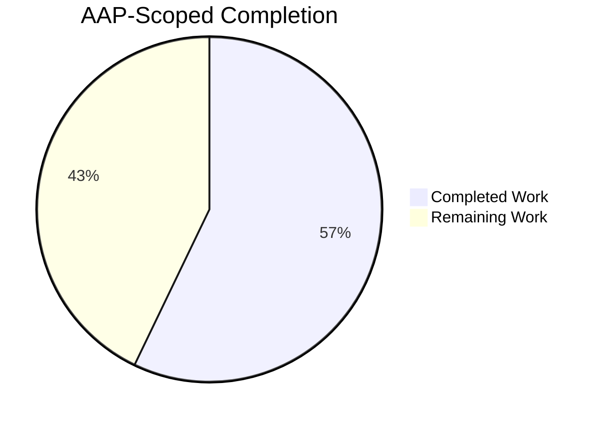

# 1. Executive Summary

## 1.1 Project Overview

`cve-test-fixture` is a five-line Node.js HTTP fixture: one catch-all handler answering every request with `Hello, World!\n` on port 3000, holding a deliberately vulnerable dependency. This delivery made that handler self-describing with one comment and gave the repository the README it lacked — project name, install command, run command — and nothing more. Five paths are tracked: the fixture, the manifest, the README, and two project documents.

## 1.2 Completion Status

All 14 plan requirements are delivered and verified. The 6 outstanding hours are path-to-production work: a scripted contract check, the dependency advisory disposition, and a documentation refresh.

**57.1% complete — 8 of 14 hours**



| Metric | Hours |
|---|---|
| Total Hours | 14 |
| Completed Hours (AI + Manual) | 8 |
| Remaining Hours | 6 |

Formula: 8 / (8 + 6) = 57.1%.

## 1.3 Key Accomplishments

- Handler documented — one JSDoc summary at `server (1).js:2`, byte-identical to the required wording.
- README delivered — name, install and run commands in five lines / 72 bytes, both executed as written.
- Install and run proven — a lockfile-free install resolves the pinned dependency without writing a lockfile, and the server binds on the first attempt.
- Contract and lifecycle verified — every path and method answers 200 with the same 14-byte body; clean boot, `EADDRINUSE` on contention, port released on stop, clean restart.
- Hostile input contained — malformed framing gets Node's own `400`/`431`, a CRLF path injects no header, and nothing is reflected or leaked.
- Browser delivery confirmed — rendered as `text/plain` on every URL, with zero console messages and zero dialogs.
- Scope held — handler body, listen call and imports untouched, manifest byte-identical, no test, lockfile, dependency or hardening added.

## 1.4 Critical Unresolved Issues

3 open items of 17 in scope: all 14 plan requirements are delivered, and the three open items are follow-on work outside the two edits.

| Issue | Impact | Owner | ETA |
|---|---|---|---|
| No automated regression check exists: `npm test` exits 1 with `Missing script: "test"`, so any future edit to the handler or the README is verified only by hand | Silent behaviour drift in a fixture other tooling depends on | Maintainer | 3 h |
| The pinned `lodash` 4.17.15 carries 5 advisories including one high severity, and the documented quickstart installs it into every consumer's checkout | Consumers inherit a known-vulnerable dependency, though its binding is never dereferenced | Maintainer | 2 h |
| The committed project guide describes this tree inaccurately: it places the comment at `server (1).js:3`, counts three tracked paths, and calls the change "two paths, six insertions, zero deletions", where the comment is line 2, five paths are tracked and the change is four files / 6892 insertions / 28 deletions | A reader of the committed documentation is misled about the file and about the change that produced it | Maintainer | 1 h |

## 1.5 Access Issues

No access issues identified: installation needs only anonymous access to the public npm registry, and neither the server nor its documentation reads a credential, secret or environment variable.

## 1.6 Recommended Next Steps

1. [High] Add a scripted contract check: install, syntax check, start, assert 200 / `Content-Length: 14` / the recorded body hash, then confirm the port is released.
2. [Medium] Re-pin `lodash` to a patched release in a dedicated change and re-run that check.
3. [Low] Refresh the committed project guide, or drop both documentation files.
4. [Low] Record the response contract consumers can rely on: 200, `Content-Length: 14`, `Hello, World!\n`, no `Content-Type`.

# 2. Project Hours Breakdown

## 2.1 Completed Work Detail

| Component | Hours | Description |
|---|---|---|
| Handler summary comment (plan 0.4.1) | 2 | Authored the single JSDoc line to the exact mandated wording, placed it directly above the `(req, res)` handler at `server (1).js:2`, collapsed the four duplicated copies of that line carried at the branch tip to that one line, and confirmed every executable line — import, handler opening, response body and `listen` chain — unchanged. |
| README quickstart and claim verification (plan 0.4.2, 0.9) | 2 | Wrote the five-line README (name, install, run) from the manifest identity and the two commands the repository supports, at 5 lines / 72 bytes with nothing after line 5, then traced each claim to its authority: the name to `package.json:2`, the install to the single pinned dependency and the absent lockfile, the run command to the tracked filename and the absent `scripts` block. |
| Scope-boundary conformance (plan 0.1.2, 0.6, 0.8) | 1 | Held the change to the two permitted contents: no test, no lockfile, no added dependency, `package.json` byte-identical, no refactoring, renaming or hardening. |
| Install, syntax and runtime verification | 2 | Ran the whole-package gate (install, `node --check`, dependency version), the lockfile-free install path, and the live contract sweep — status, headers, body bytes and hash, 13 paths, every method, negotiation, keep-alive, 20 concurrent and 50 sequential requests, 256 KB and 2 MB request bodies, the lifecycle states, and the degraded state. |
| Security and dependency-posture verification | 1 | Read the handler's surface (no request reads, one constant sink), drove eight malformed-framing and injection inputs plus the injection-shaped paths, confirmed nothing is reflected or logged and no credential canary escapes, and reproduced the advisory baseline. |
| **Total** | **8** | Matches Completed Hours in Section 1.2. |

## 2.2 Remaining Work Detail

| Category | Hours | Priority |
|---|---|---|
| [Path-to-production] Repeatable verification harness for the handler contract: lockfile-free install, syntax check, start on a free port, assert 200 / `Content-Length: 14` / body sha256 `c98c24b6…ad31`, stop the process, confirm the port is released, and assert the advisory baseline from a throwaway copy of the manifest | 3 | High |
| [Path-to-production] Dependency advisory disposition for the pinned `lodash` 4.17.15: re-pin to a patched release in a dedicated change, keep the branch lockfile-free, and re-verify the runtime contract | 2 | Medium |
| [Path-to-production] Documentation-set refresh: correct the committed project guide's comment line, tracked-path count and change-set figures, or remove the two documentation files if the tree must hold only the fixture, the manifest and the README | 1 | Low |
| **Total** | **6** | Matches Remaining Hours in Section 1.2 and the pie chart in Section 7. |

# 3. Test Results

The project ships no test framework and no coverage instrumentation — `npm test` exits 1 with `Missing script: "test"`, and adding a suite is outside this change's scope — so every case below was executed directly against the installed dependency and the running server. The Coverage column records the share of the delivered surface exercised, not line coverage.

| Area / Category | Framework | Tests | Passed | Failed | Coverage | What This Proves |
|---|---|---|---|---|---|---|
| Install, syntax and dependency gate | Node 22 / npm 11 | 6 | 6 | 0 | The manifest, the install path and the single pin | A lockfile-free install resolves the pinned dependency and writes no lockfile, the module parses, `lodash` reports 4.17.15, and the package tree holds exactly one dependency |
| Required file contents | Byte comparison (`cmp`, `wc`, `grep`) | 7 | 7 | 0 | Both delivered files and the manifest | Both files are byte-identical to the mandated text, the comment is the file's only one and carries no tags, and the tracked tree is exactly five paths with no lockfile, `.gitignore` or second handler |
| Response contract: paths and methods | Node `http` harness | 35 | 35 | 0 | Every path and every method the fixture exposes | Every path and every method answers 200 with the same 14-byte body and `Content-Length: 14`, with `HEAD` suppressing the body as HTTP requires |
| Connection handling, negotiation and volume | Node `http` harness | 9 | 9 | 0 | Header negotiation, connection reuse, request size and concurrency classes | The response is invariant under `Accept`, `Accept-Encoding` and `Connection: close`, survives 256 KB and 2 MB request bodies, and is identical across 20 concurrent and 50 sequential requests |
| Hostile and malformed input | Raw `net` sockets | 8 | 8 | 0 | All framing and injection vectors | Malformed framing gets Node's own `400`/`431`, a CRLF path injects no `Set-Cookie`, `TRACE` echoes nothing, and the process survives every case |
| Process lifecycle, documented commands and wire checks | Shell, `net` probe, curl, `od`, `sha256sum` | 9 | 9 | 0 | Every lifecycle state, both README commands and the response bytes on the wire | Both documented commands work as written, a second instance fails `EADDRINUSE` while the first keeps serving, a stop releases the port, and a restart binds on the first attempt |
| Dependency posture | `npm audit` on a copy of the manifest | 1 | 1 | 0 | The manifest's single pin | The recorded baseline reproduces exactly: 1 high-severity vulnerability and 5 advisories on `lodash` 4.17.15 |
| Browser delivery | Chrome 157, 1280×720 viewport | 6 | 6 | 0 | Four navigable URLs and two reloads | A real browser receives the same status, headers and 14 bytes on every URL, renders them as `text/plain`, reports no console message and no dialog, and issues no failing request |

81 cases were executed in total: 81 passed, 0 failed.

### Not Covered

- **Automated regression protection — none exists.** No test suite, test script, lint, type-check or CI gate is present, and adding one is outside this change's scope. Every case above was driven by hand; a scripted contract check is the outstanding work in Section 2.2.
- **IPv6 loopback `[::1]`** was never exercised: the host has no IPv6 loopback address (`EADDRNOTAVAIL`), so only the wildcard socket's IPv4 behaviour is proven.
- **TLS, authentication, configuration and persistence** have no implementation and were therefore never exercised; there is no code path in which they could pass or fail.
- **Load beyond 20 concurrent and 50 sequential requests** was not exercised — the 256 KB and 2 MB request bodies are the largest inputs tried — and no sustained-soak or memory-growth measurement exists.
- **Upgrading the pinned dependency** was not tested: the advisory baseline on `lodash` 4.17.15 was reproduced, but no upgraded pin was built or verified.
- **The documented `npm install` writes a `package-lock.json`**; only the lockfile-free install form was exercised in the checkout, and the plain form was exercised on a copy outside it, for resolution only.
- **The two committed documentation files** carry no executable surface, so no test covers them — and their statements about this tree are out of date, which Section 5.2 records and Section 2.2 schedules.

# 4. Runtime Validation & UI Verification

- ✅ **Start-up from the documented commands** — `CI=true npm install --no-fund --no-package-lock` exits 0 and writes no lockfile; `node "server (1).js"` prints exactly `Server running at http://127.0.0.1:3000/` with 0 bytes on stderr.
- ✅ **Primary request path** — `GET /` returns `HTTP/1.1 200 OK` with `Content-Length: 14` and body `Hello, World!\n` (sha256 `c98c24b677eff44860afea6f493bbaec5bb1c4cbb209c6fc2bbb47f66ff2ad31`).
- ✅ **Catch-all semantics** — 13 paths were driven, among them an unknown path, a 1200-character path, `/health`, `/favicon.ico`, `//a//b//`, a literal and a percent-encoded traversal, a unicode path, an XSS-shaped query, an SQL-injection-shaped query and a repeated query string; all return 200 with the identical body. `POST`, `PUT`, `DELETE`, `OPTIONS`, `PATCH` and `TRACE` behave the same on both a known and an unknown path, and `HEAD` returns 200 with no body.
- ⚠ **Partial — response headers.** The response carries only `Date`, `Connection`, `Keep-Alive` and `Content-Length`: there is no `Content-Type`, so clients sniff the body type, and there are no security headers. `Accept`, `Accept-Encoding` and `Connection: close` change nothing.
- ✅ **Concurrency and volume** — 20 simultaneous requests and 50 sequential requests all returned the same 200 / 14-byte body, as did request bodies of 256 KB and 2 MB, with the process still serving and stderr still empty.
- ✅ **Process lifecycle** — a second instance exits 1 with `Error: listen EADDRINUSE: address already in use :::3000` while the first keeps serving; `PORT=3999` is ignored and the second instance still collides on 3000; stopping the process releases the port (probe `FREE`) and a restart binds on the first attempt. The running process emitted exactly one stdout line and 0 bytes of stderr across the whole sweep.
- ✅ **Malformed and hostile input** — `GARBAGE\r\n\r\n`, a bad `Content-Length`, a duplicate `Content-Length`, `Content-Length` with `Transfer-Encoding` and a missing `Host` get Node's own `400`, a 20 KB header gets `431`, CRLF in the path injects no header, `TRACE` echoes nothing, and the process survived every case.
- ✅ **Browser delivery** — Chrome 157 at a 1280×720 viewport renders a single monospace `Hello, World!` line as `text/plain` for the root path, an unknown path, `/health` and a `?q=<script>…` URL; two reloads are identical; a live probe logged zero dialog invocations and zero DOM insertions; 0 console messages at every level and 16 network requests, all 200, none failed.
- ✅ **Degraded state** — with nothing listening, `curl` fails to connect (exit 7) and an in-page `fetch` rejects with `ECONNREFUSED`; no misleading success is returned.
- ❌ **Not exercised — IPv6 loopback.** `[::1]` could not be reached (`EADDRNOTAVAIL`: the host has no IPv6 loopback), and the TLS, authenticated and configured request paths do not exist to drive.

**Never exercised at runtime:** any address family other than the wildcard socket's IPv4 paths, any traffic pattern beyond the volumes above, any behaviour that would require authentication, configuration or a persistent store — none of which this fixture implements — and any load on a busy host beyond the port-contention case.

# 5. Compliance & Quality Review

## 5.1 Compliance Matrix

| # | Deliverable / Benchmark | Status | Evidence |
|---|---|---|---|
| 1 | Required contents delivered byte-exactly (plan 0.4.1, 0.4.2, 0.9) | ✅ Pass | The comment at `server (1).js:2` and the five-line / 72-byte README both compare identical to the required text |
| 2 | Comment form: one `/** … */` summary, no tags, exactly one copy | ✅ Pass | One opener, one closer, zero `@param`/`@returns`/`@example`/continuation lines; the file's only comment |
| 3 | Tracked tree holds only what the plan's in-scope pair needs (plan 0.1.2, 0.8) | ⚠ Partial | The delivery is exactly `README.md` and `server (1).js`; two documentation files are tracked alongside them and their presence is recorded in 5.2 |
| 4 | Smallest possible diff, no unrelated edit (plan 0.1.2) | ✅ Pass | The five lines are exactly the module the plan describes — import, summary, handler opening, body, `listen` chain — with nothing added, reindented, renamed or reordered |
| 5 | Dependency integrity (plan 0.6) | ✅ Pass | `package.json` byte-identical to its base blob; `lodash` 4.17.15; no lockfile tracked or on disk |
| 6 | Documentation accuracy against the code | ✅ Pass | Name = `package.json:2`; install resolvable because no lockfile is tracked; run command names the tracked filename, quoted for its space and parentheses, with no `scripts` block in the manifest |
| 7 | No forbidden artefact (plan 0.1.2, 0.8) | ✅ Pass | No test file, `LICENSE`, `CONTRIBUTING.md`, `CHANGELOG.md`, `docs/`, badge, diagram, `.gitignore` or second handler copy |
| 8 | Security posture of the delivered surface | ✅ Pass | Zero request reads, one constant response sink, no secret or internal path in either delivered file; eight hostile framing and injection cases reflected nothing and leaked nothing |
| 9 | Runtime behaviour of the delivered module | ✅ Pass | The module parses, boots and listens, and every path and method exercised answers with the documented contract, including a boot under an empty environment |
| 10 | Regression protection | ⚠ Partial | No automated suite or CI gate exists; every case in Section 3 was driven by hand, and a scripted check is outstanding work (Section 2.2) |
| 11 | Operability of the delivered fixture | ⚠ Partial | Port 3000 is hard-coded with no override and no request logging; `EADDRINUSE` on a busy host has no documented remedy |
| 12 | Repository hygiene | ⚠ Partial | Only the intended paths were committed and `node_modules/` and screenshot output stay untracked, but the committed project guide's statements about this tree are out of date (Section 5.2) |

## 5.2 AAP & Rule Divergences and Gaps

| What the AAP/Rule Required | What Was Delivered Instead | Why It Diverged | Impact | Remediation |
|---|---|---|---|---|
| "Do not create any other file" (plan 0.1.2), with "any third file" listed as out of scope (plan 0.8) | Two documentation files are tracked beyond the two edits: `blitzy/documentation/Technical Specifications.md` (6480 lines) and `blitzy/documentation/Project Guide - 182193aa-390a-4811-9305-dd7e915872d4.md` (411 lines) | The project's documentation set was committed to the branch with the change; the two-file boundary governs the change itself, and no instruction asked for those documents to be excluded | The tracked tree holds five paths rather than three, and the committed guide's statements about the tree are out of step with it | None required for correctness; refresh those documents (Section 2.2, 1 h) or remove both if the tree must hold only the fixture, the manifest and the README |
| "One new line inserted between the blank line 2 and line 3", so the file would read blank line 2, comment at line 3, handler at line 4 (plan 0.2.1, 0.4.1) | The comment is line 2, directly above the handler at line 3, with no blank line after the `lodash` require | The branch tip this delivery lands on already carried the identical summary line four times above the handler and carried no blank line before it; the delivery collapsed those four copies to the single line the plan specifies, in the position that already existed rather than restoring a line it did not have | None on behaviour or on what the comment documents; only the plan's line numbering and the blank line differ | None required — restoring the blank line would add an edit the plan never asked for |
| The starting state described two tracked files with no README, and required that the deleted README not be restored from git history (Sanctioned) | `README.md` is a newly authored five-line quickstart that replaced the 18-line file the branch tip carried (1 insertion, 14 deletions against the base) | Creating a short README is precisely what this delivery was asked to do, and the earlier deleted document was not restored: the file is fresh five-line authoring, not a revert of the earlier prose | The tracked README's content is new rather than resurrected; nothing else in the delivery changed | None required |
| "Make the smallest possible diff" and "no change to the handler's logic, signature, formatting or naming" (plan 0.1.2, 0.8) | Against the base branch, `server (1).js` reads as 0 insertions and 14 deletions rather than a one-line insertion | The file at the branch tip carried twelve unbalanced `require('http').createServer((req, res) => {` openings above four copies of the summary, so the module did not parse and no request could be served; the delivery is the five-line module the plan describes | The module parses (`node --check` exit 0) and serves the documented contract; only the diff arithmetic against the branch point differs from the plan's premise | None required — reconstructing the branch tip's state would restore a module that cannot run |

**No plan requirement was skipped, deferred or reworded beyond the four layout and tree facts above.** The basis for that conclusion: both required edits are byte-identical to the wording the plan fixes, the delivery contains no content the plan excludes — no test, no lockfile, no added dependency, no hardening, no forbidden documentation artefact — `package.json` and its single pinned dependency are unchanged, and every sanctioned absence is intact. No user-specified rules exist for this project, so no rule departure was possible in the delivered code.

The one divergence that needs a decision is the documentation set. Two markdown files are tracked beside the five-line fixture — `blitzy/documentation/Technical Specifications.md` and `blitzy/documentation/Project Guide - 182193aa-390a-4811-9305-dd7e915872d4.md` — and the second describes an earlier state of the codebase: it places the comment at `server (1).js:3`, states that three paths are tracked, and calls the change "two paths, six insertions and zero deletions". None of that matches the tree, which carries the comment at line 2, five tracked paths, and a four-file change of 6892 insertions and 28 deletions against the revision it lands on. Decide whether the repository should carry these documents at all: refresh the guide so its references match the file, or delete both and keep the tree to the fixture, the manifest and the README. Either resolution is an hour of work and neither touches the running behaviour.

The remaining three divergences need no decision. The comment sits one line higher than the plan's numbering assumed because the branch tip had already repeated the same summary four times with no blank line above the handler; the delivered file keeps one copy, in the position that existed, with the wording untouched. The README is a fresh five-line quickstart rather than a restoration of the document deleted earlier in the repository's history — which is what the delivery was asked for and what the file's 72 bytes provide. And the handler's line count moves in the opposite direction to the plan's premise because the base tip could not parse; the five lines delivered are exactly the ones the plan and the comment describe.

# 6. Risk Assessment

| Risk | Category | Severity | Probability | Mitigation | Status |
|---|---|---|---|---|---|
| Pinned `lodash` 4.17.15 carries 5 advisories including one high severity (GHSA-35jh-r3h4-6jhm, GHSA-p6mc-m468-83gw, GHSA-29mw-wpgm-hmr9, GHSA-r5fr-rjxr-66jc, GHSA-xxjr-mmjv-4gpg), and the documented quickstart installs it into every consumer's checkout | Security | High | Medium — the binding `const _` is never dereferenced, so no vulnerable API is reachable from a request | Re-pin to a patched release in a dedicated change, keep the branch lockfile-free, and re-run the contract check | Open — the pin is deliberately unchanged by this delivery |
| No automated regression check exists, so any future edit to the handler or the README is verified only by hand | Technical | Medium | High — the fixture exists to be depended on, and a silent drift in status or body would go unnoticed | Add the scripted contract check in Section 2.2: install, syntax check, start, assert 200 / 14 bytes / recorded hash, stop, confirm port release | Open |
| The committed project guide states a line, a path count and a change set that no longer match the tree, and the committed technical specification snapshots an earlier commit | Technical | Low | High — the mismatch is present today | Refresh the documents, or remove them, per Section 2.2 | Open |
| The listener binds the wildcard address (it answered on the container IP) while the startup line advertises `127.0.0.1` | Security | Medium | Medium — anything on the host network can reach the handler | Pass an explicit host argument and align the log line, in a change that amends the no-hardening boundary | Accepted for a local fixture — pre-existing design outside this delivery's scope |
| Port 3000 is hard-coded with no `PORT` override, so a busy host yields `EADDRINUSE` and the README cannot document a remedy | Operational | Medium | High — observed directly when a second instance was started, and `PORT=3999` is ignored | Make the port configurable, or document the contention remedy, in a change that amends the five-line README cap | Accepted for a local fixture — pre-existing design outside this delivery's scope |
| The response carries no `Content-Type` and no `nosniff`/CSP, so payload inertness rests on browser MIME sniffing landing on `text/plain` | Security | Medium | Low — the body is a constant ASCII literal that never reflects input | Set an explicit media type and `X-Content-Type-Options` before ever returning user-influenced content | Accepted — imposed by the no-hardening boundary |
| The documented `npm install` writes an untracked `package-lock.json` that a contributor could commit, and no `.gitignore` is permitted to prevent it | Operational | Low | Medium | Check `git status` before committing and delete the lockfile the install writes; the branch must stay lockfile-free | Accepted — contributor discipline is the only control |
| No request logging, health endpoint or metrics exist, so the only runtime evidence is the socket and the process table | Operational | Low | High — incidents leave no trace anywhere in the application | Accept for a local fixture and rely on process-level checks; adding logging would exceed the current boundary | Accepted |

# 7. Visual Project Status


**Remaining hours by category**

| Category | Hours | Priority |
|---|---|---|
| Repeatable verification harness for the handler contract | 3 | High |
| Dependency advisory disposition for the pinned `lodash` 4.17.15 | 2 | Medium |
| Documentation-set refresh for the committed guide | 1 | Low |
| **Total** | **6** | Matches Remaining Hours in Section 1.2 |

**Requirement status**

| Classification | Count |
|---|---|
| Completed | 14 |
| Partially Completed | 0 |
| Not Started | 0 |

**Priority distribution of outstanding work**

| Priority | Items | Hours |
|---|---|---|
| High | 1 | 3 |
| Medium | 1 | 2 |
| Low | 1 | 1 |

# 8. Summary & Recommendations

The request was narrow and it has been met exactly. `cve-test-fixture` now describes its own request handler with a single JSDoc summary line at `server (1).js:2`, and it carries a five-line `README.md` with the project name, the install command and the run command. The five lines of the module are exactly the import, the summary, the handler opening, the `res.end('Hello, World!\n')` body and the `listen(3000, …)` chain, with no logic renamed, reindented or reordered; no dependency was added, `package.json` is unchanged, no lockfile was committed, and no test suite or hardening entered the tree.

What the reader can rely on is stronger than a byte comparison. Both documented commands were executed from a clean checkout and produced a working server; 13 paths and 8 methods all answer 200 with the 14-byte body `Hello, World!\n`; the header set, content negotiation, keep-alive and request-size handling behave as they did before the comment was added; the lifecycle is predictable (clean boot with empty stderr, `EADDRINUSE` on port contention while the first instance keeps serving, a signal stop that releases the port, a clean restart, and a hard-coded port that no `PORT` variable overrides); 8 hostile and malformed inputs leave the process serving and leak nothing; and a real browser at 1280×720 renders the body as `text/plain` on four URLs and two reloads with 0 console messages, 0 dialogs and 16 network requests all answered 200. In total 81 cases were executed against the installed dependency and the running server — 81 passed, none failed.

**AAP-scoped completion is 57.1% — 8 of 14 hours.** All 14 requirements the plan set are delivered; the outstanding 6 hours are the three items in Section 2.2: a scripted contract check that replaces hand verification, the disposition of the dependency advisory baseline, and a refresh of the committed documentation set. The first is the critical path. Without it, nothing protects the fixture's contract, and the fixture exists to be depended on by other tooling.

One decision is owed before the tree can be called tidy. Two documentation files are tracked beside the fixture — `blitzy/documentation/Technical Specifications.md` and `blitzy/documentation/Project Guide - 182193aa-390a-4811-9305-dd7e915872d4.md` — and the second now describes the codebase inaccurately: it places the comment at line 3, counts three tracked paths, and calls the change "two paths, six insertions and zero deletions" against a real change of four files, 6892 insertions and 28 deletions. Section 5.2 sets out the options: refresh it to match the file, or remove both documents and keep the tree to the fixture, the manifest and the README.

| Metric | Value |
|---|---|
| Requirements delivered | 14 of 14 |
| Change set for the two deliverables | 2 paths (1 created, 1 comment-only) |
| Tracked paths in the repository | 5 (fixture, manifest, README, two documentation files) |
| Runtime cases executed | 81 (81 passed, 0 failed) |
| Completed hours | 8 |
| Remaining hours | 6 |
| Completion | 57.1% |

Production readiness: **ready for its stated purpose, not a production HTTP service.** The README is accurate against the code, and the runtime behaviour is proven unchanged. Every property that would make this unsuitable as a service — no authentication, no error or 404 handling, no logging, no configuration source, no TLS, no tests, a hard-coded port and a known-vulnerable pinned dependency — is either an explicit absence the request required or a recorded decision in Section 6, not an oversight. The recommendation is to land this change as it stands, then close the three open items in order: add the scripted contract check first, settle the `lodash` pin second, and refresh or remove the committed documentation set third, re-running the check after each step.

# 9. Development Guide

## 9.1 System Prerequisites

- **Node.js 22.x** — verified on v22.23.5. Any current 22.x works; no `engines` field, `.nvmrc` or `packageManager` field constrains the version.
- **npm 11.x** — verified on 11.21.0.
- **curl** — used for the runtime checks below.
- No compiler, bundler, transpiler, database, container runtime or external service is involved. There is no build step.

## 9.2 Environment Setup

Run everything from the repository root. The project reads no environment variable, needs no `.env` file and requires no credential.

```bash
cd <repository root>
node --version    # v22.23.5
npm --version     # 11.21.0
```

Keep `node_modules/` and any screenshot output untracked; neither is ever committed.

## 9.3 Dependency Installation

The manifest pins one dependency, `lodash` 4.17.15, and the checkout carries no lockfile, so `npm ci` exits 1 and cannot be used. Install with:

```bash
CI=true npm install --no-fund --no-package-lock
```

Expected output: `added 1 package, and audited 2 packages`, plus the notice `1 high severity vulnerability`; a repeat run prints `up to date, audited 2 packages`. That notice is the intended baseline — do not run `npm audit fix` or `npm audit fix --force`; both rewrite the pin to `4.18.1` and write a lockfile.

Verify the resolved version and that the source parses:

```bash
node -p "require('lodash').VERSION"   # 4.17.15
node --check "server (1).js"          # exit 0, no output
```

If a `package-lock.json` appears, delete it: the branch is deliberately lockfile-free.

## 9.4 Starting the Server

Quote the filename — it contains a space and parentheses:

```bash
node "server (1).js"
```

Expected stdout: `Server running at http://127.0.0.1:3000/`. Expected stderr: empty. The process binds port 3000 and answers every path and method with the same 14-byte body.

Port 3000 is hard-coded and host-global. Probe before starting if anything else may be using it (`lsof`, `ss`, `netstat` and `fuser` may not be installed):

```bash
node -e "const s=require('net').connect(3000,'127.0.0.1');s.on('connect',()=>{console.log('IN USE');s.end();process.exit(1)});s.on('error',()=>{console.log('FREE');process.exit(0)})"
```

Start only on `FREE`. To stop, send `SIGTERM` or `SIGINT` to the process you started (Ctrl-C in the foreground shell) and re-probe the port to confirm it was released.

## 9.5 Verification Steps

```bash
curl -sS -i http://127.0.0.1:3000/
```

Expected response:

```text
HTTP/1.1 200 OK
Date: <timestamp>
Connection: keep-alive
Keep-Alive: timeout=5
Content-Length: 14

Hello, World!
```

Body bytes and hash:

```bash
curl -sS http://127.0.0.1:3000/ | od -c        # H e l l o ,   W o r l d ! \n
curl -sS http://127.0.0.1:3000/ | sha256sum    # c98c24b677eff44860afea6f493bbaec5bb1c4cbb209c6fc2bbb47f66ff2ad31
```

Catch-all behaviour, and the check that the module still loads with the comment in place:

```bash
curl -sS -o /dev/null -w '%{http_code} %{size_download}\n' http://127.0.0.1:3000/does-not-exist   # 200 14
curl -sS -o /dev/null -w '%{http_code} %{size_download}\n' -X POST -d '{"a":1}' http://127.0.0.1:3000/  # 200 14
```

Whole-package gate — install, syntax and dependency in one line:

```bash
CI=true npm install --no-fund --no-package-lock && node --check "server (1).js" && node -p "require('lodash').VERSION"
```

Dependency-posture check, run in a separate directory outside the checkout so the checkout stays lockfile-free:

```bash
mkdir -p ../fixture-audit && cp package.json ../fixture-audit/ && cd ../fixture-audit \
  && CI=true npm install --package-lock-only --no-fund && CI=true npm audit
```

Expected: exit 1 with `1 high severity vulnerability` and 5 advisories against `lodash`. That is the known baseline; a change in those numbers is what the check exists to surface. Running `npm audit` inside the checkout itself fails with `npm error code ENOLOCK` and `loadVirtual requires existing shrinkwrap file`, because there is no lockfile there to audit.

There is no test suite to run: `npm test` exits 1 with `Missing script: "test"`, and the manifest declares no `scripts` block.

## 9.6 Example Usage

```bash
$ node "server (1).js" &
$ curl -sS http://127.0.0.1:3000/
Hello, World!
$ curl -sS http://127.0.0.1:3000/anything/at/all
Hello, World!
$ kill %1
```

## 9.7 Troubleshooting

| Symptom | Cause | Resolution |
|---|---|---|
| `bash: syntax error near unexpected token '('` | The run command was issued without quotes | Use `node "server (1).js"`; the escaped form `node server \(1\).js` resolves to a module named `server`, which does not exist |
| `Error: listen EADDRINUSE: address already in use :::3000` | Something already holds port 3000 — the port is hard-coded and cannot be overridden | Probe the port, stop the listener you own, and retry. Never stop a listener you did not start |
| `Error: Cannot find module 'lodash'` | The install step was skipped, so `node_modules/` is absent | Run `CI=true npm install --no-fund --no-package-lock` first; the documented order is install then run |
| `npm error Missing script: "test"` | The project ships no test script | Expected: there is no test suite. Use the verification steps in 9.5 |
| `npm ci` fails with `npm error code EUSAGE` | No lockfile is tracked, so `npm ci` cannot install | Use `npm install`, as the README states |
| A `package-lock.json` appears after installing | Plain `npm install` writes one | Delete it before committing; the branch must stay lockfile-free |
| `npm audit` fails with `npm error code ENOLOCK` and `loadVirtual requires existing shrinkwrap file` | No lockfile exists in the checkout to audit | Run the audit on a copy of the manifest with `--package-lock-only`, as in 9.5 |
| `curl` exits 7 / `ECONNREFUSED` | Nothing is listening on 3000 | Start the server and confirm the startup line appeared on stdout |
| The browser warns about the document type | The response carries no `Content-Type` | Expected. The body is a constant `text/plain` payload; clients sniff it |
| A committed document cites `server (1).js:3` or three tracked paths | The committed project guide predates this change | Trust the file itself: the comment is line 2 and five paths are tracked. Refreshing that document is outstanding work in Section 2.2 |

# 10. Appendices

## A. Command Reference

| Purpose | Command | Expected result |
|---|---|---|
| Install dependencies | `CI=true npm install --no-fund --no-package-lock` | exit 0, `added 1 package` (`up to date` on a repeat run), no lockfile written |
| Syntax check | `node --check "server (1).js"` | exit 0, no output |
| Resolved dependency version | `node -p "require('lodash').VERSION"` | `4.17.15` |
| Start the server | `node "server (1).js"` | stdout `Server running at http://127.0.0.1:3000/`, stderr empty |
| Probe port 3000 | `node -e "const s=require('net').connect(3000,'127.0.0.1');s.on('connect',()=>{console.log('IN USE');s.end();process.exit(1)});s.on('error',()=>{console.log('FREE');process.exit(0)})"` | `FREE` (exit 0) or `IN USE` (exit 1) |
| Request with headers | `curl -sS -i http://127.0.0.1:3000/` | `200`, `Content-Length: 14`, body `Hello, World!`, no `Content-Type` |
| Status and size only | `curl -sS -o /dev/null -w '%{http_code} %{size_download}\n' http://127.0.0.1:3000/` | `200 14` |
| Body hash | `curl -sS http://127.0.0.1:3000/ \| sha256sum` | `c98c24b677eff44860afea6f493bbaec5bb1c4cbb209c6fc2bbb47f66ff2ad31` |
| Whole-package gate | `CI=true npm install --no-fund --no-package-lock && node --check "server (1).js" && node -p "require('lodash').VERSION"` | exit 0, prints `4.17.15` |
| Advisory baseline | `mkdir -p ../fixture-audit && cp package.json ../fixture-audit/ && cd ../fixture-audit && CI=true npm install --package-lock-only --no-fund && CI=true npm audit` | exit 1, 1 high severity, 5 advisories |
| Test suite | `npm test` | exit 1, `Missing script: "test"` (no suite exists) |

## B. Port Reference

| Port | Owner | Notes |
|---|---|---|
| 3000 | `server (1).js` (`}).listen(3000, …)`) | Hard-coded, no `PORT` override, bound on the wildcard address. Exclusive on the host: a second instance fails with `EADDRINUSE`. The startup line advertises `http://127.0.0.1:3000/`. |

## C. Key File Locations

| Path | Role |
|---|---|
| `README.md` | Five-line quickstart: project name, install command, run command (72 bytes) |
| `package.json` | Manifest: name `cve-test-fixture`, version `1.0.0`, single dependency `lodash` 4.17.15, no scripts |
| `server (1).js` | The whole application: `lodash` require, the JSDoc summary at line 2, the catch-all handler, `listen(3000)` |
| `blitzy/documentation/Technical Specifications.md` | The project's technical specification, tracked with the branch (6480 lines) |
| `blitzy/documentation/Project Guide - 182193aa-390a-4811-9305-dd7e915872d4.md` | The committed project guide (411 lines); its line, path-count and change-set references are out of date — see Section 5.2 |
| `node_modules/` | Install artifact, untracked, never committed |
| `blitzy/screenshots/` | Viewport captures taken during runtime checks, untracked, never committed |

## D. Technology Versions

| Component | Version | Notes |
|---|---|---|
| Node.js | v22.23.5 | `node --version`; no version constrained by the manifest |
| npm | 11.21.0 | `npm --version` |
| lodash | 4.17.15 | Exact pin; 5 advisories including 1 high severity |
| HTTP server | Node builtin `http` | `createServer` + `res.end`, CommonJS `require` |
| Google Chrome | 157.0.8103.78 | `google-chrome --version`; used for the browser delivery checks at a 1280×720 viewport |

## E. Environment Variable Reference

The application reads none: `process.env` does not appear in any tracked file, and a start under an empty environment (`env -i`) serves identically. The only variable relevant to tooling is `CI=true` for a non-interactive `npm install`.

## F. Developer Tools Guide

| Tool | Availability | Use |
|---|---|---|
| `curl` | Installed | Response status, headers, body bytes |
| `od`, `sha256sum`, `wc` | Installed | Byte-level body verification |
| `node` (`net` module) | Installed | Port probing and malformed-request framing |
| Raw `net` sockets | Available | Substitute for `nc`, which may be absent |
| `lsof`, `ss`, `netstat`, `fuser` | May be absent | Use a `net.connect` probe, plus the kernel's TCP socket tables, to identify a listener |
| `xxd` | May be absent | Use `od -c` / `od -An -tx1` |
| Chrome | Installed | Browser delivery check; emulate a 1280×720 viewport and take viewport-only screenshots, since full-page capture of a short `text/plain` page fails with a media aspect-ratio error |

## G. Glossary

| Term | Meaning |
|---|---|
| Catch-all handler | The single `(req, res)` callback that answers every path and method identically |
| Fixture | A deliberately minimal, deliberately vulnerable project used to exercise other tooling |
| Lockfile-free | The branch tracks no `package-lock.json`, `npm-shrinkwrap.json`, `yarn.lock` or `pnpm-lock.yaml`, so `npm ci` cannot work |
| Advisory baseline | The recorded dependency posture: 5 advisories, 1 high severity, on `lodash` 4.17.15 |
| Contract | Status 200, `Content-Length: 14`, body `Hello, World!\n`, no `Content-Type` |
| Documentation set | The two files under `blitzy/documentation/` tracked with the branch: the technical specification and the project guide |
| Wildcard bind | `listen(3000)` with no host argument, so the socket answers on every interface |
