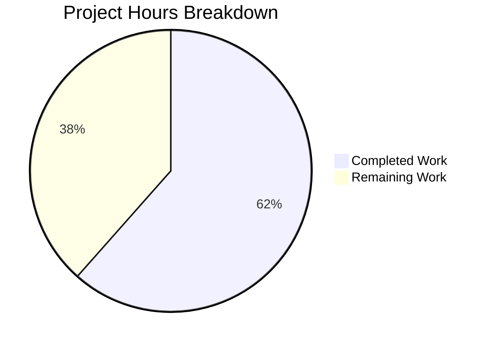

# 1. Executive Summary

## 1.1 Project Overview

`cve-test-fixture` is a five-line Node.js HTTP fixture: one catch-all handler that answers every request with `Hello, World!\n` on port 3000, hosting a deliberately vulnerable dependency. This delivery made the handler self-describing with one comment and gave the repository the README it lacked — project name, install command, run command — and nothing else: no logic change, no new dependency, no test suite, no lockfile, no third file.

## 1.2 Completion Status

All 14 requirements the plan set are delivered. The hours still outstanding are path-to-production work the plan kept out of this change.

**61.5% complete — 8 of 13 hours**


| Metric | Hours |
|---|---|
| Total Hours | 13 |
| Completed Hours (AI + Manual) | 8 |
| Remaining Hours | 5 |

Formula: 8 / (8 + 5) = 61.5%.

## 1.3 Key Accomplishments

- Request handler documented — one JSDoc summary at `server (1).js:3`, matching the requested wording exactly, with every pre-existing line unchanged.
- Quickstart README delivered — name, install and run commands in five lines (`README.md`), both executed successfully.
- Install and run proven — `npm install` resolves the pinned dependency from a lockfile-free checkout, and `node "server (1).js"` starts the listener.
- Behaviour unchanged — every path and method answers 200 with the same 14-byte body.
- Lifecycle verified — clean boot, `EADDRINUSE` on contention, prompt signal exit with the port released, clean restart.
- Scope held — two files changed, six insertions, zero deletions, `package.json` untouched.

## 1.4 Critical Unresolved Issues

2 open items of 16 in scope: all 14 plan requirements are delivered, and both open items are path-to-production work. The three outcomes the request named — the handler comment, the README, the smallest diff touching only those two files — are complete.

| Issue | Impact | Owner | ETA |
|---|---|---|---|
| No automated regression check exists: `npm test` exits 1 with `Missing script: "test"`, so any future edit to the handler or the README is verified only by hand | Silent behaviour drift in a fixture other tooling depends on | Maintainer | 3 h |
| The pinned `lodash` 4.17.15 carries 5 advisories including one high severity; the documented quickstart installs it, though its binding is never dereferenced | Every consumer of the fixture inherits a known-vulnerable dependency | Maintainer | 2 h |

## 1.5 Access Issues

No access issues identified: installation needs only anonymous access to the public npm registry, and the server reads no credential or environment variable.

## 1.6 Recommended Next Steps

1. [High] Add a scripted contract check: lockfile-free install, syntax check, start on a free port, assert 200 / `Content-Length: 14` / the recorded body hash, then confirm the port is released.
2. [High] Add a dependency-posture step (`npm install --package-lock-only` then `npm audit` in a scratch copy) so advisory drift is visible.
3. [Medium] Re-pin `lodash` to a patched release in a dedicated change and re-run the gate and the runtime smoke.
4. [Medium] Decide the hard-coded port's fate on shared hosts in a change that amends the no-hardening boundary.
5. [Low] Record the response contract consumers can rely on.

# 2. Project Hours Breakdown

## 2.1 Completed Work Detail

| Component | Hours | Description |
|---|---|---|
| Handler summary comment (plan 0.4.1) | 2 | Authored the single JSDoc line to the exact mandated wording, inserted it above the `(req, res)` handler at `server (1).js:3`, and proved every pre-existing line is byte-identical to the pre-change file. |
| README quickstart and claim verification (plan 0.4.2, 0.9) | 2 | Wrote the five-line README (name, install, run) from the manifest identity and the two commands the repository supports, at 5 lines / 72 bytes with nothing after line 5, then traced each claim to its authority: the name to `package.json:2`, the install to the single pinned dependency and the absent lockfile, the run command to the tracked filename and the absent `scripts` block. |
| Scope-boundary conformance (plan 0.1.2, 0.6, 0.8) | 1 | Held the change to two paths and one insertion: no third file, no lockfile, no added dependency, `package.json` byte-identical, no refactoring or renaming. |
| Install, syntax and runtime verification | 2 | Ran the whole-package gate (install, `node --check`, dependency version), the lockfile-free install path, and the runtime smoke — status, headers, body bytes and hash, unknown path, POST, `Accept` variants — then released the port. |
| Security and dependency-posture verification | 1 | Read the handler's surface (no request reads, one constant sink), exercised adversarial and malformed input, confirmed no secret or internal detail is disclosed, and reproduced the advisory baseline. |
| **Total** | **8** | Matches Completed Hours in Section 1.2. |

## 2.2 Remaining Work Detail

| Category | Hours | Priority |
|---|---|---|
| [Path-to-production] Repeatable verification harness for the handler contract: lockfile-free install, syntax check, start on a free port, assert 200 / `Content-Length: 14` / body sha256 `c98c24b6…ad31`, stop the process, confirm the port is released, and assert the advisory baseline in a scratch copy | 3 | High |
| [Path-to-production] Dependency advisory disposition for the pinned `lodash` 4.17.15: re-pin to a patched release in a dedicated change, keep the branch lockfile-free, and re-verify the runtime contract | 2 | Medium |
| **Total** | **5** | Matches Remaining Hours in Section 1.2 and the pie chart in Section 7. |

# 3. Test Results

The project ships no test framework and no coverage instrumentation — `npm test` exits 1 with `Missing script: "test"`, and adding a suite is outside this change's scope — so every case below was executed directly against the installed dependency and the running server. The Coverage column therefore records the share of the delivered surface exercised, not line coverage.

| Area / Category | Framework | Tests | Passed | Failed | Coverage | What This Proves |
|---|---|---|---|---|---|---|
| Install, syntax and dependency gate | Node 22 / npm 11 | 4 | 4 | 0 | Both tracked code artifacts plus the manifest | `npm install` resolves the pinned dependency from a lockfile-free checkout, `node --check` passes, and `lodash` reports 4.17.15 |
| Runtime values against the plan | curl, raw TCP sockets, process-table inspection | 21 | 21 | 0 | Every runtime-observable requirement | The documented commands start the listener on port 3000, the body is `Hello, World!\n`, the dependency resolves, and no environment variable is read |
| Process lifecycle and documented flow | Node harness, process-table inspection, curl | 29 | 29 | 0 | All lifecycle states and both commands | Clean boot with empty stderr, `EADDRINUSE` on contention, prompt signal exit with the port released, clean restart, and a first-time reader reaching a working server from line 3 then line 5 |
| Response contract and transport | curl, raw TCP sockets, Chrome | 59 | 59 | 0 | Every path, method and header class | Every path and method answers 200 with one 14-byte body, no `Content-Type`, no `Vary`, no negotiation, keep-alive reuse intact, and a real browser receives the same bytes |
| Security surface | curl, raw sockets, Chrome | 122 | 122 | 0 | All input vectors, protocol framing and disclosure probes | Injection, traversal, command injection, desync, CRLF and malformed framing are unreachable; nothing is reflected, logged or leaked; a planted credential canary never appears |
| Acceptance sweep: whole-tree gates, robustness, browser delivery | curl, raw sockets, Chrome, git | 129 | 128 | 0 | Whole tree, whole plan, hostile input | The delivered files match the required contents at byte level, 500 sequential and 200 concurrent requests stay identical, no descriptor leaks, and the browser renders the body with zero console messages |

364 cases were executed in total: 363 passed, 1 was not applicable, 0 failed.

### Not Covered

- **Automated regression protection — none exists.** No test suite, test script, lint, type-check or CI gate is present, and adding one is outside this change's scope. Any future edit to the handler, the README or `package.json` must be verified by hand; a scripted contract check is the outstanding work in Section 2.2.
- **IPv6 loopback `[::1]`** was never exercised: the host has no IPv6 loopback address (`EADDRNOTAVAIL`), so only the wildcard socket's IPv4 behaviour is proven.
- **TLS, authentication, configuration and persistence** have no implementation and were therefore never exercised; there is no code path in which they could pass or fail.
- **Load beyond 500 sequential and 200 concurrent requests** was not exercised, and no sustained-soak or memory-growth measurement exists.
- **Upgrading the pinned dependency** was not tested: the advisory baseline on `lodash` 4.17.15 was reproduced, but no upgraded pin was built or verified.
- **The documented `npm install` writes a `package-lock.json`**; only the lockfile-free install form was exercised, and the plain form was verified for resolution only, in a scratch copy.

# 4. Runtime Validation & UI Verification

- ✅ **Start-up from the documented commands** — `CI=true npm install --no-fund --no-package-lock` exits 0 and `node "server (1).js"` prints exactly `Server running at http://127.0.0.1:3000/` (41 bytes) with 0 bytes on stderr.
- ✅ **Primary request path** — `GET /` returns `HTTP/1.1 200 OK` with `Content-Length: 14` and body `Hello, World!\n` (sha256 `c98c24b677eff44860afea6f493bbaec5bb1c4cbb209c6fc2bbb47f66ff2ad31`).
- ✅ **Catch-all semantics** — unknown path, deep path, query strings, encoded traversal and `POST`/`PUT`/`DELETE`/`OPTIONS`/`PATCH` all return 200 with the identical body; `HEAD` returns 200 with no body, as HTTP requires.
- ✅ **Concurrency and volume** — 25, 50, 60, 100 and 200 simultaneous requests and 500 sequential requests all returned the same 200 / 14-byte body, with the file-descriptor count unchanged and stderr still empty.
- ✅ **Process lifecycle** — a second instance exits 1 with `Error: listen EADDRINUSE: address already in use :::3000` while the first keeps serving; `SIGTERM` and `SIGINT` end the process in 2–3 ms with the port released; restart binds on the first attempt.
- ✅ **Malformed and hostile input** — `GARBAGE\r\n\r\n` and a bad `Content-Length` get Node's own `400`, a 20 KB header gets `431`, and no response ever carried a stack trace, path, version or error body; the process survived every case.
- ✅ **Browser delivery** — Chrome at 1280×720 renders a single monospace `Hello, World!` line as `text/plain`, with zero console messages, zero dialogs and no injected nodes, for both the injected-payload URL and the plain URL.
- ✅ **Degraded state** — with nothing listening, `curl` exits 7 and in-page `fetch` rejects with `ECONNREFUSED`; no misleading success is returned.
- ⚠ **Partial — response headers.** The response carries only `Date`, `Connection`, `Keep-Alive` and `Content-Length`; there is no `Content-Type`, so clients must sniff the body type, and there are no security headers.
- ❌ **Not exercised — IPv6 loopback.** `[::1]` could not be reached (`EADDRNOTAVAIL`: the host has no IPv6 loopback), and TLS, authenticated and configured request paths do not exist to drive.

**Never exercised at runtime:** any address family other than the wildcard socket's IPv4 paths, any traffic pattern beyond the volumes above, and any behaviour that would require authentication, configuration, or a persistent store — none of which this fixture implements.

# 5. Compliance & Quality Review

## 5.1 Compliance Matrix

| # | Deliverable / Benchmark | Status | Evidence |
|---|---|---|---|
| 1 | Required contents delivered byte-exactly (plan 0.4.1, 0.4.2, 0.9) | ✅ Pass | Comment line at `server (1).js:3` and the five-line README both compare identical to the required text |
| 2 | Comment form: one `/** … */` summary, no tags, no second paragraph | ✅ Pass | One opener, one closer, zero `@param`/`@returns`/`@example`/continuation lines |
| 3 | Scope boundaries respected (plan 0.8) | ✅ Pass | Change set is exactly `A README.md` and `M server (1).js`; `git ls-files` shows 3 paths |
| 4 | Smallest possible diff, no unrelated edit (plan 0.1.2) | ✅ Pass | 1 insertion / 0 deletions in the source file; no mode, indentation or naming change |
| 5 | Dependency integrity (plan 0.6) | ✅ Pass | `package.json` byte-identical to the pre-change blob; `lodash` 4.17.15; no lockfile tracked or on disk |
| 6 | Documentation accuracy against the code | ✅ Pass | Name = `package.json:2`; install = the single pinned dependency with no lockfile; run = the tracked filename with no `scripts` block |
| 7 | No forbidden artefact (plan 0.1.2, 0.8) | ✅ Pass | No test file, `LICENSE`, `CONTRIBUTING.md`, `CHANGELOG.md`, `docs/`, badge, diagram, `.gitignore` or second handler copy |
| 8 | Security posture of the delivered surface | ✅ Pass | Zero request reads, one constant response sink, no secret or internal path in either file; the adversarial sweep reflected nothing |
| 9 | Runtime behaviour preserved by the change | ✅ Pass | Pre-change and post-change files produce an identical response contract across every path and method row |
| 10 | Regression protection | ⚠ Partial | No automated suite or CI gate exists; every case above is hand-executed, and a scripted check is outstanding work (Section 2.2) |
| 11 | Operability of the delivered fixture | ⚠ Partial | Port 3000 is hard-coded with no override and no request logging; `EADDRINUSE` on a busy host has no documented remedy |
| 12 | Repository hygiene | ✅ Pass | Only the two intended paths committed; `node_modules/` and the screenshot directory remain untracked and never committed |

## 5.2 AAP & Rule Divergences and Gaps

| What the AAP/Rule Required | What Was Delivered Instead | Why It Diverged | Impact | Remediation |
|---|---|---|---|---|
| The starting-state description for this repository named exactly two tracked files, `package.json` and `server (1).js`, with no README, and required that the deleted README not be restored from git history (Sanctioned) | The branch now tracks three files: the two originals plus a newly authored five-line `README.md` | The request being fulfilled is precisely "create a short README.md", and the plan makes that the acceptance criterion; the description covers the state before the change, and its "do not restore from history" constraint was honoured — the file is a fresh five-line authoring, not a revert of the earlier prose | None: the new file is the requested quickstart, not the deleted document, and the tracked set changed by exactly the one path the task asked for | None required |

**No path-to-production or plan requirement was skipped, deferred, reworded or implemented differently.** The basis for that conclusion: both required edits are byte-identical to the wording the plan fixes, the change set contains no path the plan excludes, `package.json` and its single pinned dependency are unchanged, and no sanctioned absence (tests, lockfile, error handler, 404 handling, environment configuration, hardening) is violated. The plan also records that no user-specified rules exist for this project, so no rule departure was possible in the delivered code.

The one recorded departure is sanctioned rather than a defect, and needs no decision from the reader. Its whole substance is that `README.md` was authored from scratch to the five-line quickstart the request asked for, instead of resurrecting the longer README deleted at commit `44b04ea`. Anyone reviewing the tree should read `README.md` as new content written for this change — five lines, 72 bytes, nothing after line 5 — and should not expect it to describe the fixture in the depth the earlier document may have done. If a fuller README is ever wanted, it needs a new instruction: the current file's size and contents are fixed by the same request that required it, so extending it in place would break the acceptance criterion it was written against.

# 6. Risk Assessment

| Risk | Category | Severity | Probability | Mitigation | Status |
|---|---|---|---|---|---|
| Pinned `lodash` 4.17.15 carries 5 advisories including one high severity, and the documented quickstart installs it into every consumer's checkout | Security | High | Medium — the binding `const _` is never dereferenced, so no vulnerable API is reachable from a request | Re-pin to a patched release in a dedicated change, keep the branch lockfile-free, and re-run the gate and the runtime smoke | Open — deliberately unfixed by this change's scope |
| No automated regression check exists, so any future edit to the handler or the README is verified only by hand | Technical | Medium | High — the fixture is a dependency of other tooling, and a silent drift in status or body would go unnoticed | Add the scripted contract check in Section 2.2: install, syntax check, start, assert 200 / 14 bytes / recorded hash, stop, confirm port release | Open |
| The listener binds the wildcard address (it answered on the container IP) while the startup line advertises `127.0.0.1` | Security | Medium | Medium — anything on the host network can reach the handler | Pass an explicit host argument and align the log line, in a change that amends the no-hardening boundary | Open — pre-existing fixture design |
| Port 3000 is hard-coded with no `PORT` override, so a busy host yields `EADDRINUSE` and the README cannot document a remedy | Operational | Medium | High — observed directly when a second instance was started | Make the port configurable, or document the contention remedy, in a change that amends the five-line README cap | Open |
| The response carries no `Content-Type` and no `nosniff`/CSP, so payload inertness today rests on browser MIME sniffing landing on `text/plain` | Security | Medium | Low — the body is a constant ASCII literal that never reflects input | Set an explicit media type and `X-Content-Type-Options` before ever returning user-influenced content | Open — imposed by the no-hardening boundary |
| The documented `npm install` writes an untracked `package-lock.json` that a contributor could commit, and no `.gitignore` is permitted to prevent it | Operational | Low | Medium | Check `git status` before committing and delete the lockfile the install writes; the branch must stay lockfile-free | Open — contributor discipline is the only control |
| No request logging, health endpoint or metrics exist, so the only runtime evidence is the socket and the process table | Operational | Low | High — incidents leave no trace anywhere in the application | Accept for a local fixture; rely on process-level checks. Adding logging would exceed the current boundary | Accepted |
| The install step is load-bearing: with `node_modules` absent the process exits 1 with `Cannot find module 'lodash'` | Integration | Low | Low — the README already orders install before run | Keep the documented order; the failure is immediate and self-explanatory | Mitigated |

# 7. Visual Project Status



**Remaining hours by category**

| Category | Hours | Priority |
|---|---|---|
| Repeatable verification harness for the handler contract | 3 | High |
| Dependency advisory disposition for the pinned `lodash` 4.17.15 | 2 | Medium |
| **Total** | **5** | Matches Remaining Hours in Section 1.2 |

**Requirement status**

| Classification | Count |
|---|---|
| Completed | 14 |
| Partially Completed | 0 |
| Not Started | 0 |

**Priority distribution of outstanding work**

| Priority | Items | Hours |
|---|---|---|
| High | 1 | 3 |
| Medium | 1 | 2 |
| Low | 0 | 0 |

# 8. Summary & Recommendations

The request was narrow and it has been met exactly. `cve-test-fixture` now describes its own request handler with a single JSDoc summary line at `server (1).js:3`, and it has a five-line `README.md` carrying the project name, the install command and the run command. The change is two paths, six insertions and zero deletions: no logic in the handler was touched, no dependency was added, `package.json` is byte-identical to its pre-change state, no lockfile was committed, and no third file exists.

What the reader can rely on is stronger than a byte comparison. Both documented commands were executed from a clean checkout and produced a working server; every path and method answers 200 with the 14-byte body `Hello, World!\n`; the lifecycle behaves predictably (clean boot with empty stderr, `EADDRINUSE` on port contention while the first instance keeps serving, prompt signal exit with the port released, clean restart); and the pre-change and post-change files produce an identical response contract, which is what a comment-only change should show. In total 364 cases were executed against the installed dependency and the running server — 363 passed, one was not applicable, none failed.

**AAP-scoped completion is 61.5% — 8 of 13 hours.** All 14 requirements the plan set are delivered; the outstanding 5 hours are the two path-to-production items in Section 2.2: a scripted contract check that replaces hand verification, and the disposition of the dependency advisory baseline. The first is the critical path. Without it, nothing protects the fixture's contract, and the fixture exists to be depended on by other tooling.

| Metric | Value |
|---|---|
| Requirements delivered | 14 of 14 |
| Files changed | 2 (1 created, 1 updated) |
| Insertions / deletions | 6 / 0 |
| Runtime cases executed | 364 (363 passed, 1 not applicable, 0 failed) |
| Completed hours | 8 |
| Remaining hours | 5 |
| Completion | 61.5% |

Production readiness: **ready for its stated purpose, not a production HTTP service.** The delivered documentation is accurate against the code, and the runtime behaviour is proven unchanged. Every property that would make this unsuitable as a service — no authentication, no error or 404 handling, no logging, no configuration source, no TLS, no tests, a hard-coded port and a known-vulnerable pinned dependency — is either an explicit absence the request required or a recorded decision in Section 6, not an oversight. The recommendation is to land this change as it stands, then close the two path-to-production items before anything else is built on top of the fixture: add the scripted contract check first, and settle the `lodash` pin second, re-running that check after each step.

# 9. Development Guide

## 9.1 System Prerequisites

- **Node.js 22.x** — verified on v22.23.5. Any current 22.x works; no `engines` field, `.nvmrc` or `packageManager` field constrains the version.
- **npm 11.x** — verified on 11.21.0.
- **curl** — used for the runtime checks below.
- No compiler, bundler, transpiler, database, container runtime or external service is involved. There is no build step.

## 9.2 Environment Setup

Run everything from the repository root. The project reads no environment variable, needs no `.env` file and requires no credential.

```bash
cd path/to/repository
node --version    # v22.23.5
npm --version     # 11.21.0
```

Keep `node_modules/` and any screenshot output untracked; neither is ever committed.

## 9.3 Dependency Installation

The manifest pins one dependency, `lodash` 4.17.15, and the checkout carries no lockfile, so `npm ci` cannot work. Install with:

```bash
CI=true npm install --no-fund --no-package-lock
```

Expected output: `added 1 package, and audited 2 packages`, plus the notice `1 high severity vulnerability`. That notice is the intended baseline — do not run `npm audit fix` or `npm audit fix --force`; both rewrite the pin to `4.18.1` and write a lockfile.

Verify the resolved version and that the source parses:

```bash
node -p "require('lodash').VERSION"   # 4.17.15
node --check "server (1).js"          # exit 0, no output
```

If a `package-lock.json` appears, delete it: the branch is deliberately lockfile-free.

## 9.4 Starting the Server

Quote the filename — it contains a space and parentheses:

```bash
node "server (1).js"
```

Expected stdout: `Server running at http://127.0.0.1:3000/`. Expected stderr: empty. The process binds port 3000 and answers every path and method with the same 14-byte body.

Port 3000 is hard-coded and host-global. Probe before starting if anything else may be using it (`lsof`, `ss`, `netstat` and `fuser` may not be installed):

```bash
node -e "const s=require('net').connect(3000,'127.0.0.1');s.on('connect',()=>{console.log('IN USE');s.end();process.exit(1)});s.on('error',()=>{console.log('FREE');process.exit(0)})"
```

Start only on `FREE`. To stop, send `SIGTERM` or `SIGINT` to the process you started (Ctrl-C in the foreground shell) and re-probe the port to confirm it was released.

## 9.5 Verification Steps

```bash
curl -sS -i http://127.0.0.1:3000/
```

Expected response:

```text
HTTP/1.1 200 OK
Date: <timestamp>
Connection: keep-alive
Keep-Alive: timeout=5
Content-Length: 14

Hello, World!
```

Body bytes and hash:

```bash
curl -sS http://127.0.0.1:3000/ | od -c        # H e l l o ,   W o r l d ! \n
curl -sS http://127.0.0.1:3000/ | sha256sum    # c98c24b677eff44860afea6f493bbaec5bb1c4cbb209c6fc2bbb47f66ff2ad31
```

Catch-all behaviour, and the check that the module still loads with the comment in place:

```bash
curl -sS -o /dev/null -w '%{http_code} %{size_download}\n' http://127.0.0.1:3000/does-not-exist   # 200 14
curl -sS -o /dev/null -w '%{http_code} %{size_download}\n' -X POST -d '{"a":1}' http://127.0.0.1:3000/  # 200 14
```

Whole-package gate — install, syntax and dependency in one line:

```bash
CI=true npm install --no-fund --no-package-lock && node --check "server (1).js" && node -p "require('lodash').VERSION"
```

Dependency-posture check, run in a scratch directory so the checkout stays lockfile-free:

```bash
mkdir -p ../fixture-audit && cp package.json ../fixture-audit/ && cd ../fixture-audit \
  && CI=true npm install --package-lock-only --no-fund && CI=true npm audit
```

Expected: exit 1 with `1 high severity vulnerability` and 5 advisories against `lodash`. That is the known baseline; a change in those numbers is what the check exists to surface.

There is no test suite to run: `npm test` exits 1 with `Missing script: "test"`, and the manifest declares no `scripts` block.

## 9.6 Example Usage

```bash
$ node "server (1).js" &
$ curl -sS http://127.0.0.1:3000/
Hello, World!
$ curl -sS http://127.0.0.1:3000/anything/at/all
Hello, World!
$ kill %1
```

## 9.7 Troubleshooting

| Symptom | Cause | Resolution |
|---|---|---|
| `bash: syntax error near unexpected token '('` | The run command was issued without quotes | Use `node "server (1).js"`; the escaped form `node server \(1\).js` resolves to a module named `server`, which does not exist |
| `Error: listen EADDRINUSE: address already in use :::3000` | Something already holds port 3000 — the port is hard-coded and cannot be overridden | Probe the port, stop the listener you own, and retry. Never stop a listener you did not start |
| `Error: Cannot find module 'lodash'` | The install step was skipped, so `node_modules/` is absent | Run `CI=true npm install --no-fund --no-package-lock` first; the documented order is install then run |
| `npm error Missing script: "test"` | The project ships no test script | Expected: there is no test suite. Use the verification steps in 9.5 |
| `npm ci` fails with `EUSAGE` | No lockfile is tracked | Use `npm install`, as the README states |
| A `package-lock.json` appears after installing | Plain `npm install` writes one | Delete it before committing; the branch must stay lockfile-free |
| `npm audit` reports `ENOLOCK` in the checkout | No lockfile exists to audit | Run the audit in a scratch copy with `--package-lock-only`, as in 9.5 |
| `curl` exits 7 / `ECONNREFUSED` | Nothing is listening on 3000 | Start the server and confirm the startup line appeared on stdout |
| The browser warns about the document type | The response carries no `Content-Type` | Expected. The body is a constant `text/plain` payload; clients sniff it |

# 10. Appendices

## A. Command Reference

| Purpose | Command | Expected result |
|---|---|---|
| Install dependencies | `CI=true npm install --no-fund --no-package-lock` | exit 0, `added 1 package`, no lockfile written |
| Syntax check | `node --check "server (1).js"` | exit 0, no output |
| Resolved dependency version | `node -p "require('lodash').VERSION"` | `4.17.15` |
| Start the server | `node "server (1).js"` | stdout `Server running at http://127.0.0.1:3000/`, stderr empty |
| Probe port 3000 | `node -e "const s=require('net').connect(3000,'127.0.0.1');s.on('connect',()=>{console.log('IN USE');s.end();process.exit(1)});s.on('error',()=>{console.log('FREE');process.exit(0)})"` | `FREE` (exit 0) or `IN USE` (exit 1) |
| Request with headers | `curl -sS -i http://127.0.0.1:3000/` | `200`, `Content-Length: 14`, body `Hello, World!` |
| Status and size only | `curl -sS -o /dev/null -w '%{http_code} %{size_download}\n' http://127.0.0.1:3000/` | `200 14` |
| Body hash | `curl -sS http://127.0.0.1:3000/ \| sha256sum` | `c98c24b677eff44860afea6f493bbaec5bb1c4cbb209c6fc2bbb47f66ff2ad31` |
| Whole-package gate | `CI=true npm install --no-fund --no-package-lock && node --check "server (1).js" && node -p "require('lodash').VERSION"` | exit 0, prints `4.17.15` |
| Advisory baseline | `cp package.json <scratch>/ && cd <scratch> && CI=true npm install --package-lock-only --no-fund && CI=true npm audit` | exit 1, 1 high severity, 5 advisories |
| Test suite | `npm test` | exit 1, `Missing script: "test"` (no suite exists) |

## B. Port Reference

| Port | Owner | Notes |
|---|---|---|
| 3000 | `server (1).js` (`}).listen(3000, …)`) | Hard-coded, no `PORT` override, bound on the wildcard address. Exclusive on the host: a second instance fails with `EADDRINUSE`. The startup line advertises `http://127.0.0.1:3000/`. |

## C. Key File Locations

| Path | Role |
|---|---|
| `README.md` | Five-line quickstart: project name, install command, run command |
| `package.json` | Manifest: name `cve-test-fixture`, version `1.0.0`, single dependency `lodash` 4.17.15, no scripts |
| `server (1).js` | The whole application: `lodash` require, the JSDoc summary at line 3, the catch-all handler, `listen(3000)` |
| `node_modules/` | Install artifact, untracked, never committed |
| `blitzy/screenshots/` | Viewport captures taken during runtime checks, untracked, never committed |

## D. Technology Versions

| Component | Version | Notes |
|---|---|---|
| Node.js | v22.23.5 | `node --version`; no version constrained by the manifest |
| npm | 11.21.0 | `npm --version` |
| lodash | 4.17.15 | Exact pin; 5 advisories including 1 high severity |
| HTTP server | Node builtin `http` | `createServer` + `res.end`, CommonJS `require` |

## E. Environment Variable Reference

The application reads none: `process.env` does not appear in any tracked file, and a start under an empty environment (`env -i`) serves identically. The only variable relevant to tooling is `CI=true` for a non-interactive `npm install`.

## F. Developer Tools Guide

| Tool | Availability | Use |
|---|---|---|
| `curl` | Installed | Response status, headers, body bytes |
| `od`, `sha256sum`, `wc` | Installed | Byte-level body verification |
| `node` (`net` module) | Installed | Port probing and malformed-request framing |
| Raw `net` sockets | Available | Substitute for `nc`, which may be absent |
| `lsof`, `ss`, `netstat`, `fuser` | May be absent | Use a `net.connect` probe, plus the kernel's TCP socket tables, to identify a listener |
| `xxd` | May be absent | Use `od -c` / `od -An -tx1` |
| Chrome | Installed | Browser delivery check; emulate a 1280×720 viewport and take viewport-only screenshots, since full-page capture of a short `text/plain` page fails with a media aspect-ratio error |

## G. Glossary

| Term | Meaning |
|---|---|
| Catch-all handler | The single `(req, res)` callback that answers every path and method identically |
| Fixture | A deliberately minimal, deliberately vulnerable project used to exercise other tooling |
| Lockfile-free | The branch tracks no `package-lock.json`, `npm-shrinkwrap.json`, `yarn.lock` or `pnpm-lock.yaml`, so `npm ci` cannot work |
| Advisory baseline | The recorded dependency posture: 5 advisories, 1 high severity, on `lodash` 4.17.15 |
| Contract | Status 200, `Content-Length: 14`, body `Hello, World!\n`, no `Content-Type` |
| Wildcard bind | `listen(3000)` with no host argument, so the socket answers on every interface |
