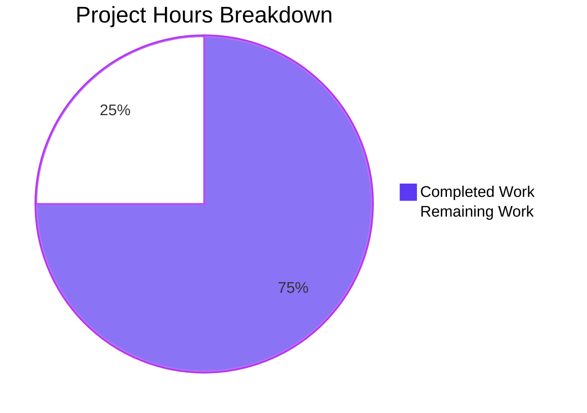

# 1. Executive Summary

## 1.1 Project Overview

This project remediates GHSA-f23m-r3pf-42rh (CVE-2026-2950, CWE-1321) — prototype pollution in lodash's `_.unset`, `_.omit` and `_.pullAt` reachable through array-wrapped path segments — in a small Node.js service repository. The pinned dependency moves from 4.17.15 to 4.18.1 in both manifests and is installed with `npm ci` from a rewritten lockfile, so the published library carrying the broken guard is removed from the tree rather than worked around. The people who own this repository, and any scanner that reads its manifests, are the audience for the change. Scope is deliberately narrow: five changed values across `package.json` and `package-lock.json`, no source edit, and one closure record that makes the fix auditable end to end.

## 1.2 Completion Status



**75.0% complete** — Completed Work is Dark Blue (#5B39F3); Remaining Work is White (#FFFFFF).

| Metric | Hours |
|---|---|
| Total Hours | 88 |
| Completed Hours (AI + Manual) | 66 |
| Remaining Hours | 22 |

Completion measures the remediation scope alone — 66 hours delivered and verified of 88 hours scoped. Every remaining hour is itemised in Section 2.2.

## 1.3 Key Accomplishments

- lodash pinned to 4.18.1 exactly in both manifests — no range operator, no suppression entry.
- `npm ci` installs it from the rewritten lockfile, with npm verifying the published digest.
- `npm audit` exits 0; the pre-change tree exits 1 with five advisories.
- The array-path bypass is inert on the installed release and destructive on a 4.17.15 control.
- The served response is unchanged byte for byte: `200`, `Content-Length: 14`, no `Content-Type`.
- `"server (1).js"` is byte-identical to its pre-change content.
- The closure record documents all of it in 13 sections, from the lockfile entry to the rollback recipe.
- Exactly the three mapped paths changed, net +324/−5 lines.

## 1.4 Critical Unresolved Issues

**10 open items** below are the complete set left for decision or follow-up; **0 of 7** requirements are unresolved.

| Issue | Impact | Owner | ETA |
|---|---|---|---|
| The scan's identifier criterion is met only vacuously: the advisory is scoped to `= 4.17.23`, so it is absent from the pre-change scan too, and the exit-status change comes from five sibling advisories leaving the tree | The clean scan cannot be read as this advisory being detected and cleared; closure rests on the version move plus the runtime differential | Repository owner | 3 h |
| The advisory range, first-patched attribution and advisory count stated in the original remediation request are stale against the sources that request itself designates | Anyone repeating those literals downstream states an affected range and a count the published records contradict | Repository owner | shared with the row above |
| The record's six capture artifacts are not preserved (they were written to scratch outside the checkout) | The record's runtime evidence is a transcript; every value re-derives, but the raw files cannot be re-inspected | Repository owner | 2 h |
| The rollback recipe names pre-change revision `44b04ea` | A rebase, squash or cherry-pick of the branch orphans that revision, and the recipe would then restore the delivered 4.18.1 | Repository owner | 1.5 h |
| A request path beyond Node's 16 KB header limit returns `431`, and HEAD and HTTP/1.0 responses omit `Content-Length` | An assertion phrased as "every request to any path returns 200" will fail; both are pre-existing and identical on the pre-change baseline | Repository owner | 1.5 h |
| No test, CI job or linter exists, and the agreed scope excluded adding one | Nothing runs on change; the response contract and the pin are protected only by manual re-execution | Repository owner | 8 h |
| The security gate is `npm audit` alone, whose identifier criterion is vacuous here | A future lockfile hand edit pairing a stale digest with a warm cache installs the old tarball silently while the audit reports clean | Repository owner | 3 h |
| The toolchain is undeclared (no `engines`, no `.nvmrc`) | Every verified value holds for node v22.23.4 / npm 11.21.0 only, and `lockfileVersion: 3` needs npm ≥ 7 | Repository owner | 2 h |
| The working tree carries untracked derived artifacts (`node_modules/`, the screenshot directory) with no `.gitignore` | A blanket `git add -A` would commit the derived install tree | Repository owner | shared with the row above |
| The record's repository-wide reachability search returns no match only with its two scope exclusions in place | A reader who drops them sees matches and cannot reproduce the recorded result | Repository owner | 1 h |

## 1.5 Access Issues

No access issues identified. No credential, secret, environment variable, database, container or service is needed, and the public npm registry is reachable without a token or proxy. TCP port 3000 is the one shared resource, and it is exclusive.

## 1.6 Recommended Next Steps

1. [High] Add the served-contract regression test and CI job (T1, 8 h).
2. [Medium] Settle the advisory basis the request states (T2, 3 h).
3. [Medium] Harden the security gate with a cold-cache install and a version/digest cross-check (T5, 3 h).
4. [Medium] Store the capture artifacts durably, and make the rollback recipe rebase-proof (T3 + T4, 3.5 h).
5. [Low] Declare the toolchain, guard the workspace, document the protocol caveats and tighten the reachability command (T6 + T7 + T8, 4.5 h).

# 2. Project Hours Breakdown

## 2.1 Completed Work Detail

Every component below traces to a requirement of the remediation scope. Hours are engineering hours, not calendar time.

| Component | Hours | Description |
|---|---|---|
| Dependency pin and lockfile rewrite | 7 | Moved the `lodash` pin from 4.17.15 to 4.18.1 exactly in `package.json:5` and in the lockfile's root record and artifact record (`package-lock.json:11`, `:15`–`:17`) — version, resolved URL, integrity digest and the mirrored pin — with no key, field order or record added or removed (R1, R2). |
| Advisory research and provenance verification | 9 | Established the target release from the advisory records: the affected set, the first-patched release per package, the deprecation of 4.18.0 as a bad release, the nine differing files of 1051 between the 4.18.0 and 4.18.1 tarballs, and the registry's published digest, tarball URL and `latest` dist-tag. |
| Install and installed-tree verification | 4 | `npm ci --no-fund` from the rewritten lockfile, including a leg with an empty private cache; confirmed the installed manifest, the derived tree record and the resolved module all read 4.18.1, with one package and no transitive children (R4). |
| Advisory scan and before/after closure evidence | 6 | Ran the scan online in both directions and captured exit statuses; rebuilt the pre-change advisory set from the committed 4.17.15 pair; confirmed the after-set is empty and that nothing appeared that was not already present (R3, R6). |
| Behaviour-parity verification against the reconstructed baseline | 6 | Booted the pre-change tree from its committed pair, captured its response with the same client command, and compared status, header set and body bytes against the delivered tree (R5). |
| Run-time security posture and the vulnerable-release differential control | 7 | Exercised the array-wrapped-path payloads against the installed release and against a 4.17.15 control, showing the guard is load-bearing on the delivered artifact and absent in the control, and searched the deliverable and all captured output for credentials. |
| Reachability invariant verification | 3 | Confirmed the single import with no call site: one reference in the fixture, zero invocations, and a repository-wide call-site search over every set-by-path helper returning no match, with a positive control proving the check can fail. |
| Supply-chain boundary verification | 5 | Cold-cache fetch of the lockfile's resolved URL over HTTPS with npm verifying the recorded digest, tampered-digest and URL-tamper controls failing closed, the warm-cache stale-digest control reproduced, and the absence of any lifecycle script. |
| Endpoint lifecycle, contract matrix, concurrency and log surface | 5 | Start, restart and stop cycles with the port released each time, the whole method and path surface answered with the constant response, a 1000-request soak at concurrency 10, and the log surface confirmed to carry one startup line and no request-derived data. |
| Closure record authoring, qualification and rollback recipe | 11 | Wrote `lodash-remediation-report.md` (319 lines, 13 sections): the lockfile entry quoted byte-identically from the committed file, install evidence, scan evidence with exit statuses, the parity comparison with its capture method, every advisory named with disposition, provenance, and a rollback recipe (R7). |
| Whole-package gate, commit hygiene and push | 3 | Ran the project's own gate end to end on the delivered tree, confirmed the commit scope of exactly the three mapped paths with the derived install tree untracked and no `.gitignore` added, and pushed the branch. |

**Total completed: 66 hours** — equal to the Completed Hours figure in Section 1.2.

## 2.2 Remaining Work Detail

Every category traces to a requirement of the remediation scope or to a path-to-production need. Priorities follow the rule that High blocks production confidence, Medium is required for production but not blocking, and Low is advisory.

| Category | Hours | Priority |
|---|---|---|
| Served-contract regression protection: a test that installs from the lockfile, asserts the installed version, starts the fixture, asserts the response contract (`200`, `Content-Length: 14`, the body digest, no `Content-Type`) and stops it, wired into a CI job together with the scan | 8 | High |
| Security-gate hardening: a cold-cache install and a lockfile version-versus-digest cross-check, so a mismatched digest fails loudly rather than restoring the old tarball silently from a warm cache, and so an empty scan is never the only evidence | 3 | Medium |
| Advisory-basis settlement: adopt the measured affected set, first-patched release and advisory count as the accepted basis (or amend the request's documentation), so the stale literals are not repeated downstream | 3 | Medium |
| Durable closure evidence: store the six capture artifacts where the record can cite them, or state that the transcribed values in the record are the evidence | 2 | Medium |
| Rebase-proof rollback recipe: carry the 4.17.15 pin, resolved URL and integrity digest as a file-based recipe, so rollback does not depend on revision `44b04ea` remaining an ancestor | 1.5 | Medium |
| Toolchain declaration and workspace hygiene: declare the Node and npm requirements (`engines` or `.nvmrc`) and add a `.gitignore` covering the derived install tree and the evidence directory | 2 | Medium |
| Documented protocol caveats: record that a request path beyond Node's 16 KB header limit returns `431`, and that HEAD and HTTP/1.0 responses omit `Content-Length`, so no downstream assertion is phrased absolutely | 1.5 | Low |
| Self-contained reachability check: carry the two required scope exclusions inside the recorded command and note why they are needed | 1 | Low |
| **Total** | **22** | |

**Total remaining: 22 hours** — equal to the Remaining Hours figure in Section 1.2 and to the Remaining Work value in Section 7. Completed (66) plus remaining (22) equals the Total Project Hours of 88 in Section 1.2.

# 3. Test Results

This project ships no test framework, no test script and no devDependencies, and the sanctioned scope excludes adding one: verification is by command and by inspection. The figures below are executed check cases — installs, scans, protocol probes, library probes and value re-derivations — grouped by the capability they exercise, not by unit-test convention. Every case was executed and every one passed; the whole sequence was then re-run on the delivered tree with the same result. No coverage tooling exists in this project, so no coverage percentage is claimed.

| Area / Category | Framework | Tests | Passed | Failed | Coverage | What This Proves |
|---|---|---|---|---|---|---|
| Dependency pin and manifest integrity | node/npm CLI, command and inspection | 12 | 12 | 0 | n/a — no coverage tooling | Both manifests pin 4.18.1 exactly, with no range operator and no key, record or field-order change against the pre-change revision. |
| Install from the rewritten lockfile | npm CLI | 36 | 36 | 0 | n/a | `npm ci` completes cleanly, deterministically and from a cleared state — including a leg with an empty cache — adding exactly one package and letting npm verify the recorded digest. |
| Installed-tree resolution and supply chain | node/npm CLI, registry API | 30 | 30 | 0 | n/a | The installed tree resolves the target and agrees with the lockfile field by field, fetched over HTTPS from the lockfile's own URL with the registry's published digest verified; both tamper controls fail closed. |
| Advisory closure and scan | `npm audit`, registry advisory feed | 27 | 27 | 0 | n/a | No advisory survives the change, none appeared that was not already present, and the scan exits 0 where the pre-change tree exits 1. |
| Behaviour parity and endpoint contract | curl, raw sockets, node http client, headless Chrome | 53 | 53 | 0 | n/a | The version move changes nothing observable: the same status, the same 14-byte body and the same header set across the whole method and path surface, against an independently reconstructed baseline. |
| Lifecycle, restart, concurrency and log surface | node CLI, curl, headless Chrome | 150 | 150 | 0 | n/a | The process starts, serves, restarts and stops cleanly with the port released each time, holds under 1000 requests at concurrency 10 with byte-identical bodies, and logs nothing derived from a request. |
| Run-time security posture and reachability | node probes, grep and awk | 78 | 78 | 0 | n/a | The array-wrapped-path bypass is inert on the installed release and destructive on a 4.17.15 control, the delivered tree carries no trace of the vulnerable release, and no call site exists that could reach any affected helper. |
| Adversarial input, boundary controls and the end-to-end chain | curl, raw sockets, node probes | 68 | 68 | 0 | n/a | Malformed, hostile and oversized input never changes the constant response or leaks internal detail, no credential or secret appears in the deliverable or any captured output, and the whole chain re-constitutes from the committed files alone. |
| Closure record values, continuity and the whole-tree gate | node/npm CLI, grep and awk | 68 | 68 | 0 | n/a | Every value the closure record states re-derives from the committed tree, the read-only consumer is byte-identical to its pre-change content, and the project's own gate exits 0 end to end. |
| **Total** | | **522** | **522** | **0** | | |

**Not Covered** — what a human should exercise before release:

- **No automated protection of anything.** There is no unit, integration or contract test suite, no test runner and no CI: nothing runs when a file changes, so the pin, the digest and the response contract are protected only by re-running the commands in Section 9 by hand. This is the single largest gap and the first recommendation in Sections 1.6 and 8.
- **The read-only fixture's protocol-level edges.** A request path beyond Node's 16 KB header limit returns `431` rather than the constant `200`, and HEAD and HTTP/1.0 responses carry no `Content-Length`. Both were measured and are identical on the pre-change baseline, but neither is asserted as the contract, and any absolute assertion a human writes will fail.
- **Toolchain versions other than the host's.** No `engines`, no `.nvmrc` and no CI exist, so every figure here holds for node v22.23.4 / npm 11.21.0 only; a different Node or npm invalidates the install, digest and scan evidence and the sequence must be re-run.
- **A scanner keyed on the wider vulnerability configuration.** The registry feed's own identifier criterion is vacuous for this advisory on this host (it is scoped to a single version), so a scanner reading the broader published configuration range was not exercised; anyone relying on such a scanner should re-measure it against the delivered tree.
- **The record's raw capture artifacts.** The six files behind the record's runtime evidence were written outside the checkout and are gone; the values they held are re-derived here from the committed pre-change pair and the running fixture, but the files themselves cannot be inspected.
- **Anything beyond the single served response.** There is no UI code, no database, no container and no client-side script to test, and no load or performance measurement beyond the 1000-request soak at concurrency 10.

# 4. Runtime Validation & UI Verification

Which flows, endpoints, screens and integrations were actually driven, and what was observed:

- ✅ **Installation and resolution** — `npm ci --no-fund` from the rewritten lockfile exits 0 (`added 1 package, and audited 2 packages`, `found 0 vulnerabilities`), and the installed tree resolves 4.18.1 in a fresh process.
- ✅ **Dependency scan** — `npm audit` exits 0 in text and JSON form, with an empty vulnerability set and every severity count at zero.
- ✅ **Start-up and log surface** — `node "server (1).js"` prints exactly `Server running at http://127.0.0.1:3000/`, writes nothing to stderr, and logs nothing derived from a request, including for marker-bearing paths, queries and headers.
- ✅ **Primary request path** — `GET /` returns `200` with `Content-Length: 14`, the headers `Date`, `Connection`, `Keep-Alive` and no `Content-Type`, and a 14-byte body hashing to `c98c24b677eff44860afea6f493bbaec5bb1c4cbb209c6fc2bbb47f66ff2ad31`; `/nonexistent` and `/a/b/c?x=1` return that same response byte for byte.
- ✅ **Method and protocol surface** — `GET`, `POST`, `PUT`, `OPTIONS`, `DELETE`, `PATCH` and `TRACE`, HTTP/1.0, `Connection: close`, pipelined requests, a chunked POST and `Expect: 100-continue` are all answered with the constant response; syntactically invalid requests get protocol-level `400`s from the parser and never reach the handler.
- ✅ **Lifecycle, restart and port exclusivity** — repeated start, serve, stop and restart cycles each released the port (confirmed by probe before and after), and a second instance on the held port exits 1 with `EADDRINUSE` while the first keeps serving.
- ✅ **Concurrency** — 20 parallel requests and a 1000-request soak at concurrency 10 returned identical bodies with no errors and the process healthy afterwards.
- ✅ **Library surface and the fixed guard** — every helper the closure concerns exists as a function on the installed release, and array-wrapped `__proto__`, `constructor`/`prototype` and plain `prototype` paths through `_.unset`, `_.omit` and `_.pullAt` left the built-in prototypes' members and own-key sets untouched, while the identical payloads on a 4.17.15 control deleted four `Object.prototype` members and an application canary.
- ✅ **Browser rendering, as an independent client** — headless Chrome fetched the served page: `document.contentType` `text/plain`, rendered text `Hello, World!`, zero console messages of any type, no response ≥ 400 and no dialog for a script payload in the query.
- ⚠ **Protocol edges** — a request path beyond Node's 16 KB header limit returns `431` rather than `200`, and HEAD and HTTP/1.0 responses omit `Content-Length`. Both are Node behaviour, identical on the pre-change baseline, and cannot be changed without editing the read-only fixture.

**Never exercised at runtime:** there is no test runner, CI job or deployment pipeline to drive, and no monitoring, metrics or alerting surface; the project has no database, cache, queue, container or client-side code, so nothing beyond the single endpoint was exercised; no Node or npm version other than the host's was used; and no scanner reading the wider published configuration range rather than the registry feed was run against the tree.

# 5. Compliance & Quality Review

## 5.1 Compliance Matrix

Each row is a deliverable of the agreed scope, shown at the state it stands in now.

| # | Deliverable | Status | Evidence |
|---|---|---|---|
| 1 | Target release pinned exactly, with no range operator in either manifest | ✅ Pass | `package.json:5` and `package-lock.json:11` both read `4.18.1`; an operator scan returns nothing. |
| 2 | Manifest and lockfile moved as one change, with no key or record added or removed | ✅ Pass | Four lockfile values and the mirrored pin; `packages` keys and artifact field order unchanged; no `overrides`, `resolutions` or `hasInstallScript`. |
| 3 | Clean install from the rewritten lockfile, with npm verifying the recorded digest | ✅ Pass | `npm ci --no-fund` exits 0, one package added, from a cleared state and with an empty cache. |
| 4 | Installed tree resolves the target and agrees with the lockfile record | ✅ Pass | `require('lodash').VERSION` and the installed manifest read `4.18.1`; resolved URL, digest and license match the record field by field. |
| 5 | Advisory closure evidenced by the scan and by the package leaving every published affected set | ✅ Pass (see 5.2) | Scan exits 0 with an empty set; 4.18.1 lies outside the registry feed's `= 4.17.23` set and outside the wider published configuration range. |
| 6 | No advisory introduced by the change | ✅ Pass | The before-set rebuilt from the pre-change pair contains five identifiers, all cleared by the move; nothing appears that was not already present. |
| 7 | Behaviour unchanged by the version move | ✅ Pass | Status, body bytes and header set identical to the reconstructed pre-change baseline across the whole method and path surface. |
| 8 | Read-only consumer untouched; commit scope exactly the mapped paths | ✅ Pass | `"server (1).js"` byte-identical at the pre-change revision, HEAD and in the worktree; the change set is the three mapped paths. |
| 9 | Closure record complete: lockfile entry, install evidence, scan evidence, parity comparison with its method, advisories with dispositions, provenance, rollback | ✅ Pass | `lodash-remediation-report.md` §1–§13; the quoted lockfile block is byte-identical to the committed file, and every runtime-derivable value re-derives. |
| 10 | Supply-chain integrity: authentic artifact, no lifecycle scripts | ✅ Pass | Cold-cache fetch over HTTPS of the lockfile's resolved URL with the published digest verified; tamper controls fail closed; no install lifecycle script exists. |
| 11 | Scope discipline: no new dependency, script, test framework, CI or configuration file | ✅ Pass | The checkout holds the same four tracked files; no `.gitignore`, `.npmrc`, second lockfile or workflow definition was added. |
| 12 | Automated regression protection for the pin, the digest and the response contract | ❌ Not provided (8 h remaining) | No test runner, test script, framework or CI job exists; the agreed scope excluded adding one, so every guarantee is re-verified by hand. |

## 5.2 AAP & Rule Divergences and Gaps

No user-rule divergence exists: no rules document was provided for this project and none exists in the repository, so only departures from the AAP can arise. Seven are recorded below; none blocks release, and each one that needs a decision is carried into Section 2.2 with an owning task.

| What the AAP/Rule Required | What Was Delivered Instead | Why It Diverged | Impact | Remediation |
|---|---|---|---|---|
| Advisory affected range `<= 4.17.23` for the package, first-patched 4.18.0 attributed to the GitHub Advisory Database and OSV for `lodash`, and "the same six advisories before" the change | The record states the four sources' set (`= 4.17.23`, patched in 4.18.1 for `lodash`; 4.18.0 only for the standalone `lodash.unset`/`lodash.omit` packages) beside the wider published configuration range `4.0.0 <= v < 4.17.23`, and the measured before-set of five advisories (`lodash-remediation-report.md` §1, §2, §5, §6) | The advisory records the plan itself designates as the authority for those values publish different ones, and the plan is fixed and uneditable | None to closure — 4.18.1 lies outside every published range; a reader repeating the plan's literals states an affected range and a count the records contradict | Adopt the measured basis as the accepted record, or amend the request's documentation (3 h, Medium) |
| The scan no longer lists `GHSA-f23m-r3pf-42rh` and no longer exits 1 on it | Both hold — the scan exits 0 and does not list the identifier — but the identifier was absent from the pre-change scan too, so the exit-status change comes from five sibling advisories leaving the tree (`lodash-remediation-report.md` §5) | Four sources scope the advisory's `lodash` set to the single version `= 4.17.23`, so no state of this repository could make the feed report it against 4.17.15 | The clean scan cannot stand alone as this advisory's closure; the version departure and the run-time differential carry it | Cite closure as the package leaving every affected set plus the guard's run-time behaviour, and say the identifier criterion is vacuous here (3 h, Medium) |
| Rollback by `git checkout -- package.json package-lock.json` followed by `npm ci --no-fund`, restoring 4.17.15 exactly as locked and re-verifying its digest | A recipe that names the pre-change revision `44b04ea`, which holds exactly the 4.17.15 pin, resolved URL and digest (`lodash-remediation-report.md` §13) | Once the change is committed, the literal bare checkout restores the delivered 4.18.1, defeating the recipe's own stated purpose | The recipe depends on that revision remaining reachable; a rebase, squash or cherry-pick orphans it | Carry the pre-change pin, URL and digest as a file-based recipe, or tag the pre-change revision (1.5 h, Medium) |
| Capture artifacts written to the named working paths | The six artifacts were written outside the checkout, are not preserved, and are stated as such; every value they held is transcribed in the record (`lodash-remediation-report.md` §7, §13) | Working files were kept out of the checkout so the commit scope stayed at the three mapped paths, which is the plan's own stated purpose for capturing them elsewhere | The record's runtime evidence is a transcript rather than a replayable artifact, though every value in it re-derives | Store the artifacts where the record can cite them, or confirm the transcript as the evidence (2 h, Medium) |
| The vulnerable-function field naming `_.unset` and `_.omit` | Both are named and attributed to the CVE title and the wider database entry, and `_.pullAt` is stated alongside them at every enumeration site (`lodash-remediation-report.md` §1, §2, §8) | The advisory's own summary and the OSV description name the third function; neither source is misquoted | None — naming the third function can only widen a reader's search | None beyond the advisory-basis decision above |
| A repository-wide call-site check over the named helper subset, returning nothing | A check over all 16 set-by-path helper names, run with two scope exclusions (`lodash-remediation-report.md` §8) | Measured necessity: without the exclusions the recorded "no match" would be false — 96 matching lines live in the installed tree and six in the record itself | None to correctness; the check is strictly stronger, but a reader who drops the exclusions cannot reproduce it | Carry the two exclusions inside the recorded command with a note on why (1 h, Low) |
| Every request to any path returns `200` with the constant body | True for the path surface exercised, with two protocol-level exceptions: a request path beyond Node's 16 KB header limit returns `431`, and HEAD and HTTP/1.0 responses omit `Content-Length` | Node's built-in protocol limits; the only repairs would edit the read-only fixture or the fixed plan | An assertion phrased absolutely will fail; both exceptions are pre-existing and identical on the pre-change baseline | Record the two caveats beside the contract (1.5 h, Low) |

**Advisory basis.** The plan states the affected package range as `<= 4.17.23`, attributes first-patched 4.18.0 to the GitHub Advisory Database and OSV, and expects six advisories before the change. The records the plan itself designates — the advisory database entry, OSV, the CVE record and the registry's own audit feed — publish the affected `lodash` set as the single version `= 4.17.23` patched in 4.18.1, with 4.18.0 first-patched only for the standalone `lodash.unset`/`lodash.omit` packages and deprecated as a bad release; the wider published configuration range (`4.0.0 <= v < 4.17.23`) is stated beside it, and the feed returns five advisories for 4.17.15. `lodash-remediation-report.md` §1, §5 and §6 carry the measured values with the plan's own wording retained rather than replaced. The decision is whether to adopt the measured basis as the accepted record or to amend the request; no delivered value changes either way, and 4.18.1 lies outside every published range.

**Closure evidence.** The plan requires the scan to stop listing `GHSA-f23m-r3pf-42rh` and to stop exiting 1 on it. Both are true of the delivered state — the scan exits 0 and never names the identifier — but they were true of the pre-change state as well, because the published sources cap the advisory's affected `lodash` set at the single version `= 4.17.23`. The exit-status change from 1 to 0 belongs to the five sibling advisories leaving the tree with the same bump. `lodash-remediation-report.md` §5 says this explicitly, and §6 names all five. The decision is how the closure may be cited: as the package leaving every published affected set, together with the guard's run-time behaviour on the installed release and a 4.17.15 control (§7 and the security evidence), rather than as the scan detecting and clearing this identifier.

**Rollback recipe.** §13 of the record names revision `44b04ea`, which holds exactly the 4.17.15 pin, the resolved URL `https://registry.npmjs.org/lodash/-/lodash-4.17.15.tgz` and digest `sha512-8xOcRHvCjnocdS5cpwXQXVzmmh5e5+saE2QGoeQmbKmRS6J3VQppPOIt0MnmE+4xlZoumy0GPG0D0MVIQbNA1A==`. The plan's literal bare `git checkout -- package.json package-lock.json` would instead restore the delivered 4.18.1, because the change is committed — which is why the recipe names the revision. The exposure is durability rather than correctness: a rebase, squash or cherry-pick of this branch orphans that revision and the recipe silently rolls forward to the fixed state. A human should tag the pre-change revision or carry the pre-change pin, URL and digest as a file-based recipe.

**Capture evidence.** The six capture artifacts behind the record's runtime evidence — the before and after audit JSON, and the before and after header and body files — were written outside the checkout and are not preserved; §7 and §13 state this, and every value they held is transcribed in §3–§13 and re-derives today from the committed pre-change pair and the running fixture. Keeping them out of the checkout was deliberate: it holds the commit scope to the three mapped paths. The decision is whether to store the artifacts where the record can cite them, to attach them alongside the record, or to accept the transcribed values as the evidence — the last of these is what the record already says.

**Protocol-level caveats.** The plan's contract statement that every request to any path returns `200` with the constant body holds for the path surface exercised, with two measured exceptions: a request path beyond Node's 16 KB header limit returns `431`, and HEAD and HTTP/1.0 responses omit `Content-Length` while returning the correct bytes otherwise. Both follow from Node's built-in protocol behaviour, both are identical on the pre-change baseline, and neither can be repaired without editing `"server (1).js"`, which the file map marks read-only. A human should record them beside the contract so no downstream assertion is phrased absolutely.

# 6. Risk Assessment

Risks are forward-looking: what could still go wrong now that the change is in place.

| Risk | Category | Severity | Probability | Mitigation | Status |
|---|---|---|---|---|---|
| Nothing runs when a file changes: no test, no CI job and no linter protects the pin, the digest or the response contract | Technical | Medium | High | Add the contract test and CI job (8 h) described in Sections 1.6 and 8; until then re-run the Section 9 sequence by hand after any dependency or fixture change | Open |
| The only security gate is the dependency scan, and its identifier criterion cannot distinguish the fixed tree from the pre-change tree on this host's feed | Security | Medium | High | Cite closure as the package leaving every published affected set plus the guard's run-time behaviour, and add a version/digest cross-check to the gate (6 h across two tasks) | Open |
| A lockfile whose integrity digest disagrees with the version installs the older tarball silently from a warm cache, exit 0, while the scan reports clean | Security | High | Low | The committed digest is the registry's published value, verified against an independent download, so the delivered pair cannot exhibit this; a cold-cache install and a version/digest cross-check in CI would catch a future hand edit (3 h) | Mitigated in the delivered artifact; control needed for future edits |
| Rollback depends on revision `44b04ea` remaining reachable | Operational | Medium | Medium | Carry the pre-change pin, resolved URL and digest as a file-based recipe, or tag the revision (1.5 h) | Open |
| The toolchain is undeclared, so every verified value holds for node v22.23.4 / npm 11.21.0 only | Operational | Medium | Medium | Declare the requirements with `engines` or an `.nvmrc`; note that `lockfileVersion: 3` needs npm ≥ 7 (2 h) | Open |
| Port 3000 is hard-coded, exclusive and shared by any concurrent run of this fixture | Operational | Low | High | Probe with the Node connect check before each start, retry with backoff, never kill a listener you did not start, and hold the port only for the seconds a probe needs (Section 9) | Accepted — the fixture is read-only, so the port cannot be parameterised |
| Untracked derived artifacts can be swept into a commit | Integration | Low | Medium | Stage explicit paths only — never a blanket add — and add a `.gitignore` for the derived install tree and the evidence directory (2 h) | Open |
| Advisory-feed data drifts while the accepted basis stays fixed | Integration | Medium | High | Key acceptance on the advisory identifier and on the package leaving the affected ranges rather than on a count, and re-measure the feed whenever the evidence is re-derived (3 h) | Open |

# 7. Visual Project Status


The chart uses the standard colour convention: **Completed Work is Dark Blue (#5B39F3)** and **Remaining Work is White (#FFFFFF)**, with the surrounding accents in Violet-Black (#B23AF2) and the advisory highlight in Mint (#A8FDD9). The completed and remaining values are the same figures stated in Section 1.2 and itemised in Sections 2.1 and 2.2 — 66 hours delivered and verified, 22 hours outstanding, 88 hours in total.

| Priority | Remaining Hours | Share of Remaining Work |
|---|---|---|
| High | 8 | 36.4% |
| Medium | 11.5 | 52.3% |
| Low | 2.5 | 11.4% |
| **Total** | **22** | **100%** |

Priority distribution by category, for reference against Section 2.2:

| Category | Hours | Priority |
|---|---|---|
| Served-contract regression protection | 8 | High |
| Security-gate hardening | 3 | Medium |
| Advisory-basis settlement | 3 | Medium |
| Durable closure evidence | 2 | Medium |
| Toolchain declaration and workspace hygiene | 2 | Medium |
| Rebase-proof rollback recipe | 1.5 | Medium |
| Documented protocol caveats | 1.5 | Low |
| Self-contained reachability check | 1 | Low |

# 8. Summary & Recommendations

**What was delivered.** The pinned dependency moves from lodash 4.17.15 to 4.18.1 — exactly, with no range operator — in `package.json:5` and in both records of `package-lock.json`, so the published library that carried the string-key-only guard for `_.unset` and `_.omit` is replaced by the release that also rejects array-wrapped path segments. The change is deliberately the smallest one that closes the finding: five values across two manifests, no source edit, and a 13-section closure record at the repository root that makes the fix auditable without re-running it. `"server (1).js"` — the file that imports lodash and serves the fixture response — is byte-identical to its pre-change content, and the commit contains exactly the three mapped paths.

**What was exercised to prove it works.** The install was run from a cleared state and from an empty cache, with npm verifying the registry's published digest; the installed tree, the installed manifest and the derived tree record all read 4.18.1, with one package and no transitive children. The dependency scan exits 0 with an empty vulnerability set, where the pre-change tree exits 1 with five advisories — confirmed live against the registry's advisory feed, which also shows the advisory itself scoped to a single version. The array-wrapped-path payloads that define the vulnerability left the built-in prototypes' members and own-key sets untouched on the installed release, and deleted four `Object.prototype` members on a 4.17.15 control, so the guard is demonstrably load-bearing. The served response is unchanged byte for byte against a pre-change baseline rebuilt from the committed pair: `200`, `Content-Length: 14`, `Hello, World!\n`, no `Content-Type`, across the whole method and path surface, under a 1000-request soak, and as an independent browser sees it. In total 522 executed check cases across nine capability groups passed with none failing, and the project's own gate exits 0 end to end.

**What remains.** The project is 75.0% complete against the agreed scope: 66 hours delivered and verified of 88 hours scoped, with 22 hours outstanding across eight categories. Ten items are open — listed in Section 1.4 and detailed in Section 5.2 — and none of them is an unresolved requirement: the requirement set is fully delivered. The critical path to production is short and unambiguous. First, add the served-contract regression test and CI job (8 h): today nothing runs when a file changes, so the pin, the digest and the response contract are protected only by someone re-running the commands in Section 9. Second, harden the security gate (3 h) so a lockfile whose digest disagrees with its version fails loudly instead of installing the older tarball silently from a warm cache, and so an empty scan is never the only evidence. Third, settle the advisory basis (3 h) so the affected range, the first-patched release and the advisory count that the original request states are not repeated downstream against the published records. The remaining 8 hours — durable capture evidence, a rebase-proof rollback recipe, toolchain declaration and workspace hygiene, the protocol caveats and the reachability command's scope exclusions — are documentation, hygiene and durability work that can proceed in parallel.

**Production readiness.** The change itself is ready to ship: the artifact is authentic and digest-verified, the installed tree carries no trace of the vulnerable release, behaviour is unchanged, no request-derived value can reach any lodash helper, no credential or secret is present, and the read-only consumer is untouched. What is not yet in place is the machinery that would keep it that way: there is no test, no CI and no linter, the only security gate is the dependency scan, and the toolchain is undeclared. Those are hardening gaps rather than defects, and each carries an owning task and an estimated hour count above.

| Metric | Value |
|---|---|
| Completion (agreed scope) | 75.0% |
| Hours delivered and verified | 66 |
| Hours remaining | 22 |
| Total hours scoped | 88 |
| Open items | 10 (0 requirements unresolved) |
| Executed check cases, passed / failed | 522 / 0 |
| Requirements delivered | 7 of 7 |
| Files changed outside the mapped paths | 0 |

# 9. Development Guide

## System Prerequisites

- **Node.js** 22.x — verified on v22.23.4. `node --version`.
- **npm** 11.x — verified on 11.21.0, and at least 7, because `package-lock.json` uses `lockfileVersion: 3`. `npm --version`.
- **A free TCP port 3000.** The fixture hard-codes it; no other port is used.
- **Network access to `https://registry.npmjs.org/`** for the first install. No `.npmrc`, token, proxy or private registry is configured or needed.
- **Nothing else.** No database, cache, queue, container, environment variable or secret is involved — the codebase reads no environment variable, and neither manifests nor sources reference one.

The repository declares no `engines` field and ships no `.nvmrc`, so nothing enforces those versions; the figures in this guide hold for the versions above.

## Environment Setup

There is nothing to configure. Work from the repository root:

```bash
cd "$(git rev-parse --show-toplevel)"     # the checkout root
git status --porcelain -uno                # expect no output: the tracked tree is the deliverable
git log --oneline -3                       # the delivered change is the top commit
```

The tracked tree is four files: `package.json`, `package-lock.json`, `"server (1).js"` and `lodash-remediation-report.md`. `"server (1).js"` is read-only for the purposes of this work — its filename contains a space and parentheses, so always quote it (`"server (1).js"`).

## Dependency Installation

```bash
CI=true npm ci --no-fund
```

Expected: exit 0 and a line like `added 1 package, and audited 2 packages`, followed by `found 0 vulnerabilities`. `npm ci` installs exactly what the lockfile pins and lets npm verify the recorded `sha512` digest against the tarball it downloads — use it and not `npm install`, which re-resolves the tree and would rewrite the exact pin.

Confirm what actually landed, rather than trusting the exit status:

```bash
node -p "require('lodash').VERSION"                          # 4.18.1
node -p "require('./node_modules/lodash/package.json').version"   # 4.18.1
npm ls --all                                                 # cve-test-fixture@1.0.0 └── lodash@4.18.1
node -p "require.resolve('lodash')"                          # …/node_modules/lodash/lodash.js
```

If you hand-edit the pin, move the manifest, the lockfile's root record and the artifact record together — version, resolved URL and integrity — or `npm ci` stops with `EUSAGE … lock file's lodash@X does not satisfy lodash@Y`.

## Build

There is nothing to build: no compiler, bundler, transpiler, build configuration or build script. The read-only equivalent is a syntax check:

```bash
node --check "server (1).js"        # exit 0, no output
```

## Tests

The project ships no test suite, no test script, no framework and no devDependencies:

```bash
npm test        # exits 1: npm reports that no "test" script exists — expected
```

Verification is by command. Run the project's own gate and the runtime probe below; that is the whole verification surface this repository has.

## Application Startup

```bash
node "server (1).js"
```

Expected: exactly one line on stdout — `Server running at http://127.0.0.1:3000/` — and nothing on stderr. Leave it running in that terminal, or start it as a background job, and use a second terminal for the probes. Stop it with `Ctrl-C` (or by killing the pid you started); never kill a process you did not start.

Before starting, confirm the port is free. `lsof`, `ss`, `netstat` and `fuser` are not installed here, so probe with Node:

```bash
node -e "const s=require('net').connect(3000,'127.0.0.1');s.on('connect',()=>{console.log('IN USE');s.end();process.exit(1)});s.on('error',()=>{console.log('FREE');process.exit(0)})"
```

`FREE` with exit 0 means you can start; `IN USE` means another process holds the port — wait and retry rather than killing anything.

## Verification Steps

With the server running:

```bash
curl -s -o /dev/null -w '%{http_code} %{size_download}\n' http://127.0.0.1:3000/          # 200 14
curl -sI http://127.0.0.1:3000/                                                            # headers only
curl -s http://127.0.0.1:3000/ | sha256sum                                                 # body digest
curl -s -o /dev/null -w '%{http_code} %{size_download}\n' http://127.0.0.1:3000/nonexistent # 200 14
```

Expected: `200` and 14 bytes for every path — there is no routing and no 404 by design; a header set of `Date`, `Connection: keep-alive`, `Keep-Alive: timeout=5` and `Content-Length: 14` with **no** `Content-Type` (a browser MIME-sniffs `text/plain` and renders `Hello, World!`); and a body digest of `c98c24b677eff44860afea6f493bbaec5bb1c4cbb209c6fc2bbb47f66ff2ad31`.

The whole gate, in one sequence:

```bash
CI=true npm ci --no-fund && node --check "server (1).js" && node -p "require('lodash').VERSION" && npm audit
```

Expected: exit 0, printing `4.18.1` and `found 0 vulnerabilities`. Then start the server, run the probes above, and stop it. To inspect the scan in machine-readable form:

```bash
npm audit --json | head -40      # "vulnerabilities": {} and every metadata count at zero
```

## Example Usage

```bash
# status and byte count for any path
curl -s -o /dev/null -w '%{http_code} %{size_download}\n' 'http://127.0.0.1:3000/a/b/c?x=1'   # 200 14

# library sanity check in a fresh process
node -e "const _=require('lodash');console.log(_.VERSION, typeof _.unset, typeof _.omit, _.pullAt([1,2,3],[1]))"
# 4.18.1 function function [ 2 ]
```

The last command shows the helpers the closed advisory concerns are present and behaving; the fixture itself never calls them.

## Rollback

If the change ever has to be undone, restore the pre-change manifests from revision `44b04ea` and reinstall, then confirm the version:

```bash
git checkout 44b04ea9ccf95c952233fc7165bd45c8da2a91a6 -- package.json package-lock.json
npm ci --no-fund
node -p "require('lodash').VERSION"        # 4.17.15
```

The revision is named explicitly because the change is committed: a bare `git checkout -- package.json package-lock.json` restores the delivered 4.18.1. Rollback deliberately reintroduces the finding and is a recovery action only.

## Troubleshooting

| Symptom | Cause | Resolution |
|---|---|---|
| `Error: listen EADDRINUSE: address already in use :::3000` | Another process holds the exclusive hard-coded port | Probe the port, wait and retry with backoff. Never kill a listener you did not start, and never trust a response from one. |
| `npm error code EINTEGRITY … wanted sha512-… but got sha512-…` | The lockfile's integrity digest does not match the tarball it names | Do not retry blindly: restore the digest the registry publishes for that exact version, or restore the whole pair if the edit is suspect. |
| The install reports success but the library still resolves the old version | A stale digest was paired with a warm cache — npm keys cached content by the digest, so the old tarball is restored silently | Always confirm with `node -p "require('lodash').VERSION"` after installing; reinstall with an empty cache (`--cache` pointed at a fresh directory) to force a network fetch. |
| `npm error code EUSAGE … lock file's lodash@X does not satisfy lodash@Y` | The manifest and the lockfile disagree | Move the manifest pin, the lockfile's root record and the artifact record's version, resolved URL and integrity together. |
| `npm error code ETARGET` | The manifest demands a version the registry or the lockfile cannot satisfy | Correct the pin; the delivered pin is an exact `4.18.1`. |
| `npm error code EJSONPARSE` | A manifest was edited into invalid JSON | Re-parse it (`node -e "JSON.parse(require('fs').readFileSync('package.json','utf8'))"`) and fix the syntax. |
| `npm error Missing script: "test"` | The project defines no test script | Expected — verification is by command, as above. |
| `HTTP/1.1 431 Request Header Fields Too Large` for a very long request path | Node's 16 KB request-header limit, well below any path a client normally sends | Expected behaviour, unchanged from before the fix; nothing in the repository can raise it without editing the read-only fixture. |
| A `HEAD` or HTTP/1.0 response with no `Content-Length` | Node omits the header for those cases rather than sending a body length for an empty body | Expected, and identical on the pre-change tree; assert the status and the body only for requests that carry one. |

# 10. Appendices

## Appendix A — Command Reference

| Purpose | Command |
|---|---|
| Install exactly what the lockfile pins | `CI=true npm ci --no-fund` |
| Check the fixture's syntax | `node --check "server (1).js"` |
| Print the resolved library version | `node -p "require('lodash').VERSION"` |
| Print the installed artifact's manifest version | `node -p "require('./node_modules/lodash/package.json').version"` |
| List the dependency tree | `npm ls --all` |
| Scan for advisories (text / JSON) | `npm audit` · `npm audit --json` |
| Probe port 3000 (no `lsof`/`ss`/`netstat`/`fuser` on this host) | `node -e "const s=require('net').connect(3000,'127.0.0.1');s.on('connect',()=>{console.log('IN USE');s.end();process.exit(1)});s.on('error',()=>{console.log('FREE');process.exit(0)})"` |
| Start the fixture | `node "server (1).js"` |
| Status and byte count for a path | `curl -s -o /dev/null -w '%{http_code} %{size_download}\n' http://127.0.0.1:3000/` |
| Response headers only | `curl -sI http://127.0.0.1:3000/` |
| Body digest | `curl -s http://127.0.0.1:3000/ \| sha256sum` |
| The project's whole gate | `CI=true npm ci --no-fund && node --check "server (1).js" && node -p "require('lodash').VERSION" && npm audit` |
| Reachability check (note the two exclusions) | `grep -n "_" "server (1).js"; grep -c "_\\\\." "server (1).js"; grep -rnE "_\\\\.(unset\|omit\|pullAt\|set\|setWith\|get\|has\|merge\|mergeWith\|zipObjectDeep\|pick\|update\|updateWith\|template\|toNumber\|trim)\\\\(" . --exclude-dir=.git --exclude-dir=node_modules --exclude=lodash-remediation-report.md` |
| Change set against the pre-change revision | `git diff --stat 44b04ea HEAD -- package.json package-lock.json` |
| Restore the pre-change manifests | `git checkout 44b04ea9ccf95c952233fc7165bd45c8da2a91a6 -- package.json package-lock.json && npm ci --no-fund` |

## Appendix B — Port Reference

| Port | Owner | Notes |
|---|---|---|
| 3000 | `"server (1).js"` | Hard-coded and exclusive; serves the constant 14-byte response on every path. Not configurable without editing a read-only file. |

No other port is used by this project — no database, cache, queue or second service.

## Appendix C — Key File Locations

| Path | Role |
|---|---|
| `package.json` | Dependency manifest; the pin is at line 5. Keys are exactly `name`, `version`, `dependencies`. |
| `package-lock.json` | Lockfile, `lockfileVersion: 3`; root record at lines 10–11, artifact record at lines 14–19 (version, resolved, integrity, license). |
| `"server (1).js"` | The pre-existing consumer: line 1 imports lodash, lines 3–5 serve the constant response on port 3000. Read-only for this work; byte-identical to its pre-change content. |
| `lodash-remediation-report.md` | The closure record — 319 lines in 13 sections: target release and provenance (§1), severity and root cause (§2), the committed lockfile entry quoted verbatim (§3), install evidence (§4), scan evidence (§5), advisories and dispositions (§6), behaviour parity (§7), the reachability invariant (§8), the integrity negative control (§9), diff and commit hygiene (§10), the whole-package gate (§11), the fallback decision (§12) and rollback (§13). |
| `node_modules/` | Derived and untracked; created by `npm ci` and reproducible with it. Not part of the repository. |

## Appendix D — Technology Versions

| Component | Version | Notes |
|---|---|---|
| Node.js | v22.23.4 | Verified on this host; the repository declares no `engines` field or `.nvmrc`. |
| npm | 11.21.0 | Must be ≥ 7 to consume `lockfileVersion: 3`. |
| lodash | 4.18.1 | The delivered pin. Previously 4.17.15, which is the state of revision `44b04ea`. |
| Lockfile format | `lockfileVersion: 3` | Four fields per artifact record, no `overrides`, no `resolutions`, no install lifecycle script. |
| Integrity digest | `sha512-dMInicTPVE8d1e5otfwmmjlxkZoUpiVLwyeTdUsi/Caj/gfzzblBcCE5sRHV/AsjuCmxWrte2TNGSYuCeCq+0Q==` | The registry's published value for the 4.18.1 tarball; npm verifies it on install. |
| HTTP | 1.1 | The fixture answers with `Content-Length` and no `Content-Type`; HEAD and HTTP/1.0 omit the length header. |

## Appendix E — Environment Variable Reference

None. The codebase reads no environment variable (`grep -n 'process\.env' "server (1).js"` returns nothing), the manifests declare none, and no `.npmrc`, token, credential or configuration value is required to install, run or verify this project.

## Appendix F — Developer Tools Guide

| Need | Tool |
|---|---|
| Install and scan | npm (`npm ci`, `npm audit`, `npm ls`) |
| Run and inspect the fixture | Node.js CLI (`node "server (1).js"`, `node -p`, `node --check`) |
| Drive HTTP requests | any client — `curl` is used throughout this guide, and a raw socket client is useful for HEAD, HTTP/1.0 and pipelining checks |
| Port probing | a Node `net.connect` one-liner, because `lsof`, `ss`, `netstat` and `fuser` are absent on this host |
| Inspect the lockfile | `node -e` with `JSON.parse` or `require`, plus `grep` for key and operator checks |
| Diff and history | `git diff --stat`, `git diff --name-status`, `git show` |

No linter, formatter, bundler, test runner or CI tool is configured, and the agreed scope excluded adding one; do not add a dependency to this project without an explicit decision, since the whole change is scoped to five values in two files.

## Appendix G — Glossary

| Term | Meaning |
|---|---|
| Advisory | A published record of a vulnerability in a package, identified here as `GHSA-f23m-r3pf-42rh` / `CVE-2026-2950`. |
| Prototype pollution | Writing to or deleting members of a built-in prototype so that unrelated code later sees changed behaviour. |
| Array-wrapped path bypass | Passing a path as an array (`['__proto__', 'x']`) so a guard that inspects only string path segments is not applied. |
| Affected set | The versions a source publishes as vulnerable; for this advisory the registry feed's `lodash` set is the single version `= 4.17.23`, while the wider published configuration range is `4.0.0 <= v < 4.17.23`. |
| First-patched release | The version in which a source records the fix; 4.18.1 for `lodash`, with 4.18.0 recorded only for the standalone `lodash.unset`/`lodash.omit` packages. |
| Exact pin | A dependency version written without any range operator (`4.18.1`, not `^4.18.1`), so the resolved artifact cannot drift. |
| `lockfileVersion: 3` | The npm lockfile format used here; it requires npm ≥ 7. |
| Integrity digest | The `sha512` value the lockfile records for the artifact; npm refuses an install whose tarball does not hash to it. |
| Reachability invariant | The property that no call site in the repository invokes the affected helpers, so no request can reach them. |
| Closure record | `lodash-remediation-report.md`, the document that carries the evidence for the remediation. |
