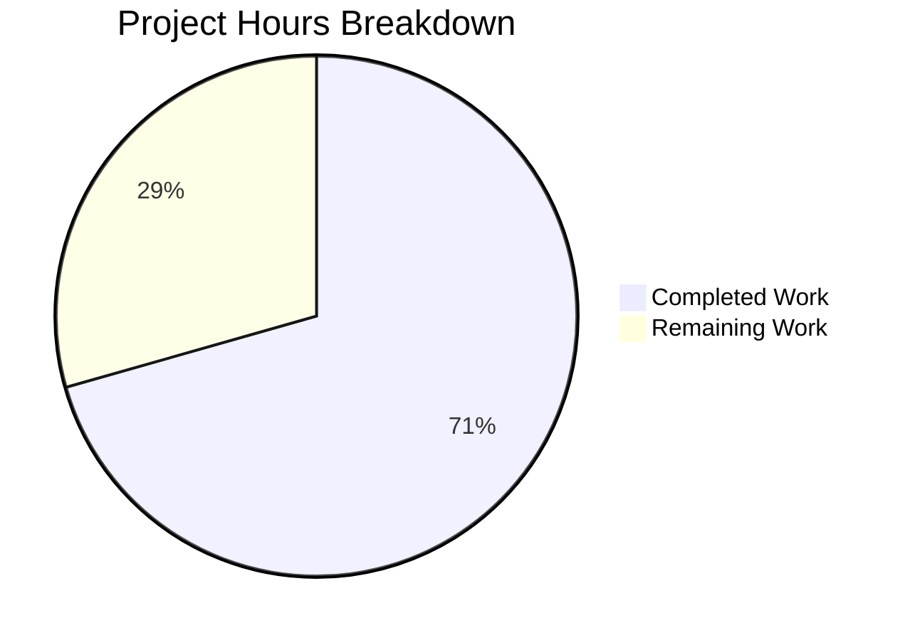
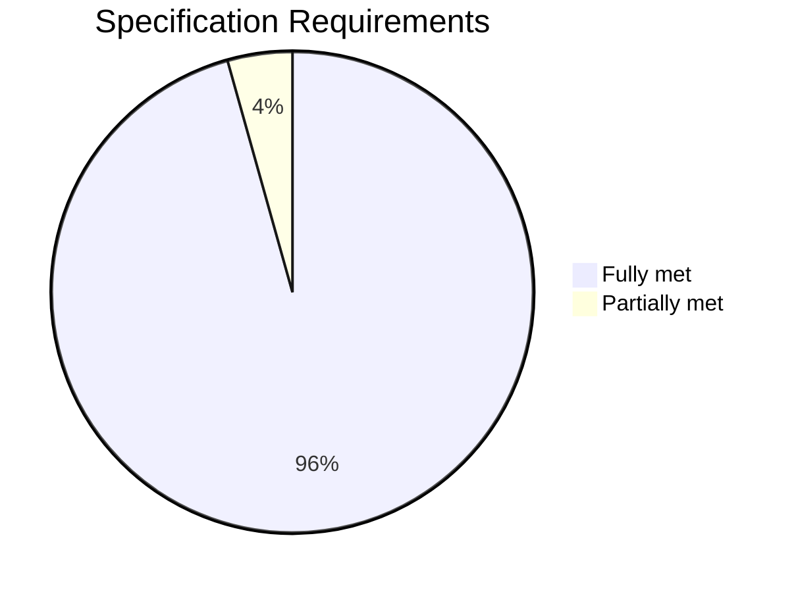

# 1. Executive Summary

## 1.1 Project Overview

`app.py` is a Python 3 / Flask port of the repository's Node.js HTTP listener: one module at the repository root that answers every request — any path, any of the nine standard verbs — with the constant body `Hello, World!\n` at status 200 on port 3000, announcing itself with the single line `Server running at http://127.0.0.1:3000/`. The original JavaScript file stays byte-identical and independently runnable, so the repository holds two interchangeable implementations. Scope is one file of 18 lines: no package structure, no manifest, no configuration, no hardening and no test suite — each deliberate — with Flask and Werkzeug resolved from the host environment.

## 1.2 Completion Status

**71% complete** — 12.0 hours delivered of 17.0 scoped.



| Metric | Hours |
|---|---|
| Total Hours | 17.0 |
| Completed Hours (Baseline: Human with agentic-assist) | 12.0 |
| Remaining Hours | 5.0 |

12.0 ÷ 17.0 × 100 = 70.6%, rounded to **71%**. Of 23 requirements, 22 are fully met and 1 partially; both open path-to-production items sit in the remaining hours.

## 1.3 Key Accomplishments

- Constant response verified on 126 of 126 registered verb × path combinations.
- Every path class answered from two rules, static route off.
- Nine standard verbs served identically, `OPTIONS` included so no `Allow`-only reply.
- One 41-byte start-up line, flushed after a successful bind, no banner.
- Loopback-only bind on port 3000, confirmed from the kernel socket table.
- An 18-line, zero-comment module matching the specified statement set byte for byte.
- Every pre-existing file left byte-identical, the Node implementation included.
- Flask 3.1.3 and Werkzeug 3.1.9 from the environment, nothing pinned in the repository.

## 1.4 Critical Unresolved Issues

Four of the 25 items the work was scoped against remain open — 23 requirements plus 2 path-to-production items — so **4 of 25**.

| Issue | Impact | Owner | ETA |
|---|---|---|---|
| Newline-bearing paths (`GET /foo%0abar`) answer 404 with a 207-byte framework page instead of the constant body — accepted with a caveat | One well-formed request class sees a distinguishable status and body; no data, credential or control exposure | Maintainer | 0.5 h decision |
| Run environment not recorded in the repository: the specification names CPython 3.12.3 at `/usr/bin/python3`, while the host provides 3.13.18 as `python3` and 3.14.4 at that path | Cross-host reproducibility depends on out-of-band knowledge of Flask 3.1.3 / Werkzeug 3.1.9 | Maintainer | 0.5 h |
| No automated regression harness covers the fixed contract | A later edit could change the body, status or start-up line undetected | Maintainer | 2 h |
| Pinned `lodash` 4.17.15 carries 5 advisories (3 high, 2 moderate) | The install gate fails any audit check; no request path reaches a vulnerable API | Maintainer | 2 h |

## 1.5 Access Issues

No access issues identified: the listener needs no credential, secret, external service or elevated permission.

## 1.6 Recommended Next Steps

1. **[High]** Re-pin the advisory-bearing dependency in a dedicated change, keep the branch lockfile-free, re-run the install, audit and contract checks (2 h).
2. **[Medium]** Add a harness pinning the body hash, status, `Content-Length`, start-up line, verb set and refusal semantics (2 h).
3. **[Medium]** Record the interpreter and framework versions wherever this project documents its setup (0.5 h).
4. **[Low]** Settle the newline outcome: accept the 404 as specified, or admit a newline-spanning catch-all converter and re-verify (0.5 h decision, ~2 h if implemented).

# 2. Project Hours Breakdown

## 2.1 Completed Work Detail

| Component | Hours | Description |
|---|---|---|
| Single-file Flask port | 2.5 | `app.py`: the two route rules, one shared nine-verb list, one view returning the constant literal, `static_folder=None`, the `__main__` start-up block — 18 lines, 510 bytes, no second module. |
| Framework-parity design of the four behaviours | 3.0 | Settled from documented framework behaviour: string return → 200 with `text/html; charset=utf-8`; nine verbs upper-cased per rule; `HEAD` auto-provisioned from `GET` and the explicit `OPTIONS` listing that suppresses the automatic `Allow` reply; `static_folder=None` removing the `/static/<path:filename>` rule; `make_server` chosen over `app.run`/`run_simple` so no banner or reloader child is printed; the message kept a fixed literal in agreement with the bind. |
| Start-up sequencing and output contract | 1.5 | Bind before print (a taken port exits 1 with 0 bytes on stdout), one flushed 41-byte line, loopback-only bind on 127.0.0.1:3000. |
| Executable verification of the delivered contract | 4.0 | Whole-package gate (install, `node --check`, dependency version, manifest parse, Flask/Werkzeug import, `py_compile -W error`, `compileall`, `tabnanny`), a 126-case nine-verb × fourteen-path request matrix, edge probes (OPTIONS/`Allow`, PROPFIND and MKCALENDAR refusals, TRACE canary, XSS-shaped path, traversal path, CR versus LF path), a byte comparison of stdout, kernel socket inspection, import-safety check and a headless-Chrome replay of three URLs. |
| Scope and negative-space conformance | 1.0 | Zero comments, the absence of handlers, configuration, hardening, logging configuration, manifest, tests and documentation artefacts, and the byte-identity of every pre-existing path. |
| **Total completed** | **12.0** | Traces to the 23 requirements: 22 fully met, 1 partially met. |

## 2.2 Remaining Work Detail

| Category | Hours | Priority |
|---|---|---|
| Dependency advisory disposition — re-pin `lodash` 4.17.15 to a patched release in a dedicated change, keep the branch lockfile-free, re-run the install, audit and contract checks | 2.0 | High |
| Automated regression harness — pin the body hash, status, `Content-Length`, the single start-up line, the nine verbs and the refusal semantics across a representative path set | 2.0 | Medium |
| Run-environment record — document the interpreter and framework versions the listener needs, since the repository records neither and the specification's CPython 3.12.3 entry does not describe this host | 0.5 | Medium |
| Newline-bearing path decision — accept the 404/207-byte outcome as specified, or amend the specification to admit a newline-spanning catch-all converter and re-verify the matrix | 0.5 | Low |
| **Total remaining** | **5.0** | |

## 2.3 Hours Reconciliation and Confidence

Section 2.1 (12.0 h) plus Section 2.2 (5.0 h) equals the 17.0 total hours in Section 1.2, and the 5.0 remaining hours are the value carried by the Section 7 pie chart. Confidence is high in the completed estimate: the delivery surface is a single 18-line module and every claim behind the hours was observed at first hand — the request matrix, the byte comparison of stdout, the kernel socket table and the browser replay. Confidence is medium in the remaining estimate: the harness effort depends on the runner chosen, and the re-pin effort depends on whether the patched release shifts any transitive behaviour of the Node fixture.

# 3. Test Results

No automated test suite ships with this repository and none may be added within the port's scope, so the executable evidence below is the whole-package gate plus purpose-built HTTP probing, all of it executed against the delivered tree and a live listener on 127.0.0.1:3000.

| Area / Category | Framework | Tests | Passed | Failed | Coverage | What This Proves |
|---|---|---|---|---|---|---|
| Install and dependency gate | npm 11.21.0 / Node 22.23.5 / CPython 3.13.18 | 5 | 5 | 0 | The manifest, the lockfile-free install path and the two imported framework symbols | The pinned dependency resolves, no lockfile is written, the manifest parses, and Flask and Werkzeug import at the versions the port relies on. |
| Python static gates | CPython 3.13.18 (`py_compile -W error`, `compileall`, `tabnanny`) | 3 | 3 | 0 | The single module, warnings promoted to errors | The module compiles clean, contains no indentation defect and raises no warning. |
| Response contract across verbs and paths | Purpose-built raw-socket HTTP harness | 126 | 126 | 0 | Nine verbs × fourteen paths (`/`, nested, trailing slash, repeated slash, percent-encoded UTF-8, query string, `/static/*`, `/favicon.ico`, 4096-char path among them) | Every registered combination answers 200 with the identical 14-byte body and `Content-Length: 14`; `HEAD` carries the length with a 0-byte body. |
| Method semantics and refusals | Raw sockets and `curl` | 8 | 8 | 0 | `OPTIONS`, `HEAD`, `TRACE`, PROPFIND, MKCALENDAR, an XSS-shaped path, a traversal path, a carriage-return path | `OPTIONS` returns the constant body and no `Allow` header; unregistered verbs are refused with 405 naming exactly the nine; `TRACE` echoes no header; caller-shaped paths change nothing in the response. |
| Start-up output and ordering | Shell byte comparison (`wc`, `cmp`, `sha256sum`, log sweeps) | 5 | 5 | 0 | One process lifetime, before and after 126 requests, plus a start against a held port | Stdout is exactly one 41-byte line identical to the required literal; no banner, debugger or traceback text appears; the line cannot be printed before a successful bind. |
| Bind and port hygiene | Kernel socket table (`/proc/net/tcp`, `/proc/net/tcp6`) and a TCP connect probe | 3 | 3 | 0 | The listening socket and its teardown | The listener is loopback-only on 127.0.0.1:3000 with no wildcard socket, and the port is released when the process stops. |
| Browser rendering | Headless Chrome 157 at 1280×720 | 3 | 3 | 0 | `/`, `/a/b/c?x=1`, `/static/nope.css` | A real client receives status 200 and the 14-byte document with a trailing newline, with zero console errors and no response at or above 400. |
| Dependency advisory baseline | `npm audit` against a copy of the manifest | 1 | 1 | 0 | The single pinned dependency | The advisory set is exactly 5 lodash advisories (3 high, 2 moderate) and nothing else in the tree — the recorded baseline, reproduced. |

**Totals: 154 checks executed, 154 passed, 0 failed.** The repository's own `npm test` and `npm run build` do not exist by design (`package.json` declares no scripts), so no suite result is claimed for them.

### Not Covered

- **Malformed request framing, HTTP/0.9, chunked encoding, header-size limits and `Expect: 100-continue`** — deliberately outside the port's scope; the framework's own behaviour on these is accepted, not asserted.
- **TLS, certificates and exposure beyond loopback** — the listener binds 127.0.0.1 only, so no transport security or remote-access path was exercised.
- **Signal handling and shutdown behaviour other than process termination** — no handler exists by design; the process was stopped and the port observed released, nothing more.
- **Sustained concurrency and load** — request handling is single-threaded and single-process; no throughput, latency or contention measurement was taken.
- **The 5 dependency advisories' exploitability** — `lodash` is bound but never dereferenced in the Node fixture and is not imported by the Python port, so no vulnerable API was reachable to test.
- **Regression detection** — nothing re-runs automatically. Every result above is point-in-time, which is why an automated harness is carried as remaining work in Section 2.2.

Before release a human should add that harness, then re-run the response-contract matrix, the start-up byte check and the browser replay against whatever environment the listener will actually serve from.

# 4. Runtime Validation & UI Verification

The listener was driven at runtime on 127.0.0.1:3000 from a clean start, with raw-socket requests, `curl` and a headless Chrome client, then stopped and the port re-probed.

- ✅ **Start-up** — `python3 app.py` printed exactly one 41-byte line naming `http://127.0.0.1:3000/` and bound the loopback port; a second start against the held port exited 1 with an empty stdout.
- ✅ **Response contract** — `/`, `/a/b/c?x=1` and `/static/nope.css` each returned 200 with the 14-byte `Hello, World!\n` body, `text/html; charset=utf-8`, in both raw sockets and Chrome.
- ✅ **Path coverage** — root, nested segments, trailing slash, repeated slashes, percent-encoded UTF-8, query strings, `/static/*`, `/favicon.ico` and a 4096-character path all reach the same view; the framework's static route never answers 404.
- ⚠ **Newline-bearing path** — `GET /foo%0abar` answers 404 with a 207-byte framework page while `/foo%0dbar` answers 200 with the body; the accepted divergence tracked in Section 5.2.
- ✅ **Nine standard verbs** — GET, HEAD, POST, PUT, DELETE, CONNECT, OPTIONS, TRACE and PATCH all return 200 with the constant body on both rules; `OPTIONS` carries the body rather than an `Allow`-only reply.
- ✅ **Refusals and non-reflectivity** — PROPFIND and MKCALENDAR return 405 naming the nine registered verbs; `TRACE` echoes no request header; XSS-shaped, traversal-shaped and CRLF-shaped paths return the constant body.
- ✅ **Bind and teardown** — a single loopback listener with no wildcard socket; stopped on request and the port confirmed free afterwards.
- ✅ **Import safety** — importing the module exits 0 with no output, opens no socket and starts no process, so tooling can import it safely.
- ⚠ **Operational envelope** — the port is hard-coded with no override and the process is never supervised; only interactive foreground runs were exercised.
- ✅ **Browser rendering** — three navigations produced the plain document with zero console errors and no failed requests; Chrome's automatic favicon probes were answered by the catch-all with the same body.

**Never exercised at runtime:** TLS, malformed request framing, chunked encoding, header-size limits, signal handling, sustained concurrent load, and any exposure of the listener beyond the loopback interface.

# 5. Compliance & Quality Review

## 5.1 Compliance Matrix

| # | Deliverable | Benchmark | Status | Verified In |
|---|---|---|---|---|
| 1 | Single-file delivery at the repository root | Exactly one module added; no second Python file, package directory or `__init__.py` | ✅ Pass | `app.py`; `git diff --name-status` against the base shows `A app.py` alone |
| 2 | Specified statement set and order | Eleven prescribed statements in order, nothing else | ✅ Pass | `app.py:1-18`; byte-identical to the specified block, 510 bytes, sha256 `d2a615b0…2830a2a`; AST top-level nodes `ImportFrom, ImportFrom, Assign, Assign, FunctionDef, If` |
| 3 | Response body | `Hello, World!\n` byte for byte, 14 bytes | ✅ Pass | 126 of 126 live responses, sha256 `c98c24b6…ff2ad31`; `app.py:12` |
| 4 | Status and headers | 200 on every registered combination, `Content-Length: 14`, `text/html; charset=utf-8` | ✅ Pass | Request matrix and browser replay; header union limited to Server, Date, Content-Type, Content-Length, Connection |
| 5 | Port and bind | `make_server('127.0.0.1', 3000, app)`, loopback only, literals in agreement | ✅ Pass | `app.py:16-17`; `/proc/net/tcp` `0100007F:0BB8` state `0A`, nothing on `tcp6` |
| 6 | Start-up output | One 41-byte flushed line after the bind, no banner, no reloader child | ✅ Pass | `cmp`-identical stdout before and after 126 requests; zero banner or traceback matches on stderr |
| 7 | Path coverage | Every request path reaches the view, static route off | ⚠ Partial | All probed path classes pass (root, nested, repeated slash, percent-encoded UTF-8, query, `/static/*`, favicon, 4096-char); decoded newlines answer 404 — see 5.2 D1 |
| 8 | Method coverage | Nine upper-case verbs on both rules, on one source line, `OPTIONS` listed | ✅ Pass | `app.py:4`; both rules carry the nine with `provide_automatic_options=False`; PROPFIND and MKCALENDAR refused with 405 |
| 9 | Comments and negative space | No comments at all; no 404/error handler, no environment configuration, no hardening, no logging configuration, no debug or reloader | ✅ Pass | Zero `#` and zero comment tokens; `error_handler_spec` and hooks empty; `PORT`/`HOST`/`FLASK_DEBUG` change nothing; header set carries no security headers |
| 10 | Dependency posture | Versions resolved from the environment; no manifest, lockfile, build or CI file; no interpreter pin | ⚠ Partial | Flask 3.1.3 / Werkzeug 3.1.9 import and serve traffic; none of those files exists. Nothing in the repository records the versions, and the recorded interpreter does not describe this host — see 5.2 D2 |
| 11 | Sibling-file continuity | Node implementation, manifest, README and pre-existing documentation untouched | ✅ Pass | Every path byte-identical to the base; `server.js` still absent; only `app.py` added |
| 12 | Operational readiness | Contract re-runnable without ad-hoc probing; deployable start command | ⚠ Partial | `python3 app.py` is a complete start command and the port check is scripted, but no harness, supervision or port override exists |

## 5.2 AAP & Rule Divergences and Gaps

| What the AAP/Rule Required | What Was Delivered Instead | Why It Diverged | Impact | Remediation |
|---|---|---|---|---|
| Routing coverage: "every request path therefore reaches the view, nested segments and paths under `/static` included"; and the "any path" behaviour requirement | `app.py:10` binds the catch-all to the stock `path` converter (`[^/].*?`), so a path whose decoded form contains 0x0A matches no rule: `GET /foo%0abar` → 404 with a 207-byte framework page, where `/foo%0dbar` still returns 200 with the body | The specification's target-structure section closes the file's content to the eleven statements with that spelling; its behaviour-parity section accepts framework request-parsing differences as ones the port "neither measures nor closes"; its hard-limits table excludes encoding edge cases and forbids the only alternative settlement, a 404 or error handler | One well-formed request class receives a distinguishable status and body — a response-shape difference with no data, credential or control exposure on a loopback-only listener | Accept as specified, or amend the specification to admit a newline-spanning route converter and re-verify (0.5 h decision, ~2 h if implemented) |
| Dependency inventory: "CPython 3.12.3 — the interpreter at `/usr/bin/python3`; the highest Python present" | The host runs CPython 3.13.18 as `python3` (`/usr/local/bin/python3`) and CPython 3.14.4 at `/usr/bin/python3`; no 3.12 exists. The port carries no interpreter statement, by design | The record was written for an interpreter this host does not have; both installed interpreters satisfy Flask 3.1.3 / Werkzeug 3.1.9's `>=3.9` floor and run the module to identical observable behaviour, and no code site may carry the correction (no comments, no shebang, no manifest permitted) | Documentation accuracy and cross-host reproducibility only; nothing in the repository records the interpreter or the framework versions | Record the actual environment wherever this project documents its setup (0.5 h) — carried in Section 2.2 |
| Source of truth: the request names `server.js` as the behaviour source and declares its quoted one-liner the complete and only authority, directing that a mismatch be reported rather than substituted **— Sanctioned by the request's own direction** | The checkout has no `server.js`; it holds `server (1).js`, which carries content beyond the quote — a `require('lodash')` binding and a summary comment. The port reproduces the quoted behaviour only: no lodash dependency, no comment | The request declares the quote the only behaviour authority and directs that the mismatch be reported rather than resolved by another copy, which the specification does in its scope-boundaries and open-questions sections | None for the four required behaviours; the two implementations differ only by a dependency that is never dereferenced | None required |

**D1 — newline-bearing paths.** The routing is the two rules the specification enumerates, and the framework's `path` converter cannot consume a line feed — the matcher compiles that segment without the flag that lets a dot match 0x0A — so `GET /foo%0abar` reaches no rule and the framework answers 404 with its own 207-byte page (`app.py:10`). Because the target-structure section closes the file's content and the hard-limits table forbids both a handler and encoding work, the divergence is recorded rather than closed, and nothing is exposed on a loopback-only bind. The owner must decide whether the coverage sentence or the closed statement set governs; the converter option needs a specification amendment and a re-run of the Section 3 matrix.

**D2 — the documented run environment.** The specification pins Flask 3.1.3 and Werkzeug 3.1.9 correctly — both served every response in Section 3 — but its interpreter row names CPython 3.12.3 at `/usr/bin/python3`, which this host does not have: `python3` is 3.13.18 under `/usr/local/bin`, and `/usr/bin/python3` is 3.14.4. Both sit inside both packages' `>=3.9` floor and run the module identically, so nothing observable depends on the difference. What matters for a fresh machine is that the repository records no versions at all. Recording the interpreter and the two framework versions closes the gap; adding a manifest is a separate decision the specification excludes from this change.

# 6. Risk Assessment

| Risk | Category | Severity | Probability | Mitigation | Status |
|---|---|---|---|---|---|
| Pinned `lodash` 4.17.15 carries 5 advisories (3 high, 2 moderate); any pipeline that gates on `npm audit` fails | Security | High | Low — the binding in `server (1).js` is never dereferenced and the Python port imports nothing from it, so no vulnerable API is reachable from a request | Re-pin to a patched release in a dedicated change, keep the branch lockfile-free, re-run the install, audit and contract checks | Open |
| No automated harness covers the fixed contract, so a later edit could silently change the body, status or start-up line | Technical | Medium | Medium — the module is small and stable, but nothing re-runs the 154 checks above | Add the regression harness described in Section 2.2 | Open |
| Reproducibility depends on host-global packages: Flask 3.1.3 / Werkzeug 3.1.9 are named nowhere in the repository and no manifest or lockfile exists | Operational | Medium | Medium — a fresh machine cannot reproduce the run without out-of-band knowledge | Record the interpreter and framework versions; reconsider a manifest only where the specification permits one | Open |
| Hard-coded exclusive port with no override, single-threaded development server, no process supervision | Operational | Medium | Medium — one slow client delays every other request, and a second listener on 3000 fails outright | Run under a supervisor and behind a production WSGI server if the listener must serve beyond a fixture; change the port only by editing the two agreeing literals | Accepted (specified behaviour) |
| A path whose decoded form contains 0x0A answers 404 with a 207-byte framework page instead of the constant body | Technical | Low | Low — one request class, loopback only, no caller data in the response | Accept as the specification's settled outcome, or amend it to admit a newline-spanning converter | Open (accepted) |
| No transport security and no hardening headers; the surface is anonymous to any local caller | Security | Medium | Low — the bind is loopback only and the response is a constant with no identity, session or stored data | Terminate TLS at a reverse proxy and keep the listener off non-loopback interfaces if it is ever exposed | Accepted (deliberate omission) |
| The Node fixture and the Python port both hard-code port 3000 and cannot run at the same time | Integration | Medium | High if both implementations are needed on one host — the second start fails with `Address already in use` | Run one at a time, or give the port a configuration seam if parallel operation is ever required | Accepted (specified behaviour) |
| Framework defaults differ from the Node original: HTTP/1.0 framing, a `text/html` content type where the fixture sends none, per-request access lines on stderr, and different handling of unusual verbs | Operational | Low | High — any byte-level comparison of the two implementations shows these differences | Compare the four required behaviours rather than wire formats, as the specification does | Accepted |

# 7. Visual Project Status

**Project hours — 71% complete.** 12.0 of 17.0 hours delivered, 5.0 remaining.


**Requirement status** — 23 requirements inventoried: 22 fully met, 1 partially met.



**Remaining hours by category** — the four rows of Section 2.2.

| Category | Hours | Priority |
|---|---|---|
| Dependency advisory disposition | 2.0 | High |
| Automated regression harness | 2.0 | Medium |
| Run-environment record | 0.5 | Medium |
| Newline-bearing path decision | 0.5 | Low |
| **Total** | **5.0** | |

**Colour key (Blitzy brand):** Completed / delivered work — Dark Blue `#5B39F3`; Remaining / not completed — White `#FFFFFF`; headings and accents — Violet-Black `#B23AF2`; highlights — Mint `#A8FDD9`. The hours chart's "Remaining Work" value (5) equals the 5.0 remaining hours in Section 1.2, the 5.0 total of Section 2.2 and the 5.0 in the table above; the hours chart's "Completed Work" value (12) equals the 12.0 total of Section 2.1, and 12.0 + 5.0 = the 17.0 total hours in Section 1.2.

# 8. Summary & Recommendations

The port is delivered and verified: `app.py` is an 18-line Flask module that answers every request on every path and every one of the nine standard verbs with the 14-byte `Hello, World!\n` body at status 200, binds 127.0.0.1:3000, and announces itself with exactly one 41-byte start-up line after a successful bind. It matches the specified statement set byte for byte, carries no comments, and leaves every pre-existing file — the Node implementation it mirrors included — untouched. The specification's requirements stand at 22 fully met and 1 partially met, and the measured hours stand at **71% complete** (12.0 of 17.0), with the open balance made up of production hygiene rather than missing functionality.

What the reader can rely on is measured, not asserted: 154 executed checks with no failures, of which 126 are a nine-verb × fourteen-path matrix that returns the identical body hash on every registered combination, plus start-up byte equality before and after traffic, a loopback-only listener confirmed from the kernel socket table, refusals for verbs outside the nine, and a headless-browser replay with zero console errors and no response at or above 400. The two behavioural properties that matter as much as the positives also hold: nothing echoes caller input, and importing the module starts nothing.

The open items are four, and none blocks the stated contract. The most significant is the absence of an automated harness — the fixed behaviour is proven, but nothing re-proves it, so any later edit is unguarded. The manifest's pinned dependency carries 5 advisories (3 high) that no request path can reach but that fail a standard audit gate. The newline-bearing path class answers 404 instead of the constant body, accepted because the specification both enumerates the routing that produces it and accepts framework request-parsing differences. And the run environment is undocumented in the repository, which leaves a fresh machine dependent on out-of-band knowledge of the interpreter and framework versions.

The critical path to production is short and sequential: add the regression harness so the contract is guarded, record the environment so it is reproducible, re-pin the dependency so the install gate passes, and settle the newline-path decision so the specification and the behaviour say the same thing — 5.0 hours in total, with the harness and the re-pin on the only path that can surprise an operator. **Production readiness: ready to run as specified on this host, and ready for wider use once the harness and the dependency re-pin land.** As a loopback fixture that serves a constant response, it needs no hardening, no transport security and no configuration seam, and the specification deliberately excludes all three; the moment it must serve anything other than a constant over loopback, those become design work rather than gaps.

# 9. Development Guide

### System prerequisites

| Requirement | Version on this host | Notes |
|---|---|---|
| Node.js + npm | v22.23.5 / 11.21.0 | Needed only to install and run the Node fixture the port mirrors, and to parse the manifest. |
| Python 3 | CPython 3.13.18 (`python3`) | Runs `app.py`. `/usr/bin/python3` is CPython 3.14.4 on this host and works equally well. |
| Flask / Werkzeug | 3.1.3 / 3.1.9 | Resolved from the host's Python environment; the repository pins neither. |
| TCP port 3000 | free | Hard-coded in both implementations; there is no `PORT` override. |
| Chrome (optional) | 157 | Only for the browser check below. |

### Environment setup

No virtualenv and no Python dependency file exist, and none should be added: the framework resolves from the host environment and the specification excludes a second file. Confirm the interpreter and the packages before anything else.

```bash
cd <repository root>
node --version                      # v22.23.5
python3 --version                   # Python 3.13.18
python3 -c "import importlib.metadata as m; print('flask', m.version('flask'), 'werkzeug', m.version('werkzeug'))"
# flask 3.1.3 werkzeug 3.1.9
python3 -m pip check                # No broken requirements found.
```

### Dependency installation

The manifest carries one pin (`lodash@4.17.15`) consumed by the Node fixture, not by the Python port. Install it per checkout; `--no-package-lock` keeps the branch lockfile-free, and `npm ci` cannot work because the branch ships no lockfile.

```bash
CI=true npm install --no-fund --no-package-lock    # exit 0; prints the expected "1 high severity vulnerability" line
node -p "require('lodash').VERSION"                # 4.17.15
```

### Static checks before running

```bash
node --check "server (1).js"                       # exit 0 (quote the name: it contains a space and parentheses)
python3 -W error -m py_compile app.py              # exit 0
python3 -m compileall -q app.py                    # exit 0
python3 -m tabnanny app.py                         # exit 0
node -e "JSON.parse(require('fs').readFileSync('package.json','utf8'))"   # exit 0
```

### Starting the listener

Port 3000 is exclusive and hard-coded, so check it is free first. `lsof`, `ss` and `netstat` are not installed on this host; a connect probe answers the question, and `/proc/net/tcp` shows the listener as `0100007F:0BB8` in state `0A` (state `06` is TIME_WAIT, not a listener).

```bash
node -e "const s=require('net').connect(3000,'127.0.0.1');s.on('connect',()=>{console.log('IN USE');s.end();process.exit(1)});s.on('error',()=>{console.log('FREE');process.exit(0)})"
# FREE  (exit 0) — start only on FREE
python3 app.py
# Server running at http://127.0.0.1:3000/
```

The start-up line is the whole of stdout — 41 bytes including its newline — and it appears only after the socket is bound. Per-request access lines are written to stderr by the framework's default handler; nothing configures them.

### Verification steps

With the server running in one shell, exercise the contract from another.

```bash
curl -sS -i http://127.0.0.1:3000/
# HTTP/1.0 200 OK
# Server: Werkzeug/3.1.9 Python/3.13.18
# Content-Type: text/html; charset=utf-8
# Content-Length: 14

curl -sS http://127.0.0.1:3000/ | wc -c        # 14
curl -sS http://127.0.0.1:3000/ | sha256sum    # c98c24b677eff44860afea6f493bbaec5bb1c4cbb209c6fc2bbb47f66ff2ad31
curl -sS -o /dev/null -w '%{http_code} %{size_download}\n' http://127.0.0.1:3000/a/b/c     # 200 14
curl -sS -o /dev/null -w '%{http_code} %{size_download}\n' http://127.0.0.1:3000/static/x.css   # 200 14
curl -sS -X OPTIONS -D - -o /dev/null http://127.0.0.1:3000/ | grep -ci '^allow:'          # 0 — the body, not an Allow reply
curl -sS -o /dev/null -w '%{http_code}\n' -X PROPFIND http://127.0.0.1:3000/               # 405
curl -sS -o /dev/null -w '%{http_code}\n' "http://127.0.0.1:3000/foo%0abar"                # 404 — the accepted newline case
```

Byte-check the start-up line on a fresh start, then stop that process:

```bash
out=$(mktemp); python3 app.py > "$out" 2>"$out.err" &
sleep 1; wc -c "$out"              # 41
kill %1                            # then re-run the free-port probe above; it should print FREE again
```

Import safety, useful for tooling: `python3 -c "import app"` exits 0 silently, opens no socket and starts nothing.

### Example usage

Any client can be pointed at the listener: the response never varies with the path, the verb, the query string, headers or a request body.

```bash
curl -s http://127.0.0.1:3000/anything/at/all?q=1     # Hello, World!
curl -s -X POST -d '{"a":1}' http://127.0.0.1:3000/    # Hello, World!
google-chrome --no-sandbox --disable-dev-shm-usage --window-size=1280,720 http://127.0.0.1:3000/
```

### Running the Node fixture instead

The original implementation answers the same four behaviours and needs the same port, so stop one before starting the other.

```bash
node "server (1).js"      # Server running at http://127.0.0.1:3000/
```

### Dependency advisory check

Run this against a copy of the manifest outside the checkout so the branch stays lockfile-free, and never run `npm audit fix` (it rewrites the pin to 4.18.1 and creates a lockfile).

```bash
scratch=$(mktemp -d); cp package.json "$scratch/"
cd "$scratch" && CI=true npm install --package-lock-only --no-fund && CI=true npm audit
# exit 1: 1 high severity vulnerable package — 5 lodash advisories (3 high, 2 moderate), the recorded baseline
```

### Troubleshooting

| Symptom | Cause | Resolution |
|---|---|---|
| `python3 app.py` exits 1, stderr `Address already in use` / `Port 3000 is in use by another program`, stdout empty | The port is held by another listener; the bind happens before the start-up print, so nothing is printed | Find what holds 3000 with the connect probe and `/proc/net/tcp`, stop the process you own, re-probe, then start. |
| `curl: (7) Failed to connect to 127.0.0.1 port 3000` | No listener is running, or it has not finished binding | Start the server and wait for the start-up line, then retry. |
| Two start-up lines, or a `Running on …` / development-server banner | The process was started through `app.run` or `run_simple`, or a debug reloader is active | Start it only as `python3 app.py`; the module deliberately uses `make_server`, which prints nothing of its own and starts no child. |
| Response is not 14 bytes, or the status is not 200 | The body literal or the view return was edited | Restore `return 'Hello, World!\n'` as the whole view body; a returned string is what yields 200 with `text/html`. |
| `GET /foo%0abar` returns 404 | The stock `path` converter cannot match a decoded line feed | Expected under the current specification; see Section 5.2 D1 before changing the routing. |
| `npm install` created a `package-lock.json`, or `npm ci` fails with `EUSAGE` | Plain `npm install` writes a lockfile, and `npm ci` requires one | Delete the lockfile and install with `CI=true npm install --no-fund --no-package-lock`. |
| `node --check server (1).js` fails to open the file | The filename contains a space and parentheses and was left unquoted | Quote it: `node --check "server (1).js"`. |

# 10. Appendices

### A. Command Reference

| Purpose | Command |
|---|---|
| Install the manifest pin | `CI=true npm install --no-fund --no-package-lock` |
| Report the pinned dependency version | `node -p "require('lodash').VERSION"` |
| Parse the manifest | `node -e "JSON.parse(require('fs').readFileSync('package.json','utf8'))"` |
| Syntax-check the Node fixture | `node --check "server (1).js"` |
| Syntax-check the Python module | `python3 -W error -m py_compile app.py` |
| Byte-compile the module verbatim | `python3 -m compileall -q app.py` |
| Whitespace and indentation check | `python3 -m tabnanny app.py` |
| Probe whether port 3000 is free | `node -e "const s=require('net').connect(3000,'127.0.0.1');s.on('connect',()=>{console.log('IN USE');s.end();process.exit(1)});s.on('error',()=>{console.log('FREE');process.exit(0)})"` |
| Start the Python listener | `python3 app.py` |
| Start the Node listener | `node "server (1).js"` |
| Check the contract | `curl -sS -i http://127.0.0.1:3000/` |
| Check the body hash | `curl -sS http://127.0.0.1:3000/ \| sha256sum` |
| Count the body bytes | `curl -sS http://127.0.0.1:3000/ \| wc -c` |
| Count start-up bytes | `out=$(mktemp); python3 app.py > "$out" 2>"$out.err" & sleep 1; wc -c "$out"` |
| Import without starting | `python3 -c "import app"` |
| Reproduce the advisory baseline | `scratch=$(mktemp -d); cp package.json "$scratch/"; cd "$scratch" && CI=true npm install --package-lock-only --no-fund && CI=true npm audit` |
| Inspect the listening socket | `grep -i ':0BB8' /proc/net/tcp /proc/net/tcp6` |
| Confirm the tree is untouched | `git status --porcelain` |

### B. Port Reference

| Port | Bound by | Interface | Notes |
|---|---|---|---|
| 3000 | `app.py` (`make_server('127.0.0.1', 3000, app)`) and `server (1).js` (`.listen(3000, …)`) | 127.0.0.1 only for the Python port; every interface for the Node fixture | Hard-coded in both; no `PORT` override exists. Exclusive — the two implementations cannot run at once. Appears exactly twice in `app.py` (the bind and the start-up message) and the two must agree. |

There is no other listening socket: no admin, metrics, health or debug port exists.

### C. Key File Locations

| Path | Role |
|---|---|
| `app.py` | The whole Python deliverable: 18 lines, two route rules, one view, the nine-verb list, the start-up block. Repository root, no package of its own. |
| `server (1).js` | The pre-existing Node implementation the port mirrors. Byte-identical to its base version; 263 bytes. |
| `package.json` | `cve-test-fixture`, single dependency `lodash@4.17.15`, no scripts. Byte-identical to its base version. |
| `README.md` | 72-byte install/run note for the Node fixture. Byte-identical to its base version. |
| `blitzy/documentation/` | Pre-existing project documentation, unmodified by this change. |
| `node_modules/` | Per-checkout install output; untracked and never committed. |
| `blitzy/screenshots/` | Browser captures from validation runs; untracked and never committed. |
| `server.js` | Absent, and it must stay absent: the specification records the name in the request while the checkout holds `server (1).js`. |

### D. Technology Versions

| Component | Version verified | Where it comes from |
|---|---|---|
| Python (as `python3`) | CPython 3.13.18 | `/usr/local/bin/python3`; `/usr/bin/python3` is CPython 3.14.4 and runs the module identically |
| Flask | 3.1.3 | Host Python environment; not pinned in the repository |
| Werkzeug | 3.1.9 | Host Python environment, resolved as Flask's own dependency |
| Node.js / npm | 22.23.5 / 11.21.0 | Host toolchain; used for the manifest and the Node fixture |
| lodash | 4.17.15 | `package.json`, installed per checkout |
| Chrome | 157 (headless) | Used only for the browser check |

### E. Environment Variable Reference

The module reads no environment variable: it consults no `os.environ`, no `getenv` and no Flask configuration object, so `PORT`, `HOST` and `FLASK_DEBUG` have no effect and the listener always binds `127.0.0.1:3000`. The specification excludes environment-driven configuration deliberately.

| Variable | Effect |
|---|---|
| `CI=true` | Install-time only: keeps npm non-interactive and suppresses prompts. Not read by the application. |
| `PYTHONDONTWRITEBYTECODE=1` | Optional: keeps `__pycache__/` out of the checkout when importing the module for tooling. Not read by the application. |
| `PORT`, `HOST`, `FLASK_DEBUG`, `FLASK_APP`, `WERKZEUG_RUN_MAIN` | No effect on the application; setting them does not move the port or enable a debugger. |

No secret, credential or API key is required or read.

### F. Developer Tools Guide

- **`python3`** runs the deliverable; `-W error` promotes warnings so a clean compile means a clean compile.
- **`node` / `npm`** install, parse and syntax-check the manifest and the Node fixture. Quote the fixture's filename everywhere — it contains a space and parentheses.
- **`curl`** is the quickest contract probe; `-D -` shows headers, `-o /dev/null -w` isolates status and size.
- **`/proc/net/tcp`** is the listener's ground truth on this host, because `lsof`, `ss` and `netstat` are not installed: `0100007F:0BB8` in state `0A` is 127.0.0.1:3000 listening, and state `06` is TIME_WAIT.
- **`git`** answers "what changed": `git diff --name-status origin/2509_01...HEAD` should show `A app.py` alone, and `git status --porcelain` should show only the two untracked directories.
- **Chrome** with `--no-sandbox --disable-dev-shm-usage` renders the constant body; emulate a 1280×720 viewport before navigating, and take viewport-only screenshots — a full-page capture of this near-empty page fails the image's aspect-ratio limit.

### G. Glossary

| Term | Meaning here |
|---|---|
| WSGI | The Python web-server interface between Werkzeug's server and the Flask application. |
| `make_server` | Werkzeug's server factory. Chosen over `app.run`/`run_simple` because it binds first, prints no banner and starts no reloader child. |
| Route rule | A URL pattern registered on the application. Two exist: `/` and `/<path:p>`. |
| Catch-all | The `/<path:p>` rule that matches any non-root path, nested segments included. |
| Path converter | The framework component that converts a URL segment into the view argument. The stock `path` converter uses `[^/].*?`. |
| `static_folder=None` | The switch that stops Flask registering its own `/static/<path:filename>` rule, so `/static/*` reaches the constant view instead of answering 404. |
| `provide_automatic_options` | The framework switch that would answer `OPTIONS` with an `Allow` header alone; listing `OPTIONS` in the method set turns it off so the view answers instead. |
| sha256 body hash | The 64-character digest used to compare response bodies: `c98c24b677eff44860afea6f493bbaec5bb1c4cbb209c6fc2bbb47f66ff2ad31` for the 14-byte body. |
| Loopback | The 127.0.0.1 interface, reachable only from the local host. |
| TIME_WAIT | A closed-socket state (`06`) that is not a listener; only state `0A` means something is listening. |
