# Technical Specification

# 1. Introduction

## 1.1 Executive Summary

**Project overview.** `cve-test-fixture` is a deliberately minimal Node.js HTTP fixture. `package.json` declares the npm package identity `cve-test-fixture@1.0.0` (L2–L3) and exactly one third-party dependency, `"lodash": "4.17.15"`, pinned to a release with published security advisories and written without a semver range (L5). The whole runtime is five lines of CommonJS in `server (1).js`: it binds `require('lodash')` to `_` (L1), and never references `_` again; it creates an `http` server whose listener ends every response with the constant 14-byte body `Hello, World!\n` (L3–L4); and it listens on TCP port 3000, logging `Server running at http://127.0.0.1:3000/` (L5). There is no framework, build step, database, configuration source or test suite.

| Path | Size | Role in the repository |
|---|---|---|
| `package.json` | 104 B, 7 lines | Package identity and the single vulnerable dependency pin; no `scripts`, `main`, `engines`, `license`, `author` or `devDependencies` |
| `server (1).js` | 263 B, 5 lines | The only executable file: unused `lodash` import, catch-all handler, listener on port 3000 |
| `README.md` | 72 B, 5 lines | The only usage documentation: project name, `npm install`, `node "server (1).js"` |
| `blitzy/documentation/` | 2 Markdown files | A delivery report (`Project Guide - 182193aa-…md`) and a prior release of this specification (`Technical Specifications.md`) |

**Core business problem.** The fixture exists to give security tooling a small, deterministic, known-answer target: a real Node.js project whose only defect is exactly one known-vulnerable dependency. Four properties of the repository carry that purpose, and each is observable in the code:

- **The name states the role.** `package.json` L2 sets `cve-test-fixture`, and the original `README.md` at commit `b306e60` consisted of the single line `# Repo_withMinorCVE_02`.
- **The dependency is pinned to a vulnerable release.** `"lodash": "4.17.15"` (`package.json` L5) is an exact pin, so the vulnerable version cannot drift between installations or machines.
- **The dependency is present on both analysis layers.** It is declared statically in the manifest and loaded into the running process at module scope (`server (1).js` L1), so both a manifest scan and a runtime inventory see it. The load is unconditional: before installation, `node "server (1).js"` fails with `Error: Cannot find module 'lodash'` at L1.
- **The dependency is functionally inert.** `_` is never dereferenced, so no application behaviour depends on the vulnerable API and a remediation cannot change the service's output.

An audit of the committed manifest confirms the fixture carries the defect it is named for. `npm audit` against a fresh install of this `package.json` reports **1 vulnerable package** (`lodash`, range `<=4.17.23`) at **high** aggregate severity with **five advisories** — three high (GHSA-35jh-r3h4-6jhm, GHSA-p6mc-m468-83gw, GHSA-r5fr-rjxr-66jc) and two moderate (GHSA-29mw-wpgm-hmr9, GHSA-xxjr-mmjv-4gpg) — and offers `lodash@4.18.1` as the fix, noting that version is "outside the stated dependency range".

**Key stakeholders and users.** The repository declares no owner, maintainer, license or contact field; `git` metadata is the only record of who acts on the fixture, and the user groups below are inferred from the package name and structure rather than stated anywhere in the tree.

| Stakeholder / user | Relationship to the fixture | Evidence in the repository |
|---|---|---|
| Repository author `lakshya-blitzy <lakshya@blitzy.com>` | Created the fixture files and made the later hand edits to the README and handler; deleted the lockfile | Commits `b306e60`, `ddd2024`, `44b04ea`, `dd23c44`, `5433d34`, `8d02da8` |
| Automation agents `Blitzy Agent` and `blitzy-qa[bot]` | Author documentation and remediation commits and merged PR #2 (current HEAD `0de48f7`) | Commit subjects in `git log`; `26f31dc` pins `lodash` 4.18.1 on a separate ref |
| SCA / dependency-audit tooling | Primary machine consumer: reads the manifest pin and reports the advisories | Package name `cve-test-fixture`; exact pin at `package.json` L5 |
| Remediation agents and engineers | Apply the upgrade and re-verify the service still answers | Runnable handler in `server (1).js`; `npm audit` fix path `lodash@4.18.1` |
| QA / validation engineers for security tooling | Use the fixture as a known-answer case with a fixed expected response | Install and run commands in `README.md` L3–L5; constant response body |

**Business impact and value proposition.** The fixture's value comes from how little it contains: every property that would add noise to a security test is deliberately absent, which makes each reported finding traceable to one cause.

| Value | Mechanism in this repository | Evidence |
|---|---|---|
| Isolation of the variable under test | One declared dependency and no transitive tree, so any finding maps to a single package | `package.json` L5; `npm install` reports `added 1 package` and `node_modules` holds only `lodash` |
| Determinism of the vulnerable state | Exact version pin with no range; npm cannot move the pin without an explicit override | `package.json` L5; audit fix requires `--force` and calls 4.18.1 "outside the stated dependency range" |
| Behavioural oracle for remediation | Every path and method returns the same status and the same 14 bytes, so a dependency upgrade is checked by one request | `server (1).js` L3–L4; `GET /`, `GET /nope` and `POST /` each returned `200` with a 14-byte body |
| Zero functional coupling to the vulnerable API | The import is bound at load and never used, so an upgrade cannot alter application output | `server (1).js` L1 is the only line mentioning `lodash` or `_` |
| Detection at both static and runtime layers | The vulnerable package is declared in the manifest and loaded into the process | `server (1).js` L1 fails with `MODULE_NOT_FOUND` before `npm install` |

The value is bounded by design. The fixture implements no authentication, routing, TLS, persistence, logging, metrics, tests or configuration, and it answers on every path and method — all of which this specification records as absent in 1.3.2. It is a validation asset for dependency-scanning and remediation workflows, not a production HTTP service, and the committed `Project Guide` reaches the same conclusion: "ready for its stated purpose, not a production HTTP service."


## 1.2 System Overview

The system is one Node.js process, one manifest, one five-line quickstart and a documentation folder; nothing else exists in the tracked tree. The three sub-sections below place that system in context, describe it as built, and state what "working" means for it.

### 1.2.1 Project Context

**Business context and market positioning.** The fixture is an internal validation asset for security tooling, not a product: `package.json` carries no `license`, `author`, `repository`, `description`, `private` or `publishConfig` field (L1–L7), and `README.md` markets nothing beyond the two commands needed to run it. Its context is dependency-security testing — a real npm project with exactly one known-vulnerable pin, small enough that a scanner's report can be checked by hand. Three details place it in that context:

- **Series naming.** The repository is `Repo_withMinorCVE_02`; the original `README.md` at commit `b306e60` held only the line `# Repo_withMinorCVE_02`, which is the source of the name. The `_02` suffix implies a numbered series, though no sibling fixture exists in this repository.
- **Hand-assembled content.** The files arrived in one GitHub web upload (commit `ddd2024`, "Add files via upload"), and the entry point is named `server (1).js` — the duplicate-name suffix a browser adds on download. The ` (1)` is a permanent part of the filename and must be quoted in every command.
- **A widely used dependency as the target.** `lodash` (`package.json` L5) is one of the most widely deployed npm packages, which makes it a realistic and well-documented subject for advisory detection and remediation. There is no market positioning, customer segment or pricing model because there are no customers.

**Current system limitations.** The fixture replaces or upgrades no earlier system: the initial commit `b306e60` contained only the one-line README, the current tree adds the manifest, the handler, a quickstart and two documents, and no previous implementation is superseded. The limitations below therefore describe the current design, and several of them are the fixture's intended condition rather than defects.

| Limitation | Location | Consequence |
|---|---|---|
| Vulnerable pinned dependency `lodash` 4.17.15 | `package.json` L5 | `npm audit` reports 1 vulnerable package at high severity with 5 advisories. This is the fixture's purpose. |
| Exact pin blocks range-based fixes | `package.json` L5 | `npm audit fix` cannot move the pin; it requires `--force` and reports 4.18.1 as "outside the stated dependency range" |
| No committed lockfile | Absent from the tree; deleted in commit `dd23c44` | `npm ci` fails with `EUSAGE`; `npm install` is the only install path and writes `package-lock.json` (lockfileVersion 3) at install time, so installs are not byte-reproducible |
| Unused import, loaded unconditionally | `server (1).js` L1 | The dependency is required into the process without functional purpose, and the module cannot start before installation (`MODULE_NOT_FOUND`) |
| Wildcard bind behind a loopback log line | `server (1).js` L5 | `listen(3000)` takes no host argument, so the listener answers on every interface; it answered at `10.11.0.7:3000` while logging `http://127.0.0.1:3000/` |
| Port 3000 hard-coded | `server (1).js` L5 | A second instance exits with `listen EADDRINUSE: address already in use :::3000`; no `PORT` override exists |
| No `Content-Type`, no security headers | `server (1).js` L3–L4 | Clients must sniff the body type; the body is a constant ASCII literal that never reflects input |
| No tests, CI, lint or `engines` constraint | Absent from the tree and the manifest | `npm test` exits with `Missing script: "test"`; no automated regression check exists and the runtime version is undeclared |
| Filename contains a space and parentheses | `server (1).js` | Every invocation must be quoted, and no `main` or `start` script hides the name |
| Committed documentation is stale | `blitzy/documentation/Technical Specifications.md` | It describes a 537-byte `package-lock.json`, a deleted README and an `npm ci` model that the current tree does not have |

**Integration with the existing enterprise landscape.** The fixture has exactly one external integration — the public npm registry at install time — plus the advisory data behind `npm audit` and the inbound HTTP clients that reach the listener. It calls no service, database, broker or identity provider, and it participates in no pipeline.

| Integration | Direction and timing | Detail |
|---|---|---|
| Public npm registry | Inbound, at install time | Resolves `lodash` 4.17.15 into `node_modules`; with no committed lockfile, neither a resolved URL nor an integrity hash is recorded in the repository |
| npm advisory data | Consumed on demand by an operator | Supplies the GHSA findings that `npm audit` reports against the pin |
| HTTP clients | Inbound, at runtime | Any client that can reach TCP port 3000 on any interface of the host |
| CI, container platform, IaC, registries | Not integrated | No `.github`, `Dockerfile`, `*.yml`/`*.yaml`, `.gitignore` or infrastructure files exist in the tree |

### 1.2.2 High-Level Description

**Primary system capabilities.** Five capabilities make up the entire system, and each maps to a specific line or file:

1. **Dependency declaration with a vulnerable exact pin.** `"lodash": "4.17.15"` (`package.json` L4–L5) fixes the dependency to one advisory-bearing release with no range.
2. **Install-time resolution.** `npm install` fetches the pin from the public registry and reports `added 1 package`; nothing is locked ahead of time because no lockfile is committed.
3. **Load-time reachability of the dependency.** `const _ = require('lodash')` (`server (1).js` L1) pulls the vulnerable package into the process at module scope; the binding is never referenced afterwards.
4. **Fixed-response HTTP service.** Every request — any path, any method — receives `HTTP/1.1 200 OK` with `Content-Length: 14` and the body `Hello, World!\n`. Node adds `Date`, `Connection` and `Keep-Alive`; no `Content-Type` is set.
5. **Startup signal.** Once listening, the process writes the single line `Server running at http://127.0.0.1:3000/` to stdout and stays alive on the open socket.

| Component | Type | Responsibility | Depends on |
|---|---|---|---|
| `package.json` | npm manifest | Declares the package identity and the exact vulnerable pin | — |
| `server (1).js` | CommonJS entry script | Loads the dependency, creates the listener, binds port 3000 | Node built-in `http`; `lodash` |
| `lodash` 4.17.15 | Third-party library | The vulnerable dependency under test; no functional role | npm public registry |
| `README.md` | Markdown quickstart | Documents the install and run commands | Manifest identity and entry filename |
| `blitzy/documentation/` | Markdown documents | Delivery report and prior specification; no runtime role | — |

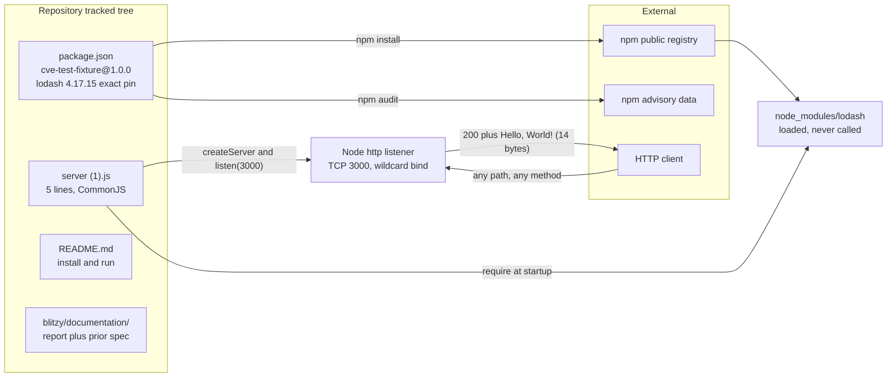

**Core technical approach.** The design minimises surface at every layer:

- **Runtime.** Node.js with CommonJS `require`, using only the built-in `http` module. No framework, no transpile or bundle step, no `engines` constraint. Behaviour in this specification was verified on Node.js v22.23.4 with npm 11.21.0.
- **Package management.** Plain npm with no committed lockfile. Because `npm ci` requires `package-lock.json` and fails without one, `npm install` is the supported path; it resolves the single pin and writes a lockfileVersion 3 lockfile into the working copy as a side effect.
- **Server design.** One anonymous arrow-function listener that ignores both `req` and `res` beyond `res.end('Hello, World!\n')`. There is no routing, middleware, error handling, signal handling, graceful shutdown, request logging or state; the port is a literal `3000`.
- **Vulnerability embedding.** The dependency is pinned exactly and imported at module load, so the vulnerable package is visible to manifest scanners and present in the running process, while no code path calls its API.
- **Documentation.** Two Markdown documents with no executable surface, plus a five-line README that gives the install and run commands.

### 1.2.3 Success Criteria

The repository defines no formal objectives, KPIs, service levels, tests or CI gates. The criteria below are derived from the fixture's observable behaviour and its evident role as a known-answer security test case, and each was exercised in an isolated copy of the repository.

**Measurable objectives.**

| Objective | Measurement | Observed result |
|---|---|---|
| The pinned dependency installs from the manifest alone | `npm install` output and `node_modules` contents | `added 1 package`; `node_modules` holds only `lodash` |
| The vulnerable state is detectable by tooling | `npm audit` on a fresh install | 1 vulnerable package, high aggregate severity, 5 advisories |
| The service is operational | HTTP request to port 3000 after start | `200`, `Content-Length: 14`, body `Hello, World!\n` |
| The handler is path- and method-agnostic | Requests to a known path, an unknown path and a non-GET method | `GET /`, `GET /nope` and `POST /` each returned `200` with 14 bytes |
| Remediation clears every finding | `npm audit` after re-pinning `lodash` 4.18.1 | `found 0 vulnerabilities` |
| Remediation preserves behaviour | Same request after the upgrade | `lodash` reports 4.18.1 and the response is still `200` with 14 bytes |

**Critical success factors.**

- **Integrity of the vulnerable state.** The `lodash` 4.17.15 pin in `package.json` L5 must stay until remediation is deliberate; changing it changes what the fixture tests.
- **Load-time reachability.** The import at `server (1).js` L1 must remain, or runtime inventory sees nothing and the fixture degenerates into a manifest-only case.
- **Behavioural invariance.** The constant response is the oracle: a remediation is acceptable only if the status and the 14-byte body are unchanged.
- **Installability from the manifest alone.** With no lockfile committed, `package.json` L5 is the sole record of dependency state; any tooling that assumes a lockfile must be adapted.
- **Correct quoting of the entry filename.** The documented command must be `node "server (1).js"`; the space and parentheses break an unquoted invocation.

**Key performance indicators.** The fixture has no throughput or latency targets — nothing in the repository measures them, and a single-request response is the only load ever characterised. The measures that matter are security and contract measures.

| KPI | Baseline as committed | Target after remediation |
|---|---|---|
| Vulnerable packages reported by `npm audit` | 1 (`lodash`) | 0 |
| Advisories against the pinned dependency | 5 (3 high, 2 moderate) | 0 |
| Highest severity in the audit report | High | None |
| HTTP contract on port 3000 | `200`, `Hello, World!\n`, 14 bytes | Identical |

The advisory count needs a qualification, because the repository's own documents disagree with each other and with today's audit data. `npm audit` against the committed manifest returned five advisories — GHSA-35jh-r3h4-6jhm, GHSA-p6mc-m468-83gw, GHSA-r5fr-rjxr-66jc, GHSA-29mw-wpgm-hmr9 and GHSA-xxjr-mmjv-4gpg — and the committed `Project Guide` also records five, "including one high severity" (Section 6). The committed `blitzy/documentation/Technical Specifications.md` records six, adding GHSA-f23m-r3pf-42rh and counting three moderate advisories (L30–L41). The sixth finding was not returned by the audit run described here, and neither count can be treated as permanent: the set reflects the advisory database as of the query, not a property of the repository.


## 1.3 Scope

Scope is stated narrowly, matching the repository. Everything the fixture implements is listed here as in-scope; everything a reader might expect from a Node.js service and will not find is listed as out-of-scope with the evidence for its absence.

### 1.3.1 In-Scope

**Must-have capabilities.** Five capabilities define the fixture; removing any of them would stop it from serving its purpose as a vulnerable-but-working test target.

| Capability | Implementation | Source |
|---|---|---|
| Vulnerable dependency declaration | `"lodash": "4.17.15"`, an exact pin with no range | `package.json` L4–L5 |
| Install-time dependency resolution | `npm install` fetches the pin and adds one package | `package.json` L4–L5; `README.md` L3 |
| Runtime load of the dependency | `const _ = require('lodash');` | `server (1).js` L1 |
| Fixed-response HTTP endpoint | `res.end('Hello, World!\n')` for every request | `server (1).js` L3–L4 |
| Listener on TCP port 3000 with a startup log | `.listen(3000, () => console.log('Server running at http://127.0.0.1:3000/'))` | `server (1).js` L5 |

**Primary user workflows.** Three workflows cover every legitimate use of the repository, and each is executable exactly as written because the README names the commands.

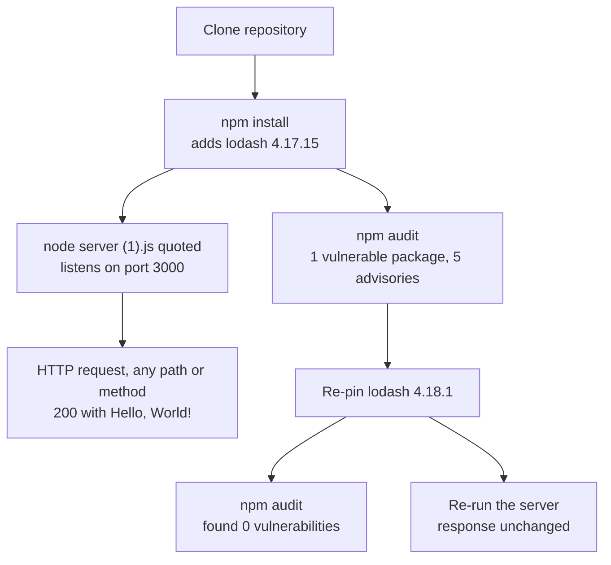

| # | Workflow | Path through the system |
|---|---|---|
| 1 | Detection — scan the fixture and observe the vulnerable pin | Install, then run `npm audit` or any SCA scanner over `package.json` |
| 2 | Execution — run the service and call it | `node "server (1).js"`, then any HTTP request to port 3000 |
| 3 | Remediation and validation — upgrade and confirm nothing broke | Re-pin `lodash` in `package.json`, re-audit, request again, compare the response |

**Essential integrations.** Two integrations are required for the fixture to work at all: the public npm registry, which supplies the pinned tarball at install time (`package.json` L5, exercised by `npm install`), and the npm advisory data behind `npm audit`, which supplies the GHSA findings that make the pin meaningful. A third integration is incidental rather than required: any HTTP client that reaches TCP port 3000 at runtime.

**Key technical requirements.**

| Requirement | Basis |
|---|---|
| A Node.js runtime with CommonJS `require` and arrow-function support | `server (1).js` syntax; the manifest declares no `engines` field |
| npm with install-time resolution (`npm ci` is not usable) | No lockfile is committed; `npm ci` exits with `EUSAGE` |
| Network access to `registry.npmjs.org` at install time | The pin is resolved from the public registry; nothing is vendored |
| TCP port 3000 free on the host and reachable on all interfaces | `listen(3000)` with no host argument; a second instance fails `EADDRINUSE` |
| Shell quoting of the entry filename | The name contains a space and parentheses: `node "server (1).js"` |
| No configuration or credential input | No environment variable, file or secret is read by any file in the tree |

**Implementation boundaries.**

| Boundary | Definition |
|---|---|
| System boundary | One Node.js process with one HTTP listener on TCP port 3000 bound to all interfaces. The only external dependency is the public npm registry at install time; there is no other outbound call, no datastore and no network service of any kind. |
| User groups covered | The inferred security-tooling audience of 1.1: SCA and audit tooling, remediation agents and engineers, and QA engineers using the fixture as a known-answer case. There are no end users and no accounts. |
| Geographic / market coverage | Not applicable. No localization, regional configuration, jurisdiction-specific logic or market exists in the tree. |
| Data domains included | Dependency metadata only — package name, version, pin in `package.json` L2–L5 — plus one constant response string. No business, personal, telemetry or configuration data is accepted, stored or transmitted. |

### 1.3.2 Out-of-Scope

**Excluded features and capabilities.** None of the following is implemented in the tracked tree; the evidence is a full inventory of its five paths, which contain no file capable of providing them.

- Request routing, path or method handling, and reading of any request field. The `req` parameter exists only in the listener signature (`server (1).js` L3) and is never dereferenced.
- Response negotiation, including a `Content-Type` header. The response carries only Node's defaults (`Date`, `Connection`, `Keep-Alive`, `Content-Length: 14`).
- Authentication, authorization, TLS/HTTPS, CORS, rate limiting and input validation.
- Persistence of any kind: database, file store, cache or queue.
- Configuration through environment variables or files. The port is the literal `3000`, and no host is passed to `listen` (`server (1).js` L5).
- Error handling, structured logging, request logging, health or readiness endpoints, metrics, tracing, graceful shutdown and signal handling.
- Any use of the `lodash` API. The binding `_` is created at `server (1).js` L1 and never referenced again.
- npm `scripts` (`start`, `test`, `lint`), a `main` entry point, `engines`, `license`, `author`, `devDependencies` and any `private`/`publishConfig` field.
- Automated tests, CI pipelines, container images and infrastructure-as-code. `npm test` exits with `Missing script: "test"`, and no `.github`, `Dockerfile`, `*.yml`/`*.yaml` or IaC file exists.
- A committed dependency lockfile. `package-lock.json` was deleted in commit `dd23c44`; any lockfile present in a working copy is a by-product of `npm install`.
- Product documentation for external consumers. The only documentation is a five-line README and the two files under `blitzy/documentation/`, which document the repository rather than a product.

**Future phase considerations.** The repository holds no roadmap, TODO or FIXME marker, issue reference or changelog, so no future phases are defined by the code. Three directions are implied by the artifacts rather than planned: adding a scripted contract check (recorded as the highest-priority open item in the committed `Project Guide`, Section 2.2), resolving the advisory baseline by re-pinning `lodash` 4.18.1 (the fix path `npm audit` itself names, and a change that exists on another ref in commit `26f31dc` but not on the current branch), and refreshing or removing the committed documentation so it matches the tree. The first two alter the fixture's stated condition and would need to be applied deliberately rather than as routine maintenance.

**Integration points not covered.** Private, mirrored or air-gapped npm registries — nothing in the tree configures a registry URL. Alternative package managers (Yarn, pnpm) — no lockfile or workspace metadata for either exists. Upstream services, APIs, databases, message queues, identity providers and observability backends — no client code or configuration references any. Reverse proxies, load balancers, service meshes and deployment topologies — no deployment artifact of any kind is present. Container and orchestration platforms — no `Dockerfile`, manifest or chart exists.

**Unsupported use cases.**

| Use case | Reason unsupported |
|---|---|
| Production or internet-facing deployment | Ships a dependency with five known advisories, binds all interfaces while logging `127.0.0.1`, and has no authentication, TLS, error handling or logging |
| Use as an application or service template | No routing, configuration, persistence, tests, build tooling or `scripts` block to extend |
| Demonstrating exploitation of the `lodash` advisories | No code path calls `_.template`, `_.unset`, `_.omit` or any other `lodash` function, so no advisory is reachable through the HTTP interface |
| Reproducible or offline installation | No lockfile and no vendored dependency; installation requires the public registry |
| Running beside another service on port 3000 | The port is hard-coded; a second listener fails with `EADDRINUSE` and no override exists |
| Load, latency or capacity testing | No metrics, logging or tuning surface exists, and no load characterisation is recorded in the repository |


## 1.4 References

**Repository files**

- `package.json` — package identity `cve-test-fixture@1.0.0` (L2–L3), the exact `lodash` `4.17.15` pin with no semver range (L5), and the absence of `scripts`, `main`, `engines`, `license`, `author`, `description`, `private`, `publishConfig` and `devDependencies` (104 bytes, 7 lines)
- `server (1).js` — the entire runtime: unused `lodash` import (L1), JSDoc summary of the handler (L2), `createServer` listener with the constant `Hello, World!\n` body (L3–L4), `listen(3000)` with no host argument and a loopback log line (L5); 263 bytes, 5 lines, `node --check` exit 0
- `README.md` — the only usage documentation: `# cve-test-fixture`, `Install: npm install`, `Run: node "server (1).js"` (72 bytes, 5 lines)
- `blitzy/documentation/Technical Specifications.md` — the prior release of this specification (6480 lines): its Introduction recorded a 537-byte `package-lock.json`, a README deleted in `44b04ea`, an `npm ci` install model and six `lodash` advisories including GHSA-f23m-r3pf-42rh, all of which conflict with the current tree and are reported as such in 1.2.3
- `blitzy/documentation/Project Guide - 182193aa-390a-4811-9305-dd7e915872d4.md` — delivery report: 57.1% completion (8 of 14 hours), 81/81 hand-executed runtime cases, the open items (no automated regression check, the advisory baseline, stale documentation), the lockfile-free install guidance and the five-advisory count
- `tech_spec.md` (repository root, untracked) — the working copy into which this specification is written; byte-identical to the tracked `Technical Specifications.md` before this revision

**Repository folders**

- `` (repository root) — five tracked paths and no subfolder other than `blitzy`; no `package-lock.json`, `node_modules`, `.gitignore`, `.github`, `Dockerfile`, `*.yml`/`*.yaml`, IaC file or test file exists
- `blitzy/` — documentation-only subtree with no source, configuration or build content
- `blitzy/documentation/` — the two Markdown documents listed above

**Git history and metadata**

- Commits `b306e60` (initial commit; the one-line README `# Repo_withMinorCVE_02`, source of the repository name), `ddd2024` ("Add files via upload"), `44b04ea` ("Delete README.md", the former `main` tip), `dd23c44` ("Delete package-lock.json"), `5433d34`/`8d02da8`/`47c41cf` (README authored and updated), `c66e66f`/`896daa4` (handler comment added, handler restored), `26f31dc` ("Pin lodash 4.18.1 in both manifests and record the remediation", present on another ref only), and `0de48f7` (merge of PR #2, current HEAD on branch `2509_01`)
- Authors recorded by git: `lakshya-blitzy <lakshya@blitzy.com>`, `Blitzy Agent`, `blitzy-qa[bot]` — the only ownership evidence in the repository

**Observed runtime and tooling results**

- `node -v` → `v22.23.4`; `npm -v` → `11.21.0`
- `node "server (1).js"` before installation → `Error: Cannot find module 'lodash'` at L1; after installation → `Server running at http://127.0.0.1:3000/`
- HTTP responses: `200 OK`, `Content-Length: 14`, body `Hello, World!\n`, no `Content-Type`, identical for `GET /`, `GET /nope`, `POST /` and for a request to the host address `10.11.0.7:3000` (wildcard bind); a second instance failed with `listen EADDRINUSE: address already in use :::3000`
- `npm install` → `added 1 package`, `node_modules` holding only `lodash`, and a generated `package-lock.json` (lockfileVersion 3, `requires: true`); `npm ci` → `npm error code EUSAGE` (no lockfile); `npm test` → `npm error Missing script: "test"`
- `npm audit` on the committed pin → `1 high severity vulnerability`, `lodash <=4.17.23`, five advisories (GHSA-35jh-r3h4-6jhm, GHSA-p6mc-m468-83gw, GHSA-r5fr-rjxr-66jc, GHSA-29mw-wpgm-hmr9, GHSA-xxjr-mmjv-4gpg), fix `lodash@4.18.1` outside the stated range; after re-pinning 4.18.1 → `found 0 vulnerabilities` with the `200`/14-byte response unchanged

**Web sources**

No external web source was used for this section. Every statement rests on the tracked files, the git history, or commands executed locally against the checkout; advisories are reported as `npm audit` returned them rather than from a separate advisory-database lookup.


# 2. Product Requirements

## 2.1 Feature Catalog

Six features account for everything the tracked tree implements: two dependency-state features carried by `package.json` and the install path, three runtime features carried by `server (1).js`, and one documentation feature carried by `README.md`. Nothing else in the repository holds behaviour — `blitzy/documentation/` contains two Markdown documents with no executable surface, and the untracked `tech_spec.md` at the repository root is this specification.

Priority reflects each feature's weight in the fixture's role as a known-answer security test case (see 1.1 Executive Summary and 1.2.3 Success Criteria).

| Priority | Definition | Features |
|---|---|---|
| Critical | Creates or supplies the vulnerable state under test: the exact `lodash` 4.17.15 pin, and the installed tree that turns that pin into a scannable and loadable dependency | F-001, F-002 |
| High | Makes the fixture runnable, or supplies the behavioural oracle that proves a remediation did not break it | F-003, F-004, F-005 |
| Medium | Supports operability and documented usage without affecting the test condition | F-006 |

Every feature has status **Completed**: it is implemented in the committed tree and was exercised at HEAD `0de48f7`. No tracked file contains a `TODO` or `FIXME` marker, an issue reference, a roadmap or a changelog, so no feature is Proposed, Approved or In Development (see 1.3.2 Future Phase Considerations). The three open items in the committed `Project Guide` — a scripted contract check, the advisory disposition, a documentation refresh — are assurance and documentation follow-on work, not unimplemented features.

### 2.1.1 Feature Summary

| ID | Feature Name | Category | Priority / Status |
|---|---|---|---|
| F-001 | Vulnerable Dependency Declaration | Dependency Management (test condition) | Critical / Completed |
| F-002 | Install-Time Dependency Resolution | Dependency Management (installation) | Critical / Completed |
| F-003 | Runtime Dependency Loading | Runtime Module Loading | High / Completed |
| F-004 | HTTP Server Bootstrap and Startup Signal | Runtime Service | High / Completed |
| F-005 | Fixed-Response HTTP Handler | HTTP Interface | High / Completed |
| F-006 | Documented Install and Run Instructions | Documentation / Operability | Medium / Completed |

| ID | Implementing Artifact | Source Lines | Related Specification |
|---|---|---|---|
| F-001 | `package.json` | L2–L5 | 1.1, 1.2.1, 1.3.1 |
| F-002 | `package.json` L5 plus the npm install path | L5; `README.md` L3 | 1.2.1, 1.2.3, 1.3.1 |
| F-003 | `server (1).js` | L1 | 1.1, 1.2.2, 1.3.2 |
| F-004 | `server (1).js` | L3, L5 | 1.2.1, 1.2.2, 1.3.1 |
| F-005 | `server (1).js` | L2–L4 | 1.2.2, 1.2.3, 1.3.2 |
| F-006 | `README.md` | L1, L3, L5 | 1.2.2, 1.3.1 |

### 2.1.2 F-001: Vulnerable Dependency Declaration

**Feature Metadata**

| Attribute | Value |
|---|---|
| Unique ID | F-001 |
| Feature Name | Vulnerable Dependency Declaration |
| Feature Category | Dependency Management (test condition) |
| Priority Level | Critical |
| Status | Completed |

**Description**

- **Overview:** `package.json` declares the npm package identity `cve-test-fixture` version `1.0.0` (L2–L3) and one runtime dependency, `"lodash": "4.17.15"` (L4–L5). The version is an exact pin with no range operator. The manifest carries no other field: there is no `main`, `scripts`, `engines`, `license`, `author`, `description`, `private`, `publishConfig` or `devDependencies` (L1–L7, 104 bytes).
- **Business Value:** This single line is the fixture's test condition. `lodash` 4.17.15 falls inside the affected ranges of the five advisories `npm audit` reports against it, at high aggregate severity, which gives dependency scanners a known-answer target that needs no domain context to interpret.
- **User Benefits:** A scanner operator or QA engineer asserts against exactly one vulnerable package, and a remediation agent has a single, unambiguous edit target. Because the manifest holds nothing else, no unrelated finding can appear in a report.
- **Technical Context:** An exact pin removes semver resolution as a variable: npm cannot move the dependency without an explicit edit. `npm audit` therefore names `lodash@4.18.1` as the fix while reporting it "outside the stated dependency range", and applying it needs an explicit version change or `npm audit fix --force`.

**Dependencies**

| Dependency Type | Detail |
|---|---|
| Prerequisite Features | None; F-001 is the root feature of the catalog |
| System Dependencies | An npm CLI able to parse `package.json` (any npm supporting the manifest schema) |
| External Dependencies | `lodash` 4.17.15 on the public npm registry; the advisory data behind `npm audit` |
| Integration Requirements | The pin is the sole record of dependency state, so F-002 resolves from it directly; there is no lockfile to keep in step |

### 2.1.3 F-002: Install-Time Dependency Resolution

**Feature Metadata**

| Attribute | Value |
|---|---|
| Feature Name | Install-Time Dependency Resolution |
| Feature Category | Dependency Management (installation) |
| Priority Level | Critical |
| Status | Completed |

**Description**

- **Overview:** Dependency resolution happens at install time, from the manifest alone. The tracked tree contains no `package-lock.json`, no `npm-shrinkwrap.json` and no `yarn.lock` (`package-lock.json` was deleted in commit `dd23c44`), so `npm install` reads the pin at `package.json` L5, fetches `lodash` 4.17.15 from the public registry, and reports `added 1 package`; `node_modules` then contains only `lodash`. `npm ci` is not available on this tree and exits with `npm error code EUSAGE`, because it requires an existing `package-lock.json` or `npm-shrinkwrap.json` with `lockfileVersion >= 1`.
- **Business Value:** The install step converts the declared pin into a real installed dependency, which is what makes the fixture both scannable in an installed state and startable. Without it the module cannot run, because `lodash` is required at load time (F-003).
- **User Benefits:** One documented command (`README.md` L3) works from a fresh clone, and the repository stays free of a generated lockfile that would otherwise have to be kept in step with the pin (see 1.2.1).
- **Technical Context:** Resolution is deliberately unpinned ahead of time: the exact manifest pin is the only recorded dependency state, and the recommended form `CI=true npm install --no-fund --no-package-lock` writes no lockfile. The plain `npm install` documented in the README does write a `package-lock.json` into the working copy as a side effect — observed as `lockfileVersion: 3`, `requires: true`, a `packages[""]` record mirroring the manifest, and `node_modules/lodash` recorded with its resolved registry URL, `sha512` integrity and MIT licence. That file is untracked and must not be committed.

**Dependencies**

| Dependency Type | Detail |
|---|---|
| Prerequisite Features | F-001 (the pin this feature resolves) |
| System Dependencies | npm CLI; network access to the public registry on first install |
| External Dependencies | `https://registry.npmjs.org/lodash` tarballs for the pinned version |
| Integration Requirements | Produces the `node_modules/lodash` tree that F-003 loads; consumes the install command documented in F-006 |

### 2.1.4 F-003: Runtime Dependency Loading

**Feature Metadata**

| Attribute | Value |
|---|---|
| Feature Name | Runtime Dependency Loading |
| Feature Category | Runtime Module Loading |
| Priority Level | High |
| Status | Completed |

**Description**

- **Overview:** `const _ = require('lodash');` (`server (1).js` L1) loads `lodash` when the module is evaluated, before the server is created. The binding `_` is never referenced again anywhere in the file.
- **Business Value:** The vulnerable package is present in the running process as well as in the declared manifest, so a runtime inventory or process-level scan sees it in addition to a manifest scan. At the same time no code path calls its API, so the fixture cannot demonstrate exploitation — a property 1.3.2 records as intended.
- **User Benefits:** A dependency upgrade cannot change application output, because nothing in the handler depends on the library. Anyone validating a remediation therefore needs one static check and one HTTP request, not a functional test suite.
- **Technical Context:** Resolution is CommonJS from `node_modules`. When the dependency is absent, the module fails at L1 with `Error: Cannot find module 'lodash'` (`MODULE_NOT_FOUND`) and exit code 1, before any listener exists — observed on a checkout before `npm install`.

**Dependencies**

| Dependency Type | Detail |
|---|---|
| Prerequisite Features | F-002 (the installed `node_modules/lodash` tree) |
| System Dependencies | A Node.js runtime with CommonJS `require`; `node --check` parses the file with exit 0 |
| External Dependencies | The `lodash` package |
| Integration Requirements | Must complete at L1 before F-004 executes, since both live in one top-to-bottom script |

### 2.1.5 F-004: HTTP Server Bootstrap and Startup Signal

**Feature Metadata**

| Attribute | Value |
|---|---|
| Feature Name | HTTP Server Bootstrap and Startup Signal |
| Feature Category | Runtime Service |
| Priority Level | High |
| Status | Completed |

**Description**

- **Overview:** `require('http').createServer(...)` (`server (1).js` L3) creates the server with Node's built-in `http` module and registers the F-005 listener; `.listen(3000, cb)` (L5) binds the hard-coded TCP port 3000 and, once listening, writes `Server running at http://127.0.0.1:3000/` to stdout. No host argument is passed, so the socket binds the wildcard address — observed at `[::]:3000` in `/proc/net/tcp6` and reachable at the host address `10.11.0.7`, while the log line names the loopback address.
- **Business Value:** The fixture runs as a service, so a remediation can be validated by executing it and calling it, not only by inspecting files. That is what makes the fixed response in F-005 observable.
- **User Benefits:** Starting takes one command, `node "server (1).js"`, and the single stdout line is a reliable readiness signal for a harness to wait on. The port is fixed at 3000, so no configuration step is needed.
- **Technical Context:** There is no `start` or `test` script: `npm start` and `npm test` both exit with `npm error Missing script`. The entry filename contains a space and parentheses, so every invocation must quote it. A second instance fails with `Error: listen EADDRINUSE: address already in use :::3000` (exit 1) while the first keeps serving, and a `PORT` environment variable has no effect because the port is a literal.

**Dependencies**

| Dependency Type | Detail |
|---|---|
| Prerequisite Features | F-003 (execution must pass L1) |
| System Dependencies | Node.js runtime with the built-in `http` module; TCP port 3000 free on the host |
| External Dependencies | None |
| Integration Requirements | Registers the F-005 handler; emits the startup line on stdout for harnesses and operators |

### 2.1.6 F-005: Fixed-Response HTTP Handler

**Feature Metadata**

| Attribute | Value |
|---|---|
| Feature Name | Fixed-Response HTTP Handler |
| Feature Category | HTTP Interface |
| Priority Level | High |
| Status | Completed |

**Description**

- **Overview:** The anonymous arrow function `(req, res) => { res.end('Hello, World!\n'); }` (`server (1).js` L3–L4) ignores `req` entirely and ends every response with the constant 14-byte body `Hello, World!\n` and the implicit status `200`. A JSDoc summary on L2 states that behaviour: `/** Replies to every HTTP request with the plain-text body "Hello, World!". */`.
- **Business Value:** The constant response is the fixture's behavioural oracle (1.2.3): a remediation is acceptable only if the same status and the same bytes come back, which turns dependency-upgrade validation into a single request and one comparison.
- **User Benefits:** Every path and every method yield the same result, so a harness needs no fixtures, no state and no sequencing. The body hash `c98c24b677eff44860afea6f493bbaec5bb1c4cbb209c6fc2bbb47f66ff2ad31` (sha256 of `Hello, World!\n`) is a stable assertion target.
- **Technical Context:** Responses carry only Node's defaults — `Date`, `Connection: keep-alive`, `Keep-Alive: timeout=5` and `Content-Length: 14`. No `Content-Type` is set, so clients sniff the body type. `HEAD` returns `200` with headers and no body. The handler holds no state, does no routing, reads no request field, and never touches `lodash`.

**Dependencies**

| Dependency Type | Detail |
|---|---|
| Prerequisite Features | F-004 (the server that registers and invokes the handler) |
| System Dependencies | Node.js built-in `http` module |
| External Dependencies | Any HTTP client able to reach TCP port 3000 |
| Integration Requirements | None with F-003; the handler never references `_`, which is why remediation cannot change its output |

### 2.1.7 F-006: Documented Install and Run Instructions

**Feature Metadata**

| Attribute | Value |
|---|---|
| Feature Name | Documented Install and Run Instructions |
| Feature Category | Documentation / Operability |
| Priority Level | Medium |
| Status | Completed |

**Description**

- **Overview:** `README.md` (5 lines, 72 bytes) gives the package name as a heading (L1), the install command `Install: \`npm install\`` (L3) and the run command `Run: \`node "server (1).js"\`` (L5). It claims nothing else: it states no test, CI, licence, port or dependency fact.
- **Business Value:** The tree carries no `scripts` block and the entry filename cannot be typed unquoted, so the README is the only record of how the fixture is meant to be installed and started. It removes the ambiguity a consumer would otherwise resolve by reading the source.
- **User Benefits:** Both documented commands run as written from a fresh clone — `npm install` adds the pinned package, and the quoted `node` invocation prints the startup line.
- **Technical Context:** The documented install path is the plain form that writes an untracked `package-lock.json`, which a contributor must not commit (see F-002). The run command must stay quoted because the tracked filename contains a space and parentheses. Adding a `start` script to the manifest would be the alternative, and the manifest deliberately has none.

**Dependencies**

| Dependency Type | Detail |
|---|---|
| Prerequisite Features | F-001 (the package name on L1 mirrors `package.json` L2) and F-002 (the install command documented on L3) |
| System Dependencies | A shell that applies the quoting shown on L5 |
| External Dependencies | None |
| Integration Requirements | Must name the tracked entry file exactly; F-004 and F-005 are reached only through the command documented here |


## 2.2 Functional Requirements

The requirements below describe the fixture as built, not a planned design. Each acceptance criterion was executed in an isolated copy of the repository at HEAD `0de48f7` with Node.js v22.23.4 and npm 11.21.0; the repository declares no runtime constraint of its own, since `package.json` has no `engines` field.

| Scale | Meaning in this Section |
|---|---|
| Must-Have | Removing or changing it alters what the fixture tests, or stops it being a runnable test case |
| Should-Have | Supports isolation, determinism or diagnosability of the test case |
| Could-Have | Incidental as-built behaviour, recorded so a harness can assert it rather than discover it |
| Complexity | Effort to implement or verify. The whole runtime is five lines, so almost every item is Low |

### 2.2.1 F-001 Requirements: Vulnerable Dependency Declaration

**Requirement Details**

| Requirement ID | Description | Acceptance Criteria | Priority / Complexity |
|---|---|---|---|
| F-001-RQ-001 | Declare the package identity | `package.json` L2 is `cve-test-fixture` and L3 is `1.0.0`; no other identity field (`private`, `publishConfig`, `repository`) is present | Must-Have / Low |
| F-001-RQ-002 | Declare exactly one runtime dependency, pinned exactly | `dependencies` (L4–L6) contains only `lodash` with the value `4.17.15` and no range operator (`^`, `~`, `>`, `x`, `*`) | Must-Have / Low |
| F-001-RQ-003 | The declared version is detectable as vulnerable | After `npm install`, `npm audit --json` reports `metadata.vulnerabilities` = `{high: 1, total: 1}` and `lodash` with range `<=4.17.23` carrying the five advisories named in 1.1 | Must-Have / Low |
| F-001-RQ-004 | No other dependency groups | `devDependencies`, `peerDependencies`, `optionalDependencies` and `bundledDependencies` are all absent (L1–L7) | Should-Have / Low |
| F-001-RQ-005 | The pin resists range-based fixes | `npm audit` reports `fixAvailable` = `{name: lodash, version: 4.18.1, isSemVerMajor: false}` and states 4.18.1 is "outside the stated dependency range"; moving the pin requires an explicit edit or `--force` | Should-Have / Medium |

**Technical Specifications**

| Specification | Detail |
|---|---|
| Input Parameters | `package.json` (JSON, 104 bytes, 7 lines): `name`, `version`, `dependencies.lodash` |
| Output / Response | A dependency specification consumed by npm; the finding set emitted by `npm audit` |
| Performance Criteria | None defined; the file is static and never read at runtime by the application |
| Data Requirements | Valid JSON; `version` must be an exact semver value, `name` a valid npm package name |

**Validation Rules**

| Rule Type | Rule |
|---|---|
| Business Rules | The pin must stay `4.17.15` until a remediation is deliberately applied; changing it changes what the fixture tests (1.2.3 Critical Success Factors) |
| Data Validation | The manifest must parse as JSON with no duplicate keys; `lodash` must resolve to exactly 4.17.15 at install (verified: `require('lodash').VERSION` → `4.17.15`) |
| Security Requirements | The dependency is knowingly vulnerable and must not be deployed to a production or internet-facing service (1.3.2 Unsupported Use Cases) |
| Compliance Requirements | The fixture declares no licence of its own; the `lodash` licence is MIT, as the generated lockfile records for the resolved package |

### 2.2.2 F-002 Requirements: Install-Time Dependency Resolution

**Requirement Details**

| Requirement ID | Description | Acceptance Criteria | Priority / Complexity |
|---|---|---|---|
| F-002-RQ-001 | Resolve the dependency from the manifest alone | In a copy holding only the tracked files, `npm install` exits 0, prints `added 1 package`, and `node_modules` contains only `lodash` | Must-Have / Low |
| F-002-RQ-002 | Commit no dependency lockfile | No `package-lock.json`, `npm-shrinkwrap.json`, `yarn.lock` or `pnpm-lock.yaml` exists in the tracked tree; `npm ci` exits 1 with `npm error code EUSAGE`, naming `package-lock.json`/`npm-shrinkwrap.json` as required | Must-Have / Low |
| F-002-RQ-003 | The resolved version equals the pin | After install, `require('lodash').VERSION` returns `4.17.15` | Must-Have / Low |
| F-002-RQ-004 | A lockfile written by the documented install is a side effect only | Plain `npm install` writes `package-lock.json` with `lockfileVersion: 3`, `requires: true`, `packages[""]` mirroring the manifest, and `node_modules/lodash` recording the resolved registry URL, `sha512` integrity and MIT licence; the file stays untracked and is absent after `git status` is checked | Should-Have / Low |
| F-002-RQ-005 | A lockfile-free install form exists | `CI=true npm install --no-fund --no-audit --no-package-lock` exits 0, reports `added 1 package`, and writes no lockfile | Could-Have / Low |
| F-002-RQ-006 | No transitive dependencies are introduced | The generated lockfile's `packages` holds only `""` and `node_modules/lodash`; `node_modules` holds only `lodash` | Should-Have / Low |

**Technical Specifications**

| Specification | Detail |
|---|---|
| Input Parameters | `package.json` L5; npm configuration defaults (no `.npmrc` exists); network access to `registry.npmjs.org` unless the tarball is cached |
| Output / Response | A `node_modules/lodash` tree at 4.17.15; the install summary on stdout; optionally a generated lockfile in the working copy |
| Performance Criteria | None defined. Observed at 466 ms for the single package on a warm cache; this is environment-dependent, not a target |
| Data Requirements | Version pin in the manifest; per-package `version`, `resolved`, `integrity` and `license` in any generated lockfile |

**Validation Rules**

| Rule Type | Rule |
|---|---|
| Business Rules | Installation must remain the first step of both documented workflows (1.3.1 Primary User Workflows); `npm ci` must not be presented as an option, because it cannot run on this tree |
| Data Validation | npm verifies any downloaded tarball against the registry integrity value; the resolved version must equal the manifest pin exactly |
| Security Requirements | Resolution reaches the public HTTPS registry over the default configuration; there is no private mirror, no registry override and no vendored copy |
| Compliance Requirements | The repository carries no licence or attribution obligation of its own; the dependency licence (MIT) is recorded only in a generated lockfile, which is untracked |

### 2.2.3 F-003 Requirements: Runtime Dependency Loading

**Requirement Details**

| Requirement ID | Description | Acceptance Criteria | Priority / Complexity |
|---|---|---|---|
| F-003-RQ-001 | Load `lodash` at module scope, before the server is created | `server (1).js` L1 executes `require('lodash')` and assigns it to `_` before L3 runs; the loaded version equals the installed version | Must-Have / Low |
| F-003-RQ-002 | Invoke no `lodash` API | `_` appears only in its declaration on L1; `grep` for `lodash` and `_` across the tracked files returns L1 and `package.json` L5 only; no HTTP output depends on the installed version | Must-Have / Low |
| F-003-RQ-003 | Fail fast when the dependency is missing | Before installation, `node "server (1).js"` exits 1 with `Error: Cannot find module 'lodash'` at L1 and opens no listener | Should-Have / Low |

**Technical Specifications**

| Specification | Detail |
|---|---|
| Input Parameters | `node_modules/lodash`, located by Node's CommonJS resolution from the script's directory |
| Output / Response | An in-memory `_` binding that is never used; on failure, a `MODULE_NOT_FOUND` stack trace on stderr and exit code 1 |
| Performance Criteria | A one-time module-load cost at startup and no per-request cost, because the import sits outside the handler; no target is defined |
| Data Requirements | None; no data is read, transformed or persisted |

**Validation Rules**

| Rule Type | Rule |
|---|---|
| Business Rules | The import must stay: without it the fixture degenerates into a manifest-only case and no runtime inventory can see the dependency (1.2.3 Critical Success Factors) |
| Data Validation | Not applicable; no input is processed |
| Security Requirements | No code path reaches the vulnerable functions named by the advisories (`_.template`, `_.unset`, `_.omit`, `_.pullAt`); any future call on untrusted input would make a currently unreachable finding reachable (1.3.2) |
| Compliance Requirements | None identified; the load creates no record, data flow or audit obligation |

### 2.2.4 F-004 Requirements: HTTP Server Bootstrap and Startup Signal

**Requirement Details**

| Requirement ID | Description | Acceptance Criteria | Priority / Complexity |
|---|---|---|---|
| F-004-RQ-001 | Create the server with the built-in `http` module only | L3 calls `require('http').createServer(...)`; no framework or third-party server package appears in the manifest | Must-Have / Low |
| F-004-RQ-002 | Listen on TCP port 3000 | After start, port 3000 accepts connections; the listening socket is the wildcard address (`/proc/net/tcp6` entry `00000000000000000000000000000000:0BB8`, state `0A`) | Must-Have / Low |
| F-004-RQ-003 | Emit the startup signal | stdout contains exactly the line `Server running at http://127.0.0.1:3000/`, once, with nothing on stderr | Must-Have / Low |
| F-004-RQ-004 | Start with the one documented command | `node "server (1).js"`, filename quoted, starts the server; `npm start` and `npm test` each exit 1 with `npm error Missing script` | Must-Have / Low |
| F-004-RQ-005 | Serve on every interface (as-built) | A request to the host's non-loopback IPv4 address (`10.11.0.7:3000` in the verification environment) returns `200` with 14 bytes | Could-Have / Low |
| F-004-RQ-006 | Terminate on a port conflict without disturbing the running instance | A second instance exits 1 with `Error: listen EADDRINUSE: address already in use :::3000`, `code: 'EADDRINUSE'`, while the first instance keeps answering | Could-Have / Low |
| F-004-RQ-007 | Ignore environment-based port overrides (as-built) | Starting with `PORT=3999` still targets port 3000 and collides when 3000 is occupied; no `PORT`, `HOST` or configuration file is read | Could-Have / Low |

**Technical Specifications**

| Specification | Detail |
|---|---|
| Input Parameters | None. There are no CLI arguments, environment variables or configuration files; the port is the literal `3000` at L5 and no host is supplied |
| Output / Response | A listening socket on `[::]:3000` and the startup line on stdout; on failure a stack trace on stderr and exit code 1 |
| Performance Criteria | Node's defaults apply unchanged (`headersTimeout` 60 000 ms, `requestTimeout` 300 000 ms, `keepAliveTimeout` 5 000 ms); the repository sets none of them and defines no throughput or latency target |
| Data Requirements | None; the process holds no configuration, credential or persisted state |

**Validation Rules**

| Rule Type | Rule |
|---|---|
| Business Rules | The port (3000) and the startup line are fixed values that harnesses and operators may rely on; the README relies on the same filename (F-006) |
| Data Validation | Not applicable; the bootstrap accepts no input |
| Security Requirements | No TLS, no authentication and no access control. The socket binds every interface while the log line names loopback, so the fixture must run only in an isolated environment (1.3.2) |
| Compliance Requirements | None identified; the listener records no request data anywhere |

### 2.2.5 F-005 Requirements: Fixed-Response HTTP Handler

**Requirement Details**

| Requirement ID | Description | Acceptance Criteria | Priority / Complexity |
|---|---|---|---|
| F-005-RQ-001 | Return the fixed body for every request | `GET /`, `GET /nope` and `POST /` each return `200` with a 14-byte body; no path, method, query, header or request body changes the result | Must-Have / Low |
| F-005-RQ-002 | Emit Node's default headers only | Response headers are `Date`, `Connection: keep-alive`, `Keep-Alive: timeout=5`, `Content-Length: 14`; `Content-Type` and all security headers are absent | Should-Have / Low |
| F-005-RQ-003 | Handle `HEAD` per HTTP | `HEAD /` returns `200` with the same headers and no body | Could-Have / Low |
| F-005-RQ-004 | Handle every request statelessly | `req` is never dereferenced (L3–L4); repeated and concurrent requests return identical responses and the process holds no per-request state | Must-Have / Low |
| F-005-RQ-005 | Preserve the byte-exact contract | The body is exactly `Hello, World!\n`, sha256 `c98c24b677eff44860afea6f493bbaec5bb1c4cbb209c6fc2bbb47f66ff2ad31`, with `Content-Length: 14` | Must-Have / Low |
| F-005-RQ-006 | Remain unchanged by a dependency remediation | With `lodash` re-pinned to 4.18.1 and reinstalled, `npm audit` reports `found 0 vulnerabilities` and `GET /` still returns `200` with the same 14 bytes and the same sha256 (verified) | Must-Have / Low |

**Technical Specifications**

| Specification | Detail |
|---|---|
| Input Parameters | Any HTTP/1.1 request; its method, path, query string, headers and body are all ignored |
| Output / Response | `HTTP/1.1 200 OK`, `Content-Length: 14`, body `Hello, World!\n` |
| Performance Criteria | No SLA is defined. Each request does constant work — no I/O, no computation, no allocation beyond the response — and nothing in the repository measures latency or throughput |
| Data Requirements | One static string constant embedded at L4; nothing is read, stored or transmitted onward |

**Validation Rules**

| Rule Type | Rule |
|---|---|
| Business Rules | The response must stay byte-identical, because it is the oracle that proves a remediation did not change behaviour (1.2.3) |
| Data Validation | None in application code: no request field is parsed, so nothing can be validated, reflected or rejected. Framing errors are answered by Node's own HTTP parser, which returns `400` for malformed framing and `431` for oversized headers; the handler is not involved |
| Security Requirements | No authentication, authorization, TLS, CORS or rate limiting (1.3.2). With no request reads and one constant sink in ASCII, the handler offers no injection or reflection path; the remaining exposure is the HTTP parser and the wildcard listener scope (F-004) |
| Compliance Requirements | No personal, business or telemetry data is accepted, logged or transmitted; no privacy or retention obligation arises |

### 2.2.6 F-006 Requirements: Documented Install and Run Instructions

**Requirement Details**

| Requirement ID | Description | Acceptance Criteria | Priority / Complexity |
|---|---|---|---|
| F-006-RQ-001 | Name the package consistently with the manifest | `README.md` L1 reads `# cve-test-fixture`, matching `package.json` L2 | Should-Have / Low |
| F-006-RQ-002 | Document the install command that actually works | L3 reads ``Install: `npm install` `` and that command exits 0 in a fresh copy | Must-Have / Low |
| F-006-RQ-003 | Document the run command with the quoting the filename requires | L5 reads ``Run: `node "server (1).js"` ``; run as written it prints the startup line of F-004 | Must-Have / Low |
| F-006-RQ-004 | Claim nothing beyond those facts | The file is 5 lines / 72 bytes and states no test, CI, licence, dependency, port or performance claim | Could-Have / Low |

**Technical Specifications**

| Specification | Detail |
|---|---|
| Input Parameters | None at runtime; a reader's shell applies the two commands |
| Output / Response | Static guidance only; the commands' effects belong to F-002 (install) and F-004/F-005 (run and respond) |
| Performance Criteria | None defined; the file has no executable surface |
| Data Requirements | None; the content duplicates the package name and the tracked entry filename |

**Validation Rules**

| Rule Type | Rule |
|---|---|
| Business Rules | The documented install path is the plain form that writes a lockfile into the working copy; the run command must stay quoted, because the tracked filename contains a space and parentheses |
| Data Validation | The package name must match `package.json` L2 and the filename must match the tracked path exactly |
| Security Requirements | The file must carry no credential, internal host, registry override or example secret — it carries none |
| Compliance Requirements | None identified; no licence claim is made, matching the manifest's missing `license` field |


## 2.3 Feature Relationships

Every relationship below is drawn from file content or from observed runtime behaviour. The features form one linear chain — the manifest pin is resolved at install time, the installed tree must load before the server starts, and the server invokes the handler — with the documentation feature hanging off the chain at two points. The one deliberate non-relationship is between the handler (F-005) and `lodash` (F-003): the handler never references `_`.

### 2.3.1 Feature Dependency Map

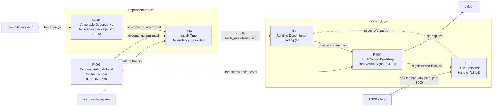

| Feature | Depends On | Nature of Dependency | Effect if the Dependency Fails |
|---|---|---|---|
| F-002 | F-001 | Resolves the pin in `package.json` L5; no lockfile intermediates | Nothing to install; `node_modules` stays empty |
| F-003 | F-002 | Requires the installed `node_modules/lodash` tree | `MODULE_NOT_FOUND` at L1, exit 1, no listener |
| F-004 | F-003 | Executes after L1 in the same top-to-bottom script | The process never reaches `createServer` or `listen` |
| F-005 | F-004 | The server registers and invokes the listener | No HTTP surface exists; clients get connection refused |
| F-005 | none on F-003 | The handler never dereferences `_` | No functional effect: remediation cannot change the response |
| F-006 | F-001, F-002, F-004 | Its two commands and its heading restate other features' facts | Guidance is wrong or unusable, while runtime behaviour is unaffected |

### 2.3.2 Process Flows

The first diagram traces the runtime path through F-003, F-004 and F-005, including the two failure exits observed during verification. The second traces the dependency-state path across F-001, F-002 and F-005. Section 4 (Process Flowchart) carries the full workflow treatment; 1.3.1 holds the high-level user-workflow chart.

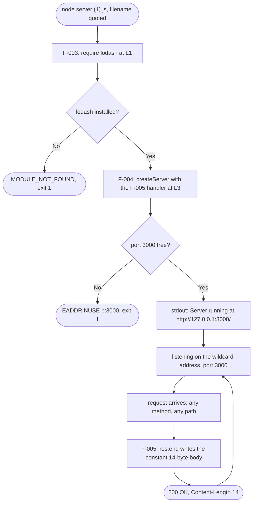

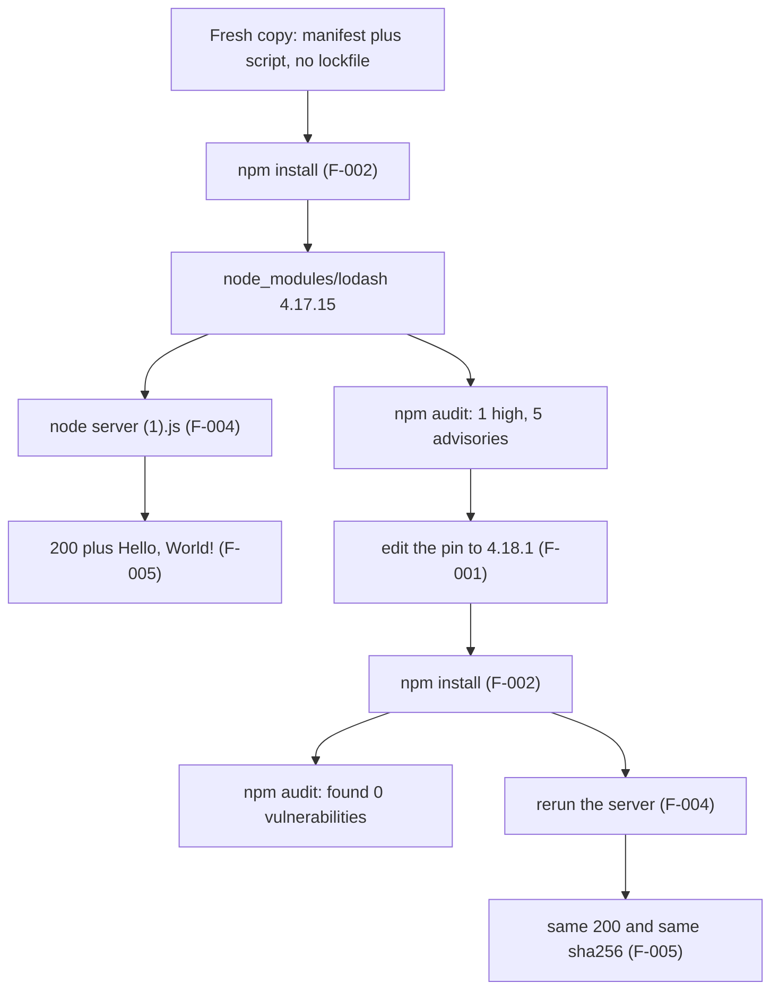

### 2.3.3 Integration Points

| Integration Point | Features | Direction / Protocol | Evidence |
|---|---|---|---|
| Public npm registry | F-002 | Inbound HTTPS download at install time | `package.json` L5; `npm install` → `added 1 package`; generated lockfile records `resolved` URL and `sha512` integrity |
| npm advisory data | F-001, F-002 | Read on demand by `npm audit` against the installed tree | `npm audit` → `1 high severity vulnerability`, five advisories, fix `lodash@4.18.1` |
| HTTP clients | F-004, F-005 | Inbound HTTP/1.1 over TCP 3000 on all interfaces | `server (1).js` L3–L5; `[::]:3000` listener; `10.11.0.7:3000` returned `200` |
| Process stdout / stderr | F-003, F-004 | Outbound: one startup line on stdout, unhandled error traces on stderr | `server (1).js` L5; observed `MODULE_NOT_FOUND` and `EADDRINUSE` traces |
| Operator shell / README | F-006 | Human-readable commands executed by an operator | `README.md` L3, L5; both commands run as written |

### 2.3.4 Shared Components and Common Services

**Shared components**

| Component | Shared By | Role |
|---|---|---|
| `server (1).js` | F-003, F-004, F-005 | The single entry script, evaluated top to bottom in one process (`node --check` exit 0) |
| `package.json` pin and identity | F-001, F-002, F-006 | Defines the vulnerable state and the package name the README's heading restates |
| Node built-in `http` module | F-004, F-005 | Server creation, request parsing, default response headers |
| Constant body `Hello, World!\n` | F-005, F-006 | The behavioural oracle used for remediation checks; implicitly the subject of the README's run command |

**Common services**

| Service | Used By | Operations Exercised |
|---|---|---|
| npm CLI | F-001, F-002, F-006 | `npm install` (install), `npm audit` (detection), `npm start`/`npm test` (both absent, `Missing script`) |
| Node.js runtime v22.23.4 | F-003, F-004, F-005 | CommonJS loader, `http` server, event loop, process exit codes |

The repository has no shared application libraries, middleware, utility modules, configuration service, cache or datastore. `blitzy/documentation/` documents the repository and is used by no feature.


## 2.4 Implementation Considerations

The considerations below follow from the committed files and from verified runtime behaviour. The fixture is a test asset, so constraints are stated relative to that role; production operation is ruled out in 1.3.2.

### 2.4.1 F-001: Vulnerable Dependency Declaration

| Aspect | Consideration | Evidence |
|---|---|---|
| Technical Constraints | The exact pin removes range resolution as a variable, so no automated fix can move the dependency. npm is the only supported package manager: the tree carries no Yarn or pnpm metadata and the manifest no `engines` field. | `package.json` L5, L1–L7 |
| Performance Requirements | None. The manifest is static and is never read by the running application. | `package.json`; `server (1).js` reads only `node_modules` |
| Scalability | One dependency keeps every finding attributable to a single cause. Each added package would add findings unrelated to the test case. | `node_modules` holds only `lodash`; generated lockfile's `packages` has two keys |
| Security Implications | The pin is intentionally vulnerable: one high severity finding with five advisories, widest range `<=4.17.23`. The set grows as advisories are published, so the declared state's risk profile drifts without any change to the file. | `npm audit --json`; 1.1 |
| Maintenance Requirements | Assert specific advisory identifiers rather than a count or a severity label, or record the audit date alongside the result. The repository name's "MinorCVE" already disagrees with today's `high` rating (1.2.3). | `npm audit`; `git log` initial README |

### 2.4.2 F-002: Install-Time Dependency Resolution

| Aspect | Consideration | Evidence |
|---|---|---|
| Technical Constraints | Resolution requires the public registry (or a warm cache). `npm ci` cannot be used, so any pipeline that assumes a lockfile must be adapted to `npm install`. Registry configuration is default: no `.npmrc` exists. | `npm ci` → `npm error code EUSAGE`; `npm install` → `added 1 package` |
| Performance Requirements | One tarball fetch or cache read per install; observed at 466 ms on a warm cache. Not a target. | `npm install` timing |
| Scalability | Not applicable: one package, no transitive tree, no workspace or monorepo structure. | Generated lockfile `packages` = `""` and `node_modules/lodash` |
| Security Implications | Integrity verification applies only to the transient install, because no committed lockfile records a `sha512` value or resolved URL. A tampered registry response would not be detectable against the tracked tree, only against a generated lockfile that the repository does not keep. | Tracked tree listing; generated `package-lock.json` content |
| Maintenance Requirements | The plain `npm install` documented in the README writes an untracked `package-lock.json`; a contributor must delete it or use `--no-package-lock`, since no `.gitignore` exists to prevent a commit. Re-created lockfiles must not be committed while the fixture is meant to stay lockfile-free. | `git status` after install; `CI=true npm install --no-package-lock` writes none |

### 2.4.3 F-003: Runtime Dependency Loading

| Aspect | Consideration | Evidence |
|---|---|---|
| Technical Constraints | CommonJS only; `node_modules/lodash` must be resolvable from the script's directory. The load is unconditional and precedes server creation, so the process cannot start uninstalled. | `server (1).js` L1; `MODULE_NOT_FOUND` before install |
| Performance Requirements | One module-load cost at startup, no per-request cost. No measurement is defined or recorded. | L1 sits outside the handler |
| Scalability | Not applicable; nothing about the load depends on request volume. | `server (1).js` L1–L5 |
| Security Implications | The vulnerable code is resident in memory while no code path reaches it. Any future call such as `_.template` or `_.unset` on request data would turn an unreachable advisory into a reachable one, and the handler currently reads no request field at all. | `_` referenced only at L1; `req` never dereferenced at L3–L4 |
| Maintenance Requirements | A linter would flag `_` as unused, and none is configured (`devDependencies` absent). Removing the import would forfeit the runtime-presence property that makes the fixture more than a manifest scan. | `package.json` L1–L7; 1.2.3 Critical Success Factors |

### 2.4.4 F-004: HTTP Server Bootstrap and Startup Signal

| Aspect | Consideration | Evidence |
|---|---|---|
| Technical Constraints | Port 3000 is a literal, so no environment or CLI override exists; the entry filename must be quoted; there is no `main` field or `start` script, so npm cannot launch the fixture. | `server (1).js` L5; `npm start` → `Missing script`; `PORT=3999` still collides on 3000 |
| Performance Requirements | One process, one event loop, Node's default timeouts (`headersTimeout` 60 000 ms, `requestTimeout` 300 000 ms, `keepAliveTimeout` 5 000 ms), no clustering and no tuning. The committed `Project Guide` records 20 concurrent and 50 sequential requests answered identically, but that is evidence, not a target. | `server (1).js` L3–L5; Project Guide Section 3–4 |
| Scalability | One instance per host: a second bind fails with `EADDRINUSE`. No deployment topology, load balancer or replication path is defined (1.3.2). | Port-conflict test |
| Security Implications | The socket binds all interfaces while the startup line advertises `127.0.0.1`, so an operator reading the log would underestimate exposure — a request to `10.11.0.7:3000` returned `200`. No TLS, authentication or request logging. The fixture must be isolated at the network or container boundary. | `/proc/net/tcp6`; non-loopback request; 1.2.1 limitations |
| Maintenance Requirements | No error handler, signal handler or graceful shutdown: the listener is dropped when the process ends, and an `EADDRINUSE` crash prints a raw stack trace. The single startup line is the only operational signal, so harnesses should match it and not stderr. | `server (1).js` L5; observed traces |

### 2.4.5 F-005: Fixed-Response HTTP Handler

| Aspect | Consideration | Evidence |
|---|---|---|
| Technical Constraints | No `Content-Type` and no security headers are emitted, so a client must sniff the body type. The body is a literal inside `res.end`, with no template or interpolation. | Response header capture; `server (1).js` L4 |
| Performance Requirements | Constant work per request: no I/O, no computation, no state. No latency or throughput target is defined anywhere in the repository. | `server (1).js` L3–L4 |
| Scalability | Stateless, so no shared-state limit; capacity is bounded only by the single fixed-port process of F-004 (1.2.3). | L3–L4 |
| Security Implications | Application code reads no input, so there is no reflection, injection or traversal surface; framing errors are Node's `400`/`431`. Residual exposure is the parser and the wildcard listener, with no rate limiting. | `req` unused; Project Guide Section 4 hostile-input cases |
| Maintenance Requirements | The body is the contract: status `200`, `Content-Length: 14`, sha256 `c98c24b6…ad31`, no `Content-Type`. Changing the string, or adding a header, invalidates every harness assertion and the remediation-invariance requirement F-005-RQ-006. | `server (1).js` L2–L4; verified hash before and after the 4.18.1 upgrade |

### 2.4.6 F-006: Documented Install and Run Instructions

| Aspect | Consideration | Evidence |
|---|---|---|
| Technical Constraints | The README cannot offer a `npm start` workflow because no `scripts` block exists, and it cannot document a port override because none exists. Its run command must keep the filename quoted. | `README.md` L3, L5; `package.json` L1–L7 |
| Performance Requirements | None; the file has no executable surface. | `README.md` |
| Scalability | Not applicable. | `README.md` |
| Security Implications | The documentation must not normalise committing the generated lockfile, and it names no host, credential or registry override — it names none. | `README.md` L1–L5; F-002-RQ-004 |
| Maintenance Requirements | Two edits would invalidate it: renaming or adding scripts for the entry file, and changing the install form. The committed `Project Guide` records the documentation set as the lowest-priority open item, and the committed `Technical Specifications.md` still describes a lockfile and a deleted README, so this feature's accuracy is the repository's weak point (1.2.1). | `README.md`; Project Guide Sections 1.4, 2.2 |


## 2.5 Traceability Matrix

The repository ships no tests, no CI and no lint configuration (1.3.2), so every requirement is traced to its source lines and to a manual verification method that a harness can automate. All 31 requirements across the six features are traced below.

### 2.5.1 Requirements Traceability Matrix

| Requirement ID | Source Location | Verification Method | Related Specification |
|---|---|---|---|
| F-001-RQ-001 | `package.json` L2–L3 | Inspect the JSON fields | 1.1, 1.2.1 |
| F-001-RQ-002 | `package.json` L4–L6 | Inspect the JSON; assert no range operator | 1.1, 1.3.1 |
| F-001-RQ-003 | `package.json` L5 | `npm install`, then `npm audit --json` | 1.2.3, 1.1 |
| F-001-RQ-004 | `package.json` L1–L7 | Inspect the JSON keys | 1.3.2 |
| F-001-RQ-005 | `package.json` L5 | Read `fixAvailable` in `npm audit --json` | 1.2.1, 1.2.3 |
| F-002-RQ-001 | `package.json` L5; `README.md` L3 | `npm install` in a copy, then list `node_modules` | 1.2.3, 1.3.1 |
| F-002-RQ-002 | Tracked tree listing (`git ls-files`) | `find` for lockfiles; `npm ci` must fail `EUSAGE` | 1.2.1, 1.3.2 |
| F-002-RQ-003 | Generated lockfile; `package.json` L5 | `node -e "require('lodash').VERSION"` | 1.2.3 |
| F-002-RQ-004 | Generated `package-lock.json` | `npm install`, then `git status` shows it untracked | 1.2.1 |
| F-002-RQ-005 | `README.md` L3; Project Guide Section 2.2 | `CI=true npm install --no-package-lock` writes no lockfile | 1.3.1 |
| F-002-RQ-006 | Generated lockfile `packages` keys | Inspect `packages`; count `node_modules` entries | 1.1, 1.3.1 |
| F-003-RQ-001 | `server (1).js` L1 | Start the server; compare loaded and installed version | 1.2.2 |
| F-003-RQ-002 | `server (1).js` L1–L5 | `grep` for `_` and `lodash`; compare responses across versions | 1.3.2 |
| F-003-RQ-003 | `server (1).js` L1 | Run before installing; expect `MODULE_NOT_FOUND`, exit 1 | 1.2.1, 1.3.1 |
| F-004-RQ-001 | `server (1).js` L3 | Code inspection; manifest dependency list | 1.2.2 |
| F-004-RQ-002 | `server (1).js` L5 | Connect to port 3000; read `/proc/net/tcp6` | 1.3.1 |
| F-004-RQ-003 | `server (1).js` L5 | Capture stdout; assert the exact line, empty stderr | 1.2.2 |
| F-004-RQ-004 | `server (1).js` filename; `package.json` | Run the quoted command; run `npm start`, `npm test` | 1.2.1, 1.3.1 |
| F-004-RQ-005 | `server (1).js` L5 | Request the host's non-loopback IPv4 address | 1.2.1, 1.3.2 |
| F-004-RQ-006 | `server (1).js` L5 | Start a second instance while the first serves | 1.3.2 |
| F-004-RQ-007 | `server (1).js` L5 | Start with `PORT=3999`; observe the collision on 3000 | 1.3.2, 2.4.4 |
| F-005-RQ-001 | `server (1).js` L3–L4 | Send each method to known and unknown paths; compare bytes | 1.2.2, 1.2.3 |
| F-005-RQ-002 | `server (1).js` L3–L4 | Capture response headers; assert no `Content-Type` | 1.2.1, 1.2.2 |
| F-005-RQ-003 | `server (1).js` L3–L4 | `HEAD /`; expect headers and no body | 1.2.2 |
| F-005-RQ-004 | `server (1).js` L3–L4 | Code inspection; repeated and concurrent requests | 1.3.1 |
| F-005-RQ-005 | `server (1).js` L4 | Compare status, `Content-Length`, body sha256 | 1.2.3 |
| F-005-RQ-006 | `server (1).js` L1–L4; `package.json` L5 | Re-pin 4.18.1, reinstall, re-audit, re-request | 1.2.3, 2.3.2 |
| F-006-RQ-001 | `README.md` L1; `package.json` L2 | String comparison of the two names | 1.2.2 |
| F-006-RQ-002 | `README.md` L3 | Run the documented install in a fresh copy | 1.2.2, 1.3.1 |
| F-006-RQ-003 | `README.md` L5 | Run the documented command verbatim | 1.2.2, 1.3.1 |
| F-006-RQ-004 | `README.md` L1–L5 | Byte and line count; read for unsupported claims | 1.3.1 |

**Coverage by feature and flowchart**

| Feature | Requirements | Flowchart Reference |
|---|---|---|
| F-001 | F-001-RQ-001 … 005 (5) | 2.3.2 dependency-state flow, steps "edit the pin" onward; 1.3.1 user workflows |
| F-002 | F-002-RQ-001 … 006 (6) | 2.3.2 dependency-state flow, `npm install` steps |
| F-003 | F-003-RQ-001 … 003 (3) | 2.3.2 runtime flow, L1 and the `MODULE_NOT_FOUND` exit |
| F-004 | F-004-RQ-001 … 007 (7) | 2.3.2 runtime flow, `createServer`, port check, startup line |
| F-005 | F-005-RQ-001 … 006 (6) | 2.3.2 runtime flow, request-to-response loop; section 4 for the full workflow set |
| F-006 | F-006-RQ-001 … 004 (4) | 1.3.1 user workflows (the commands the README documents) |

### 2.5.2 Assumptions and Constraints

**Assumptions**

| ID | Assumption | Basis |
|---|---|---|
| A-01 | The fixture is a validation asset, never a production service | `package.json` has no licence, author, description or `publishConfig`; 1.3.2 rules out production use |
| A-02 | The public npm registry is reachable and serves the pinned version unmodified | No `.npmrc`, mirror or vendored copy exists; resolution depends on the registry |
| A-03 | The lockfile-free dependency state is deliberate | `package-lock.json` was deleted in commit `dd23c44`, and the `Project Guide` records "the branch must stay lockfile-free" |
| A-04 | Verification runs on a host with TCP port 3000 free and one instance at a time | `listen(3000)` takes no host and no override; a second instance fails `EADDRINUSE` |
| A-05 | Consumers run the fixture in an isolated network or container | The socket binds all interfaces; the log line names loopback only |
| A-06 | Advisory findings are read as a point-in-time snapshot | The five advisories are what `npm audit` returned on the recorded run; three upstream documents disagree on the count (1.2.3) |

**Constraints**

| ID | Constraint | Consequence |
|---|---|---|
| C-01 | `lodash` is pinned exactly at 4.17.15 and no lockfile is committed | Only an explicit manifest edit moves the dependency; resolution is not byte-reproducible |
| C-02 | `npm ci` cannot run on this tree | Every workflow, gate and harness must use `npm install` or the `--no-package-lock` form |
| C-03 | Port 3000 is hard-coded with no `PORT`/`HOST` override | One instance per host; contention yields `EADDRINUSE` and no remedy is documented |
| C-04 | The entry filename contains a space and parentheses | Every invocation must quote `server (1).js`; no `main` or `scripts` entry hides it |
| C-05 | The manifest declares no `engines` field | Runtime compatibility is undocumented; behaviour was verified on Node.js v22.23.4 / npm 11.21.0 |
| C-06 | No automated test, lint or CI gate exists | Every acceptance criterion in 2.2 is verified by hand or by a harness the consumer supplies |

### 2.5.3 Requirement Version Control

| Version | Applies To | Basis in the Repository | Status |
|---|---|---|---|
| 1.0 | All 31 requirements in 2.2 | HEAD `0de48f7` on branch `2509_01`: manifest pin 4.17.15, no lockfile, `server (1).js` with the L2 JSDoc summary, `README.md` present | Current |
| 0.9 (superseded) | The prior release of this specification in `blitzy/documentation/Technical Specifications.md`, which carried a Critical lockfile feature and an `npm ci` install model | Superseded by commit `dd23c44` ("Delete package-lock.json"); the lockfile it specified no longer exists, so F-002 was restated as install-time resolution | Superseded |
| 1.1 (proposed, not on this branch) | F-001-RQ-002, F-001-RQ-003, F-005-RQ-006 | Commit `26f31dc` ("Pin lodash 4.18.1 in both manifests and record the remediation") exists only on `origin/blitzy-57c07a95-…`, not on `2509_01` | Proposed |

A version increment is required whenever a requirement's acceptance criterion, source line or priority changes. The three triggers visible in the repository's history are a change to the `lodash` pin (C-01), the addition or removal of a lockfile (C-02), and any edit to the response body or headers (`server (1).js` L3–L4), which invalidates F-005-RQ-002 and F-005-RQ-005.


## 2.6 References

**Repository files**

- `package.json` — package identity `cve-test-fixture@1.0.0` (L2–L3), the exact `lodash` `4.17.15` pin with no range (L4–L5), and the absence of `main`, `scripts`, `engines`, `license`, `author`, `description`, `private`, `publishConfig`, `devDependencies`, `peerDependencies` and `optionalDependencies` (104 bytes, 7 lines); source for F-001 and the install precondition of F-002
- `server (1).js` — the whole runtime: unused `lodash` import (L1), JSDoc handler summary (L2), `createServer` with the constant `Hello, World!\n` body (L3–L4), `listen(3000)` with no host argument and the loopback startup line (L5); 263 bytes, 5 lines; source for F-003, F-004 and F-005
- `README.md` — the only usage documentation: `# cve-test-fixture` (L1), ``Install: `npm install` `` (L3), ``Run: `node "server (1).js"` `` (L5); 72 bytes, 5 lines; source for F-006
- `blitzy/documentation/Project Guide - 182193aa-390a-4811-9305-dd7e915872d4.md` — delivery report used for the documented install form (`CI=true npm install --no-fund --no-package-lock`), the 81 hand-executed runtime cases, the hostile-input and concurrency evidence, the five-advisory baseline, and the three open items ranked in Section 2.2
- `blitzy/documentation/Technical Specifications.md` — the prior release of this specification; its lockfile-era feature model (F-002 as "Locked Dependency Resolution", `npm ci` install model, six advisories) is recorded in 2.5.3 as the superseded version 0.9
- `tech_spec.md` (repository root, untracked) — the working copy into which this section is written

**Repository folders**

- `` (repository root) — five tracked paths plus the untracked `tech_spec.md`; no `package-lock.json`, `npm-shrinkwrap.json`, `yarn.lock`, `node_modules`, `.gitignore`, `.github`, `Dockerfile`, `*.yml`/`*.yaml`, IaC file or test file exists, which is the evidence for F-002-RQ-002 and constraints C-02 and C-06
- `blitzy/` — documentation-only subtree with no source, configuration or build content
- `blitzy/documentation/` — the two Markdown documents listed above

**Git history and metadata**

- `0de48f7` — current HEAD on branch `2509_01` ("Merge pull request #2")
- `dd23c44` — "Delete package-lock.json", the commit that removed the locked-dependency feature and makes install-time resolution (F-002) the only path
- `5433d34`, `8d02da8`, `47c41cf` — creation and updates of `README.md`, the artifact behind F-006
- `c66e66f`, `896daa4`, `2d35439`, `602ea95` — the JSDoc summary and handler restoration in `server (1).js`
- `26f31dc` — "Pin lodash 4.18.1 in both manifests and record the remediation", present only on `origin/blitzy-57c07a95-…`, the basis for the proposed version 1.1 in 2.5.3

**Observed runtime and tooling results (Node.js v22.23.4, npm 11.21.0)**

- `node "server (1).js"` → `Server running at http://127.0.0.1:3000/`; before installation → `Error: Cannot find module 'lodash'` at L1
- `GET /` → `HTTP/1.1 200 OK` with `Date`, `Connection: keep-alive`, `Keep-Alive: timeout=5`, `Content-Length: 14` and no `Content-Type`; body `Hello, World!\n`, sha256 `c98c24b677eff44860afea6f493bbaec5bb1c4cbb209c6fc2bbb47f66ff2ad31`
- `GET /nope` → `200`/14 bytes; `POST /` with body → `200`/14 bytes; `HEAD /` → `200` with headers and no body
- Listener at `/proc/net/tcp6` `00000000000000000000000000000000:0BB8` state `0A`; request to host IPv4 `10.11.0.7:3000` → `200`/14 bytes; second instance → `Error: listen EADDRINUSE: address already in use :::3000`; `PORT=3999` still collides on 3000
- `npm install` → `added 1 package`, writing `package-lock.json` (`lockfileVersion: 3`, `requires: true`, `packages[""]` mirroring the manifest, `node_modules/lodash` with its resolved URL, `sha512` integrity and MIT licence); `CI=true npm install --no-fund --no-audit --no-package-lock` → `added 1 package` with no lockfile written; `npm ci` → `npm error code EUSAGE`; `npm test` and `npm start` → `npm error Missing script`; `node --check "server (1).js"` → exit 0
- `npm audit` → `1 high severity vulnerability`, `lodash <=4.17.23`, five advisories (GHSA-35jh-r3h4-6jhm, GHSA-p6mc-m468-83gw, GHSA-29mw-wpgm-hmr9, GHSA-r5fr-rjxr-66jc, GHSA-xxjr-mmjv-4gpg), `fixAvailable` `lodash@4.18.1` "outside the stated dependency range"
- Remediation run in an isolated copy with the pin at 4.18.1: `npm install` → `added 1 package`, `require('lodash').VERSION` → `4.18.1`, `npm audit` → `found 0 vulnerabilities`, and `GET /` → `200` with the same 14 bytes and the same sha256, which is the evidence for F-005-RQ-006

**Web sources**

No external web source was used. Every statement rests on the tracked files, the git history or commands executed against the checkout; the advisories are reported as `npm audit` returned them rather than from a separate advisory-database lookup.

**Related specification sections**

1.1 Executive Summary (purpose and stakeholders), 1.2 System Overview (capabilities, success criteria, limitations), 1.3 Scope (in-scope capabilities, out-of-scope exclusions), 1.4 References (source inventory), 4. Process Flowchart (full workflow treatment referenced by 2.3.2).


# 3. Technology Stack

## 3.1 Programming Languages


The repository ships one programming language: JavaScript (ECMAScript), executed by the Node.js runtime. A file-type census of the entire tree — `find` over every file outside `.git`, followed by extension grouping — returns four Markdown files, one JSON file and one JavaScript file. There is no TypeScript, Python, shell, YAML, HCL, Swift, Kotlin, Objective-C or C/C++ source anywhere in the checkout, and the manifest declares no `devDependencies` that would introduce a second language for tests, linting or building.

### 3.1.1 Language Inventory by Component

| Component | Artifact | Language or format | How it executes | Evidence |
|---|---|---|---|---|
| HTTP server and request handler | `server (1).js` | JavaScript, ES2015 subset, CommonJS | Interpreted directly by `node`, no build or transpile step | L1–L5, 263 bytes |
| Dependency declaration | `package.json` | JSON (declarative data, not code) | Parsed by the npm CLI at install time | L1–L7, 104 bytes |
| Install and run instructions | `README.md` | Markdown (prose with inline code) | Read by a human; no executable surface | L1–L5, 72 bytes |
| Design baseline and delivery report | `blitzy/documentation/Technical Specifications.md`, `blitzy/documentation/Project Guide - 182193aa-390a-4811-9305-dd7e915872d4.md` | Markdown (prose, fenced `bash`/`text` transcripts, Mermaid diagrams) | Read by a human; no executable surface | 6,481 and 430 lines |
| Test, build, migration or automation code | none | — | — | No `*.test.js`, `*.spec.js`, `*.sh`, `*.py`, `Makefile` or `scripts` block exists |

The single `.js` file is the whole executable surface. It is a five-line script, not a library: it contains no `module.exports`, no `exports.` assignment and no exported class, so nothing in the repository can import it. The other tracked artifacts are declarative (JSON) or documentary (Markdown), which is why the language inventory stops at one language.

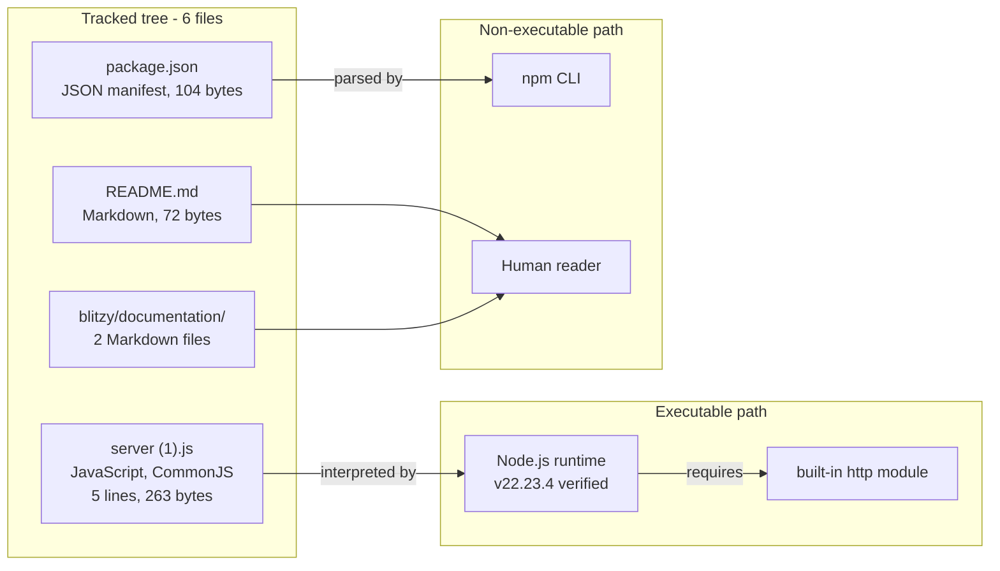

### 3.1.2 Language Level and Syntax Baseline

The source uses exactly two post-ES5 constructs. Everything else it needs is available in any Node.js release.

| Construct | Where | Note |
|---|---|---|
| `const` declaration | `server (1).js` L1 (`const _ = require('lodash');`) | The only variable declaration in the file |
| Arrow functions | L3 request listener, L5 `listen` callback | Both are anonymous; neither is named or exported |
| CommonJS `require` | L1 (`lodash`), L3 (`http`) | No `import`/`export` syntax and no top-level `await` |

Absent from the file and from the repository: `async`/`await`, promises, classes, template literals, spread/rest, destructuring, generators, optional chaining, nullish coalescing, JSX, and every TypeScript construct. `package.json` carries no `type` field, so `.js` resolves as CommonJS rather than ESM — a fact that fixes the module system by default rather than by declaration.

The practical consequence is that no language-level feature constrains the runtime. The version-sensitive surface is the module system (`require` resolution from `node_modules`) and the `http` API (`createServer`, `res.end`, `server.listen`), all of which predate every Node.js release still supported. `node --check "server (1).js"` parses the file with exit 0, and the file runs unmodified as committed.

### 3.1.3 Selection Criteria and Rationale

The language choice follows from what the fixture must prove, not from application requirements. Each criterion is traceable to an observable property of the tree.

| Criterion | Why it drives the choice | Evidence |
|---|---|---|
| Ecosystem realism for software-composition analysis | The only measurable property of this system is what dependency scanners and `npm audit` report about an npm package. JavaScript with an npm manifest is the artifact format those tools consume, and `lodash` is an npm package. | `package.json` L4–L5; `npm audit` reporting against the pin |
| The vulnerable declaration must survive into the shipped artifact | No transpile, bundle or minify step exists, so both `package.json` and the `require('lodash')` line reach a scanner exactly as authored. A build step would relocate or obscure the declaration. | No build config in the tree; `server (1).js` L1 |
| No framework that could add findings of its own | With only Node's built-in `http` module, every dependency in the tree is the one under test. A web framework would introduce its own advisory surface and dilute attribution. | `server (1).js` L3; `dependencies` holds one entry |
| Smallest possible behavioural oracle | A five-line CommonJS script with no routing, middleware or state produces a constant response whose status and bytes can be compared before and after a dependency change. | `server (1).js` L3–L4; body `Hello, World!\n` |
| No toolchain beyond the runtime | The file runs as committed, so a consumer needs only `node` plus one `npm install`; there is no compiler, bundler or transpiler to install or version. | `README.md` L3, L5 |

The corresponding rejections are equally direct. TypeScript is absent because it would add a compiler and a type-checking step without changing what the scanner sees. A shell wrapper is absent because the entry point is already a single command. Python is absent because the dependency under test is an npm package and the fixture must present an npm manifest.

### 3.1.4 Constraints and Dependencies

| Constraint | Detail | Evidence |
|---|---|---|
| Runtime version is undeclared | No `engines` field in the manifest, no `.nvmrc`, no `.node-version`, no `packageManager` field. Behaviour was verified on Node.js v22.23.4 with npm 11.21.0; the committed design baseline records an earlier verification on Node.js v22.23.3 with npm 11.18.0. Both are observations, not constraints — any version change on the host is an untested change. | `package.json` L1–L7; committed blitzy specification 9.1.4 |
| CommonJS resolution precedes everything else | L1 executes before the server is created, so `node_modules/lodash` must exist in the script's directory tree. Without it the process exits 1 with `MODULE_NOT_FOUND` before any listener exists. | `server (1).js` L1; F-003 |
| The module system is fixed implicitly | Because `package.json` has no `"type": "module"`, adding ESM to the file or the manifest would break the existing `require` calls. The language surface is therefore closed to ESM without a deliberate migration. | `package.json` L1–L7 |
| The entry filename must be quoted in every shell | The tracked name contains a space and parentheses. Unquoted `node server (1).js` is a shell syntax error; the README and the specification both quote it. | `server (1).js` (filename); `README.md` L5 |
| No type checking and no lint gate | The only binding to `lodash` is never used, and nothing flags it. There is no `devDependencies`, ESLint, Prettier or `tsconfig` in the tree, so the code has no static analysis layer at all. | `package.json` L1–L7; no config files present |
| The oracle is asserted only from outside | Because the language offers no test harness and none is configured (`npm test` exits with `Missing script: "test"`), contract regressions in status, body or headers can only be caught by an external HTTP probe. | `package.json`; F-006 |
| Documentation cannot fail a build | Markdown and JSON carry no executable surface, so stale prose — such as the committed design baseline's claim of a committed lockfile that the tree no longer has — passes every check the repository can run. | `blitzy/documentation/Technical Specifications.md` vs. tracked tree |


## 3.2 Frameworks & Libraries


The system has no application framework. Its runtime composition is the Node.js standard library plus one third-party package that is loaded but never called. That is a deliberate architectural position, recorded in the committed design baseline as ADR-004 ("use the built-in `http` module in a single CommonJS file, with no framework and no build step"), and it is what keeps every dependency in the tree attributable to the vulnerability under test.

### 3.2.1 Runtime Platform

| Attribute | Value | Declared in repository? | Evidence |
|---|---|---|---|
| Platform | Node.js (server-side JavaScript) | No | `server (1).js` L1–L5 |
| Node.js version used for verification | v22.23.4 | No — no `engines`, `.nvmrc` or `.node-version` | Verification record in 1.2 System Overview; environment probe |
| npm version used for verification | 11.21.0 | No — no `packageManager` field | As above |
| Minimum Node.js implied by the source | Any release that provides CommonJS `require` and the `http` module — that is, every release still supported | Implied only | ES2015-only syntax at L1, L3, L5 |
| Minimum npm implied by the generated lockfile format | npm 7 or later, because an install writes `lockfileVersion: 3` | Implied only | Generated `package-lock.json` after `npm install`; committed design baseline 8.2.1 |

The platform is unversioned on purpose: nothing in the manifest constrains it, so the fixture installs and runs on any current Node.js line. The trade-off is that a host version change is silent — no file records the version a result was obtained on, and only the specification's verification notes do.

### 3.2.2 Core Framework

None. The tree contains no Express, Koa, Fastify, NestJS, Hapi or equivalent, and no Flask, LangChain, Django, React, React Native, Angular, Vue, TailwindCSS, Electron, Swift, Kotlin or Objective-C project anywhere. The absence is verifiable in three ways: `dependencies` in `package.json` holds exactly one entry (`lodash`, L4–L5); no `devDependencies`, `peerDependencies` or `optionalDependencies` block exists; and the only `require` calls in the codebase are `lodash` and `http`, the latter being a Node.js built-in rather than a framework.

What a framework would normally supply is therefore supplied by nothing. There is no router (every path reaches the single listener), no middleware chain (no header, CORS, body-parsing or compression layer), no error-handling middleware, no logger, no configuration loader and no lifecycle hooks. Two security-relevant consequences follow directly: responses carry no `Content-Type` and no security headers, and there is no rate limiting or authentication layer in front of the listener.

### 3.2.3 Supporting Libraries and Built-in Modules

| Library or module | Version | Type | Role | Evidence |
|---|---|---|---|---|
| `lodash` | 4.17.15 (exact pin) | Third-party runtime dependency | The vulnerability under test. Bound to `_` at module load and never referenced again, so it is present in the process without being reachable from any code path. | `package.json` L4–L5; `server (1).js` L1 |
| `http` | Ships with the Node.js runtime | Built-in core module | Creates the server (`createServer`) and binds TCP port 3000 (`listen`) | `server (1).js` L3, L5 |
| `console` | Ships with the Node.js runtime | Built-in global | Writes the single startup line to stdout | `server (1).js` L5 |

No other library is present. There is no HTTP client (`fetch`, `axios`, `https.request`), no database driver, no ORM, no cache client, no authentication SDK, no cloud SDK, no telemetry or metrics client, and no environment-variable loader — `process.env` is never read. Total third-party surface: one package, with no transitive dependencies of its own, which is why `npm ls --all` prints a two-line tree.

### 3.2.4 Compatibility Requirements

| Requirement | Constraint | Consequence if violated | Evidence |
|---|---|---|---|
| Module system | CommonJS, resolved from `node_modules` relative to the script | `require` fails; ESM in the manifest (`"type": "module"`) breaks both `require` calls | `server (1).js` L1, L3; `package.json` has no `type` field |
| `http` API surface | `createServer(handler)`, `res.end(body)`, `server.listen(port, cb)` | None for any supported Node.js line; these are long-stable APIs | `server (1).js` L3–L5 |
| `lodash` API surface | None used | Nothing: the library is never called, so no lodash function needs to exist for the fixture to work | `server (1).js` L1 |
| Lockfile format | `lockfileVersion: 3` if a lockfile is generated or adopted | An npm older than 7 cannot read a v3 lockfile | Generated `package-lock.json`; committed design baseline 8.2.1 |
| Registry protocol | HTTPS to `registry.npmjs.org`; `strict-ssl` is npm's default and no `.npmrc` overrides it | Install fails on a host that cannot reach the registry or validate its certificate | Historical lockfile `resolved` URL; no `.npmrc` in the tree |
| Peer and optional dependencies | None declared and none implied | Not applicable | `package.json` L1–L7 |
| Shell compatibility | Every invocation must quote the entry filename | Unquoted invocation is a shell syntax error (exit 2 in bash) | `server (1).js` (filename); `README.md` L5 |

### 3.2.5 Runtime Composition

The diagram traces what actually loads and runs in a started process. Only one path executes application code; `lodash` is loaded at module scope and then never touched, and the npm CLI is present only during install.

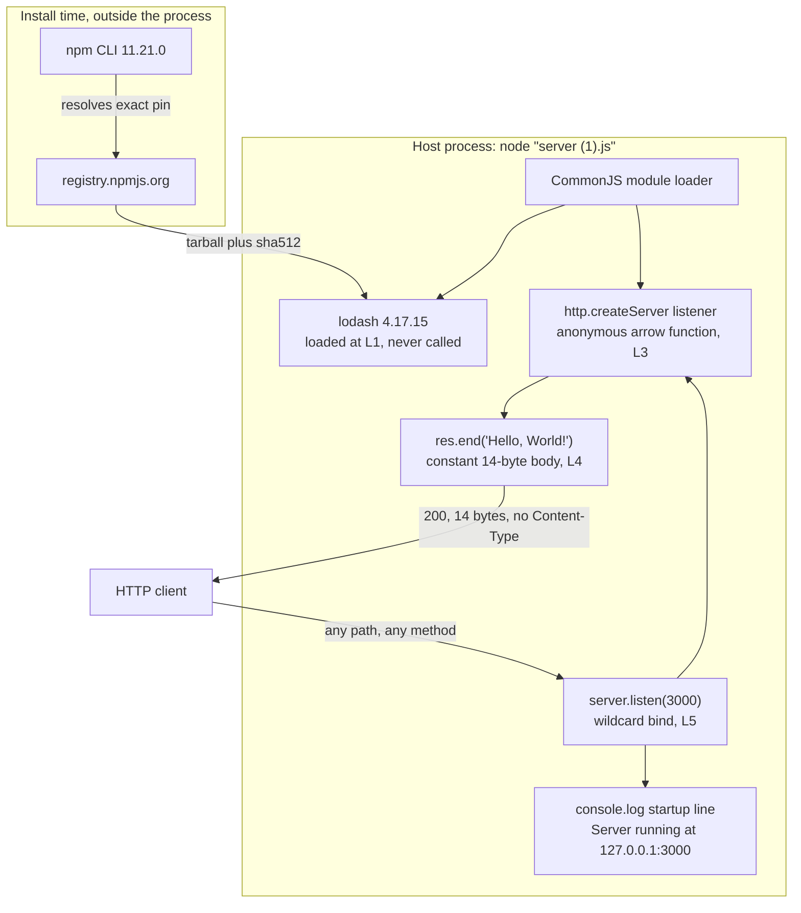

The composition has three properties that matter to any consumer. First, `lodash` is resolved and instantiated before the listener exists, so a missing dependency stops the process at start rather than at request time. Second, the request path touches nothing outside the handler — no library call, no I/O, no state — so the response is byte-identical for every request. Third, there is no framework layer to configure, which means every security control a framework would normally provide is absent by construction rather than by misconfiguration.


## 3.3 Open Source Dependencies


The open-source surface is one package: `lodash` at exact version 4.17.15, listed as the sole entry in `dependencies` (`package.json` L4–L5) and having no transitive dependencies of its own. Verified on a clean install: `npm install --no-fund --no-audit` reports `added 1 package`, `node_modules` holds only `lodash`, and `npm ls --all` prints a two-node tree. This narrowness is the fixture's design constraint — each additional package would add findings that cannot be attributed to the test case.

### 3.3.1 Dependency Inventory

| Package | Version | Dependency group | Direct or transitive | Transitive dependencies | License | Advisory state | Evidence |
|---|---|---|---|---|---|---|---|
| `lodash` | 4.17.15 (exact pin, no caret or tilde) | `dependencies` | Direct | None | MIT | 1 vulnerable package, high aggregate severity, 5 advisories | `package.json` L4–L5; `npm ls --all`; `npm audit --json` |
| — | — | `devDependencies` | — | — | — | — | Absent from the manifest |
| — | — | `peerDependencies` / `optionalDependencies` / `bundledDependencies` | — | — | — | — | Absent from the manifest |

Totals: one declared dependency, one installed package, zero transitive packages, zero development dependencies. The manifest carries no `overrides` or `resolutions` block, so there is no dependency-pinning mechanism other than the single version string.

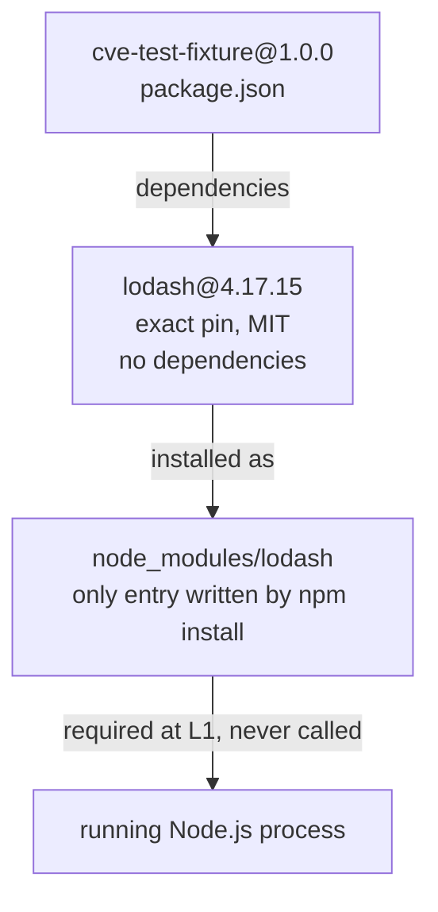

### 3.3.2 Registry, Package Manager and Integrity

| Aspect | State | Evidence |
|---|---|---|
| Package manager | npm only. No `yarn.lock`, `pnpm-lock.yaml`, `bun.lockb`, `lerna.json`, `pnpm-workspace.yaml` or `packageManager` field exists. | Tree census; `package.json` L1–L7 |
| Registry | The public npm registry, `https://registry.npmjs.org/`. No `.npmrc`, no scoped-registry configuration and no `publishConfig`, so npm defaults apply. | Historical lockfile `resolved` URL; absence of `.npmrc` |
| Committed lockfile | **None.** `package-lock.json` was added in commit `ddd2024` and deleted in commit `dd23c44`; it is absent from the tracked tree at HEAD, so no resolved URL or integrity hash is recorded in the repository. | `git log` on `package-lock.json`; tracked file listing |
| Lockfile written by install | `npm install` writes `package-lock.json` with `lockfileVersion: 3`, `requires: true`, a root record mirroring the manifest, and a `node_modules/lodash` record whose `version` is `4.17.15`, `resolved` is `https://registry.npmjs.org/lodash/-/lodash-4.17.15.tgz`, `integrity` is `sha512-8xOcRHvCjnocdS5cpwXQXVzmmh5e5+saE2QGoeQmbKmRS6J3VQppPOIt0MnmE+4xlZoumy0GPG0D0MVIQbNA1A==` and `license` is `MIT`. This file is untracked and must not be committed. | Observed install; the identical record exists in commit `ddd2024` |
| Locked-install path | Unavailable. `npm ci` requires a committed `package-lock.json` or `npm-shrinkwrap.json` and exits 1 on this tree with a usage error. `npm install` is therefore the only install path. | `npm ci` on a copy of the tracked files |
| Integrity verification scope | Applies only to each transient install, against the hash the registry returns. Because no hash is committed, a substituted tarball cannot be detected against the repository — only against the lockfile the install itself writes. | Tracked tree vs. generated lockfile |
| Artifact size and shape | The package is a single tarball; the CLI reports `1 package` and no lifecycle scripts run (`ignore-scripts` default is `false`, and `lodash` declares no install script). | `npm install` output; package metadata |

Migration constraint: adopting `npm ci` in any downstream copy requires committing a lockfile first, and committing one changes the fixture's declared state — the tree would then carry a second record of the dependency version that must be kept in step with the exact pin.

### 3.3.3 Known Vulnerabilities in the Locked Version

`npm audit --json` against a clean install of the pinned tree reports one vulnerable package with five advisories. The aggregate severity is `high` (metadata: 0 low, 0 moderate at package level, 1 high, 0 critical), the vulnerable range is `<=4.17.23`, and `fixAvailable` names `lodash` 4.18.1 as a non-major upgrade.

| Advisory (source ID) | GHSA / CVE | Title | CVSS | Individual severity | Affected range |
|---|---|---|---|---|---|
| 1106913 | GHSA-35jh-r3h4-6jhm / CVE-2021-23337 | Command Injection in `lodash` | 7.2 | High | `<4.17.21` |
| 1106920 | GHSA-p6mc-m468-83gw / CVE-2020-8203 | Prototype Pollution in `lodash` | 7.4 | High | `>=3.7.0 <4.17.19` |
| 1108258 | GHSA-29mw-wpgm-hmr9 / CVE-2020-28500 | Regular Expression Denial of Service (ReDoS) in `lodash` | 5.3 | Moderate | `>=4.0.0 <4.17.21` |
| 1115806 | GHSA-r5fr-rjxr-66jc / CVE-2026-4800 | Code Injection via `_.template` imports key names | 8.1 | High | `>=4.0.0 <=4.17.23` |
| 1244531 | GHSA-xxjr-mmjv-4gpg / CVE-2025-13465 | Prototype Pollution in `_.unset`, `_.omit` and `_.pullAt` | 6.5 | Moderate | `>=4.0.0 <=4.17.22` |

Security implications for this system, stated at the scope the evidence supports:

- **The vulnerable code is present but unreachable.** `server (1).js` L1 loads `lodash` and never references `_` again; the handler reads no request field, so no caller can reach `_.template`, `_.unset`, `_.omit` or `_.pullAt`. The presence of the package is the exposure, not any invocation.
- **The finding set drifts without any file change.** Three of the five ranges extend to the newest 4.17.x releases (published long after the pin was created), so a count or severity label recorded once stops describing the tree as advisories are published. Assert advisory identifiers, not a total.
- **The committed documentation disagrees with the observed report.** `blitzy/documentation/Technical Specifications.md` records six advisories, including GHSA-f23m-r3pf-42rh / CVE-2026-2950, and describes a committed lockfile with `npm ci` as the install path. The tracked tree has no lockfile, `npm ci` fails, and the current audit returns the five advisories above; the sixth is reported by neither the audit nor the current `Project Guide`, which itself records five. The sixth is therefore treated here as a documented-but-unreproduced finding against the pinned version, and the five above as the reproducible set.

### 3.3.4 Version Currency and Upgrade Path

| Attribute | Value |
|---|---|
| Versions installed | `lodash` 4.17.15 |
| Latest published version (`latest` dist-tag) | 4.18.1 |
| Version distance | One minor version across the 4.17.x line, but several patch releases behind the 4.18.x line in security terms |
| Blocking mechanism | The exact pin admits no range, so `npm audit fix` cannot move the dependency and reports the fix as "outside the stated dependency range". `npm audit fix --force` would upgrade, but writes the caret range `^4.18.1` and destroys the exact-pin convention. |
| Documented remediation | `npm install lodash@4.18.1 --save-exact`, recorded as ADR-008 in the committed design baseline. `--save-exact` is mandatory because npm's default `save-prefix` is `^`. |
| Intermediate versions that do not suffice | 4.17.21 clears the command-injection and ReDoS ranges but leaves the two ranges that extend to `<=4.17.22` and `<=4.17.23`; the same holds for the newest 4.17.x release. Only 4.18.x clears all five. |
| Verification after upgrade | `npm audit` must report `found 0 vulnerabilities`, `require('lodash').VERSION` must report `4.18.1`, and the HTTP response must remain `200` with the unchanged 14-byte body. A running process must be restarted to load the new version. |
| Scope of the change | Applying the upgrade in this repository changes the fixture's declared test condition (F-001) and therefore belongs in a downstream copy or a separate branch, not in the state under test. |

The upgrade carries no compatibility risk for this code: no `lodash` function is called, so the library's API surface is irrelevant to behaviour, and the only observable contract — status `200` with the constant body — is independent of the dependency.


## 3.4 Third-Party Services


No third-party service is integrated at runtime. The system makes no outbound network call of its own, holds no credential, and reports to no external system. The only services it touches are the package registry at install time and the advisory data behind `npm audit`, both through the npm CLI rather than through application code. On inspection: no `fetch`, `axios`, `https.request` or `http.request` call exists in the codebase; no SDK import references a cloud, identity or telemetry vendor; `process.env` is never read, so no endpoint or key can be injected.

### 3.4.1 External APIs and Integrations

| Integration | Direction and timing | Mechanism | What it supplies | Evidence |
|---|---|---|---|---|
| Public npm registry (`registry.npmjs.org`) | Outbound, at install time only | npm CLI resolves the exact pin and fetches one tarball over HTTPS | `lodash` 4.17.15 into `node_modules` | `package.json` L5; `npm install` → `added 1 package`; historical lockfile `resolved` URL |
| npm advisory data | Outbound, on operator demand | `npm audit` posts the dependency tree to the registry's audit endpoint and renders the response | The five GHSA findings, their severities and `fixAvailable` | `npm audit --json` |
| Inbound HTTP clients | Inbound, at runtime | Any client reaching TCP port 3000 on any host interface | Requests only; the client supplies no credential and receives no data derived from its own | `server (1).js` L3–L5 |

There is no API key, token, webhook, OAuth client, message broker, queue, SMTP relay or third-party data feed anywhere in the tree. The application has no outbound call path at all: the only network activity it initiates is the listener's own socket lifecycle.

### 3.4.2 Authentication Services

None. No identity provider is integrated — Auth0, Okta, Cognito, Firebase Auth, Keycloak and equivalents are all absent — and no authentication primitive is implemented locally: no JWT validation, no session store, no cookie handling, no API-key check, no basic-auth parsing, no mTLS and no TLS at all. The handler (`server (1).js` L3–L4) never reads a header, so it could not authenticate a caller even if a credential were supplied.

The security posture that follows is deliberate and bounded by the fixture's purpose: any client that can reach the host on port 3000 receives the same response, and because `listen(3000)` omits a host argument the binding is the wildcard address while the startup line advertises `127.0.0.1`. Isolation must therefore be supplied from outside the process — a network boundary or a container — and the committed design baseline rules production operation out of scope for that reason.

### 3.4.3 Monitoring and Observability

| Capability | State | Evidence |
|---|---|---|
| Logging (structured or levelled) | Absent. The process writes one plain-text line to stdout after a successful bind: `Server running at http://127.0.0.1:3000/`. No request logging, no error logging, no log level and no log destination configuration. | `server (1).js` L5 |
| Metrics / time series | Absent. No metrics client, no `/metrics` route, no counters. Request volume and latency are unmeasured. | No instrumentation in either file |
| Distributed tracing | Absent. No OpenTelemetry, Sentry, Datadog, New Relic or equivalent dependency. | `package.json` L4–L6 |
| Health check endpoint | Absent as a dedicated route. Every path returns `200` with the constant body, so a probe can only assert liveness, not readiness or dependency state. | `server (1).js` L3–L4 |
| Alerting and dashboards | Absent. No configuration, no pipeline integration, no notification channel. | Tree census |
| Operational signals available | Process exit status (`1` on bootstrap failure such as `MODULE_NOT_FOUND` or `EADDRINUSE`), the single stdout line, npm exit codes and npm debug logs for install and audit failures. | `server (1).js`; `npm` behaviour |

No hosted monitoring service is used, so there is no vendor to configure, no agent to install and no ingestion key to protect. Observability beyond stdout and exit codes would have to come from the surrounding harness.

### 3.4.4 Cloud Services

None. No AWS, Azure, Google Cloud or other provider SDK appears in the dependencies, no infrastructure-as-code definition exists (no Terraform `.tf` files, no CloudFormation or ARM templates), and no managed service is referenced in configuration, because there is no configuration file of any kind. There is also no container or serverless runtime definition that would imply a hosting platform.

The system runs as a single foreground Node.js process on whatever host executes `node "server (1).js"`. Its hosting requirements are correspondingly minimal: a Node.js runtime, a writable directory for `node_modules`, outbound HTTPS to the registry for installs and audits, and a free TCP port 3000.


## 3.5 Databases & Storage


The system stores nothing. There is no database, no cache and no persistence layer of any kind: the application holds no state between requests, opens no file, and its only durable outputs are the ones the toolchain writes around it. The evidence is direct — `package.json` declares one dependency (`lodash`) and no driver, ORM, migration tool or cache client; the handler at `server (1).js` L3–L4 calls nothing but `res.end`; and the file imports no `fs`, `path` or `stream` module.

### 3.5.1 Databases and Data Persistence

| Category | State | Evidence |
|---|---|---|
| Primary database | None. No MongoDB, PostgreSQL, MySQL, SQLite, Redis, DynamoDB or managed store is integrated, and no connection string, host, port or credential exists anywhere in the tree. | `package.json` L4–L6; no configuration file |
| ORM, ODM or query builder | None. No Mongoose, Sequelize, Prisma, TypeORM, Knex or equivalent dependency. | `package.json` L1–L7 |
| Schema, migrations, seeds | None. No migration directory, no schema file, no seed script and no `db:*` npm script (the manifest has no `scripts` block at all). | Tree census; `package.json` |
| In-request persistence | None. The listener receives `req` and never reads it; `res.end('Hello, World!\n')` writes a constant literal. No input is stored, echoed or derived from a request. | `server (1).js` L3–L4 |
| Session or cookie store | None. No cookie is set or parsed, and no session identifier exists, so there is nothing to persist. | `server (1).js` L3–L5 |
| Application-level file I/O | None. `fs` is never imported, and the startup line is written to stdout rather than to a log file. | `server (1).js` L1–L5 |
| State held while running | Only what the runtime itself holds: the resolved `lodash` module in memory at L1 and the open listening socket at L5. Both vanish when the process exits. | `server (1).js` L1, L5 |

The consequence for consumers is that the system has no data lifecycle to document — no backup, restore, retention, migration or disaster-recovery procedure applies, because no state survives a restart. Every request is answered from a compile-time constant, so an instance is fully fungible with any other instance of the same commit.

### 3.5.2 On-Disk Artifacts and Caching

Storage that does exist belongs to the toolchain, not to the application, and none of it is tracked.

| Artifact | Location | Owner | Lifetime | Tracked? | Evidence |
|---|---|---|---|---|---|
| `node_modules/` | Repository root | npm | Survives until deleted; created by `npm install` | No. No `.gitignore` exists to exclude it, so it can be committed by mistake | `npm install` output |
| `node_modules/lodash` | Inside `node_modules/` | npm | As above | No | `npm ls --all` |
| Generated `package-lock.json` | Repository root | npm | Written by `npm install`; untracked side effect | No — and it must not be committed while the fixture stays lockfile-free. `npm install --no-package-lock` (or `CI=true`) writes none. | `git status` after install; deleted in commit `dd23c44` |
| npm cache (`cacache`) | Host npm cache directory, outside the repository | npm | Persists across runs; makes a repeat install near-instant | Outside the tree | `npm install` timing; npm debug log path |
| npm debug logs | `<cache>/_logs/*-debug-0.log` | npm | Written only when a command fails, for example on `EUSAGE` or a registry error | Outside the tree | `npm ci` failure output |
| Application cache, CDN or object store | — | — | — | Not present | No client library, no configuration, no bucket reference in the tree |

Two practical cautions follow. First, because the repository ships no `.gitignore`, both `node_modules/` and a generated lockfile are visible to `git status` and can be committed accidentally; the differing install forms in the README (`npm install`) and in the committed delivery report (`CI=true npm install --no-fund --no-package-lock`) are the two ways to avoid the lockfile. Second, no artifact in the tree records the resolved tarball or its `sha512` hash, so the integrity record of what was actually installed lives only in the transient lockfile or the host cache.


## 3.6 Development & Deployment


Development and deployment are manual. The repository defines no build, no test, no package script, no container image and no pipeline; the entire lifecycle is three commands — clone, `npm install`, `node "server (1).js"`. Everything that a conventional toolchain would declare (a build config, a test runner, a `Dockerfile`, a workflow file, an `.npmrc`, an `.nvmrc`, a `.gitignore`) is absent from the tree, and the manifest's lack of a `scripts` block is why `npm start` and `npm test` both fail.

### 3.6.1 Development Tools

| Tool | Version used | Declared in the repository? | Role | Evidence |
|---|---|---|---|---|
| Node.js | v22.23.4 (verified) | No — no `engines`, `.nvmrc`, `.node-version` | Runs the entry script; supplies the `http` module and the CommonJS loader | Verification record in 1.2; environment probe |
| npm CLI | 11.21.0 (verified) | No — no `packageManager` field | Installs the pinned dependency, writes an untracked lockfile, produces audit output | `npm install`, `npm audit` |
| Git | Any client able to clone over HTTPS | Not applicable | Source control; the origin is `https://github.com/lakshya-blitzy/Repo_withMinorCVE_02.git` | `git remote -v` |
| POSIX shell | bash (as documented) | Not applicable | Must quote the entry filename in every `node` invocation | `README.md` L5 |
| Text editor or IDE | Any | No editor configuration | No `.editorconfig`, no `.vscode/`, no `.idea/` | Tree census |
| Linter / formatter | None | No ESLint, Prettier or equivalent configuration | No static analysis; the unused `_` binding at L1 passes unflagged | No config files, no `devDependencies` |
| Test runner / debugger | None | No `node:test`, Jest, Mocha, Vitest or debug configuration | No automated verification exists | `npm test` → `Missing script: "test"` |

The toolchain is therefore implicit and unversioned: a contributor needs `node` and `npm`, and nothing records which versions the results were obtained with. Any change of Node.js or npm version on a build or test host is an untested change.

### 3.6.2 Build System

There is no build step. `server (1).js` runs exactly as committed, so nothing is compiled, transpiled, bundled, minified or generated. The evidence is the absence of every relevant configuration: no `tsconfig.json`, no Babel configuration, no `webpack`, `vite`, `rollup` or `esbuild` config, no `Makefile`, and no `scripts` block that could invoke a build.

| Aspect | State |
|---|---|
| Compilation / transpilation | None. The source is the artifact that executes. |
| Bundling or minification | None. One file, five lines, 263 bytes. |
| Static verification available | `node --check "server (1).js"` parses the file and exits 0. That is the only static check the repository can perform, and it verifies syntax only. |
| What "build" means here | Reproducing the dependency tree and confirming the fixture is still in its intended vulnerable state: `npm install`, then `npm audit`. The committed design baseline states this explicitly in its Minimal Build Requirements section. |
| Build outputs | None are produced by the application. The only generated artifact is `node_modules/`, plus an untracked `package-lock.json` when a plain `npm install` is used. |

### 3.6.3 Testing and Verification Tooling

No test framework is installed, no test file exists (`*.test.js` and `*.spec.js` are absent from the tree), and the manifest defines no `test` script, so `npm test` exits with `Missing script: "test"`. Automated regression protection does not exist in the repository.

Verification that has actually been performed is manual and external to the code: probing the listener with `curl`, hashing the response body with `sha256sum` (sha256 `c98c24b677eff44860afea6f493bbaec5bb1c4cbb209c6fc2bbb47f66ff2ad31` for `Hello, World!\n`), rendering bytes with `od -c`, checking the bound socket with a port probe, and running `npm audit` outside the checkout. Those procedures are described in the committed `Project Guide`, and the committed design baseline proposes a `node:test` suite with quality gates QG-01 to QG-09 — a proposal only, with nothing committed. Any harness that asserts the contract must therefore live outside the repository.

### 3.6.4 Containerization

The system is not containerized. No `Dockerfile`, `docker-compose.yml`, `.dockerignore`, OCI image definition, Kubernetes manifest or Helm chart exists anywhere in the tree, and no base image or registry is referenced. The committed design baseline records containerization as "one possible isolation mechanism, not a requirement", since the process needs nothing beyond a Node.js runtime.

For an operator who containerizes it anyway, four properties of the application determine the minimum configuration:

| Property | Consequence | Evidence |
|---|---|---|
| No signal handlers | When `node` runs as PID 1, `SIGTERM` and `SIGINT` are ignored and only `SIGKILL` ends the process, so a stop has to wait out the runtime timeout and then kill (exit 137). Running the server under an init process that forwards signals restores prompt termination (exit 143). | `server (1).js` L1–L5 installs no handlers; committed design baseline §8.6 records this verified under a PID namespace |
| Literal port 3000, no host argument | One instance per network namespace, and the port must stay unpublished or be published only on a loopback or internal address, since the bind covers all interfaces | `server (1).js` L5 |
| No dedicated health endpoint | A probe can only assert liveness, because every path returns `200` with the constant body; readiness can instead be taken from the startup line | `server (1).js` L3–L5 |
| Undeclared runtime version | The image must pin a Node.js line, and an npm 7 or later version if it installs from a v3 lockfile | `package.json` has no `engines` |

### 3.6.5 CI/CD

The repository contains no pipeline: no `.github/workflows/`, no `Jenkinsfile`, no `.gitlab-ci.yml`, no CircleCI, Travis, Azure Pipelines or Buildkite configuration, and no YAML file of any kind. No build is triggered on commit or pull request, no gate runs, and no artifact is published. The Git history itself shows the workflow that was actually used — files added through GitHub web uploads and merges — rather than an automated one.

The closest thing to CI is the manual install form recorded in the committed delivery report: `CI=true npm install --no-fund --no-package-lock`. The `CI=true` variable makes npm non-interactive and `--no-package-lock` prevents a lockfile from being written into a pipeline workspace. Nothing in the repository performs this automatically, so a pipeline added later would have to encode it, and would also have to decide how to treat the `npm audit` exit code 1 that the fixture produces by design.

### 3.6.6 Deployment Procedure and Toolchain Flow

Deployment is a foreground process on a host. There is no release artifact, no versioned package (the manifest declares no `private` flag, but it also declares no `files`, `bin` or `main`, and installation as a dependency would deliver nothing callable), no supervisor script and no rollback procedure.

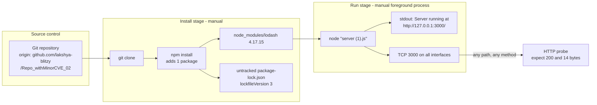

| Stage | Command | Success criterion | Failure mode |
|---|---|---|---|
| Obtain source | `git clone <origin>` | Working tree with `package.json`, `server (1).js`, `README.md` | — |
| Install | `npm install` | `added 1 package`; `node_modules` holds only `lodash` | Registry unreachable; a substituted tarball cannot be detected against the tracked tree, which records no hash |
| Start | `node "server (1).js"` | Startup line on stdout within seconds; process stays in the foreground | `MODULE_NOT_FOUND` and exit 1 if the install was skipped; `EADDRINUSE` and exit 1 if port 3000 is taken |
| Verify | HTTP request to port 3000 | `200` with the 14-byte body and no `Content-Type` | Any other status or body means the oracle changed |
| Audit (optional) | `npm audit` | Exit 1 with the five advisories above is the expected state | Exit 0 means the fixture state drifted; an endpoint error is inconclusive |
| Stop | `SIGTERM` / `SIGINT` to the process | Exit 143 / 130 when the process is not PID 1 | Ignored when `node` is PID 1 in a container; needs `SIGKILL` or an init process |

Scaling, load balancing, blue-green release and rollback are all inapplicable: `listen(3000)` accepts one instance per host, and there is no shared state, so a replacement instance is interchangeable with the one it replaces once the port is free.

### 3.6.7 Default Technology Stack Conformance

The default enterprise stack proposed as a starting template does not describe this system. Each entry below is either realized in the repository or rejected on evidence, and no item is adopted merely because the template lists it.

| Template layer | Template item | Status here | Evidence |
|---|---|---|---|
| Core infrastructure | AWS | Not used | No cloud SDK, no IaC, no provider configuration |
| Core infrastructure | Docker | Not used | No `Dockerfile` or Compose file |
| Core infrastructure | Terraform | Not used | No `.tf` files, no state or module references |
| Core infrastructure | GitHub Actions | Not used | No `.github/` directory, no workflow YAML |
| Backend | Python | Not used | No `.py` file; the only source file is JavaScript |
| Backend | Flask | Not used | No Python dependency, no web framework of any kind |
| Backend | Auth0 | Not used | No identity provider, no authentication layer |
| Backend | MongoDB | Not used | No database driver, no connection string, no persistence |
| Backend | Langchain | Not used | No AI or LLM dependency, no model integration |
| Frontend | React with TypeScript | Not used | No frontend, no `.tsx`/`.ts` file, no bundler; the specification records that no user interface exists |
| Frontend | TailwindCSS | Not used | No CSS, stylesheet or build pipeline |
| Frontend | React Native with TypeScript | Not used | No mobile project, no `.tsx`/`.ts` file |
| Native | Swift (iOS) | Not used | No `.swift` file, no Xcode project |
| Native | Kotlin (Android) | Not used | No `.kt` file, no Gradle build |
| Native | Objective-C (macOS) | Not used | No `.m`/`.h` file, no Xcode project |
| Native | ElectronJS | Not used | No desktop shell, no Electron dependency |
| Backend (actual) | Node.js runtime with npm and the built-in `http` module | In use | `server (1).js` L1–L5; `package.json` L4–L6 |

The substitution is the point of the fixture rather than a gap in it: a single-vulnerability test case needs the smallest possible stack, and every framework, cloud service or build tool the template would add is a second source of findings that would make the vulnerability under test harder to attribute.


### 3.5.3 Lockfile Creation Control and Verified Install Forms


Because no `.gitignore` exists, whether an install writes `package-lock.json` decides whether an on-disk artifact can leak into the tracked tree. The forms below were measured on a clean copy of the manifest with the same Node.js v22.23.4 and npm 11.21.0 used for the rest of this section.

| Install form | Writes `package-lock.json`? | Result on this tree | Guidance |
|---|---|---|---|
| `npm install` | Yes | `added 1 package`; lockfile with `lockfileVersion: 3` appears at the repository root | The form documented in `README.md` L3; the generated file must not be committed |
| `CI=true npm install` | Yes — CI mode does not suppress lockfile creation | `added 1 package`; the lockfile is still written | Do not rely on `CI=true` alone to keep the tree lockfile-free |
| `npm install --no-package-lock` (equivalently `--package-lock=false`) | No | `added 1 package`; no lockfile is created | The form to use when the tree must stay lockfile-free |
| `npm ci` | Requires one | Exit 1 with a usage error: `npm ci` cannot run without an existing `package-lock.json` or `npm-shrinkwrap.json` | Unavailable on this tree; adopting it requires committing a lockfile, which changes the declared state |

The distinction matters for two reasons. An install that writes a lockfile leaves a second record of the dependency version on disk, and committing it would convert the fixture from manifest-only resolution into a locked install — a change to the test condition rather than a housekeeping detail. And because the repository ships no ignore file, `git status` after `npm install` reports both `node_modules/` and `package-lock.json` as untracked, so a contributor must remove or avoid them deliberately.


## 3.7 References


**Repository files**

- `package.json` — L1–L7, 104 bytes: package identity `cve-test-fixture` 1.0.0 and the single exact pin `"lodash": "4.17.15"`; establishes the absent `scripts`, `engines`, `type`, `packageManager`, `license` and `devDependencies` fields that this section reports.
- `server (1).js` — L1–L5, 263 bytes: the only source file. L1 `require('lodash')` bound to an unused `_`; L2 JSDoc summary; L3 `require('http').createServer(...)`; L4 `res.end('Hello, World!\n')`; L5 `listen(3000, ...)` with the startup `console.log`. Establishes the language, module system, built-in module usage, absent framework and absent signal handlers.
- `README.md` — L1–L5, 72 bytes: the only documented workflow (`npm install`, `node "server (1).js"`) and the quoting requirement for the entry filename.
- `blitzy/documentation/Technical Specifications.md` — committed design baseline: ADR-001 to ADR-007 (accepted implicit) and ADR-008 (proposed `lodash` 4.18.1 remediation) in §5.3.7; Minimal Build Requirements and Build Toolchain in §8.2; containerization and orchestration constraints in §8.5.3–8.5.4; the container termination constraint verified under a PID namespace in §8.6; Node.js and npm platform defaults and the `lodash` release timeline in §9.1.4–9.1.5. It also supplies the six-advisory record and the committed-lockfile, `npm ci` model that the current tree no longer matches.
- `blitzy/documentation/Project Guide - 182193aa-390a-4811-9305-dd7e915872d4.md` — delivery report: the manual verification tooling (`CI=true npm install --no-fund --no-package-lock`, port probe, `curl`, `od -c`, `sha256sum`, out-of-checkout `npm audit`), the five-advisory finding set, and the technology-versions appendix.
- `blitzy/documentation/` — the folder holding the two Markdown documents above; the only documentation artifacts in the tree, with no executable surface.
- Repository root (`""`) — the complete tracked inventory at HEAD `0de48f7`: `package.json`, `server (1).js`, `README.md` and `blitzy/`, plus the untracked `tech_spec.md` that is this specification. Establishes the absence of `Dockerfile`, Compose file, CI definition, IaC, `.npmrc`, `.nvmrc`, `.gitignore`, `.editorconfig`, linter, formatter, build config, test file and lockfile.
- Git history and refs — commits `ddd2024` (added `package.json`, `package-lock.json`, `server (1).js`), `dd23c44` (deleted `package-lock.json`), `44b04ea` (deleted `README.md`), `5433d34`/`8d02da8`/`47c41cf` (recreated and revised the README) and `0de48f7` (HEAD); branches `main` and `2509_01`; remote `https://github.com/lakshya-blitzy/Repo_withMinorCVE_02.git`. Establishes the lockfile history and the absence of tags, releases and pipeline artifacts.

**Verification runs (executed on a throwaway copy; the repository was left unmodified)**

- `npm install --no-fund --no-audit`, `CI=true npm install`, `npm install --no-package-lock`, `npm ci` — install outcomes, lockfile creation per install form, and the `npm ci` usage failure.
- `npm ls --all` — one direct dependency, zero transitive packages.
- `npm audit --json` and `POST https://registry.npmjs.org/-/npm/v1/security/advisories/bulk` — the five advisories with their GHSA identifiers, titles, individual severities and affected ranges, plus the `high` aggregate severity, range `<=4.17.23` and `fixAvailable` 4.18.1.
- [web] OSV API, `https://api.osv.dev/v1/vulns/<GHSA>` — CVE aliases for each GHSA identifier cited in 3.3.3, and confirmation that `GHSA-f23m-r3pf-42rh` exists as CVE-2026-2950 while not being returned by the current audit query.
- [web] npm registry package metadata (`npm view lodash version`, `npm view lodash@4.17.15 dependencies license`) — the `latest` dist-tag at 4.18.1, the absence of dependencies in 4.17.15, and the MIT licence.
- Mermaid parser (`mermaid` v11, `flowchart-v2`) — the four diagrams in 3.1.1, 3.2.5, 3.3.1 and 3.6.6 parse without error.

**Cross-references within this specification**

- 1.2 System Overview — verified runtime versions and the no-lockfile install model that 3.2.1 and 3.3.2 restate.
- 2.1 Feature Catalog — F-001 to F-006, the features whose implementing artifacts this section names.
- 2.4 Implementation Considerations — the technical constraints per feature that 3.1.4, 3.2.2 and 3.3.3 elaborate at stack level.


# 4. Process Flowchart

## 4.1 System Workflows

The fixture has no business domain: no users, accounts, orders or transactions. Its workflows are the operations its consumers run against it — install, detect, execute, remediate, stop — and the lifecycle of its single Node.js process. Those six workflows cover all behaviour in the three root files: `package.json` (L2–L6), `package-lock.json` (L1–L21) and `server (1).js` (L1–L5). `README.md` (L3, L5) names the two commands an operator types. Nothing in the repository declares a workflow, a state machine, an SLA or a retry policy; every arrow below is either a line of source, an npm/Node.js default that applies because nothing overrides it, or an observed runtime outcome.

| ID | Workflow | Trigger / Actor | Features | Terminal Outcome (success) | Evidence |
|---|---|---|---|---|---|
| WF-01 | Dependency Installation | `npm ci` run by an operator or CI | F-001, F-002 | `added 1 package` (`lodash` 4.17.15), exit 0 | `package.json` L5; `package-lock.json` L14–L19 |
| WF-02 | Vulnerability Detection | `npm audit` or an SCA scanner | F-001, F-002 | exit 1: 1 high-severity package, the six advisories catalogued in 3.3.3 | `package.json` L5; 3.3.3 |
| WF-03 | Remediation and Validation | Remediation agent or engineer | F-001, F-002, F-005 | `found 0 vulnerabilities`; HTTP response byte-identical | `package.json` L5; `server (1).js` L4 |
| WF-04 | Server Startup | `node "server (1).js"` | F-003, F-004 | Listener on `[::]:3000`; one startup line on stdout | `server (1).js` L1, L3, L5 |
| WF-05 | Request Handling | Any HTTP client | F-004, F-005 | `200 OK`, `Content-Length: 14`, body `Hello, World!\n` | `server (1).js` L3–L4 |
| WF-06 | Shutdown | SIGINT or SIGTERM | F-004 | Process exits 130 or 143; port released | `server (1).js` (no signal handler) |

Two baseline facts govern how these workflows are read. First, the committed baseline described in 1.2 and 3.5 carries `package-lock.json` with `lockfileVersion: 3` and a `sha512` integrity hash, which is what makes WF-01 a deterministic replay rather than a resolution. Second, the branch checked out for this analysis (`2509_01`, HEAD `0de48f7`) contains no `package-lock.json` — commit `dd23c44` deleted it — so on that branch the README's `npm install` (`README.md` L3) is the only install path that runs, and `npm ci` fails before any network access with `npm error code EUSAGE … can only install with an existing package-lock.json`. Both readings are reported where they change a workflow step; the lockfile path is documented as the designed flow because it is the one sections 1–3 specify.

Observability is the same for all six workflows: one `console.log` line on stdout (`server (1).js` L5), npm `error` lines plus a debug log under `<npm cache>/_logs/`, unhandled-exception stack traces on stderr, HTTP responses, and process exit codes. There is no application log, metric, trace or alert anywhere in the three root files.

### 4.1.1 Core Business Processes

The end-to-end process is a detect → execute → remediate cycle driven by three actor groups (1.3.1.2): security-tooling operators who need a known-vulnerable dependency, remediation agents and engineers who must upgrade it without changing behaviour, and QA engineers who need a deterministic smoke check. No actor touches application logic; every touchpoint is a shell command, a file edit, a console stream, or the fixed HTTP response.

#### 4.1.1.1 High-Level System Workflow

Each swim lane is one system boundary. The npm CLI and Node.js lanes are undeclared toolchain (3.6.1); only the three committed files belong to the repository.

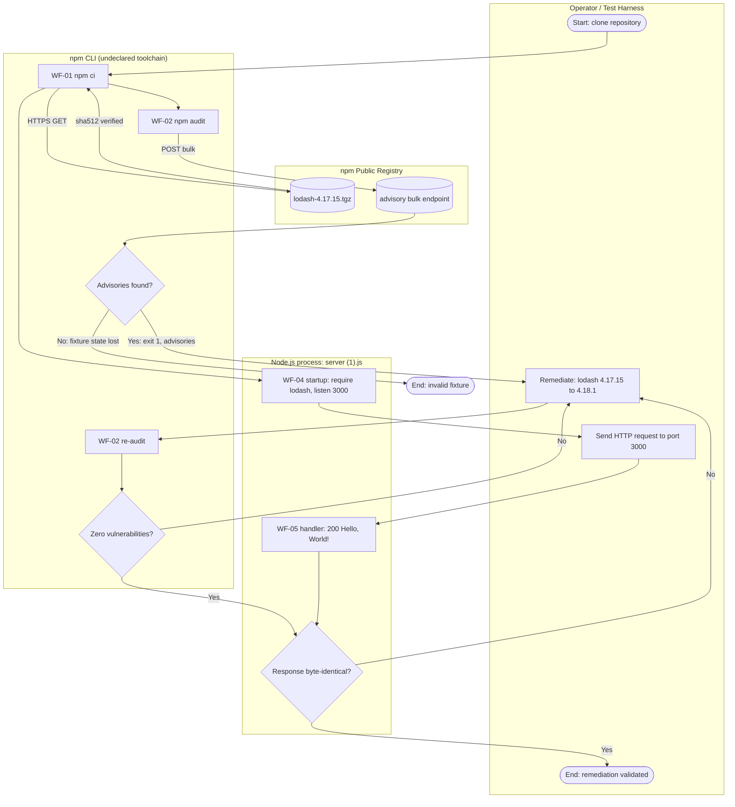

The *No* branch of *Advisories found?* is a real outcome rather than a formality: an audit that cannot reach the advisory endpoint reports zero findings, so a fixture whose audit comes back clean has lost its purpose as a test case (1.2.3). The `FAILX` terminal exists to make that silent failure explicit instead of letting it pass as success.

#### 4.1.1.2 End-to-End User Journeys

| Journey | Actor | Workflow Sequence | Touchpoints | Success Signal |
|---|---|---|---|---|
| J-1 Scanner validation | Security-tooling operator | WF-01 → WF-02 | Shell; `npm audit` report; lockfile | The six advisory IDs in 3.3.3 are reported against `lodash` 4.17.15 |
| J-2 Remediation | Remediation agent / engineer | WF-02 → WF-03 → WF-02 → WF-04 → WF-05 → WF-06 | Edits to `package.json` and `package-lock.json`; audit report; HTTP response; exit codes | Audit exits 0 and the response is still `200` with the same 14-byte body (F-005-RQ-005) |
| J-3 Behavioural smoke check | QA engineer / harness | WF-01 → WF-04 → WF-05 → WF-06 | stdout line `Server running at http://127.0.0.1:3000/`; HTTP response; exit code | Startup line appears; `200` with `Content-Length: 14`; port released after stop |

User touchpoints by channel:

- **Input:** shell commands (`npm ci` or `npm install`, `npm audit`, `node "server (1).js"`, SIGINT/SIGTERM), manifest and lockfile edits, and HTTP requests to TCP 3000.
- **Output:** the stdout startup line (`server (1).js` L5), stderr stack traces on crash, npm `error` lines, the audit report, HTTP responses, and process exit codes.

The filename itself is a touchpoint hazard: it contains a space and parentheses, so `node server (1).js` unquoted is a shell syntax error, and both `README.md` L5 and every harness must quote it.

#### 4.1.1.3 System Interactions

| Interaction | From → To | Mechanism | Evidence |
|---|---|---|---|
| Manifest / lockfile consistency check | npm CLI → both files | `packages[""]` compared with `package.json` | `package.json` L2–L6; `package-lock.json` L7–L13 |
| Artifact fetch | npm CLI → `registry.npmjs.org` | HTTPS GET of the `resolved` URL | `package-lock.json` L16 |
| Artifact verification | npm CLI → npm cache, then `node_modules` | `sha512` comparison | `package-lock.json` L17 |
| Advisory lookup | npm CLI → registry advisory API | HTTPS POST `/-/npm/v1/security/advisories/bulk` | 3.4.1; `npm audit` output |
| Module load | Node loader → `node_modules/lodash` | CommonJS `require` | `server (1).js` L1 |
| Socket bind | Node `http` → OS socket layer | `listen(3000)` with no host argument | `server (1).js` L5 |
| Request dispatch | OS → Node HTTP parser → handler | `request` event | `server (1).js` L3–L4 |
| Startup signal | Process → stdout | `console.log` in the `listening` callback | `server (1).js` L5 |

There are no other interactions: no database, no message broker, no external API call from application code, no configuration service, and no file the process writes.

#### 4.1.1.4 Decision Points

`server (1).js` contains no conditional statement — its five lines are a `require`, a comment, a `createServer` call with one handler, a `res.end` call and a `listen` call. Every decision below is made by npm, by the Node.js runtime, or by the operator.

| ID | Decision | Decided By | Outcomes | Evidence / reference |
|---|---|---|---|---|
| D-01 | Does `package.json` match `packages[""]`? | npm ci | Continue / exit 1 "are in sync" error | `package.json` L2–L6; `package-lock.json` L7–L13 |
| D-02 | Is the tarball cached under its `sha512`? | npm ci | Use the cache / fetch from the registry | `package-lock.json` L17; npm `_cacache` |
| D-03 | Did the fetch succeed, and are attempts left? | npm ci | Extract / retry / exit 1 `ECONNREFUSED` | npm defaults: `fetch-retries=2` |
| D-04 | Does the downloaded tarball match `sha512` at L17? | npm ci | Install / exit 1 `EINTEGRITY` | `package-lock.json` L17 |
| D-05 | Is the audit online? | npm audit | Query advisories / report `found 0 vulnerabilities` (false negative) | `--offline` behaviour |
| D-06 | Is the highest severity at or above `--audit-level`? | npm audit | exit 1 (default: any severity) / exit 0 (e.g. `critical`) | npm config `audit-level=null` |
| D-07 | Which remediation method? | Operator | Exact `4.18.1` / caret `^4.18.1` / no change | `package.json` L5 |
| D-08 | Does `lodash` resolve? | Node loader, L1 | Continue / `MODULE_NOT_FOUND`, exit 1 | `server (1).js` L1 |
| D-09 | Is port 3000 free? | Node `http`, L5 | Listen / `EADDRINUSE`, exit 1 | `server (1).js` L5 |
| D-10 | Is the request valid, with headers ≤ 16384 bytes? | Node HTTP parser | Invoke the handler / `400` or `431`, then close | `http.maxHeaderSize` = 16384 (verified) |
| D-11 | Is this an HTTP/1.1 keep-alive connection? | Node `http` | Idle up to 5000 ms / close after the response | `server.keepAliveTimeout` = 5000 (verified) |

D-01 through D-07 belong to the dependency-state half of the system and are exercised by WF-01 to WF-03; D-08 and D-09 gate process start-up in WF-04; D-10 and D-11 act on every request in WF-05. Two of the decisions have asymmetric failure costs: D-05 has no error signal at all — an offline audit is indistinguishable from a clean one on exit code alone — and D-09 has no remediation lever inside the repository, because the port is a literal in L5 and `PORT` in the environment is ignored.

#### 4.1.1.5 Error Handling Paths

Every error path ends in one of two ways: the process terminates with a non-zero exit code, or the Node HTTP parser answers `4xx` and the server keeps serving. The application installs no handler of its own on any path — there is no `server.on('error')`, no `clientError` listener and no `process.on('SIGINT'|'SIGTERM')` — so each path is the runtime's default behaviour. Recovery procedures are in 4.3.2.

| Error Path | Workflow | Entry Condition | Terminal State | Verified |
|---|---|---|---|---|
| Manifest / lockfile desync | WF-01 | D-01 = No | exit 1; `node_modules` untouched | Design baseline 4.2.1.1 |
| `npm ci` without a lockfile | WF-01 | No `package-lock.json` in the checkout | exit 1, `npm error code EUSAGE` | Yes — observed on branch `2509_01` |
| Registry unreachable | WF-01 | D-03 attempts exhausted | exit 1 after roughly 70 s of backoff; no tree | Design baseline 4.2.1.1 |
| Integrity mismatch | WF-01 | D-04 = No | exit 1 `EINTEGRITY`; partial tree left behind | Design baseline 4.2.1.1 |
| Advisory endpoint unreachable | WF-02 | D-05 online, request fails | exit 1 "audit endpoint returned an error" | Design baseline 4.2.1.2 |
| Dependency missing | WF-04 | D-08 = No | exit 1, `Cannot find module 'lodash'`, no listener | Yes — observed in this checkout |
| Port conflict | WF-04 | D-09 = No | exit 1, `listen EADDRINUSE: address already in use :::3000`, no listener | Yes — observed with a second instance |
| Missing npm script | WF-04 | Operator types `npm start` | exit 1, `npm error Missing script: "start"` | Yes — observed; `package.json` has no `scripts` |
| Invalid request or oversized headers | WF-05 | D-10 = No | `400` / `431` with `Connection: close`; process keeps serving; nothing logged | Design baseline 4.2.1.5 |
| Abrupt termination | WF-06 | SIGINT or SIGTERM | exit 130 / 143; in-flight sockets dropped | Yes — both signals observed |

### 4.1.2 Integration Workflows

Three external boundaries exist: the npm public registry (tarball and advisory data), HTTP clients, and the operator's console. All three are synchronous and request-driven. There is no event bus, no queue, no webhook, no scheduled job and no streaming interface.

#### 4.1.2.1 Data Flow Between Systems

| Channel | Direction | Payload | Persistence Point | Evidence |
|---|---|---|---|---|
| Manifest read | npm CLI ← `package.json` | Package identity and exact `lodash` pin | Git-tracked file | `package.json` L2–L6 |
| Lockfile read | npm CLI ← `package-lock.json` | Root record, resolved URL, `sha512`, license | Git-tracked file | `package-lock.json` L7–L19 |
| Tarball download | registry → npm CLI | `lodash` 4.17.15 tarball over HTTPS | npm content-addressable cache, then `node_modules/lodash` | `package-lock.json` L16–L17 |
| Advisory query | npm CLI → registry | Version list in the request; advisory records in the response | None (transient report) | 3.4.1 |
| Module load | Node loader ← `node_modules/lodash` | CommonJS module object bound to `_`; never dereferenced | Process memory for the process lifetime | `server (1).js` L1 |
| HTTP request | client → process | Request line, headers, optional body; all discarded | None | `server (1).js` L3–L4 |
| HTTP response | process → client | `200`, `Date`, `Connection`, `Keep-Alive`, `Content-Length: 14`, body `Hello, World!\n` | None | Verified on the wire |
| Startup signal | process → stdout | One `console.log` line after a successful bind | Piped stdout / terminal | `server (1).js` L5 |

The only state that crosses a process boundary is file content on disk. The running process holds no reference to the request, and no response depends on request content, so the integration surface is stateless in both directions.

#### 4.1.2.2 Integration Sequence Diagrams

**WF-01 install sequence.** The cache lookup happens before any network call, which is what allows an offline install when the tarball was fetched before.

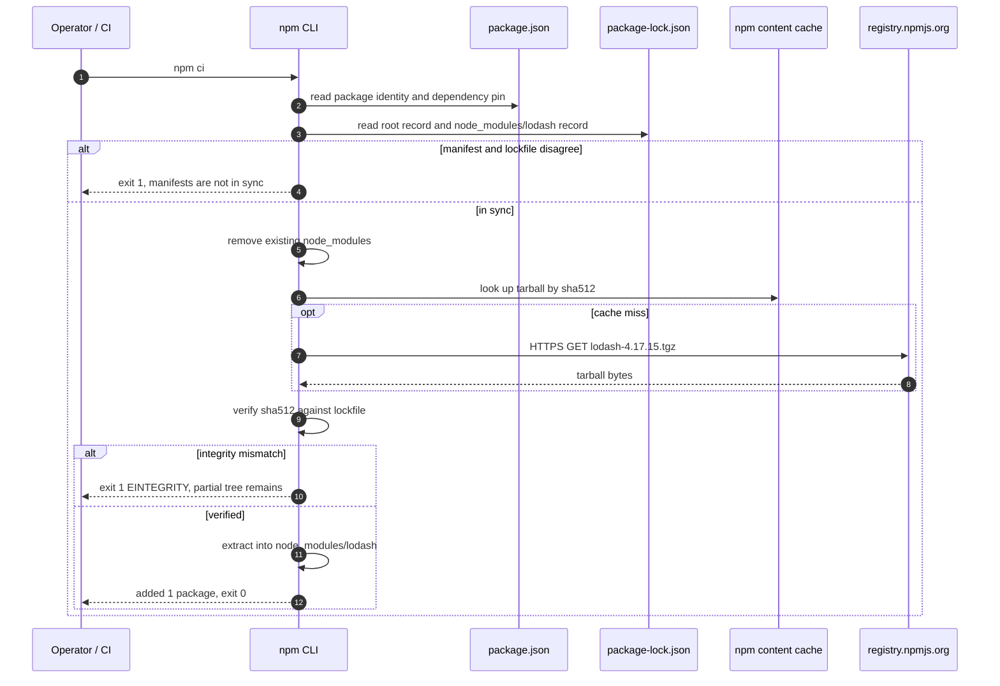

**WF-02 audit sequence.** `node_modules` is not required: the audit reads the lockfile tree, which is why detection works on a fresh clone.

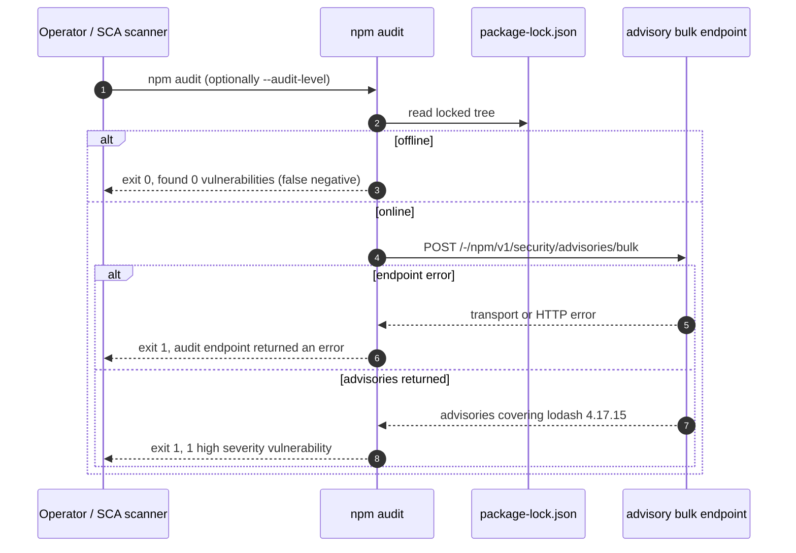

**WF-05 request / response sequence.** The handler is the last step of a chain the application does not control: parsing, header limits and keep-alive are all Node `http` defaults.

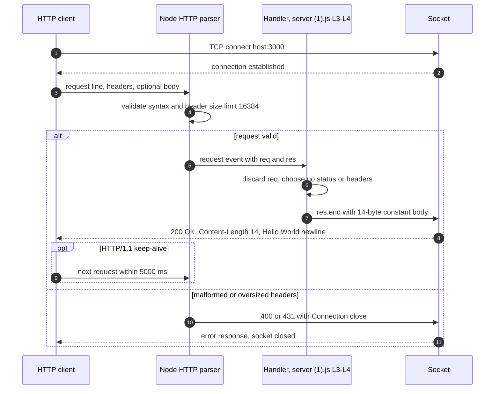

#### 4.1.2.3 Event Processing Flows

The system uses the Node.js `EventEmitter` internally and nothing else. No message broker, no pub/sub topic, no webhook and no queue exists in the repository.

| Event | Emitter | Consumer | Application Handler? | Effect |
|---|---|---|---|---|
| `request` | `http.Server` | Node `http` internals → the L3 arrow function | Yes — the only application handler | Writes the constant body |
| `listening` | `http.Server` | The L5 callback | Yes — one-line callback | Prints the startup line |
| `error` | `http.Server` | None | No | Unhandled `EADDRINUSE` throws and exits 1 |
| `clientError` | `http.Server` | Node default | No | `400` / `431`, then socket close |
| `SIGINT`, `SIGTERM` | Process | Node default | No | Immediate termination, exit 130 / 143 |
| `connection`, `close`, `timeout` | `http.Server` | None | No | Defaults apply, with no observability |

Asynchronous work is limited to the event loop: a request is answered without reading the body, waiting on I/O, or scheduling a callback, so there is no queue and no back-pressure to design for.

#### 4.1.2.4 Batch Processing Sequences

No batch or scheduled job exists. The two npm invocations are the only whole-tree operations, and both are one-shot CLI runs whose "batch" is the single unit they process.

| Operation | Granularity | Iteration | Failure Semantics |
|---|---|---|---|
| `npm ci` | Whole `node_modules` tree | One package, no transitive entries (3.3.1) | Aborts on first failing package; partial tree may remain (D-04) |
| `npm audit` | Whole locked tree | One package, six advisories | Single report; non-zero exit for findings or endpoint error |
| WF-05 handler | One request | One `res.end` per request | No iteration; no partial response possible |

Because each run processes exactly one package, there is no ordering, sharding, checkpointing or resumption logic to document.


## 4.2 Flowchart Requirements

Every diagram below follows one convention set, so a decision node can be matched to its identifier in 4.1.1.4. Starts and ends are stadium nodes, processes are rectangles, decisions are diamonds labelled with `D-xx` where a decision ID exists, error terminals are stadium nodes prefixed `exit`, and each swim lane is one actor or system boundary. Lane names never appear as flow nodes. Where a repository fact and a runtime default differ, the label states the default and the prose cites it.

### 4.2.1 Detailed Process Flows

#### 4.2.1.1 WF-01 Dependency Installation (F-001, F-002)

The designed path is `npm ci`, which replays the lockfile instead of resolving a range. The alternate entry from the locked-file check records the branch state described in 4.1, where no `package-lock.json` is present and `npm install` (the command in `README.md` L3) is the only path that runs.

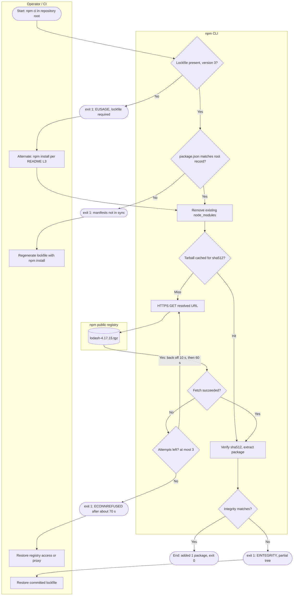

| Step | Behaviour | Evidence |
|---|---|---|
| Entry | `package-lock.json` `lockfileVersion: 3` requires npm v7 or later | `package-lock.json` L4 |
| D-01 sync check | Editing only `package.json` fails; npm reports the two files are not in sync and exits 1 | `package.json` L2–L6; `package-lock.json` L7–L13 |
| D-02 cache | A warm cache completes the install with the registry unreachable, because the cache is keyed by `sha512` | `package-lock.json` L17 |
| D-03 retry | Cold cache plus unreachable registry exhausts 3 attempts and exits 1 after roughly 70 s | npm defaults `fetch-retries=2`, `fetch-retry-mintimeout=10000`, `fetch-retry-maxtimeout=60000` |
| D-04 integrity | A tampered L17 hash yields `EINTEGRITY` and leaves a partial tree; npm does not roll back | `package-lock.json` L17 |
| Success | One package installed, no transitive entries, `require('lodash').VERSION` = `4.17.15` | `package-lock.json` L14–L19 |
| Observed deviation | With no lockfile in the checkout, `npm ci` exits 1 with `npm error code EUSAGE` before touching the network | Verified on branch `2509_01` |

#### 4.2.1.2 WF-02 Vulnerability Detection (F-001, F-002)

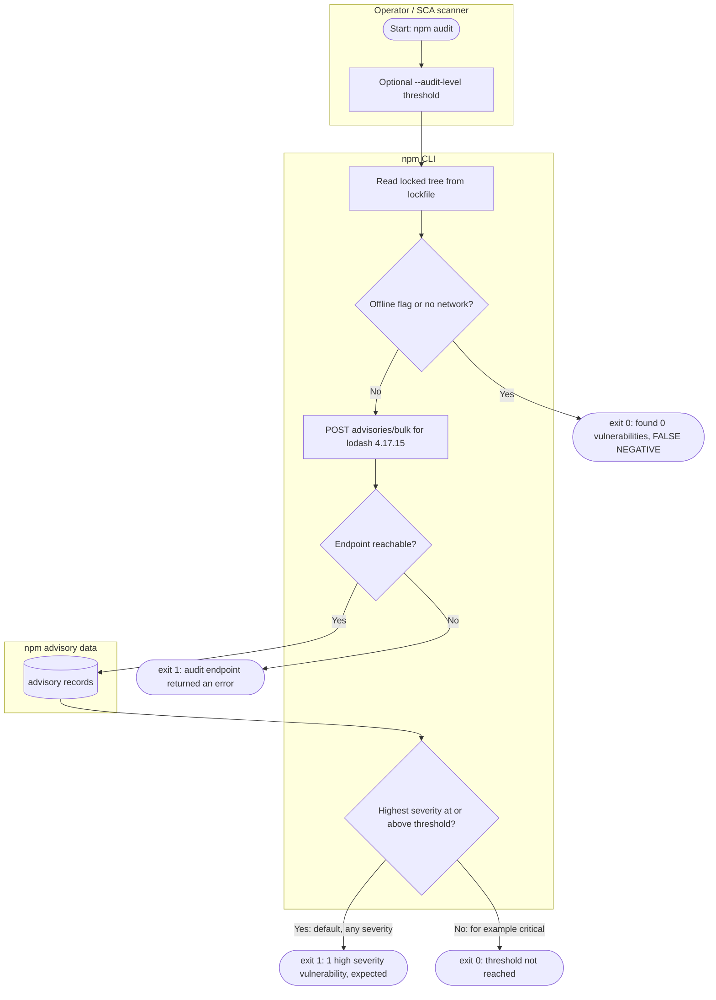

| Step | Behaviour | Evidence |
|---|---|---|
| Detection source | The audit reads the locked tree, so it works on a fresh clone without `node_modules` | `package-lock.json` L14–L19 |
| D-05 offline | An offline audit reports zero vulnerabilities and exits 0; the finding set is silent, not empty | Design baseline 4.2.1.2; npm `--offline` |
| D-06 threshold | The default `audit-level` is unset, so any severity exits 1; raising it above `high` suppresses the fixture's finding | Verified `npm config get audit-level` → `null` |
| Exit-code ambiguity | Exit 1 means findings *or* an endpoint error; only the report text distinguishes them | Design baseline 4.2.1.2 |
| Expected result | One vulnerable package (`lodash`), six advisories at high aggregate severity, fix `lodash@4.18.1` | 3.3.3 |

#### 4.2.1.3 WF-03 Remediation and Validation (F-001, F-002, F-005)

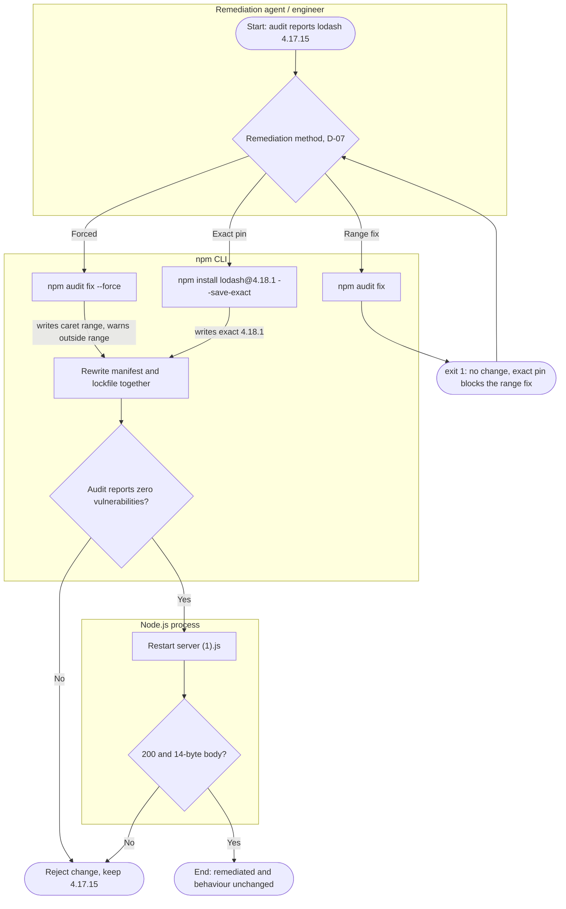

| Method (D-07) | Resulting `package.json` | Outcome |
|---|---|---|
| `npm audit fix` | Unchanged at `"4.17.15"` | exit 1; the available fix lies outside the exact pin |
| `npm audit fix --force` | `"^4.18.1"` | Warns that protections were disabled and the change is outside the declared range; audit then reports zero vulnerabilities; breaks the exact-pin convention |
| `npm install lodash@4.18.1 --save-exact` | `"4.18.1"` | Audit reports zero vulnerabilities and both files are rewritten together; preserves the convention |

Both successful methods leave the HTTP response unchanged, because `_` is never referenced after `server (1).js` L1 (F-003-RQ-002). That invariance is the acceptance test for J-2: the process must be restarted and the body compared before the change is accepted.

#### 4.2.1.4 WF-04 Server Startup (F-003, F-004)

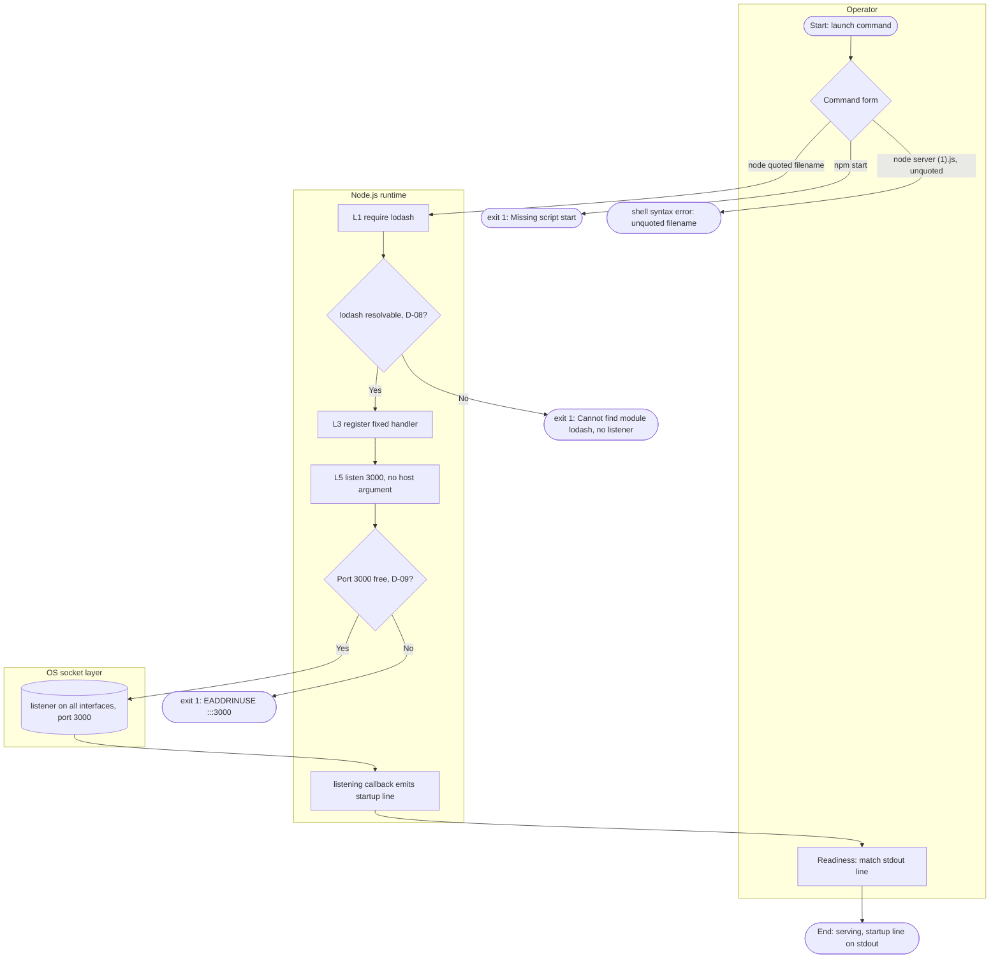

| Step | Behaviour | Evidence |
|---|---|---|
| Quoting | Unquoted, bash rejects the filename at the parentheses; quoting it works | `README.md` L5; verified shell behaviour |
| D-08 | Without `node_modules`, L1 throws `Cannot find module 'lodash'`, exit 1, before `createServer` runs | Verified in this checkout |
| D-09 | A second instance fails with `listen EADDRINUSE: address already in use :::3000`, exit 1, while the first keeps serving | Verified |
| Bind address | `listen(3000)` with no host binds the wildcard address; `/proc/net/tcp6` shows LISTEN on the all-zero IPv6 address for port 3000 | `server (1).js` L5; verified |
| Startup signal | The advertised address is `127.0.0.1`, but the socket accepts on every interface — a readiness check may match the line, not trust its address | `server (1).js` L5; verified |
| `npm start` | No `scripts` block exists, so npm exits 1 with `Missing script: "start"` | `package.json`; verified |

#### 4.2.1.5 WF-05 Request Handling (F-004, F-005)

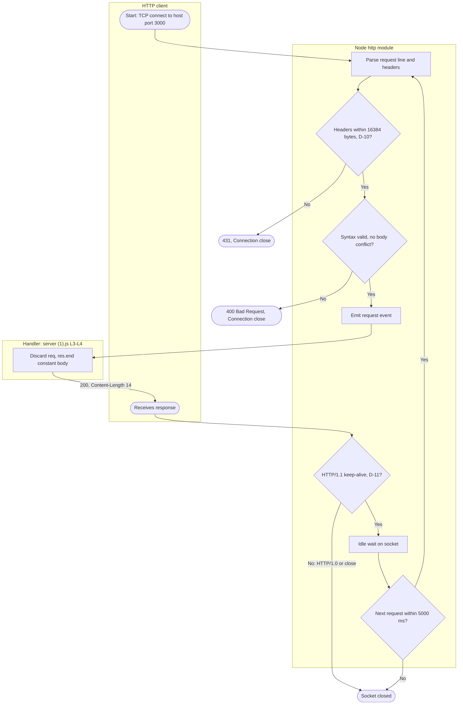

| Request Variant | Observed Response |
|---|---|
| Any method, any path, any query, with or without a body | `200`, `Content-Length: 14`, body `Hello, World!\n` |
| `HEAD /` | `200` with headers and no body |
| HTTP/1.0 | `200`, `Connection: close`, no `Content-Length` in the observed reply, same body |
| Malformed request line, non-numeric `Content-Length`, `Content-Length` with `Transfer-Encoding` | `400 Bad Request`, `Connection: close`; the handler is not invoked |
| Headers totalling more than 16384 bytes | `431 Request Header Fields Too Large`, `Connection: close` |
| Two pipelined requests on one socket | Two `200` responses |

The response header set is fixed by Node: `Date`, `Connection`, `Keep-Alive`, `Content-Length`. No `Content-Type`, no `Server` and no security header is sent, because the handler sets none and `res.end` supplies only the length (verified on the wire).

#### 4.2.1.6 WF-06 Shutdown (F-004)

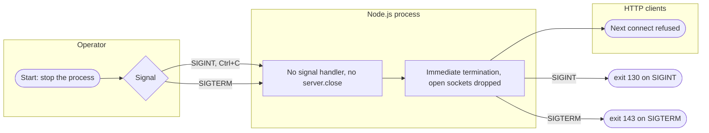

There is no drain phase: in-flight responses are cut off rather than finished, and a harness must receive the probe response before it signals the process. The listening socket is released by process exit, so an immediate restart binds on the first attempt.

### 4.2.2 Timing and SLA Considerations

No SLA, SLO, deadline or timeout is defined anywhere in the repository: a text search of `server (1).js`, `package.json` and `README.md` for `SLA`, `SLO`, `timeout`, `retry` or `catch` matches only the `console.log` on L5. Every figure below is either an npm or Node.js default that applies because nothing overrides it, or a single-environment observation on Node.js v22.23.4 / npm 11.21.0. None of them is a target, and none is guaranteed by the code.

| Stage | Value | Source | Constraint for Harnesses |
|---|---|---|---|
| `npm ci`, warm cache | Sub-second (`added 1 package`) | Observed | None |
| `npm ci`, registry unreachable | Exit after roughly 70 s (3 attempts) | npm defaults `fetch-retries=2`, backoff 10 s → 60 s cap | Step timeout above 70 s, or set `fetch-retries=0` to fail fast |
| npm per-request fetch timeout | 300000 ms | npm default `fetch-timeout` (verified) | Upper bound for a stalled download |
| Process start to startup line | 32–33 ms across 3 runs on this host | Observed | Poll stdout rather than sleeping a fixed interval |
| Single loopback request | 3.9–4.4 ms wall including the client process | Observed with `curl` | None |
| Keep-alive idle close | 5000 ms | Node default `server.keepAliveTimeout` (verified) | Clients must tolerate server-side closes |
| Header receive timeout | 60000 ms | Node default `server.headersTimeout` (verified) | Relevant to slow clients only |
| Full request timeout | 300000 ms | Node default `server.requestTimeout` (verified) | Same |
| Socket inactivity timeout | 0, meaning disabled | Node default `server.timeout` (verified) | Idle HTTP/1.1 sockets rely on keep-alive alone |
| Maximum header size | 16384 bytes | Node default `http.maxHeaderSize` (verified) | Oversized headers produce `431` |
| Shutdown latency | Immediate on signal; exit 130 or 143 | Observed | No drain window to wait for |

Because no deadline exists inside the system, latency requirements are entirely the caller's: a harness that needs a bound must impose it externally, and the only in-band failure signal it can rely on is the exit code or missing startup line.

### 4.2.3 Validation Rules

#### 4.2.3.1 Business Rules at Each Step

| Workflow Step | Business Rule | Requirement Reference |
|---|---|---|
| WF-01 install | Install from the lockfile (`npm ci`), never a fresh resolution, so the locked `lodash` tree is preserved | F-002-RQ-004 |
| WF-01 install | The root record `packages[""]` must mirror `package.json`; one file must not be edited alone | F-002-RQ-002 |
| WF-02 detect | Exit 1 is the expected pre-remediation state; a clean audit means the fixture has lost its purpose | F-001-RQ-003 |
| WF-02 detect | Assert advisory identifiers, not a count or severity, because findings drift as advisories are published | 3.3.3 |
| WF-03 remediate | Change `package.json` L5 and the lockfile records together, in a downstream copy or branch; the committed fixture stays vulnerable | F-002-RQ-002; 1.3.2 |
| WF-03 validate | The response must stay `200` with the 14-byte body after remediation | F-005-RQ-005 |
| WF-04 startup | The `require('lodash')` on L1 must stay, so the package is loaded in-process | F-003-RQ-001 |
| WF-04 startup | The filename must be quoted in every command | `README.md` L5 |
| WF-05 serve | Every method and path answers identically; no request content may influence the response | F-005-RQ-001 to F-005-RQ-004 |

#### 4.2.3.2 Data Validation Requirements

| Validation | Where Enforced | Failure Behaviour |
|---|---|---|
| `package.json` parses as JSON and carries name, version and the `lodash` pin | npm CLI | exit 1, parse error |
| `packages[""]` equals the manifest | npm CLI at D-01 | exit 1, "not in sync" |
| Tarball `sha512` equals the lockfile `integrity` | npm CLI at D-04 | exit 1 `EINTEGRITY` |
| `node_modules/lodash` exposes a resolvable entry point | Node loader at D-08 | exit 1 `Cannot find module 'lodash'` |
| Request line and header syntax, `Content-Length` consistency | Node HTTP parser at D-10 | `400`, socket closed, handler not invoked |
| Total header size ≤ 16384 bytes | Node HTTP parser at D-10 | `431`, socket closed |
| Request body, query string, cookies, and all other client input | Nowhere | Accepted and discarded unread by the handler |

The last row is the defining validation property of the fixture: the application validates no input, because it consumes none. All input validation that exists is transport-level parsing performed by Node before the handler is reached.

#### 4.2.3.3 Authorization Checkpoints

There are none. The repository contains no authentication, authorization, session, token, TLS or rate-limiting code; `server (1).js` L3–L4 answers without inspecting `req`. Two consequences belong in any process design built on this fixture:

- **Exposure.** `listen(3000)` binds the wildcard address, so the endpoint is reachable on every interface of the host, not only the loopback address named in the startup line.
- **Open data.** Any client can obtain the response; there is no identity, no audit trail and no request logging to attribute a call.

Any workflow that requires authentication or authorization must add it upstream of this process; nothing in the fixture provides a checkpoint.

#### 4.2.3.4 Regulatory and Compliance Checks

No compliance control, licence gate or data-handling rule is implemented. The lockfile records `"license": "MIT"` for `lodash` (`package-lock.json` L18), which is descriptive metadata rather than an enforced check, and no licence-scanning step exists in the repository. The security-relevant obligation that remains is the vulnerability posture itself, which is deliberate: the pinned release is inside the affected ranges of the six advisories in 3.3.3, and no code path reaches the affected functions (`_.template`, `_.unset`, `_.omit`, `_.zipObjectDeep`), because `_` is never dereferenced after L1. Production or internet-facing deployment is therefore out of scope (1.3.2).


## 4.3 Technical Implementation

The process holds no application state. What varies over time belongs to three machines outside the source: the dependency state of the working copy (files on disk), the lifecycle of the Node.js process, and the lifecycle of each HTTP connection. Each is documented below with the event that causes each transition; every transition is produced by npm, by Node `http`, or by a signal, never by a branch in `server (1).js`, which contains no conditional.

### 4.3.1 State Management

#### 4.3.1.1 Dependency State Transitions

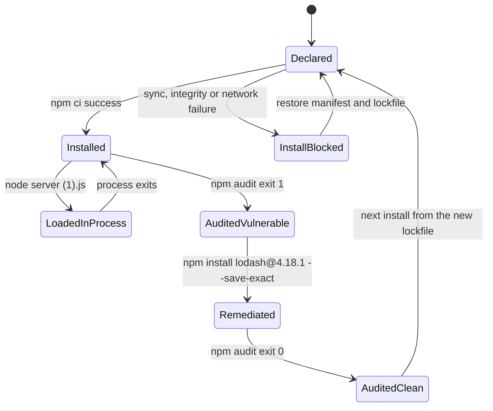

| State | Entered By | Observable Evidence | Exit Events |
|---|---|---|---|
| Declared | Clone or checkout | `package.json` L5 pin; lockfile records present or absent | Install |
| Installed | `npm ci` success | `node_modules/lodash`, `require('lodash').VERSION` = `4.17.15` | Process start, audit |
| InstallBlocked | D-01, D-03 or D-04 failure | npm `error` line and non-zero exit; possibly a partial tree | Restore files, restore network |
| LoadedInProcess | WF-04 reaching L1 | Process resident, listener open | Process exit |
| AuditedVulnerable | `npm audit` | exit 1, six advisories (3.3.3) | Remediation |
| Remediated | WF-03 | `package.json` L5 = `4.18.1`; lockfile rewritten | Re-audit |
| AuditedClean | `npm audit` after remediation | exit 0, `found 0 vulnerabilities` | Next install |

The fixture's intended resting state is *Installed* plus *AuditedVulnerable*. Every other state exists to be reached and left again in a test, which is why *AuditedClean* is not the repository's committed condition.

#### 4.3.1.2 Process Lifecycle State Transitions

```mermaid
stateDiagram-v2
    [*] --> NotStarted
    NotStarted --> ModuleLoadFailed: lodash unresolvable, exit 1
    NotStarted --> BindFailed: EADDRINUSE, exit 1
    NotStarted --> Listening: bind wildcard address port 3000
    Listening --> StartupLogged: listening callback runs
    StartupLogged --> Serving: request event handled
    Serving --> StartupLogged: response complete
    StartupLogged --> Terminated: SIGINT or SIGTERM
    Terminated --> [*]
    ModuleLoadFailed --> [*]
    BindFailed --> [*]
```

| State | Trigger | stdout / stderr | Exit Code |
|---|---|---|---|
| NotStarted | `node "server (1).js"` | none | — |
| ModuleLoadFailed | L1 throws | stderr stack trace | 1 |
| BindFailed | L5 `error` event unhandled | stderr `EADDRINUSE` stack trace | 1 |
| Listening | Socket bound | one line: `Server running at http://127.0.0.1:3000/` | — |
| Serving | Request handled | none per request | — |
| Terminated | Signal | none | 130 (SIGINT), 143 (SIGTERM) |

`Listening` and `StartupLogged` are separate facts even though the source emits them in one statement: the socket is usable before the log line is flushed, so a harness that reads the log line has a bound listener, while a harness that connects blind may succeed slightly earlier.

#### 4.3.1.3 HTTP Connection Lifecycle

```mermaid
stateDiagram-v2
    [*] --> Connected: TCP accepted
    Connected --> Parsing: bytes received
    Parsing --> Rejected: syntax error or headers over 16384 bytes
    Parsing --> Responded: request event, handler writes body
    Responded --> Idle: HTTP/1.1 keep-alive
    Idle --> Parsing: next request within 5000 ms
    Idle --> Closed: keepAliveTimeout expires
    Responded --> Closed: HTTP/1.0 or Connection close
    Rejected --> Closed: Connection close
    Closed --> [*]
```

| State | Duration Bound | Owner | Application Visibility |
|---|---|---|---|
| Connected | Until first byte, capped by the 60000 ms `headersTimeout` | Node `http` | None |
| Parsing | `headersTimeout` 60000 ms; `requestTimeout` 300000 ms for the whole request | Node `http` | None |
| Responded | Immediate: one `res.end` call | Handler, L4 | None |
| Idle | `keepAliveTimeout` 5000 ms | Node `http` | None |
| Closed | Terminal | Node `http` | None |

The application cannot observe or influence any of these states: it never reads the request, never sets a header, and never registers a `close`, `timeout` or `error` listener.

#### 4.3.1.4 Data Persistence Points

| Artefact | Written By | When | Durability |
|---|---|---|---|
| `package.json` | A human or `npm install --save-exact` | Authoring, or WF-03 | Git-tracked |
| `package-lock.json` | npm | Dependency-changing installs | Git-tracked on the baseline branch |
| `node_modules/lodash` | `npm ci` or `npm install` | WF-01 | Local only; not committed, and no `.gitignore` excludes it |
| npm content-addressable cache | npm | Any successful fetch | Host-local, keyed by `sha512` |
| npm debug log (`<npm cache>/_logs/`) | npm | Every npm run | Host-local |
| Process stdout | `console.log`, L5 | Once per successful bind | Not persisted |
| HTTP response body | Handler, L4 | Per request | Not persisted |

The process writes no file, opens no database and keeps no in-memory record of what it served. Restarting it loses nothing, and two instances would serve identical answers.

#### 4.3.1.5 Caching Requirements

| Cache | Key | Scope | Failure Effect if Absent |
|---|---|---|---|
| npm content-addressable cache | `sha512` digest from `package-lock.json` L17 | Host-local, shared across projects | Cold cache forces a registry fetch (D-02 miss) |
| HTTP keep-alive socket reuse | Connection identity | One client connection | New TCP handshake per request |
| HTTP response caches (browser, proxy, CDN) | None issued | — | The response carries no `ETag`, `Last-Modified`, `Cache-Control` or `Expires`, so clients may revalidate on every call |

There is no application-level cache, no memoization, and no computed value to cache: the body is a string literal evaluated on each request. The only cache the design depends on is npm's, and its role is narrow — it removes the registry from the install path, and it cannot make `npm audit` work offline.

#### 4.3.1.6 Transaction Boundaries

| Operation | Boundary | Atomicity | Partial-Failure State |
|---|---|---|---|
| `npm ci` | The whole `node_modules` tree; it is removed before extraction | All-or-nothing in intent, not in effect | A failed `EINTEGRITY` run can leave a partial `node_modules/lodash` behind, and npm does not roll back |
| Manifest + lockfile change (WF-03) | The pair must change in one operation | Atomic only when produced by one install command | A hand edit to one file leaves the pair inconsistent and the next `npm ci` rejects it at D-01 |
| Advisory lookup (WF-02) | Single request / response | Read-only | No state to corrupt; a failed lookup is an error, not a partial report |
| Request handling (WF-05) | One request, one `res.end` | Atomic from the client's view: headers and body are written together | A mid-write close truncates the response; nothing is recorded |
| Startup (WF-04) | Bind then log | Not transactional: the socket is bound before the log line exists | A crash between the two leaves no evidence of a successful bind except the listening socket |

Two rules follow for any workflow built on the fixture: never edit one of the two dependency files alone, and always confirm the process is gone before reinstalling, because an install that fails at D-04 leaves a tree that can still resolve `lodash` in some cases and not others.

### 4.3.2 Error Handling

The application defines no error handling. Error behaviour is supplied by three layers — npm, the Node HTTP parser, and the operating system's process semantics — and the only application-visible artefact of an unhandled failure is a stderr stack trace plus an exit code.

#### 4.3.2.1 Retry Mechanisms

| Layer | Retries | Backoff | Bound | Evidence |
|---|---|---|---|---|
| npm registry fetch | 3 attempts total (`fetch-retries=2`) | 10 s minimum, 60 s maximum | `fetch-timeout` 300000 ms per request | Verified npm configuration |
| npm audit endpoint | Uses the same fetch machinery | Same | Same | Design baseline 4.2.1.2 |
| Node HTTP server | None | — | A rejected request is answered once with `4xx` | Node `http` defaults |
| Application | None | — | No retry loop exists in `server (1).js` | `server (1).js` L1–L5 |
| Caller / harness | Not in the repository | — | Must be supplied externally | `README.md` L3, L5 |

A retry that matters for a harness is the HTTP probe: because the process can exit before it binds (D-08, D-09), the probe should be retried against a readiness signal — the startup line or a successful connect — rather than fired once at a fixed delay.

#### 4.3.2.2 Fallback Processes

| Failure | Fallback | Available? | Consequence |
|---|---|---|---|
| Registry unreachable during install | Serve the tarball from the npm cache | Only with a warm cache; no mirror or proxy is configured | Otherwise the install fails after roughly 70 s |
| Advisory endpoint unreachable | None | No | Exit 1 "audit endpoint returned an error"; an offline audit instead reports a false clean result |
| `lodash` missing at L1 | None | No | Exit 1; upstream must install first |
| Port 3000 occupied | None inside the repository; `PORT` is ignored | No | Exit 1; the competing listener must be stopped |
| Malformed request | Node's built-in `clientError` reply | Yes, automatic | `400` / `431` and socket close; the process keeps serving |
| Lost dependency state | Restore `package.json` and the lockfile from version control, then reinstall | Yes, outside the process | Deterministic return to the baseline state |

The only fallback the design relies on is the npm cache, and it covers installation alone. No fallback exists for detection, so a CI job that treats exit 0 as "clean" without checking network reachability will silently pass a vulnerable fixture.

#### 4.3.2.3 Error Notification Flows

| Signal | Channel | Produced By | Content | Human or Machine Consumable |
|---|---|---|---|---|
| Startup line | stdout | `console.log`, L5 | `Server running at http://127.0.0.1:3000/` | Both |
| Uncaught exception | stderr | Node runtime | Stack trace naming `Cannot find module 'lodash'` or `EADDRINUSE` | Both |
| npm failure | stderr | npm CLI | `npm error` lines plus a debug log reference | Both |
| Dependency findings | stdout or `--json` | `npm audit` | Advisory identifiers, severities, ranges, fix version | Both; `--json` is machine-readable |
| HTTP status | Response | Node `http` / handler | `200`, or parser-generated `400` / `431` | Machine |
| Exit code | Process | Node or npm | 0 success, 1 failure, 130/143 signal | Machine |

Nothing is logged, metered or alerted from application code. There is no log line per request, no health endpoint, no `/metrics`, no trace context and no alert rule in the repository, so the observability surface of the running process is exactly one startup line.

#### 4.3.2.4 Recovery Procedures

| Symptom | Diagnosis | Recovery | Verification |
|---|---|---|---|
| `npm error code EUSAGE … existing package-lock.json` | No lockfile in the checkout | Use `npm install`, or restore the lockfile from version control | `node_modules/lodash` exists; `require('lodash').VERSION` = `4.17.15` |
| "not in sync" from `npm ci` | Manifest and lockfile diverged | Re-run a dependency-changing install so both files are rewritten, or revert both | `npm ci` exits 0 |
| `ECONNREFUSED` after retries | Registry or proxy unreachable | Restore network access; pre-warm the cache while online | `added 1 package` |
| `EINTEGRITY` | Tarball does not match the recorded `sha512` | Restore `package-lock.json` from version control and install again (the partial tree is removed first) | Package present with the expected version |
| `Cannot find module 'lodash'` | Dependencies not installed | Run the install workflow | Startup line appears |
| `listen EADDRINUSE :::3000` | Another process owns TCP 3000 | Stop the listener you own; the port cannot be reconfigured | Startup line appears |
| `Missing script: "start"` | `package.json` has no `scripts` block | Use `node "server (1).js"` as `README.md` L5 documents | Startup line appears |
| Audit reports zero vulnerabilities unexpectedly | Offline run, or a raised `--audit-level` | Re-run the audit online with the default threshold | One vulnerable package and the expected advisories |
| Behaviour changed after remediation | Handler or L1 altered, or the wrong file edited | Revert to L1–L5 semantics; the response must remain `200` with the 14-byte body | Body sha256 `c98c24b6…ad31` and `Content-Length: 14` |

#### 4.3.2.5 Error Handling Flowchart

```mermaid
flowchart TD
    subgraph EHDetect["Failure detection"]
        A{"Which phase failed?"}
    end
    subgraph EHDependency["Dependency phase (npm)"]
        B{"Manifest and lockfile in sync?"}
        C{"Tarball in cache?"}
        D{"Registry reachable?"}
        E["Restore both files from version control"]
        F["Pre-warm the cache while online"]
        G["Restore network or proxy access"]
    end
    subgraph EHProcess["Process phase (Node)"]
        H{"lodash resolvable?"}
        I{"Port 3000 free?"}
        J["Run the install workflow"]
        K["Stop the listener that owns TCP 3000"]
    end
    subgraph EHRequest["Request phase (Node http)"]
        L{"4xx from parser or no response?"}
        M["Correct syntax or header size and retry"]
        N["Restart the process and re-probe"]
    end
    OK(["Recovered: exit 0 and 200 with 14-byte body"])
    A -->|install| B
    B -->|No| E --> OK
    B -->|Yes| C
    C -->|No| D
    D -->|No| G --> OK
    D -->|Yes| OK
    C -->|Yes| OK
    A -->|startup| H
    H -->|No| J --> OK
    H -->|Yes| I
    I -->|No| K --> OK
    I -->|Yes| OK
    A -->|request| L
    L -->|"4xx reply received"| M --> OK
    L -->|"no reply, process gone"| N --> OK
```

Every recovery path ends outside the application: the process either restarts into a healthy state or the dependency state is repaired on disk. No recovery step is available from inside the running process, because it exposes no control surface other than its HTTP response.


## 4.4 Diagram Catalog and Requirement Traceability

### 4.4.1 Required Diagram Coverage

| Required Diagram | Delivered In | What It Shows |
|---|---|---|
| High-level system workflow | 4.1.1.1 | Detect → execute → remediate cycle across four swim lanes, including the false-clean audit branch |
| Detailed process flows, one per core feature | 4.2.1.1 – 4.2.1.6 | WF-01 install, WF-02 detect, WF-03 remediate, WF-04 startup, WF-05 request, WF-06 shutdown |
| Error handling flowchart | 4.3.2.5 | The three failure phases (dependency, process, request) and their recovery paths |
| Integration sequence diagrams | 4.1.2.2 | Install, advisory-search and request/response interactions with the registry and HTTP clients |
| State transition diagrams | 4.3.1.1 – 4.3.1.3 | Dependency state, process lifecycle, and HTTP connection lifecycle |
| End-to-end user journeys | 4.1.1.2 | J-1 scanner validation, J-2 remediation, J-3 behavioural smoke check |
| Event processing flow | 4.1.2.3 | The six Node events that act on the process, and which of them have application handlers |

Every diagram is grounded in one of three sources: a line of source, an npm/Node.js default verified on this environment, or a runtime observation recorded in this section. No diagram is derived from a design intent that the code does not implement.

### 4.4.2 Workflow-to-Requirement Traceability

| Workflow | Decision Points | Features / Requirements | Diagrams |
|---|---|---|---|
| WF-01 Dependency Installation | D-01 to D-04 | F-001-RQ-001, F-001-RQ-002; F-002-RQ-001 to F-002-RQ-005 | 4.1.2.2 install sequence, 4.2.1.1, 4.3.1.1 |
| WF-02 Vulnerability Detection | D-05, D-06 | F-001-RQ-003, F-001-RQ-005 | 4.1.2.2 audit sequence, 4.2.1.2 |
| WF-03 Remediation and Validation | D-07, then D-01 on the next install | F-001-RQ-005, F-002-RQ-002, F-003-RQ-002, F-005-RQ-005 | 4.2.1.3, 4.3.1.1 |
| WF-04 Server Startup | D-08, D-09 | F-003-RQ-001, F-003-RQ-003; F-004-RQ-001 to F-004-RQ-006 | 4.2.1.4, 4.3.1.2 |
| WF-05 Request Handling | D-10, D-11 | F-004-RQ-001, F-004-RQ-004; F-005-RQ-001 to F-005-RQ-005 | 4.1.2.2 request sequence, 4.2.1.5, 4.3.1.3 |
| WF-06 Shutdown | Signal type only | No functional requirement; graceful shutdown is out of scope (1.3.2) | 4.2.1.6, 4.3.1.2 |

WF-06 is the only workflow without a requirement behind it, and that absence is deliberate: the process has no drain, no `server.close()` and no shutdown hook, so there is nothing to specify beyond the exit codes the operating system produces.

### 4.4.3 Source-Line Traceability

| Source Location | Content | Workflows and Decisions It Drives |
|---|---|---|
| `package.json` L2–L3 | Package identity `cve-test-fixture` 1.0.0 | D-01 comparison input |
| `package.json` L4–L6 | `dependencies` with the exact `"lodash": "4.17.15"` pin (L5) | WF-01, WF-02, WF-03 (D-07 target) |
| `package-lock.json` L4–L5 | `lockfileVersion: 3`, `requires: true` | WF-01 entry condition (npm v7 or later) |
| `package-lock.json` L7–L13 | Root record `packages[""]` | D-01 sync check |
| `package-lock.json` L14–L19 | `node_modules/lodash` record: version L15, `resolved` L16, `integrity` L17, license L18 | D-02, D-04, WF-02 audit input |
| `server (1).js` L1 | `require('lodash')` bound to an unused `_` | D-08, F-003 |
| `server (1).js` L2 | JSDoc summary of the handler contract | — (documentation only) |
| `server (1).js` L3–L4 | `createServer` with the fixed-response listener | WF-05, D-10, D-11 |
| `server (1).js` L5 | `listen(3000)` with the startup-log callback | WF-04, D-09, startup signal |
| `README.md` L3 | `npm install` | WF-01 alternate entry |
| `README.md` L5 | `node "server (1).js"` | WF-04 launch form and quoting requirement |


## 4.5 References

- `server (1).js` - The entire implementation surface: `require('lodash')` bound to an unused `_` (L1), the JSDoc handler summary (L2), `http.createServer` with the fixed-response listener (L3–L4), and `listen(3000)` with the startup-log callback (L5). It establishes every runtime process flow, the `MODULE_NOT_FOUND` and `EADDRINUSE` error paths, the absence of signal and `error` handlers, and the response contract.
- `package.json` - Package identity `cve-test-fixture` 1.0.0 and the exact `"lodash": "4.17.15"` pin (L5); the absence of a `scripts` block, which is why `npm start` fails.
- `package-lock.json` - Lockfile v3 baseline cited for the installation workflow: `lockfileVersion: 3` (L4–L5), root record `packages[""]` (L7–L13), and the `node_modules/lodash` record with version, `resolved` URL, `sha512` integrity and MIT licence (L14–L19). Read from `origin/main`, because the working branch `2509_01` deleted it in commit `dd23c44`.
- `README.md` - The operator's two commands: `npm install` (L3) and `node "server (1).js"` (L5), the latter establishing the quoting requirement for the filename.
- `blitzy/documentation/Technical Specifications.md` - Design baseline used for cross-reference: the workflow inventory WF-01 to WF-06, journey definitions, decision identifiers D-01 to D-11, the detailed per-workflow step tables, the npm/node timing defaults and the error-recovery tables, plus the feature and requirement identifiers (F-001 to F-005, `F-00x-RQ-00y`) and the six-advisory set reproduced in section 3.3.3.
- `blitzy/documentation/Project Guide - 182193aa-390a-4811-9305-dd7e915872d4.md` - Delivery and verification report corroborating observed behaviour: 81 executed runtime cases across 13 paths and 8 methods, the header set (`Date`, `Connection`, `Keep-Alive`, `Content-Length`, no `Content-Type`), body sha256 `c98c24b6…ad31`, `EADDRINUSE` on a second instance with `PORT=3999` ignored, port release on stop, no request logging, and the unexercised IPv6 loopback path.
- `blitzy/` and `blitzy/documentation/` - Documentation subtree; the only folder in the repository and the location of both prose artefacts above.
- No web source was consulted for this section: every statement derives from repository content or from local execution on Node.js v22.23.4 with npm 11.21.0, whose defaults (`http.maxHeaderSize` 16384, `keepAliveTimeout` 5000, `headersTimeout` 60000, `requestTimeout` 300000, `server.timeout` 0, `fetch-retries` 2, `fetch-retry-mintimeout` 10000, `fetch-retry-maxtimeout` 60000, `fetch-timeout` 300000, `audit-level` unset) were read directly from those runtimes.


# 5. System Architecture

## 5.1 High-Level Architecture

The system is a CVE test fixture: a deliberately small Node.js service whose single dependency, `lodash` 4.17.15, is pinned exactly so that dependency-scanning tools have one unambiguous finding to report. The tracked tree holds five files in two folders — `package.json`, `server (1).js` and `README.md` at the root, plus two Markdown documents under `blitzy/documentation/` — and the architecture is the shape those files take once npm has resolved the pin and Node.js runs the script. Where this section states a rationale, the rationale is inferred from the package name `cve-test-fixture`, the repository name `Repo_withMinorCVE_02` and the behaviour of the code; the repository holds no architecture decision record, no diagram of its own and no design note outside the two committed documents, which describe an earlier state of the tree (5.1.1.5).

### 5.1.1 System Overview

#### 5.1.1.1 Architecture Style and Rationale

The architecture is a **single-process, single-file, framework-free Node.js program over a declarative npm dependency layer**. It operates on two planes that meet at exactly one point: the CommonJS resolution of `lodash` at `server (1).js` L1.

- **Supply-chain plane** (install and audit time). `package.json` declares the package identity and the exact pin; the npm CLI resolves the pin, writes a lockfile into the working copy, and extracts the tarball into `node_modules`. No lockfile is tracked in Git, so resolution happens on every install rather than being replayed from committed state.
- **Runtime plane** (process lifetime). One Node.js process runs one event-driven HTTP/1.1 listener whose single stateless callback returns a constant response. There is no router, middleware, configuration reader, datastore client or background work.

| Design Choice | Inferred Rationale | Evidence |
|---|---|---|
| Exactly one direct dependency with zero transitive packages | A scanner reports exactly one package, so the finding is unambiguous and verifiable by hand | `package.json` L4–L6; `npm ls --all` resolves only `lodash@4.17.15` |
| Exact pin, no caret or tilde | Every resolution selects the same known-vulnerable release; a range-based fix cannot move it silently | `package.json` L5; `npm audit fix` refuses, `--force` reports `4.18.1` as "outside the stated dependency range" |
| Dependency state in the manifest only; no committed lockfile | The fixture models a project that ships a manifest and no lockfile, which is the case that makes `npm ci` unusable and forces tooling to audit live resolution | `git ls-tree -r HEAD` lists no lockfile; commit `dd23c44` deleted it; `npm ci` exits `EUSAGE`, `npm audit` exits `ENOLOCK` in a clean checkout |
| `lodash` loaded at startup but never called | The vulnerable package is present in the manifest and in the process address space, yet unreachable from any request, so "present" and "reachable" can be distinguished | `server (1).js` L1; `_` appears nowhere else in the file |
| Constant response with no input processing | A byte-exact oracle for proving that a remediation changed nothing observable | `server (1).js` L3–L4; 14-byte body, sha256 `c98c24b6…ff2ad31`, identical before and after an upgrade |
| No framework, build step or configuration | Nothing can add a second finding, transform the committed source, or change behaviour between checkout and execution | `server (1).js` L3 uses only the built-in `http` module; no `scripts`, `engines`, `type` or `.npmrc` exists |

#### 5.1.1.2 Key Architectural Principles and Patterns

| Principle / Pattern | Realization | Evidence |
|---|---|---|
| Minimal runtime surface | Four executable lines use one Node built-in (`http`) and one library handle; no middleware, decorator, transpiler or bundler | `server (1).js` L1–L5; `node --check` exits 0 |
| Declarative dependency state | Identity and pin live in JSON; the code reads no configuration file or environment variable | `package.json` L2–L6; no `process.env` reference in any file |
| Event-driven, non-blocking I/O | One anonymous request listener plus one `listen` callback on a single event loop; no threads, forks or clustering | `server (1).js` L3, L5 |
| Stateless request handling | The handler reads nothing from `req` and performs one write, `res.end` | `server (1).js` L3–L4 |
| Fail-fast through platform defaults | No `try`/`catch`, no `error` listener, no signal handler, so a bootstrap failure ends the process with exit 1 | observed `MODULE_NOT_FOUND` and `EADDRINUSE :::3000`, both exit 1 |
| Present-but-unreachable dependency | The import is at module scope, so the package is loaded and cached, while no code path dereferences it | `server (1).js` L1; `_` never referenced |
| Behavioural invariance under remediation | The response is the contract: status, 14-byte body and absence of `Content-Type` must survive a dependency upgrade | `server (1).js` L4; Project Guide records the same contract |
| Documentation as runbook | Two shell commands, quoted filename included, are the entire operator interface; the manifest carries no `scripts` | `README.md` L3, L5 |

#### 5.1.1.3 System Boundaries and Major Interfaces

The boundary encloses the tracked files, the lockfile and `node_modules` tree that an install creates in the working copy, and the running process. Everything else is external: the public npm registry, the npm advisory service, HTTP clients, the operator or test harness, and SCA scanners that read the manifest.

| Interface | Direction | Protocol / Format | Defined At |
|---|---|---|---|
| Dependency declaration | Read by the npm CLI and by SCA tools | npm manifest JSON, 104 B | `package.json` L1–L7 |
| Install-time lockfile | Written and read by npm inside the working copy | lockfile v3 JSON, 537 B, untracked | generated by `npm install`; absent from Git |
| Artifact download | Outbound, at install time | HTTPS `GET` of a `.tgz`, `sha512` verified | registry resolution of the `4.17.15` pin |
| Advisory query | Outbound, on demand | HTTPS `POST` with a JSON bulk payload | `npm audit`, and the audit step of a default install |
| HTTP service | Inbound, at runtime | HTTP/1.1 and 1.0 over TCP 3000, wildcard bind on `[::]` | `server (1).js` L3, L5 |
| Operational output | Outbound to the operator | stdout line, stderr stack traces, POSIX exit codes | `server (1).js` L5; observed exits 0, 1, 130, 143 |
| Process control | Inbound from the operator | Shell launch; `SIGINT` and `SIGTERM` | `README.md` L5; no handler in code |

```mermaid
flowchart TB
    subgraph Supply["Supply-chain plane - install and audit time"]
        MAN["C1 package.json<br/>cve-test-fixture 1.0.0<br/>lodash 4.17.15 exact pin"]
        NPM["C2 npm CLI 11.21.0<br/>install and audit"]
        LCK["C3 package-lock.json<br/>generated in working copy<br/>537 B, untracked"]
        NMD[("C4 node_modules/lodash<br/>4.17.15")]
        MAN --> NPM
        NPM -->|"writes"| LCK
        NPM -->|"extract after digest check"| NMD
    end
    subgraph Runtime["Runtime plane - one Node.js process"]
        BOOT["C5 server (1).js L1<br/>require lodash, binding never read"]
        SRV["C6 Node http server<br/>wildcard bind"]
        CB["C7 request handler<br/>res.end constant"]
        BOOT -->|"createServer L3"| SRV
        SRV -->|"invokes per request"| CB
    end
    subgraph Outside["Outside the system boundary"]
        REG["registry.npmjs.org<br/>tarball source"]
        ADV["npm advisory endpoint<br/>bulk JSON query"]
        CLI["HTTP clients<br/>any interface, any path"]
        OPS["Operator or harness<br/>stdio and exit codes"]
        SCA["SCA scanners<br/>read the manifest"]
    end
    NPM -->|"HTTPS GET"| REG
    LCK -->|"payload"| ADV
    ADV -->|"findings"| NPM
    NMD -->|"CommonJS resolve"| BOOT
    CLI -->|"HTTP over TCP 3000"| SRV
    SRV -->|"startup line"| OPS
    NPM -->|"report and exit code"| OPS
    SCA -->|"static read"| MAN
```

#### 5.1.1.4 Architectural Assumptions

| Assumption | Basis | Impact If It Does Not Hold |
|---|---|---|
| The consumer is external tooling that scans a manifest, not an end user | Package and repository names; no scanner configuration, no accounts, no UI asset anywhere in the tree | The service has no purpose beyond a probe target: no routing, no persistence, no presentation layer |
| Unreachability of the vulnerable API is intended, not an oversight | `_` is created at L1 and never referenced; the advisories are thus present but not exploitable through HTTP | Any future call such as `_.template` or `_.unset` on untrusted input would turn a declared vulnerability into a reachable one |
| A harness tolerates a lockfile appearing in the working copy | `npm install` writes `package-lock.json` (537 B) and `node_modules/.package-lock.json` (400 B) as a side effect | Tooling that asserts a lockfile-free checkout must clean those files between runs |
| One process on one host is enough capacity | Single event loop, constant per-request work; 200 requests at concurrency 10 completed in 39 ms | Multi-instance operation would need separate hosts or network namespaces, because port 3000 is a literal |
| Any modern Node.js runs the code unmodified | ES2015 `const` and arrow functions only; no `engines` field; verified on v22.23.4 with npm 11.21.0 | An ancient runtime would fail on syntax rather than on behaviour; the version is undeclared and therefore unpinned |
| The public npm registry is reachable at install and audit time | Nothing is vendored and no `.npmrc` or mirror is configured; registry resolves to `https://registry.npmjs.org/` | A cold cache plus no network blocks installation, and detection has no offline fallback |
| TCP port 3000 is free on the host | `listen(3000)` with no host argument and no `PORT` override | A second instance exits with `EADDRINUSE :::3000`; the `PORT` variable is ignored |
| The committed documents describe history, not the current tree | They assert a tracked lockfile, `npm ci` and a deleted README that the tree does not have | A reader trusting them would plan an install path that fails on this checkout |

#### 5.1.1.5 Documented Baseline Versus the Current Tree

Two committed documents describe the repository, and both disagree with it. `blitzy/documentation/Technical Specifications.md` documents a lockfile-based architecture (components C1–C7 keyed to a tracked `package-lock.json`, `npm ci` as the install path, six advisories, Node v22.23.3 with npm 11.18.0); `blitzy/documentation/Project Guide - 182193aa-390a-4811-9305-dd7e915872d4.md` records the delivered state, five advisories and a lockfile-free branch. The architecture described in this section follows the tree, and the conflicts are stated rather than averaged:

| Topic | Committed Technical Specifications.md | Current tree and runtime |
|---|---|---|
| Lockfile | 537 B tracked lockfile v3 with `resolved` URL and `sha512` integrity, treated as a feature | No lockfile tracked; deleted in `dd23c44`. `npm install` generates one in the working copy |
| Install path | `npm ci` | `npm install`; `npm ci` exits `EUSAGE` — "can only install with an existing package-lock.json" |
| Detection path | `npm audit` reading the lockfile | `npm audit` exits `ENOLOCK` until a lockfile exists; audit then reports five advisories |
| Advisory set | Six advisories, three high and three moderate | Five returned for `4.17.15`: GHSA-35jh-r3h4-6jhm, GHSA-p6mc-m468-83gw, GHSA-29mw-wpgm-hmr9, GHSA-r5fr-rjxr-66jc, GHSA-xxjr-mmjv-4gpg |
| Runtime baseline | Node v22.23.3, npm 11.18.0 | Node v22.23.4, npm 11.21.0 |
| Repository shape | Three files, no README, no subfolders | Five files including `README.md` (72 B) and the `blitzy/documentation/` folder |

Advisory counts are a property of the advisory database as of the query, not of the repository, so any of these numbers can change without a commit.

### 5.1.2 Core Components Table

The system comprises seven components, C1 to C7. The Node.js runtime itself is the platform beneath C5 to C7: it is undeclared by the repository and was verified on v22.23.4. The two documentation artifacts carry no runtime role and are described separately in 5.2.8. To keep each table within four columns, the required attributes are split across two tables.

**Responsibilities, dependencies and integration points**

| Component Name | Primary Responsibility | Key Dependencies | Integration Points |
|---|---|---|---|
| **C1 Manifest** (`package.json`) | Declares the package identity `cve-test-fixture@1.0.0` and the exact pin `lodash: "4.17.15"` (L5) | None | Read by C2; read by external SCA tools; mirrored by the generated lockfile root record |
| **C2 npm CLI** (undeclared; verified 11.21.0) | Resolves the pin, installs it, queries advisories, applies remediation | C1; npm public registry; advisory service; npm content cache | HTTPS to registry and advisory endpoint; writes C3 and C4; reports to the operator through stdout, stderr and exit codes |
| **C3 Install-time lockfile** (`package-lock.json`, untracked, 537 B) | Records the resolved version, tarball URL and `sha512` integrity of the single dependency for one working copy | C1, which its root record must mirror | Read by C2 for repeat installs and for `npm audit`; consumed by nothing at runtime |
| **C4 Dependency tree** (`node_modules/lodash` 4.17.15) | The package under test; it has no functional role in the application | Created by C2 from the registry tarball | CommonJS resolution from C5 L1 |
| **C5 Entry script** (`server (1).js`) | Bootstrap in three statements: load C4 (L1), create C6 with C7 (L3), bind port 3000 and signal readiness (L5) | Node.js runtime, C4, Node built-in `http` | Launched as `node "server (1).js"`; writes one startup line to stdout |
| **C6 HTTP server** (Node built-in `http`) | Owns network I/O: accepts TCP connections on `[::]:3000`, parses HTTP, adds default headers, manages keep-alive | Node.js runtime, OS TCP stack | Inbound clients; invokes C7; answers invalid input with `400`/`431` |
| **C7 Request handler** (anonymous arrow function, L3–L4) | Ends every response with the constant body `Hello, World!\n` | `req`/`res` objects supplied by C6 | Writes only to `res`; never references `_` (C4) |

**Critical considerations**

| Component Name | Critical Considerations | Cross-Reference |
|---|---|---|
| C1 Manifest | The exact pin blocks `npm audit fix`; changing the version string changes what the fixture tests and where the node_modules tree lands. It is the only dependency record in the repository, so a scanner sees the pin and nothing else. | 1.2.3; 5.3.7 |
| C2 npm CLI | Version is declared nowhere (no `engines`, no `.npmrc`). Exit code 1 means either "findings" or "endpoint or resolution failure". A default `npm install` also runs an audit, prints `1 high severity vulnerability`, and still exits 0. | 5.3.2; 5.4.3 |
| C3 Install-time lockfile | Not tracked, so reproducibility and integrity guarantees hold per working copy only. `npm ci` and `npm audit` both refuse to run until it exists, and it appears as an untracked file that nothing prevents committing. | 5.2.3; 3.6 |
| C4 Dependency tree | Carries five advisories with the package marked high severity. Loaded once into the module cache, it stays in memory for the process lifetime even after an on-disk upgrade. | 3.3; 5.2.4 |
| C5 Entry script | Filename contains a space and parentheses and must be quoted; there is no `main` or `start` script; the port is a literal and the log line names `127.0.0.1` although the bind is wildcard. | 1.3.1; 5.2.5 |
| C6 HTTP server | Only Node defaults apply (`keepAliveTimeout` 5000 ms, `headersTimeout` 60000 ms, `requestTimeout` 300000 ms, `maxHeaderSize` 16384 B). No TLS, no connection cap, one instance per host. | 4.2; 5.2.6 |
| C7 Request handler | Sets no `Content-Type` and ignores `req` entirely; its fixed output is the behavioural oracle for remediation checks. | 2.2; 5.2.7 |

### 5.1.3 Data Flow Description

#### 5.1.3.1 Primary Data Flows

**Flow A: declaration to installed tree (`npm install`, WF-01).** C2 reads C1 and resolves the `4.17.15` pin against registry metadata (**T1**: version string to a resolved tarball URL plus a `sha512` integrity digest). It writes C3 into the working copy — a 537 B lockfile v3 whose root record mirrors the manifest — and then, on a cache miss, issues an HTTPS `GET` for the tarball. The downloaded archive is verified against the digest in C3 (**T2**) and stream-extracted into `node_modules/lodash`, a derived tree of 1 049 files and 4.9 MB that Git does not track. Observed outcome: `added 1 package`, with `node_modules/.package-lock.json` (400 B) written alongside.

**Flow B: dependency state to advisory report (`npm audit`, WF-02).** C2 reads C3 alone; the installed tree is not required. Without a lockfile the command aborts with `ENOLOCK` — "This command requires an existing lockfile". With one present, C2 reduces the locked tree to a bulk payload of names and versions (**T3**), sends it by `POST` to `https://registry.npmjs.org/-/npm/v1/security/advisories/bulk`, and condenses the response into one entry per package (**T4**): `lodash`, vulnerable range `<=4.17.23`, severity high, fix `4.18.1`, five advisory records. The report goes to stdout as text or JSON and the command exits 1.

**Flow C: module load (WF-04).** The CommonJS loader resolves `lodash` from the script's directory to `node_modules/lodash`, evaluates it once (12.64 ms measured) and caches its exports. The binding `_` lives for the process lifetime but is never read, so no data flows from C4 into any later step — the deliberate non-flow that separates "present in the process" from "reachable from a request".

**Flow D: request and response (WF-05).** A client's bytes arrive over TCP at C6. The HTTP parser validates request syntax and the 16 384-byte header limit, then materialises the `req` and `res` objects (**T5**). C7 ignores `req` and calls `res.end` with a 14-byte constant; Node's serializer (**T6**) emits the status line `200 OK` and the headers `Date`, `Connection: keep-alive`, `Keep-Alive: timeout=5` and `Content-Length: 14`. `GET /`, `GET /nope`, `POST /a/b?q=1` with a body, `PUT`, `DELETE` and `OPTIONS` all returned the same 200 and 14 bytes; `HEAD` returns headers only; an HTTP/1.0 request receives `Connection: close` with no `Content-Length`. Request content never reaches application code and nothing is persisted, logged or echoed.

**Flow E: operational signals.** The `listen` callback writes one line to stdout (`Server running at http://127.0.0.1:3000/`) and nothing else is ever logged, including for rejected requests. Uncaught errors write stack traces to stderr and set exit code 1; termination signals produce exits 130 and 143 with no handler in the process. npm writes debug logs under `<npm cache>/_logs/` whenever a command fails.

#### 5.1.3.2 Integration Patterns and Protocols

| Flow | Pattern | Protocol / Format | Transformation Points |
|---|---|---|---|
| A: install | Pull on cache miss, with npm's retry and backoff | HTTPS `GET`; gzip tarball; `sha512` integrity | T1 pin to resolved version and digest; T2 digest check and extraction |
| B: audit | Synchronous bulk query after a local reduction | HTTPS `POST`; JSON request and response | T3 lockfile tree to payload; T4 advisory records to report |
| C: module load | Synchronous in-process resolution | CommonJS `require` | None; exports are cached and never read |
| D: request | Synchronous request/response over persistent connections | HTTP/1.1 and 1.0 over TCP 3000 | T5 parse to `req`/`res`; T6 serialize with default headers |
| E: signals | Fire-and-forget | stdio text; POSIX exit codes | None |

The system uses no message queue, event bus, RPC, WebSocket, webhook, streaming protocol or scheduled job; no flow originates from the system except the npm requests in flows A and B.

#### 5.1.3.3 Key Data Stores and Caches

| Store / Cache | Kind | Contents | Lifetime |
|---|---|---|---|
| `package.json` | Git-tracked JSON | Package identity and the exact vulnerable pin | Versioned with the repository |
| `package-lock.json` (generated) | Working-copy JSON, untracked, 537 B | Resolved version, tarball URL, `sha512` integrity, MIT license | Until the next install rewrites or a checkout removes it |
| `node_modules/lodash` | Derived local file tree, untracked, 1 049 files | `lodash` 4.17.15 sources | Until `node_modules` is deleted or reinstalled |
| npm content cache (`~/.npm/_cacache`) | Content-addressable cache keyed by digest | Tarballs and registry metadata | Persists across runs, outside the repository |
| Node module cache | In-memory, per process | The `lodash` exports bound to `_` | Process lifetime |
| Process heap | In-memory | The unused `_` binding and the constant response literal | Process lifetime |

The system has no database, no application-level cache, no session store and no HTTP caching headers — no `Cache-Control`, `ETag` or `Last-Modified` is emitted. Persistence and caching are covered further in 4.3.1.

### 5.1.4 External Integration Points

#### 5.1.4.1 Integration Characteristics

| System Name | Integration Type | Data Exchange Pattern | Protocol / Format |
|---|---|---|---|
| npm public registry (`registry.npmjs.org`) | Artifact source at install time, called by C2 | Pull on cache miss, with npm retries; one tarball of the pinned version | HTTPS `GET`; `.tgz` verified against the `sha512` digest recorded in C3 |
| npm advisory service (`/-/npm/v1/security/advisories/bulk`) | Vulnerability data at audit time, called by C2 | One synchronous bulk query per run; also an implicit step of a default `npm install` | HTTPS `POST`; JSON request and response |
| HTTP clients | Inbound consumers of C6 at runtime | Synchronous request/response; keep-alive reuse of one connection | HTTP/1.1 and 1.0 over TCP 3000 on all interfaces; 14-byte body, no `Content-Type` |
| Operator or test harness | Process control and observation, plus the README runbook | Launch, signal, read stdout and stderr, read exit codes | Shell command; plain-text stdio; exits 0, 1, 130, 143 |
| SCA scanners and remediation agents | Static analysis of C1 (and of C3 when a working copy has one) | Read files from a checkout; no live connection | npm manifest JSON; lockfile v3 JSON |
| Git remote | Distribution of the fixture itself | Clone and fetch | Git protocol over HTTPS |

The scanner and remediation-agent row is inferred from the package and repository names: the tree contains no scanner configuration, plugin or report. The Git remote row is likewise inferred from the checkout layout, not from any file in the tree.

#### 5.1.4.2 Service Levels and Failure Behavior

No SLA, SLO, timeout, retry policy or availability target is defined anywhere in the repository. The values below are the effective platform behaviour, observed on this environment, and none of them is a commitment.

| System Name | SLA Requirements | Behavior Under Failure |
|---|---|---|
| npm public registry | None defined. npm defaults apply: `fetch-timeout` 300 000 ms, `fetch-retries` 2, backoff from 10 000 ms up to a 60 000 ms cap | Cold cache and no network: the install fails with a non-zero exit. Warm cache: installation succeeds offline from `~/.npm/_cacache` |
| npm advisory service | None defined, and no offline fallback exists | Failure surfaces as an npm error, not as "no findings"; an offline audit therefore reports a false clean result |
| HTTP clients | None defined. Node defaults apply: `keepAliveTimeout` 5000 ms, `headersTimeout` 60 000 ms, `requestTimeout` 300 000 ms, `maxHeaderSize` 16 384 B | Malformed requests are answered `400` or `431` by the platform and the process keeps serving; the startup log line appears 30–33 ms after launch |
| Operator or test harness | None defined | Bootstrap errors exit 1 with a stderr trace; nothing supervises or restarts the process |
| SCA scanners | None defined. Findings drift as advisories are published, so assertions should name advisory identifiers rather than counts | Not applicable to runtime |


## 5.2 Component Details

Each component in 5.1.2 is described below under five aspects: purpose and responsibilities, technologies and frameworks, key interfaces and APIs, data persistence, and scaling considerations. C1 to C3 are covered in sequence because they are the dependency-state chain that a single `npm install` touches end to end; C5 to C7 are the runtime chain evaluated top to bottom by one Node.js process.

### 5.2.1 C1 Manifest: `package.json`

| Aspect | Specification | Evidence |
|---|---|---|
| Purpose and responsibilities | Holds the entire dependency state of the repository: the package identity `cve-test-fixture@1.0.0` (L2–L3) and the one exact pin `"lodash": "4.17.15"` (L5). It is the only file an SCA scanner needs, and the only input to an install. | `package.json` L1–L7, 104 B |
| Technologies and frameworks | npm manifest JSON with three keys only: `name`, `version`, `dependencies`. No `type` field, so Node treats the package as CommonJS and `require` is the default loader. No `scripts`, `main`, `engines`, `license`, `author`, `devDependencies`, `private` or `publishConfig`. | `package.json` L1–L7; `npm test` and `npm start` both fail with `Missing script` |
| Key interfaces and APIs | Consumed by the npm CLI for `install`, `ci`, `audit` and version edits, and read statically by scanners. Its `dependencies` block is mirrored into the generated lockfile's root record `packages[""]`, which must match for `npm ci` to proceed. | `package.json` L4–L6; generated `package-lock.json` root record |
| Data persistence | Tracked in Git; unchanged since the files were uploaded in commit `ddd2024`. It is the sole durable record of the vulnerable state, because no lockfile is committed beside it. | `git log -- package.json`; `git ls-tree -r HEAD` |
| Scaling considerations | The single entry keeps the finding unambiguous: every added package would add unrelated findings. The exact pin means the vulnerable range is fixed regardless of resolution date, and it also prevents `npm audit fix` from editing it. | `package.json` L5; `npm audit fix` exits 1 leaving L5 intact |

### 5.2.2 C2 npm CLI: Install, Audit and Remediation Toolchain

| Aspect | Specification | Evidence |
|---|---|---|
| Purpose and responsibilities | The only toolchain in the system: it resolves the pin, writes the lockfile, extracts the dependency tree, queries advisory data, and performs remediation when an operator asks for it. | `README.md` L3; observed command behaviour below |
| Technologies and frameworks | npm 11.21.0 on Node.js v22.23.4. No version is declared by the repository (no `engines`, no `.npmrc`), so CLI defaults govern: registry `https://registry.npmjs.org/`, `fetch-retries` 2, `fetch-retry-mintimeout` 10 000 ms, `fetch-retry-maxtimeout` 60 000 ms, `fetch-timeout` 300 000 ms, `audit-level` null. | `npm config get` on this environment; `package.json` has no `engines` |
| Key interfaces and APIs | Five commands are exercised by the documented workflows; the table below records what each one does to this repository. | observed runs in an isolated copy |
| Data persistence | Writes `package-lock.json` (537 B) and `node_modules/.package-lock.json` (400 B) into the working copy, extracts `node_modules/lodash`, edits `package.json` during remediation, caches tarballs in `~/.npm/_cacache`, and writes debug logs to `<cache>/_logs/*-debug-0.log` on failure. | observed install output; npm debug-log path from a failed `npm audit` |
| Scaling considerations | One tarball of about 0.4 s with a warm cache; a cold cache without network blocks for the configured retry window before failing. Parallel harness runs on one host share the content cache, so the second run needs no network. | `npm install` → `added 1 package` in 397 ms |

| Command | Reads | Writes | Result on This Repository |
|---|---|---|---|
| `npm install` | C1, registry metadata, cache | C3, C4 | `added 1 package`; runs an audit and prints `1 high severity vulnerability`; exits 0 |
| `npm ci` | C1, C3 | C4 | Fails `EUSAGE` — "can only install with an existing package-lock.json or npm-shrinkwrap.json with lockfileVersion >= 1"; exits 1 |
| `npm audit` | C3 only | stdout | Without a lockfile: `ENOLOCK`, "This command requires an existing lockfile". With one: 1 vulnerable package, high severity, five advisories; exits 1 |
| `npm audit fix` | C1, C3 | nothing | Exits 1 and leaves L5 untouched; the exact pin blocks the range-based fix |
| `npm audit fix --force` | C1, C3, registry | C1 with `^4.18.1`, C3, C4 | Reports `4.18.1` as "outside the stated dependency range"; replaces the exact pin with a caret range |
| `npm start`, `npm test` | C1 | nothing | `npm error Missing script`; no `scripts` block exists |

### 5.2.3 C3 Install-Time Lockfile: Derived Dependency Record

| Aspect | Specification | Evidence |
|---|---|---|
| Purpose and responsibilities | Records what the install actually resolved: the version, the tarball URL and the `sha512` integrity of the single dependency, so that later installs and audit queries can work from a file rather than from the manifest. It is a by-product of C2, not committed state. | generated by `npm install`; absent from `git ls-tree -r HEAD` |
| Technologies and frameworks | npm lockfile format v3 with `requires: true`; a root record `packages[""]` mirroring the manifest and a `node_modules/lodash` record carrying `version` 4.17.15, `resolved` `https://registry.npmjs.org/lodash/-/lodash-4.17.15.tgz`, `integrity` `sha512-8xOcRHvCjnocdS5cpwXQXVzmmh5e5+saE2QGoeQmbKmRS6J3VQppPOIt0MnmE+4xlZoumy0GPG0D0MVIQbNA1A==` and `license` MIT. 537 B. | generated `package-lock.json` in this environment |
| Key interfaces and APIs | Read by `npm ci`, by repeat `npm install` and by `npm audit`; the audit bulk payload is derived from it. Consumed by nothing at runtime, and no script reads it. | `npm audit` → `ENOLOCK` when it is missing |
| Data persistence | Present only in the working copy. Deleted from Git in commit `dd23c44`, and nothing prevents it from being re-committed by accident because there is no `.gitignore`. | `git log --diff-filter=D -- package-lock.json`; no `.gitignore` in the tree |
| Scaling considerations | Format v3 requires npm v7 or later. Because the lockfile is regenerated per machine, integrity and reproducibility guarantees are local: two machines installing the same manifest can pick up different registry metadata, and neither has a committed digest to compare against. | 5.3.3; 5.4.6 |

### 5.2.4 C4 Dependency Tree: `lodash` 4.17.15

| Aspect | Specification | Evidence |
|---|---|---|
| Purpose and responsibilities | The package under test. It has no functional role: the application never calls it, so its role is to exist in the manifest, on disk and in memory. | `server (1).js` L1; `_` never referenced |
| Technologies and frameworks | `lodash` 4.17.15, MIT licensed, `main` `lodash.js`, zero runtime dependencies, no `engines` constraint. Installed it is 1 049 files and 4.9 MB from a 1.4 MB unpacked package. | `npm view lodash@4.17.15`; `node_modules/lodash` tree |
| Key interfaces and APIs | The CommonJS exports object is bound to `const _`. No function is ever invoked, so no `lodash` API is on any request path. | `server (1).js` L1 |
| Data persistence | None of its own. The tree is derived and rebuilt by any install; it is untracked and holds no state. | no writes from application code |
| Scaling considerations | Loaded once at startup in 12.64 ms and cached for the process lifetime, with zero per-request cost. Because the module cache is per process, an on-disk upgrade is invisible to a running instance until restart. Five advisories apply to the installed version, with the package reported at high severity and a fix available at 4.18.1. | measured require cost; `npm audit` output; 5.2.9.2 |

### 5.2.5 C5 Entry Script: `server (1).js`

| Aspect | Specification | Evidence |
|---|---|---|
| Purpose and responsibilities | Assembles the runtime in three statements executed top to bottom: load C4 (L1), create C6 with C7 (L3), bind port 3000 and signal readiness (L5). It exports nothing, takes no arguments and reads no environment variable. | `server (1).js` L1–L5, 263 B |
| Technologies and frameworks | JavaScript with ES2015 `const` and arrow functions on the CommonJS loader; one Node built-in, `http`. A JSDoc one-liner at L2 documents the handler contract. No transpiler, bundler, linter or test runner exists. | `server (1).js` L1–L5; `node --check` exits 0 |
| Key interfaces and APIs | Invoked as `node "server (1).js"`; the quoting is required because the filename contains a space and parentheses. Its outputs are the listener on TCP 3000 and one stdout line, `Server running at http://127.0.0.1:3000/`. Exit codes are 0 on clean termination and 1 on a bootstrap error. | `README.md` L5; observed startup and exit behaviour |
| Data persistence | None; the script holds no state between runs and writes no file. | no filesystem calls in the script |
| Scaling considerations | Port 3000 is a literal with no host argument and no `PORT` support, so each host or network namespace runs at most one instance; a second exits with `EADDRINUSE :::3000`. There is no `cluster`, no worker thread and no graceful shutdown, so scaling out means separate hosts or containers, neither of which the repository defines. | observed `EADDRINUSE`; `PORT=3999` ignored |

### 5.2.6 C6 HTTP Server: Node.js Built-in `http`

| Aspect | Specification | Evidence |
|---|---|---|
| Purpose and responsibilities | Owns all network I/O: accepts TCP connections, parses and validates HTTP, emits the `request` event, serializes responses with default headers, and manages keep-alive. | `server (1).js` L3, L5 |
| Technologies and frameworks | The Node.js core `http` module and its built-in parser on a single-threaded event loop, with no framework, TLS terminator or reverse proxy in front of it. | `server (1).js` L3; no other server module imported |
| Key interfaces and APIs | Listens on the unspecified address, port 3000 (`[::]:3000`, state `0A` in `/proc/net/tcp6`), which is reachable over IPv4 and IPv6 on every interface — a request to the host address `10.11.0.7:3000` returned 200 with 14 bytes. Invalid input is answered by the platform with `400` or `431`. | listener inspection; host-IP probe |
| Data persistence | None; no request or response is written anywhere, and there is no access log. | `server.log` holds only the startup line after repeated requests |
| Scaling considerations | Effective configuration is entirely Node defaults, none of which the repository overrides: `keepAliveTimeout` 5000 ms, `headersTimeout` 60 000 ms, `requestTimeout` 300 000 ms, `maxHeaderSize` 16 384 B, `maxRequestsPerSocket` 0 (unlimited), `timeout` 0. One event loop serves every connection: 200 requests at concurrency 10 all returned 200, wall time 39 ms, per-request p50 0.67 ms and p95 9.50 ms — a single-environment observation, not a target. | `http` server property inspection; load probe on this environment |

### 5.2.7 C7 Request Handler

| Aspect | Specification | Evidence |
|---|---|---|
| Purpose and responsibilities | Produces the constant response that serves as the fixture's behavioural oracle: every request, whatever its method, path, headers or body, receives the same status and the same 14 bytes. | `server (1).js` L3–L4 |
| Technologies and frameworks | An anonymous arrow function, `(req, res) => { res.end('Hello, World!\n'); }`, registered as the `request` listener of C6. | `server (1).js` L3–L4 |
| Key interfaces and APIs | Input `req` is never read; the only output is one `res.end` call. The status stays at the default `200` and no header is set, so the response has no `Content-Type`: `HTTP/1.1 200 OK`, `Date`, `Connection: keep-alive`, `Keep-Alive: timeout=5`, `Content-Length: 14`, body `Hello, World!\n` (sha256 `c98c24b677eff44860afea6f493bbaec5bb1c4cbb209c6fc2bbb47f66ff2ad31`). | `curl -D -` against the running server |
| Data persistence | None; the handler keeps no state across requests and never touches the filesystem. | `server (1).js` L3–L4 |
| Scaling considerations | Work per request is constant with no I/O, measured at 0.41–0.56 ms per loopback request in a sequential probe. The handler is never the bottleneck; capacity is bounded by C6 and by the single port binding. | sequential timing probe; 5.2.6 |

### 5.2.8 Documentation and Operator Interface (non-runtime components)

These artifacts bind the architecture together for a human operator but execute nothing and are imported by no code.

| Artifact | Contents | Architectural Role | Evidence |
|---|---|---|---|
| `README.md` (72 B, 5 lines) | `# cve-test-fixture`, `Install: npm install`, `Run: node "server (1).js"` | The only runbook: it names the install path (C2) and the launch command with the quoting that the filename requires (C5). It is the interface through which every workflow starts. | `README.md` L1–L5 |
| `blitzy/documentation/Technical Specifications.md` (6 480 lines) | Prior full specification: components, workflows, decisions, contracts, metrics | A design baseline that no longer matches the tree (5.1.1.5); useful as a history of intent, not as a description of current behaviour | committed document |
| `blitzy/documentation/Project Guide - 182193aa-390a-4811-9305-dd7e915872d4.md` (429 lines) | Delivery report: 57.1% completion, test matrix, compliance table, risk register, development guide | Records the delivered state — five advisories, lockfile-free branch, `ENOLOCK` in the checkout — and the open items that no code implements | committed document |

### 5.2.9 Component Interactions and State Transitions

#### 5.2.9.1 Component Interaction Diagram

Edges are grouped by phase: install (1–5), audit (6), startup (7–9) and request handling (10–13). The dotted edge is the deliberate non-interaction between C7 and C4.

```mermaid
flowchart LR
    OPR(["Operator or harness"])
    subgraph Decl["Dependency state - tracked"]
        C1["C1 package.json<br/>exact pin 4.17.15"]
    end
    subgraph Tool["Toolchain - undeclared"]
        C2["C2 npm CLI 11.21.0"]
        NC[("npm cache<br/>content addressed")]
        C3["C3 package-lock.json<br/>generated, untracked"]
    end
    subgraph Dep["Dependency tree - derived"]
        C4["C4 lodash 4.17.15<br/>1049 files"]
    end
    subgraph App["Application - server (1).js"]
        C5["C5 entry script<br/>bootstrap"]
        C6["C6 Node http server<br/>wildcard port 3000"]
        C7["C7 request handler<br/>constant body"]
    end
    EXT["Registry and<br/>advisory service"]
    CL(["HTTP client"])
    OPR -->|"1 npm install"| C2
    C2 -->|"2 read pin"| C1
    C2 -->|"3 cache lookup"| NC
    C2 -->|"4 fetch on miss"| EXT
    C2 -->|"5 write then extract"| C3
    C2 -->|"5 extract"| C4
    OPR -->|"6 npm audit"| C2
    OPR -->|"7 node server (1).js"| C5
    C5 -->|"8 require"| C4
    C5 -->|"9 createServer and listen"| C6
    CL -->|"10 request"| C6
    C6 -->|"11 request event"| C7
    C7 -->|"12 res.end"| C6
    C6 -->|"13 200 OK, 14 bytes"| CL
    C7 -.->|"never reads or calls"| C4
```

#### 5.2.9.2 State Transition Diagram: Disk State and Process State

The running process loads `lodash` once at L1, so an upgrade written to disk while the process runs does not change what that process has in memory. Because no lockfile is committed, the "remediated" states below are reached by editing the pin and reinstalling, and each is per working copy.

```mermaid
stateDiagram-v2
    [*] --> VulnerableStopped: checkout, npm install
    VulnerableStopped --> VulnerableRunning: node "server (1).js"
    VulnerableRunning --> VulnerableStopped: SIGINT exit 130 or SIGTERM exit 143
    VulnerableStopped --> FixedStopped: re-pin 4.18.1 and npm install
    VulnerableRunning --> StaleRunning: remediate on disk while running
    StaleRunning --> FixedStopped: stop the process
    FixedStopped --> FixedRunning: node "server (1).js"
    FixedRunning --> FixedStopped: SIGINT or SIGTERM
    FixedRunning --> [*]: audit clean and response identical
    note right of StaleRunning
        Disk holds 4.18.1 but the
        module cache still serves
        4.17.15 until restart
    end note
```

| State | Files on Disk | Library in Process Memory | `npm audit` Result |
|---|---|---|---|
| VulnerableStopped | `lodash` 4.17.15 | none | Exit 1, five advisories |
| VulnerableRunning | `lodash` 4.17.15 | 4.17.15 | Exit 1 |
| StaleRunning | `lodash` 4.18.1 | 4.17.15 | Exit 0, which misleads a runtime scanner |
| FixedStopped | `lodash` 4.18.1 | none | Exit 0 |
| FixedRunning | `lodash` 4.18.1 | 4.18.1 | Exit 0; response byte-identical |

### 5.2.10 Sequence Diagrams for Key Flows

Protocol-level sequences for install, audit and a single HTTP exchange are in 4.1.2. The two sequences below span components end to end.

#### 5.2.10.1 Startup to First Response

```mermaid
sequenceDiagram
    autonumber
    actor OP as Operator
    participant ND as Node.js runtime
    participant FS as node_modules/lodash
    participant HT as http module
    participant OS as OS TCP stack
    actor CL as HTTP client
    OP->>ND: node "server (1).js"
    ND->>FS: L1 require lodash
    alt dependency missing
        FS-->>ND: MODULE_NOT_FOUND
        ND-->>OP: stderr trace, exit 1
    else dependency present
        FS-->>ND: exports cached as _
        ND->>HT: L3 createServer with handler
        ND->>HT: L5 listen 3000
        HT->>OS: bind unspecified address
        alt port in use
            OS-->>ND: EADDRINUSE :::3000
            ND-->>OP: stderr trace, exit 1
        else port free
            OS-->>HT: listener on [::]:3000
            HT-->>OP: stdout Server running at http://127.0.0.1:3000/
            CL->>OS: TCP connect and HTTP request
            OS->>HT: bytes
            HT->>HT: parse, emit request event
            HT->>ND: invoke handler with req and res
            ND->>HT: res.end Hello, World!
            HT-->>CL: 200 OK, Content-Length 14, keep-alive 5000 ms
        end
    end
```

#### 5.2.10.2 Detect, Remediate and Verify

This sequence runs in a downstream copy or branch; the committed fixture must stay vulnerable (1.3.2).

```mermaid
sequenceDiagram
    autonumber
    actor AG as Remediation agent
    participant NPM as npm CLI
    participant REPO as Manifest and generated lockfile
    participant ADV as Advisory service
    participant REG as npm registry
    participant SRV as server (1).js process
    AG->>NPM: npm install
    NPM->>REPO: resolve pin, write package-lock.json
    NPM->>REG: fetch lodash 4.17.15 tarball
    REG-->>NPM: tarball, digest verified
    AG->>NPM: npm audit
    NPM->>REPO: read lockfile tree
    NPM->>ADV: POST lodash 4.17.15
    ADV-->>NPM: five advisories
    NPM-->>AG: 1 high severity vulnerability, exit 1
    AG->>NPM: re-pin to 4.18.1 and npm install
    NPM->>REG: fetch lodash 4.18.1 tarball
    NPM->>REPO: rewrite pin and lockfile together
    NPM-->>AG: found 0 vulnerabilities
    AG->>SRV: restart process
    SRV-->>AG: startup line
    AG->>SRV: HTTP probe
    SRV-->>AG: 200 OK, 14-byte body
    Note over AG,SRV: identical response confirms behavioural invariance
```


## 5.3 Technical Decisions

The repository records no decisions of its own: there is no ADR file, no design note, no TODO or FIXME marker, and the commits that produced the tree are titled "Add files via upload", "Create README.md" and "Delete package-lock.json". Every decision below is therefore reconstructed from what the committed files do, with the rationale inferred from the fixture's evident purpose and each tradeoff verified against runtime behaviour rather than taken from a stated intent.

### 5.3.1 Architecture Style Decisions and Tradeoffs

| Decision Area | Observed Choice | Rationale | Tradeoff |
|---|---|---|---|
| Application structure | One script with three statements, no modules, no exports (`server (1).js` L1–L5) | The smallest runtime that can load a dependency and prove it is serving | No separation of concerns; the filename carries a browser-duplicate suffix ` (1)` and must be quoted everywhere |
| Web layer | Node built-in `http`; no Express or other framework | A framework would add transitive packages and therefore unrelated, unowned findings | No routing, middleware, content negotiation, compression or error pages |
| Module system | CommonJS; `package.json` has no `type` field, so `require` is the default | A synchronous `require` at L1 puts the dependency in memory before the listener exists, deterministically | ES-module resolution paths are not exercised; a future `"type": "module"` would break L1 as written |
| Process model | One process, one event loop, no `cluster`, no worker threads | Adequate for a probe-driven fixture and keeps the finding surface minimal | One instance per host, one CPU core, no in-process redundancy |
| Dependency state location | Manifest only; the lockfile was deleted from Git (`dd23c44`) and is regenerated by each install | Models a project whose only dependency record is `package.json`, which forces tooling to resolve rather than replay | Installs are not byte-reproducible; `npm ci` cannot run; `npm audit` needs a lockfile that no checkout contains |
| Build and tooling | No build, transpile, lint or test step; no `scripts` block | What the scanner reads is exactly what executes | `npm test` and `npm start` fail with `Missing script`; nothing automates regression detection |
| Configuration | Hard-coded constants: port 3000, the response literal, no host argument | Identical behaviour on every host, with no configuration surface to misread | No `PORT` override, so a conflict cannot be resolved without editing code; the bind scope is implicit (all interfaces) |

### 5.3.2 Communication Pattern Choices

| Link | Pattern | Justification | Implication |
|---|---|---|---|
| HTTP client to C6 | Synchronous request/response over plaintext HTTP/1.1 with Node's default keep-alive (5000 ms) | Any HTTP client or shell tool can probe it; nothing needs a client library | No TLS, no rate limiting, reachable on every interface; idle sockets close after about 5 s |
| C5 to C4 | Synchronous in-process call (`require`) | Places the dependency in the process address space at a deterministic point in startup | The module is cached for the process lifetime, so remediation needs a restart (5.2.9.2) |
| C2 to npm registry | HTTPS pull with npm's retry and exponential backoff | No lockfile, so the pin is resolved against registry metadata on every install | Depends on public-registry availability unless the content cache is warm |
| C2 to advisory service | HTTPS `POST` bulk query | npm's built-in audit, so no extra tooling or credential is needed | Online only; an offline or failed query does not degrade gracefully |
| Process to operator | stdout line, stderr traces, POSIX exit codes | No logging library, hence no dependency | Unstructured, unlevelled, uncorrelated output with no retention outside the operator's shell |

The system uses no message queue, event bus, RPC framework, WebSocket, webhook, streaming protocol or scheduled job, and it makes no outbound call of its own at runtime: the only outbound traffic in the whole architecture happens inside the npm CLI during install and audit.

### 5.3.3 Data Storage Solution Rationale

| Data | Storage Choice | Rationale | Alternative Not Adopted |
|---|---|---|---|
| Dependency state | JSON tracked in Git (`package.json`) | Diffable, reviewable, and the exact input an SCA scanner consumes | A lockfile (removed in `dd23c44`) or a vendored tree |
| Installed dependency | Local `node_modules`, derived and untracked | Rebuildable at any time from the manifest plus the registry | Vendoring into Git; no `.gitignore` exists, so the tree sits untracked and could be committed by accident |
| Resolution record | Generated `package-lock.json` (537 B) in the working copy | Gives local commands (`npm audit`, repeat installs) a resolved tree and a digest to verify | A committed lockfile, which the fixture deliberately omits |
| Artifact cache | npm content-addressable cache under `~/.npm/_cacache` | Integrity-keyed reuse and offline installs | A private registry or mirror; nothing in the tree configures one |
| Application data | None | The fixture accepts, transforms and stores no data | Any datastore; the manifest declares no client and no code opens a connection |

### 5.3.4 Caching Strategy Justification

| Cache | Decision | Justification | Consequence |
|---|---|---|---|
| HTTP response cache | None: no `Cache-Control`, `ETag` or `Last-Modified` | The body is constant and every probe should reach the live process | No client can cache; each request exercises C6 and C7 |
| Application-level cache | None | Nothing is computed or fetched per request | No invalidation problem and no staleness risk |
| Node module cache | Implicit platform behaviour | `lodash` is evaluated once at L1 and never used again | A running process keeps whatever version it loaded; restart is part of remediation |
| npm content cache | Implicit npm default | Makes repeat installs fast and possible offline | Cannot make auditing work offline, because advisory data is remote |

### 5.3.5 Security Mechanism Selection

| Concern | Mechanism Present | Rationale or Gap | Reference |
|---|---|---|---|
| Artifact authenticity | `sha512` integrity recorded in the generated lockfile and verified on extraction | Detects a tampered tarball for that working copy | generated `package-lock.json`; 5.2.3 |
| Transport to the registry | HTTPS `resolved` URL (`https://registry.npmjs.org/lodash/-/lodash-4.17.15.tgz`) | Confidentiality and integrity in transit | generated lockfile |
| Dependency surface | One package with zero transitive dependencies and no install-time lifecycle scripts | Minimal supply-chain attack surface and one clear finding | `npm ls --all`; `npm view lodash@4.17.15` |
| Version drift versus patching | Exact pin, no range | Deliberately reproducible, which also blocks automatic security fixes | `package.json` L5; `npm audit fix` exits 1 |
| Vulnerable-code reachability | `_` is never invoked | The five advisories are present in the manifest and in memory but unreachable from HTTP | `server (1).js` L1; 2.4 |
| Request parsing | Node parser defaults: `400` for malformed syntax, `431` above 16 384 header bytes | The platform supplies protection against smuggling and oversized headers | 4.2; 5.2.6 |
| Network exposure | None in code: no TLS, authentication, CORS or rate limiting, and the bind is `[::]:3000` while the log says `127.0.0.1` | Isolation is delegated entirely to the operator's host or network boundary | 1.3.2; 5.4.4 |
| Secret handling | None: no credential, token, `.npmrc` or environment variable is read | Nothing to leak from the code, and the public registry is used anonymously | no `process.env` reference in any file |

### 5.3.6 Decision Tree: Change Governance

The fixture is only useful while its invariants hold. The tree classifies a proposed change against the decisions recorded in 5.3.7.

```mermaid
flowchart TD
    START(["Proposed change"])
    Q1{"Committed fixture or<br/>a downstream copy?"}
    Q2{"Changes the pinned<br/>lodash version at L5?"}
    Q3{"Removes or stops loading<br/>require lodash at L1?"}
    Q4{"Changes status, body or<br/>adds response headers?"}
    Q5{"Adds a runtime dependency<br/>or a framework?"}
    Q6{"Commits a lockfile or adds<br/>a script that needs one?"}
    DS(["Allowed in a copy or branch<br/>see ADR-008"])
    RJ1(["Reject: changes what the<br/>fixture tests - ADR-001"])
    RJ2(["Reject: loses in-process<br/>presence - ADR-003"])
    RJ3(["Reject: breaks the<br/>behavioural oracle - ADR-007"])
    RJ4(["Reject: adds unrelated<br/>findings - ADR-001, ADR-004"])
    RJ5(["Reject: reinstates the install<br/>model the fixture omits - ADR-002"])
    OK(["Accept: comments, README edits,<br/>signal or error handlers"])
    START --> Q1
    Q1 -->|"Downstream copy"| DS
    Q1 -->|"Committed fixture"| Q2
    Q2 -->|"Yes"| RJ1
    Q2 -->|"No"| Q3
    Q3 -->|"Yes"| RJ2
    Q3 -->|"No"| Q4
    Q4 -->|"Yes"| RJ3
    Q4 -->|"No"| Q5
    Q5 -->|"Yes"| RJ4
    Q5 -->|"No"| Q6
    Q6 -->|"Yes"| RJ5
    Q6 -->|"No"| OK
```

Changes that pass every check — adding a comment, rewording the README, or adding error and signal handlers — leave the dependency state, the in-process presence and the response contract intact.

### 5.3.7 Architecture Decision Records

ADR-001 to ADR-007 are **accepted implicitly**: they describe the state committed at HEAD `0de48f7`, and no document states them. ADR-008 is **proposed**: it applies only to downstream copies, because the committed fixture must stay vulnerable.

| ADR | Decision | Context and Rationale | Consequences |
|---|---|---|---|
| ADR-001 | Pin `lodash` exactly to `4.17.15` as the only dependency (`package.json` L5) | The fixture needs one known-vulnerable package and one unambiguous finding | `npm audit` exits 1 with five advisories; `npm audit fix` cannot move the pin; the finding set drifts as advisories publish |
| ADR-002 | Keep the dependency state in the manifest alone; commit no lockfile | The lockfile was deleted in `dd23c44` and the README documents `npm install`, so the repository models a manifest-only project | `npm ci` fails `EUSAGE`; `npm audit` fails `ENOLOCK` in a clean checkout; installs re-resolve each time and no digest is versioned; a generated lockfile appears as an untracked file after every install |
| ADR-003 | Import the dependency at startup and never call it (`server (1).js` L1) | Presence in the process without reachability, so scanners can distinguish declared from exploitable | The package occupies memory for the process lifetime; removing L1 would change what the fixture tests |
| ADR-004 | Use the built-in `http` module in a single CommonJS file, with no framework and no build step (`server (1).js` L3) | Avoid dependencies that would produce unrelated findings, and keep the executed code identical to the committed code | No routing, middleware or content negotiation; the filename must be quoted because of its space and parentheses |
| ADR-005 | Hard-code port 3000 and pass no host argument (`server (1).js` L5) | Simplicity and identical behaviour on every host | Binds all interfaces while logging `127.0.0.1`; one instance per host (`EADDRINUSE`); `PORT` is ignored |
| ADR-006 | Delegate error handling, logging and shutdown to Node.js and npm defaults | Minimal code, no dependencies, no policy to maintain | Fail-fast exit 1 on bootstrap errors; `400`/`431` handled by the platform; no graceful shutdown, no supervisor, no structured logs |
| ADR-007 | Return a constant `200` with the body `Hello, World!\n` for every request (`server (1).js` L4) | A deterministic oracle for proving that remediation changed nothing observable | The response must stay byte-identical across upgrades; no `Content-Type` is sent; the endpoint cannot express an error |
| ADR-008 | Remediate in a downstream copy by re-pinning to `lodash` 4.18.1 exactly and reinstalling (Proposed) | 4.18.1 is the latest release and clears every advisory the audit reports; `npm audit fix --force` would write `^4.18.1` and abandon the exact-pin convention | Rewrites the pin and regenerates the lockfile together; requires a process restart because the module cache holds the old version; the HTTP response must be re-verified byte for byte |

**ADR relationship map:**

```mermaid
flowchart LR
    subgraph Sup["Dependency state decisions"]
        A1["ADR-001<br/>exact pin 4.17.15"]
        A2["ADR-002<br/>manifest only,<br/>no committed lockfile"]
        A8["ADR-008<br/>re-pin 4.18.1<br/>in a downstream copy"]
    end
    subgraph Run["Runtime decisions"]
        A3["ADR-003<br/>import, never call"]
        A4["ADR-004<br/>built-in http,<br/>single CommonJS file"]
        A5["ADR-005<br/>hard-coded port 3000,<br/>no host argument"]
        A6["ADR-006<br/>delegate to<br/>platform defaults"]
        A7["ADR-007<br/>constant response<br/>as oracle"]
    end
    A1 -->|"blocks range-based fix"| A8
    A2 -->|"install re-resolves the pin"| A8
    A3 -->|"keeps the API unreachable"| A7
    A4 -->|"leaves no middleware to handle"| A6
    A5 -->|"EADDRINUSE handled by"| A6
    A7 -->|"verifies"| A8
    A1 -->|"single finding to scan"| A7
```


## 5.4 Cross-Cutting Concerns

The repository implements no cross-cutting infrastructure of its own: no logging library, no metrics client, no authentication middleware, no error handler, no supervisor and no backup tooling. Every concern below is carried either by platform defaults (Node.js, npm) or by the operator's harness, and each subsection states which one carries it and where the gap is. The absence is architectural, not incidental: adding any of these would add code or a dependency, and the fixture's design keeps both at a minimum (5.3.1).

### 5.4.1 Monitoring and Observability Approach

The system exposes no metrics endpoint, health route, readiness probe, APM agent or telemetry exporter. Observability rests on five signals that a harness can read from outside the process:

| Signal | Source | What It Indicates | Limitation |
|---|---|---|---|
| Startup line `Server running at http://127.0.0.1:3000/` | `listen` callback, `server (1).js` L5 | The listener is bound; the process is ready to serve | The printed address is wrong: the real bind is `[::]:3000` on all interfaces |
| HTTP probe returning `200` with the 14-byte body | C6 and C7, on any method and any path | Liveness and the behavioural contract in one signal | There is no dedicated health route, so any path answers identically and a probe cannot tell a healthy route from a catch-all |
| Process exit status | Node.js runtime | `1` bootstrap failure; `130`/`143` signal termination; `0` n/a since the server never exits cleanly | Nothing restarts the process or records the exit |
| `npm audit` report and exit code | C2 | Dependency posture: five advisory identifiers, high severity, fix `4.18.1` | Exit 1 means either findings or an endpoint failure; the two are distinguishable only from the text |
| npm debug log `<cache>/_logs/*-debug-0.log` | C2 | Root cause of an install or audit failure | Local to the host and written only on failure |

A harness observes the fixture in four steps: wait for the startup line rather than sleeping a fixed interval (the line appears 30–33 ms after launch); probe any path and compare status and body byte for byte; record the exit code on termination; and parse `npm audit --json` for advisory identifiers rather than counts.

### 5.4.2 Logging and Tracing Strategy

| Log Source | Content | Format | Destination and Retention |
|---|---|---|---|
| Application (C5) | One startup line; nothing per request; nothing when a request is rejected | Plain text via `console.log` | stdout, retained only if the operator redirects it |
| Node.js runtime | Stack traces for uncaught bootstrap errors (`MODULE_NOT_FOUND`, `EADDRINUSE :::3000`) | Plain-text stack trace | stderr, same retention |
| npm CLI (C2) | Progress, audit report, error codes (`EUSAGE`, `ENOLOCK`, network failures) | Text, or JSON with `--json` | stdout and stderr, plus a persistent debug log in the npm cache |

There is no tracing of any kind: no request identifiers, correlation headers, spans, log levels, structured schema or sampling. Because C7 never reads `req`, application code has no request context it could log even if a logger were added. The absence is visible in the running system: after `GET`, `POST`, `PUT`, `DELETE` and `OPTIONS` requests plus a burst of 200 requests, the process output held the single startup line and nothing else.

### 5.4.3 Error Handling Patterns

The pattern is **layer-local handling with fail-fast propagation**. Each error is handled, or left unhandled, by the layer that raises it, and the application adds nothing: `server (1).js` contains no `try`/`catch`, no `error` listener, no `clientError` listener, no `uncaughtException` hook and no signal handler.

| Error Class | Raised By | Handling Pattern | Outcome |
|---|---|---|---|
| Dependency not installed | Node CommonJS loader at L1 | Uncaught exception | `Error: Cannot find module 'lodash'` on stderr, exit 1, no listener ever bound |
| Port already in use | `http` server `error` event at L5 | Unhandled `error` event, rethrown | `Error: listen EADDRINUSE: address already in use :::3000`, exit 1 |
| Missing lockfile for `npm ci` or `npm audit` | npm CLI | Validation, abort | `EUSAGE` ("can only install with an existing package-lock.json") or `ENOLOCK` ("This command requires an existing lockfile"); exit 1 |
| Registry unreachable | npm CLI | Retry (2 retries, 10 s to 60 s backoff), then abort | Non-zero exit; a warm content cache avoids the failure entirely |
| Blocked native fix | npm CLI | Report only | `npm audit fix` exits 1 and leaves the pin untouched; neither the manifest nor the tree changes |
| Advisories found | npm CLI | Report, exit 1 | Expected state of the fixture, not a fault |
| Malformed request or oversized headers | Node HTTP parser | Platform default `clientError` reply, then socket close | `400` or `431` to the client; C7 is never invoked; the process keeps serving |
| Handler failure | — | Not applicable | C7 performs one `res.end` on a constant string and has no failure path |
| Termination signal | Operating system | Default disposition, no handler | Exit 130 on `SIGINT`, 143 on `SIGTERM`; in-flight responses are dropped |

**Error handling flow (propagation by layer):**

```mermaid
flowchart TD
    subgraph Nav["Dependency state - npm CLI"]
        N1["npm ci or npm audit<br/>with no lockfile"]
        N2["Registry unreachable<br/>after retries"]
        N3["Advisories found"]
        N4["Native fix blocked<br/>by exact pin"]
    end
    subgraph Boot["Bootstrap - server (1).js"]
        B1["L1 require lodash throws<br/>MODULE_NOT_FOUND"]
        B2["L5 listen emits error<br/>EADDRINUSE"]
    end
    subgraph Req["Request path - Node http parser"]
        H1["Malformed request or<br/>headers over 16384 bytes"]
        H2["Valid request"]
    end
    NOHOOK["No try/catch, no error listener,<br/>no uncaughtException hook,<br/>no signal handler"]
    DEFH["Node default clientError reply"]
    O1(["npm stderr plus debug log<br/>exit 1"])
    O2(["stdout report<br/>exit 1 - expected state"])
    O3(["stderr stack trace<br/>exit 1, no listener"])
    O4(["400 or 431 to client<br/>connection closed, nothing logged"])
    O5(["200 OK, 14-byte body"])
    N1 --> O1
    N2 --> O1
    N3 --> O2
    N4 --> O2
    B1 --> NOHOOK
    B2 --> NOHOOK
    NOHOOK --> O3
    H1 --> DEFH
    DEFH --> O4
    H2 --> O5
```

Recovery steps for each outcome are in 4.3.2; the consolidated operational procedures are in 5.4.6.

### 5.4.4 Authentication and Authorization Framework

There is none. No principal is identified, no credential is accepted and no access decision is made anywhere in the runtime path; the only identity check in the whole architecture applies to an artifact, not to a user.

| Control | Status | Evidence |
|---|---|---|
| Client authentication | None; every request receives `200` regardless of identity | `server (1).js` L3–L4 |
| Authorization and access control | None; no routes, roles, policies or tenants exist | `server (1).js` contains no branch on request data |
| Transport security | No TLS; plaintext HTTP on `[::]:3000` | `server (1).js` L5; listener inspection |
| CORS, CSRF, rate limiting | None | no header is set beyond Node's defaults; 200-request burst served unthrottled |
| Registry authentication | None; the public registry is used anonymously, with no `.npmrc` and no token | no `.npmrc` in the tree; `npm config get registry` returns the public URL |
| Artifact authentication | `sha512` integrity recorded in the generated lockfile and verified on extraction | generated `package-lock.json` |

The only access boundary is network isolation supplied by the operator — an isolated network, a firewall rule, or a container with port 3000 unpublished. Because the bind is wildcard and the log line misleadingly says `127.0.0.1`, the fixture must not be placed where untrusted networks can reach it (1.3.2).

### 5.4.5 Performance Requirements, SLAs and Scalability

The repository defines no SLA, SLO, latency budget or throughput target, and no file measures anything at runtime. The table below separates effective platform limits from single-environment observations; none of it is a commitment.

| Metric | Value | Nature | Source |
|---|---|---|---|
| Install with a warm cache | 397 ms, `added 1 package` | Observed | `npm install` in an isolated copy |
| Install failure with no registry and a cold cache | Governed by 300 000 ms timeout, 2 retries, 10 s to 60 s backoff | npm defaults | `npm config get` values |
| First `require('lodash')` | 12.64 ms | Observed | module-load timing |
| Process start to startup line | 30–33 ms | Observed over three launches | spawn timing |
| Single request, loopback, sequential | 0.41–0.56 ms | Observed | five sequential requests |
| 200 requests at concurrency 10 | 39 ms wall; p50 0.67 ms, p95 9.50 ms, max 11.65 ms | Observed | this environment only |
| Header, request and keep-alive limits | 60 000 ms, 300 000 ms, 5000 ms | Node defaults | `http` server properties |
| Maximum header size | 16 384 B | Node default | `http.maxHeaderSize` |

Scalability implications:

- **Vertical.** One event loop on one core. Per-request work is a constant string write with no I/O, so throughput is bounded by the Node HTTP stack rather than by application code; the observed p95 growth under concurrency reflects the client and the single socket, not handler work.
- **Horizontal.** The handler is stateless, so instances need no coordination and no shared cache. The hard-coded port still limits each host or network namespace to one instance, and no load balancer, container image or orchestration definition exists to spread them.
- **Supply chain.** Install time is dominated by one tarball fetch and can be removed from the critical path by pre-warming the npm cache; audit time cannot, because advisory data is always remote.
- **Memory.** Resident cost is one small event loop plus the cached `lodash` module (1 049 files, 4.9 MB on disk); nothing grows per request because no state is retained.

### 5.4.6 Disaster Recovery Procedures

All authoritative state is the Git history of the tracked files: `package.json`, `server (1).js`, `README.md` and the two documents under `blitzy/documentation/`. Everything else — the generated lockfile, the installed tree, the npm cache and the running process — is derived and can be rebuilt. The repository defines no recovery point objective, recovery time objective or backup procedure; in effect the recovery point is the last pushed commit, and recovery is one clone, one install and one process start. Because no lockfile is committed, every recovery also re-resolves the dependency against the registry, so the rebuild is behaviourally identical but not bit-identical across machines.

| Scenario | Recovery Procedure | Verification |
|---|---|---|
| Host or working copy lost | Clone the repository, `npm install`, then `node "server (1).js"` | `added 1 package`; startup line; probe returns 200 with 14 bytes |
| `node_modules` missing or partial | Re-run `npm install`, which resolves the pin and rewrites the lockfile | `node_modules/lodash` present; `require('lodash').VERSION` is `4.17.15` |
| `npm ci` or `npm audit` refuses to run | Regenerate the lockfile first: `npm install --package-lock-only`, then retry | Audit reports the five advisory identifiers, exit 1 |
| Lockfile out of step with the manifest | Delete the generated lockfile and reinstall from the manifest | Lockfile root record mirrors `package.json`; audit result unchanged |
| Manifest modified by accident | Restore `package.json` from Git and reinstall | Audit reports the five advisories again; response unchanged |
| Registry outage | Use a pre-warmed npm cache; no mirror is configured, so a cold cache has no fallback | Install completes from cache |
| Advisory service outage | Postpone detection; treat any offline audit result as invalid rather than clean | Online audit reports the five identifiers |
| Process crash or termination | Restart manually; there is no supervisor, restart policy or health check | Startup line; probe returns 200 with 14 bytes |
| Dependency remediated in place by mistake | Revert `package.json` to the committed pin and reinstall; restart any running process, because in-memory state follows disk only after a restart (5.2.9.2) | Audit shows five advisories; the running process reports `4.17.15` |
| Stale documentation misleads an operator | Treat `blitzy/documentation/Technical Specifications.md` as history and follow `README.md` and this specification | Install and run succeed on a clean checkout |

Two recovery limits are worth stating explicitly. First, the repository holds no copy of `lodash` 4.17.15 and no digest for it, so the fixture can be rebuilt only while the public registry serves that version. Second, since nothing supervises the process and nothing logs requests, an outage is detected only by the absence of the startup line or by a failed probe.


## 5.5 References

### 5.5.1 Repository Files and Folders

- `` (repository root) - Flat layout at HEAD `0de48f7` on branch `2509_01`: `README.md`, `package.json`, `server (1).js` and the `blitzy/` folder. No `package-lock.json`, `.gitignore`, `.npmrc`, CI, container or infrastructure file exists, and no path is excluded by a `.blitzyignore` file.
- `package.json` - Package identity `cve-test-fixture` 1.0.0 (L2–L3) and the single exact pin `"lodash": "4.17.15"` (L5); 104 B, 7 lines; no `scripts`, `main`, `engines`, `type`, `license` or `devDependencies` (C1; ADR-001).
- `server (1).js` - The whole runtime: unused `require('lodash')` binding at L1, handler JSDoc at L2, `http.createServer` with the constant responder at L3–L4, and `listen(3000)` with the startup log at L5; 263 B, 5 lines (C5–C7; ADR-003 to ADR-007).
- `README.md` - The operator runbook: title, `Install: npm install` (L3), `Run: node "server (1).js"` (L5); 72 B, 5 lines (5.2.8).
- `blitzy/documentation/Technical Specifications.md` - Committed prior specification, 6 480 lines. Source of the conflicting documented baseline compared in 5.1.1.5: tracked 537 B lockfile v3, `npm ci` install model, six advisories, Node v22.23.3 / npm 11.18.0, three-file repository shape.
- `blitzy/documentation/Project Guide - 182193aa-390a-4811-9305-dd7e915872d4.md` - Committed delivery report, 429 lines. Establishes the delivered state: 57.1% completion, five advisories on `lodash` 4.17.15, lockfile-free branch, `npm audit` failing `ENOLOCK` inside the checkout, and the response contract (200, 14 bytes, no `Content-Type`).

### 5.5.2 Derived Artifacts Observed at Runtime

- Generated `package-lock.json` (537 B, lockfileVersion 3) - Produced by `npm install` in an isolated copy; establishes the root record mirroring the manifest, the `resolved` tarball URL, the `sha512` integrity digest and the MIT license of `lodash` 4.17.15, and the absence of `hasInstallScript` (C3; 5.2.3).
- `node_modules/lodash` - Installed tree of 1 049 files and 4.9 MB; establishes the single, transitive-free dependency tree (C4; 5.2.4).
- `node_modules/.package-lock.json` (400 B) - Side effect of an install, alongside the working-copy lockfile (5.1.1.4).

### 5.5.3 Runtime Verification Performed on This Environment

- Node.js v22.23.4 with npm 11.21.0 - Establishes the runtime baseline used throughout this section (5.2.2, 5.2.6).
- `npm install`, `npm ci`, `npm audit`, `npm audit fix`, `npm audit fix --force`, `npm start`, `npm test` - Establish install, detection and remediation behaviour: `added 1 package` in 397 ms, `EUSAGE` without a lockfile, `ENOLOCK` before a lockfile exists, one high-severity package with five advisories, blocked native fix, `^4.18.1` plus `found 0 vulnerabilities` under `--force`, and `Missing script` for the two absent scripts (5.2.2, 5.3.7).
- `node "server (1).js"` with `curl` probes - Establish the HTTP contract (`200 OK`, `Date`, `Connection: keep-alive`, `Keep-Alive: timeout=5`, `Content-Length: 14`, no `Content-Type`), the catch-all behaviour across `GET`/`POST`/`PUT`/`DELETE`/`OPTIONS` and arbitrary paths, HTTP/1.0 and `HEAD` behaviour, the wildcard `[::]:3000` bind reachable at `10.11.0.7`, `EADDRINUSE :::3000` on a second instance, `MODULE_NOT_FOUND` before any bind, and the absence of request logging (5.2.5 to 5.2.7, 5.4.1 to 5.4.3).
- Timings and load probe - Establish 30–33 ms process start to startup line, 12.64 ms first `require('lodash')`, 0.41–0.56 ms sequential loopback requests, and 200 requests at concurrency 10 in 39 ms with p50 0.67 ms and p95 9.50 ms (5.4.5).
- Node `http` property inspection - Establishes the effective server limits: `keepAliveTimeout` 5000 ms, `headersTimeout` 60 000 ms, `requestTimeout` 300 000 ms, `timeout` 0, `maxHeaderSize` 16 384 B, `maxRequestsPerSocket` 0 (5.2.6, 5.4.5).

### 5.5.4 External Sources

- [web] `https://registry.npmjs.org/` (queried through the npm CLI) - Registry metadata for `lodash@4.17.15`: MIT license, `main` `lodash.js`, no runtime dependencies, unpacked size 1 401 029 B; latest published version `4.18.1` (5.2.4, 5.3.7).
- [web] `https://registry.npmjs.org/-/npm/v1/security/advisories/bulk` (queried by `npm audit`) - Returned the five advisories that define the fixture's vulnerable state: GHSA-35jh-r3h4-6jhm, GHSA-p6mc-m468-83gw, GHSA-29mw-wpgm-hmr9, GHSA-r5fr-rjxr-66jc, GHSA-xxjr-mmjv-4gpg, with vulnerable range `<=4.17.23` (5.2.4, 5.4.1).
- [web] `https://github.com/advisories/` - Advisory pages cited by the audit report for the same five identifiers (5.3.5).

### 5.5.5 Cross-Referenced Specification Sections

- 1.2 System Overview and 1.3 Scope - Limitations, integration list and implementation boundaries summarized from this section's component model.
- 2.2 Functional Requirements and 2.3 Feature Relationships - Feature identifiers F-001 to F-006 and the dependency chain that maps onto C1 to C7.
- 3.2, 3.3, 3.5 and 3.6 Technology Stack - Language and runtime, dependency advisories, storage, install and deployment constraints.
- 4.1, 4.2 and 4.3 Process Flowchart - Workflows WF-01 to WF-06, decision points D-01 to D-11, state diagrams and error recovery referenced from 5.1.3 and 5.4.


# 6. SYSTEM COMPONENTS DESIGN

## 6.1 Core Services Architecture

### 6.1.1 Applicability Determination

**Core Services Architecture is not applicable for this system.** The tree at HEAD `0de48f7` yields exactly one deployable unit: a single Node.js process running `server (1).js`, five lines that bind one TCP port and answer every request with a constant 14-byte body. There is no second service, no peer the process talks to, no deployment descriptor, no orchestrator and no registry. The absence is a property of the design, not an unfinished area — the repository exists to present one exactly pinned vulnerable dependency to software-composition-analysis tooling (`package.json` L5; 1.2.1), so its runtime surface is deliberately irreducible (5.1.1.1).

The fifteen service-architecture areas this section is required to cover are therefore assessed against that single unit. Each is reported as present or absent with the file, line or probe that shows it; where a mechanism is absent, the nearest behaviour that does exist is named so a reader knows what would have to be added. Measured figures are single-host observations of Node.js defaults on the verification environment (Node v22.23.4, npm 11.21.0), not commitments: the repository declares no SLA, SLO or throughput target anywhere (5.4.5).

#### 6.1.1.1 Evidence Against a Service Architecture

| Check | Result | Evidence |
|---|---|---|
| Independent deployable units | 1 | `server (1).js` L1–L5 is the only executable file; `package.json` keys are exactly `name`, `version`, `dependencies`, so there is no `scripts`, `main` or `bin` that could launch a second unit |
| Network listeners owned by the system | 1 (TCP 3000, all interfaces) | `/proc/net/tcp6` shows local address `0000…0000:0BB8` in state `0A` (wildcard IPv6, dual-stack); `listen(3000)` at `server (1).js` L5 passes no host argument |
| Outbound calls from the running process | 0 | Only two modules are loaded: `lodash` (L1, bound to `_` and never referenced) and the built-in `http` (L3). No `http.request`, `https.request`, `fetch`, `axios`, gRPC or queue client exists in any tracked file |
| Container, orchestration or CI descriptors | 0 | A search of the whole tree for `Dockerfile*`, `*compose*.yml`, `*.yaml`, `*.yml`, `Procfile`, `*.service`, `nginx*`, `*.tf`, `.env*`, `*.ini`, `*.toml`, `*.conf` returned nothing; `.github`, `.gitlab-ci.yml`, `Jenkinsfile`, `.circleci`, `k8s`, `kubernetes`, `deploy`, `charts`, `helm`, `terraform` and `ansible` do not exist |
| Process and concurrency model | 1 process, 1 event loop | Keyword sweep over all tracked files for `cluster`, `worker_threads`, `fork`, `spawn`, `process.on` returned nothing; `process.env` is never read. The 7 OS threads the process shows are libuv and V8 internals, not application workers |
| Health, readiness or metrics endpoints | 0 | `/healthz`, `/health`, `/ready`, `/livez` and `/metrics` each returned `200` with the same 14-byte body, because the single handler answers every path identically (`server (1).js` L3–L4) |
| Retry, backoff, timeout, circuit-breaker or fallback configuration | 0 | Keyword sweep for `retry`, `backoff`, `circuit`, `breaker`, `timeout`, `healthcheck`, `probe`, `graceful`, `shutdown` returned nothing in code, manifest or README |
| Persistence, cache or shared state | 0 | No database client, no filesystem call and no in-memory store; the handler retains nothing between requests (`server (1).js` L3–L4) |
| Horizontal capacity on one host | Blocked at 1 instance | Starting a second instance on the same host and in the same namespace fails: `Error: listen EADDRINUSE: address already in use :::3000`, exit code 1 |

The sweeps covered every tracked file that carries code, JSON or executable instructions — `server (1).js`, `package.json` and `README.md`. The two documents under `blitzy/documentation/` and the untracked `tech_spec.md` describe intent but configure nothing, so they were not counted as evidence of a mechanism.

#### 6.1.1.2 Architectural Reasons

**One process is the whole required surface.** The fixture's job is to make a dependency scanner produce one unambiguous finding: a manifest that pins `lodash` `4.17.15` exactly, an install that materialises that version, and a running process in which the package is loaded. All three are satisfied by a single script. A second component would either add a dependency the scanner would also report, or add behaviour that the verification protocol would have to account for.

**The behavioural oracle must remain invariant.** The response is the contract: `200 OK`, the 14-byte body `Hello, World!\n`, no `Content-Type` (`server (1).js` L4; 5.2.7). A remediation check works by comparing bytes before and after the dependency upgrade. Service boundaries introduce replicated instances, partial writes and in-flight divergence — exactly the conditions under which two instances could answer differently and the comparison would lose its meaning.

**There is no workload to partition.** The criteria that normally justify splitting a system into services — independent scaling profiles, separate data ownership, distinct failure domains, independent release cadence — have no candidates here. Per-request work is one `res.end` on a constant string, the process owns no data, and every request is served by the same code path (5.1.1.2). Splitting would create boundaries between components that share nothing to isolate.

**Cross-cutting infrastructure is deliberately absent.** No logging library, metrics client, supervisor, proxy or backup tooling is configured; every non-functional concern is carried by Node.js or npm defaults or by the operator's harness (5.4). A core-services architecture would be the first thing to require such infrastructure, and the fixture's design keeps it out (5.3.1).

#### 6.1.1.3 Conditions That Would Change This Determination

| Condition | What would become applicable | State today |
|---|---|---|
| A second process, listener or scheduled job is added (worker, queue consumer, cron) | Service boundaries and responsibilities, inter-service communication, discovery; 6.1.2 | Absent — one listener, no timers, no child processes |
| The request path gains an outbound call (HTTP client, database, cache) | Circuit breaking, retry and fallback, timeouts, bulkheads; 6.1.2.5 | Absent — handler performs one write and has no I/O |
| The system acquires state (database, session, uploads) | Replication, failover, data redundancy, point-in-time recovery; 6.1.4.2 | Absent — nothing is persisted, in memory or on disk |
| A deployment descriptor or orchestrator definition is committed | Replica counts, probes, resource requests and limits, auto-scaling rules; 6.1.3.2 | Absent — no Dockerfile, manifest or CI pipeline exists |
| An availability or latency objective is stated | Capacity planning targets, SLO-driven auto-scaling, degradation policy; 6.1.3.4, 6.1.4.4 | Absent — no SLA or SLO is defined (5.4.5) |
| The port becomes configurable and a reverse proxy is introduced | Service discovery and load balancing become meaningful; 6.1.2.3, 6.1.2.4 | Absent — port 3000 is a literal and `PORT` is ignored |

#### 6.1.1.4 How the Remaining Sub-Sections Are Written

- **6.1.2 Service Components** assesses boundaries and responsibilities, inter-service communication, discovery, load balancing, and circuit-breaking/retry/fallback, and carries the service interaction diagram (Figure 6.1-1).
- **6.1.3 Scalability Design** assesses horizontal and vertical scaling, auto-scaling triggers and resource allocation, performance optimization, and capacity planning, and carries the scalability diagram (Figure 6.1-2).
- **6.1.4 Resilience Patterns** assesses fault tolerance, disaster recovery and data redundancy, failover, and degradation policy, and carries the lifecycle and fault-containment diagrams (Figures 6.1-3 and 6.1-4).
- **6.1.5 Assessment Summary** consolidates all fifteen areas into one table of determinations, evidence and cross-references.

Component identifiers C1 to C7 follow 5.1.2 and 5.2: C5 is `server (1).js`, C6 the Node.js `http` server, C7 the request handler, C1 the manifest and C4 the installed `lodash` tree.

### 6.1.2 Service Components

Each of the five service-component concerns is assessed below against the single deployable unit. The determinations are uniform — no service boundary, no peer, no discovery, no balancer, no breaker — but the evidence and the nearest existing behaviour differ per concern, so each is recorded separately.

#### 6.1.2.1 Service Boundaries and Responsibilities

The process is the only boundary in the system. Inside it, the listener, parser, handler and the loaded dependency share one heap and one event loop, so there is no network hop, no serialization and no partial failure between them.

| Unit | Responsibility as implemented | Evidence |
|---|---|---|
| Deployable unit (whole repository) | One Node.js process launched as `node "server (1).js"`; no other unit exists | `README.md` L5; `package.json` has no `scripts`, `main` or `bin` |
| C6 listener and parser | Accepts TCP connections on `[::]:3000`, parses HTTP, applies the 16 384-byte header cap, manages keep-alive, answers malformed input itself | `server (1).js` L3, L5; `/proc/net/tcp6` state `0A`; 5.2.6 |
| C7 request handler | Ends every response with the constant body `Hello, World!\n`; reads nothing from `req` and holds no state | `server (1).js` L3–L4; 5.2.7 |
| C4 loaded dependency | Present in the process address space, bound to `_` at module scope, never called | `server (1).js` L1; `_` appears nowhere else |

| Concern normally enforced at a service boundary | Typical multi-service realization | This system |
|---|---|---|
| Addressability and contract | Versioned API paths, schemas, content negotiation | One catch-all path-less handler; no versioning, no schema, no `Content-Type` |
| Failure isolation | Separate processes or hosts so one failure cannot spread | None inside the process: every component shares the event loop, so a blocking handler or an unhandled exception affects all traffic |
| Independent deployability | Separate artifacts released on their own cadence | One artifact, one launch command, one release unit |
| Data ownership | Each service owns its store | No data to own; nothing is persisted (5.1.3.3) |
| Access control at the edge | Authentication and authorization per boundary | No principal, credential or policy exists (5.4.4) |

#### 6.1.2.2 Inter-Service Communication Patterns

**No inter-service communication exists at runtime.** The running process only listens; it opens no outbound connection and holds no client for a peer. The four network flows the repository does participate in are listed below, and only the first occurs while the process is serving.

| Flow | Direction and timing | Protocol and format | Owner |
|---|---|---|---|
| HTTP request/response | Inbound, per request, synchronous | HTTP/1.1 and 1.0 over TCP 3000 on all interfaces; 14-byte body, no `Content-Type` | C6 and C7 |
| Module resolution | In-process, once at boot | CommonJS `require` from the script directory into `node_modules/lodash` | Node.js loader, `server (1).js` L1 |
| Artifact download | Outbound, at install time only | HTTPS `GET` of the `4.17.15` tarball, `sha512` integrity verified before extraction | npm CLI, before the process starts |
| Advisory query | Outbound, at audit time only | HTTPS `POST` of a JSON bulk payload to the npm advisory endpoint | npm CLI, in a separate invocation |

The last two flows belong to the toolchain, not to the service: they are performed by npm on the operator's host, and the running process neither initiates nor observes them (5.1.4.1). There is no asynchronous messaging, publish/subscribe, RPC, webhook, server-sent stream, correlation identifier or distributed trace, so no message can be lost, reordered or retried inside the architecture — the only exchange is a single request folded into a single response (5.4.2).

#### 6.1.2.3 Service Discovery Mechanisms

There is no discovery mechanism of any kind. The address is a compile-time constant, and the only way a client learns it is out of band.

| Mechanism | Status | Evidence |
|---|---|---|
| Hard-coded endpoint | Present, and the only addressing that exists | `listen(3000)` with no host argument (`server (1).js` L5); wildcard `[::]:3000` |
| Environment or configuration injection | Absent | No `process.env` reference anywhere in the code; `PORT=3999 node srv.js` still bound 3000 and exited 1 with `EADDRINUSE :::3000` |
| DNS-based or registry discovery | Absent | No Consul, etcd, SRV record, `.env` file or client-side lookup code exists |
| Orchestrator service object | Absent | No Kubernetes Service, Endpoints or compose file exists |
| Health-driven registration | Not possible as designed | Every path, including `/healthz` and `/ready`, returns `200` with the same 14 bytes, so a registry could not distinguish a live instance from a catch-all response (5.4.1) |
| Address advertisement | Misleading | The startup line prints `http://127.0.0.1:3000/` while the bind is wildcard, so the advertised address is narrower than the real one (5.4.1) |

Consumers must therefore be configured with `host:3000` externally — the operator's harness or a fixed probe target. Any discovery layer would have to live outside the repository entirely, since nothing in the tree registers, resolves or advertises an endpoint.

#### 6.1.2.4 Load Balancing Strategy

No balancer is defined, configured or referenced, and the code makes co-located balancing impossible.

| Capability | Status | Evidence |
|---|---|---|
| In-repository balancer or proxy configuration | Absent | No nginx, HAProxy, Envoy or Traefik configuration file anywhere in the tree |
| Multiple instances behind one virtual address | Absent | A second instance on the same host fails with `EADDRINUSE :::3000` and exit 1; no descriptor defines replicas |
| Client-side load balancing | Absent | The repository contains no client code |
| Health-check-based ejection | Not achievable as designed | All paths answer `200`, so an HTTP check cannot separate a healthy instance from a degraded one |
| Connection acceptance and distribution | Single listener, Node defaults | 200 simultaneous idle connections were accepted and the server still answered `200`; 20 000 requests over a 64-socket keep-alive pool completed in 706 ms |

An external L4 or L7 balancer would work with this unit without changes, because the handler is stateless and the response constant: any instance can serve any request. That is the only property the system contributes to load balancing; the balancing itself is undefined, and the port literal confines it to distribution across hosts or network namespaces rather than across processes on one host (5.2.5).

#### 6.1.2.5 Circuit Breaker, Retry and Fallback Mechanisms

None of the three exists in application code, and the request path has no external dependency that would need them: C7 performs one `res.end` on a constant string and has no failure path. The table records what does exist near each concern.

| Mechanism | Status in this system | Nearest behaviour that exists | Evidence |
|---|---|---|---|
| Application-level retry | Absent | The handler has a single write and no branch that could fail and retry | `server (1).js` L3–L4 |
| Platform-level retry | Present only outside the runtime | npm CLI retries fetches twice with backoff from 10 s to a 60 s cap and a 300 s fetch timeout, during install and audit | npm defaults; `package.json` declares none of them |
| Circuit breaker | Absent | No failure accounting and no half-open state; a broken dependency fails at boot rather than per request | `server (1).js` L1; `MODULE_NOT_FOUND` exits 1 before any bind |
| Request, header and keep-alive timeouts | Not configured; Node defaults apply | `headersTimeout` 60 000 ms, `requestTimeout` 300 000 ms, `keepAliveTimeout` 5 000 ms | `http` server properties, verified by inspection |
| Fallback response | Absent | No error body, static page or degraded payload exists; a failed exchange surfaces only as a client transport error | `server (1).js` L3–L4 |
| Bulkhead or concurrency isolation | Absent | One event loop serves every connection, so any blocking work would stall all traffic at once | `server (1).js` L3 |
| Idempotency and replay safety | Implicit | Every response is a constant, so retries by a client are indistinguishable from first attempts | `server (1).js` L4 |

The only circuit-breaker-shaped behaviour in the architecture is boot-time fail-fast: a missing dependency or an occupied port terminates the process with exit code 1 and a stack trace rather than leaving a half-functional instance listening (5.4.3). That is fail-fast detection, not circuit breaking — it protects the client from a process that cannot serve, but it does not meter, retry or degrade anything while the process is serving.

#### 6.1.2.6 Service Interaction Diagram

**Figure 6.1-1: Service interaction — one process, no peer, and the mechanisms that are absent.** Solid edges are real flows; dotted edges mark the deliberate non-interaction between the handler and the loaded dependency, and the dashed mechanisms represent capabilities that do not exist.

```mermaid
flowchart LR
    CL["HTTP client<br/>any path, any method"]
    subgraph UNIT["Single deployable unit - one Node.js process"]
        DEP["lodash 4.17.15<br/>loaded at L1, never called"]
        LSN["Listener<br/>wildcard [::]:3000"]
        PRS["HTTP parser<br/>header cap 16384 B"]
        HDL["Request handler<br/>res.end constant"]
        LSN -->|"2 parse"| PRS
        PRS -->|"3 request event"| HDL
        DEP -.->|"bound as _, never referenced"| HDL
    end
    subgraph BUILD["Build time only - npm CLI, before launch"]
        NPM["npm CLI 11.21.0"]
        REG["registry.npmjs.org"]
        ADV["Advisory service"]
        NPM -->|"HTTPS GET tarball"| REG
        NPM -->|"HTTPS POST bulk audit"| ADV
        NPM -.->|"populates node_modules"| DEP
    end
    subgraph GAPS["Service mechanisms absent"]
        DSC["Service discovery"]
        LB["Load balancing"]
        BRK["Circuit breaker<br/>retry, fallback"]
    end
    CL -->|"1 request"| LSN
    HDL -->|"4 200 OK, 14 bytes"| CL
    DSC -.->|"not implemented"| LSN
    LB -.->|"not implemented"| LSN
    BRK -.->|"not implemented"| HDL
```

Reading the diagram: the numbered path 1–4 is the entire runtime interaction surface, and it terminates in the same process that received it. The only flow that leaves the host is npm's, which happens before or after the process runs. The three gaps are drawn as targets they would attach to if implemented — discovery and balancing to the listener, breaking and retry to the handler — which is where a future implementation would have to act (6.1.1.3).

### 6.1.3 Scalability Design

The system scales today by nothing: no replica definition, no auto-scaler, no resource limits and no metrics surface exist. What it does provide is the precondition for scaling out — a stateless, constant-cost handler — and a hard obstruction to it — a literal port that permits one instance per host. Both are recorded below, together with the measured per-instance envelope a plan would have to be built on.

#### 6.1.3.1 Horizontal and Vertical Scaling Approach

**Vertical.** One process uses one core for JavaScript work on a single event loop. Adding CPU to the host does not raise the ceiling of a single instance, because the handler never blocks and never fans out; adding memory only widens headroom that the workload does not consume. Observed resident size was 51 728 KB shortly after boot, 79 120 KB at the peak of a load probe, and 71 164 KB after a 20 000-request soak — unchanged when re-read two seconds later, which is the signature of a handler that retains no per-request state.

**Horizontal.** Two of the three prerequisites hold and one is missing:

| Property | Effect on scaling | Evidence |
|---|---|---|
| No shared state, session or cache | Any instance can serve any request, so instances need no coordination — the main blocker to scaling out is absent | `server (1).js` L3–L4 reads nothing and writes nothing; 5.1.3.3 lists no store |
| Constant per-request work | Capacity grows linearly with instance count; there is no warm-up, no cache fill and no migration | Handler performs one `res.end` on a constant string |
| Fixed port binding | One instance per host or network namespace; scale-out requires separate hosts, containers or namespaces | `listen(3000)` with no host argument; second instance exits 1 with `EADDRINUSE :::3000` |
| Deployment definition | Nothing declares replica count, image, command or resource request, so an orchestrator has no input to act on | No Dockerfile, compose file, manifest or `scripts.start` exists |

The practical consequence: horizontal scaling is architecturally *safe* and operationally *undefined*. A harness can start N processes on N hosts and get N times the capacity with no behaviour change, but it must supply the addressing, the distribution and the port isolation itself (6.1.2.3, 6.1.2.4).

#### 6.1.3.2 Auto-Scaling Triggers and Resource Allocation

No trigger of any kind is defined: the repository exports no metric, logs no request, and answers identically on every path, so neither a status-code check nor a latency check could drive a decision, and a CPU-based rule would need a collector outside the process.

| Resource aspect | Value in this system | Nature |
|---|---|---|
| Auto-scaling triggers and rules | None — no HPA, scaling rule, queue-depth or CPU threshold exists | Absent by design |
| Metrics available to a scaler | None — `/metrics` returns the same `200` and 14 bytes as every other path | Absent; 5.4.1 |
| CPU and memory limits, requests or reservations | None — no cgroup configuration, no manifest, no `.npmrc` or Node flags | Absent |
| Runtime heap ceiling | V8 default, 4 144 MB on the verification host; not set by the repository and not overridable from it | Node.js default |
| Thread resources | 7 OS threads at rest, all libuv and V8 internals; `UV_THREADPOOL_SIZE` unset, and the default pool of 4 is never used because no filesystem, DNS or crypto work occurs | Observed |
| Launch contract for a platform | `node "server (1).js"` from the README; the manifest offers no `main` or `scripts.start`, so a platform that builds from the manifest has nothing to run | `README.md` L5; `package.json` L1–L7 |

The absence of a metrics surface is the more consequential half: without it, any auto-scaler would be reacting to host-level signals about a process that consumes a fraction of one core. Capacity would have to be sized statically, and scaling decisions would come from outside the system entirely (6.1.3.4).

#### 6.1.3.3 Performance Optimization Techniques

The techniques that are present are all consequences of the minimal design rather than tuning, and the ones a scaled service would normally carry are absent.

| Technique | Status | Effect and evidence |
|---|---|---|
| Constant-time handler with no I/O | Present | Per-request work is one write of 14 bytes; measured p50 of 0.08 ms at concurrency 1 over a reused socket |
| One-time module load | Present | `lodash` is required once at boot (12.64 ms measured in 5.2.4) and cached for the process lifetime; no per-request resolution |
| Event-driven non-blocking I/O | Present | A single event loop serves all connections; 200 simultaneous idle connections were accepted without error |
| Connection reuse (keep-alive) | Present via Node defaults | `Keep-Alive: timeout=5`; a client reused the same socket after 100 ms and after 3 000 ms idle |
| Compression, caching headers, HTTP/2, TLS | Absent | No `Content-Encoding`, `Cache-Control`, `ETag` or `Last-Modified` is emitted; 5.1.3.3 |
| Request-level tuning (timeouts, socket caps, keep-alive tuning) | Absent | Only Node defaults apply: `keepAliveTimeout` 5 000 ms, `headersTimeout` 60 000 ms, `requestTimeout` 300 000 ms, `maxRequestsPerSocket` 0, `timeout` 0 |

Measured single-instance behaviour on the verification host, client and server on the same machine over loopback, 2 000 requests per run unless stated:

| Concurrency | Transport used by the client | Throughput | Latency p50 / p95 |
|---|---|---|---|
| 1 | One keep-alive socket | 9 172 req/s | 0.08 ms / 0.20 ms |
| 10 | New connection per request | 5 538 req/s | 1.64 ms / 2.99 ms |
| 100 | New connection per request | 7 974 req/s | 10.32 ms / 27.74 ms |
| 400 | New connection per request | 9 176 req/s | 39.48 ms / 69.17 ms |
| 64 | 64-socket keep-alive pool, 20 000 requests | 28 329 req/s | 0 errors, 706 ms wall |

These figures measure the Node.js HTTP stack on this hardware, not application logic, and the client shares the host's CPU with the server. They are useful as an order of magnitude and must be re-measured on target hardware before being used in a plan (5.4.5).

#### 6.1.3.4 Capacity Planning Guidelines

Because no SLO exists to plan against, a capacity plan for this system has to state its own target and then apply four measured constraints per instance.

- **Throughput per instance.** Use the keep-alive figure — roughly 28 000 requests per second for a 64-connection pool on this hardware — as the optimistic ceiling, and the connection-churn figures — 5 500 to 9 200 requests per second — whenever clients open a new connection per request. Divide the peak request rate by the chosen figure and round up.
- **Memory per instance.** Reserve about 80 MB resident plus the runtime's heap growth allowance; observed peak during a load probe was 79 120 KB and the post-soak steady state was 71 164 KB. The process does not grow with request count.
- **CPU per instance.** One core carries the event loop; a second core on the same host adds nothing to that instance and cannot be used for a second instance in the same namespace because of the fixed port.
- **Host and port units.** One instance per host or network namespace, so the instance count equals the number of isolated hosts, containers or namespaces the operator provisions.
- **Availability target.** With no supervisor and no replica set, the achievable availability is the operator's restart responsiveness, not a configured policy (6.1.4.3). Any target above single-instance best effort requires an external balancer and a health check that can distinguish the catch-all `200` from a real one.

Two caveats bound any such plan. The measurement envelope comes from a loopback client on a shared host, so it overstates what a network-separated client would see. And because no metric is exported, the operator cannot verify that a deployed instance is operating inside its planned envelope without external instrumentation.

#### 6.1.3.5 Scalability Architecture Diagram

**Figure 6.1-2: Scalability architecture — what the code permits, what must be added, and what does not exist.** The left column is the deployable unit as built; the centre column is the scale-out that its stateless handler already permits; the right column is the control plane that has no implementation anywhere in the repository.

```mermaid
flowchart TB
    CL["Clients or probe harness"]
    subgraph ASBUILT["As built - one instance per host"]
        H1["Host or namespace A"]
        P1["Process bound to [::]:3000<br/>single event loop<br/>~51 to 79 MB RSS"]
        H1 --> P1
    end
    subgraph ALLOWED["Permitted by the design - manual scale out"]
        H2["Host or namespace B"]
        P2["Process bound to [::]:3000"]
        H3["Host or namespace C"]
        P3["Process bound to [::]:3000"]
        H2 --> P2
        H3 --> P3
    end
    subgraph MISSING["Absent control plane"]
        BAL["Load balancer<br/>no configuration"]
        AUTO["Auto-scaler<br/>no triggers, no metrics"]
        HEA["Probe that can detect degradation<br/>every path returns 200"]
        OBS["Metrics or logs for sizing<br/>none exported"]
    end
    CL -->|"must know host:3000"| P1
    CL -.->|"would need a balancer"| BAL
    BAL -.->|"would distribute to"| P2
    BAL -.->|"would distribute to"| P3
    AUTO -.->|"would add or remove instances"| H2
    HEA -.->|"would gate traffic"| BAL
    OBS -.->|"would size the count"| AUTO
```

Reading the diagram: horizontal scale-out is drawn in the centre to make plain that no code change is needed — the handler carries no state — while every edge on the right is dashed because no such component exists. The single hard constraint on the left is the fixed binding: two instances cannot share one host namespace, which is why each permitted instance gets its own host box.

### 6.1.4 Resilience Patterns

Resilience in this system is supplied entirely by the platform: the Node.js HTTP parser contains malformed input, the operating system contains process death, and the operator supplies recovery by relaunching. The application contributes one property of its own — it is stateless, so a restart costs nothing but the in-flight requests — and it contributes no fault handling at all (5.4.3).

#### 6.1.4.1 Fault Tolerance Mechanisms

| Failure class | Observed behaviour | Evidence |
|---|---|---|
| Malformed request (garbage request line, header without a colon) | Parser answers `400 Bad Request`, closes the connection, and the process keeps serving — a following request still returned `200` | probe against the running process; parser defaults |
| Oversized headers (over 16 384 B) | Rejected by the parser before the handler runs (`431` per the platform default) | `http.maxHeaderSize` = 16 384 B; 5.4.3 |
| Connection flood without requests | 200 simultaneous idle sockets were accepted and the server still answered `200` afterwards; no connection cap is configured | probe; `maxRequestsPerSocket` 0, `timeout` 0 |
| Handler fault | Not reachable: the handler is a single `res.end` on a constant string with no branch that can throw | `server (1).js` L3–L4 |
| Bootstrap fault (dependency missing) | Uncaught `MODULE_NOT_FOUND`, stack trace on stderr, exit 1, no listener ever bound | `server (1).js` L1; 5.4.3 |
| Bootstrap fault (port in use) | Unhandled `error` event: `Error: listen EADDRINUSE: address already in use :::3000`, exit 1 | probe; no `error` listener in code |
| Termination signal | Default disposition, no handler: `SIGTERM` → exit 143, `SIGINT` → exit 130; in-flight responses are dropped, nothing drains | probes on the running process |
| Hard kill | `SIGKILL` → exit 137; the port closes and nothing restarts it | probe; connection refused afterwards |
| Loss of instance | No data loss, because no data is held; only the requests in flight at that instant are lost | stateless handler; 5.1.3.3 |

Two properties make this envelope adequate for a fixture and inadequate for a service. First, containment happens strictly at the protocol layer: anything the parser accepts reaches a handler that cannot fail, so there is no application-level error taxonomy to get wrong. Second, recovery is manual in every case — no component in the repository observes a failure, and none reacts to one (6.1.4.3).

#### 6.1.4.2 Disaster Recovery and Data Redundancy

There is no data to replicate, which makes data redundancy a non-issue and disaster recovery a rebuild rather than a restore.

| Asset | Durable copy | Rebuild path |
|---|---|---|
| `package.json`, `server (1).js`, `README.md` | Git history, per commit | Clone the repository |
| Two documents under `blitzy/documentation/` | Git history, per commit | Clone the repository |
| `node_modules/lodash` (1 049 files, 4.9 MB) | None — derived | `npm install` resolves the pin and extracts the tarball from the public registry |
| Generated lockfile | None — deliberately untracked since commit `dd23c44` | `npm install` rewrites it in the working copy |
| Process memory | None — nothing of value is held | Restart the process; boot takes 5–6 ms to a listening socket and 30–33 ms from spawn to the startup line |

The recovery point is the last pushed commit and the recovery time is one clone, one install and one process start; no RPO, RTO, backup schedule or restore drill is defined anywhere (5.4.6). Two limits follow from the missing lockfile. A rebuild is behaviourally identical but not bit-identical, because each install re-resolves the pin against live registry metadata (5.2.3). And the rebuild depends on the public registry still serving `lodash` 4.17.15, since nothing is vendored and no mirror is configured. Detailed recovery procedures per scenario are in 5.4.6; this section records only that no redundancy, replication or backup mechanism exists as a system capability.

#### 6.1.4.3 Failover Configuration

| Failover control | Status | Evidence |
|---|---|---|
| Replica set or standby instance | None | No descriptor, no replica definition; a second instance on the same host fails `EADDRINUSE :::3000` |
| Supervisor or restart policy | None | After `SIGKILL` nothing restarted the process and the port stayed closed; no `systemd` unit, `pm2` config or orchestrator restart policy exists |
| Health-check-driven replacement | Not achievable as designed | Every path returns `200`, so a platform check cannot distinguish a serving instance from a failing one (5.4.1) |
| State to migrate on failover | None | Stateless handler; the only inputs are the manifest and the installed tree, both rebuildable |
| Graceful drain before switchover | None | No `server.close()`, signal handler or readiness flag; termination drops in-flight responses |
| Leader election or coordination | None | Nothing is shared, so nothing needs coordinating |

Failover is therefore an operator action, not a configuration: relaunch `node "server (1).js"` on the same host or on another one that has the repository and its installed tree. The properties that make this cheap are the stateless handler and the 5–6 ms cold start, which sets the floor on failover time once a human or harness acts. The property that makes it fragile is detection: with no supervisor, no log and no distinguishable health response, an outage is visible only as a connection refusal or a missing startup line.

#### 6.1.4.4 Service Degradation Policies

No degradation policy exists, and the design forecloses expressing one: every path, status and payload is identical, so the system has no vocabulary for "degraded".

| Mechanism | Status | Consequence |
|---|---|---|
| Degraded-mode response (partial body, error page, maintenance status) | Absent | A caller cannot be told that the system is impaired; the only failure signal is a transport error |
| Health or readiness signal that can fail | Absent | `/healthz`, `/health`, `/ready` and `/livez` all return `200` with the 14-byte body, so a probe reports healthy for a process that cannot report anything else |
| Rate limiting, quotas or load shedding | Absent | A 20 000-request burst over 64 sockets and 200 simultaneous idle connections were both served without throttling |
| Circuit breaker or fallback path for a dependency | Absent | No request-time dependency exists to fall back from (6.1.2.5) |
| Resource guard (heap cap, request cap, connection cap) | Absent | Only Node defaults apply, and none of them sheds load under pressure |

The single degradation vector worth naming is the event loop: because one loop serves every connection, any future blocking work in the handler — a synchronous read, a cryptographic operation, a `lodash` call on a large input — would slow every concurrent request rather than one, and nothing in the system would measure or report it. The second is silent dependency failure: since the process never checks its own dependency state after boot, a running instance would keep answering `200` with the constant body even after the on-disk tree was remediated beneath it, which is exactly the stale-instance condition recorded in 5.2.9.2.

#### 6.1.4.5 Resilience Pattern Diagrams

**Figure 6.1-3: Process lifecycle and failover state — every exit is terminal, and only an operator returns the system to service.**

```mermaid
stateDiagram-v2
    [*] --> Bootstrapping: node "server (1).js"
    Bootstrapping --> DependencyMissing: lodash not installed
    Bootstrapping --> PortInUse: EADDRINUSE :::3000
    Bootstrapping --> Serving: listener bound in 5 to 6 ms
    Serving --> Serving: request served, 200 and 14 bytes
    Serving --> Stopped143: SIGTERM
    Serving --> Stopped130: SIGINT
    Serving --> Killed137: SIGKILL
    DependencyMissing --> [*]: exit 1
    PortInUse --> [*]: exit 1
    Stopped143 --> [*]: no drain, in-flight dropped
    Stopped130 --> [*]: no drain, in-flight dropped
    Killed137 --> [*]: no cleanup, in-flight dropped
    note right of Serving
        No supervisor, no replica and no
        restart policy exists: every exit
        stays down until an operator
        relaunches the process
    end note
```

**Figure 6.1-4: Fault containment on the request path — the parser is the only containment layer, and the absent mechanisms are drawn to the outcomes they would have to change.**

```mermaid
flowchart TD
    IN["Inbound bytes on TCP 3000"]
    subgraph PARSELAYER["Node.js HTTP parser - the only containment layer present"]
        BAD["Malformed request line<br/>or header without a colon"]
        BIG["Headers over 16384 B"]
        VALID["Valid request"]
    end
    subgraph HANDLERLAYER["Application handler - no failure path"]
        ENDCALL["res.end with the constant body"]
    end
    R400(["400 Bad Request<br/>socket closed, nothing logged"])
    R431(["431 Request Header Fields Too Large"])
    R200(["200 OK, 14 bytes"])
    ABSENT["No retry, no fallback, no breaker,<br/>no supervisor, no replica, no drain"]
    IN --> BAD
    IN --> BIG
    IN --> VALID
    BAD --> R400
    BIG --> R431
    VALID --> ENDCALL
    ENDCALL --> R200
    ABSENT -.->|"no recovery action"| R400
    ABSENT -.->|"no degraded response"| R431
```

Reading the two diagrams together: the vertical path in Figure 6.1-4 is survivable because the process never enters a partially-working state — a request either reaches the constant write or is rejected by the parser before it. Figure 6.1-3 shows the cost of that simplicity: every abnormal exit leaves the system down, so resilience depends on how quickly an external actor notices and relaunches (6.1.4.3).

### 6.1.5 Assessment Summary

Each required area, its determination and the evidence that settles it, in one place. "Absent" means no code, configuration or descriptor implementing it exists anywhere in the tracked tree; "not achievable as designed" means a mechanism could not function even if an external component supplied it.

| Area | Determination | Evidence | Detail |
|---|---|---|---|
| Service boundaries and responsibilities | One unit, one boundary | Whole system is `server (1).js` L1–L5; no `scripts`, `main` or `bin` | 6.1.2.1 |
| Inter-service communication | Absent — no runtime egress | Only `lodash` (unused) and built-in `http` loaded; no client library or queue client in any file | 6.1.2.2 |
| Service discovery | Absent — static `host:3000` only | `listen(3000)` literal; `PORT` ignored; no registry, SRV or orchestrator object | 6.1.2.3 |
| Load balancing | Absent — one instance per host | `EADDRINUSE :::3000` on a second instance; no proxy or replica definition | 6.1.2.4 |
| Circuit breaker | Absent — no request-time dependency to break on | Handler performs one constant write; no failure accounting anywhere | 6.1.2.5 |
| Retry and fallback | Absent in the runtime; npm retries only at install and audit | No `try`/`catch`, no retry loop, no error body; npm `fetch-retries` 2 with 10–60 s backoff | 6.1.2.5 |
| Horizontal and vertical scaling | Horizontal safe but undefined; vertical gives almost nothing | Stateless handler enables scale-out; fixed port blocks co-location; one core carries the loop | 6.1.3.1 |
| Auto-scaling triggers and rules | Absent | No HPA or scaling rule; `/metrics` returns the constant `200` like every path | 6.1.3.2 |
| Resource allocation | Absent — only platform defaults | No cgroup limits, Node flags or `engines`; V8 heap default 4 144 MB; RSS 51 728 KB at rest, 79 120 KB peak | 6.1.3.2 |
| Performance optimization | Minimal but effective; nothing tuned | Constant-time handler, one-time module load, keep-alive reuse; no compression or cache headers | 6.1.3.3 |
| Capacity planning | No targets defined; measured envelope only | 28 329 req/s at a 64-socket keep-alive pool; 5 538–9 176 req/s under connection churn | 6.1.3.4 |
| Fault tolerance | Platform-supplied only | Parser returns `400` while the process keeps serving; 200 idle sockets tolerated; no application handler | 6.1.4.1 |
| Disaster recovery | Rebuild, not restore; no RPO or RTO | Git holds the only durable state; install plus start reproduces the system in seconds | 6.1.4.2 |
| Data redundancy | Absent — nothing to replicate | No database, cache, session store or filesystem write exists | 6.1.4.2 |
| Failover | Absent — operator action only | After `SIGKILL` (exit 137) nothing restarted; no supervisor, replica or restart policy | 6.1.4.3 |
| Service degradation policy | Absent and not expressible | Every path returns `200` and 14 bytes, including `/healthz` and `/ready`; no throttling under a 20 000-request burst | 6.1.4.4 |

The determinations share one root cause: the system has a single unit with a constant-cost, stateless handler, so every concern that exists to coordinate, distribute or isolate multiple units has nothing to act on. What the architecture does supply to any future service topology is the precondition rather than the mechanism — instances are interchangeable, starts are fast and restarts are lossless. Adding a service component would not require reworking this system; it would require adding the addressing, discovery, balancing, health signalling and supervision that the repository deliberately omits (6.1.1.3).

### 6.1.6 References

**Repository files and folders cited as evidence**

- `server (1).js` - The only executable unit: L1 `require('lodash')` bound to an unused `_`, L2 the JSDoc handler contract, L3 `http.createServer` with an anonymous listener, L4 `res.end('Hello, World!\n')`, L5 `listen(3000)` with no host argument plus the startup log line. Source of every boundary, communication and failure-path statement in this section.
- `package.json` - Keys exactly `name` (`cve-test-fixture`), `version` (`1.0.0`) and `dependencies` (`"lodash": "4.17.15"`); its lack of `scripts`, `main`, `bin`, `engines` and `type` establishes that no second launchable unit, runtime constraint or resource declaration exists.
- `README.md` - L3 `npm install` and L5 `node "server (1).js"`: the only documented install and launch contract, and the reason a platform building from the manifest has no start command.
- `package-lock.json` - Not tracked at HEAD (deleted in commit `dd23c44`); the derived lockfile whose absence makes a rebuild behaviourally identical rather than bit-identical (6.1.4.2).
- `blitzy/documentation/` - Contains the two prose documents only; no configuration, descriptor or code that could implement a service mechanism.
- `blitzy/documentation/Technical Specifications.md` - Prior design baseline covering components C1–C7 and their intended contracts; used as intent history, not as evidence of current behaviour.
- `blitzy/documentation/Project Guide - 182193aa-390a-4811-9305-dd7e915872d4.md` - Delivery report recording the delivered state and open items; corroborates that no observability, supervisor or scaling asset was delivered.
- `tech_spec.md` (untracked) - Byte-identical copy of the prior specification held at the repository root; excluded from the configuration sweeps because it specifies intent rather than configuring the system.
- `.git` metadata - Branch `2509_01` at HEAD `0de48f7`; commit `dd23c44` deletes `package-lock.json`, which is why no lockfile is part of the current tree.

**Repository areas searched to establish absence**

- All tracked files, whole-tree search: patterns `Dockerfile*`, `*compose*.yml`, `*.yaml`, `*.yml`, `Procfile`, `*.service`, `nginx*`, `*.tf`, `.env*`, `*.ini`, `*.toml`, `*.conf` returned no matches; directories `.github`, `.circleci`, `k8s`, `kubernetes`, `deploy`, `charts`, `helm`, `terraform`, `ansible` and files `.gitlab-ci.yml`, `Jenkinsfile` do not exist.
- Code, manifest and README keyword sweep: `retry`, `backoff`, `circuit`, `breaker`, `timeout`, `healthcheck`, `health`, `readiness`, `liveness`, `probe`, `replicas`, `replica`, `scale`, `scaling`, `load balanc`, `discover`, `service mesh`, `cluster`, `worker_threads`, `fork`, `spawn`, `process.on`, `SIGTERM`, `SIGINT`, `graceful`, `shutdown`, `queue`, `kafka`, `rabbit`, `mq`, `redis`, `grpc`, `rpc`, `webhook`, `fetch(`, `axios`, `https.request`, `prometheus`, `metrics` — all returned nothing, the sole match being the JSDoc phrase "HTTP request" at `server (1).js` L2.
- `/proc/net/tcp6` and `/proc/net/tcp` - Local address `0000…0000:0BB8` in state `0A` confirms the wildcard IPv6 (dual-stack) bind on port 3000 that the startup line misreports as `127.0.0.1`.

**Runtime observations on the verification environment**

- Node.js v22.23.4 with npm 11.21.0 on a 16-vCPU Linux host (cgroup `memory.max` 32 GiB), fixture copied to a scratch directory so the repository stayed unmodified (`git status` showed only the untracked `tech_spec.md`). Establishes the `http` defaults (`keepAliveTimeout` 5 000 ms, `headersTimeout` 60 000 ms, `requestTimeout` 300 000 ms, `maxHeaderSize` 16 384 B, `maxRequestsPerSocket` 0, `timeout` 0), the V8 heap limit of 4 144 MB, the 5–6 ms listen-ready time, resident memory of 51 728 KB at rest and 71 164 KB after a 20 000-request soak, the load-probe tables in 6.1.3.3, the `400` responses to malformed input with the process still serving, the tolerance of 200 idle connections, `EADDRINUSE :::3000` with exit 1 on a second instance, `PORT=3999` being ignored, and exit codes 130, 137 and 143 for `SIGINT`, `SIGKILL` and `SIGTERM` with no restart.
- Loopback request probes to `/healthz`, `/health`, `/ready`, `/metrics` and `/livez` - Each returned `200` with the same 14-byte body and no `Content-Type`, establishing that no probe can distinguish a health check from the catch-all response.

**Cross-referenced sections of this specification**

- 1.2.1, 1.3.2 - Fixture purpose and the unsupported production uses that bound every determination here.
- 5.1.1.1, 5.1.1.2, 5.1.1.3, 5.1.1.4, 5.1.2, 5.1.3.3, 5.1.4.1 - Architecture style, principles, boundaries, assumptions, component identifiers C1–C7, data stores and external integration points.
- 5.2.3, 5.2.4, 5.2.5, 5.2.6, 5.2.7, 5.2.9.2 - Component detail for the lockfile, dependency tree, entry script, HTTP server, handler and the stale-instance state transition.
- 5.4.1, 5.4.3, 5.4.4, 5.4.5, 5.4.6 - Observability signals, error-handling patterns, absent access control, the observed performance envelope, and the disaster-recovery procedures this section assesses.

No web source was consulted for this section: every value reported is either read from a repository file or observed on the verification environment described above.

## 6.2 Database Design

### 6.2.1 Applicability Determination

**Database Design is not applicable to this system.** At HEAD `0de48f7` on branch `2509_01` the tracked tree is five files — `README.md`, `package.json`, `server (1).js` and two prose documents under `blitzy/documentation/` — and the only executable one is a five-line Node.js script that answers every request with a constant 14-byte body (`server (1).js` L1–L5). There is no database, no embedded store, no schema, no migration tool and no configuration that points at one. The manifest declares a single dependency, `lodash` `4.17.15` (`package.json` L4–L6), which is neither a driver nor an ORM nor a cache client; the handler dereferences nothing it receives and writes nowhere (`server (1).js` L3–L4); and the script imports no filesystem module.

The missing layer is a property of the design rather than an unfinished area, for three reasons that are visible in the code:

- **The manifest is the subject under test.** The exact pin at `package.json` L5 exists so that software-composition-analysis tooling reports it (1.2.1, 3.3). A store would arrive as another dependency — driver, ORM or client — which the same scanner would also report, and the fixture's single-finding property would be lost.
- **The response is the behavioural oracle.** Remediation is validated by comparing the response before and after the dependency upgrade (2.1, 4.1.1.2 J-2). Persisted state lets two instances, or two runs, answer differently, which is exactly what a byte comparison cannot tolerate.
- **There is no domain to model.** The system has no users, accounts, orders, sessions or transactions (4.1); the only data crossing its boundary is the request, which the handler discards.

Each of the eighteen required areas is still assessed below, following the pattern of 6.1.1: the determination, the artifact that settles it, and — where a mechanism is absent — the nearest behaviour that does exist, so a reader knows what would have to be added or where to look. Measurements and probes were taken on Node.js v22.23.4 with npm 11.21.0, the environment used in 5.4 and 6.1; the repository itself was left unmodified, and `git status` showed only the pre-existing untracked `tech_spec.md`.

#### 6.2.1.1 Evidence Against a Persistence Layer

| Check | Result | Evidence |
|---|---|---|
| Database driver, ORM, ODM, query builder or cache client | None. Exactly one dependency is declared. | `package.json` L4–L6 declares `lodash` `4.17.15` and no other entry; the manifest has no `devDependencies` and no `scripts`. A sweep of every tracked file for `sqlite`, `postgres`, `mysql`, `mongo`, `redis`, `memcach`, `sequelize`, `knex`, `prisma`, `typeorm`, `mongoose`, `dynamodb`, `cassandra`, `createPool`, `connectionstring`, `jdbc`, `odbc` and `leveldb` matched nothing. |
| Connection string, host, port or credential | None. No configuration artifact of any kind exists. | Whole-tree census for `*.env*`, `*.ini`, `*.toml`, `*.conf`, `*.yml`, `*.yaml`, `.npmrc` and `.gitignore` returned no file; the only `.json` file in the tree is `package.json`; `server (1).js` never reads `process.env`. |
| Schema, migration, seed or SQL file | None. | Census for `*.sql`, `*.db`, `*.sqlite*`, `*.csv`, `*migration*`, `*schema*` and `*seed*` returned nothing, and there is no migration or scripts directory (`blitzy/` contains two Markdown documents only). |
| Filesystem access from the process | None. | `fs`, `path` and `stream` are never imported, and no `writeFile`, `appendFile`, `createReadStream` or `Buffer` call appears in `server (1).js` L1–L5. |
| Per-request reads or writes | None. The request object is never dereferenced. | `server (1).js` L3 receives `req`; L4 calls `res.end` with a string literal; `req` appears nowhere else in the file, and the sole binding `_` (L1) is referenced nowhere else either. |
| Session, cookie or token store | None. | No cookie or session API is loaded, and the response carries only Node's own headers — `Date`, `Connection: keep-alive`, `Keep-Alive: timeout=5`, `Content-Length: 14` — with no `Set-Cookie`. |
| Files written while the service runs | None. | In a scratch copy, 500 sequential `GET /x` requests all returned `200`, and a `find -newer <boot marker>` over the tree listed no file created or modified during serving. |
| In-memory state that a store would later persist | One module object and one socket. | After boot, `require.cache` holds exactly one entry, `node_modules/lodash/lodash.js`; the only other retained resource is the listening socket (`server (1).js` L5). Both vanish at process exit, and 500 requests left resident memory unchanged in the probe. |
| Persistence anywhere in the repository's history | None, at any commit. | `git grep` across every commit (`git rev-list --all`) for the same seventeen persistence terms matched nothing in code, manifest or README; the only file deletions in history are `package-lock.json` (`dd23c44`) and an early `README.md`. |

#### 6.2.1.2 Scope of the Assessment Below

The four areas the section prompt specifies are covered in order, and each area's individual concerns get their own sub-section:

- **6.2.2 Data Flow** follows the request path and the install path, marks every point where durable state would be written, and carries the data flow diagram (Figure 6.2-1).
- **6.2.3 Schema Design** assesses entity relationships, data models and structures, indexing, partitioning, replication configuration and backup architecture, and carries the entity-model diagram (Figure 6.2-2) and the replication and durability diagram (Figure 6.2-3).
- **6.2.4 Data Management** assesses migration procedures, versioning strategy, archival policies, storage and retrieval mechanisms, and caching policies.
- **6.2.5 Compliance Considerations** assesses retention rules, backup and fault tolerance, privacy controls, audit mechanisms and access controls.
- **6.2.6 Performance Optimization** assesses query optimization, caching, connection pooling, read/write splitting and batch processing against the mechanisms that do exist — the module cache, HTTP keep-alive, and the npm CLI's single-package batch.
- **6.2.7 Assessment Summary** consolidates all eighteen areas into one table of determination, evidence and cross-reference.

#### 6.2.1.3 Conditions That Would Make Database Design Applicable

| Condition | What would become applicable | State today |
|---|---|---|
| The handler reads request data and retains it | A schema, keys, indexes and a write path; 6.2.3, 6.2.4.4 | Absent — `req` is never dereferenced (`server (1).js` L3–L4) |
| Identity, sessions or cookies are introduced | User and session records, retention and erasure rules, access control; 6.2.4, 6.2.5 | Absent — no principal, no cookie, no credential, no TLS (5.4.4) |
| A dependency capable of storage enters the manifest | Driver pooling, migrations, replication and backup; 6.2.3.5, 6.2.6.3 | Absent — one dependency, `lodash`, which performs no I/O (3.3) |
| The process gains a log file, upload or embedded store | Retention and archival policy, backup, file permissions; 6.2.4.3, 6.2.5.1 | Absent — no filesystem call; the startup line goes to stdout (5.4.2) |
| Telemetry, audit trails or metrics are recorded | Auditable stores, tamper protection, retention schedules; 6.2.5.4 | Absent — no logging library, no metrics endpoint (5.4.1) |
| A deployment definition with a volume or managed database is committed | Partitioning, replication, backup automation, failover; 6.2.3.4–6.2.3.6 | Absent — no Dockerfile, compose file or IaC in the tree (3.6) |

### 6.2.2 Data Flow

Two flows cross this system, and neither is a database interaction. The runtime flow is inbound only: a request arrives, the parser validates it, and the handler answers from a literal that was fixed at build time. The toolchain flow happens on the host before or after the process runs, and it is the only flow that writes anything durable — the installed dependency tree and, on the install path, a generated lockfile. This sub-section traces both and names every point at which persistent state is created, read or would have been written.

#### 6.2.2.1 Request-Path Data Flow

**Figure 6.2-1: Data flow through the system — no runtime data reaches any store, and the only durable writes belong to the toolchain.**

```mermaid
flowchart LR
    CL["HTTP client<br/>any method, any path"]
    subgraph RUNTIME["Runtime - one process, no storage hop"]
        LSN["Listener<br/>wildcard [::]:3000"]
        PRS["HTTP parser<br/>header cap 16384 B"]
        HDL["Handler<br/>server (1).js L3-L4"]
        BODY["Constant literal<br/>Hello, World! plus newline"]
        LSN -->|"parse"| PRS
        PRS -->|"request event"| HDL
        HDL -->|"write"| BODY
    end
    subgraph TOOLCHAIN["Toolchain - host, outside the process"]
        MAN["package.json<br/>lodash 4.17.15"]
        NPM["npm CLI 11.21.0"]
        REG[("registry.npmjs.org")]
        CAC[("npm content cache<br/>host directory")]
        TREE["node_modules/lodash<br/>1049 files, 4.9 MB"]
        MAN -->|"read pin"| NPM
        NPM -->|"HTTPS GET tarball"| REG
        REG -->|"verified bytes"| CAC
        CAC -->|"extract"| TREE
    end
    subgraph ABSENT["What a database design would occupy"]
        STORE["Tables, rows,<br/>indexes, transactions"]
        POOL["Connection pool"]
        REPL["Replicas and backups"]
    end
    CL -->|"1 request"| LSN
    BODY -->|"2 200 OK, 14 bytes"| CL
    TREE -.->|"loaded once at L1, bound to an unused name"| HDL
    HDL -.->|"no write"| STORE
    HDL -.->|"no connection"| POOL
    STORE -.->|"nothing to replicate"| REPL
```

Reading the diagram: the numbered path is the whole runtime data flow, and it terminates in the same process that received the request. The request's bytes are parsed by the platform and then discarded — the handler never touches `req` — so the outbound payload is a compile-time constant and no data is derived from the input (`server (1).js` L3–L4). The only arrow leaving the runtime is the dotted one to the toolchain tree, and it carries no data: the module was loaded once at L1 and its binding `_` is never referenced. The three dashed edges on the right mark where a database would sit; each is dashed because nothing exists at either end.

Two consequences follow directly. First, the request path has no latency component that a store could dominate: the whole exchange is one socket write, which is why the measured envelope in 6.1.3.3 reflects the Node HTTP stack rather than application work. Second, the path has nothing to recover: a terminated process loses only the requests in flight, because no data was ever durable on its side (6.1.4.1).

#### 6.2.2.2 Install and Audit Data Flow

The toolchain is the only actor that persists anything, and it does so on the host filesystem rather than through a service.

| Stage | Actor | Durable effect | Evidence |
|---|---|---|---|
| Read manifest | npm CLI | None — input only | `package.json` L4–L6; `README.md` L3 documents `npm install` as the operator command |
| Resolve and fetch tarball | npm CLI → registry | Host-level content cache keyed by `sha512`; outside the repository | `npm install` in a scratch copy added one package from `registry.npmjs.org` |
| Extract package | npm CLI | `node_modules/lodash`, 1049 files and 4.9 MB on disk | `find`/`du` on the installed tree |
| Write lockfile | npm CLI | `package-lock.json` (lockfileVersion 3) generated at install time; untracked at HEAD | Generated file in a scratch copy; the tracked lockfile was deleted in `dd23c44` |
| Query advisories | npm CLI → registry | None — the report is transient output | `npm audit` path in 4.1.1.1 (WF-02) |
| Load module | Node.js loader | Process memory only, for the process lifetime | `require.cache` holds one entry after boot (`server (1).js` L1) |
| Serve request | Node.js `http` | None | 500 requests produced no file creation in the tree |

The one asymmetry worth recording is the lockfile. The design baseline carries a committed `package-lock.json` (`lockfileVersion: 3`, root record, `resolved` URL and `sha512` integrity for `node_modules/lodash`), but at HEAD `0de48f7` that file does not exist — commit `dd23c44` deleted it — so the manifest is the only committed dependency state and `npm install` regenerates the lockfile as a side effect (3.5.2, 4.1). Either way the artifact is a file owned by the package manager, not a record in a store.

#### 6.2.2.3 Persistence Points That Do Exist

| Artifact | Owner | Lifetime and rebuild path | Evidence |
|---|---|---|---|
| `README.md`, `package.json`, `server (1).js`, two documents under `blitzy/documentation/` | Git | Permanent for the life of the repository; restored by clone | `git ls-files` lists exactly these five paths |
| `node_modules/lodash` | npm | Until deleted; rebuilt by one `npm install` from the public registry | Installed tree: 1049 files, 4.9 MB |
| `package-lock.json` | npm | Written on install, not tracked; regenerated from the manifest | Absent at HEAD (`dd23c44`); regenerated in a scratch copy at lockfileVersion 3 |
| npm content cache and debug logs | npm | Persist on the host across runs, outside the repository | Install completes from a warm cache; debug logs written only on failure |
| Process memory: resolved module, listening socket | Node.js | Until the process exits; no copy survives | `require.cache` length 1; socket bound to port 3000 |
| Startup line on stdout | Node.js | Only if the operator redirects it; nothing writes a log file | `server (1).js` L5 `console.log` |

None of these is a database, and none has a schema, a query interface or a transaction boundary. They are the file and memory artifacts already recorded in 3.5.2 and 6.1.4.2, and their recovery path is a rebuild — clone, install, start — rather than a restore (5.4.6).

### 6.2.3 Schema Design

A schema design describes entities, their attributes, the relationships between them, and the structures that make access to them efficient. This system has none of those in a database sense: the only structured records it persists are two JSON documents written and read by the npm CLI, and the only access structures are a JSON object keyed by package path, the Node module cache, and the filesystem directory tree. Each required concern is assessed below, with the nearest existing mechanism named where the concern is absent.

#### 6.2.3.1 Entity Relationships

The relational model resolves to zero entities and zero relationships: there is no table, no primary key, no foreign key and no engine to enforce one. The nearest thing to an entity graph is the chain of records the package manager writes about its single dependency, and it is a chain of files rather than a set of rows.

**Figure 6.2-2: Entity model of the only structured records the system persists.** Two JSON records with a one-to-one resolution computed at install time; no keys, no constraints, no referential integrity.

```mermaid
erDiagram
    MANIFEST_RECORD ||--o| LOCKFILE_DEPENDENCY_RECORD : "resolves to at install time"
    MANIFEST_RECORD {
        string name "cve-test-fixture"
        string version "1.0.0"
        string dependencies "lodash pinned to 4.17.15"
    }
    LOCKFILE_DEPENDENCY_RECORD {
        string path "node_modules/lodash"
        string version "4.17.15"
        string resolved "registry tarball URL"
        string integrity "sha512 digest"
        string license "MIT"
    }
```

Reading the diagram: the left record is `package.json` (`package.json` L2–L6), which is tracked and authoritative. The right record exists only as a generated artifact — the design baseline committed it, and commit `dd23c44` deleted it — so the relationship is computed on every install rather than stored. Cardinality is fixed by construction: one manifest, one dependency, one record, no transitive records, because `lodash` `4.17.15` declares no dependencies of its own (3.3). Nothing in the model can be queried, joined or constrained; the only integrity rule is the exact version pin at `package.json` L5, backed at install time by the `sha512` digest in the generated lockfile.

#### 6.2.3.2 Data Models and Structures

Five structures hold data in this system, and only the first two survive the process that created them.

| Structure | Fields as observed | Enforced by |
|---|---|---|
| Manifest record (`package.json`) | `name` = `cve-test-fixture`, `version` = `1.0.0`, `dependencies` = `{ "lodash": "4.17.15" }`; no `scripts`, `engines`, `license` or `devDependencies` | JSON syntax only; npm reads the fields it needs, and the pin is an exact version rather than a range |
| Lockfile root record (`packages[""]`) | `name`, `version`, `dependencies` mirroring the manifest | npm CLI at install time (lockfileVersion 3, `requires: true`) |
| Lockfile dependency record (`packages["node_modules/lodash"]`) | `version` = `4.17.15`, `resolved` = tarball URL, `integrity` = `sha512-8xOcRHv…`, `license` = `MIT` | npm CLI; the digest is verified against the downloaded tarball before extraction |
| In-memory module object | The `lodash` export object, bound to `_` at `server (1).js` L1 and referenced nowhere else | Node.js CommonJS loader; discarded when the process exits |
| Response payload | The 14 bytes `Hello, World!` plus a newline, written by `res.end` at `server (1).js` L4 | Nothing — a string literal in the source |

The constraints a schema would normally declare — not-null, unique, check, foreign key, default — have no counterpart. The nearest substitutes are two: the exact version string at `package.json` L5, which removes range resolution entirely, and the `sha512` integrity digest, which binds the installed bytes to a specific artifact. Neither is enforced by a data engine; both are enforced by the npm CLI on the host, before the process starts, and neither can be evaluated while the service is running.

#### 6.2.3.3 Indexing Strategy

There is no index, no B-tree, no query planner and no statistics. The four keyed lookups that do occur are all platform structures:

| Keyed structure | Key | Purpose | Location |
|---|---|---|---|
| Lockfile `packages` map | Package path string, e.g. `""` or `node_modules/lodash` | Direct record lookup by path, with no scan | Generated `package-lock.json` |
| Node module cache | Resolved absolute filename | One-time module load and re-use; observed as exactly one entry after boot | `require.cache` |
| Installed tree directory | Package name path segments | Filesystem lookup of the extracted package | `node_modules/lodash`, 1049 files |
| In-process handler dispatch | None | Every request takes the same code path, so there is nothing to look up | `server (1).js` L3–L4 |

The absence has an operational consequence worth stating: there is no index to maintain, so there is no write amplification, no rebuild, no bloat and no plan regression to monitor. What a reader must not infer is that lookups are absent because they are unnecessary to document — they are absent because the only data structures are a map keyed by path and the runtime's module cache, and both are supplied by tools outside the application.

#### 6.2.3.4 Partitioning Approach

No partitioning of any kind exists, in the database sense of splitting a logical dataset across physical units. Three partitions of a sort are visible, and all three are layout rather than data design:

| Partition type | Status | Nearest structure that exists |
|---|---|---|
| Horizontal partitioning or sharding across nodes | Absent | Nothing is distributed; one process holds no data at all |
| Vertical partitioning by column group | Absent | No table exists to split |
| Partitioning of the dependency set by package path | Present as a filesystem layout | One entry (`node_modules/lodash`) in a map keyed by path, extracted into a directory |
| Time-based or range partitioning | Absent | No time-series or historical record is written anywhere |

Because every request is answered from a constant and no instance carries state, there is also nothing that partitioning would improve: capacity is added by running another instance on another host, not by splitting a dataset (6.1.3.1).

#### 6.2.3.5 Replication Configuration

No replication is configured, because there is no primary to replicate. The mechanism that does give this system multiple independent copies is version control, and it replicates source bytes rather than data rows.

**Figure 6.2-3: Replication and durability architecture — full-copy replication of source through Git, per-host rebuild of the derived tree, and no database replication at all.**

```mermaid
flowchart TB
    subgraph SOURCE["Single source of truth"]
        WC["Working copy on a developer or CI host<br/>five tracked files"]
    end
    subgraph GITREPL["Full-copy replication - Git"]
        ORIGIN[("origin remote<br/>lakshya-blitzy/Repo_withMinorCVE_02")]
        OTHER["Clone on another host<br/>byte-identical tracked files"]
        WC -->|"push"| ORIGIN
        ORIGIN -->|"fetch or clone"| OTHER
    end
    subgraph DERIVED["Derived per host - rebuilt, never replicated"]
        N1["node_modules/lodash on host A"]
        N2["node_modules/lodash on host B"]
        REG[("registry.npmjs.org")]
        WC -.->|"npm install"| N1
        REG -.->|"tarball plus advisory data"| N1
        OTHER -.->|"npm install"| N2
        REG -.->|"tarball plus advisory data"| N2
    end
    subgraph ABSENTREPL["Database replication absent"]
        PRIMARY["Primary writer"]
        REPLICA["Read replica"]
        STANDBY["Standby with promotion"]
        PRIMARY -.->|"no log shipping"| REPLICA
        PRIMARY -.->|"no failover"| STANDBY
    end
```

Reading the diagram: the top half is real — Git distributes every tracked byte to every clone, and each clone is a complete copy with no delta or partial state. The middle half shows that the installed dependency tree is not replicated but rebuilt on each host from the public registry, which is why a rebuild is behaviourally identical rather than bit-identical when the lockfile is absent (5.4.6). The bottom half is the absent replication topology drawn against the roles it would fill; every edge is dashed because no process writes rows, ships logs or stands by for promotion.

| Replication aspect | Status | Nearest mechanism that exists |
|---|---|---|
| Primary-to-replica replication | Absent | Nothing to replicate; the handler holds no state between requests |
| Read replicas and read scaling | Absent, and unnecessary | Every instance is a complete copy that answers identically, so a second instance is a replica of code, not of data (6.1.3.1) |
| Synchronous or asynchronous modes, lag, conflict resolution | Absent | `git push`/`fetch` is the only synchronisation, and conflicts are file merges resolved by Git |
| Standby promotion and failover | Absent | An operator relaunches `node "server (1).js"`; after `SIGKILL` nothing restarted the process (6.1.4.3) |

#### 6.2.3.6 Backup Architecture

No backup is defined, scheduled or configured. Durability comes entirely from the fact that the authoritative inputs are text files in version control, which makes recovery a rebuild rather than a restore.

| Asset | Backup mechanism | Restore path | Evidence |
|---|---|---|---|
| Tracked files | Git history on the origin remote; every commit is a recoverable state | Clone the repository | `git ls-files`: five paths, HEAD `0de48f7` |
| Installed dependency tree | None — deliberately derived | `npm install`, one package from the public registry | `added 1 package`; tree is 1049 files, 4.9 MB |
| Generated lockfile | None — untracked at HEAD | Regenerated by the same install | Absent since `dd23c44`; regenerated at lockfileVersion 3 in a scratch copy |
| Process memory | None | Restart the process; 5–6 ms to a listening socket | Stateless handler (`server (1).js` L3–L4) |

The resulting objectives are implicit rather than declared: the recovery point is the last pushed commit, and the recovery time is one clone, one install and one process start. No schedule, snapshot, retention window, restore drill or verification step is defined anywhere in the tree, and the full per-scenario procedures are in 5.4.6. Two limits bound the architecture: the repository vendors no copy of `lodash` `4.17.15` and records no digest for it, so a rebuild depends on the public registry still serving that version; and with no supervisor, a lost process is invisible until a probe fails.

### 6.2.4 Data Management

Data management in this system reduces to two questions: how the dependency state on disk changes, and how the runtime reads it. There are no rows to migrate, no schema version to track, nothing to archive, and no application cache to invalidate — but there are real procedures and real version numbers on the toolchain side, and they are recorded here so a change to the fixture is made deliberately.

#### 6.2.4.1 Migration Procedures

No migration tooling, runner or versioned migration directory exists; the census found no `*migration*`, `*schema*` or `*seed*` file and the manifest has no `scripts` block that could invoke one. The changes that do alter persisted state are manual and are the fixture's own remediation workflow.

| Migration concern | Status | Nearest procedure that exists |
|---|---|---|
| Schema migration with up/down scripts and a version table | Absent | No schema exists to migrate |
| Dependency change (the only real data change) | Manual edit of `package.json` L5, followed by a reinstall | Remediation to `4.18.1`, validated by `npm audit` reporting no findings and by a byte-identical response (4.1.1.2 J-2) |
| Lockfile regeneration | Automatic side effect of the install | `npm install` rewrites `package-lock.json` at lockfileVersion 3; `npm ci` cannot run at HEAD because no lockfile is committed (4.1.1.5) |
| Rollback | Git revert of the manifest change plus a reinstall | `package.json` restored from history; the running process must be restarted, because the loaded module does not follow the disk (5.2.9.2) |
| Partial or failed migration | No transactional wrapper; the package manager aborts on the first failure | A failed install can leave a partial `node_modules` tree, cleared only by reinstalling (4.1.1.5) |

Two properties distinguish this from a schema migration and matter operationally. First, the change is not invisible to consumers: editing the pin changes what the software-composition-analysis finding is, which is the fixture's entire output. Second, there is no compatibility window — an instance either has the dependency installed at boot or fails with `MODULE_NOT_FOUND` before binding a port (5.4.3).

#### 6.2.4.2 Versioning Strategy

Four version numbers exist and none of them versions a data schema.

| Version | Value | What it governs |
|---|---|---|
| Package identity | `cve-test-fixture@1.0.0` (`package.json` L2–L3) | The artifact's own identity; never read at runtime and never sent in a header |
| Dependency pin | `lodash` `4.17.15`, exact (`package.json` L5) | The advisory set the fixture is designed to expose; no caret or tilde, so no range resolution occurs |
| Lockfile format | `lockfileVersion: 3` with `requires: true` | The structure of the generated dependency record; readable by npm v7 and later |
| Source revision | Git commits, HEAD `0de48f7` on branch `2509_01` | The only version of the system that is actually released; a clone at a commit reproduces the behaviour |

A schema version, migration version or data-format version has no counterpart, because no data outlives the process. The practical rule that follows: a change to behaviour is a change to a Git revision, and a change to the finding is a change to the exact pin. The two are decoupled, which is why the documented remediation alters `package.json` L5 while the response must remain byte-identical (2.2, F-005).

#### 6.2.4.3 Archival Policies

No archival policy exists, and nothing the system produces needs archiving: the response is a constant, the request is discarded and no record of either is retained. Four artifacts are adjacent to the question and none is managed by the repository.

| Artifact | Archival status | Consequence |
|---|---|---|
| Git history | The de facto archive: every committed state remains retrievable | Deleting or rewriting history destroys the only durable record; no off-site copy is configured |
| `node_modules/` | Never archived; derived and disposable | Because no `.gitignore` exists, it can be committed by accident and would then be archived permanently (3.5.2) |
| Generated `package-lock.json` | Never archived at HEAD; regenerated per install | The resolved URL and `sha512` digest of the installed tarball survive only in the working copy or the host cache |
| npm cache and debug logs on the host | Outside the repository and unmanaged by it | Logs are written only on failure, and nothing rotates, expires or collects them |

#### 6.2.4.4 Data Storage and Retrieval Mechanisms

All storage is file-based and all retrieval is a load or a literal read. The table lists every read and write the system performs, on both sides of the process boundary.

| Operation | Mechanism | Direction | Evidence |
|---|---|---|---|
| Read dependency pin | npm CLI parses `package.json` | Read at install | `package.json` L4–L6 |
| Fetch and extract package | npm CLI writes `node_modules/lodash` after verifying the digest | Write at install | Installed tree of 1049 files, 4.9 MB |
| Write lockfile | npm CLI serialises the resolved record | Write at install | Generated at lockfileVersion 3 in a scratch copy |
| Load module | Node.js loader reads `node_modules/lodash/lodash.js` once, via CommonJS `require` | Read at boot | `server (1).js` L1; `require.cache` holds one entry |
| Read request | Node.js parser hands `req` to the handler, which never dereferences it | Read per request, discarded | `server (1).js` L3 |
| Write response | `res.end` sends a 14-byte literal | Write per request, not persisted | `server (1).js` L4; body `Hello, World!\n` |

There is no read/write separation to design, no transaction boundary to draw, and no retrieval path that can fail independently of the process: an absent module fails at boot, and once the listener is bound every read the handler performs is of data already in its own address space.

#### 6.2.4.5 Caching Policies

No application cache, cache client, TTL or invalidation rule exists. Four caches sit around the application, all supplied by other layers, and none is configured by the repository.

| Cache | Scope and content | Eviction and invalidation | Evidence |
|---|---|---|---|
| npm content cache (`cacache`) | Host directory holding verified package tarballs; survives across runs | Managed by npm alone; the repository sets no size, TTL or verification policy | Installs complete from a warm cache; no `.npmrc` exists to configure it |
| Node.js module cache | One resolved module in process memory for the process lifetime | Process exit; nothing invalidates or reloads it while running | `require.cache` length 1 after boot |
| HTTP keep-alive connection reuse | Idle client sockets held for a subsequent request on the same connection | Node's default `keepAliveTimeout` of 5000 ms, confirmed by the response header `Keep-Alive: timeout=5` | Observed response headers; `server (1).js` L5 sets nothing |
| HTTP response caching by intermediaries | Response bodies are cacheable by heuristic because no directive is sent | No `Cache-Control`, `ETag` or `Last-Modified` exists to control it | Observed headers: `Date`, `Connection`, `Keep-Alive`, `Content-Length: 14` only |

The third and fourth rows have a consequence for consumers: because the response carries no caching directive, an intermediary may reuse a copy of a response the fixture is meant to prove byte-for-byte. Probes should therefore bypass caches or compare bodies directly rather than trusting a proxy's stored copy.

### 6.2.5 Compliance Considerations

Compliance regimes attach to data: retaining, protecting, erasing and auditing it. This system holds none — the handler never reads a request, never writes a record and never persists a byte — so most of the obligations below are satisfied by having no subject matter. The posture is nonetheless worth recording precisely, because a reader deciding whether the fixture may be placed on a given network needs to know what it does and does not process, and because two compliance-relevant facts remain: the dependency is deliberately vulnerable, and transport is plaintext.

#### 6.2.5.1 Data Retention Rules

No retention rule, TTL, purge job or deletion procedure exists, and none is needed: no request, response or derived record is stored by the system. A 25-term sweep of `server (1).js`, `package.json` and `README.md` for `retention`, `archive`, `backup`, `restore`, `audit`, `privacy`, `GDPR`, `PII`, `encrypt`, `secret`, `credential`, `password`, `token`, `consent`, `purge`, `erase`, `redact`, `anonym`, `role`, `permission`, `grant` and `tenant` returned zero matches for every term.

| Data class | Retention rule in the system | What actually happens |
|---|---|---|
| Request content | None | Parsed by Node.js and discarded; `req` is never dereferenced (`server (1).js` L3) |
| Response content | None | A compile-time literal; no copy is kept after the socket write (`server (1).js` L4) |
| Client identity, sessions, cookies | None | No cookie is set or parsed, and no identifier is generated |
| Dependency state | Retained deliberately and indefinitely in Git | The exact pin at `package.json` L5 must stay until remediation is intentional (2.1) |
| Host-local toolchain artifacts | Unmanaged by the repository | npm cache and debug logs persist on the host with no rotation or expiry |

The one retention decision that is genuinely a decision is the vulnerable pin itself: keeping `lodash` `4.17.15` is the fixture's function, so "retention" here means preserving a known-vulnerable artifact deliberately, disclosed in 1.2 and 3.3 rather than overlooked.

#### 6.2.5.2 Backup and Fault Tolerance Policies

No policy is declared. Fault tolerance is supplied by the platform and backup by version control, both of which are documented in full in 6.2.3.6 and 6.1.4.1; the compliance-relevant summary is that the system cannot lose data it never held.

| Policy aspect | Status | Mechanism that actually applies |
|---|---|---|
| Recovery point objective | Not declared | Implicitly the last pushed commit |
| Recovery time objective | Not declared | One clone, one install, one process start (5.4.6) |
| Backup schedule, snapshots, off-site copy | Absent | Git remote only; no additional copy is configured |
| Runtime fault tolerance | Absent in application code | Node.js HTTP parser containment; operator-restart recovery (6.1.4.1) |
| Data-loss exposure on failure | None for stored data | Only requests in flight are lost, because nothing is persisted (6.1.4.2) |

#### 6.2.5.3 Privacy Controls

There is no personal data in the system, and application code does not touch the fields that could carry it.

| Privacy control | Status | Evidence |
|---|---|---|
| Collection of personal data | None | The handler never reads `req`; no query string, header, body or cookie is parsed (`server (1).js` L3–L4) |
| Logging of identifiable data | None | No request logging exists; the process prints one startup line and nothing per request (5.4.2) |
| Consent, subject access, erasure | Not applicable | No record about a person exists to consent to, retrieve or erase |
| Data in transit | Plaintext HTTP on the wildcard address, with no TLS and no `Content-Type` | `server (1).js` L5; observed headers carry no `Strict-Transport-Security` or `Set-Cookie` |

The practical privacy rule is a placement rule: because the bind is the wildcard address on port 3000 and the startup line misleadingly advertises `127.0.0.1`, the fixture must not be exposed to untrusted networks (1.3.2, 5.4.4). That is a network-exposure judgement, not a data-protection one — there is no personal data behind the port.

#### 6.2.5.4 Audit Mechanisms

The runtime records nothing, so there is no audit trail of activity. Two audit mechanisms exist around the system and neither observes the service.

| Audit need | Mechanism that exists | Gap |
|---|---|---|
| Dependency posture and vulnerability state | `npm audit`, which reports the advisory set for the exact pin and exits non-zero | It observes the manifest and lockfile, not the running process, and an offline run reports zero findings indistinguishable from a clean one (4.1.1.5) |
| Change history of the system | Git commits, authors and diffs on the origin remote | Nothing attests to what is deployed on a host, or that a running instance matches the checkout |
| Evidence that the service started and served | One stdout startup line, and the response itself | No per-request record, no timestamps, no principal, no retention, no tamper resistance (5.4.2) |
| Failure diagnostics | Stack traces on stderr; npm debug logs under the host cache | Written only on failure, local to the host, and never collected or shipped |

#### 6.2.5.5 Access Controls

No authentication, authorization or data-level access control exists in the code, which removes the whole class of controls that protect stored records — and also the whole class of exposures that come with credentials.

| Control | Status | Nearest substitute that exists |
|---|---|---|
| Authentication and authorization of callers | None; every request receives `200` regardless of identity | Network isolation applied by the operator (5.4.4) |
| Credentials, secrets, API keys or database passwords | None anywhere in the tree | Nothing to leak: no `.npmrc`, no `.env`, no configuration file exists |
| Access to the persisted dependency state | Filesystem permissions on the host plus Git remote permissions | Standard OS and Git access control, configured outside the repository |
| Per-record access rules or row-level security | Not applicable | No record and no store exist |
| Transport-level access control | None; no TLS and no client certificate | The wildcard bind is reachable by anything that can route to the host |

The absence is a genuine reduction in attack surface for a database design to account for, not a gap to be closed here: with no store there is no credential to rotate, no connection string to protect, no backup to encrypt and no data at rest to classify — matching the assessment already recorded in 3.5.1 and 5.4.4.

### 6.2.6 Performance Optimization

Performance optimization in a database design targets the cost of finding and moving rows: planner behaviour, index selection, pool sizing, read distribution and batch sizing. None of those costs exists here. What does exist is a constant-cost handler, a one-time module load and a connection-reuse policy inherited from Node.js, and those are the mechanisms assessed below. The measured envelope for the service is recorded in 6.1.3.3 rather than repeated here, because it measures the HTTP stack and not a data path.

#### 6.2.6.1 Query Optimization Patterns

No query language, planner, statement, prepared statement, ORM-generated SQL or query cache exists anywhere in the tree. The per-request work is a single socket write of a 14-byte literal, so there is nothing to optimize and no plan that could regress.

| Optimization pattern | Status | Nearest reality |
|---|---|---|
| Index selection, plan caching, statistics refresh | Absent | No planner and no index exist (6.2.3.3) |
| Query rewriting, join elimination, N+1 avoidance | Absent | No query is issued; the handler computes nothing from input |
| Prepared statements or statement reuse | Absent | The response is a string literal at `server (1).js` L4 |
| Constant-work request path | Present, and the dominant property | One `res.end` per request; `req` is never read (`server (1).js` L3–L4) |

The one performance lever a consumer of this fixture controls is how requests are transported. Reusing a keep-alive socket measured roughly three times the throughput of opening a connection per request in 6.1.3.3, which is a property of the client's connection handling rather than of any application optimization.

#### 6.2.6.2 Caching Strategy

The strategy is entirely inherited: one in-process module cache, one host-level package cache, and HTTP keep-alive. No cache is sized, warmed, keyed or invalidated by the application, and no response is marked cacheable.

| Cache layer | What it saves | Cost when missed | Evidence |
|---|---|---|---|
| Node.js module cache | Re-resolution and re-parsing of the dependency | One load of 12.64 ms at boot, then never again | `server (1).js` L1 is outside the handler; `require.cache` holds one entry |
| npm content cache | Re-downloading the tarball at install | One HTTPS fetch from `registry.npmjs.org` | Install completed from a warm cache in a scratch copy |
| HTTP keep-alive reuse | TCP handshake and TLS-free connect cost per request | A new connection per request, measurably slower | `Keep-Alive: timeout=5` on the observed response |
| HTTP response caching directives | — | Not sent at all | No `Cache-Control`, `ETag` or `Last-Modified` in the observed headers |

#### 6.2.6.3 Connection Pooling

No connection pool exists, in either direction: the process opens no outbound connection that would need one, and the inbound side is a single listening socket that Node.js accepts connections against without a pool. The pool a reader might expect — a database client pool with a minimum, maximum and idle timeout — has no counterpart, which removes pool exhaustion, connection warm-up and pool sizing from the operational surface, at the cost of also removing any admission control.

| Pool concern | Status | Evidence |
|---|---|---|
| Outbound pool to a store | Absent — no outbound call is made | Only `lodash` and the built-in `http` module are loaded (`server (1).js` L1, L3) |
| Inbound connection cap | Unbounded — `maxConnections` is `undefined` on the server | Node.js defaults verified on v22.23.4; 200 simultaneous idle sockets were accepted in 6.1.4.1 |
| Per-socket request cap and idle timeout | `maxRequestsPerSocket` `0` (unlimited) and `timeout` `0` (none) | Node.js defaults; nothing is set at `server (1).js` L5 |
| Idle connection reuse | Handled by Node.js with `keepAliveTimeout` 5000 ms | `Keep-Alive: timeout=5` header on the observed response; `requestTimeout` 300000 ms, `headersTimeout` 60000 ms |
| Outbound agent configuration | Default agent exists but is never used | `http.globalAgent` has `keepAlive` true and `maxSockets` `Infinity`; no request is ever issued |

The practical consequence is that connection pressure on this service is bounded by the host's socket table and the event loop, not by a pool. There is no "pool exhausted" failure mode and no pool tuning to perform; there is also no queue that would shed load under a flood (6.1.4.4).

#### 6.2.6.4 Read/Write Splitting

Read/write splitting requires at least one writer and at least one read endpoint, and this system has neither. Every request is answered from the same constant, so requests are indistinguishable in cost and result, and no instance carries a role that would justify routing one class of traffic elsewhere.

| Splitting concern | Status | Nearest reality |
|---|---|---|
| Primary for writes, replicas for reads | Absent | Nothing is written; instances are interchangeable (6.2.3.5) |
| Read-your-writes consistency, replication lag tolerance | Not applicable | No state is shared, so no consistency model is needed |
| Routing layer, proxy or read/write annotation | Absent | No proxy, middleware or routing code exists in the tree |
| Request classification for routing | Absent, and impossible to derive | The handler ignores the method and path entirely (`server (1).js` L3–L4) |

Because any instance serves any request identically, an external balancer could distribute traffic without coordination — but that is load distribution across fungible instances, not read/write splitting (6.1.2.4).

#### 6.2.6.5 Batch Processing Approach

No application batch, scheduled job, queue consumer or worker exists. The only whole-tree operation in the system is the npm CLI run, and it processes exactly one package, so batching has no work to coalesce.

| Batch concern | Status | Nearest mechanism |
|---|---|---|
| Application batch or scheduled job | Absent | No timers, no `setInterval`, no worker and no child process in `server (1).js` |
| Bulk dependency install | Present as a one-package run, with no iteration | `npm install` reports `added 1 package`; `lodash` `4.17.15` has no dependencies of its own, so there is no transitive batch (3.3) |
| Bulk advisory query | One advisory request per audit run | `npm audit` posts the whole tree's version list in a single request (4.1.1.1) |
| Queue depth, chunk size, checkpointing, resumption | Absent | Nothing to queue and nothing to resume; a failed install simply aborts (6.2.4.1) |
| Per-request batching or request coalescing | Absent | One request, one response, no aggregation (`server (1).js` L3–L4) |

The consequence for capacity work is that there is no batch window to schedule and no bulk job that could contend with request traffic: the only bulk activity in the system happens on the host before the process starts (6.1.3.4).

### 6.2.7 Assessment Summary

Every area the section prompt requires, its determination and the artifact that settles it, in one place. "Absent" means no code, configuration or data structure implementing it exists anywhere in the tracked tree; "not applicable" means the concern presupposes a store that the system does not have.

| Area | Determination | Evidence | Detail |
|---|---|---|---|
| Entity relationships | None — the relational model has zero entities and zero relationships | No DDL, table, key or constraint anywhere; the only records are two JSON documents written by npm | 6.2.3.1 |
| Data models and structures | Two persisted file records and three runtime structures | `package.json` L2–L6; generated lockfile record; `require.cache` holds one module | 6.2.3.2 |
| Indexing strategy | None; four platform keyed lookups, no index owned by the application | Lockfile `packages` map, module cache, directory tree, catch-all dispatch | 6.2.3.3 |
| Partitioning approach | Absent — nothing is distributed or split | One dependency record; no shard, range or time partition | 6.2.3.4 |
| Replication configuration | Absent; Git replicates source bytes, not data | Every clone is a complete copy; no replica, lag or promotion role exists | 6.2.3.5 |
| Backup architecture | No backup; recovery is a rebuild | Git remote holds the only durable copy; `npm install` recreates the tree; no snapshot or schedule | 6.2.3.6 |
| Migration procedures | None; the only data change is a manual pin edit plus reinstall | No migration file or runner; the install regenerates the lockfile and `npm ci` cannot run at HEAD | 6.2.4.1 |
| Versioning strategy | Four version numbers, none of them a data-schema version | `1.0.0`, exact pin `4.17.15`, `lockfileVersion: 3`, Git revision `0de48f7` | 6.2.4.2 |
| Archival policies | None; nothing produced by the system needs archiving | Git history is the de facto archive; the installed tree is derived and disposable | 6.2.4.3 |
| Data storage and retrieval | One file read at boot, one literal write per request | `server (1).js` L1 module load, L3–L4 constant response | 6.2.4.4 |
| Caching policies | Inherited only: npm content cache, module cache, HTTP keep-alive | No cache client, no TTL, and no `Cache-Control` or `ETag` on the response | 6.2.4.5 |
| Data retention rules | None needed; nothing is retained | 25-term compliance sweep of the tracked code, manifest and README returned zero hits | 6.2.5.1 |
| Backup and fault tolerance policies | None declared | Containment by the Node.js parser; recovery by operator restart | 6.2.5.2 |
| Privacy controls | No personal data is processed | The handler never reads `req`, and no request is logged | 6.2.5.3 |
| Audit mechanisms | No runtime audit trail | `npm audit` and Git history audit the dependency and the change set, not the service | 6.2.5.4 |
| Access controls | None, and nothing at rest to protect | No credential, `.npmrc` or configuration file exists; exposure is limited by network isolation | 6.2.5.5 |
| Query optimization patterns | No query, no planner, no plan to regress | Per-request work is one `res.end` of a literal | 6.2.6.1 |
| Caching strategy | One boot-time module load, then keep-alive reuse only | 12.64 ms first load; `Keep-Alive: timeout=5` on the response | 6.2.6.2 |
| Connection pooling | No pool in either direction | `maxConnections` unlimited; `http.globalAgent` never used; `maxRequestsPerSocket` 0 | 6.2.6.3 |
| Read/write splitting | Not applicable | No writer exists and every instance is fungible | 6.2.6.4 |
| Batch processing approach | No application batch; the only bulk run is a one-package install | `npm install` reports `added 1 package`, with no transitive entry to batch | 6.2.6.5 |

Every determination has the same root cause: the process holds no state, so there is nothing to model, index, partition, replicate, back up, migrate, retain, audit, cache, pool or batch. What the architecture supplies instead is the precondition for a future store rather than a design for one — an instance that is fully fungible, a request path with no I/O, and a boot that either succeeds or fails immediately. Introducing persistence would not require reworking what exists; it would require adding the schema, the driver and its pool, the migration path, the backup and replication topology, and the access controls that this section records as absent (6.2.1.3).

### 6.2.8 References

**Repository files and folders cited as evidence**

- `server (1).js` - The only executable unit and the source of every statement about the request-path data flow: L1 `require('lodash')` bound to `_` and referenced nowhere else, L2 the JSDoc contract, L3 the listener with an unused `req`, L4 `res.end('Hello, World!\n')` as the sole write, L5 `listen(3000)` with the startup log. Establishes the absence of request reading, filesystem access, timers and outbound calls.
- `package.json` - Keys exactly `name` (`cve-test-fixture`), `version` (`1.0.0`) and `dependencies` (`"lodash": "4.17.15"`, L5). Its lack of `scripts`, `devDependencies`, `engines` and any driver, ORM or cache client is the primary evidence that no persistence layer or migration entry point exists.
- `README.md` - L3 `npm install` and L5 `node "server (1).js"`: the only documented install and launch contract, and therefore the only documented procedure that writes durable state (the installed tree and the generated lockfile).
- `blitzy/documentation/Technical Specifications.md` - Prior design baseline. Source of the lockfile record shape (`lockfileVersion: 3`, root record, `resolved` URL, `sha512` integrity, MIT license) that Figure 6.2-2 reproduces, and of the baseline statement that the repository declares no driver, ORM or cache client. Used as intent history, not as evidence of current behaviour.
- `blitzy/documentation/Project Guide - 182193aa-390a-4811-9305-dd7e915872d4.md` - Delivery report. Corroborates that no persistence, configuration, authentication or audit mechanism exists, and records the lockfile-free install guidance that makes the generated lockfile part of the install procedure.
- `blitzy/documentation/` - Contains two Markdown documents and nothing else: no code, configuration, schema, migration or data file.
- `tech_spec.md` (untracked, repository root) - Working copy of this specification; not product evidence, and excluded from every configuration and keyword sweep.
- `.git` metadata - Branch `2509_01` at HEAD `0de48f7`; commit `dd23c44` deletes `package-lock.json`, which is why the manifest is the only committed dependency state.

**Repository areas searched to establish absence**

- Whole-tree file census (excluding `.git`) for `*.sql`, `*.db`, `*.sqlite*`, `*.csv`, `*.json`, `*.env*`, `*.conf`, `*.ini`, `*.toml`, `*.yaml`, `*.yml`, `*migration*`, `*schema*`, `*seed*`, `.gitignore` and `.npmrc`: the only match is `package.json`.
- `git grep` across every commit (`git rev-list --all`) for `sqlite`, `postgres`, `mysql`, `mongo`, `redis`, `memcach`, `sequelize`, `knex`, `prisma`, `typeorm`, `mongoose`, `dynamodb`, `cassandra`, `createPool`, `connectionstring`, `jdbc`, `odbc` and `leveldb`: no match in any code, manifest or README at any revision.
- Keyword sweep of `server (1).js`, `package.json` and `README.md` for `fs`, `path`, `stream`, `process.env`, `setInterval`, `setTimeout`, `writeFile`, `appendFile`, `createReadStream`, `Buffer`, `cookie`, `session`, `auth` and `token`: no match.
- Keyword sweep of the same three files for 25 compliance terms (`retention`, `archive`, `archival`, `backup`, `restore`, `audit`, `privacy`, `GDPR`, `PII`, `encrypt`, `secret`, `credential`, `password`, `token`, `consent`, `purge`, `erase`, `redact`, `anonym`, `access-control`, `role`, `permission`, `grant`, `tenant`): zero matches for every term.
- Filesystem-state probe in a scratch copy: 500 sequential `GET /x` requests all returned `200`, and a `find -newer` over the tree showed no file created or modified while the server ran.

**Runtime observations on the verification environment**

- Node.js v22.23.4 with npm 11.21.0, in throwaway copies under `/tmp` so the repository stayed unmodified (`git status` showed only the pre-existing untracked `tech_spec.md`). Establishes: `npm install` reporting `added 1 package in 333ms` and writing only `node_modules/` and `package-lock.json`; `node_modules/lodash` at 1049 files and 4.9 MB; `require.cache` holding exactly one entry (`node_modules/lodash/lodash.js`) with `VERSION` 4.17.15.
- Response headers observed on the wire: `HTTP/1.1 200 OK`, `Date`, `Connection: keep-alive`, `Keep-Alive: timeout=5`, `Content-Length: 14`, body `Hello, World!` plus a newline, and no `Content-Type`, `Cache-Control`, `ETag` or `Set-Cookie`.
- Node.js `http` defaults read from a constructed server on the same runtime: `keepAliveTimeout` 5000 ms, `headersTimeout` 60000 ms, `requestTimeout` 300000 ms, `maxHeaderSize` 16384 B, `maxRequestsPerSocket` 0, `timeout` 0, `maxConnections` undefined, `http.globalAgent.keepAlive` true with `maxSockets` `Infinity`; V8 heap limit 4144 MB; `UV_THREADPOOL_SIZE` unset.
- Generated lockfile from the scratch install: `lockfileVersion` 3, `requires: true`, root record mirroring the manifest, and a `node_modules/lodash` record with `version` 4.17.15, `resolved` `https://registry.npmjs.org/lodash/-/lodash-4.17.15.tgz`, `integrity` `sha512-8xOcRHv…` and `license` MIT — the record shape drawn in Figure 6.2-2.

**Cross-referenced sections of this specification**

- 1.2.1, 1.3.2 - Fixture purpose and the unsupported production uses that bound this section's determinations.
- 2.1, 2.2 - Feature F-001 (vulnerable dependency declaration) and F-005 (fixed-response handler), the behavioural contract the constant response must keep.
- 3.3, 3.5.1, 3.5.2, 3.6 - Dependency set, the primary statement that no database or persistence layer exists, the on-disk toolchain artifacts, and the absent deployment definitions.
- 4.1, 4.1.1.1, 4.1.1.2, 4.1.1.5 - Workflows WF-01 to WF-06, journeys J-1 to J-3, decision and error paths for install, audit and request handling.
- 5.2.9.2, 5.4.1, 5.4.2, 5.4.3, 5.4.4, 5.4.6 - Stale-instance state, observability signals, logging, error handling, absent access control and recovery procedures.
- 6.1.2.4, 6.1.3.1, 6.1.3.3, 6.1.3.4, 6.1.4.1, 6.1.4.2, 6.1.4.3, 6.1.4.4 - Load distribution, scaling preconditions, the measured performance envelope, capacity planning, fault tolerance, data redundancy, failover and degradation, all of which this section's replication, backup and pooling findings rest on.

No web source was consulted for this section: every value reported is either read from a repository file or observed on the verification environment described above.

## 6.3 Integration Architecture

### 6.3.1 Applicability Determination

**Integration Architecture is not applicable for this system** in the sense this template assumes: the running system integrates with no external system or service. At HEAD `0de48f7` on branch `2509_01` the tracked tree holds five files — `README.md`, `package.json`, `server (1).js` and two prose documents under `blitzy/documentation/` — and the only executable one is five lines of CommonJS. It loads `lodash` without calling it (`server (1).js` L1), creates a Node.js built-in `http` server whose handler answers every request with the same 14-byte string (`server (1).js` L3–L4), and binds TCP port 3000 with no host argument (`server (1).js` L5). The script contains no outbound client, no route table, no schema, no credential, no broker client and no gateway configuration. The repository exists to present one exactly pinned vulnerable dependency to software-composition-analysis tooling (1.2.1; `package.json` L5), which makes an irreducible runtime surface a design property rather than an unfinished area, and production or internet-facing deployment is out of scope (1.3.2; 6.1.1).

Two kinds of interaction still cross the system boundary, and the remainder of this section documents both so that every external dependency is recorded rather than inferred:

- **One inbound interface.** A catch-all HTTP/1.x listener with no API semantics, assessed in 6.3.2 and 6.3.3.
- **Supply-chain integrations run by the toolchain, not by the system's code.** The npm CLI calls the public registry and its advisory endpoint, and Git talks to the GitHub remote. The fixture needs these at install and audit time and never at runtime; they are inventoried with their wire contracts in 6.3.4.

#### 6.3.1.1 Evidence Against an Integration Architecture

| Integration prerequisite | Result in the tracked tree | Evidence |
|---|---|---|
| Outbound API, SDK or service client | None. Only two modules are loaded: `lodash` (L1, bound to `_` and never referenced) and the built-in `http` (L3). | `server (1).js` L1–L5; a sweep of every tracked file for `fetch`, `http.request`, `https.request`, `axios`, `undici`, `net.connect`, `dns`, `amqp`, `kafka`, `redis` and `mqtt` matched nothing; after an 8 000-request burst the process held only its listening socket |
| Defined API contract (routes, schemas, status codes) | None. The handler never reads `req`, so method, path, headers and body cannot influence the response. | `server (1).js` L3–L4; `/v1/users`, `/v2/users`, `/admin`, `/openapi.json`, `/swagger`, `/docs`, `/health` and `/metrics` each returned `200` with the same 14 bytes |
| Authentication or authorization code | None. A request to `/admin` carrying `Authorization: Bearer invalid` and an `Origin` header returned `200`; no `Set-Cookie`, no `WWW-Authenticate`, no CORS header. | `server (1).js` L3–L4; credential and preflight probes; 5.4.4 |
| Message broker, queue or stream client | None. The manifest declares one dependency, which is a utility library that performs no I/O. | `package.json` L4–L6; 3.3 |
| API gateway, reverse proxy, ingress or load-balancer configuration | None. No proxy, container or infrastructure file exists; `package.json` is the only JSON document in the tree. | Whole-tree census at HEAD for `*.yaml`, `*.yml`, `Dockerfile*`, `*.tf`, `nginx*`, `*compose*` and `Procfile` |
| API specification or reference documentation | None. No OpenAPI or Swagger document exists, and the paths that would serve one return the constant body. | Root listing; runtime probes; `README.md` documents only install and launch |
| Integration configuration (endpoints, credentials, `.npmrc`, `.env`) | None. `process.env` is never read, so no endpoint, port or key can be injected. | `server (1).js` L1–L5; census for `.npmrc`, `.env*`, `*.ini`, `*.toml`, `*.conf` |

The sweeps covered every tracked file that carries code, JSON or executable instructions — `server (1).js`, `package.json` and `README.md`. The two documents under `blitzy/documentation/` and the untracked `tech_spec.md` describe intent but configure nothing, so they are cited as intent history, not as evidence of a mechanism.

#### 6.3.1.2 Reasons

1. **No runtime peers.** Components C4 to C7 — the installed `lodash` tree, the entry script, the Node.js `http` server and the request handler — run inside one process that initiates no network connection (5.1.2; 6.1.2.2). There is no second deployable unit for an integration to reach.
2. **No contract to integrate against.** The response is a fixed oracle: `200 OK` and the 14-byte body `Hello, World!\n`, with nothing derived from the request (`server (1).js` L4; 5.2.7). Integration contracts exist to keep two parties' expectations aligned; here there is no request schema, no error model and no version to agree on.
3. **Purpose-driven minimalism.** A single reported dependency is the fixture's output. Any integration library, SDK or broker client would enter the manifest and add its own software-composition findings beside the intended one, which conflicts with the one-finding design recorded in 3.3 and 5.1.1.1.
4. **Supply-chain calls belong to the toolchain.** The registry and advisory requests are issued by the npm CLI, which the repository never declares and never configures: `package.json` has no `scripts`, no `engines` and no `main`, so no install, audit or fetch step is even recorded there (3.6). The committed files supply only the inputs — the exact pin at `package.json` L5 — and, when a lockfile is generated, a resolved URL and a `sha512` digest (6.2.2.2).

#### 6.3.1.3 Integration Surfaces That Exist

| Surface | Initiated by | Direction and protocol | Detailed in |
|---|---|---|---|
| Catch-all HTTP listener | Any HTTP client that can route to the host | Inbound; plaintext HTTP/1.1 and 1.0 over TCP 3000 on every interface | 6.3.2 |
| Tarball download (EC-1) | Operator or CI running `npm install` | Outbound HTTPS `GET`, once per cold install | 6.3.4.5 |
| Bulk advisory query (EC-2) | `npm audit`, and the audit step inside `npm install` | Outbound HTTPS `POST`, gzip-compressed JSON | 6.3.4.5 |
| Package metadata lookup (EC-3) | npm CLI, to compute the available fix | Outbound HTTPS `GET` | 6.3.4.5 |
| CLI update check (EC-4) | npm CLI `update-notifier` | Outbound HTTPS `GET` | 6.3.4.5 |
| Source retrieval (EC-5) | Git client | HTTPS to the GitHub remote `origin` | 6.3.4.3 |
| Static file consumption | SCA scanners and harnesses (implied by the purpose) | Read the manifest and any generated lockfile from a checkout | 5.1.4.1 |
| Process control and output | Operator or harness | Shell launch, signals, stdio, exit codes | 6.3.3.7 |

One asymmetry matters to a consumer: the tarball contract (EC-1) is reached today through `npm install`, not `npm ci`. Commit `dd23c44` deleted `package-lock.json`, so the tree at HEAD carries no lockfile, `npm ci` exits 1 with `EUSAGE` ("can only install with an existing package-lock.json"), and `npm audit` exits 1 with `ENOLOCK` until an install generates one (6.2.2.2). The historical lockfile shape and its digest are therefore recorded in 6.3.4.5 as the contract a lockfile-bearing derivative resumes.

#### 6.3.1.4 How the Remaining Sub-Sections Are Written

Each concern the template requires is recorded with its as-built status and the artifact that settles it, following the pattern of 6.1.1 and 6.2.1, so a reviewer can confirm each absence instead of inferring it. Every diagram shows the system as built, and every table stays within four columns.

| Sub-section | Template area | Figures |
|---|---|---|
| 6.3.2 | API Design: endpoint, protocol, authentication, authorization, rate limiting, versioning, documentation | Figure 6.3-1 API architecture; Figure 6.3-2 inbound request sequence |
| 6.3.3 | Message Processing: event patterns, queues, streams, batches, delivery semantics, error handling | Figure 6.3-3 event and message flow |
| 6.3.4 | External Systems: dependency inventory, integration patterns, legacy interfaces, gateway, service contracts | Figure 6.3-4 integration flow; Figures 6.3-5 and 6.3-6 contract sequences |
| 6.3.5 | Integration requirements and constraints on consumers and on change | — |
| 6.3.6 | Assessment summary of every required area | — |

#### 6.3.1.5 Conditions That Would Change This Determination

| Condition | What would become applicable | State today |
|---|---|---|
| An outbound HTTP, SDK or broker client enters the code | Timeouts, retries, circuit breaking and egress control; 6.3.4.2, 6.3.5.2 | Absent — no client code and no client dependency |
| The response becomes dependent on the request (routing, echo, payload) | A request schema, status taxonomy, error model and versioning policy; 6.3.2 | Absent — `req` is never dereferenced |
| Authentication or authorization middleware is added | Credential handling, session or token validation, authorization policy; 6.3.2.3 | Absent — a credentialed request already returns `200` |
| An `.npmrc`, registry override or proxy configuration is committed | Registry substitution, authentication and mirror contracts; 6.3.4.2 | Absent — npm runs on built-in defaults |
| A deployment descriptor places a gateway or proxy in front of port 3000 | TLS termination, routing, rate limiting and header injection at the edge; 6.3.4.4 | Absent — no descriptor of any kind exists (3.6) |
| A message broker, queue or scheduler is introduced | Producer/consumer contracts, delivery semantics and dead-letter handling; 6.3.3 | Absent — no broker client, no timer, no child process |


### 6.3.2 API Design

The system exposes one API and defines no interface contract for it: a catch-all HTTP endpoint produced by the Node.js built-in `http` module with an anonymous handler (`server (1).js` L3–L4). Valid requests of every method and path map to the same operation and receive the same response. Everything else in the API's behavior — parsing, rejection of malformed input, default headers, keep-alive, timeouts — comes from Node.js runtime defaults, because the script passes no server options and sets no header (`server (1).js` L5; 6.1.2.5). Authentication, authorization, rate limiting, versioning and documentation are assessed below area by area; each is absent, and each absence is shown with the probe or file that establishes it.

#### 6.3.2.1 Endpoint Specification

| Attribute | Specification as built | Evidence |
|---|---|---|
| Base address | `http://<any-host-interface>:3000`. The listener binds the wildcard address, so it accepts IPv4 and IPv6 on every interface although the startup line claims `127.0.0.1`. | `server (1).js` L5; `/proc/net/tcp6` entry `0000…0000:0BB8` in state `0A`; a request to the host's own `10.11.0.7:3000` returned `200` |
| Paths and query strings | Any. `/`, `/v1/users`, `/v2/users`, `/admin` and `/api/v1/items?i=1` are indistinguishable. | Runtime probes |
| Methods | Any. `GET`, `POST`, `PUT`, `DELETE`, `PATCH` and `OPTIONS` return the full response; `HEAD` returns headers only. | Runtime probes |
| Request headers and body | Ignored and unbounded. A 10 MB fixed-length body, a 10 MB chunked body and `Expect: 100-continue` each received `200`; `Accept` and `Accept-Encoding` change nothing. | `server (1).js` L3–L4; runtime probes |
| Success response | `200 OK`, body `Hello, World!\n` (14 bytes), headers `Date`, `Connection: keep-alive`, `Keep-Alive: timeout=5`, `Content-Length: 14` | `server (1).js` L4; on-the-wire capture |
| Media type and caching | None. No `Content-Type`, `Content-Encoding`, `Cache-Control`, `ETag` or `Last-Modified` is emitted, so an intermediary may apply heuristic caching to a body the fixture is meant to compare byte for byte. | Response headers; 6.2.4.5 |

**Response matrix.** Every outcome other than a plain `200` is produced by the platform rather than by application code, which is why the API has a status taxonomy without having a status branch:

| Request condition | Client receives | Produced by |
|---|---|---|
| Valid HTTP/1.1 request | `200`, 14-byte body, keep-alive retained (idle socket closed after about 6.0 s) | Handler L4; Node `keepAliveTimeout` 5 000 ms |
| Valid HTTP/1.0 request | `HTTP/1.1 200 OK` with `Connection: close` and no `Content-Length` | Node serializer |
| `HEAD` request | `200` with `Date`, `Connection`, `Keep-Alive`, no body and no `Content-Length` | Node serializer |
| Malformed request line | `400 Bad Request`, `Connection: close`, nothing logged; the process keeps serving | Node `clientError` default |
| Header block above 16 384 bytes | `431 Request Header Fields Too Large`, `Connection: close` | Node `maxHeaderSize` default |
| HTTP/2 prior-knowledge preface (`PRI * HTTP/2.0`) | `400 Bad Request` | Node HTTP/1 parser |
| TLS `ClientHello` on port 3000 | An HTTP `400`, or a client-side handshake failure (`curl` exit 35, `wrong version number`) | No TLS listener exists |
| `Upgrade: websocket` or `h2c` | `200` with no protocol switch | No `upgrade` listener exists |
| Process not running | Connection refused | Operating system |

#### 6.3.2.2 Protocol Specifications

| Protocol layer | Supported | As-built behavior | Evidence |
|---|---|---|---|
| Transport | TCP only | Port 3000 is a literal in the source and no host is supplied, so the bind is the wildcard address and `PORT` has no effect | `server (1).js` L5; 6.1.2.3 |
| Transport security | No | Plaintext only. `https://` requests fail before any HTTP exchange | `curl https://127.0.0.1:3000` → exit 35; 5.4.4 |
| HTTP/1.1 | Yes | Keep-alive and pipelining work; 8 000 requests were served over 16 reused sockets | Burst probe; 6.1.3.3 |
| HTTP/1.0 | Yes | The response closes the connection and omits `Content-Length` | Runtime probe |
| HTTP/2, h2c, WebSocket | No | The preface is rejected with `400`; an `Upgrade` request is answered as a plain HTTP/1.1 request | Raw-socket probes |
| Content negotiation, compression, CORS | No | `Accept`, `Accept-Encoding` and `Origin` are ignored; an `OPTIONS` preflight carries no `Access-Control-*` header | Runtime probes |
| Timeouts and limits | Node defaults | `headersTimeout` 60 000 ms, `requestTimeout` 300 000 ms, `keepAliveTimeout` 5 000 ms, `maxHeaderSize` 16 384 B, `maxRequestsPerSocket` 0 (unlimited) | 5.2.6; 6.1.2.5 |

#### 6.3.2.3 Authentication Methods

| Concern | Status | As-built behavior | Evidence |
|---|---|---|---|
| Inbound authentication | None | No credential of any kind is examined. `Authorization: Bearer invalid` receives the constant `200`. | `server (1).js` L3–L4; credentialed probe |
| Identity providers or middleware | None | No JWT, session, cookie, API-key, basic-auth or mTLS handling exists, and no identity SDK appears in the manifest | `package.json` L4–L6; 3.4.2 |
| Sessions and cookies | None | No `Set-Cookie` is sent and no session state is held; the handler retains nothing between requests | Response headers; 6.2.1.1 |
| Credential storage | None | No `.env`, `.npmrc` or configuration file exists, and `process.env` is never read, so no secret could be supplied | Whole-tree census; `server (1).js` L1–L5 |
| Outbound registry authentication | Anonymous | The npm CLI identifies itself with `npm-auth-type: web` and sends no `Authorization` header; `lodash` is a public package | Captured request headers (6.3.4.5) |

Because no principal exists anywhere in the system, the only boundary that limits who may call the API is network isolation, applied from outside the process (5.4.4; 2.4.4 in the baseline). That boundary is load-bearing: the listener is reachable on every interface.

#### 6.3.2.4 Authorization Framework

| Authorization concern | Status | Nearest behavior that exists | Evidence |
|---|---|---|---|
| Authentication-to-authorization chain | Absent | There is no authenticated subject to authorize, because no credential is read | `server (1).js` L3–L4 |
| Roles, scopes, claims or policy engine | Absent | No policy artifact, no RBAC model, no OPA or equivalent, and no dependency that could host one | `package.json` L4–L6; 5.4.4 |
| Resource-level protection | Absent | `/admin` is served exactly like `/`; no path is privileged because no path is read | Runtime probe on `/admin` |
| Enforcement points | None in the process | Enforcement is possible only at the network edge, which the operator supplies | 6.3.4.4 |
| Audit of access decisions | Absent | Nothing is logged per request, so even a denial supplied externally would leave no trace in the system | 5.4.1; 5.4.2 |

#### 6.3.2.5 Rate Limiting Strategy

| Concern | Status | As-built behavior | Evidence |
|---|---|---|---|
| Request-rate limiting | None | 8 000 `GET` requests over 16 keep-alive sockets, each carrying `X-Forwarded-For: 203.0.113.7`, all received `200` with the exact body in 412 ms. No `429` and no `Retry-After` was ever returned. | Burst probe; 6.1.3.3 |
| Quotas, tiers or per-client accounting | None | No client identifier is derived, so no counter could be keyed even if one existed | `server (1).js` L3–L4 |
| Payload limits | None at the application level | The only limit is the platform's 16 384-byte header cap, which yields `431`; bodies are unbounded because they are never read | 6.3.2.1; 6.3.2.2 |
| Load shedding or admission control | None | One event loop accepts every connection; capacity is bounded only by the host's socket table | 6.1.4.4 |

#### 6.3.2.6 Versioning Approach

| Versioning concern | Status | As-built behavior | Evidence |
|---|---|---|---|
| Path, header or media-type versioning | None | `/v1/users` and `/v2/users` return identical bytes; no `Accept-Version`, no `Content-Type` and no version prefix is interpreted | Runtime probes |
| Exposed service version | None | Package version `1.0.0` never leaves the manifest: it appears in no response body or header | `package.json` L3; response headers |
| Compatibility policy | Implicit and absolute | The byte-identical response is the fixture's verification oracle, so the effective policy is that the API may never change while the fixture is used as intended | `server (1).js` L4; 2.2 F-005; 5.2.7 |
| Deprecation mechanism | Not implementable as designed | With no version identifier there is nothing to deprecate; a change would be visible only as a different body | `server (1).js` L3–L4 |

#### 6.3.2.7 Documentation Standards

| Documentation artifact | Status | As-built behavior | Evidence |
|---|---|---|---|
| Machine-readable specification (OpenAPI, Swagger, AsyncAPI) | None | No specification file exists in the tree, and the paths that would serve one return the constant body | Root listing; `/openapi.json`, `/swagger` probes |
| Human API reference | None | `README.md` documents `npm install` and the launch command only, with no endpoint, header or status-code reference | `README.md` L3, L5 |
| In-code contract statement | One line | A single JSDoc sentence above the handler describes it as replying to every request with the plain-text body `Hello, World!` | `server (1).js` L2 |
| Discoverability endpoints | None | `/docs`, `/health` and `/metrics` are served by the same catch-all handler as any other path | Runtime probes |
| Authoritative description | This specification | The API's real contract is the recorded handler behavior in 5.2.7, the response matrix in 6.3.2.1 and the byte comparison a remediation check performs | 2.2 F-005; 4.1.1.2 |

A consumer therefore has no schema to generate a client from and no version to negotiate. The only stable, documented property is the exact response: `200`, and the 14 bytes `Hello, World!` followed by a newline.

#### 6.3.2.8 API Architecture Diagram

**Figure 6.3-1: As-built inbound API stack.** Solid elements exist at runtime; the dashed chain lists the API layers the template expects, none of which is defined in the repository.

```mermaid
flowchart TB
    CL(["HTTP client<br/>any method, path, headers, body"])
    subgraph ABSENT["API layers not defined in the repository"]
        direction TB
        TLS["TLS termination<br/>https fails, curl exit 35"]
        GW["API gateway or reverse proxy"]
        AUTHN["Authentication<br/>Authorization header ignored"]
        AUTHZ["Authorization and roles"]
        RL["Rate limiter<br/>8000-request burst all 200"]
        RT["Router and version prefix<br/>/v1 and /v2 identical"]
        DOC["OpenAPI or docs endpoint<br/>constant body"]
        TLS -.-> GW -.-> AUTHN -.-> AUTHZ -.-> RL -.-> RT -.-> DOC
    end
    subgraph BUILT["As built - one Node.js process"]
        SOCK["TCP listener [::]:3000<br/>server (1).js L5"]
        PARSE{"Node http parser<br/>valid HTTP/1.x?"}
        HND["Handler L3-L4<br/>req never read"]
        SER["Node serializer<br/>Date, Connection,<br/>Keep-Alive, Content-Length 14"]
    end
    RESP(["200 OK<br/>Hello, World!"])
    REJ(["400 or 431<br/>Connection: close"])
    CL -->|"plaintext TCP"| SOCK
    SOCK --> PARSE
    PARSE -->|"no"| REJ
    PARSE -->|"yes, request event"| HND
    HND -->|"res.end constant"| SER
    SER --> RESP
    CL -.->|"would pass through"| TLS
```

Reading the diagram: the numbered path from client to `200 OK` is the entire inbound architecture, and it terminates in the same process that accepted the connection. The dashed chain is drawn to show ordering rather than existence — each layer an integration architecture normally places in front of an application is missing, and a client reaching this listener meets the TCP socket directly (6.3.4.4).

#### 6.3.2.9 Inbound Request Sequence

**Figure 6.3-2: Key inbound flows as observed.** The diagram covers a credentialed and supposedly versioned request, a sustained burst, and two kinds of protocol negotiation. The `400` and `431` rejection branches are drawn in 6.1.4.5 and are not repeated.

```mermaid
sequenceDiagram
    autonumber
    participant C as HTTP client
    participant P as Node http parser on [::]:3000
    participant H as Handler L3-L4
    Note over C,H: No TLS, gateway, authentication, rate limiter or router on the path
    C->>P: GET /v2/admin with Authorization Bearer invalid and Origin header
    P->>H: request event (req, res)
    Note right of H: req.method, req.url and req.headers are never read
    H->>P: res.end("Hello, World!\n")
    P-->>C: 200 OK, Content-Length 14, no Content-Type, no CORS headers
    loop 8000 requests over 16 keep-alive sockets
        C->>P: GET /api/v1/items?i=N with X-Forwarded-For
        P->>H: request event
        H->>P: res.end constant
        P-->>C: 200 OK, same 14 bytes, no 429 and no Retry-After
    end
    alt HTTP/2 prior-knowledge preface
        C->>P: PRI * HTTP/2.0
        P-->>C: 400 Bad Request, connection closed
    else Upgrade websocket header
        C->>P: GET / with Connection Upgrade and Upgrade websocket
        P->>H: request event, no upgrade listener registered
        P-->>C: 200 OK, no protocol switch
    end
```


### 6.3.3 Message Processing

The system has no messaging infrastructure. No broker, queue, topic, stream processor, webhook or scheduler is defined, and none is reachable from the code: a pattern sweep of every tracked file for `amqp`, `kafka`, `redis`, `mqtt`, `webhook`, `setInterval`, `cron`, `worker_threads`, `fork` and `spawn` matched nothing. "Messages" exist only as in-memory callbacks that the Node.js event loop dispatches inside the single process, and the repository registers exactly two of them — the `request` handler (`server (1).js` L3) and the `listening` callback (`server (1).js` L5). This sub-section records that processing model, the delivery properties it implies, and the error strategy that surrounds it.

#### 6.3.3.1 Event Processing Patterns

| Concern | Status | As-built behavior | Evidence |
|---|---|---|---|
| Event dispatch model | In-process observer only | `http.Server` is an `EventEmitter`. The script subscribes to `request` through the `createServer` argument and to `listening` through the `listen` callback, and registers nothing else. | `server (1).js` L3, L5 |
| Custom emitters, pub/sub or fan-out | None | No `EventEmitter` subclass, no `emit` call, no listener array and no subscriber registry exists | `server (1).js` L1–L5 |
| Platform error events | Unhandled | `clientError` and `error` have no listeners, so parser rejections fall to Node defaults and a bind failure becomes an uncaught exception | 6.3.3.7; probe `EADDRINUSE` |
| Process signals | Unhandled | No `process.on` hook exists; default disposition terminates the process immediately | Signal probes: `SIGTERM` → 143, `SIGINT` → 130 |
| Timers, scheduling or cron | None | No `setTimeout`, `setInterval`, `setImmediate` or `nextTick` call appears in the source or the manifest | `server (1).js` L1–L5; `package.json` L1–L7 |

#### 6.3.3.2 Message Queue Architecture

| Queue concern | Status | Nearest behavior that exists | Evidence |
|---|---|---|---|
| Broker client or protocol library | Absent | Only `lodash` and the built-in `http` module are loaded | `server (1).js` L1, L3; `package.json` L4–L6 |
| Queues, topics, exchanges or subscriptions | Absent | Nothing is declared, bound or consumed; the single handler is invoked directly by the socket layer | `server (1).js` L3–L4 |
| Producer path | Absent | The handler publishes nothing; its only output is the response write | `server (1).js` L4 |
| Dead-letter, delay or priority handling | Absent | No retry, DLQ or scheduling configuration exists anywhere in the tree | Whole-tree sweep; 6.1.2.5 |
| Queue-depth or backlog signals | Absent | No metric, log line or endpoint exposes a backlog, because no backlog can accumulate | 5.4.1 |

#### 6.3.3.3 Stream Processing Design

| Stream concern | Status | As-built behavior | Evidence |
|---|---|---|---|
| Request stream consumption | None | The handler never reads `req`: no `req.on('data')`, no `async` iteration and no `req.pipe`. The stream is left to the parser and discarded. | `server (1).js` L3–L4 |
| Transform, filter or aggregation logic | None | The response is a string literal, so no record is derived from any inbound byte | `server (1).js` L4 |
| Response streaming or chunking | None | One `res.end` call writes 14 bytes; no `res.write`, no flush control, no backpressure handling | `server (1).js` L4 |
| Large-payload behavior | Unbounded and ignored | 10 MB fixed-length and 10 MB chunked bodies both received `200`; the application never observes the bytes | Runtime probes |
| Stream framing or serialization | None | No NDJSON, SSE, gRPC stream or multipart parsing exists | Whole-tree sweep |

#### 6.3.3.4 Batch Processing Flows

| Batch concern | Status | Nearest mechanism that exists | Evidence |
|---|---|---|---|
| In-application batch or scheduled job | Absent | No job runner, timer, queue consumer or child process in the code | `server (1).js` L1–L5 |
| Bulk dependency install | Present in the toolchain, single-package | `npm install` resolves the one pin and reports `added 1 package`; `lodash` declares no dependencies, so there is no transitive batch | Install probe; 3.3 |
| Bulk advisory query | Present in the toolchain | One `POST /-/npm/v1/security/advisories/bulk` carries every locked package version in a single gzip body | EC-2 capture (6.3.4.5) |
| Chunking, checkpointing or resumption | Absent | Nothing is batched in the runtime, and a failed install simply aborts without resumption | 6.2.4.1 |
| Batch window that could contend with traffic | None | All bulk work happens on the host before or after the process runs | 6.1.3.4 |

The two toolchain flows are the system's only batch semantics, and neither is invoked by the system: they run in a separate npm process under an operator's or harness's control (6.3.4.1).

#### 6.3.3.5 Delivery Semantics

These properties describe how the event loop behaves in the absence of a messaging layer. They set expectations for a consumer that treats HTTP requests as messages.

| Property | As-built value | Basis |
|---|---|---|
| Delivery guarantee | At most once, in memory. A request in flight when the process stops is lost, and nothing is persisted or replayed. | No persistence (6.2.1); `SIGTERM` exits 143 without draining (6.1.4.1) |
| Ordering | Per connection only: pipelined HTTP/1.1 requests are answered in the order received, with no ordering across connections | Node `http` semantics; 6.1.3.3 |
| Concurrency | One JavaScript thread, so request callbacks run one at a time and any blocking work delays every connection | `server (1).js` L3; 6.1.2.1 |
| Backpressure and flow control | TCP and Node socket buffering only; no queue depth, admission limit or load shedding exists | Burst probe (6.3.2.5) |
| Retry, dead-letter and replay | None at runtime; a client must retry on its own, and a retry is indistinguishable from a first attempt | `server (1).js` L1–L5 |
| Idempotency | Every request is idempotent in effect: no state changes and the response is constant | `server (1).js` L4; 2.2 F-005 |

#### 6.3.3.6 Message Flow Diagram

**Figure 6.3-3: Event and message flow inside the single process.** Solid edges are the only dispatch that occurs; the dashed edge marks the messaging layer that does not exist.

```mermaid
flowchart TB
    subgraph SOURCES["Event sources"]
        OSK(["OS socket readiness<br/>accept, read, close"])
        OSS(["OS signals<br/>SIGINT, SIGTERM"])
        TMR(["Node timers<br/>keepAliveTimeout 5000 ms"])
    end
    subgraph LOOP["Single Node.js event loop"]
        Q["Pending callback queue<br/>in memory, FIFO per phase"]
        subgraph EMITTER["http.Server EventEmitter"]
            EVL["listening"]
            EVR["request"]
            EVC["clientError"]
            EVE["error"]
        end
    end
    subgraph HANDLERS["Dispositions"]
        H1["L5 callback<br/>console.log startup line"]
        H2["L3-L4 handler<br/>res.end constant"]
        H3["Node default<br/>400 or 431, socket destroyed"]
        H4["No listener<br/>uncaught, exit 1"]
        H5["Default disposition<br/>exit 130 or 143"]
        H6["Node default<br/>close idle socket"]
    end
    BRK["Broker, queue, topic, stream<br/>or scheduler: none"]
    OSK --> Q
    TMR --> Q
    Q --> EVL
    Q --> EVR
    Q --> EVC
    Q --> EVE
    EVL --> H1
    EVR --> H2
    EVC --> H3
    EVE --> H4
    OSS -->|"no process.on handler"| H5
    TMR --> H6
    H2 -.->|"never publishes"| BRK
```

Reading the diagram: everything above the handlers is supplied by the platform — the event loop, the emitter and the socket readiness that feeds it. The application contributes two listeners and no producers, so the message flow has exactly one shape: readiness in, constant bytes out. The dashed edge is the only place an outbound message could originate, and it is never taken (6.3.4.1).

#### 6.3.3.7 Error Handling Strategy

The strategy is to **delegate every error to platform or toolchain defaults**. Application code catches nothing and logs nothing: there is no `try`/`catch`, no error callback and no logging call in the handler (`server (1).js` L3–L4). Runtime errors either make Node answer the client with a `4xx` or terminate the process, and supply-chain errors are absorbed by npm's own retry and reporting behavior.

| Error class | Detected by | Handling and outcome | Evidence |
|---|---|---|---|
| Malformed or oversized request | Node HTTP parser (`clientError`) | Node default: `400` or `431` with `Connection: close`; nothing is logged and the server keeps serving | Raw-socket probes; 6.3.2.1 |
| Missing dependency at boot | Node loader at L1 | No handler exists: stack trace on stderr, `MODULE_NOT_FOUND`, exit 1, no listener ever bound | Probe against the checkout without `node_modules` |
| Bind failure | Node `net` at L5, `EADDRINUSE` | Unhandled `error` event: stack trace on stderr, exit 1, no listener | Second-instance probe |
| Termination signal | Operating system | Default disposition: `SIGTERM` exit 143, `SIGINT` exit 130; in-flight responses dropped, nothing drains | Signal probes; 6.1.4.1 |
| Tarball fetch failure (EC-1) | npm fetcher | Up to two retries with backoff from 10 s to a 60 s cap, then a fatal error and exit 1; a warm cache completes the install with the registry down | npm defaults; capture returning `404` produced `npm error code E404` |
| Integrity mismatch (EC-1) | npm, against the lockfile digest | None; fatal. A digest mismatch fails the install rather than extracting the tarball. | 6.3.4.5; digest comparison verified |
| Advisory endpoint failure (EC-2) | npm audit | None; fatal for `npm audit`, which prints `audit endpoint returned an error` and exits 1 | Capture-registry probe |
| Missing lockfile at HEAD | npm CLI | `npm ci` stops with `EUSAGE`; `npm audit` stops with `ENOLOCK` and advises `npm i --package-lock-only` | Probes in a scratch copy of the manifest |
| Offline audit | `npm audit --offline` | No remote query is made: it prints `found 0 vulnerabilities` and exits 0 — a false negative when findings exist | Offline probe |

Two consequences follow for anyone integrating with this system. The same exit code 1 means different things — findings, an endpoint error and an install failure all produce it — so a harness must parse output or `--json` rather than trust the status alone (6.3.5.1). And because nothing is logged per request, a client-side transport error is the only runtime failure signal the API gives (5.4.1).


### 6.3.4 External Systems

Every external system this repository touches is reached through the toolchain — the npm CLI and the Git client — at install, audit or checkout time. The running process calls none of them, holds no client for any of them and observes none of their responses (6.3.1.1). The repository configures none of these integrations either: there is no `.npmrc`, no proxy setting, no registry override and no credential, so every behavior recorded below is an npm 11.21.0 or Git default observed on the verification environment with Node.js v22.23.4. One structural fact governs the whole sub-section: the tree at HEAD carries no lockfile, so the digest-pinned artifact contract is exercised today through `npm install` rather than `npm ci` (6.2.2.2; 6.3.1.3).

#### 6.3.4.1 External Dependency Inventory

| External dependency | Type and use | Direction and timing | Criticality and evidence |
|---|---|---|---|
| npm registry tarball endpoint (`registry.npmjs.org`) | Artifact repository; supplies `lodash` 4.17.15 | Outbound HTTPS `GET`, on a cold install | Required for a cold install. Observed: `HTTP/2 200`, 314 170 bytes, `cache-control: public, immutable, max-age=31557600` |
| npm bulk advisory endpoint (`/-/npm/v1/security/advisories/bulk`) | Vulnerability-data API; supplies the finding set | Outbound HTTPS `POST`, per audit run | Required for detection, with no offline fallback. Observed: `200`, 1 537 bytes, five advisories for `lodash` |
| npm packument (`GET /lodash`) | Package-metadata API; version list used to compute the available fix | Outbound HTTPS `GET` during resolution | Supporting. Observed as a cache miss on a cold run and served from cache on a warm one |
| npm CLI update check (`GET /npm`) | Toolchain housekeeping by `update-notifier` | Outbound HTTPS `GET` on a cold run | Not needed by the fixture; a failure here does not stop an install or an audit |
| GitHub Advisory Database | Upstream advisory source | Indirect only: every advisory's `url` field points to a `github.com/advisories/GHSA-…` page | Informational; never called directly |
| GitHub remote `origin` (`github.com/lakshya-blitzy/Repo_withMinorCVE_02`) | Source-control host | Outbound HTTPS from the Git client at clone or fetch | The only off-host copy of authoritative state (6.1.4.2). Observed: local branch `2509_01` at `0de48f7`; remote branches `main`, `2509_01` and two `blitzy/*` |
| `lodash` 4.17.15 (MIT) | Third-party library; loaded at L1 and never called | Inbound at install, then in-process | Hard startup dependency with five advisories and a maximum CVSS of 8.1 (3.3; 6.3.4.5) |
| Node.js runtime (undeclared) | Platform; supplies the `http` module | In-process | Required. No `engines` field constrains it (3.6); observed v22.23.4 |
| npm CLI (undeclared) | Toolchain; install, audit, remediation | Outbound during operator commands | Required for every supply-chain flow. Lockfile format 3 requires npm 7 or later; observed 11.21.0 |

The system uses no cloud service, identity provider, monitoring service or third-party SDK (3.4.3, 3.4.4), and no `.npmrc` records the two dependencies it does rely on: neither the Node.js runtime nor the npm CLI is declared in `package.json`, which contains only `name`, `version` and `dependencies`.

#### 6.3.4.2 Third-Party Integration Patterns

| Pattern | Applied to | Mechanism as configured | Evidence |
|---|---|---|---|
| Immutable artifact retrieval | Tarball | A `resolved` URL for a specific version, verified against a `sha512` digest before extraction; the registry marks the artifact immutable and cacheable for a year | Historical lockfile L16–L17; the served tarball's sha512 matches that digest exactly |
| Content-addressed cache-aside | Tarball | The npm content cache is consulted before any network call, so a warm cache installs with the registry unreachable | A second `npm ci` in the same cache logged no tarball fetch |
| Registry host substitution | Tarball and metadata | `replace-registry-host` defaults to `npmjs`, so the recorded `registry.npmjs.org` host is rewritten to whatever registry is configured | Pointing npm at a local capture server produced `GET /lodash/-/lodash-4.17.15.tgz` on that host, answered with `npm error code E404` |
| Synchronous bulk query | Advisories | One `POST` covers every locked package, with a gzip-compressed JSON body and a JSON response | Capture: `content-type: application/json`, `content-encoding: gzip`, 42-byte body for the single package |
| Conditional revalidation | Packument | Warm runs report `cache hit` or revalidation instead of a full fetch | `npm ci --loglevel=http` on a cold cache logged `GET https://registry.npmjs.org/lodash` with `(cache miss)` |
| Retry with exponential backoff | Tarball and metadata | npm defaults: `fetch-retries` 2, `fetch-retry-mintimeout` 10 000 ms, `fetch-retry-maxtimeout` 60 000 ms, `fetch-timeout` 300 000 ms | `npm config get` on the verification host; 6.1.2.5 |
| Anonymous public access | All registry calls | No token, no `.npmrc`, no `Authorization` header; `npm-auth-type: web` names the login flow npm would use if one were configured | Captured request headers (6.3.4.5) |

No webhook, callback, polling loop or server push pattern is used anywhere. Two patterns a reader might expect are deliberately absent: there is no vendored or mirrored copy of the artifact, and there is no integrity pin in the tracked tree at HEAD, because the lockfile that carried it was deleted in commit `dd23c44`.

#### 6.3.4.3 Legacy System Interfaces

None. The repository has no SOAP, XML-RPC, FTP, file-drop, message-queue bridge, mainframe or database-link interface, and no adapter, translation layer or compatibility shim for one. Two elements are legacy in a narrower sense and neither is an interface to a legacy system:

- **The deliberately outdated `lodash` 4.17.15** is the object under test rather than an integration — it is loaded at `server (1).js` L1 and never called, and its age is the reason the fixture exists (3.3).
- **HTTP/1.0 compatibility** is supplied by Node's parser without any code in the repository: a 1.0 request receives `HTTP/1.1 200 OK` with `Connection: close` (6.3.2.1).

The only other external interface is source control: the Git client reaches `origin` over HTTPS, which is the mechanism by which a checkout — and therefore the tracked baseline this section describes — comes into existence. It is recorded as contract EC-5 in 6.3.4.5.

#### 6.3.4.4 API Gateway Configuration

No gateway, reverse proxy, ingress controller or load balancer is defined, configured or referenced. Clients connect directly to the Node.js listener on the wildcard address at port 3000, so none of the functions a gateway normally provides is present: TLS termination, routing, authentication, authorization, rate limiting, request logging, header normalization and CORS. Two consequences deserve recording:

- **The advertised address understates the exposure.** The startup line prints `Server running at http://127.0.0.1:3000/`, while the bind covers every interface. A copy of the script edited to listen on port 3002 still printed the same `127.0.0.1:3000` line, which shows the string is a literal rather than a report of the actual binding (6.1.2.3).
- **An operator-supplied gateway would not change the system's behavior.** The handler ignores every header it receives, including the `X-Forwarded-For` sent during the burst probe, so no forwarding header, path prefix or client certificate can influence the response. Any edge component must also leave the response bytes untouched, because the byte-identical body is the fixture's verification oracle (5.2.7).

#### 6.3.4.5 External Service Contracts

Five contracts cross the boundary, all of them toolchain contracts. The requests were captured by pointing npm at a local capture server with `--registry`, and the success responses were observed against `registry.npmjs.org` on the verification date.

| Contract | Request | Success response | Failure behavior |
|---|---|---|---|
| EC-1 Tarball download | `GET {registry}/lodash/-/lodash-4.17.15.tgz` | `200`; 314 170-byte gzip tar whose sha512 equals the lockfile digest | `E404` when the path is missing, `EINTEGRITY` on a digest mismatch, `E503` or `ECONNREFUSED` after retries; exit 1 with no tree |
| EC-2 Bulk advisory query | `POST {registry}/-/npm/v1/security/advisories/bulk`, gzip JSON body `{"lodash":["4.17.15"]}` | `200`; JSON object mapping each package name to an array of advisory objects | `audit endpoint returned an error`, exit 1; fatal for `npm audit`, tolerated inside an install |
| EC-3 Packument lookup | `GET {registry}/lodash` | `200`; package metadata including the version list and the `latest` tag | Served from cache on warm runs; a failure blocks fix calculation rather than the install |
| EC-4 CLI update check | `GET {registry}/npm` | `200`; npm package metadata | Non-fatal by design: the fixture does not depend on the update check |
| EC-5 Source retrieval | Git over HTTPS to `origin` | Refs for `main` and `2509_01` | Standard Git transport errors; nothing in the system retries them |

**Request envelope observed from npm 11.21.0.** The contract is defined by the client as much as by the endpoint, so the headers are recorded:

| Header | Observed value | Sent on |
|---|---|---|
| `user-agent` | `npm/11.21.0 node/v22.23.4 linux x64 workspaces/false` | Every request |
| `npm-command`, `npm-auth-type` | `ci` or `audit`, depending on the invoking command; `web` | Every request |
| `accept`, `accept-encoding` | `application/vnd.npm.install-v1+json; q=1.0, application/json; q=0.8, */*` for the packument, `application/json` for the update check, `*/*` for the tarball and the audit; `gzip,deflate` | Per request type |
| `content-type`, `content-encoding`, `Authorization` | `application/json` and `gzip` on EC-2 only; `Authorization` is absent on every request | EC-2; all requests respectively |

**EC-2 response schema.** Each advisory object carries exactly seven fields — `id` (npm advisory identifier), `url` (the GitHub advisory page), `title`, `severity`, `vulnerable_versions` (semver range), `cwe` (weakness identifiers) and `cvss` (score and vector). The live response for the single pinned package was 1 537 bytes and contained five advisories:

| npm advisory ID | GHSA advisory | Severity and CVSS | Vulnerable range |
|---|---|---|---|
| 1106913 | GHSA-35jh-r3h4-6jhm | high / 7.2 | `<4.17.21` |
| 1106920 | GHSA-p6mc-m468-83gw | high / 7.4 | `>=3.7.0 <4.17.19` |
| 1108258 | GHSA-29mw-wpgm-hmr9 | moderate / 5.3 | `>=4.0.0 <4.17.21` |
| 1115806 | GHSA-r5fr-rjxr-66jc | high / 8.1 | `>=4.0.0 <=4.17.23` |
| 1244531 | GHSA-xxjr-mmjv-4gpg | moderate / 6.5 | `>=4.0.0 <=4.17.22` |

npm merges those five into a single report entry — one `lodash` vulnerability at high severity, with `fixAvailable` naming `lodash` 4.18.1 as a semver-minor upgrade — and exits 1 because a finding exists. The set is registry-driven and time-dependent: the design baseline in `blitzy/documentation/Technical Specifications.md` §6.3.4.5 recorded six advisories for the same version, including GHSA-f23m-r3pf-42rh, which the live response no longer lists under the same identifiers. A consumer must therefore assert on advisory identity rather than on the count or on the exit code (6.3.5.1).

**EC-1 integrity evidence.** The tarball served on the verification date is 314 170 bytes and its sha512 digest is `8xOcRHvCjnocdS5cpwXQXVzmmh5e5+saE2QGoeQmbKmRS6J3VQppPOIt0Mnm…`, which matches the `integrity` value recorded at L17 of the historical `package-lock.json` byte for byte. That match is what makes a lockfile-bearing derivative reproducible: the digest pins the artifact rather than the version label. No service-level agreement is defined for any of these contracts, so the only timeouts and retries that apply are npm's defaults (6.3.4.2).

#### 6.3.4.6 Integration Flow Diagram

**Figure 6.3-4: End-to-end integration flow.** Every external call originates in the toolchain. The runtime process only accepts inbound connections.

```mermaid
flowchart LR
    subgraph ACTORS["Operators and consumers"]
        OP(["Operator, CI harness<br/>or remediation agent"])
        HC(["HTTP clients"])
        SCA(["SCA scanners<br/>read files only"])
    end
    subgraph SYSONE["System boundary at HEAD 0de48f7"]
        MAN["package.json L5<br/>lodash 4.17.15"]
        SRV["server (1).js<br/>listener [::]:3000"]
        LOCK["package-lock.json<br/>absent, deleted in dd23c44"]
    end
    subgraph TOOL["Toolchain - undeclared in the repository"]
        GITC["git client"]
        NPMC["npm CLI 11.21.0<br/>anonymous, npm-auth-type web"]
    end
    subgraph EXT["External systems"]
        GH[("GitHub origin<br/>lakshya-blitzy/Repo_withMinorCVE_02")]
        TGZ[("registry.npmjs.org<br/>GET /lodash/-/lodash-4.17.15.tgz")]
        PKM[("registry.npmjs.org<br/>GET /lodash")]
        BULK[("registry.npmjs.org<br/>POST advisory bulk")]
        UPD[("registry.npmjs.org<br/>GET /npm")]
        GHSA[("GitHub Advisory Database<br/>referenced by advisory url")]
    end
    NORUN["Runtime outbound calls:<br/>none"]
    OP -->|"clone, fetch"| GITC
    GITC -->|"HTTPS"| GH
    GITC -->|"checkout tracked files"| MAN
    GITC -.->|"not present at HEAD"| LOCK
    OP -->|"npm install, npm audit"| NPMC
    MAN --> NPMC
    LOCK -.->|"digest pin when present"| NPMC
    NPMC -->|"cache miss"| TGZ
    NPMC -->|"gzip JSON payload"| BULK
    NPMC -->|"fix calculation"| PKM
    NPMC -->|"update-notifier"| UPD
    BULK -.->|"url field points to"| GHSA
    SCA -->|"static read"| MAN
    HC -->|"HTTP/1.1 TCP 3000"| SRV
    SRV -.->|"no client code"| NORUN
```

Reading the diagram: the top and bottom arrows into the listener are the runtime's entire external surface — it receives connections and opens none. Every arrow that leaves the host belongs to npm or Git, both of which run outside the process lifetime. The dashed edge to `package-lock.json` marks the one contract input missing at HEAD, which is why EC-1 is exercised through `npm install` today (6.3.1.3).

#### 6.3.4.7 Service-Contract Sequences

**Figure 6.3-5: Advisory query contract (EC-2, with EC-3).** The request envelope, the retry-free failure path and the fix calculation are shown as observed.

```mermaid
sequenceDiagram
    autonumber
    actor Op as Operator or CI
    participant CLI as npm CLI 11.21.0
    participant Man as package.json
    participant Reg as registry.npmjs.org
    Op->>CLI: npm audit
    CLI->>Man: Read dependency pin
    Man-->>CLI: lodash 4.17.15
    CLI->>CLI: Build {"lodash":["4.17.15"]} and gzip it
    CLI->>Reg: POST /-/npm/v1/security/advisories/bulk
    Note over CLI,Reg: content-type application/json, content-encoding gzip, npm-command audit, npm-auth-type web, no Authorization
    alt Endpoint error or unreachable registry
        Reg-->>CLI: 503 or connection error
        CLI-->>Op: audit endpoint returned an error, exit 1
    else 200 OK
        Reg-->>CLI: {"lodash":[five advisory objects]}
        CLI->>Reg: GET /lodash packument (cache hit or revalidate)
        Reg-->>CLI: Version list with latest 4.18.1
        CLI->>CLI: Merge ranges, compute fixAvailable 4.18.1
        CLI-->>Op: 1 high severity vulnerability, exit 1
    end
    Note over Op,CLI: Without a lockfile the same command stops earlier with ENOLOCK
```

**Figure 6.3-6: Tarball download contract (EC-1).** The digest check is the load-bearing step: it is what binds the served bytes to the version label.

```mermaid
sequenceDiagram
    autonumber
    actor Op as Operator or CI
    participant CLI as npm CLI 11.21.0
    participant Cache as npm content cache
    participant Reg as Configured registry
    Op->>CLI: npm install
    CLI->>CLI: Read the exact pin at package.json L5
    CLI->>Cache: Look up by content digest
    alt Cache hit
        Cache-->>CLI: Tarball bytes, no network call
    else Cache miss
        CLI->>Reg: GET /lodash/-/lodash-4.17.15.tgz
        Note over CLI,Reg: accept */*, accept-encoding gzip deflate, npm-command ci or install, no Authorization
        alt 200 OK
            Reg-->>CLI: 314170-byte tarball, cache-control immutable
            CLI->>Cache: Store content-addressed
        else 404, 503 or network failure after two retries
            Reg-->>CLI: E404, E503 or ECONNREFUSED
            CLI-->>Op: npm error, exit 1, no node_modules
        end
    end
    CLI->>CLI: Verify sha512, extract node_modules/lodash
    CLI-->>Op: added 1 package, exit 0
```


### 6.3.5 Integration Requirements and Constraints

The repository defines no integration configuration, so every environment that consumes it — a CI pipeline, an SCA harness, a remediation agent — must satisfy the requirements below. Each follows from an observed behavior rather than from a policy, and the change constraints come from the design decisions that keep the fixture's single finding and constant response intact.

#### 6.3.5.1 Consumer Integration Requirements

| Requirement | Reason | Evidence |
|---|---|---|
| Allow outbound HTTPS to `registry.npmjs.org` for every audit and every cold-cache install | EC-1 needs the registry when the cache is cold; EC-2 has no offline mode, and `--offline` reports `found 0 vulnerabilities` as a false negative | Endpoint probes; offline probe; 6.3.4.5 |
| Use `npm install` at HEAD, or generate and commit the lockfile before using `npm ci` | The tree at HEAD has no lockfile, so `npm ci` stops with `EUSAGE` and `npm audit` stops with `ENOLOCK` | Probe in a scratch copy of the manifest; 6.2.2.2 |
| Assert on advisory identity, never on the count or on the exit code alone | The EC-2 set is registry-driven and changes between runs, and exit code 1 covers findings, endpoint errors and install failures alike | Live five-advisory response versus the six recorded in the baseline; 6.3.3.7 |
| Require byte-identical tarballs from any mirror or private registry | Host substitution sends EC-1 to the configured registry, but the stored digest must still match or the install fails with `EINTEGRITY` | Digest comparison; registry capture; 6.3.4.2 |
| Bypass intermediary caches when comparing response bodies | The response carries no `Cache-Control`, `ETag` or `Last-Modified`, so a proxy may serve a stored copy of the very bytes being verified | Response headers; 6.3.2.1 |
| Provide the health and liveness semantics yourself | Every path, including `/health` and `/ready`, returns `200` with the same body, so a probe cannot distinguish a serving instance from a failing one | Runtime probes; 6.1.4.4 |
| Isolate the listener's network and keep TCP 3000 free | The bind is the wildcard address with no authentication, and a second instance on the same host exits 1 with `EADDRINUSE` | Binding probe; second-instance probe; 6.3.2.3 |
| Restart the process after remediation, before probing | The loaded module stays in memory after an on-disk upgrade, so a stale instance keeps reporting the old finding state | `server (1).js` L1; 5.2.9.2 |
| Launch with the quoted filename `node "server (1).js"` | No `start` script or `main` field exists, and the filename contains a space and parentheses | `package.json` L1–L7; `README.md` L5 |
| Optionally disable the npm update check (`update-notifier=false`) | EC-4 is toolchain housekeeping the fixture does not need | Capture showing `GET /npm`; 6.3.4.1 |

#### 6.3.5.2 Constraints on Adding Integrations

| Proposed change | Governing rule | Effect on the committed fixture |
|---|---|---|
| Add authentication, authorization, rate limiting, routing or versioning to the handler | The response is a constant, byte-identical verification oracle (2.2 F-005; 5.2.7) | Rejected: responses would start to depend on the request and the remediation check would lose its meaning |
| Add an HTTP client, SDK, broker client or telemetry agent | `lodash` is the only reported dependency, which is the fixture's output (3.3; 5.1.1.1) | Rejected: it would add unrelated findings and transitive packages beside the intended one |
| Read endpoints, port, registry or credentials from the environment | Configuration is hard-coded in the source (`server (1).js` L5), and `process.env` is never read | Would change the startup contract and the reproducibility of the verification environment |
| Place a TLS proxy, gateway or balancer in front of port 3000 | No edge component is defined in the repository (6.3.4.4) | Permitted at deployment time, provided the response bytes are unchanged |
| Commit a lockfile to pin EC-1's artifact | The digest is the only contract input that makes installs bit-reproducible (6.3.4.5) | Permitted and recommended for a derivative; it restores `npm ci` and makes `npm audit` runnable without a prior install |

A derivative that needs real integrations would have to add its own API contract, security controls, messaging layer and operational signaling. The repository offers no starting point for any of them, and this section records that absence rather than recommending a path: every requirement above exists so that the fixture can be used as designed — pinned, scanned, compared, and thrown away.


### 6.3.6 Assessment Summary

Every area the section prompt requires, its determination and the artifact that settles it, in one place. "Absent" means no code, configuration or contract implementing it exists anywhere in the tracked tree; "not applicable" means the concern presupposes a counterpart that the system does not have.

| Area | Determination | Evidence | Detail |
|---|---|---|---|
| Protocol specifications | One protocol pair: plaintext HTTP/1.1 and 1.0 over TCP 3000 on every interface | Parser defaults, keep-alive and `Connection: close` behavior; wildcard `/proc/net/tcp6` listener | 6.3.2.2 |
| Transport security | Absent — no TLS listener or certificate | `https://` fails with curl exit 35; a `ClientHello` meets an HTTP `400` | 6.3.2.2 |
| Authentication methods | None — a bearer token changes nothing | `/admin` with `Authorization: Bearer invalid` returned `200` | 6.3.2.3 |
| Authorization framework | None — no principal, role, scope or policy exists | Every path is served identically; no credential is read | 6.3.2.4 |
| Rate limiting and quotas | None — no `429`, no `Retry-After`, no client accounting | 8 000 requests over 16 keep-alive sockets in 412 ms, all `200` | 6.3.2.5 |
| Versioning approach | None — `/v1` and `/v2` are identical, and `1.0.0` is never exposed | Runtime probes; `package.json` L3 | 6.3.2.6 |
| Documentation standards | No machine-readable or human API reference exists | No OpenAPI or Swagger file; `README.md` covers install and launch only | 6.3.2.7 |
| Event processing patterns | In-process observer only — `request` and `listening` listeners, nothing else | `server (1).js` L3, L5; no custom emitter, timer or signal hook | 6.3.3.1 |
| Message queue architecture | Absent — no broker, queue, topic or producer | Only `lodash` and built-in `http` are loaded | 6.3.3.2 |
| Stream processing design | Absent — `req` is never consumed and the response is one `res.end` | 10 MB bodies ignored; no `pipe`, no `res.write` | 6.3.3.3 |
| Batch processing flows | Absent in the runtime; two single-shot toolchain batches | `npm install` adds one package; EC-2 posts one bulk payload | 6.3.3.4 |
| Delivery semantics | At most once, ordered per connection, idempotent by construction | No persistence, no retry, no replay, constant response | 6.3.3.5 |
| Error handling strategy | Delegate to platform and toolchain defaults; the application catches nothing | `400`/`431` from the parser, exit 1 on boot faults, npm retries and exit codes | 6.3.3.7 |
| External dependencies | Six registry and source-control endpoints, one library, an undeclared runtime and CLI | EC-1 to EC-5 captures; `package.json` L4–L6 | 6.3.4.1 |
| Third-party integration patterns | Immutable artifact plus digest, cache-aside, host substitution, bulk query, revalidation, backoff, anonymous access | Lockfile digest matching the served tarball; capture-registry rewrite | 6.3.4.2 |
| Legacy system interfaces | None; the outdated library is the test subject, not an interface | No SOAP, XML-RPC, FTP, file-drop or DB link anywhere | 6.3.4.3 |
| API gateway configuration | None — clients reach the listener directly, and the startup line understates the bind | No proxy configuration; a port-3002 copy still printed `127.0.0.1:3000` | 6.3.4.4 |
| External service contracts | Five documented contracts, all toolchain-issued, none versioned by the system | Request envelope, EC-2 schema and the five-advisory set captured live | 6.3.4.5 |
| Consumer integration requirements | Ten requirements derived from observed behavior | Offline false negative, `EUSAGE`/`ENOLOCK`, digest enforcement | 6.3.5.1 |

The determinations share one cause: the process has no outbound path and the API has no contract, so every integration concern either has no counterpart or is supplied by npm, Git and the operator's harness. What the architecture does supply to a consumer is a stable, cheap and unambiguous oracle — one port, one protocol, 14 constant bytes — and a supply chain small enough to audit exhaustively: one pinned dependency, five advisories, and a digest that can be checked against the artifact actually served. Adding an integration would not require reworking what exists; it would require adding the contract, the client, the timeouts, the authentication and the observability that this section records as absent (6.3.1.5).


### 6.3.7 References

**Repository files and folders cited as evidence**

- `server (1).js` — the only integration surface in code. L1 `require('lodash')` bound to `_` and never referenced; L2 the single JSDoc contract sentence; L3 `http.createServer` with an anonymous listener that never reads `req`; L4 `res.end('Hello, World!\n')` as the constant response; L5 `listen(3000)` with no host argument plus the hard-coded startup log. Establishes the absence of routing, authentication, authorization, rate limiting, versioning, clients, brokers, timers and signal handlers.
- `package.json` — L2–L3 `cve-test-fixture@1.0.0`; L4–L6 the sole dependency `lodash` `4.17.15` as an exact pin. Its lack of `scripts`, `main`, `bin`, `engines` and any client or broker package is the primary evidence that no integration is declared or configured.
- `README.md` — L3 `npm install` and L5 `node "server (1).js"`: the only documented install and launch contract, and therefore the only documented way a consumer reaches the supply-chain contracts.
- `package-lock.json` — not tracked at HEAD; deleted in commit `dd23c44`. Its historical content (commit `ddd2024`) supplies the EC-1 contract shape: `lockfileVersion` 3, `resolved` tarball URL at L16 and the `sha512` integrity at L17 that the served artifact was verified against.
- `blitzy/documentation/Technical Specifications.md` — prior design baseline: §6.3 recorded the original contract analysis from which EC-1 to EC-5 are numbered, and its six-advisory set is the stale reading compared against the live five-advisory response in 6.3.4.5.
- `blitzy/documentation/Project Guide - 182193aa-390a-4811-9305-dd7e915872d4.md` — delivery report corroborating the absence of configuration, authentication, gateway or observability assets, and recording the manual verification steps a harness reproduces.
- `blitzy/` and `blitzy/documentation/` — contain two Markdown documents and nothing else: no configuration, descriptor or code that could implement an integration.
- Repository root (`""`) — five tracked files plus `.git`; `package.json` is the only JSON document, and no `.npmrc`, `.env`, proxy, container, IaC or OpenAPI file exists anywhere in the tree.
- `.git` metadata — branch `2509_01` at HEAD `0de48f7`; remote `origin` = `https://github.com/lakshya-blitzy/Repo_withMinorCVE_02.git`; commit `dd23c44` deletes `package-lock.json`, which is why EC-1 runs through `npm install` today.

**External endpoints and web sources consulted**

- [web] `https://registry.npmjs.org/lodash/-/lodash-4.17.15.tgz` — EC-1 success response: `HTTP/2 200`, 314 170 bytes, `cache-control: public, immutable, max-age=31557600`; the downloaded file's sha512 equals the digest recorded in the historical lockfile.
- [web] `https://registry.npmjs.org/-/npm/v1/security/advisories/bulk` — EC-2 response: 1 537 bytes, top-level key `lodash`, five advisory objects with fields `id`, `url`, `title`, `severity`, `vulnerable_versions`, `cwe`, `cvss`.
- [web] `https://github.com/advisories/GHSA-35jh-r3h4-6jhm`, `GHSA-p6mc-m468-83gw`, `GHSA-29mw-wpgm-hmr9`, `GHSA-r5fr-rjxr-66jc`, `GHSA-xxjr-mmjv-4gpg` — the GHSA pages named in the advisory `url` fields; referenced, never called by the system.
- [web] `https://github.com/lakshya-blitzy/Repo_withMinorCVE_02` — the Git remote named by `origin`, the only off-host copy of the tracked baseline.

**Runtime observations on the verification environment**

- Node.js v22.23.4 with npm 11.21.0; the fixture was copied to scratch directories under `/tmp` with a stub dependency module where a running server was needed, so the repository stayed unmodified (`git status` showed only the pre-existing untracked `tech_spec.md`).
- Inbound probes: every path and method `200` with 14 bytes; credentialed and preflight requests unchanged; `HEAD` headers only; HTTP/1.0 `Connection: close`; malformed request `400`; 20 000-byte header `431`; HTTP/2 preface `400`; `Upgrade` request answered without a switch; TLS handshake failed at the client with curl exit 35; 10 MB fixed, chunked and `Expect: 100-continue` bodies all `200`; idle keep-alive socket closed after about 6.0 s.
- Load and lifecycle probes: 8 000 requests over 16 keep-alive sockets in 412 ms with no `429`; listener `0000…0000:0BB8` state `0A` with no outbound connection; a request to the host address `10.11.0.7:3000` returned `200`; second instance exited 1 with `EADDRINUSE :::3000`; `SIGTERM` 143 and `SIGINT` 130; a copy listening on 3002 still logged port 3000.
- Toolchain probes: `npm install` added one package and generated a lockfile at format 3; `npm ci` failed with `EUSAGE` and `npm audit` with `ENOLOCK` in a checkout without a lockfile; `npm audit --json` reported one high-severity vulnerability with `fixAvailable` 4.18.1; `npm audit --offline` reported `found 0 vulnerabilities` with exit 0; a capture registry recorded the request envelope in 6.3.4.5, returned `E404` for the tarball path and `audit endpoint returned an error` for EC-2; npm defaults were `registry` `https://registry.npmjs.org/`, `replace-registry-host` `npmjs`, `update-notifier` `true`, `fetch-retries` 2, `fetch-retry-mintimeout` 10 000 ms, `fetch-retry-maxtimeout` 60 000 ms, `fetch-timeout` 300 000 ms.

**Cross-referenced sections of this specification**

- 1.2.1, 1.3.2 — fixture purpose and the unsupported production uses that bound every determination here.
- 2.2 (F-005) — the fixed-response handler requirement that makes the response a byte-identical oracle.
- 3.3, 3.4.2, 3.4.3, 3.4.4, 3.6 — dependency set and advisories, absent identity integration, absent observability and cloud services, and the undeclared toolchain.
- 4.1.1.2 — the remediation journey whose byte comparison defines the API's only compatibility rule.
- 5.1.1.1, 5.1.2, 5.1.4.1, 5.2.6, 5.2.7, 5.2.9.2 — architecture style, components C1–C7, external integration points, Node `http` defaults, handler contract and the stale-instance condition.
- 5.4.1, 5.4.2, 5.4.4 — absent observability signals, absent request logging, and absent authentication and authorization.
- 6.1.2.2, 6.1.2.3, 6.1.2.5, 6.1.3.3, 6.1.4.1, 6.1.4.2, 6.1.4.4 — absent inter-service communication, static addressing, retry and timeout defaults, the measured envelope, fault tolerance, recovery and degradation.
- 6.2.1.1, 6.2.2.2, 6.2.4.1, 6.2.4.5 — no persistence, the install-time lockfile, migration-by-reinstall and inherited caching behavior.


## 6.4 Security Architecture

### 6.4.1 Applicability Determination

**Detailed Security Architecture is not applicable for this system.** At HEAD `0de48f7` on branch `2509_01` the tracked tree holds five files — `README.md`, `package.json`, `server (1).js` and two prose documents under `blitzy/documentation/` — and the only executable one is five lines of CommonJS. The process identifies no principal, accepts no credential, stores no record and never reads a request (`server (1).js` L1–L5). Nothing exists for an authentication framework to authenticate, nothing for an authorization system to protect, and no confidential data for an encryption scheme to cover. Adding any of the three would require code the fixture does not contain and dependencies it is explicitly designed not to declare (3.3; 6.3.5.2).

The security architecture that does exist is **supply-chain security**. One exactly pinned dependency, `lodash` 4.17.15 (`package.json` L5), carries five published advisories, and presenting that finding to composition-analysis tooling is the fixture's purpose (1.2.1). Every control around it is enforced by the npm toolchain or by the operator, never by application code. The sub-sections below therefore document both planes — the absent runtime controls and the present artifact controls — and name the standard practice that stands in each one's place.

#### 6.4.1.1 Evidence Supporting the Determination

| Prerequisite for a security architecture | Result in the tracked tree | Evidence |
|---|---|---|
| Identity model or credential store | None. A sweep of `server (1).js`, `package.json` and `README.md` for auth, token, session, password, credential, crypto, TLS, secret, JWT, OAuth, RBAC, role, permission, cookie, CORS and CSRF matched nothing. | Source sweep; `server (1).js` L1–L5 |
| Authentication endpoint or middleware | None. `/admin` carrying `Authorization: Bearer invalid` and `Cookie: session=forged; role=admin` returned `200` with the constant body. | Credentialed probe; L3–L4 |
| Session or token state | None. No `Set-Cookie` and no `WWW-Authenticate` is sent; the complete header set is `Date`, `Connection`, `Keep-Alive` and `Content-Length`. | On-the-wire capture |
| Protected resource | None. The only resource is a string literal: `GET`, `POST`, `PUT`, `DELETE`, `PATCH` and `OPTIONS` all return the same 14 bytes. | Runtime probes; L4 |
| Policy artifact or configuration | None. No `.npmrc`, `.env`, policy file, proxy setting or TLS material exists anywhere in the tree; `package.json` is the only JSON document. | Whole-tree census |
| Confidential data store | None. No database, volume or file is written by the process (6.2.1). | Census; L1–L5 |
| Secrets in version history | None. A sweep of every commit for token, password, secret and key strings found no credential. | `git log --all -p` |
| Server identity over TLS | None. `curl https://127.0.0.1:3000` fails at the handshake with exit 35, `wrong version number`. | TLS probe; 6.3.2.2 |
| Vulnerability surface | Present by design: `lodash` 4.17.15, five advisories, highest CVSS 8.1, `npm audit` exit 1. | Live audit; 6.3.4.5 |

#### 6.4.1.2 Standard Security Practices Applied Instead

Seven practices stand in for the framework. Each is carried by an npm default, by the source's minimal capability, or by the operator, and each is recorded here with the observation that establishes it.

| Practice | Carried by | Verified state |
|---|---|---|
| Artifact integrity via `sha512` digest | npm, against the lockfile `integrity` field | The historical lockfile holds `sha512-8xOc…bNA1A==` at L17, and the tarball served on the verification date hashes to the same value. At HEAD no lockfile is committed, so `npm install` verifies against registry metadata fetched in the same transaction. |
| Encrypted transport with certificate validation | npm defaults: `strict-ssl=true`, no `cafile`, TLS 1.2–1.3 | `npm config get` on the verification host; Node.js v22.23.4 with OpenSSL 3.5.9 |
| Anonymous access, no credential in the repository | Public registry; no `.npmrc` | `npm-auth-type: web` and no `Authorization` header on any captured request (6.3.4.5) |
| Software composition analysis as the security gate | `npm audit` against the public advisory endpoint | Exit 1 with five advisories; `--audit-level` low, moderate and high exit 1, `critical` exit 0 |
| Registry signature verification on demand | `npm audit signatures` | Exit 0, `1 package has a verified registry signature` |
| Least capability in the code | `server (1).js` L1–L5 | `_` is bound and never referenced; `req` is never dereferenced; the only sink is `res.end` with a constant; no filesystem, child-process, `eval` or network client exists |
| Network isolation for the listener | Operator, outside the repository | The bind is the wildcard address and answered `200` at the host's own `10.11.0.7:3000`; nothing in the code restricts it (6.4.5) |

#### 6.4.1.3 Conditions That Would Make a Detailed Security Architecture Applicable

| Condition | What would become applicable | State today |
|---|---|---|
| A principal is introduced — login, API key, token or mTLS | Identity management, credential storage, session and token lifecycle, password policy, MFA (6.4.2) | Absent; a bearer token changes nothing |
| The response starts depending on the request or the caller | Roles, permissions, resource ownership, policy enforcement, decision audit (6.4.3) | Absent; `req` is never read |
| Confidential data is stored, logged or returned | Classification, encryption at rest, masking, retention limits (6.4.4) | Absent; no persistence and no per-request log |
| The listener is exposed beyond an isolated network | TLS termination, security headers, rate limiting, edge access control (6.4.5) | Absent; wildcard bind on every interface |
| A registry token, private registry or proxy is configured | Credential management, rotation and egress policy (6.4.4.3) | Absent; anonymous public access |
| A pipeline or any data-protection regime is adopted | Automated gates, signed artifacts, SBOM and control evidence (6.4.6) | Absent; no pipeline and no descriptor exists |

#### 6.4.1.4 How the Remaining Sub-Sections Are Written

| Sub-section | Required area | Figure |
|---|---|---|
| 6.4.2 | Authentication framework: identity, MFA, sessions, tokens, passwords, artifact authentication | Figure 6.4-1 |
| 6.4.3 | Authorization system: RBAC, permissions, resource authorization, enforcement points, audit logging | Figure 6.4-2 |
| 6.4.4 | Data protection: encryption standards, key management, masking, secure communication, compliance controls | — |
| 6.4.5 | Security zones and trust boundaries: zone model and TB-1 to TB-3 | Figure 6.4-3 |
| 6.4.6 | Security control matrix, vulnerability register, SEC-CR requirements and operator hardening | — |

Every required area is recorded with its as-built status and the probe or file that settles it, following the pattern of 6.1.1, 6.2.1 and 6.3.1, so a reviewer confirms each absence instead of inferring it. Every table stays within four columns.


### 6.4.2 Authentication Framework

The system authenticates nothing at runtime and exactly one thing at install time. No caller identity is established, no credential is validated and no session is created; in the other direction, npm establishes the identity and the integrity of the `lodash` artifact before its bytes are extracted. 5.4.4 and 6.3.2.3 record the runtime absence at the architecture and API levels. This sub-section assesses every required authentication concern and specifies the artifact checks that do exist.

#### 6.4.2.1 Assessment of Required Authentication Areas

| Authentication area | Determination | Evidence |
|---|---|---|
| Identity management | Not implemented. No user, service or device identity exists, and no identity provider is reachable from the code. | `server (1).js` L1–L5; 3.4.2 |
| Multi-factor authentication | Not applicable. There is no first factor, so there is nothing to strengthen. | L3–L4 |
| Session management | Not implemented. No `Set-Cookie` is sent and no server-side state is kept. HTTP keep-alive (`Keep-Alive: timeout=5`) reuses a TCP connection but carries no identity. | Header capture; 5.2.6 |
| Token handling | Not implemented. No token is issued, parsed, refreshed or revoked: `Authorization: Bearer invalid`, Basic `admin:wrong` and `Cookie: session=forged; role=admin` all returned `200` with the 14-byte body. | Credentialed probe |
| Password policies | Not applicable. No password field, hash function, KDF or credential store exists anywhere in the tree. | Source sweep; `package.json` L1–L7 |
| Server identity (TLS certificate) | Not implemented. The listener is plaintext only; `curl https://127.0.0.1:3000` fails before any HTTP exchange with exit 35, `wrong version number`. | L5; TLS probe |
| Client certificates (mTLS) | Not implemented. No TLS server is created, so no `requestCert`, `ca` or `rejectUnauthorized` option exists. | L3–L5 |
| Registry client identity | Anonymous. No `.npmrc` and no token: `npm-auth-type: web`, no `Authorization` header on any registry request. | 6.3.4.5 |
| Artifact identity | Implemented by npm — a `sha512` digest over the tarball, plus an on-demand registry signature check. | 6.4.2.2 |

#### 6.4.2.2 Artifact Authentication Controls

These five controls are the only authentication the system performs. They are listed in the order npm applies them, and each is a toolchain check that application code neither performs nor repeats.

| Control | Enforced by | Observed behavior |
|---|---|---|
| Tarball digest match | npm, comparing `sha512` integrity before extraction | A mismatch is fatal (`EINTEGRITY`) and no tree is written. With a committed lockfile the digest is fixed in advance; at HEAD `npm install` compares against registry metadata fetched in the same transaction, so the bytes are bound to the version label by the registry's own answer. |
| Registry TLS server identity | npm with `strict-ssl=true`, `cafile` unset | Certificates are validated against the platform trust store, TLS 1.2 minimum to 1.3 maximum (Node.js v22.23.4, OpenSSL 3.5.9). A handshake failure aborts the install rather than falling back. |
| Registry signature | `npm audit signatures`, operator-invoked | Exit 0 with `1 package has a verified registry signature` for the installed 4.17.15. |
| Exact version pin | `package.json` L5 | `"lodash": "4.17.15"` carries no range operator, so no version other than 4.17.15 satisfies the pin and resolution cannot drift (3.3.4). |
| Load-time integrity of installed code | Nobody | None. `require` at L1 loads whatever bytes are on disk; npm verified them at install time only, and `npm ci` is the operation that restores a tampered tree. |

One consequence deserves emphasis. Commit `dd23c44` deleted `package-lock.json`, so no digest is committed at HEAD: `npm ci` exits 1 (`EUSAGE`) and `npm audit` exits 1 (`ENOLOCK`) in a fresh checkout until an install generates a lockfile (6.2.2.2). The first integrity guarantee for a new checkout is therefore the registry's metadata, and only a committed lockfile turns it into a guarantee that holds independently of the registry's live answer.

#### 6.4.2.3 Authentication Flow

**Figure 6.4-1: Authentication flow as built.** The runtime plane carries credentials that are never evaluated; the supply-chain plane authenticates the artifact while the client stays anonymous.

```mermaid
sequenceDiagram
    autonumber
    actor C as HTTP client
    participant P as Node listener [::]:3000
    participant H as Handler L3-L4
    participant CLI as npm CLI 11.21.0
    participant REG as registry.npmjs.org

    Note over C,H: Runtime plane - no identity provider, no credential store, no session state
    C->>P: GET /admin with Authorization Bearer, Cookie and Basic
    P->>H: request event, headers parsed and never read
    H-->>C: 200 OK, 14 bytes, no Set-Cookie, no WWW-Authenticate
    C->>P: TLS ClientHello on port 3000
    P-->>C: HTTP 400 from the parser, or a client-side handshake failure (curl exit 35)

    Note over CLI,REG: Supply-chain plane - anonymous client, authenticated artifact
    CLI->>REG: HTTPS GET tarball, no Authorization header
    REG-->>CLI: tarball bytes and registry signature metadata
    CLI->>CLI: compare sha512 with the lockfile integrity field
    alt digest mismatch
        CLI-->>CLI: EINTEGRITY, install aborts, no tree written
    else digest matches
        CLI->>CLI: extract node_modules/lodash
    end
    opt operator runs npm audit signatures
        CLI->>REG: fetch signing keys
        REG-->>CLI: signing keys
        CLI-->>CLI: verified signature, exit 0
    end
```

Reading the figure: the upper half is the entire runtime authentication surface, and it terminates in a constant response rather than in a decision. The lower half is where trust is actually established — over the artifact, once per install, by a client that presents no identity of its own.


### 6.4.3 Authorization System

The application makes no authorization decision. Every request that clears Node's HTTP parser reaches the same handler and receives `200` with the constant body, whatever its method, path, headers or caller (`server (1).js` L3–L4). What authorization exists sits outside the process and is grouped below as enforcement points: one platform check on request syntax, and four toolchain and governance gates on the dependency state.

#### 6.4.3.1 Assessment of Required Authorization Areas

| Authorization concern | Determination | Evidence |
|---|---|---|
| Role-based access control | Not implemented. No role is defined, assigned or read; `/admin/delete?id=1` returned `200` with the same 14 bytes as `/`. | `server (1).js` L3–L4; probe |
| Permission management | Not implemented. No permission model, ACL, scope, tenant or policy file exists, and `process.env` is never read, so no policy could be injected at launch. | Source sweep; whole-tree census |
| Resource authorization | Not applicable. The only resource is a constant string with no owner; `GET`, `POST`, `PUT`, `DELETE`, `PATCH` and `OPTIONS` are indistinguishable. | L4; probes |
| Policy decision point or engine | Not implemented. No OPA, policy module or branch on request data exists; the single declared dependency is a utility library that performs no I/O. | `package.json` L4–L6 |
| Rate limiting and quotas | Not implemented. No client identifier is derived and no counter exists, so no throttle could be keyed; an 8 000-request burst produced no `429` and no `Retry-After`. | Burst probe; 6.3.2.5 |
| CORS and CSRF protections | Not implemented. No `Access-Control-*` header and no origin check exists, and an `OPTIONS` preflight is answered by the same handler. Cross-origin reads are prevented by the browser's own same-origin policy, not by this code. | Header capture; preflight probe |
| Audit of access decisions | Not implemented. No allow or deny decision is ever made, so none is recorded (6.4.3.3). | 5.4.2 |

#### 6.4.3.2 Policy Enforcement Points

Five enforcement points govern security posture. Only one runs inside the process, and it enforces syntax rather than authority. The `EP-n` identifiers are introduced here and used only within this section.

| Point | Decision enforced | Behavior observed | Owner |
|---|---|---|---|
| EP-1 Node HTTP parser | Whether a request is syntactically valid and its header block fits in 16 384 bytes | `GARBAGE` request line → `400 Bad Request` with `Connection: close` and the handler never invoked; 17 000-byte header → `431 Request Header Fields Too Large`; `Content-Length` combined with `Transfer-Encoding` → `400`. Nothing is logged. | Platform (Node.js) |
| EP-2 Operator network boundary | Whether a client can reach `[::]:3000` at all | Not implemented in the repository but required: the listener answered `200` at the host's own `10.11.0.7:3000`. Close it with a loopback-only bind, an unpublished container port or a firewall rule (6.4.5). | Operator |
| EP-3 npm resolution and integrity check | Which artifact bytes may be installed for the pin | With a lockfile present, `npm ci` exits 0 and replaces a tampered tree: a marker written into `node_modules/lodash/lodash.js` was gone afterwards and `require('lodash').VERSION` read `4.17.15`. A digest mismatch fails with `EINTEGRITY`. At HEAD no lockfile exists, so `npm ci` and `npm audit` exit 1 (`EUSAGE`, `ENOLOCK`). | npm |
| EP-4 `npm audit` severity gate | Whether a vulnerability finding blocks a run | Exit 1 at `--audit-level` low, moderate and high; exit 0 at `critical`, because the highest severity is `high`. The repository sets no level (`audit-level=null`), so any finding exits 1 by default. | Operator or CI |
| EP-5 Change governance | Whether a change to the pin, the import or the handler is accepted | No branch protection, review rule or pipeline gate is defined. The only record is Git history and the fixture invariants in 5.3.6. | Operator |

EP-2 and EP-4 are the only points where a policy about the system as a whole can be expressed, and both live outside the repository. EP-1 is the only one that runs in the process, and it decides nothing about who the caller is.

#### 6.4.3.3 Audit Logging

| Event class | Captured | Destination |
|---|---|---|
| Startup | Yes — `Server running at http://127.0.0.1:3000/`, once, from the `listen` callback | stdout (`server (1).js` L5) |
| Request handling | No — nothing per request, for any method or path | none |
| Rejected requests | No — the `400` and `431` replies from EP-1 are produced by Node with no listener and no log line | none |
| Authentication or authorization decisions | Not applicable — none are made (6.4.2.1, 6.4.3.1) | — |
| Install and audit results | Yes — npm stdout and stderr, plus a debug log on failure | Terminal; `~/.npm/_logs/*-debug-0.log` |
| Dependency state changes | Yes — commit, author and timestamp per change | Git history |
| Process termination | Partial — exit status only: `1` on a boot failure, `130` or `143` on a signal | Calling shell |

The absence is measurable rather than assumed: after credentialed requests, every HTTP method, a malformed request, an oversized header block and a TLS attempt, the process output held the single startup line and nothing else. Git history is therefore the only durable, attributable audit trail, and it records dependency state rather than access. Runtime output carries no timestamp, level, request identifier or tamper evidence, and it survives only if the operator redirects stdout (5.4.2).

#### 6.4.3.4 Authorization Flow

**Figure 6.4-2: Authorization flow as built.** The runtime path holds one decision — the parser's — and no notion of authority; the supply-chain path holds the only policy decisions about security posture.

```mermaid
flowchart TD
    REQ(["HTTP request from any client<br/>any method, path, headers, body"])
    subgraph RUNTIME["Runtime path - the only decision is syntactic"]
        PARSE{"EP-1 Node parser<br/>valid HTTP/1.x and<br/>header block at most 16384 B?"}
        REJ(["400 or 431<br/>Connection: close<br/>handler not invoked"])
        HND["Handler L3-L4<br/>req never read"]
        OK(["200 OK, 14 bytes<br/>no identity, role or tenant"])
        ABSENT["Absent controls<br/>authentication, RBAC,<br/>ownership, rate limit, access log"]
    end
    subgraph SUPPLY["Supply-chain path - toolchain and operator"]
        CLI["npm install or npm ci"]
        INTEG{"EP-3 digest and<br/>sync checks pass?"}
        BLOCK(["Fatal EINTEGRITY, EUSAGE<br/>or ENOLOCK, exit 1"])
        GATE{"EP-4 npm audit finding<br/>at or above audit-level?"}
        PASS(["Exit 0, accepted"])
        FAIL(["Exit 1, blocked or reported"])
    end
    NET["EP-2 operator network boundary<br/>not implemented in the repository"]
    GOV["EP-5 change governance<br/>Git history only"]
    REQ --> NET
    NET --> PARSE
    PARSE -->|"no"| REJ
    PARSE -->|"yes"| HND
    HND --> OK
    HND -.-> ABSENT
    CLI --> INTEG
    INTEG -->|"no"| BLOCK
    INTEG -->|"yes"| GATE
    GATE -->|"no finding"| PASS
    GATE -->|"finding"| FAIL
    GOV -.->|"accepts or rejects the pin,<br/>import and handler"| CLI
```

Reading the figure: the left branch is what a caller experiences — a syntax check, then a constant answer. The right branch never involves a caller; it decides which dependency state a run is allowed to use, and it is where every security decision the fixture supports actually happens.


### 6.4.4 Data Protection

#### 6.4.4.1 Data Classification

| Data item | Classification | Where it goes |
|---|---|---|
| Response body `Hello, World!\n` | Public and constant | Written to every socket (`server (1).js` L4); no request data enters it |
| Inbound request line, headers and body | Untrusted input from any peer that can route to the host | Parsed by Node, held in memory for the life of one request, never read by the handler and discarded. Bodies are unbounded and unread: a 10 MB body received `200` (6.3.3.3). |
| Credentials a caller may send — `Authorization`, `Cookie` | Sensitive if present, and never required | Not read, not logged and not persisted, but they do cross the network in plaintext because no TLS exists (6.4.4.5) |
| Dependency inventory `{"lodash":["4.17.15"]}` | Internal technical metadata | Sent to the public advisory endpoint on every audit (6.3.4.5) |
| Package tarball and installed tree | Public open-source content, MIT licensed | `node_modules/lodash` — 4.9 MB, plaintext on disk; content-addressed copy in the npm cache under `~/.npm/_cacache` |
| Source, documentation and Git objects | Public | Working copy and the GitHub remote `origin` |
| Personal data, secrets, keys, certificates | None present | Absent from the tree and from every commit |

#### 6.4.4.2 Encryption Standards

| Channel or asset | Standard in force | As-built state |
|---|---|---|
| Inbound TCP 3000 | None | Plaintext HTTP/1.1 and 1.0. No TLS listener, no HTTP/2, no certificate; an `https://` request fails at the handshake (curl exit 35). |
| npm to registry | TLS 1.2 minimum to 1.3 maximum, certificates validated | Platform default, unmodified: `strict-ssl=true`, no custom `cafile`; Node.js v22.23.4 with OpenSSL 3.5.9 |
| Git to origin | HTTPS | Determined by the operator's Git configuration, not by the repository |
| Data at rest — installed tree, npm cache, Git objects | None | No application-level encryption and no key material; all content is plaintext on the host filesystem |
| Response header hardening | None | No `Content-Type`, `Strict-Transport-Security`, `Content-Security-Policy`, `X-Content-Type-Options` or `X-Frame-Options`; the full header set is `Date`, `Connection`, `Keep-Alive` and `Content-Length` |

The missing `Content-Type` matters beyond hygiene: with no declared media type and no caching directive, an intermediary may MIME-sniff or heuristically cache a body that a consumer compares byte for byte as the fixture's verification oracle (6.3.5.1).

#### 6.4.4.3 Key Management

| Key or trust anchor | Owner | Status |
|---|---|---|
| TLS trust anchors for registry connections | Node.js platform | Default trust store; `cafile` and `ca` are unset, so the platform bundle applies |
| Registry signing keys | npm registry | Fetched on demand by `npm audit signatures`; never stored in the repository |
| Registry authentication tokens | Nobody — none are used | Access is anonymous; no `.npmrc` exists in the tree |
| Git remote credentials | Operator environment | Outside the tracked files and deliberately not reproduced here |
| Application keys, certificates, HMAC secrets | None | No key exists, because nothing in the code signs, verifies or encrypts |

There is no `.gitignore`, so `git add .` would stage any file placed in the working copy. A registry token must therefore come from a user-level configuration — `npm config get userconfig` reports `/root/.npmrc` on the verification host — or from the environment, and never from a project-level `.npmrc` committed here.

#### 6.4.4.4 Data Masking Rules

No masking rule is defined, and none is needed as built: the only application log line carries no request data, and npm output carries no credential because none is configured. Two rules become mandatory as soon as anything is added around the process.

| Trigger | Rule to apply | Basis |
|---|---|---|
| Any request or access log is introduced | Exclude or mask `Authorization`, `Cookie`, `Set-Cookie` and the request body before writing | Callers can send credentials the server ignores today, so a future logger would capture them verbatim (6.4.2.1) |
| Audit or install output is archived with a token configured | Keep `--loglevel` output and npm debug logs free of registry tokens; prefer environment-sourced tokens that never reach the log | Debug logs record command context and URLs, and a configured token would surface with them (6.4.3.3) |

#### 6.4.4.5 Secure Communication

| Path | Protection in transit | Integrity | Residual risk |
|---|---|---|---|
| Client to listener, TCP 3000 on every interface | None — plaintext | TCP checksums only | Any on-path party can read, replay or alter traffic; there is no caller authentication and no rate limiting (6.4.3.1) |
| npm to registry — tarball, packument, advisory bulk, signing keys | TLS 1.2–1.3 with certificate validation | `sha512` digest over the artifact, plus a signature check on demand | Anonymous access; the advisory `POST` discloses the exact dependency inventory; a single public source with no mirror |
| Git to origin | HTTPS | Git object hashes | Depends entirely on the operator's credentials and the host's trust chain |
| Response headers to the client | None | None | No media type, no HSTS and no `nosniff`, so an intermediary may cache or sniff a body meant to be compared exactly |

#### 6.4.4.6 Compliance Controls

The fixture processes no personal data and holds no regulated record, so no data-protection regime binds it directly. What does bind it is the supply-chain and licensing duty that comes with publishing a dependency.

| Regime or requirement | Applicability | Basis |
|---|---|---|
| GDPR, CCPA and equivalent privacy law | Not applicable | No personal data is collected, stored or logged; request bodies are never read (6.4.4.1) |
| PCI DSS, HIPAA, SOX | Not applicable | No cardholder, health or financial record exists, and there is no datastore (6.2.1) |
| ISO/IEC 27001, SOC 2 | Not applicable as certification | No control environment, policy set or evidence trail exists beyond Git history |
| OWASP Top 10 — web application | Applicable by absence and by one live item | Broken access control and authentication failures are structurally moot because no protected resource exists; vulnerable and outdated components applies in full, and is the fixture's purpose |
| OWASP Top 10 — CI/CD and supply chain | Applicable | Dependency integrity, provenance and vulnerable-component handling are the controls this section documents (6.4.6) |
| Software composition analysis duty, such as EO 14028 / NTIA minimum elements | Applicable in intent | Manifest plus a generated lockfile supply name, version, source URL, digest and license; the repository itself produces no SBOM and runs no build step (3.6.2) |
| License compliance | Applicable and satisfied | The single dependency is MIT, recorded as `"license": "MIT"` in the generated lockfile; no attribution or NOTICE file is shipped |
| Export control and cryptography regulation | Not applicable to the code | The repository contains no cryptographic implementation; TLS is a platform service used only by the toolchain |


### 6.4.5 Security Zones and Trust Boundaries

#### 6.4.5.1 Zone Definitions

The code defines no zone. Its call to `listen(3000)` passes no host argument, so the process accepts connections on the wildcard address `[::]:3000` for IPv4 and IPv6 alike, and a request to the host's own `10.11.0.7:3000` returned `200`. The zones below are therefore the **required deployment model**: the fixture is safe only where the operator supplies Zone 1 (1.3.2.4; 3.6).

| Zone | Contents | Trust level | Control owner |
|---|---|---|---|
| Zone 0 — untrusted network | Any client that can route to a host interface | Untrusted | None |
| Zone 1 — operator isolation boundary | The host, container or network namespace running the fixture | Trusted, and must exclude Zone 0 | Operator |
| Zone 1a — Node.js process | Listener `[::]:3000`, HTTP parser, constant handler, and `lodash` 4.17.15 held in memory and never called | Trusted code with known-vulnerable content | Repository |
| Zone 1b — local filesystem | `package.json`, a generated lockfile, `node_modules/lodash`, the npm cache and the Git working copy | Trusted after an install-time digest check | Operator and npm |
| Zone 2 — external tool-time services | `registry.npmjs.org` endpoints, the GitHub remote and the GitHub Advisory Database | Authenticated by TLS; artifacts verified by digest | Third parties |

#### 6.4.5.2 Security Zone Diagram

**Figure 6.4-3: Security zones and trust boundaries.** In the repository as committed, the arrow out of Zone 0 is open; only the operator's boundary closes it.

```mermaid
flowchart LR
    subgraph Z0["Zone 0 - untrusted network"]
        U1["Any HTTP client that can<br/>route to a host interface"]
    end
    subgraph Z1["Zone 1 - operator isolation boundary: host, container or network namespace"]
        subgraph Z1A["Zone 1a - Node.js process"]
            P1["Listener [::]:3000<br/>plaintext HTTP/1.1"]
            P2["Node http parser<br/>EP-1: 400 or 431"]
            P3["Handler L3-L4<br/>constant response"]
            P4["lodash 4.17.15 in memory<br/>five advisories, never called"]
        end
        subgraph Z1B["Zone 1b - local filesystem"]
            F1["package.json L5<br/>exact pin 4.17.15"]
            F2["package-lock.json<br/>absent at HEAD, generated by install"]
            F3["node_modules/lodash<br/>4.9 MB, no load-time check"]
            F4["npm cache ~/.npm/_cacache<br/>content-addressed by sha512"]
        end
        T1["npm CLI 11.21.0 and Git client"]
    end
    subgraph Z2["Zone 2 - external tool-time services"]
        E1["registry.npmjs.org<br/>tarball and packument"]
        E2["Advisory bulk endpoint<br/>and signing keys"]
        E3["GitHub origin<br/>lakshya-blitzy/Repo_withMinorCVE_02"]
        E4["GitHub Advisory Database<br/>referenced by advisory url only"]
    end
    U1 -->|"TB-1: no TLS, no authn,<br/>no rate limit, no access log"| P1
    P1 --> P2
    P2 --> P3
    F3 -->|"TB-3: require at L1,<br/>no load-time verification"| P4
    F1 --> T1
    F2 -.->|"supplies the digest<br/>when present"| T1
    T1 -->|"TB-2: HTTPS, strict-ssl"| E1
    T1 -->|"TB-2: HTTPS POST, gzip JSON"| E2
    T1 -->|"clone and fetch"| E3
    E1 -->|"sha512 verified, cached"| F4
    F4 --> F3
    E2 -.->|"url field points to"| E4
```

Reading the diagram: Zone 1a holds the only code, and its inbound arrow crosses TB-1 with nothing but a parser on the far side. Every arrow leaving the host originates in the toolchain (Zone 1, `T1`), never in the running process, which is why all supply-chain controls are install-time controls.

#### 6.4.5.3 Trust Boundary Controls

| Boundary | Crossing | Controls present | Gap |
|---|---|---|---|
| TB-1: Zone 0 to Zone 1a | Inbound HTTP to port 3000 on every interface | EP-1 parser limits only: request syntax and the 16 384-byte header cap | No TLS, authentication, rate limiting or access log; reachable at `10.11.0.7:3000`. Close it with a loopback-only bind, an unpublished container port or a firewall rule. |
| TB-2: Zone 1 to Zone 2 | npm and Git outbound HTTPS | TLS 1.2–1.3 with certificate validation; `sha512` digest on the artifact; registry signature on demand | Anonymous access to a single public source, and the advisory query discloses the dependency inventory; at HEAD no digest is committed, so the check relies on metadata fetched in the same transaction |
| TB-3: Zone 1b to Zone 1a | `require('lodash')` at L1 loads code from disk at every process start | Install-time digest verification, and `npm ci` replaces a tampered tree — a marker written into `node_modules/lodash/lodash.js` was gone after `npm ci` | No verification at load time: anything written to disk after the install is loaded as-is, and the module cache keeps the previously loaded version until the process restarts (5.2.9.2) |


### 6.4.6 Security Control Matrix and Compliance Requirements

The tables below consolidate every security control relevant to the fixture, the vulnerabilities it intentionally carries, and the requirements that keep it both safe and valid. The repository has no pipeline (3.6.4), so it enforces none of these automatically: enforcement rests with npm's built-in checks and with the operator's harness.

#### 6.4.6.1 Security Control Matrix

Status values: **Implemented** in the committed files, **Platform** for a Node.js or npm default that nothing overrides, **Operator** where the control is required but lives outside the repository, **Absent**, and **Not applicable**.

| Domain | Control | Status | Evidence |
|---|---|---|---|
| Authentication | User identity, sessions, tokens, passwords, MFA | Absent | 6.4.2.1 |
| Authentication | Server identity over TLS | Absent | `server (1).js` L5; TLS probe |
| Authentication | Artifact integrity, `sha512` digest | Implemented when a lockfile exists; Platform at HEAD | 6.4.2.2; historical lockfile L17 |
| Authentication | Registry certificate validation | Platform | `strict-ssl=true`, no `cafile` |
| Authentication | Registry signature verification | Operator | `npm audit signatures` exit 0 |
| Authorization | RBAC, permissions, resource ownership | Absent | 6.4.3.1 |
| Authorization | Request syntax and header-size limits (EP-1) | Platform | 6.4.3.2 |
| Authorization | Network access restriction (EP-2) | Operator | 6.4.5.3 |
| Authorization | Severity gate on `npm audit` (EP-4) | Operator | 6.4.3.2 |
| Audit | Access and decision logging | Absent | 6.4.3.3 |
| Audit | Change history of dependency state | Implemented (Git) | `git log` |
| Data protection | Encryption in transit, inbound | Absent | 6.4.4.2 |
| Data protection | Encryption in transit, toolchain outbound | Platform | TLS 1.2–1.3; 6.4.4.2 |
| Data protection | Encryption at rest and masking | Not applicable | No datastore, no sensitive data (6.2.1) |
| Supply chain | Exact pin with no range operator | Implemented | `package.json` L5 |
| Supply chain | Lockfile sync and digest check (EP-3) | Operator, until a lockfile is committed | 6.4.3.2 |
| Supply chain | Zero transitive dependencies, no install scripts | Implemented | Generated lockfile: one package, no `hasInstallScript` |
| Supply chain | Load-time integrity of `node_modules` | Absent | 6.4.5.3 |
| Supply chain | Vulnerability remediation | Absent by design; proposed for copies | 5.3.7; SEC-CR-07 |
| Exposure | Vulnerable code unreachable — `_` never invoked | Implemented | `server (1).js` L1, L4 |
| Exposure | Response security headers | Absent | 6.4.4.2 |
| Exposure | Rate limiting, CORS, CSRF | Absent | 6.4.3.1 |

#### 6.4.6.2 Known Vulnerability Register

Every advisory below is loaded into memory, because `require` at L1 loads `lodash`, and none is reachable: no code path calls `_` (SEC-CR-03). The vectors are the publishers' CVSS 3.1 ratings, not reachability-adjusted scores. Identifiers come from the live `npm audit --json` response (6.3.4.5).

| Advisory and weakness | CVSS 3.1 | Affected range | First fixed |
|---|---|---|---|
| GHSA-35jh-r3h4-6jhm — command injection; CWE-77, CWE-94 | 7.2 high, `AV:N/AC:L/PR:H/UI:N/S:U/C:H/I:H/A:H` | `<4.17.21` | 4.17.21 |
| GHSA-p6mc-m468-83gw — prototype pollution; CWE-770, CWE-1321 | 7.4 high, `AV:N/AC:H/PR:N/UI:N/S:U/C:N/I:H/A:H` | `>=3.7.0 <4.17.19` | 4.17.19 |
| GHSA-29mw-wpgm-hmr9 — regular-expression denial of service; CWE-400, CWE-1333 | 5.3 moderate, `AV:N/AC:L/PR:N/UI:N/S:U/C:N/I:N/A:L` | `>=4.0.0 <4.17.21` | 4.17.21 |
| GHSA-r5fr-rjxr-66jc — code injection through `_.template` import key names; CWE-94 | 8.1 high, `AV:N/AC:H/PR:N/UI:N/S:U/C:H/I:H/A:H` | `>=4.0.0 <=4.17.23` | 4.18.0 |
| GHSA-xxjr-mmjv-4gpg — prototype pollution in `_.unset`, `_.omit` and `_.pullAt`; CWE-1321 | 6.5 moderate, `AV:N/AC:L/PR:N/UI:N/S:U/C:N/I:L/A:L` | `>=4.0.0 <=4.17.22` | 4.17.23 |

Two properties of this register matter to a consumer. First, upgrading to 4.17.21 or 4.17.23 still leaves advisories open; only 4.18.x clears the whole set, and the verified remediation target is exactly 4.18.1, which `npm audit --json` reports as `fixAvailable` with `isSemVerMajor` false. Second, the set is registry-driven and time-dependent: the in-repo design baseline records six advisories including GHSA-f23m-r3pf-42rh, which the live response no longer lists. A gate must therefore assert on advisory identity rather than on a count.

#### 6.4.6.3 Compliance Requirements

These nine requirements define what "used correctly" means for this fixture. Each is verifiable from a command or a file review, and none is enforced by the repository itself.

| ID | Requirement | Verification | Source |
|---|---|---|---|
| SEC-CR-01 | The fixture keeps its vulnerable state: `lodash` is exactly 4.17.15 in the manifest and in any lockfile | Online `npm audit --json` exits 1 and lists the advisory IDs in 6.4.6.2 | 5.3.7; 2.2 F-001 |
| SEC-CR-02 | Installs verify the artifact: with a lockfile present `npm ci` must pass the sync and digest checks; at HEAD generate one first with `npm i --package-lock-only` | `npm ci` exits 0 and replaces a tampered tree; `EINTEGRITY` or a sync error blocks the run | 6.4.2.2; 6.2.2.2 |
| SEC-CR-03 | Vulnerable code stays unreachable: `_` is never referenced and the handler never reads the request | The source contains no `_.` reference, and the handler body is L4 only | 5.3.7; 2.2 F-003 |
| SEC-CR-04 | The listener is never reachable from Zone 0 | A probe from outside the operator boundary fails to connect; today `10.11.0.7:3000` answers `200` | 1.3.2.4; 6.4.5 |
| SEC-CR-05 | Vulnerability results are valid only from an online audit | Reject any `--offline` result: it reports `found 0 vulnerabilities` and exits 0 | 4.3.2.2; 6.3.3.7 |
| SEC-CR-06 | Any gate uses the default level or `--audit-level=moderate` or stricter | `--audit-level=high` exits 1; `critical` exits 0 and must never be adopted | EP-4 (6.4.3.2) |
| SEC-CR-07 | Remediated copies pin `lodash` to exactly 4.18.1 in the manifest and lockfile, then restart the process | `npm audit` exits 0 and the response is still `200` with the 14-byte body | 5.3.7; 5.2.9.2 |
| SEC-CR-08 | No credentials in source control; any registry token stays outside the repository | Review the Git index and history, and remember that no `.gitignore` exists to catch a stray file | 6.4.4.3 |
| SEC-CR-09 | Run a supported Node.js line with npm 7 or later | `node -v` and `npm -v`; lockfile format 3 requires npm 7 or later — observed v22.23.4 and 11.21.0 | 3.1; 3.6 |

#### 6.4.6.4 Operator Hardening Controls

Each control works on the fixture as committed, needs no source change, and preserves SEC-CR-01 to SEC-CR-03.

| Control | How to apply | Effect | Verification |
|---|---|---|---|
| Network isolation | Run in an isolated segment, or in a container with port 3000 unpublished, or bind loopback in a copy | Closes TB-1, the only open boundary | Required by SEC-CR-04; the code supplies no bind restriction |
| Script-free install | `npm ci --ignore-scripts` | Blocks lifecycle scripts from any future dependency | Verified: exit 0, `VERSION` is 4.17.15 |
| Signature check | `npm audit signatures` after installing | Confirms the registry signed the installed package | Verified: exit 0, one verified signature |
| Fresh install before start | `npm ci` before every `node "server (1).js"` | Removes edits made after install, closing the TB-3 gap | Verified: a tampered tree was restored to 4.17.15 |
| Online audit gate | `npm audit` at the default or a moderate-or-stricter level, parsing `--json` rather than trusting the exit code | Detects advisory drift and the expected findings | Verified: exit 1 at low, moderate and high |
| Restart after remediation | Stop and start the process after changing the installed version | The module cache keeps the old version until restart | 5.2.9.2 |
| Exposure probe | Attempt a connection from outside the boundary and require failure | Catches an accidentally exposed wildcard bind | Verified exposure today: `200` at `10.11.0.7:3000` |


### 6.4.7 References

**Repository files and folders cited as evidence**

- `server (1).js` — the only executable surface. L1 `require('lodash')` binds `_` and never references it; L2 the single JSDoc sentence; L3–L4 an anonymous handler that never reads `req` and writes one constant body; L5 `listen(3000)` with no host argument, hence the wildcard bind, plus the startup log that is the only application output. Establishes the absence of authentication, authorization, TLS, headers, request logging and error handling.
- `package.json` — L2–L3 `cve-test-fixture@1.0.0`; L4–L6 the sole dependency `lodash` `4.17.15` as an exact pin, with no `scripts`, `main`, `engines` or dependency group that could carry a security control.
- `README.md` — L3 `npm install` and L5 `node "server (1).js"`: the only documented install and launch contract, and the only operator guidance in the tree.
- `package-lock.json` — not tracked at HEAD; deleted in commit `dd23c44`. Its historical content supplies the integrity contract used throughout this section: `lockfileVersion` 3, the HTTPS `resolved` URL at L16 and `sha512-8xOc…bNA1A==` at L17, which the tarball served on the verification date still matches.
- `blitzy/documentation/Technical Specifications.md` — prior design baseline. Source of the `EP-1` to `EP-5`, `SEC-CR-01` to `SEC-CR-09` and `TB-1` to `TB-3` numbering reused here, and of the six-advisory reading that the live five-advisory response is compared against in 6.4.6.2.
- `blitzy/documentation/Project Guide - 182193aa-390a-4811-9305-dd7e915872d4.md` — delivery report corroborating the absence of authentication, configuration, container and observability assets, and recording the manual verification steps the operator hardening controls reproduce.
- `blitzy/` and `blitzy/documentation/` — two Markdown documents and nothing else: no configuration, descriptor, key, certificate or code that could implement a security control.
- Repository root (`""`) — five tracked files plus `.git`; `package.json` is the only JSON document, and no `.npmrc`, `.env`, `.gitignore`, policy file or TLS material exists anywhere in the tree.
- `.git` metadata — branch `2509_01` at HEAD `0de48f7`; remote `origin` = `https://github.com/lakshya-blitzy/Repo_withMinorCVE_02.git`; commit `dd23c44` deletes `package-lock.json`; a sweep of every commit found no token, key or password.

**External endpoints and advisory sources**

- [web] `https://registry.npmjs.org/-/npm/v1/security/advisories/bulk` — queried by `npm audit`; returned five advisories for `lodash` 4.17.15 with GHSA identifiers, severities, CVSS 3.1 vectors, CWE identifiers and vulnerable ranges, as recorded in 6.4.6.2.
- [web] `https://registry.npmjs.org/lodash/-/lodash-4.17.15.tgz` — the artifact whose `sha512` digest equals the historical lockfile's `integrity` value (6.3.4.5).
- [web] `https://github.com/advisories/GHSA-35jh-r3h4-6jhm`, `GHSA-p6mc-m468-83gw`, `GHSA-29mw-wpgm-hmr9`, `GHSA-r5fr-rjxr-66jc`, `GHSA-xxjr-mmjv-4gpg` — the advisory pages named in the audit response `url` fields; referenced by the toolchain, never called by the system.
- [web] `https://github.com/lakshya-blitzy/Repo_withMinorCVE_02` — the Git remote `origin`, the only off-host copy of the tracked baseline.

**Runtime observations on the verification environment**

- Node.js v22.23.4, npm 11.21.0, OpenSSL 3.5.9 with `tls.DEFAULT_MIN_VERSION` `TLSv1.2` and `tls.DEFAULT_MAX_VERSION` `TLSv1.3`. The fixture was copied to scratch directories under `/tmp` and the repository was left unmodified.
- Inbound probes: every path and method `200` with 14 bytes; `Authorization: Bearer invalid`, Basic `admin:wrong` and `Cookie: session=forged; role=admin` all `200`; response headers limited to `Date`, `Connection`, `Keep-Alive` and `Content-Length`; `curl https://127.0.0.1:3000` exit 35, `wrong version number`; a request to `10.11.0.7:3000` returned `200`; `GARBAGE` request line `400` with `Connection: close`; 17 000-byte header block `431`; `Content-Length` with `Transfer-Encoding` `400`; second instance exited 1 with `EADDRINUSE :::3000`; the process wrote the startup line once and nothing else through every probe.
- Toolchain probes: `npm audit --json` reported `auditReportVersion` 2, `metadata.vulnerabilities.total` 1 (high), five advisories with a maximum CVSS of 8.1 and `fixAvailable` `lodash` 4.18.1 with `isSemVerMajor` false; `--audit-level` low, moderate and high exited 1 and `critical` exited 0; `npm audit --offline` printed `found 0 vulnerabilities` and exited 0; `npm audit signatures` exited 0 with one verified signature; in a checkout without a lockfile `npm audit` and `npm ci` exited 1 (`loadVirtual requires existing shrinkwrap file`, `EUSAGE`); `npm ci --ignore-scripts` exited 0 and restored a tampered `node_modules/lodash`; npm defaults on the host were `registry` `https://registry.npmjs.org/`, `strict-ssl` `true`, `audit` `true`, `audit-level` `null`, `cafile` `null`, `userconfig` `/root/.npmrc`; the installed tree measured 4.9 MB and the npm cache resides at `~/.npm/_cacache`.

**Cross-referenced sections of this specification**

- 1.2.1, 1.3.2, 1.3.2.4 — fixture purpose and the unsupported production uses that bound every determination here.
- 2.2 (F-001, F-003) — the vulnerable-dependency and runtime-loading requirements behind SEC-CR-01 and SEC-CR-03.
- 3.1, 3.3, 3.3.4, 3.4.2, 3.6, 3.6.4 — runtime and toolchain versions, the dependency set, version currency, absent identity integrations, and the missing pipeline.
- 4.3.2.2 — the offline audit false negative that SEC-CR-05 rejects.
- 5.2.6, 5.2.9.2, 5.3.6, 5.3.7 — Node `http` defaults, the stale-instance condition, change governance and the architecture decision records.
- 5.4.1, 5.4.2, 5.4.4 — observability signals, logging behavior and the architecture-level authentication and authorization summary.
- 6.1.1, 6.2.1, 6.2.2.2, 6.3.1, 6.3.2.2, 6.3.2.3, 6.3.2.5, 6.3.3.3, 6.3.3.7, 6.3.4.5, 6.3.5.1, 6.3.5.2 — sibling determinations on service architecture, persistence, the generated lockfile, integrations, protocol and transport security, absent API authentication, rate limiting, unread request bodies, error handling, the captured advisory contract, and consumer requirements.


## 6.5 Monitoring and Observability

### 6.5.1 Applicability Determination

**Detailed Monitoring Architecture is not applicable for this system.**

At HEAD `0de48f7` the tracked baseline is `README.md`, `package.json`, `server (1).js` and two Markdown documents under `blitzy/documentation/`. The only construct in the executable code that concerns monitoring is the `console.log` startup line at `server (1).js` L5. There is no instrumentation, logger, tracer, health route, alert rule or dashboard, and no deployment target that could host a collector or an agent. The system is a single-process CVE test fixture (`cve-test-fixture`) whose purpose is to present `lodash` 4.17.15 to software-composition-analysis tooling; production and internet-facing deployment are explicitly unsupported (1.3.2.4). Monitoring therefore reduces to process-level health checks plus a check of the fixture's vulnerability state, both performed from outside the process by the operator's harness.

#### 6.5.1.1 Evidence Against a Monitoring Architecture

| Monitoring Prerequisite | Observed in the Repository | Evidence |
|---|---|---|
| Metrics instrumentation or exporter (Prometheus client, StatsD, OpenTelemetry, APM agent) | Absent. `lodash` is the only dependency, and `GET /metrics` returns the same 14-byte `200` body as every other path. | `package.json` L4–L6; runtime probe |
| Logging framework, level or format | Absent. There is exactly one `console.log` call and no logger, level, formatter or sink configuration. | `server (1).js` L5 |
| Tracing or request correlation | Absent. The handler never reads `req`, so the process holds no request context to propagate or tag. | `server (1).js` L3–L4 |
| Dedicated health, readiness or metrics route | Absent. `/`, `/health`, `/healthz`, `/ready`, `/metrics`, `/status` and `/debug/vars` all return `200` with `Hello, World!\n`. | `server (1).js` L3–L4; runtime probe |
| Process hooks (`process.on`, `uncaughtException`, `error`, `clientError` listeners, signal handlers) | Absent. A search of every tracked file for `process.on`, `uncaughtException`, `SIGTERM` and `SIGINT` returns no match. | `server (1).js` L1–L5; 5.4.3 |
| Alert rules, notification channels, on-call configuration | Absent. | Root listing; Git tree at `0de48f7` |
| Dashboard definitions | Absent. | Root listing; Git tree at `0de48f7` |
| Host able to run probes or collectors (container, orchestrator, CI pipeline, process manager) | Absent. There is no `Dockerfile`, Compose file, CI workflow, `Procfile` or process-manager configuration, and `package.json` declares no `scripts`. | `package.json` L1–L7; 3.6.3–3.6.5 |

#### 6.5.1.2 Reasons

1. **The health state is binary.** One process with no downstream dependency returns a constant response (`server (1).js` L3–L4). It is either serving the oracle response or it is not; there are no internal stages to measure and no outbound calls to correlate.
2. **The decisive outcome is not runtime telemetry.** The fixture's meaningful result is the supply-chain state that `npm audit` derives from the manifest and the lockfile: one vulnerable package, an advisory set, and a highest CVSS score of 8.1 (3.3.3; 6.4.6.2). That state lives in files, not in the running process.
3. **There is no hosting environment.** No deployment target, container, orchestrator or pipeline exists to host collectors, exporters or alerting (3.6.3; 3.6.5; 6.1.1.1).
4. **Runs are short and driven by a harness.** The lifecycle is install, audit, launch, probe, stop (4.1). There is no long-running uptime to trend, no user population and no request distribution, because every request receives the same reply.

#### 6.5.1.3 Basic Monitoring Practices Followed Instead

The repository automates none of these practices. They are the operator harness's responsibilities, built on the externally visible signals catalogued in 5.4.1. Pass conditions marked *observed* were measured on Node.js v22.23.4 and npm 11.21.0 on a 16-CPU Linux host.

| ID | Practice | Method | Pass Condition |
|---|---|---|---|
| BMP-01 | Readiness gating | Launch `node "server (1).js"` with stdout redirected and wait for `Server running at http://127.0.0.1:3000/` instead of sleeping a fixed interval. The line prints `127.0.0.1`, but the process binds all interfaces on `[::]:3000`. | The line appears within 5 s of launch (observed 43–44 ms over five launches) |
| BMP-02 | Liveness and oracle probe | HTTP `GET` on a fresh connection to any path, comparing status, `Content-Length` and body byte for byte | `200`, `Content-Length: 14`, body `Hello, World!\n` |
| BMP-03 | Exit-status capture | Record the wait status of the Node.js process | No exit during the run. `1` means a bootstrap crash; `130` / `143` mean `SIGINT` / `SIGTERM`. |
| BMP-04 | Stream capture | Redirect stdout and stderr to per-run files | stdout holds exactly one line (41 bytes) and stderr stays at 0 bytes while the process serves |
| BMP-05 | Vulnerability-state check | Run `npm audit --json` online and parse `metadata.vulnerabilities` and `vulnerabilities.lodash.via`; never rely on the exit code alone, because `1` covers both findings and failures | Vulnerable state: `total` 1 with the expected advisory set; remediated state: `total` 0 |
| BMP-06 | On-demand diagnostics | Runtime features that need no code change: `NODE_DEBUG=http` writes a per-connection trace to stderr, and `--report-on-signal --report-directory=<existing dir>` plus `SIGUSR2` writes a JSON diagnostic report | Use only in isolated runs: `NODE_DEBUG=http` printed an explicit warning that it can expose sensitive data, and the report includes `environmentVariables` |

#### 6.5.1.4 Conditions That Would Change This Determination

This determination holds for the tracked tree at `0de48f7`. Revisit it if any of the following occurs:

- The fixture is deployed as a long-running or shared service, which conflicts with 1.3.2.4.
- The handler gains request-dependent logic, additional routes or downstream calls, which would create internal states worth measuring.
- A container, orchestrator, CI pipeline or process-manager definition is added that could host probes, collectors or restart policies.
- A logging or metrics dependency is added. That would also change the dependency set the fixture presents to SCA tools, which alters what the fixture tests (1.2.3.2).

#### 6.5.1.5 Scope of the Remaining Sub-Sections

Sub-sections 6.5.2 to 6.5.4 report the as-built state of each area required by the section template, together with the minimal harness-side artifacts (metrics, thresholds, service levels, runbooks) needed to apply the practices above. Every threshold is a harness proposal derived from single-environment baselines with explicit headroom; none is a repository commitment, and no SLA exists (5.4.5).

| Sub-Section | Template Area | Artifacts Defined |
|---|---|---|
| 6.5.2 | Monitoring Infrastructure | Metrics M-01 to M-17; log event coverage; Figure 6.5-1 monitoring architecture; Figure 6.5-2 dashboard layout with panels P1 to P12 |
| 6.5.3 | Observability Patterns | Health-check contract; performance, business and capacity baselines; service-level requirements SLO-01 to SLO-06 |
| 6.5.4 | Incident Response | Severity model; alert matrices AL-01 to AL-12; Figure 6.5-3 alert flow; routing levels L0 to L3; runbooks RB-01 to RB-09; post-mortem and improvement tracking |


### 6.5.2 Monitoring Infrastructure

The repository supplies no monitoring infrastructure. Every value described here is collected from outside the Node.js process by the operator's harness, using signals that the runtime, the operating system and the npm CLI already emit. The application emits no telemetry of its own.

#### 6.5.2.1 Infrastructure Concerns

| Concern | Status | As-Built Behavior | Evidence |
|---|---|---|---|
| Metrics collection | Not implemented | No counters, gauges, histograms, timers or `/metrics` route exist. Metrics exist only when the harness samples them externally (6.5.2.2). | `package.json` L4–L6; `server (1).js` L3–L4 |
| Log aggregation | Not implemented | Three local stream families exist: application stdout, Node.js stderr, and npm output plus its debug log under the npm cache `_logs/` directory. Nothing ships, rotates, indexes or retains them unless the harness redirects them to files; the per-run directory is the only aggregation unit. | `server (1).js` L5; 5.4.2 |
| Distributed tracing | Not applicable | One process, no outbound calls, and a handler that ignores `req`. No trace context, correlation identifier or timing span is created, read or forwarded. | `server (1).js` L3–L4; 6.3.1 |
| Alert management | Not implemented | No alert rules, notification channels or pager configuration. The only machine-readable failure signals are exit codes, stderr text and the `npm ci` / `npm audit` JSON or error output; threshold evaluation is harness logic (6.5.4.2). | Git tree at `0de48f7` |
| Dashboard design | Not implemented | No dashboard definition of any kind. A single-run status view (Figure 6.5-2) covers every signal that exists. | Git tree at `0de48f7` |

#### 6.5.2.2 Metrics Definitions

**Runtime metrics.** The harness samples these from outside the process; none requires a code change.

| Metric | Definition and Unit | Collection Method | Source Signal |
|---|---|---|---|
| M-01 Process up | `1` while the PID exists, `0` after exit | PID liveness check | OS process table |
| M-02 Exit status | Integer wait status of the process (`0`, `1`, `130`, `143`) | Wait on the child process | Node.js default signal dispositions (5.4.3) |
| M-03 Launch-to-ready | Milliseconds from spawn to the startup line on stdout | Timestamp the first stdout line | `server (1).js` L5 |
| M-04 Probe success | `1` when the status is `200` and the body is exactly `Hello, World!\n` (14 bytes), otherwise `0` | HTTP `GET` on a fresh connection with a byte comparison | `server (1).js` L4 |
| M-05 Probe latency | Milliseconds per probe, reported as p50, p95 and p99 over a window | Client-side timer | Node `http` stack |
| M-06 Throughput | Requests per second, measured only during a deliberate load run | Completed requests divided by wall time | Node `http` stack |
| M-07 Resident memory | `VmRSS` in MiB | `/proc/<pid>/status` | Operating system |
| M-08 Threads | `Threads` count | `/proc/<pid>/status` | Operating system (event loop plus libuv and V8 helpers) |
| M-09 Open descriptors | Number of entries in the descriptor table | `/proc/<pid>/fd` | Operating system |
| M-10 Listeners on port 3000 | Number of sockets with local port `0BB8` and state `0A` (LISTEN) | `/proc/net/tcp6` | `server (1).js` L5 |
| M-11 stderr volume | Bytes written to the captured stderr file | File size | Node.js runtime |

M-10 must filter on state `0A`. A plain search for `:0BB8` in `/proc/net/tcp6` also matches established and `TIME_WAIT` sockets left by probes and load runs, so an unfiltered count reports many false listeners while exactly one process listens.

**Supply-chain metrics.** These derive from the manifest, the lockfile and the advisory service through npm and Node.js CLI invocations.

| Metric | Definition and Unit | Collection Method | Source Signal |
|---|---|---|---|
| M-12 Vulnerable packages | `metadata.vulnerabilities.total` | `npm audit --json` | Manifest, lockfile and the advisory service |
| M-13 Advisories by severity | Count of `vulnerabilities.lodash.via` entries grouped by `severity` | Parse the audit JSON | Advisory service |
| M-14 Highest CVSS | Maximum `via[].cvss.score` | Parse the audit JSON | Advisory service |
| M-15 Installed version and fix | `require('lodash').VERSION`; `vulnerabilities.lodash.fixAvailable` | `node -e`; parse the audit JSON | `node_modules/lodash`; npm registry |
| M-16 Install result | `npm ci` exit code, npm error code and duration | Command wrapper | npm CLI |
| M-17 Audit result | `npm audit` exit code, duration and validity (run online; output parses as `auditReportVersion` 2) | Command wrapper | npm CLI |

M-12 to M-14 have a precondition the runtime metrics do not: an installable project with a lockfile. `npm audit` against a working copy without `package-lock.json` exits `1` with the error code `ENOLOCK`, and `npm ci` exits `1` with `EUSAGE`. Both are repository-state findings, not vulnerability findings, and must be recorded as such (6.5.3.3, AL-08, AL-09).

#### 6.5.2.3 Log Event Coverage

The table records what each lifecycle event writes, which bounds what the harness can observe. Every entry was reproduced on a copy of the repository.

| Event | Output Written | Stream | Monitoring Consequence |
|---|---|---|---|
| Successful startup | `Server running at http://127.0.0.1:3000/` | stdout | Readiness signal for M-03. The printed address differs from the actual bind, `[::]:3000`. |
| Request served, any method or path | Nothing | — | No access log exists. Volume and latency are observable only from the client side (M-05, M-06). |
| Malformed request (`400`) or header block over 16384 bytes (`431`) | Nothing | — | Rejections leave no server-side trace; stderr stayed at 0 bytes through a `431` response. |
| Port 3000 already bound | `Unhandled 'error' event` followed by `Error: listen EADDRINUSE: address already in use :::3000` and a stack trace | stderr | Exit `1` with 0 bytes on stdout, so readiness and exit alerts can fire together (AL-01, AL-02) |
| `lodash` not installed | `Error: Cannot find module 'lodash'` with `code: 'MODULE_NOT_FOUND'` | stderr | Exit `1` before any listener exists |
| `SIGINT` / `SIGTERM` | Nothing | — | Visible only as exit status `130` / `143` (M-02) |
| `npm ci` success | `added 1 package`, with the audit hint `Run npm audit for details.` | stdout | Input to M-16; confirms 1,050 files and 4.9 MB of `node_modules` |
| `npm ci` or `npm audit` failure | npm error lines, for example `EUSAGE` (no lockfile), `ENOLOCK` (audit without lockfile), `EINTEGRITY`, `E503`, `ECONNREFUSED`, the lockfile-sync error, or the audit endpoint error; each is repeated in a debug log | stderr, plus `<npm cache>/_logs/*-debug-0.log` | Root cause for AL-08 and AL-09 |

**Aggregation practice.** Keep one directory per run holding the captured stdout, the captured stderr, the process exit status, the `npm ci` output, the raw `npm audit --json` document and the path of any npm debug log. The repository defines no retention policy, so this directory travels with the test-run results. No shipping or rotation is needed: in a run of 1,000 probes and 8,000 load requests the application wrote 41 bytes to stdout and nothing to stderr.

#### 6.5.2.4 Monitoring Architecture

**Figure 6.5-1: Monitoring architecture.** Signal sources on the left exist today. The harness in the middle is operator-provided and sits outside the repository. The dashed group on the right names capabilities that do not exist.

```mermaid
flowchart LR
    subgraph SrcRuntime["Runtime signals - node server (1).js"]
        S1["stdout<br/>one startup line, L5"]
        S2["stderr<br/>bootstrap stack trace only"]
        S3["TCP [::]:3000<br/>any path: 200, 14-byte body"]
        S4["Exit status<br/>1, 130, 143"]
        S5["/proc/PID<br/>RSS, threads, fds, listeners"]
    end
    subgraph SrcSupply["Supply-chain signals - npm CLI and Git"]
        S6["npm audit --json<br/>metadata.vulnerabilities"]
        S7["npm ci / npm audit<br/>exit code and error code"]
        S8["npm debug log<br/>cache _logs, on failure"]
        S9["Working tree<br/>manifest and lockfile presence"]
    end
    subgraph Harness["Operator harness - outside the repository"]
        H1["Stream capture<br/>stdout and stderr to files"]
        H2["HTTP prober<br/>status, byte-exact body, latency"]
        H3["Exit recorder"]
        H4["Resource sampler"]
        H5["Audit parser<br/>IDs, severities, CVSS, fix version"]
        H6["Tree check<br/>lockfile present, VERSION loaded"]
        EV{"Threshold evaluation<br/>AL-01 to AL-12"}
        RPT(["Run report and alerts<br/>to the fixture operator"])
    end
    subgraph Absent["Not implemented - no code or configuration"]
        X1["Metrics endpoint or exporter"]
        X2["Tracing and correlation IDs"]
        X3["Log shipper or aggregator"]
        X4["Alert manager or pager"]
        X5["Dashboard definitions"]
    end
    S1 --> H1
    S2 --> H1
    S3 --> H2
    S4 --> H3
    S5 --> H4
    S6 --> H5
    S7 --> H5
    S8 -->|"manual inspection"| H1
    S9 --> H6
    H1 --> EV
    H2 --> EV
    H3 --> EV
    H4 --> EV
    H5 --> EV
    H6 --> EV
    EV --> RPT
    S3 -.->|"no /metrics route"| X1
    H1 -.->|"no shipper"| X3
    EV -.->|"no pager"| X4
```

Signal paths:

- **Runtime plane (S1–S5).** Collection is entirely passive. The prober (H2) is the only component that touches the process, and it sends the same request any client would; because the handler never reads `req`, a probe cannot alter or reveal internal state. Readiness (M-03) and liveness (M-04) are therefore separate signals from separate sources, and an `EADDRINUSE` crash produces stderr without stdout, which the harness must treat as a failed launch rather than a slow one.
- **Supply-chain plane (S6–S9).** Collection needs network access to the registry's advisory endpoint. An offline audit prints `found 0 vulnerabilities` and exits `0`, a false negative (4.3.2.2), so the parser (H5) must reject results produced with `--offline` instead of recording them. The tree check (H6) covers the precondition those metrics inherit: without a lockfile, `npm ci` fails with `EUSAGE` and `npm audit` fails with `ENOLOCK`, and the run has no vulnerability metrics at all.

#### 6.5.2.5 Dashboard Design

No persistent dashboard is warranted, because there is no long-running deployment to display. One per-run status view that renders the harness report is sufficient. Figure 6.5-2 gives its layout.

**Figure 6.5-2: Dashboard layout (harness run view).**

```mermaid
flowchart TB
    subgraph Row1["Row 1 - Runtime availability"]
        P1["Process state<br/>M-01 up, M-02 last exit code"]
        P2["Readiness<br/>M-03 launch-to-ready ms"]
        P3["Liveness and oracle<br/>M-04 last probe result"]
    end
    subgraph Row2["Row 2 - Performance and capacity"]
        P4["Probe latency<br/>M-05 p50, p95, p99"]
        P5["Throughput<br/>M-06 requests per second, load runs only"]
        P6["Resources<br/>M-07 RSS, M-08 threads, M-09 fds, M-10 listeners"]
    end
    subgraph Row3["Row 3 - Supply-chain state"]
        P7["Vulnerable packages<br/>M-12 total, expected 1 or 0"]
        P8["Advisories<br/>M-13 by severity, M-14 highest CVSS"]
        P9["Installed version and fix<br/>M-15 VERSION, fixAvailable"]
    end
    subgraph Row4["Row 4 - Events and alerts"]
        P10["Active alerts<br/>AL-01 to AL-12 with severity"]
        P11["Error stream<br/>M-11 stderr tail, npm debug log path"]
        P12["Run timeline<br/>M-16 install, M-17 audit, launch, probe, stop"]
    end
    P1 ~~~ P4
    P4 ~~~ P7
    P7 ~~~ P10
```

| Panel | Update Trigger | Healthy Display | Alerting Link |
|---|---|---|---|
| P1 Process state | Process start and exit | Up, with no exit code recorded | AL-02 |
| P2 Readiness | Once per launch | Startup line seen; launch-to-ready in tens of milliseconds | AL-01 |
| P3 Liveness and oracle | Every probe | `200`, 14 bytes, body matches | AL-03, AL-04 |
| P4 Probe latency | End of each probe window | p99 near 1 ms for sequential probing on loopback | AL-05 |
| P5 Throughput | Load runs only | Informational; no target exists | — |
| P6 Resources | Each sampling interval | RSS around 53–71 MiB; 7 threads; 1 listener | AL-06 |
| P7 Vulnerable packages | Each audit | `1` in the vulnerable state, `0` after remediation | AL-08, AL-09, AL-10 |
| P8 Advisories | Each audit | The registered advisory set with highest CVSS 8.1 in the vulnerable state | AL-10 |
| P9 Installed version and fix | After install and after audit | `4.17.15` in the vulnerable state, `4.18.1` after remediation, with `fixAvailable` present | AL-10, AL-11, AL-12 |
| P10 Active alerts | Each evaluation | None active | All |
| P11 Error stream | stderr change, or an npm failure | Empty | AL-07, AL-08, AL-09 |
| P12 Run timeline | Each stage | Install, audit, launch, probe and stop all completed in order | AL-08, AL-09 |


### 6.5.3 Observability Patterns

None of these patterns is built into the code. Each is applied from outside, using the metrics defined in 6.5.2.2. The baselines below were measured on Node.js v22.23.4 and npm 11.21.0 on a 16-CPU Linux host over loopback; the earlier baselines in 4.2.2 and 6.1.3.2 were taken on Node.js v22.23.3 and npm 11.18.0 in the test sandbox. Both agree in order of magnitude, and neither is a commitment (5.4.5).

#### 6.5.3.1 Health Checks

The server exposes no health route. Every method and path returns the same response (`server (1).js` L3–L4), so any request doubles as a health check, and the check cannot be separated from ordinary traffic.

| Check | Mechanism | Pass Criteria | Limitation |
|---|---|---|---|
| Readiness | Wait for the startup line on stdout; fall back to polling the port until the first successful probe | Line present within 5 s of launch (AL-01); observed 43–44 ms | The line comes from the `listen` callback, so it proves the listener is bound. Its address text (`127.0.0.1`) is not the bind address (`[::]`). |
| Liveness and oracle | HTTP `GET` to any path on a fresh connection, with a 1 s timeout | `200`, `Content-Length: 14`, body `Hello, World!\n` | `/health` and `/metrics` behave exactly like `/`; the probe cannot distinguish a health request from traffic. |
| Port-level reachability | TCP connect to port 3000 | Connection accepted | Weaker than the HTTP probe because it does not verify the oracle response |
| Dependency depth | Not applicable | — | There are no runtime dependencies. `lodash` is loaded but never called, and its absence already fails at startup with exit `1`. |
| Supply-chain state | Online `npm audit --json` | Result matches the expected fixture state (6.5.3.3) | The exit code alone is ambiguous: `1` covers findings, a missing lockfile (`ENOLOCK`) and endpoint failures. |

Probe design rules, each verified against the running process:

- **Use `GET`, not `HEAD`.** `HEAD` returns `200` without a body and without `Content-Length`, so it cannot verify the 14-byte oracle.
- **Open a fresh connection per probe.** Node closes idle keep-alive sockets after about 5 s (`Keep-Alive: timeout=5` is sent on every response; 5.4.5). A prober that reuses a socket beyond that interval sees spurious connection errors.
- **Keep prober concurrency low.** Latency is dominated by connection churn rather than by the handler: 1,000 sequential fresh-connection probes gave p99 1.094 ms, whereas the same probes issued 50 at a time gave p99 27.925 ms. Any latency threshold must be stated together with the concurrency it assumes.
- **Interval and cost.** At an interval of 5 s a probe adds no measurable load, and a single failure is enough to alert: 1,000 of 1,000 probes and 8,000 of 8,000 load requests passed, and no flapping was observed on loopback.

#### 6.5.3.2 Performance Metrics

| Metric | Observed Baseline | Conditions | Source |
|---|---|---|---|
| M-03 Launch-to-ready | 43–44 ms over five launches | Node.js v22.23.4, spawn to first stdout line; 35–41 ms on Node.js v22.23.3 | Runtime measurement; 4.2.2 |
| M-05 Probe latency | p50 0.246 ms, p95 0.503 ms, p99 1.094 ms, max 10.281 ms | 1,000 `GET /health` requests, one fresh connection each, sequential, 0 failures | Runtime measurement |
| M-05 Probe latency, concurrent | p50 4.518 ms, p95 26.768 ms, p99 27.925 ms | Same requests issued 50 at a time on fresh connections | Runtime measurement |
| M-06 Throughput | About 26,700 requests/s | 8,000 keep-alive requests over 8 sockets in 0.30 s; about 11,063 and 11,819 requests/s in earlier 8-thread runs | Runtime measurement; 6.1.3.2 |
| M-16 Install duration | 393–436 ms with a warm cache; exit `1` after about 70 s when the registry is unreachable | `npm ci` | Runtime measurement; 5.4.3 |
| M-17 Audit duration | About 451 ms | Online `npm audit --json` | Runtime measurement |

Throughput and latency depend only on Node's HTTP stack, because the handler performs constant work and reads nothing from the request. The Node timeouts that bound slow clients (`headersTimeout` 60000 ms, `requestTimeout` 300000 ms, `keepAliveTimeout` 5000 ms) are defaults the repository does not override (5.4.5).

#### 6.5.3.3 Business Metrics

The fixture has one business outcome: it must be a detectable CVE case that can also be remediated. Its KPIs (1.2.3.3) map directly onto the supply-chain metrics.

| KPI | Vulnerable State (as committed) | Remediated State | Metric |
|---|---|---|---|
| Vulnerable packages | `1` (`lodash`, aggregate severity high, range `<=4.17.23`) | `0` | M-12 |
| Advisories | The registered set in 3.3.3 and 6.4.6.2, highest CVSS 8.1 (GHSA-r5fr-rjxr-66jc) | None reported | M-13, M-14 |
| Installed `lodash` and fix | `4.17.15`; `fixAvailable` = `4.18.1` with `isSemVerMajor` false | `4.18.1` | M-15 |
| Audit gate outcome | `--audit-level` low, moderate or high: exit `1`; critical: exit `0` | Exit `0` at every level | M-17 |
| Behavioral oracle | `200` with the 14-byte body | Identical | M-04 |

**Precondition of the supply-chain metrics.** M-12 to M-17 require an installable project with a lockfile. On the tracked tree at `0de48f7` no `package-lock.json` exists (it was deleted in `dd23c44`), so a run against a clean checkout cannot produce them: `npm ci` exits `1` with `EUSAGE` ("The `npm ci` command can only install with an existing package-lock.json") and `npm audit` exits `1` with `ENOLOCK` ("This command requires an existing lockfile"). The harness must therefore verify the presence of the lockfile as part of the run (signal S9 in Figure 6.5-1) and report those two error codes as repository-state findings, distinct from a vulnerability finding.

**Registered versus observed advisory set.** The register in 3.3.3 and 6.4.6.2 lists six advisories. A live online audit on 2026-11-17, after regenerating a lockfile from `package.json`, reported five: GHSA-35jh-r3h4-6jhm (high, CVSS 7.2), GHSA-p6mc-m468-83gw (high, 7.4), GHSA-29mw-wpgm-hmr9 (moderate, 5.3), GHSA-r5fr-rjxr-66jc (high, 8.1) and GHSA-xxjr-mmjv-4gpg (moderate, 6.5), with `total` 1, highest CVSS 8.1 and `fixAvailable` 4.18.1 unchanged; GHSA-f23m-r3pf-42rh was not reported. Both readings are recorded here: the six-advisory set is the registry baseline, and the five-advisory set is what the advisory service returns now. A changed M-13 while `package.json` and `package-lock.json` are unchanged is advisory drift, not a change to the fixture (3.3.3), and the assertion in AL-10 must be able to tell the two apart.

#### 6.5.3.4 SLA Monitoring and Service-Level Requirements

The repository defines no SLA, SLO, availability percentage, RTO or RPO (5.4.5; 5.4.6), and there is no agreement with the npm registry or its advisory service (5.1.4). The requirements below are the minimum service levels a harness should enforce so that a run's results can be trusted. Each threshold is a proposal derived from the baselines in 6.5.3.2 and 6.5.3.3, with the headroom stated in the basis.

| ID | Requirement | Measurement | Basis |
|---|---|---|---|
| SLO-01 Readiness | Startup line within 5 s of every launch | M-03 | Observed 43–44 ms, two orders of magnitude of headroom; the 5 s bound also covers a cold page cache |
| SLO-02 Correctness | 100 % of probes during a run pass the oracle | M-04 | 1,000 of 1,000 probes and 8,000 of 8,000 load requests passed; the response is constant by design (ADR-007) |
| SLO-03 Responsiveness | Sequential probe p99 at most 10 ms, and no probe over 1 s, on loopback | M-05 | Observed p99 1.094 ms and a single 10.281 ms outlier; a prober with 50 requests in flight must use a threshold scaled to that concurrency (p99 27.925 ms observed) |
| SLO-04 Detection fidelity | In the vulnerable state, every online audit reports M-12 = 1, the registered advisory IDs and M-14 = 8.1 | M-12, M-13, M-14, M-17 | KPI baseline in 1.2.3.3 and register in 3.3.3; see the drift note in 6.5.3.3 |
| SLO-05 Remediation effectiveness | After pinning `4.18.1` and restarting the process, M-12 = 0 and SLO-02 still holds | M-12, M-15, M-04 | 1.2.3.1. A restart is required because the module cache keeps 4.17.15 in memory (5.2.7.2). |
| SLO-06 Install reproducibility | `npm ci` exits `0` with `added 1 package`, and the loaded `VERSION` is `4.17.15` | M-16, M-15 | 1.2.3.1; observed 393–436 ms and 1,050 files |

**Compliance evaluation.** The harness evaluates all six requirements once per run. A run is compliant when all six hold and no Critical or High alert fired (6.5.4.2). Availability is defined only inside a run, as the pass ratio of SLO-02; outside a run there is no uptime target, because the fixture has no supervisor and recovery is a manual restart (6.1.4).

#### 6.5.3.5 Capacity Tracking

| Resource | Observed | Constraint | Tracking Guidance |
|---|---|---|---|
| CPU and event loop | One JavaScript thread; the 16-CPU test host gave no extra request capacity | No `cluster` or `worker_threads` (`server (1).js` L1–L5) | Measure M-06 only during deliberate load runs; there is no production load to trend |
| Memory | RSS 53,652 kB after startup and 71,120 kB after the 8,000-request load | No heap flags, `scripts` or container limits (`package.json` L1–L7) | Sample M-07 each interval and warn above 128 MiB, about 1.8× the observed peak (AL-06) |
| Threads | 7, unchanged under load | Set by the runtime | A change in M-08 indicates a runtime or flag change |
| File descriptors | 22 before and after load | No `ulimit` set by the repository | Sample M-09; growth under steady probing would indicate leaked connections |
| Instances and listeners | 1 per host or network namespace; a second instance exits `1` with `EADDRINUSE` | Hard-coded port 3000 (`server (1).js` L5) | M-10 must equal 1, counting only sockets in state `0A` |
| Disk | `node_modules/lodash` at 1,050 files and 4.9 MB; the npm cache lies outside the repository | Only derived artifacts; nothing is written at runtime | Check after each `npm ci`; it cannot change while the process serves (6.2) |

The unit of capacity is one process per host or network namespace (6.1.3.2). Capacity planning beyond confirming that these values stay stable is not required for a fixture that only ever runs inside a harness.


### 6.5.4 Alerting and Incident Response

The repository holds no alert rules, notification channels, on-call rotation, runbooks or incident records; its Git history is 16 commits by three identities (`lakshya-blitzy`, `Blitzy Agent`, `blitzy-qa[bot]`). The model below is the minimum needed to act on the practices in 6.5.1.3: the harness evaluates alerts and routes them to one operator role, and every threshold refers back to a requirement in 6.5.3.4.

#### 6.5.4.1 Severity Model

| Severity | Meaning | Effect on the Run | Response Expectation |
|---|---|---|---|
| Critical | The fixture is not serving: not started, already exited, or unreachable | The run stops and its results are void | Apply the mapped runbook before any further test uses the fixture |
| High | The fixture serves, but the results cannot be trusted: wrong dependency state, invalid or impossible audit, failed install, or oracle mismatch | The run stops and its results are void | Act before any result from the run is published |
| Warning | Degradation or anomaly that does not invalidate results | The run continues and the report is annotated | Review after the run |

#### 6.5.4.2 Alert Threshold Matrices

**Runtime alerts** (signals S1–S5 in Figure 6.5-1):

| Alert | Trigger Condition | Severity | Runbook |
|---|---|---|---|
| AL-01 Readiness timeout | No startup line within 5 s of launch (SLO-01; observed 43–44 ms) | Critical | RB-01, RB-02 |
| AL-02 Unexpected exit | M-02 recorded while the run expects the process to be up: `1` is a bootstrap crash, `130` / `143` is a signal | Critical | RB-01, RB-02, RB-03 |
| AL-03 Liveness failure | Probe connection refused, connection reset, or no response within 1 s | Critical | RB-03 |
| AL-04 Oracle mismatch | Status is not `200`, `Content-Length` is not `14`, or the body is not `Hello, World!\n` (SLO-02) | High | RB-04 |
| AL-05 Latency degradation | Probe-window p99 over 10 ms for sequential probing (SLO-03; observed 1.094 ms, and 27.925 ms at 50 requests in flight) | Warning | RB-09 |
| AL-06 Memory growth | M-07 over 128 MiB (observed peak 71,120 kB) | Warning | RB-09 |
| AL-07 Unexpected stderr | M-11 over 0 bytes while the process is running, except in runs launched deliberately with `NODE_DEBUG` | Warning | RB-09 |

**Supply-chain alerts** (signals S6–S9):

| Alert | Trigger Condition | Severity | Runbook |
|---|---|---|---|
| AL-08 Install failure | `npm ci` exits non-zero: `EUSAGE` from a missing lockfile, `EINTEGRITY`, `E503`, `ECONNREFUSED` after about 70 s of retries, or the lockfile-sync error (SLO-06) | High | RB-05 |
| AL-09 Audit result invalid | The audit ran with `--offline`, the output contains `ENOLOCK` or the endpoint error, or the JSON does not parse as `auditReportVersion` 2 | High | RB-06 |
| AL-10 Vulnerable-state drift | In the vulnerable state: M-12 is not 1, the advisory ID set differs from the registered set, M-14 is not 8.1, or M-15 is not `4.17.15` (SLO-04) | High | RB-07 |
| AL-11 Remediation not effective | In the remediated state: M-12 over 0, or M-04 = 0 after the restart (SLO-05) | High | RB-08 |
| AL-12 Restart pending | The process started before the last change to `package-lock.json`, so the `lodash` loaded in memory differs from the one on disk (5.2.7.2) | Warning | RB-08 |

An `npm audit` exit code of `1` is expected in the vulnerable state and never triggers an alert on its own; AL-09 and AL-10 are evaluated from the parsed JSON. AL-12 is detected by comparing the process start time (`ps -o lstart= -p <pid>`) with the lockfile's modification time.

#### 6.5.4.3 Alert Flow

**Figure 6.5-3: Alert flow.** The harness walks the stages of a run in order. Critical and High alerts stop the run and preserve the evidence bundle; Warnings annotate the report.

```mermaid
flowchart TD
    START(["Harness run: verify lockfile, npm ci, npm audit, launch, probe"])
    L1{"Lockfile present?"}
    HIGH0["High: AL-08 install failure<br/>error code EUSAGE"]
    I1{"npm ci exit 0?"}
    HIGH1["High: AL-08 install failure<br/>EINTEGRITY, E503, ECONNREFUSED or sync error"]
    A1{"Online audit JSON<br/>parsed without error?"}
    HIGH2["High: AL-09 audit result invalid<br/>ENOLOCK, offline or endpoint error"]
    A2{"Findings match the expected<br/>fixture state?"}
    HIGH3["High: AL-10 or AL-11 state drift"]
    R1{"Startup line within 5 s?"}
    CRIT1["Critical: AL-01 readiness timeout"]
    R2{"Process still running?"}
    CRIT2["Critical: AL-02 unexpected exit"]
    R3{"Probe 200 with the exact<br/>14-byte body within 1 s?"}
    CRIT3["Critical: AL-03 liveness failure<br/>or High: AL-04 oracle mismatch"]
    R4{"p99 at most 10 ms, RSS at most 128 MiB,<br/>stderr empty, no restart pending?"}
    WARN1["Warning: AL-05, AL-06,<br/>AL-07, AL-12"]
    HEALTHY(["Healthy: record M-01 to M-17<br/>in the run report"])
    STOP["Stop run and preserve the evidence bundle"]
    NOTE["Annotate the run report;<br/>results remain usable"]
    OP["Fixture operator<br/>single role, no pager"]
    RB["Apply runbook RB-01 to RB-09"]
    VER{"Re-audit and re-probe pass?"}
    ESC["Escalate to the repository maintainer:<br/>re-baseline or correct the fixture"]
    CLOSE(["Close with a post-incident record"])
    START --> L1
    L1 -->|"no"| HIGH0
    L1 -->|"yes"| I1
    I1 -->|"no"| HIGH1
    I1 -->|"yes"| A1
    A1 -->|"no"| HIGH2
    A1 -->|"yes"| A2
    A2 -->|"no"| HIGH3
    A2 -->|"yes"| R1
    R1 -->|"no"| CRIT1
    R1 -->|"yes"| R2
    R2 -->|"no"| CRIT2
    R2 -->|"yes"| R3
    R3 -->|"no"| CRIT3
    R3 -->|"yes"| R4
    R4 -->|"no"| WARN1
    R4 -->|"yes"| HEALTHY
    HIGH0 --> STOP
    HIGH1 --> STOP
    HIGH2 --> STOP
    HIGH3 --> STOP
    CRIT1 --> STOP
    CRIT2 --> STOP
    CRIT3 --> STOP
    WARN1 --> NOTE
    STOP --> OP
    NOTE --> OP
    OP --> RB
    RB --> VER
    VER -->|"yes"| CLOSE
    VER -->|"no"| ESC
    ESC --> CLOSE
```

#### 6.5.4.4 Alert Routing and Escalation

The repository configures no routing, so every alert reaches one role, the operator running the harness; escalation beyond it follows fixture ownership. No response-time targets are defined.

| Level | Responsible | Entry Condition | Action |
|---|---|---|---|
| L0 Harness (automated) | Harness logic | Any alert | Critical or High: stop the run and capture the evidence bundle (6.5.2.3). Warning: annotate the report. |
| L1 Fixture operator | The person running the harness | Any Critical or High alert; Warnings at post-run review | Apply the mapped runbook (6.5.4.5), then re-verify with a fresh audit and probe |
| L2 Repository maintainer | Owner of the fixture files | The runbook does not resolve the alert, AL-10 with the fixture files unchanged (advisory drift), or a fixture change is required | Decide whether to re-baseline the expected advisory set (6.5.3.3) or correct the fixture, then commit the change |
| L3 Upstream provider | npm public registry and advisory service | `E503` or `ECONNREFUSED` persists, or advisory data appears wrong | Wait for recovery, or install from a pre-warmed cache. No SLA exists with either service (5.1.4). |

#### 6.5.4.5 Runbooks

| Runbook | Trigger | Diagnosis | Recovery and Verification |
|---|---|---|---|
| RB-01 Port conflict | AL-01 or AL-02 with stderr `listen EADDRINUSE: address already in use :::3000` | Look for a socket in state `0A` on local port `0BB8` in `/proc/net/tcp6` and identify its owning process, typically a leftover fixture run | Stop the process holding the port and relaunch `node "server (1).js"`; setting `PORT` has no effect (6.1.3.1). Verify the startup line, M-10 = 1 and a passing probe. |
| RB-02 Dependency missing | AL-01 or AL-02 with `Cannot find module 'lodash'` (`MODULE_NOT_FOUND`) | Check that `node_modules/lodash` exists | Run `npm ci`, confirm `added 1 package` and `VERSION` `4.17.15`, then relaunch |
| RB-03 Termination or refusal | AL-02 with `130` / `143`, or AL-03 | Read the exit status. Shutdown writes nothing, so trace the signal through harness or OS records. | Relaunch; there is no runtime state to recover (6.2). Verify SLO-01 and SLO-02. |
| RB-04 Oracle mismatch | AL-04 | Run `git status` and `git diff` on `server (1).js`, and confirm the probe reached port 3000 on the fixture rather than another service | Restore `server (1).js` from Git at `0de48f7`, restart, and verify the 14-byte body |
| RB-05 Install failure | AL-08 | Read the npm error code and the debug log. `EUSAGE` means no lockfile is present; `EINTEGRITY` means the lockfile or cache was altered; `E503` / `ECONNREFUSED` means the registry; the sync error means `package.json` was edited without the lockfile. | `EUSAGE`: restore the tracked lockfile with `git show dd23c44^:package-lock.json > package-lock.json` (lockfileVersion 3, `lodash` 4.17.15, `sha512` integrity) and re-run `npm ci`. `EINTEGRITY` or sync error: restore both files from Git and re-run `npm ci`, which replaces the partial tree. Registry errors: retry later or use a pre-warmed cache. Verify SLO-06. |
| RB-06 Invalid audit | AL-09 | Confirm network access to the registry, that `--offline` was not used, and that a lockfile exists; `ENOLOCK` means it does not | Restore or regenerate the lockfile as in RB-05, then re-run `npm audit --json` online and confirm the output parses as `auditReportVersion` 2 |
| RB-07 State drift | AL-10 | Run `git diff -- package.json package-lock.json` and check the loaded `VERSION` | If the files changed, restore them from Git and run `npm ci`. If they are unchanged but the advisory set moved, this is advisory drift: escalate to L2 to re-baseline 6.5.3.3. |
| RB-08 Remediation verification | AL-11, AL-12 | Confirm `4.18.1` in `package.json` L5 and in the lockfile, and compare the process start time with the lockfile's modification time | Apply the pin with `npm install lodash@4.18.1 --save-exact` (ADR-008); `npm audit fix --force` writes the caret range `^4.18.1` instead. Restart the process, then verify `found 0 vulnerabilities` and a passing probe. |
| RB-09 Degradation diagnostics | AL-05, AL-06, AL-07 | Repeat the probe window to exclude prober-side variance, and re-check the concurrency the threshold assumes. For depth, relaunch in an isolated run with `NODE_DEBUG=http` or with `--report-on-signal`, then send `SIGUSR2`. | A restart clears in-process state. Treat the debug trace and report files as sensitive, because they can contain headers and environment variables, and attach them to the post-incident record. |

#### 6.5.4.6 Post-Incident (Post-Mortem) Process

The repository keeps no incident records, issue templates or changelog; Git history is its only change record. Write a post-incident record for every Critical or High alert and for every run that breached a requirement in 6.5.3.4.

| Record Element | Content | Source |
|---|---|---|
| Identification | Alert IDs, severity, fixture commit, Node.js and npm versions | Harness report; `git rev-parse HEAD`; `node -v`; `npm -v` |
| Timeline | Timestamps for install, audit, launch, detection, runbook start and verification | Run timeline (panel P12) |
| Evidence | Captured stdout and stderr, exit status, `npm ci` output, raw audit JSON, npm debug log, any diagnostic report | Per-run directory (6.5.2.3) |
| Root cause | One of the error classes in 5.4.3, a missing-lockfile condition, or advisory drift | 5.4.3; 3.3.3; 6.5.3.3 |
| Resolution | Runbook applied and the verification result | 6.5.4.5 |
| Follow-up | A new or updated improvement item, or a re-baseline decision | 6.5.4.7; L2 maintainer |

Store records with the test-run results, outside the fixture files. Editing `package.json`, `package-lock.json` or `server (1).js` changes what the fixture tests (1.2.3.2).

#### 6.5.4.7 Improvement Tracking

Each gap below is visible in the current code or tracked tree and affects monitoring. Any change has to preserve the vulnerable pin, the `lodash` import at L1 and the constant response, or the fixture stops testing what it exists to test.

| ID | Observed Gap | Monitoring Impact | Constraint on Change |
|---|---|---|---|
| IMP-01 | The startup line prints `127.0.0.1` while the process binds `[::]` (`server (1).js` L5) | The readiness message misstates the reachable address | Keep a startup line, because harnesses gate on it (BMP-01) |
| IMP-02 | No access or rejection logging (L3–L4); `400` and `431` are silent | No server-side evidence of requests exists | The 14-byte response must stay constant (ADR-007) |
| IMP-03 | No distinct health route | Health checks cannot be separated from traffic | A new route changes the oracle for that path, so SLO-02 needs re-baselining |
| IMP-04 | No signal or error handlers and no shutdown log | Terminations appear only as exit codes, and in-flight responses are dropped | Keep fail-fast bootstrap errors, because AL-01 and AL-02 depend on them |
| IMP-05 | No `start` script or `engines` field (`package.json` L1–L7) | Harnesses must hard-code `node "server (1).js"` and the runtime version | Manifest edits must keep the lockfile root record in sync (1.2.3.2) |
| IMP-06 | The lockfile is not tracked at HEAD, and no CI pipeline verifies the fixture | Runs on a clean checkout fail with `EUSAGE` / `ENOLOCK` and produce no vulnerability metrics; SLO-01 to SLO-06 are checked only when someone runs the harness | Restoring the lockfile and adding CI must keep the vulnerable pin and expect exit `1` from the audit gate in the vulnerable state (6.5.3.3) |

Track each item in the team's issue tracker, linked to the alert IDs and post-incident records that raised it. Close an item only after a harness run shows the affected requirements (SLO-01 to SLO-06) still hold.


### 6.5.5 References

**Repository files and folders**

- `server (1).js` - The only source of runtime signals. L1 loads `lodash` into the unused `_`, a hard startup dependency that produces `MODULE_NOT_FOUND` when missing. L3–L4 define the constant-response handler that serves as the liveness and oracle check for every path. L5 listens on the hard-coded port 3000 and holds the single `console.log` startup line used as the readiness signal. The file has no metrics, logger, tracing, health route, error listeners or signal handlers.
- `package.json` - The manifest (L1–L7). Its only dependency is `lodash` `4.17.15` (L5), and it declares no `scripts`, `engines` or monitoring dependencies, which is the basis for the determination and for IMP-05.
- `package-lock.json` - Not tracked at HEAD; deleted in `dd23c44`. The deleted file remains retrievable at `dd23c44^:package-lock.json`: lockfileVersion 3, 21 lines, the `node_modules/lodash` record with resolved tarball and `sha512` integrity. It is the precondition for M-12 to M-16 and the recovery source in RB-05.
- `README.md` - Install and run instructions (`npm install`, `node "server (1).js"`); part of the tracked baseline at HEAD.
- `` (repository root) - Tracked tree at `0de48f7`: `README.md`, `package.json`, `server (1).js` and the two files under `blitzy/documentation/`. No CI, container, process-manager, alerting or dashboard configuration exists.
- `blitzy/documentation/Technical Specifications.md` - Design baseline whose sections 3.3.3 and 6.4.6.2 register the six expected advisories, whose 9.1.7 registry fixes the identifier series used here (BMP, M, P, SLO, AL, L, RB, IMP), and whose 1.2.3.3, 4.2.2, 5.4, 6.1.3.2, 6.1.4 and 8.5.6 are cross-referenced.
- `blitzy/documentation/Project Guide - 182193aa-390a-4811-9305-dd7e915872d4.md` - Delivery report that records the absence of request logging, a health endpoint and metrics as an accepted operational risk for a local fixture, which supports the applicability determination in 6.5.1.

**External services consulted**

- npm public registry and the npm advisory endpoint (`/-/npm/v1/security/advisories/bulk`) - Queried on 2026-11-17 through `npm install --package-lock-only` and `npm audit --json`; returned `auditReportVersion` 2, `total` 1 with severity high, five advisories, highest CVSS 8.1 and `fixAvailable` 4.18.1 (see 6.5.3.3 for the difference from the registered six).

**Runtime observations recorded in this section**

- Launch to startup line: 43–44 ms over five launches. Every probed path returned `200` with `Content-Length: 14` and body `Hello, World!\n`; `HEAD` returned headers only; a 20 KB header returned `431`. Response headers carried no `Content-Type`.
- Sequential fresh-connection probes: p50 0.246 ms, p95 0.503 ms, p99 1.094 ms, max 10.281 ms, 0 failures. The same probe 50 at a time: p99 27.925 ms. Keep-alive load: 8,000 requests over 8 sockets in 0.30 s, about 26,700 requests/s.
- Process footprint: RSS 53,652 kB after startup and 71,120 kB after load; 7 threads; 22 descriptors; one listener in state `0A` on `[::]:3000`. A second instance wrote nothing to stdout and exited `1` with `EADDRINUSE`; `SIGINT` gave exit `130`, `SIGTERM` exit `143`, both silent.
- `npm ci` with a regenerated lockfile: 393–436 ms, 1,050 files, 4.9 MB. `npm audit --json`: about 451 ms. `--audit-level` low, moderate and high exited `1`, critical exited `0`. `--offline` printed `found 0 vulnerabilities` and exited `0`. Without a lockfile, `npm ci` exited `1` with `EUSAGE` and `npm audit` with `ENOLOCK`.
- `NODE_DEBUG=http` wrote 429 bytes of per-connection trace to stderr and warned that it can expose sensitive data.

**Cross-referenced Technical Specification sections**

- 1.2.3.1, 1.2.3.2, 1.2.3.3 - Measurable objectives, critical success factors and KPI baselines behind the business metrics and SLO-04 to SLO-06.
- 1.3.2.4 - Production and internet-facing deployment are unsupported.
- 3.3.3, 6.4.6.2 - Registered advisory set, ranges and CVSS scores; source of the AL-10 expectation and the drift discussion.
- 3.6.3, 3.6.5 - No containerization, infrastructure as code or deployment target to host monitoring.
- 4.1, 4.2.2 - Run lifecycle and timing baselines.
- 4.3.2.2 - Offline audit false negative, the basis for rejecting offline results in AL-09.
- 5.1.4 - External integration points and the absence of any SLA with the registry or the advisory service.
- 5.2.7.2 - Restart required after remediation because the module cache retains 4.17.15; the basis for AL-12.
- 5.3.7 - ADR-007 (constant response as the oracle) and ADR-008 (remediate by exact-pin reinstall of 4.18.1).
- 5.4.1, 5.4.2, 5.4.3, 5.4.5, 5.4.6 - Externally visible signals, log streams, error classes, effective limits and disaster recovery.
- 6.1.3.1, 6.1.3.2, 6.1.4 - Scalability constraints, capacity baseline and failure detection summary.
- 6.2 - No runtime persistence to monitor.
- 6.3.1, 6.3.2.1 - No integration surface to trace, and the endpoint and response matrix behind the health-check contract.
- 8.5.6 - Infrastructure monitoring requirements that delegate to 6.5.2 to 6.5.4.
- 9.1.7, 9.1.8 - Identifier registry that fixes the series used here, and the errata record.


## 6.6 Testing Strategy

### 6.6.1 Testing Approach

**Detailed Testing Strategy is not applicable for this system.** At commit `0de48f7` (branch `2509_01`) the repository tracks five files: `package.json`, `server (1).js`, `README.md`, and the two documents under `blitzy/documentation/`. The executable surface is one five-line CommonJS module that answers every HTTP request with the constant body `Hello, World!\n` on port 3000 while holding a deliberately vulnerable `lodash` 4.17.15 in memory without calling it. There are no services, no persistence layer, no user interface, no outbound call at run time and no configurable behavior (6.1, 6.2, 6.3). A multi-tier strategy covering service integration, database integration, UI automation, cross-browser runs and load testing would have nothing to exercise.

What does need verifying is small and exact: the pinned vulnerable state must stay intact, the vulnerable library must stay unreachable, and the constant response must stay byte-identical before and after remediation; that response is the behavioral oracle recorded in 1.2.3. What follows is therefore a **basic testing approach** built on the Node.js built-in runner, in three layers: offline unit tests over the committed artifacts and the module loaded under mocks, a thin serial black-box layer against a real process on port 3000, and online security checks against the npm registry.

> **Status:** The repository ships no tests. Every test file, path and command below is a proposal, not a description of the tree. The examples and the coverage behaviors were re-verified for this section on Node.js v22.23.4 with npm 11.21.0 inside a temporary copy outside the checkout; the earlier full prototype of the suite ran on Node.js v22.23.3 with npm 11.18.0 and recorded 31 of 31 tests passing. The checkout itself was not modified.

#### 6.6.1.1 Applicability Determination

| Area | Finding | Evidence |
|---|---|---|
| Test code | None. There is no `test/`, `tests/`, `__tests__/` or `spec/` folder, and no commit ever added one. | Repository root listing; `git ls-tree -r HEAD` |
| Test tooling | No `scripts` block, so no `test` script; no `devDependencies`; no Jest, Mocha, nyc, c8 or Vitest configuration. `npm test` exits 1 with `Missing script: "test"`. | `package.json` L1–L7; Project Guide L43, L329 |
| CI/CD | No `.github/workflows`, `.gitlab-ci.yml`, `.circleci`, `Jenkinsfile`, `.travis.yml`, `Makefile` or `Dockerfile` | Root listing; 3.6.4 |
| Lockfile | Not present at HEAD and not tracked, so `npm ci` exits 1 with a EUSAGE error. Git history deleted it at `dd23c44`; commit `26f31dc` once carried a v3 lockfile pinned to `lodash` 4.18.1. | `git log --all -- package-lock.json`; Project Guide L247, L425 |
| Testable surface | Five lines: one `require`, one anonymous request listener, one `listen` call with an anonymous callback. Nothing is exported. | `server (1).js` L1–L5 |
| Integration targets | No database, message broker, downstream service or runtime outbound call. The npm registry is contacted by tools, never by the running process. | 6.1.1, 6.2.1, 6.3.1 |
| User interface | None. The body is 14 bytes of plain text and no `Content-Type` header is sent. | `server (1).js` L4; 6.3.2.1 |
| Existing verification | Manual and scripted by hand only: an eight-row matrix of 81 executed runtime cases plus Chrome 157 delivery checks, none of it retained as code. | Project Guide §3, L84–L93 |

Four reasons make a full strategy inapplicable, and each constrains what the basic approach may do:

- **The system is itself the test subject.** Software-composition analysis and remediation tooling consumes the fixture as input. Its correctness criteria are its vulnerable state and its constant oracle, not business functionality.
- **There is no logic to decompose.** The handler has no branch, reads no input and calls nothing (F-005-RQ-004). Unit, integration and system behavior all collapse to "every request gets `200` and `Hello, World!\n`".
- **There is no integration boundary at run time.** The only external system, `registry.npmjs.org`, is used by npm at install and audit time (6.3.4).
- **Adding a framework would change the fixture.** A runner installed as a `devDependency` would add a dependency group, contradict F-001-RQ-004, and enlarge the scope of `npm audit` — the very findings the fixture exists to produce. The built-in `node:test` runner avoids this entirely, and invoking it directly leaves `package.json` byte-identical.

| Layer | Status | Scope | Network |
|---|---|---|---|
| Unit: static artifacts and mocked module | Required | Manifest and source-text invariants; the entry module loaded with `http` and `console.log` mocked, opening no socket | None |
| Black-box process (integration) | Required, serial | A spawned server on port 3000: response oracle, headers, parser rejection, start-up failure modes | Loopback only |
| Security | Required, online | `npm audit`, audit-level thresholds, registry signatures, offline negative control | `registry.npmjs.org` |
| End-to-end remediation | Required for remediated copies | Upgrade a temporary copy to `lodash` 4.18.1, restart, confirm the response is unchanged | `registry.npmjs.org` |
| Service, database, UI, cross-browser, load | Not applicable | No such component exists (6.1.1, 6.2.1, 6.3.1, 6.3.2.1) | — |

| Change That Would Arrive | Testing It Would Then Require |
|---|---|
| The handler reads request data or calls `_` | Input-validation and fuzz tests; reachability tests for `_.template`, `_.unset`, `_.omit` (2.4.3) |
| Routes, authentication or roles appear | Per-route API contract tests; authentication and authorization tests (6.4.2, 6.4.3) |
| Persistence is introduced | Database integration tests with seeded fixtures and teardown (6.2.5) |
| A browser-facing UI appears | UI automation, cross-browser runs, security-header assertions (6.4.4.5) |
| The port becomes configurable | Parallel-safe tests on ephemeral ports, replacing the serial rule in 6.6.2.3 |
| Deployment beyond an isolated network, or a defined SLA | Load and latency tests against contractual thresholds, replacing the informational baselines in 6.6.1.4 |

#### 6.6.1.2 Unit Testing

Unit tests are the core layer. They run offline, parallelize safely, and on their own give full coverage of `server (1).js`. They verify two kinds of thing: the committed artifacts as data (manifest, source text, and the lockfile when one is present), and the entry module loaded in-process with the two platform calls it makes intercepted, so that no socket is ever opened.

**Frameworks and tools.** Every tool either ships with Node.js or is already required to install the fixture; none adds a package to `package.json`.

| Tool | Version Verified | Role |
|---|---|---|
| `node:test` | Node.js v22.23.4 | `describe`/`it`, `before`/`after` hooks, `mock`, reporters, sharding, name filters, `--test-concurrency` |
| `node:assert/strict` | Node.js v22.23.4 | `equal`, `deepEqual`, `match`, `ok` with `Object.is` equality |
| V8 coverage via `--experimental-test-coverage` | Node.js v22.23.4 (flag still experimental in this line) | Line, branch and function percentages with `--test-coverage-lines`, `--test-coverage-branches`, `--test-coverage-functions` thresholds; a missed threshold exits 1 |
| `node:http`, `node:child_process`, `node:net` | Node.js v22.23.4 | Spawn the server, issue requests, send raw malformed bytes in the integration layer |
| npm CLI | 11.21.0 (npm 7 or later required by lockfile v3) | Install before the run; `npm audit` and `npm audit signatures` in the security layer |
| `node --check` | Node.js v22.23.4 | Syntax gate on `server (1).js` without executing it (Project Guide L317) |

Two invocation rules apply and were confirmed on this toolchain:

- **Pass a quoted glob, not a directory.** `node --test test/unit` fails; `node --test "test/unit/**/*.test.js"` works.
- **Quote the entry filename wherever it appears**, for example `--test-coverage-include="server (1).js"`; it contains a space and parentheses, as the README's run command also has to accommodate.

**Test organization structure.** Folder names encode the execution constraint of each layer, so that the serial requirement is visible from the layout.

| Path | Contents | Constraint |
|---|---|---|
| `test/unit/manifest.test.js` | Manifest invariants: name, version, the exact `4.17.15` pin, absence of other dependency groups; lockfile assertions when a lockfile exists | Offline, parallel-safe |
| `test/unit/handler.test.js` | Source-text invariants plus the entry module loaded under mocks | Offline, parallel-safe, opens no socket |
| `test/integration/http.test.js` | Spawned server on port 3000 and spawned failure probes | Serial; needs port 3000 free |
| `test/security/audit.test.js` | Online audit, audit-level thresholds, signatures, offline negative control | Online, serial |
| `test/e2e/remediation.test.js` | Remediation of a temporary copy, server restarted on port 3000 | Online, serial |
| `test/helpers/server.js` | `startServer`, `stopServer`, `runToExit` and `request` helpers | Not a test file; must never match the test glob |

Always select files with the explicit glob `"test/**/*.test.js"`. When `node --test` runs with no arguments its default discovery also executes `test/helpers/server.js` as a test file, which the prototype observed as 32 tests instead of 31.

**Mocking strategy.** `server (1).js` exports nothing and starts listening as soon as it is loaded, so the unit layer intercepts the two platform calls the module makes and then loads the module fresh.

| Dependency | Technique | Rationale |
|---|---|---|
| `http.createServer` | `mock.method(http, 'createServer', …)` returns a stub whose `listen` records its arguments and invokes the callback | Captures the anonymous listener without opening a socket; asserts port `3000` and that no host argument is passed |
| `console.log` | `mock.method(console, 'log', …)` collects output lines | Asserts the exact startup line (F-004-RQ-003) |
| `req` | A `Proxy` whose `get` trap throws on any property access | Proves the handler never reads the request (F-005-RQ-004) |
| `res` | An object whose `end`, `setHeader` and `writeHead` are each `mock.fn()` | Asserts one `end('Hello, World!\n')` call and zero header calls |
| Module cache | `delete require.cache[entry]` before `require(entry)` | Forces re-evaluation under the mocks |
| `lodash` | **Not mocked.** The installed 4.17.15 is loaded for real. | Loading the vulnerable package is itself under test (F-003-RQ-001); a mock would hide the import |
| npm registry | **Not mocked** in security tests | An offline or stubbed audit reports a false "found 0 vulnerabilities" (SEC-CR-05) |
| Restoration | `mock.restoreAll()` in `after()` | Leaves no mock behind for later suites in the same file |

**Code coverage requirements.** Coverage is measured for the entry module only, and only from the unit layer.

| Metric | Target | Observed | Enforcement |
|---|---|---|---|
| Line coverage of `server (1).js` | 100% | 100.00% | `--test-coverage-lines=100` |
| Branch coverage of `server (1).js` | 100% | 100.00% | `--test-coverage-branches=100` |
| Function coverage (2 inline callbacks) | 100% | 100.00% | `--test-coverage-functions=100` |
| Report scope | `server (1).js` only | — | `--test-coverage-include="server (1).js"` |

Three behaviors shape how the coverage gate must run:

1. **Coverage must come from the unit layer.** A black-box-only run reported 80.00% lines and 0.00% functions because the server child is stopped with `SIGTERM` and its V8 counters are never flushed, so that run fails the threshold.
2. **The gate can pass vacuously.** A run whose tests never load the entry file prints `all files | 100.00` with no `server (1).js` row and exits 0. This was reproduced for this section; the gate must therefore include `test/unit/handler.test.js` and assert that the row is present.
3. **Coverage does not prove the invariants.** A mutant that routes the body through `_.toString` returns identical bytes and keeps full coverage. Only the static invariant test catches it (6.6.3.3).

**Test naming conventions.** Names carry the requirement identifier so that they work both as selectors and as the traceability key in reports.

| Element | Convention | Example |
|---|---|---|
| File | `<subject>.test.js` inside the folder for its layer | `test/unit/manifest.test.js` |
| Suite (`describe`) | Feature ID, then subject | `F-002 locked install` |
| Test (`it`) | Requirement ID, then expected behavior in the present tense | `F-001-RQ-002 declares lodash 4.17.15 with no range syntax` |
| Non-feature IDs | `SEC-CR-0n`, `EP-n`, `E2E-0n` | `SEC-CR-05 offline audit is a false negative and is rejected` |
| Parametrized cases | One `it` per value, with the value in the name | `F-005-RQ-001 PATCH /any/path?q=1 returns 200 and the oracle` |

Identifiers at the start of a name make them usable as filters (`--test-name-pattern="F-002"`) and appear verbatim in the JUnit output used for traceability.

**Test data management.**

| Data | Source | Handling Rule |
|---|---|---|
| `package.json`, `server (1).js` | Committed files, read at test time | Read-only; tests never write to the working copy |
| `package-lock.json` | Absent at HEAD; read when a lockfile is committed or restored | Lockfile assertions are skipped, not failed, while the file is absent, and the skip is reported |
| Response oracle `Hello, World!\n` (14 bytes) and the startup line | Constants in the test code | Change them only with a recorded decision (ADR-007) |
| Expected advisories: six GHSA IDs, fix version `4.18.1` | Constants in the security tests | Assert that each expected ID is present, never a total count, because advisories drift (3.3.3) |
| Hostile inputs: a `{"__proto__":{"x":1}}` body and a `GARBAGE` request line | Generated inline | Exercise parser and prototype-pollution paths without fixture files |
| Temporary copies | `fs.mkdtempSync(os.tmpdir() + 'fixture-e2e-' \| 'fixture-nomod-')` | Removed with `fs.rmSync` in `after` or `finally` |
| `node_modules/lodash` | `npm install` into the checkout (about 4.9 MB, untracked) | The E2E test installs into its own copy so the working copy stays at 4.17.15 |

**Example test patterns.** A static invariant, which catches reachability regressions that the HTTP response cannot show:

```javascript
const src = fs.readFileSync(entry, 'utf8');
assert.equal((src.match(/\b_\./g) || []).length, 0);                        // F-003-RQ-002: lodash never called
assert.equal(require('../../package.json').dependencies.lodash, '4.17.15');  // F-001-RQ-002: exact pin
```

Listener capture under platform mocks, which opens no socket:

```javascript
mock.method(http, 'createServer', (h) => { handler = h; return { listen: (...a) => { listenArgs = a; a[1](); } }; });
delete require.cache[entry]; require(entry);
handler(new Proxy({}, { get: () => { throw new Error('req was read'); } }), res);
```

Oracle and bootstrap assertions on the captured objects:

```javascript
assert.deepEqual(res.end.mock.calls[0].arguments, ['Hello, World!\n']);
assert.equal(res.setHeader.mock.callCount() + res.writeHead.mock.callCount(), 0);
assert.equal(listenArgs[0], 3000); assert.equal(typeof listenArgs[1], 'function');
```

The unit suite takes about 0.1 s of wall-clock time, so it is cheap enough to run on every edit.

#### 6.6.1.3 Integration Testing

Above the unit layer, testing is limited to a real process on port 3000 and to the npm toolchain. Each required integration topic is assessed below: implemented where the fixture has a real surface, and marked not applicable, with the reason, where it does not.

| Concern | Status | Approach | Evidence |
|---|---|---|---|
| Service integration | Not applicable | No services to integrate; the process makes no outbound call | 6.1.1, 6.3.1 |
| API testing | Implemented as a black-box oracle | Spawn the real server and assert status, body and headers across methods, paths and hostile bodies; the contract is a constant response | `server (1).js` L3–L5; 6.3.2 |
| Database integration | Not applicable | No persistence layer exists | 6.2.1 |
| External service mocking | Deliberately not used | Nothing external is called at run time; the registry stays real for security tests. A local capture registry passed with `--registry` would only be legitimate for request-contract checks, and its `503` failure mode is documented in 6.3.4.5. | 6.3.4 |
| Test environment management | Required | Isolated host, exclusive port 3000, readiness gated on the startup line, `SIGTERM` teardown | 6.4.5; 6.6.2.6 |

**Install precondition.** The spec-level constraint in 3.6.4 is to install with `npm ci`, which enforces manifest–lockfile agreement and the `sha512` integrity check. That requires a committed lockfile, which HEAD does not carry: `npm ci` currently exits 1 with a EUSAGE error, and the repository's own runbook records it (Project Guide L247, L350). Until a lockfile is committed or restored from history, the integration stage installs with `CI=true npm install --no-fund --no-package-lock`, which writes no lockfile, and the two lockfile-dependent checks (EINTEGRITY on a tampered hash, exit 1 on a manifest-only edit) are reported as skipped rather than passed. `lodash` has no transitive dependencies and the pin is exact, so a lockfile-free install resolves the same single artifact.

The black-box helper starts the server with the running Node binary and treats the startup line as the readiness signal:

```javascript
const child = spawn(process.execPath, ['server (1).js'], { cwd, stdio: ['ignore', 'pipe', 'pipe'] });
child.stdout.on('data', (d) => { out += d; if (out.includes(READY)) resolve({ child }); }); // 5000 ms timeout
```

| Black-Box Case | Assertion | Result |
|---|---|---|
| Startup signal (F-004-RQ-003) | stdout is exactly `Server running at http://127.0.0.1:3000/` plus a newline; stderr empty | Pass |
| Six methods (F-005-RQ-001) | `GET`, `POST`, `PUT`, `DELETE`, `PATCH`, `OPTIONS` to `/any/path?q=1`, write methods carrying a `__proto__` JSON body, all return `200` and `Hello, World!\n` | Pass |
| Headers (F-005-RQ-002) | With `agent: false` the header keys are exactly `connection`, `content-length`, `date`, with no `content-type`; keep-alive clients also receive `Keep-Alive: timeout=5` | Pass |
| `HEAD` (F-005-RQ-003) | `200` with an empty body | Pass |
| Parser rejection (EP-1) | The raw bytes `GARBAGE\r\n\r\n` produce `HTTP/1.1 400 Bad Request` | Pass |
| Port conflict (F-004-RQ-006) | A second instance exits 1 with `EADDRINUSE: address already in use :::3000` | Pass |
| Missing dependency (F-003-RQ-003) | A copy of the entry script without `node_modules` exits 1 with `Cannot find module 'lodash'` and writes nothing to stdout | Pass |
| Loaded version (F-002-RQ-004, F-003-RQ-001) | `require('lodash').VERSION` equals the declared 4.17.15 | Pass |
| Single command (F-004-RQ-004) | `npm start` exits 1 with `Missing script: "start"`; the documented command is `node "server (1).js"` | Proposed |

After teardown the only sockets on port 3000 are in `TIME_WAIT` and no listener remains.

#### 6.6.1.4 End-to-End Testing

End-to-end cases span the toolchain, not a stack of services: install, serve, audit, remediate, restart. They are the only tests that observe the fixture's two purposes — being detected as vulnerable and remaining behaviorally identical after remediation.

| Scenario | Steps | Expected Result | Status |
|---|---|---|---|
| E2E-01 Install and serve | Install, start the server, probe it, stop it with `SIGTERM` | One package added; `200` with the oracle; the process exits on the signal | Verified as precondition plus black-box cases |
| E2E-02 Vulnerability detection | Online `npm audit --json` against the installed tree | Exit 1; `lodash` lists all six expected GHSA IDs; `fixAvailable.version` is `4.18.1` | Verified in the security layer |
| E2E-03 Remediation preserves behavior | In a temporary copy: baseline audit and probe, `npm install lodash@4.18.1 --save-exact`, audit again, restart, probe | Audit exits 1 before and 0 after; the restarted server returns `200`, the 14-byte body and `Content-Length: 14` | Verified: 2 tests |
| E2E-04 Recovery from a tampered install | Edit `node_modules/lodash`, reinstall, check `VERSION` | A lockfile-based reinstall restores 4.17.15; without it the tampered file is loaded as-is (6.4.2.2) | Proposed; applies once a lockfile exists |

E2E-03 must start a **new** process after the upgrade: a running process keeps the old `lodash` in its module cache until restart (5.2.7.2), so probing the original process would prove nothing.

| Topic | Status | Reason or Approach |
|---|---|---|
| UI automation | Not applicable | There is no UI; the response is plain text with no `Content-Type`. The recorded Chrome 157 checks (Project Guide L93, L116) were one-off manual observations of the same bytes, not an automatable UI surface. |
| Cross-browser testing | Not applicable | No HTML, script, style or browser-specific behavior exists; every browser receives identical bytes |
| Test data setup and teardown | Implemented | `fs.mkdtempSync` copies of the committed files; `fs.rmSync` in `after` or `finally`; `SIGTERM` for every spawned server |
| Performance testing | Optional smoke only | No SLA or performance requirement is defined (5.4.5), so volume and latency tests are not a release gate |

Performance baselines come from the measurements in 6.5.3.2 and are informational, host-dependent, and never a pass/fail criterion; a breach is a warning to investigate, not a test failure.

| Measure | Observed Baseline | Optional Smoke Threshold |
|---|---|---|
| Launch to first successful probe | 54 ms | ≤ 5 s readiness timeout |
| Probe latency, fresh connection (n = 1000) | p50 0.124 ms, p95 0.186 ms, p99 0.307 ms | p99 ≤ 10 ms |
| Keep-alive throughput (8 threads × 2000 requests) | 16,000 of 16,000 correct, about 11,819 requests/s | Every response equals the oracle |
| Resident memory | About 52.6 MiB idle, about 63 MiB peak | ≤ 128 MiB |
| stderr output under load | 0 bytes | Empty |

#### 6.6.1.5 Test Strategy Matrix

Every Must-Have requirement in 2.2 and every security control in 6.4.6.3 maps to exactly one primary layer, so a failing test names the requirement it protects.

| Requirement IDs | Layer | Test File | Status |
|---|---|---|---|
| F-001-RQ-001, F-001-RQ-002, F-001-RQ-004 | Unit | `test/unit/manifest.test.js` | Verified |
| F-001-RQ-003, F-001-RQ-005 | Security | `test/security/audit.test.js` | Verified, except `isSemVerMajor` |
| F-002-RQ-001, F-002-RQ-003, F-002-RQ-004, F-002-RQ-005 | Unit | `test/unit/manifest.test.js` | Conditional on a lockfile being present |
| F-002-RQ-002 | Unit and integration | `manifest.test.js`; install stage | Positive case verified; the manifest-only edit case is proposed |
| F-003-RQ-001, F-003-RQ-003 | Integration | `test/integration/http.test.js` | Verified |
| F-003-RQ-002, SEC-CR-03 | Unit | `test/unit/handler.test.js` | Verified, including the mutation check |
| F-004-RQ-001, F-004-RQ-002, F-004-RQ-003 | Unit and integration | `handler.test.js`; `http.test.js` | Verified |
| F-004-RQ-004 | Integration | `test/integration/http.test.js` | Proposed |
| F-004-RQ-005, SEC-CR-04 | Operator probe | Manual connection attempt from outside the isolation boundary | Proposed; environment-dependent |
| F-004-RQ-006, EP-1 | Integration | `test/integration/http.test.js` | Verified |
| F-005-RQ-001, F-005-RQ-002, F-005-RQ-003, F-005-RQ-004 | Unit and integration | `handler.test.js`; `http.test.js` | Verified |
| F-005-RQ-005, SEC-CR-07 | E2E | `test/e2e/remediation.test.js` | Verified (E2E-03) |
| SEC-CR-01, SEC-CR-05, SEC-CR-06 | Security | `test/security/audit.test.js` | Verified |
| SEC-CR-02 | Precondition | Install stage in 6.6.2.1 | Verified only when a lockfile exists |
| SEC-CR-08 | Static review | Git index and history scan | Proposed |
| SEC-CR-09 | Precondition | `node -v` and `npm -v` in stage S0 | Proposed |

The prototype suite totalled 31 tests: 12 unit, 13 integration, 4 security and 2 end-to-end. It covered every Must-Have requirement in 2.2 except F-004-RQ-004 and the negative half of F-002-RQ-002, both listed above as proposed.

### 6.6.2 Test Automation

The repository has no pipeline (3.6.4) and no CI platform is adopted, so the stages below are plain shell commands that any runner, or a local harness, can execute in order. They carry forward the constraints already stated in 3.6.4: install before testing, treat `npm audit` exit code 1 as the expected pre-remediation state, assert advisory identifiers rather than counts, and re-verify the response after remediation.

#### 6.6.2.1 CI/CD Integration and Automated Triggers

| Stage | Command | Pass Condition | Network |
|---|---|---|---|
| S0 Toolchain | `node -v`; `npm -v` | Node.js v22.x; npm 7 or later (SEC-CR-09) | None |
| S1 Install | `CI=true npm install --no-fund --no-package-lock`, or `npm ci --no-fund` once a lockfile is committed | Exit 0 and one `lodash` package present (SEC-CR-02) | Registry or warm cache |
| S2 Unit and coverage | `node --test --experimental-test-coverage --test-coverage-include="server (1).js" --test-coverage-lines=100 --test-coverage-branches=100 --test-coverage-functions=100 "test/unit/**/*.test.js"` | Exit 0 and a `server (1).js` row in the coverage table (QG-04) | None |
| S3 Integration | `node --test --test-concurrency=1 "test/integration/**/*.test.js"` | Exit 0; no listener left on port 3000 | Loopback only |
| S4 Security and E2E | `node --test --test-concurrency=1 "test/security/**/*.test.js" "test/e2e/**/*.test.js"` | Exit 0; the online audit was reachable | `registry.npmjs.org` |

| Trigger | Stages Run | Reason |
|---|---|---|
| Any change to `package.json`, `server (1).js`, `README.md` or `test/**` | S0–S4 | Each of them can change the fixture state or the oracle (1.2.3) |
| Scheduled run, for example daily | S1 and S4 | Advisory data changes without any commit (3.3.3): a new advisory still satisfies the inclusion assertions, a withdrawn one fails and needs review |
| Node.js or npm version change on the runner | S0–S4 | The toolchain is undeclared — no `engines` field, no `.nvmrc` — so a runner upgrade is an untested change (3.1) |
| A remediated branch or copy pinned to `lodash` 4.18.1 | S0–S3, then S4 with the audit expectation inverted | SEC-CR-07: audit must exit 0 and the response must be identical |
| A change to the harness itself | S2–S4 | A weakened assertion is a silent loss of verification, which is why the runner definition is reviewed under QG-07 |

#### 6.6.2.2 Test Execution Flow

The stages fail fast. The only online-only stage distinguishes an unreachable registry (inconclusive) from a failing audit (block). Figure 6.6-1 shows the order, the preconditions and each gate's outcome.

```mermaid
flowchart TD
    START([Test run requested]) --> CHK{"Node.js 22.x and npm 7 or later?"}
    CHK -->|No| ABORT1([Abort: SEC-CR-09 unmet])
    CHK -->|Yes| INSTALL["Install dependencies without writing a lockfile"]
    INSTALL --> INSTG{"Install exited 0?"}
    INSTG -->|No| ABORT2([Abort: install, sync or integrity failure])
    INSTG -->|Yes| PORTCHK{"Port 3000 free?"}
    PORTCHK -->|No| ABORT3([Abort: stray listener on 3000])
    PORTCHK -->|Yes| U1
    subgraph UNITSTAGE["Stage S2 unit, offline, parallel-safe"]
        U1["Run manifest and handler unit tests"]
        U2["Coverage gate: 100 percent lines, branches and functions, server row present"]
    end
    U1 --> U2
    U2 -->|Fail| BLOCK1([Block: regression or vacuous coverage])
    U2 -->|Pass| I1
    subgraph INTSTAGE["Stage S3 integration, serial, port 3000"]
        I1["Spawn server and await the startup line within 5 s"]
        I2["Assert status, body, headers and HEAD"]
        I3["Assert parser 400 and EADDRINUSE exit"]
        I4["SIGTERM teardown and confirm no listener"]
    end
    I1 --> I2
    I2 --> I3
    I3 --> I4
    I4 -->|Fail| BLOCK2([Block: behaviour changed])
    I4 -->|Pass| NETCHK
    subgraph SECSTAGE["Stage S4 security and E2E, online"]
        NETCHK{"Registry reachable?"}
        N1["Online audit: exit 1 and six expected GHSA IDs"]
        N2["Audit level and registry signature checks"]
        N3["E2E-03 remediation inside a temporary copy"]
    end
    NETCHK -->|No| INCONC([Inconclusive: an offline result is never a pass])
    NETCHK -->|Yes| N1
    N1 --> N2
    N2 --> N3
    N3 -->|Fail| BLOCK3([Block: fixture drift or invalid remediation])
    N3 -->|Pass| PUBLISH["Publish spec, TAP and JUnit reports"]
    PUBLISH --> DONE([Run recorded with reports retained])
```

*Figure 6.6-1: Test execution flow. The three boxed stages correspond to pipeline stages S2–S4 in 6.6.2.1; S0 and S1 are the preconditions at the top.*

#### 6.6.2.3 Parallel Test Execution

The runner executes test files in parallel by default, one subprocess per file. Because `listen(3000)` is hard-coded at `server (1).js` L5, only the unit layer is safe to parallelize.

| Execution Mode | Observed Result | Rule |
|---|---|---|
| Unit files at default concurrency | All unit tests pass | Allowed |
| Full suite at default concurrency | Passed, but only because timing kept port users from overlapping | Not allowed: a latent race |
| Two port-3000 files forced to overlap | Exit 1 with `EADDRINUSE` raised in a `before` hook; the remaining tests are cancelled by the parent | Proves the race |
| The same files with `--test-concurrency=1` | All tests pass on every repeat | Required for S3 and S4 |
| `--test-shard=1/2` and `--test-shard=2/2` on the unit layer | Both shards pass with a disjoint subset | Sharding allowed only for S2 |

Two pipelines must never run S3 or S4 on the same host or in the same network namespace concurrently. Sharded runs of S3 or S4 require separate hosts or network namespaces, since each needs exclusive use of port 3000.

#### 6.6.2.4 Test Reporting Requirements

| Report | How It Is Produced | Consumer |
|---|---|---|
| Human-readable log | `--test-reporter=spec` to stdout | Developer console and CI log |
| Machine-readable results | `--test-reporter=junit --test-reporter-destination=<file>`, producing a `<testsuites>` root with one `<testcase>` per test | CI test-result ingestion; traceability |
| TAP stream | `--test-reporter=tap` (`TAP version 13`) | TAP-compatible tooling |
| Coverage table | The `--experimental-test-coverage` summary: line, branch and function percentages, with uncovered lines per file | The QG-04 check |

Several reporters can run at once by repeating the pair of flags. Every report must preserve the full test name, because the requirement identifier at its start is the traceability key (6.6.1.2). The npm debug log under the npm cache (`~/.npm/_logs/*-debug-0.log`) is retained only for a failed install or a failed security stage (5.4.2).

#### 6.6.2.5 Failed Test Handling and Flaky Test Management

A failing `before` hook cancels every test in its suite, and those tests are reported as cancelled rather than failed. Gates must treat a non-zero cancelled count as a failure, although the runner's exit code already reflects it.

| Failure Signal | Probable Cause | Action |
|---|---|---|
| `EADDRINUSE` or readiness timeout in `before` | Stray server or a concurrent run on port 3000 | Free the port; rerun serially |
| `Cannot find module 'lodash'` | The install stage did not run or failed | Rerun S1 |
| Audit exits 0 on the unremediated fixture | The pin drifted from 4.17.15 | Block: the fixture no longer tests anything |
| An expected GHSA ID is missing | Advisory withdrawn or renamed upstream | Review, then update the constants as a deliberate change |
| Audit endpoint error or registry unreachable | Network or registry outage | Mark the run inconclusive; never substitute `--offline` (SEC-CR-05) |
| Oracle mismatch in status, body or headers | Behaviour regression | Block |
| Coverage row for `server (1).js` absent | No test loaded the entry module | Block: vacuous pass (QG-04) |

Retry is a pipeline policy, because the built-in runner on the Node.js v22 line offers no retry or rerun-failed option:

- **S0–S3: no automatic retries.** These stages are deterministic once the host is isolated and port 3000 is exclusive, so any failure is real.
- **S4: at most one manual rerun,** and only for a network error. npm itself already retries fetches three times and can take about 70 s to fail when the registry is unreachable (4.3.2.1).
- **No quarantine.** Each test implements a numbered requirement, so disabling one removes a requirement from verification.
- **Known flake sources** are confined to three: port collisions, removed by the serial rule and host isolation; registry availability, handled as inconclusive; and advisory drift, handled by inclusion assertions rather than counts.

#### 6.6.2.6 Test Environment Architecture

One isolated host is enough: a machine, container or network namespace that holds the toolchain, the working copy, the system under test and the runner. Outbound access to the public npm registry is needed only for a cold-cache install and for S4.

| Requirement | Specification | Reason |
|---|---|---|
| Isolation | Dedicated host, container or namespace whose port 3000 is not reachable from untrusted networks | The server binds every interface with no TLS and no authentication (SEC-CR-04; 6.4.5) |
| Node.js | v22.x; verified on v22.23.4, which provides `node:test` and V8 coverage | The repository declares no `engines` field (3.1) |
| npm | 7 or later; verified on 11.21.0 | Required by lockfile v3 if a lockfile returns (SEC-CR-09) |
| TCP port 3000 | Free, and used by one stage at a time | Hard-coded at `server (1).js` L5 |
| Filesystem and privileges | Writable working copy and `os.tmpdir()`; no elevated privileges; no environment variables | Port 3000 is unprivileged; the server reads no environment (3.6.5) |

| Resource | Observed | Guidance |
|---|---|---|
| Wall-clock per stage | Install under 0.5 s warm; unit about 0.1 s; integration about 0.25 s; security and E2E about 3.6 s | Full serial run with coverage about 5 s; allow for registry latency in the online stages |
| Timeouts | Readiness 5,000 ms; npm calls 120,000 ms in security tests and 180,000 ms in E2E | npm alone can take about 70 s to fail when the registry is unreachable (4.3.2.1) |
| CPU and memory | Child processes about 4.0 s user and 0.7 s system over a full run; largest child peaked at 111.5 MiB RSS | Budget the runner, one server process and one npm process concurrently |
| Disk and ports | About 4.9 MB per `node_modules` install, a second install for E2E, plus the npm cache | Remove temporary copies after every run; a single port-3000 user per host |

```mermaid
flowchart LR
    subgraph HOST["Isolated test host - port 3000 not published"]
        subgraph TOOLS["Toolchain"]
            NODEBIN["Node.js 22.x: node:test, node:assert, V8 coverage"]
            NPMBIN["npm 11.x, 7 or later required"]
        end
        subgraph RUNNER["node --test runner"]
            RUNPROC["Runner process, concurrency 1 for port users"]
            SUBPROC["One subprocess per test file"]
        end
        subgraph SUTG["System under test"]
            SERVER["node server (1).js on all interfaces, port 3000"]
            SECOND["Second instance probe expecting EADDRINUSE"]
        end
        subgraph FSG["Filesystem"]
            WORK["Working copy: package.json and server (1).js"]
            NMOD["node_modules lodash 4.17.15"]
            TEMPD["os.tmpdir copies: fixture-e2e and fixture-nomod"]
            CACHE["npm cache"]
            REPORTS["Reports: spec on stdout, JUnit XML file"]
        end
    end
    subgraph EXT["External, online stages only"]
        REG["registry.npmjs.org tarball and packument"]
        ADV["Advisory bulk endpoint"]
        KEYS["Registry signing keys"]
    end
    NODEBIN --> RUNPROC
    RUNPROC --> SUBPROC
    RUNPROC --> REPORTS
    SUBPROC --> SERVER
    SUBPROC --> SECOND
    SUBPROC --> WORK
    SUBPROC --> TEMPD
    NPMBIN --> NMOD
    NPMBIN --> CACHE
    NPMBIN --> REG
    NPMBIN --> ADV
    NPMBIN --> KEYS
    NMOD --> SERVER
```

*Figure 6.6-2: Test environment architecture. Everything except the External group sits inside the operator's isolation boundary, and only the npm client crosses it.*

#### 6.6.2.7 Test Data Flow

Test inputs come from three sources: the committed files, constant oracles held in the test code, and artifacts generated during the run. Each assertion joins one generated artifact with one or more fixed inputs, and nothing but read access ever touches the committed files.

```mermaid
flowchart LR
    subgraph SRC["Committed inputs, read only"]
        D1["package.json with lodash 4.17.15"]
        D2["server (1).js source text"]
        D3["package-lock.json when present"]
    end
    subgraph ORC["Constant oracles in test code"]
        O1["Body Hello, World! plus newline, 14 bytes"]
        O2["Startup line text"]
        O3["Six expected GHSA IDs, fix version 4.18.1"]
    end
    subgraph GEN["Generated at run time"]
        G1["Captured listener and mock call records"]
        G2["HTTP status, headers and body"]
        G3["npm audit JSON report"]
        G4["Temporary copy pinned to lodash 4.18.1"]
    end
    subgraph ASSERT["Assertions"]
        A1["Unit: manifest and source invariants"]
        A2["Integration: response oracle"]
        A3["Security: advisory IDs and audit level"]
        A4["E2E: audit clean and identical response"]
    end
    OUT["Reporters: spec, TAP, JUnit"]
    CLEAN["Teardown: SIGTERM server, rmSync temporary directories"]
    D1 --> A1
    D3 --> A1
    D2 -->|regex scan| A1
    D2 -->|require with mocked http| G1
    G1 --> A1
    O1 --> A2
    O2 --> A2
    G2 --> A2
    D1 -->|npm audit| G3
    G3 -->|via url to advisory IDs| A3
    O3 --> A3
    D1 -->|copy| G4
    D3 -->|copy| G4
    D2 -->|copy| G4
    G4 --> A4
    O1 --> A4
    A1 --> OUT
    A2 --> OUT
    A3 --> OUT
    A4 --> OUT
    A2 --> CLEAN
    A4 --> CLEAN
```

*Figure 6.6-3: Test data flow. The committed files are only ever read; all mutation, including the 4.18.1 upgrade, happens in temporary copies that teardown removes.*

Advisory identifiers are read from the last path segment of each `via[].url` entry in the `npm audit --json` report, for example `.../advisories/GHSA-r5fr-rjxr-66jc`. The bulk endpoint returns npm's numeric advisory identifiers, and the `url` field is what links each to its GHSA identifier (6.3.4.5). The `via[].url` path, not the advisory count, is therefore the stable assertion target: the repository's own recorded audit run reported one high-severity package with a smaller advisory count than the six identifiers in 6.4.6.2, which is precisely the drift the inclusion assertions absorb.

### 6.6.3 Quality Metrics

Quality for this fixture is measured against two inverted criteria. On the committed branch a *passing* security test means the known vulnerabilities are still detected; an audit that comes back clean on the unremediated tree is a failure, because the fixture has drifted. Only a remediated copy is expected to audit clean (SEC-CR-07).

#### 6.6.3.1 Security Testing Requirements

| ID | Test | Expected Result on the Fixture | Status |
|---|---|---|---|
| SEC-CR-01 | Online `npm audit --json` | Exit 1; `vulnerabilities.lodash.via` includes all six identifiers from 6.4.6.2; `fixAvailable.version` is `4.18.1` | Verified |
| SEC-CR-06 | Audit-level thresholds | `--audit-level=high` exits 1; `--audit-level=critical` exits 0, and the test pins that known gap so no pipeline adopts the weaker level | Verified |
| SEC-CR-05 | Offline negative control | `npm audit --offline` exits 0 with `found 0 vulnerabilities`; the test pins the false negative so the harness rejects offline results | Verified |
| Signature | `npm audit signatures` | Exit 0 with one package verified against the registry signing keys | Verified |
| SEC-CR-03 | Reachability invariant and mutation check | The source contains no `_.` reference, `_` appears only in its declaration, and the handler never reads `req` | Verified |
| EP-1 | Parser rejection | The request line `GARBAGE` returns `400 Bad Request`; a header block above 16 KB returning `431` is proposed (behaviour verified in 4.2.3.2) | Verified, `431` proposed |
| Hostile input | Prototype-pollution body | `{"__proto__":{"x":1}}` on every write method returns `200` and the oracle; the body is never parsed | Verified |
| SEC-CR-02 | Integrity negative test | A lockfile with an altered `integrity` value makes the install exit 1 with `EINTEGRITY` | Proposed; requires a lockfile (6.6.1.3) |
| SEC-CR-04 | Exposure probe | A connection attempt from outside the isolation boundary fails | Proposed; environment-dependent |
| SEC-CR-08 | Secret hygiene | The Git index and history contain no credential or token | Proposed as a static check |
| SEC-CR-07 | Remediated-copy audit | After the upgrade to 4.18.1 the copy audits clean and the response is unchanged | Verified (E2E-03) |

Security tests must run after a fresh install. Integrity is checked only at install time: a file edited under `node_modules` afterwards is loaded without any verification (6.4.2.2). The online audit is the only source of a valid vulnerability result; an offline or stubbed audit reports a clean tree and must never be accepted as evidence (SEC-CR-05).

#### 6.6.3.2 Code Coverage Targets

| Metric | Target | Observed | Measured By |
|---|---|---|---|
| Line coverage of `server (1).js` | 100% | 100.00% | `--test-coverage-lines=100` |
| Branch coverage of `server (1).js` | 100% | 100.00% | `--test-coverage-branches=100` |
| Function coverage of `server (1).js` | 100% | 100.00% | `--test-coverage-functions=100` |
| Coverage scope | Entry module only | — | `--test-coverage-include="server (1).js"` |

The 100% target is achievable only because the executable surface is five lines with two inline callbacks, and it is met by the unit layer alone. The target is not a proxy for correctness: the coverage gate and the static reachability invariant are separate gates, because the reachability mutant described in 6.6.3.3 keeps full coverage while making the vulnerable library reachable.

#### 6.6.3.3 Test Success Rate and Mutation Detection

| Metric | Target | Observed | Measured By |
|---|---|---|---|
| Test success rate | 100% pass, 0 failed, 0 cancelled | 31 of 31 passed in the full serial prototype run | Runner summary and JUnit `failures` |
| Flaky reruns in S0–S3 | 0 | 0 across repeated serial runs | Pipeline history |
| Mutation kill rate | 4 of 4 reference mutants | 4 of 4 | Unit suite against mutated copies |
| Must-Have requirements with an automated test | 100% | All except F-004-RQ-004 and the negative half of F-002-RQ-002 | 6.6.1.5 |

The reference mutants measure whether the suite detects regressions rather than merely executing code. Each was killed by exactly one unit test:

| Mutant | Change Applied to a Copy | Killed By |
|---|---|---|
| Body | `res.end('Hello, World!')`, dropping the newline | Handler oracle (F-005-RQ-001, F-005-RQ-004) |
| Port | `listen(3001, …)` | Bootstrap assertion (F-004-RQ-002) |
| Reachability | `res.end(_.toString('Hello, World!\n'))`, identical HTTP output but `lodash` now called | Static invariant (F-003-RQ-002, SEC-CR-03) |
| Header | `res.setHeader('Content-Type', 'text/plain')` before `end` | Zero-header assertion (F-005-RQ-002) |

The reachability mutant is the reason the static invariants must stay in the suite: it passes every black-box test and keeps 100% coverage, yet it turns the fixture's advisory set into a live risk instead of a memory-resident one.

#### 6.6.3.4 Performance Test Thresholds

No SLA or performance requirement is defined (5.4.5), so performance tests are not a release gate and have no contractual threshold. The optional smoke thresholds in 6.6.1.4 exist only to catch gross regression: a breach is a warning to investigate under the runbook in 6.5.4.5, never a test failure. The measured baselines that would seed such a check are the launch-to-first-probe figure of 54 ms, p99 probe latency of 0.307 ms on a fresh connection, about 11,819 requests/s with keep-alive, and a resident set of 52.6 MiB idle to about 63 MiB at peak (6.5.3.2).

#### 6.6.3.5 Quality Gates

| Gate | Condition | Stage | On Failure |
|---|---|---|---|
| QG-01 Toolchain | Node.js v22.x and npm 7 or later | S0 | Abort |
| QG-02 Install | Install exits 0 with one `lodash` package | S1 | Abort and restore the committed files |
| QG-03 Unit | All unit tests pass | S2 | Block |
| QG-04 Coverage | 100% lines, branches and functions, with a `server (1).js` row present | S2 | Block; a missing row is a vacuous pass |
| QG-05 Integration | All black-box tests pass and no listener remains on port 3000 | S3 | Block |
| QG-06 Fixture state | Online audit exits 1 and all six expected identifiers are present | S4 | Block on drift; inconclusive when the registry is unreachable |
| QG-07 Gate level | No pipeline uses `--audit-level=critical` | Review | Reject the pipeline change |
| QG-08 Remediation | E2E-03 passes: audit clean and an identical response after restart | S4 | Block the remediation change |
| QG-09 Hygiene | No leftover `fixture-e2e-*` or `fixture-nomod-*` directory and no stray server process | After S4 | Clean up and investigate teardown |

No gate may be satisfied by an inconclusive result: an unreachable registry yields "inconclusive", which is recorded and never reported as passed (6.6.2.5).

#### 6.6.3.6 Documentation Requirements

- **Traceability in names.** Every test name begins with the requirement identifier it verifies, and a requirement added to 2.2 or 6.4.6.3 brings its test in the same change.
- **Oracle changes are decisions.** Changing the body, the startup line, the port or the expected advisory set requires a recorded decision in 5.3.7. Test constants never change silently.
- **Advisory updates are reviewed.** When a scheduled S4 run fails on a missing identifier, the update to the expected set is committed with a link to the upstream advisory change.
- **Retained artifacts.** Keep the JUnit report and the coverage summary for every run, and the npm debug log for every failed install or security stage.
- **Inconclusive runs are labelled.** A run whose registry was unreachable is recorded as inconclusive, never as passed.

### 6.6.4 References

**Repository files and folders**

- `` (repository root) - Holds `package.json`, `server (1).js` and `README.md`, plus the `blitzy/documentation` subtree. No `test/` folder, test configuration, lockfile, CI definition, `Makefile`, `Dockerfile` or linter configuration exists at HEAD `0de48f7`.
- `package.json` - L1–L7: name `cve-test-fixture`, version `1.0.0`, the exact `lodash` pin `4.17.15` at L5, and no `scripts` or `devDependencies`, which is why `npm test` exits 1 and why the built-in runner is invoked directly.
- `server (1).js` - L1 the `require('lodash')` that is loaded and never called (the static invariant); L3 `require('http').createServer`, mocked by the unit layer; L4 the constant body `Hello, World!\n` (the oracle); L5 `listen(3000, …)` with no host argument, which forces the port-3000 stage to run serially. The module exports nothing, so the listener has to be captured through a mock.
- `README.md` - L3–L5: the documented install and run commands, including the quoted `node "server (1).js"` form that the quoting rule in 6.6.1.2 mirrors.
- `blitzy/documentation/Project Guide - 182193aa-390a-4811-9305-dd7e915872d4.md` - L43 and L99 no automated regression check and `npm test` exits 1; L84–L93 the 81-case manual matrix and Chrome 157 delivery checks; L247–L250 and L350–L351 the lockfile-free install and the `npm ci` failure; L304 the body sha256 `c98c24b6…ad31`; L317 the `node --check` gate; L329 and L373 the absence of a test script; L363–L373 the command table; L372 the recorded audit result of one high-severity package.
- `blitzy/documentation/Technical Specifications.md` - the tracked design baseline whose §6.6 supplied the stage definitions, gate set and prototype measurements reused here, and whose §2.2.2, §3.6.2 and §6.4.6.3 assume a committed lockfile that HEAD does not carry; the divergence is reported in 6.6.1.1 and 6.6.1.3.
- Git history - `dd23c44` deleted `package-lock.json`; `26f31dc` once pinned `lodash` 4.18.1 in both manifests; no commit ever added a `test/` directory or a CI definition.

**Technical Specification cross-references**

- 1.2.3 - Success criteria and the response as the behavioral oracle.
- 2.2 - Requirement identifiers F-001-RQ-001 to F-005-RQ-005, used in test names and in the strategy matrix (6.6.1.5).
- 2.4.3 - Reachability of the advisory functions named in 6.4.6.2.
- 3.1, 3.3.3, 3.6.1, 3.6.4, 3.6.5 - Supported Node.js lines; advisory drift; no test framework; CI constraints; no environment configuration.
- 4.2.3.2, 4.3.2.1 - Parser limits (`400` and `431`); npm retry timing when the registry is unreachable.
- 5.2.7.2, 5.3.7, 5.4.2, 5.4.5 - The restart required after remediation; the ADR record for oracle changes; the npm debug log; the absence of an SLA.
- 6.1.1, 6.1.3.2, 6.2.1, 6.3.4 - No services, capacity baseline, no database, and the registry request and response contracts including the advisory `url` field.
- 6.4.2.2, 6.4.5, 6.4.6.2, 6.4.6.3 - No load-time integrity check; isolation zones; the six-advisory register; SEC-CR-01 to SEC-CR-09.
- 6.5.3.2, 6.5.4.5 - Performance baselines seeded into the smoke thresholds, and the runbook invoked on a breach.

**Verification environment (not part of the repository)**

- Temporary copies outside the checkout on Node.js v22.23.4 with npm 11.21.0 - established that `npm test` exits 1 with `Missing script: "test"`; that `npm ci` exits 1 with a EUSAGE error while no lockfile exists; that `--experimental-test-coverage`, `--test-coverage-lines|branches|functions|include`, `--test-concurrency` and `--test-reporter` are available; that the mocked-listener unit pattern passes and reports 100.00% line, branch and function coverage for `server (1).js`; and that a run which never loads the entry module prints no `server (1).js` row and exits 0. The checkout was left unmodified.
- The tracked baseline's prototype suite (31 tests across `test/unit`, `test/integration`, `test/security`, `test/e2e`, with helpers in `test/helpers/server.js`) - all 31 passed on Node.js v22.23.3 with npm 11.18.0, establishing the stage timings, the port-3000 race at default concurrency, the reporter and sharding behaviour, the absence of a built-in retry option, and a 4-of-4 mutation kill rate.

No web sources were used for this section.

# 7. User Interface Design

## 7.1 UI Applicability Determination

**No user interface required.**

The repository defines no user interface of any kind — no graphical, web, terminal or interactive command-line surface — and the fixture does not need one. `cve-test-fixture` v1.0.0 is a dependency-scanning test target: one exact-pinned vulnerable dependency (`package.json` L4–L5) loaded by one five-line HTTP responder (`server (1).js` L1–L5). Its consumers are SCA scanners, audit tooling, remediation agents and QA harnesses that read files and compare response bytes (1.3.1; 6.3.1). No person is given anything to operate, and no file in the tree can render a page.

| UI indicator | Finding | Evidence |
|---|---|---|
| Markup, stylesheets, client scripts, images, fonts | None. The whole tree is 4 `.md`, 1 `.json` and 1 `.js`: no `.html`, `.css`, `.jsx`, `.tsx`, `.vue`, `.ejs`, `.hbs`, `.svg`, `.png`, `.ico` or `.woff*` file exists | File census over the working tree at HEAD `0de48f7` |
| Frontend framework, component library or design system | None. `dependencies` holds `lodash` alone, and the only other module loaded is the Node.js built-in `http` | `package.json` L4–L6; `server (1).js` L1, L3; 3.2.2 |
| View, template, component, `public/` or `static/` folder | None. The only folder is `blitzy/documentation/`, which holds two Markdown documents | Root listing; `git ls-files` |
| UI build or asset pipeline | None. No bundler, transpiler, dev server, task runner or `scripts` block is declared, so there is no build step of any kind | `package.json` L1–L7; 3.6.1 |
| Interactive CLI | None. No argument parsing, prompt, stdin read, subcommand or coloured output; the only console write is one fixed startup line | `server (1).js` L5 |
| UI file ever committed on any branch | None. The complete path history of every ref is `README.md`, `package.json`, `package-lock.json`, `server (1).js` and three Markdown documents | `git log --all --pretty=format: --name-only` |

**What every browser request actually receives.** Any path and any method returns `200 OK` with the 14-byte body `Hello, World!` followed by a newline, and with no `Content-Type`, no HTML, no routing and no static-file handling (`server (1).js` L3–L4; 6.3.2.1). A browser pointed at TCP port 3000 therefore displays one line of plain text: it is rendering a machine-facing verification oracle, not a page this repository authored.

Two surfaces involve a human without being a user interface, and both are implemented outside the program:

- **The shell.** `npm install` and `node "server (1).js"` are the only documented operator commands (`README.md` L3, L5; 3.6.2). Their interface is the shell's, not the fixture's.
- **The browser as a delivery check.** The committed `blitzy/documentation/Project Guide - 182193aa-390a-4811-9305-dd7e915872d4.md` records Chrome 157 at a 1280×720 viewport rendering the same line as `text/plain` on four URLs and two reloads, with zero console messages, zero dialogs, zero DOM insertions and 16 network requests all answered `200`. That is a manual confirmation that the response reaches a browser intact; it introduces no UI.

Sections 7.2 to 7.8 record each design area the template requires with its as-built status and the artifact that settles it, following the pattern of 6.1.1, 6.2.1 and 6.3.1, so that each absence can be confirmed rather than inferred.

**Conditions that would change this determination.** Any one of the following would turn 7.2 to 7.8 from recorded absences into design work:

| Condition | What would become applicable | State today |
|---|---|---|
| An HTML, CSS or client-script asset, a template directory or a frontend dependency enters the tree | Markup and styling standards, component inventory, asset pipeline, screen catalogue (7.2, 7.5, 7.6) | Absent — no such file or dependency exists on any ref |
| The handler starts reading `req` and shaping the response per path, method or field | Content negotiation, media types, an interaction model, an error-page design (7.4, 7.7) | Absent — `req` is never dereferenced (`server (1).js` L3) |
| The entry point gains arguments, prompts or subcommands | An interactive CLI design (7.2, 7.7) | Absent — the process takes no input and prints one fixed line (`server (1).js` L5) |
| A build step, bundler or framework is introduced | Toolchain and design-system decisions that 3.2.2 and 3.6 currently record as not applicable | Absent — the manifest declares no `scripts` and no framework |


## 7.2 Core UI Technologies

No UI technology is used, because no presentation layer is authored. The only language in the repository is server-side JavaScript executed by Node.js (`server (1).js` L1–L5; 3.1), and the only dependency is a utility library that is loaded and never called (`package.json` L5; `server (1).js` L1). What a browser displays is produced entirely by the user agent from 14 constant bytes.

| Technology class | Present | Role in this system | Evidence |
|---|---|---|---|
| HTML / markup | No | The body contains no `<` character at all, so there is no document structure, no `<head>`, no `<body>` and no title | `server (1).js` L4; body capture `H e l l o ,   W o r l d ! \n` |
| CSS / styling | No | No stylesheet file, no `<style>` element, no inline `style` attribute; all typography and colour come from browser defaults | Tree census; `server (1).js` L4 |
| Client-side JavaScript | No | The only `.js` file in the tree is the server entry point; no script is ever sent to a client, and no framework, bundler or module loader exists | Tree census (1 `.js` file); `package.json` L1–L7 |
| Template or view engine | No | No `.ejs`, `.hbs`, `.pug`, JSX, TSX or string-template rendering call; the body is a single literal at L4 | `server (1).js` L4; tree census |
| UI framework, component library or design system | No | Not one UI package appears in the manifest, and 3.2.2 confirms the absence of Express, React, Vue, Angular, TailwindCSS and Electron project structure | `package.json` L4–L6; 3.2.2 |
| Content negotiation (the one UI-adjacent HTTP technology) | No | No `Content-Type`, `Content-Encoding`, `Content-Language` or `Vary` header is emitted, so the browser selects its rendering mode by sniffing rather than by instruction | On-the-wire capture: `HTTP/1.1 200 OK`, `Date`, `Connection: keep-alive`, `Keep-Alive: timeout=5`, `Content-Length: 14` only |
| Static asset hosting | No | `/index.html`, `/app.js`, `/static/app.css` and `/favicon.ico` each receive the same 14-byte text body with an empty media type — the catch-all handler cannot serve a file | Runtime probes; `server (1).js` L3–L4 |

**What performs the presentation function.** The user agent alone. Any browser that reaches the listener receives an untyped 14-byte payload and applies its default plain-text viewer: a monospace face, the operating system's or browser's own background and foreground colours, and no layout beyond one line of text. The version-recorded observation of that behaviour is the Chrome 157 run in the committed `Project Guide` (7.1); the header set that makes sniffing necessary is recorded in 6.3.2.1.

**What this buys and what it costs.** Using no UI technology keeps the dependency surface at exactly one reported package, which is the fixture's whole output (3.3; 6.3.5.2), and leaves nothing to build, bundle or serve. The cost is that no technology a browser needs in order to treat the response as a document — a media type, a security header, a stylesheet, a script — is present, so every presentational decision belongs to the client and none to the repository.


## 7.3 UI Use Cases

The system supports no UI use case, because no user-facing task exists for a UI to serve. The three workflows the repository was built around are executed from a shell and from scanner tooling (1.3.1): detection — install and audit the pinned dependency; execution — launch the server and issue requests; remediation — re-pin the dependency, re-audit and compare the response byte for byte. None of them needs a screen, a form or a navigation path.

| Use case a UI template would anticipate | Status | Nearest capability that exists | Evidence |
|---|---|---|---|
| Sign in, register, recover credentials | Not applicable | No principal, credential or session exists anywhere; a credentialed request receives the constant `200` | `server (1).js` L3–L4; 6.3.2.3 |
| Browse, search or filter records | Not applicable | No data is stored, queried or returned; no datastore exists | 3.5; 6.2.1 |
| Submit a form or mutate state | Not applicable | Every method, including `POST`, `PUT`, `DELETE` and `PATCH`, returns the same 14 bytes and changes nothing | Runtime probes; `server (1).js` L4 |
| Configure the application | Not applicable | The port is the literal `3000`, no host is passed, and `process.env` is never read | `server (1).js` L5; 3.6.4 |
| Monitor status or view metrics | Not applicable | `/health`, `/ready` and `/metrics` are served by the same catch-all handler as any other path | Runtime probes; 6.5 |
| Present a result to an end user | Not applicable | No end users, accounts or market exist; the consumer is a program | 1.3.1 |

**The human-facing activities that do exist.** Two, and neither is a UI use case:

| Activity | Actor | What the actor operates | Where it is defined |
|---|---|---|---|
| Install and launch the fixture, then scan or audit it | Operator, CI job, remediation agent | A shell prompt and the npm CLI | `README.md` L3, L5; 1.3.1 |
| Open a URL to confirm the response reaches a browser intact | QA engineer | Any browser and its address bar | `Project Guide` §4 browser-delivery rows; 7.1 |

The second activity is verification rather than use: the browser is a probe whose output (one line of text, no console message, no dialog) is compared against the recorded expectation. Because every URL produces identical bytes, no navigation decision inside the browser can produce a different result, which is precisely what makes the check meaningful (5.2.7; 6.3.2.1).

**Consequence for requirements traceability.** No functional requirement in 2.2 is a UI requirement: the six features are the dependency declaration, install-time resolution, runtime load, server bootstrap, fixed-response handler and the documented install/run instructions. Any future UI would add a new requirement family rather than extend an existing one, and it would have to preserve the byte-identical response that the fixture exists to guarantee (6.3.5.2).


## 7.4 UI / Backend Interaction Boundary

The boundary between a browser and the program is a single HTTP response and nothing else. There is no client the repository ships, so no client-side logic, state or error handling exists to divide responsibility with the server: the browser contributes transport, parsing and rendering, and the program contributes one status line, four headers and 14 constant bytes.

| Boundary attribute | As built | Evidence |
|---|---|---|
| Transport | Plaintext HTTP/1.1 (and 1.0) over TCP port 3000, bound to every interface although the startup line advertises `127.0.0.1`; no TLS, so `https://` fails before any exchange | `server (1).js` L5; `/proc/net/tcp6` LISTEN on `[::]:3000`; `curl https://…` exit 35; 6.3.2.2 |
| Request side consumed by the program | Nothing. `req` is declared and never dereferenced — method, URL, query string, headers, cookies and body are all ignored | `server (1).js` L3–L4; 6.3.3.3 |
| Response side produced by the program | `200 OK`, headers `Date`, `Connection: keep-alive`, `Keep-Alive: timeout=5`, `Content-Length: 14`, and the body `Hello, World!\n` — no `Content-Type`, no caching or security headers | On-the-wire capture; 6.3.2.1 |
| Error rendering | Malformed or oversized requests are rejected by the Node.js parser (`400`, `431`) with nothing logged, so the browser shows its own error page; the program defines no error screen | Runtime probes; 6.3.3.7 |
| Sessions, cookies and state carried across requests | None. No `Set-Cookie` is sent, no body is varied, and the handler retains nothing between requests | Response headers; 6.2.1 |
| Cross-origin access | Not configured. `Origin` is ignored, `OPTIONS` returns the constant body, and no `Access-Control-*` header is emitted | Runtime probes; 6.3.2.2 |
| Configurable endpoints or API base URL | None. No client code exists to configure, and the port is a literal in the source | `server (1).js` L5 |

```mermaid
flowchart LR
    UA["Browser or generic HTTP client<br/>any URL, any method"]
    subgraph ABSENT["Presentation layers the repository does not define"]
        direction TB
        STATIC["Static file handler<br/>/index.html, /app.css, /favicon.ico"]
        TPL["Template engine and view models"]
        TYPE["Content-Type and content negotiation"]
        STYLE["CSS, fonts and images"]
        STATIC -.-> TPL -.-> TYPE -.-> STYLE
    end
    subgraph BUILT["As built: one Node.js process"]
        direction TB
        SOCK["TCP listener [::]:3000<br/>server (1).js L5"]
        PARSE{"Node http parser<br/>valid HTTP/1.x request?"}
        HND["Handler L3-L4<br/>req never read"]
        BYTES["200 OK, Content-Length 14<br/>Hello, World! plus newline"]
    end
    RENDER["Browser default plain-text view<br/>one line, monospace"]
    REJ["400 or 431, Connection: close<br/>browser shows its own error page"]
    UA -->|"plaintext HTTP/1.1, no TLS"| SOCK
    SOCK --> PARSE
    PARSE -->|"no"| REJ
    PARSE -->|"yes"| HND
    HND --> BYTES
    BYTES --> RENDER
    UA -.->|"would pass through"| STATIC
```

**Figure 7.4-1: As-built browser-to-server boundary.** Solid edges are the only path a request takes; the dashed chain lists the presentation layers a UI normally places between a browser and an application, none of which exists in this repository.

Reading the diagram: the boundary has one shape for every input — the request reaches the parser, the handler writes a constant, and the browser renders text. Because the handler never reads the request, upstream components cannot influence what is displayed, so no header, path prefix or client certificate can change the bytes a browser shows (6.3.4.4). That property is the boundary's specification: the response is the contract (5.2.7), and its exact byte content is what consumer harnesses compare.


## 7.5 UI Schemas

There is no UI schema, because there is no UI layer to describe: no component props, no client state shape, no route table, no form model and no view-model serialisation. The only schema-like artifact in the system is the response contract, which is fixed, untyped and four lines long.

| Schema class | Status | Evidence |
|---|---|---|
| Component inventory, props or state model | None | No component file of any kind exists; the tree holds one `.js` file, the server entry point |
| Route table, deep-link or navigation map | None | The handler is registered for every path; `/`, `/v1/users` and `/admin` are indistinguishable | `server (1).js` L3; 6.3.2.1 |
| Form schema, field validation or error-message map | None | No input is read and no validation exists; a 10 MB body is accepted and discarded | 6.3.2.5; 6.3.3.3 |
| View model, DTO or serialisation format (JSON, XML, protobuf) | None | The body is the string literal at `server (1).js` L4; no serialiser is loaded and no structured payload is ever produced |
| Client storage schema (cookie, `localStorage`, `sessionStorage`, IndexedDB) | None | No `Set-Cookie` is sent and no client script exists to use storage | Response headers; 6.2.1 |
| Design tokens, theme or i18n resource bundle | None | No stylesheet, no token file and no message catalogue exists; the body is ASCII English in the source | Tree census; `server (1).js` L4 |
| API description document (OpenAPI, JSON Schema, AsyncAPI) | None | No specification file exists, and the paths that would serve one return the constant body | 6.3.2.7 |

**The response contract, the system's only interface schema.** Every request maps to this record, unchanged:

| Contract field | Value | Evidence |
|---|---|---|
| Status line | `HTTP/1.1 200 OK` for every path and method; `400` or `431` only when the Node.js parser rejects the request | `server (1).js` L3–L4; runtime probes |
| Headers | `Date`, `Connection: keep-alive`, `Keep-Alive: timeout=5`, `Content-Length: 14` — and nothing else; `HEAD` omits the body and `Content-Length` | On-the-wire capture |
| Media type | Absent. No `Content-Type`, `Content-Encoding`, `Content-Language` or `Vary`, so the client infers plain text | Capture; 6.3.2.1 |
| Body | `Hello, World!` and a newline: 14 bytes, sha256 `c98c24b6…ad31`, never derived from the request | `server (1).js` L4; `od -c` capture of `H e l l o ,   W o r l d ! \n` |
| Caching directives | None. No `Cache-Control`, `ETag`, `Last-Modified` or `Expires`, so an intermediary may cache heuristically | 6.3.2.1; 6.2.4.5 |

Because that record is the fixture's verification oracle, it functions as the schema a consumer depends on: a harness asserts the status, the header set and the exact 14 bytes rather than generating a client from a document (2.2 F-005; 5.2.7). A UI added later would have to extend this contract without changing those bytes for existing paths.


## 7.6 Screens Required

**Screens required: zero.** The system has no screen to design, mock, build or test. What a browser shows is one plain-text document produced from 14 constant bytes, and every URL yields the same one.

| Screen a UI specification would define | Status | What a browser actually shows |
|---|---|---|
| Landing, home or dashboard | Not required | The 14-byte line, identically for `/` and for any other path |
| Sign-in, registration or account screens | Not required | The same line: no credential is read and no session is created (6.3.2.3) |
| Data list, detail or search screens | Not required | The same line: no data source exists to render (3.5) |
| Settings or configuration screens | Not required | The same line: nothing is configurable at runtime (`server (1).js` L5) |
| Error or "not found" page | Not required | No custom error screen exists. An unknown path returns the normal 200 line; a malformed request receives a bodiless parser rejection, so the browser displays its own error text (6.3.3.7) |
| Favicon or browser-tab identity | Not required | None. The request for `/favicon.ico` is answered with the same 14 text bytes and an empty media type, so no icon can be served and the tab shows the URL as typed |

| Deliverable a UI project would count | Count in this repository |
|---|---|
| Designed screens or wireframes | 0 |
| HTML documents, templates or view files | 0 |
| Client routes | 0 (one catch-all handler, `server (1).js` L3) |
| Static assets (stylesheet, script, image, font, icon) | 0 |
| Reusable UI components | 0 |

**The single rendered document.** The one thing a browser displays is not a page but a text resource: no `<head>`, no title element, no landmarks, no viewport meta tag and no body markup, because the body contains no `<` character (7.2). Its appearance is fixed by the browser's default plain-text renderer, and it is the same at every viewport — the Chrome 157 check at 1280×720 recorded in the committed `Project Guide` observed exactly that line and nothing else (7.1).

**Why no screen is missing.** A screen exists to let a person read or change something. This fixture holds no data to read (`3.5`), accepts no input (`server (1).js` L3–L4) and exposes no state that a person could change (6.2.1). The browser check that appears in the delivery report is a verification step, not a screen requirement: it asserts that the response survives delivery to a user agent, which is a property of the HTTP boundary in 7.4 rather than of a screen.


## 7.7 User Interactions

The system defines no user interaction. A person can type a URL and press reload, and that is the complete set of actions available — none of them is handled by the program, and none changes what is displayed.

| Interaction class | Status | As-built behaviour | Evidence |
|---|---|---|---|
| Click, tap or pointer events | Not applicable | No markup, no element and no client script is served, so no handler could exist | `server (1).js` L4; tree census |
| Typing, form fill and submission | Not applicable | `POST` with a body returns the same 14 bytes as `GET`; no field is read or validated | Runtime probes; 6.3.3.3 |
| Navigation, menus, links and breadcrumbs | Not applicable | No link is emitted; every path, known or unknown, returns the identical body, so navigation cannot produce a new view | `server (1).js` L3–L4 |
| Hover, focus, keyboard shortcuts or accessibility controls | Not applicable | No focusable element exists; only browser-chrome shortcuts apply, and they are the user agent's | `server (1).js` L4 |
| Upload, drag-and-drop or file selection | Not applicable | Multipart bodies are not parsed; a 10 MB body is accepted and discarded | 6.3.3.3 |
| Client-side validation or inline feedback | Not applicable | No client code exists to validate or display anything | Tree census (1 `.js` file, server-side only) |
| Modals, notifications, toasts or dialogs | Not applicable | The constant body contains no script, so no dialog can be raised; the browser check recorded zero dialog invocations | `Project Guide` §4 browser rows |

**What a user can actually do, and what it produces.**

| Action | Result |
|---|---|
| Navigate to `http://<host>:3000/` (or any path) | `200` and the single line `Hello, World!` |
| Reload, repeatedly | Byte-identical response every time; two reloads in the recorded browser check were identical |
| Append a query string, including `<script>alert(1)</script>` | The same response. The value is never read and never reflected, so no dialog appears and no markup is produced — a probe of `/?q=<script>alert(1)</script>` returned exactly 14 bytes with an empty media type |
| Send a different method (`POST`, `PUT`, `DELETE`, `PATCH`, `OPTIONS`) | The same `200` and the same 14 bytes; `HEAD` returns the headers only |
| Stop the process, then reload | The browser reports a connection failure, since the operating system refuses the connection — the program cannot render an error state it does not implement (6.3.3.7) |
| Use the shell instead | `npm install` then `node "server (1).js"`; the interaction surface is the shell's and the npm CLI's (`README.md` L3, L5; 3.6.2) |

**Absence of interaction telemetry.** Nothing observes what a user does: there is no client script to instrument, no request logging in the handler, and no analytics, session recording or metrics endpoint that could report an interaction (`server (1).js` L3–L4; 5.4.1). The only record of an interaction is whatever the client's own tooling keeps — which is why the browser verification in the committed `Project Guide` reports its observations (16 network requests, zero console messages, zero dialogs) from the client side rather than from the server.


## 7.8 Visual Design Considerations

No visual design exists to specify, because the repository authors no visual surface. Every presentational attribute of what a browser shows is chosen by the user agent, not by the product.

| Visual concern | As built | Decided by |
|---|---|---|
| Typography | Browser default face for an untyped text payload — monospace in the verified Chrome 157 run; no font is specified, shipped or referenced | User agent; the response carries no `Content-Type` (6.3.2.1) |
| Colour, contrast and theming | Browser defaults, including its own dark-mode behaviour. No palette, no tokens, no CSS | User agent |
| Layout, grid, spacing and responsive behaviour | None. The output is a single 14-character line with no wrapping, container or breakpoint, identical at every viewport | `server (1).js` L4 |
| Branding, logo, icon and product name in the UI | None. No image or icon file exists, no favicon can be served, and the browser tab title is the URL. The package name `1.0.0`/`cve-test-fixture` never reaches the response | `package.json` L2–L3; 6.3.2.6 |
| Motion, transition or animation | None | No client code or stylesheet |
| Localisation, RTL and language declaration | None. The body is an ASCII English literal, and no `Content-Language` or `lang` attribute is emitted | `server (1).js` L4 |
| Print or export styling | None; the browser's own text print behaviour applies | No stylesheet |
| Accessibility affordances | None authored. The payload is exposed to assistive technology as a plain-text document — no headings, landmarks, labels, focus order or ARIA, and equally no contrast, reflow or keyboard traps introduced by the repository | `server (1).js` L4 |

**The one visual defect on record.** The response carries no `Content-Type` and no `X-Content-Type-Options: nosniff`, so how the payload is presented depends on browser MIME sniffing landing on plain text, and the browser may warn about the document type. The committed `Project Guide` records this as an accepted risk: the body is a constant ASCII literal that never reflects input, so the only consequence is a possible sniffing warning and a slightly imprecise rendering mode, not an injection path (7.7). It would stop being acceptable the moment the response contained anything derived from a request, at which point an explicit media type and `nosniff` would be required (6.4 Security Architecture; 6.3.5.2).

**Constraints any future visual layer would inherit.** Because the response bytes are the fixture's verification oracle, a UI cannot be added by changing what existing paths return:

- The catch-all `200`/14-byte response must stay byte-identical for existing paths, so a UI would need its own paths rather than an altered root (5.2.7; 6.3.5.2).
- No framework, bundler or stylesheet dependency may enter the manifest without adding a second reported dependency beside the intended one, which defeats the fixture's single-finding design (3.3; 3.2.2).
- The listener stays on the literal port 3000 with no authentication or TLS, so any UI would face the network the wildcard bind exposes (6.3.2.3; 6.3.2.2).


## 7.9 References

**Repository files and folders cited as evidence**

- `server (1).js` — the whole application, 5 lines and 263 bytes. L1 `const _ = require('lodash');` (the only dependency, bound and never referenced); L2 the single JSDoc sentence describing the plain-text reply; L3 `http.createServer((req, res) => {` where `req` is never dereferenced; L4 `res.end('Hello, World!\n')`, the 14-byte constant body; L5 `.listen(3000, () => console.log('Server running at http://127.0.0.1:3000/'))`, the hard-coded port, wildcard bind and only console output. Establishes the absence of markup, client code, routing, media types, input handling and error screens.
- `package.json` — L2–L3 `cve-test-fixture@1.0.0`; L4–L6 the sole dependency `lodash` `4.17.15` as an exact pin. Its lacking `scripts`, `main`, `bin`, `engines` and any UI package is the primary evidence that no frontend toolchain or framework is declared.
- `README.md` — L1 title, L3 `Install: \`npm install\``, L5 `Run: \`node "server (1).js"\``: the only documented operator interface, and the reason the shell rather than a UI is the human-facing surface.
- `blitzy/documentation/Project Guide - 182193aa-390a-4811-9305-dd7e915872d4.md` — the delivery report. Its "Runtime Validation & UI Verification" section records Chrome 157 at 1280×720 rendering the same line as `text/plain` on four URLs with 0 console messages, 0 dialogs, 0 DOM insertions and 16 network requests all `200`; its risk and troubleshooting rows record the missing `Content-Type`/`nosniff` exposure and the browser's document-type warning as accepted.
- `blitzy/documentation/Technical Specifications.md` — prior design baseline, including its own §7 ("User Interface Applicability — No user interface required") from which this section's determination is corroborated, and §6.3.2 for the endpoint contract. Its file inventory is stale (three files, a committed lockfile), so its layout claims are not relied on.
- `blitzy/` and `blitzy/documentation/` — contain two Markdown documents and nothing else: no template, view, public or static-asset folder anywhere in the tree.
- Repository root (`""`) — five tracked files plus `tech_spec.md`; the full file census is 4 `.md`, 1 `.json`, 1 `.js`, with no HTML, CSS, client script, image, icon or font file and no UI folder of any name.
- `.git` metadata — HEAD `0de48f7` on branch `2509_01`; `git log --all --pretty=format: --name-only` shows the complete long-term path history (`README.md`, `package.json`, `package-lock.json`, `server (1).js`, three Markdown documents) with zero UI-related paths ever committed.
- `package-lock.json` — not present at HEAD (deleted in commit `dd23c44`); it appears only in the path history cited above and therefore supplies no UI dependency evidence.

**Runtime observations on the verification environment**

- Node.js v22.23.4 with npm 11.21.0; the fixture was copied to `/tmp/uiprobe` with a stub `lodash` module so the repository stayed unmodified.
- Inbound probes: `HTTP/1.1 200 OK` with headers `Date`, `Connection: keep-alive`, `Keep-Alive: timeout=5`, `Content-Length: 14` and no `Content-Type` (curl reported an empty content type); body bytes `H e l l o ,   W o r l d ! \n` (14 bytes) containing no `<` character.
- Asset-shaped URLs (`/index.html`, `/favicon.ico`, `/static/app.css`, `/app.js`, `/login`) and a query-string probe (`/?q=<script>alert(1)</script>`) each returned status `200`, 14 bytes and an empty media type.
- Startup stdout was exactly `Server running at http://127.0.0.1:3000/`; no web source was consulted for this section, since every statement rests on repository files and these probes.

**Cross-referenced sections of this specification**

- 1.2.1, 1.3.1, 1.3.2 — fixture purpose, in-scope capabilities, workflows and user groups (no end users), and the exclusions that cover routing and content negotiation.
- 2.2 (F-005), 5.2.7 — the fixed-response handler requirement and the byte-identical contract that makes the response a verification oracle.
- 3.1, 3.2.2, 3.3, 3.5, 3.6.1, 3.6.2, 3.6.4 — single server-side language, no framework, the one-dependency manifest, absence of storage, no build step, and the documented shell commands.
- 5.4.1 — absence of request logging and observability signals for interactions.
- 6.2.1, 6.2.4.5 — no persistence or request state, and the caching behaviour inherited from missing cache headers.
- 6.3.1, 6.3.2.1, 6.3.2.2, 6.3.2.3, 6.3.2.6, 6.3.2.7, 6.3.3.3, 6.3.3.7, 6.3.4.4, 6.3.5.2 — the single inbound interface, its endpoint and protocol specification, absent authentication, absent versioning, absent API documentation, unconsumed request streams, parser-level error handling, absent gateway, and the constraints on adding integrations.
- 6.4 Security Architecture — the security-header expectations that the missing `Content-Type` and `nosniff` are measured against.


# 8. Infrastructure

## 8.1 Infrastructure Applicability Determination

**Detailed Infrastructure Architecture is not applicable for this system.**

`cve-test-fixture` is a single-purpose software-composition-analysis (SCA) test input, not a service. At HEAD `0de48f7` (branch `2509_01`) the tracked tree holds five files — `README.md`, `package.json`, `server (1).js` and two Markdown documents under `blitzy/documentation/` — of which exactly one is executable: five lines of CommonJS that load a deliberately vulnerable `lodash` 4.17.15 and answer every HTTP request on port 3000 with one constant 14-byte body (`server (1).js` L1–L5). The repository declares no deployment target, environment tier, cloud account, container image, orchestration manifest, pipeline, secret store or infrastructure-as-code. Production and internet-facing deployment are explicitly out of scope (1.3.2), and the process is designed to run on one operator-provided, isolated host.

What remains in scope is therefore small and fully documentable: the build requirements that reproduce the vulnerable dependency tree (8.7.1), the distribution requirements that keep a known-vulnerable package from spreading (8.7.2), the single-host execution environment with its measured resource envelope (8.2), and the operator-side environment management, monitoring, maintenance and recovery practices a harness needs (8.3, 8.8, 8.10). Sections 8.4, 8.5 and 8.6 record, area by area, why cloud services, containers and orchestration are not adopted and what each would require if it were.

### 8.1.1 Reasons Detailed Infrastructure Does Not Apply

| Reason | Basis |
|---|---|
| The system is a test input, not a hosted service. Its consumer is an SCA scanner or a remediation agent running on the operator's host, so there is no user population, traffic forecast, availability commitment or SLA to design infrastructure around. | `package.json` L2–L6; 1.3.1; 6.5.3.4 |
| It must not be reachable. The listener takes no host argument, so it binds every interface in plaintext with no authentication, and the process holds a dependency with five published advisories; the only infrastructure control the fixture needs is network isolation. Load balancers, public ingress and multi-region routing would work against that control. | `server (1).js` L5; 6.4.5; SEC-CR-04 |
| It has no state to host. The authoritative artifacts are the committed files; `node_modules`, the npm cache and the process are all derived and rebuildable from the registry and the manifest. | `package.json` L4–L6; 6.2; 8.3.4 |
| It cannot scale horizontally on one host. Port 3000 is literal and there is no `PORT` handling, so a second instance on the same host or network namespace exits 1 with `EADDRINUSE`; an autoscaler or load balancer would have nothing to distribute across. | `server (1).js` L5; 6.5.3.5; 8.6 |
| No infrastructure artifact exists to document. A keyword sweep of every tracked file for container, orchestration, IaC, PaaS, cloud-provider and pipeline terms matches only prose inside `blitzy/documentation/Technical Specifications.md`, never code or configuration. | Tracked tree at `0de48f7`; 3.6 |

### 8.1.2 Evidence Supporting the Determination

| Area | Observed in the tracked tree | Evidence |
|---|---|---|
| Deployment target | None. No `Procfile`, `app.yaml`, `fly.toml`, `vercel.json`, `netlify.toml`, `serverless.yml`, deployment script or supervisor unit. | Root listing; `git ls-files` |
| Infrastructure as Code | None. No `*.tf`, CloudFormation, Pulumi, Helm or Kubernetes manifest. | Whole-tree sweep; 3.6 |
| Containerization | None. No `Dockerfile`, `.dockerignore` or Compose file. | Whole-tree sweep; 3.6.4 |
| Orchestration | None. No Kubernetes, ECS, Nomad or Swarm descriptor. | Whole-tree sweep; 8.6 |
| CI/CD | None. No `.github/workflows`, `.gitlab-ci.yml`, `.circleci`, `Jenkinsfile`, `.travis.yml`, `azure-pipelines.yml` or `Makefile`. | Whole-tree sweep; 3.6.5 |
| Configuration management | None. The port is the literal `3000`, no host argument is passed, `process.env` is never read, and no `.env`, `.npmrc`, `.nvmrc` or config file exists. | `server (1).js` L5; 6.4.3.1 |
| Toolchain declaration | None. No `engines`, `packageManager`, `.nvmrc` or `.node-version`; Node.js v22.23.4 and npm 11.21.0 are this document's verification environment only. | `package.json` L1–L7; 3.6.1 |
| Lockfile | Absent at HEAD — deleted in `dd23c44`; `package-lock.json` remains tracked on `main` and on the remote remediation branch only. `npm ci` therefore exits 1 with `EUSAGE` on a clean checkout. | Git history; runtime check; 6.4.2.2 |
| Release markers | None. `git tag` lists zero tags; no changelog and no release assets. | Git refs |
| Package publication | Not published. `npm view cve-test-fixture` returns `E404`, and `package.json` sets no `private` guard. | Registry query; 8.7.2 |
| Process footprint | One process, 7 threads, 51,864 kB RSS when idle, one listener on `[::]:3000`. | Runtime check, Node.js v22.23.4 |

### 8.1.3 Scope of This Section

| Topic | Treatment in this section | Location |
|---|---|---|
| Target environment, sizing, network, compliance, cost | Documented at single-host scope from measured values | 8.2, 8.9 |
| Infrastructure as code, configuration management, promotion, backup and disaster recovery | Documented as the minimal operator practice that stands in for each | 8.3 |
| Cloud services, containerization, orchestration | Assessed: status, reason, and the minimum requirement if adopted | 8.4, 8.5, 8.6 |
| Build and distribution pipeline, quality gates, release management | Documented as the minimum pipeline an operator would need to add | 8.7 |
| Infrastructure monitoring, security monitoring, compliance auditing | Delegated to the metric, alert and runbook series in 6.5, plus host-level checks | 8.8 |
| Maintenance, recovery and diagrams | Documented with the required diagrams | 8.10, 8.11 |

### 8.1.4 Conditions That Would Change the Determination

| Change | Infrastructure it would then require |
|---|---|
| The fixture is served to remote SCA tools across a network | A private segment or VPN, TLS termination and access control in front of port 3000 (6.4.5) |
| Several fixture instances must run at once | Per-instance network namespaces or containers, because the port is fixed (`server (1).js` L5), or a code change that reads the port from configuration |
| An automated verification or audit gate is adopted | A runner definition for the stages in 6.6.4 with gates QG-01 to QG-09 (8.7.1) |
| Offline or air-gapped use is required | A registry mirror or a pre-seeded npm cache; neither is configured today (8.7.1) |
| The package is distributed through a registry, container image or release asset | A publishing policy plus a `"private": true` guard in the manifest, and a scan gate for the image (8.7.2, 8.5) |


## 8.2 Target Environment Assessment

A fixture instance needs one host that the operator supplies and isolates: a workstation, a virtual machine, a container or a CI runner. This sub-section sets the requirements for that host from measured behavior on Node.js v22.23.4 and npm 11.21.0 (Linux x64). All figures are observations, not commitments; no SLA exists (6.5.3.4).

### 8.2.1 Environment Type

| Aspect | Assessment | Basis |
|---|---|---|
| Environment type | On-premises or local only. There is no cloud, hybrid or multi-cloud environment, no account, region or provider reference, and no managed service of any kind. | Root listing; 3.6.7 |
| Host form | Any host able to run a supported Node.js line: laptop, VM, container or CI runner. The code is platform-neutral — built-in `http` only, no native add-ons — and was verified on Linux x64. | `server (1).js` L1–L5 |
| Tenancy | Single instance per host or network namespace. A second instance on the same host exits 1 with `EADDRINUSE :::3000`, because port 3000 is literal and no host argument is passed. | `server (1).js` L5; runtime check |
| Lifecycle | Short-lived and operator-driven: install, launch, probe, stop. Nothing runs unattended and no supervisor or restart policy exists. | `README.md` L3–L5; 4.1 |
| Privileges | None required. Port 3000 is unprivileged, no environment variable is read and no filesystem write occurs at runtime. | `server (1).js` L1–L5 |
| Supported use | Local verification of SCA tooling and remediation workflows. Production and internet-facing deployment are unsupported. | 1.3.2; SEC-CR-04 |

### 8.2.2 Geographic Distribution

There is no geographic dimension. One instance runs on one host, with no region, zone, replica, latency target or failover site, and no data residency question arises because nothing is persisted and no request data is read (`server (1).js` L3–L4). The only geographically distributed dependencies are the two tool-time services, both reached over public HTTPS: the npm registry at `registry.npmjs.org` (tarball, packument, advisory bulk endpoint) and the GitHub origin `https://github.com/lakshya-blitzy/Repo_withMinorCVE_02.git` (3.6.1; 6.3.4). Neither has an SLA with this project, and both are contacted by the toolchain, never by the running process.

### 8.2.3 Compute, Memory and Storage Requirements

| Resource | Measured requirement | Basis |
|---|---|---|
| CPU | One JavaScript thread on the event loop; no `cluster`, no `worker_threads`. Any single modern vCPU suffices; 16 cores gave no extra request capacity. | `server (1).js` L1–L5; 6.5.3.5 |
| Memory | 51,864 kB RSS when idle (measured), 53,652 kB after startup and 71,120 kB after an 8,000-request keep-alive load. Size a 128 MiB ceiling, about 1.8× the observed peak. | Runtime check; 6.5.3.2 |
| Threads and descriptors | 7 OS threads; 22 open file descriptors, unchanged under load. | Runtime check; 6.5.3.5 |
| Runtime install | The Node.js binary used for verification is 124,902,584 bytes (about 119 MiB); npm ships with it. | `ls -l $(command -v node)` |
| Source payload | 439 bytes across `package.json` (104 B), `README.md` (72 B) and `server (1).js` (263 B). | `wc -c` |
| Installed dependency | 4.9 MB for `node_modules/lodash`; one package, no transitive dependencies. | `npm install`; 6.4.6.1 |
| Documentation payload | 524 KB for `blitzy/` (the Project Guide and the design baseline). Not required at runtime. | `du -sh blitzy` |
| Git metadata | 416 KB on disk, with a 225.84 KiB pack; zero tags. | `du -sh .git`; `git count-objects -vH` |
| Durable storage | No volume, database, object store or log sink. `package.json` is the only JSON document in the tree. | 6.2; 6.4.6.1 |

### 8.2.4 Network Requirements

| Path | Requirement | Observed state |
|---|---|---|
| Inbound, port 3000 | One TCP port for probes during a run, reachable only from inside the isolation boundary. | Bound on the wildcard address `[::]:3000`, plaintext HTTP/1.1, no TLS, no authentication, no rate limiting. |
| Inbound, any other port | None. | No other listener exists; a TLS handshake attempt on 3000 fails with curl exit 35. |
| Outbound, 443/TCP | HTTPS to `registry.npmjs.org` for installs from a cold cache and for every online audit. | npm defaults apply: `strict-ssl=true`, no `cafile`, no proxy configured. |
| Outbound, Git | HTTPS to the GitHub origin to fetch the source. | Operator's Git credentials, held outside the repository. |
| Outbound, runtime | None. The process makes no outbound connection: no client, no DNS lookup, no telemetry. | `server (1).js` L1–L5 |
| DNS | Resolution of the two tool-time hosts only. | Platform resolver; nothing configured in the tree |
| Time synchronisation | None required by the code. Response headers carry `Date` from the host clock, which a client comparing bytes may notice but does not depend on. | Response header capture |

Because the bind is the wildcard address and the code supplies no restriction, network placement is the operator's control and the only infrastructure control the fixture needs (6.4.5; SEC-CR-04). In a container, publish port 3000 unpublished or on a loopback address only (8.5).

### 8.2.5 Compliance and Regulatory Requirements

| Regime or requirement | Applicability | Basis |
|---|---|---|
| Data-protection law (GDPR, CCPA and equivalents) | Not applicable. No personal data is collected, stored, logged or returned; request bodies are never read. | 6.4.4.1; 6.4.4.6 |
| PCI DSS, HIPAA, SOX | Not applicable. No cardholder, health or financial record exists and there is no datastore. | 6.2; 6.4.4.6 |
| ISO/IEC 27001, SOC 2 certification | Not applicable as certification. No control environment or evidence trail exists beyond Git history. | 6.4.4.6 |
| License obligations | Satisfied for the dependency: `lodash` is MIT, recorded in the lockfile and in registry metadata. The fixture itself declares no `license` field, so its own redistribution terms are unspecified. | `package.json` L1–L7; 6.4.4.6 |
| Software-composition-analysis duty (EO 14028 / NTIA minimum elements, in intent) | Applicable and partly met. Manifest plus a generated lockfile supply name, version, source URL, digest and license; the repository produces no SBOM and has no build step. | `package.json` L4–L6; 3.6.2 |
| Governing operational constraint | Not regulation but security policy: known-vulnerable software stays inside the isolation boundary and is never published. | SEC-CR-04; 8.7.2 |


## 8.3 Environment Management

The fixture has no environments to manage in the conventional sense: there is one host form, no configuration file, no secret and no promotion gate. Environment management therefore reduces to keeping three committed files at a known commit, keeping the dependency pin intact, and letting the operator own the one thing the repository does not define — network isolation.

### 8.3.1 Infrastructure as Code Approach

No infrastructure-as-code exists. There is no Terraform, CloudFormation, Pulumi, Ansible, Helm or Kubernetes descriptor, so nothing about the runtime environment is declared, versioned or reproducible from the repository.

| What IaC normally declares | State here | Control that stands in its place |
|---|---|---|
| Compute instance, image and size | Undeclared | Operator chooses the host; sizing guidance in 8.9.2 |
| Dependency set and versions | Declared, but only as an exact pin `"lodash": "4.17.15"` (`package.json` L5) | The pin itself, plus the lockfile when one exists (6.4.6.1) |
| Ports, routes, ingress rules | Undeclared; the port is the literal `3000` (`server (1).js` L5) | Operator network isolation (SEC-CR-04) |
| Environment variables and secrets | Undeclared and unread; `process.env` is never touched | Nothing to configure; no secret exists (6.4.4.3) |
| Toolchain version | Undeclared; no `engines`, `packageManager`, `.nvmrc` or `.node-version` | Operator pins a Node.js line on the host (SEC-CR-09) |

The practical substitute is the commit SHA. A named commit is the only artifact that binds the source, the exact pin and (where a lockfile exists) the integrity digest together, so a reproducible environment is "checkout `0de48f7`, install, run" rather than a declarative document. If IaC is ever introduced, the minimum it must encode is one host, one TCP port kept private, a Node.js line, and outbound HTTPS to the registry — and no ingress rule to the internet.

### 8.3.2 Configuration Management

| Configuration item | Where it lives | Managed by |
|---|---|---|
| HTTP port | Literal `3000` in `server (1).js` L5, with no host argument | Source change only; nothing overrides it at runtime |
| Bind address | Implicit wildcard address (`[::]`) because `listen` receives no host | Source change only (6.4.5) |
| Response body | Literal `Hello, World!\n` in `server (1).js` L4 | Source change only; the fixture's verification oracle (ADR-007) |
| Dependency version | `"lodash": "4.17.15"` in `package.json` L5 | Manifest edit plus lockfile regeneration |
| Registry and TLS settings | npm defaults (`https://registry.npmjs.org/`, `strict-ssl=true`, `cafile` unset) | Operator's npm configuration, outside the repository |
| Network exposure | Not expressed anywhere in the repository | Operator: firewall, VPN, container network, loopback-only bind in a copy |

Three consequences follow. First, the fixture cannot be reconfigured without editing and re-committing source, so there is no configuration drift to detect between environments — only source drift. Second, attempting to inject configuration has no effect: setting `PORT` in the environment does not change the listener, and no `.env` file is read (6.5.4.5, RB-01). Third, because there is no `.gitignore`, a locally created `.env` or `.npmrc` would be staged by `git add .`, so any operator-specific configuration must live at the user level (`~/.npmrc`) or in the host environment, never in the working copy (6.4.4.3).

### 8.3.3 Environment Promotion Strategy

There are no dev, staging and production tiers. Every host form — laptop, VM, container, CI runner — runs the same three files and the same command, and behaves identically, so promotion is not a configuration transition but a change of the commit a host is told to check out.

| Promotion step | What changes | What must stay invariant |
|---|---|---|
| Author change locally | Working copy only; an install leaves an untracked `package-lock.json` and `node_modules/` | The exact pin, the `lodash` import at L1 and the constant response |
| Commit and push to the origin | A new commit SHA on `main` or a topic branch | `package.json` L5 and `server (1).js` L4–L5 unless the change is intentional |
| Point a harness host at the new SHA | Checkout plus `npm install` on that host | Fresh install before start; no reuse of a mutated `node_modules` (TB-3) |
| Verify | `npm audit` exit 1 with the registered advisory set, then a probe returning `200` and 14 bytes | The fixture stays in its intended vulnerable state (SEC-CR-01) |

Two branches matter and must not be conflated. The vulnerable fixture lives on `main` and `2509_01` at `0de48f7` (and `main` additionally tracks `package-lock.json`); the remediated variant exists only on the remote branch `blitzy-57c07a95-b8f5-4d0e-913a-f828b8e9a980` (commit `26f31dc`, `lodash` 4.18.1). Remediation is therefore promoted on its own branch and never onto the branch that holds the vulnerable pin. No branch protection, review rule or pipeline gate enforces this today; Git history is the only record (EP-5).

### 8.3.4 Backup and Disaster Recovery

The only durable, version-controlled state is the Git commit. Everything else — `node_modules`, the npm cache, the running process — is derived and rebuildable.

| Asset | Backup state | Recovery |
|---|---|---|
| Source and manifest (439 bytes across three files) | Tracked; the GitHub origin is the only off-host copy. There are no tags and no release assets. | Reclone from `https://github.com/lakshya-blitzy/Repo_withMinorCVE_02.git` at the same SHA |
| Design documentation (`blitzy/`, 524 KB) | Tracked in the same repository | Same clone |
| Dependency artifact | Not stored in the repository; the npm cache holds a content-addressed copy after the first install | Re-download from `registry.npmjs.org`; the pin fixes the version |
| Installed tree (4.9 MB) | Not backed up, and must not be | Reinstall with `npm install` (about 0.44 s with a warm cache) |
| Process state | None exists | Restart; there is nothing to restore (6.2) |
| Logs and run evidence | Not retained by the repository | Per-run capture directory kept by the harness (6.5.2.3) |

| Recovery objective | Value | Basis |
|---|---|---|
| RPO | The last push to the origin; no other data is at risk | Only committed files matter |
| RTO, warm npm cache | Seconds: clone, `npm install` (measured 441 ms), launch (about 44 ms to the startup line) | 8.7.1; 6.5.3.2 |
| RTO, cold cache | Adds the Node.js runtime install (about 119 MiB) and one 4.9 MB dependency download | 8.2.3 |
| Recovery of an accidental dependency change | `npm install` reinstalls the pinned version; a mutated `node_modules` is replaced | 6.4.6.4 |
| Loss of a lockfile | Regenerate with `npm i --package-lock-only`, or restore `dd23c44^:package-lock.json`; the pin makes the resolved version deterministic | 6.5.4.5, RB-05 |
| Origin loss | Unrecoverable from any other location; the fixture has no mirror, no tag and no release asset | `git tag` returns zero tags |

Because the working copy has no `.gitignore`, a backup procedure must never archive the working directory as-is: `node_modules/` and a generated `package-lock.json` would be captured alongside the tracked files. Archive the commit (`git archive HEAD`, 169,470 bytes including documentation), not the directory.


## 8.4 Cloud Services

**The system does not use cloud services, and this sub-section is therefore not applicable.** The repository references no cloud provider: no SDK, no provider configuration, no account, subscription or project identifier, no credential and no managed-service endpoint. The runtime makes no outbound connection at all (`server (1).js` L1–L5), and the default enterprise stack's AWS is not adopted (3.6.7; 6.4.6.1).

| Cloud capability | Required by the fixture? | Basis |
|---|---|---|
| Compute (virtual machine, container service, serverless) | No. One operator-provided host is the entire requirement; no managed compute is declared or needed. | 8.2.1 |
| Object storage or block volume | No. Nothing is persisted at runtime and no artifact is stored from the repository. | 6.2 |
| Managed database or cache | No. There is no datastore, no connection string and no driver. | `package.json` L4–L6 |
| Load balancer, API gateway, CDN | No, and each would work against the required isolation by making a plaintext, unauthenticated listener reachable. | 6.4.5; SEC-CR-04 |
| Identity, secret manager, KMS | No. No principal, credential or key exists in the system. | 6.4.4.3 |
| Managed observability (metrics, logs, tracing) | No. The process emits one startup line and nothing else; there is no agent or exporter to host. | `server (1).js` L5; 6.5.2.1 |
| Cloud networking (VPC, subnets, security groups) | Only as an operator-chosen isolation mechanism, never as a declared topology. | 8.2.4 |

If the fixture were ever placed in a cloud account, four constraints would carry over unchanged. The instance must have no public ingress to port 3000, since the listener binds every interface in plaintext with no authentication (SEC-CR-04). Egress must reach `registry.npmjs.org` over HTTPS for installs and audits, or be replaced by a pre-seeded cache (8.7.1). No credential may be introduced, because there is nothing in the code to consume one and no `.gitignore` to keep a stray file out of the commit (6.4.4.3). And because the package is deliberately vulnerable, the account's own security tooling — image scanning, vulnerability alerting, compliance rules — will raise findings against it by design, which is the expected signal rather than a defect (6.4.6.2).


## 8.5 Containerization

**The system is not containerized, and no container platform is adopted.** The tree contains no `Dockerfile`, `.dockerignore`, Compose file, OCI image definition, base-image reference or registry address (3.6.4). Containerization is nevertheless the mechanism that fits the fixture best — one stateless process, one port, one 4.9 MB dependency — so the requirements below state exactly what an operator who containerizes it anyway must get right.

### 8.5.1 Platform and Registry Selection

Any OCI-compatible runtime works; nothing in the code depends on a platform feature. No registry is used, no image is published, and because the image would embed a deliberately vulnerable dependency it must not be pushed to a public or shared registry — the same reasoning that keeps the package off npm applies (8.7.2). A local build on the isolated host, discarded after the run, is the only form consistent with that constraint.

### 8.5.2 Base Image Strategy

| Decision | Requirement | Reason |
|---|---|---|
| Image family | Official Node.js image on a supported line, pinned by tag and digest | The code needs no system package beyond the runtime; nothing is compiled, so no build toolchain is required in the image |
| Version pinning | Pin both the Node.js line and the image digest; do not use a floating tag | `package.json` declares no `engines`, so the image is the only place the runtime version can be fixed (SEC-CR-09) |
| User | Run as the image's non-root `node` user | The process needs no privileges; port 3000 is unprivileged |
| Size | The runtime layer dominates: the Node.js binary alone is about 119 MiB | No compilation layer, no dev dependencies and no build stage can offset that |

### 8.5.3 Image Versioning

No images exist today. If one is built, the version must identify the fixture state rather than the application, because the application never changes: tag by the source commit SHA plus the Node.js line (for example `<sha>-node22`), never `latest`, and never reuse a tag for a different dependency state. An image whose `lodash` is 4.18.1 is a different fixture variant from one at 4.17.15 and must carry a different tag, matching the branch separation in 8.3.3.

### 8.5.4 Build Optimization

There is nothing to compile or bundle, so optimization means layer ordering and cache use only: copy `package.json` first, install the single dependency, then copy `server (1).js`, so a source edit does not invalidate the dependency layer. Mount the npm cache as a build cache to avoid re-downloading the 4.9 MB package on every build; a warm install measured 441 ms. Multi-stage builds add nothing, because there is no artifact to carry into a runtime stage.

### 8.5.5 Runtime Constraints Inside a Container

| Constraint | Required configuration | Evidence |
|---|---|---|
| Signal handling | Run the container with an init process, or accept that a stop must wait for the timeout and end in `SIGKILL` (exit 137). The source installs no `SIGTERM`/`SIGINT` handler, so Node ignores both as PID 1. | `server (1).js` L1–L5; 3.6.4 |
| Port publication | Leave 3000 unpublished, or publish only on a loopback or internal address. The bind is the wildcard address, so any publication reaches every interface. | `server (1).js` L5; SEC-CR-04 |
| One instance per network namespace | Do not scale replicas within one namespace; a second process exits 1 with `EADDRINUSE :::3000`. | 8.2.1 |
| Entry command | Use the exec form with the filename quoted or array-escaped: `["node", "server (1).js"]`. The space and parentheses are literal parts of the filename. | `README.md` L5 |
| Health checking | A probe can assert liveness only; every path returns `200` with the same 14 bytes. Readiness is best taken from the startup line on stdout. | `server (1).js` L3–L5; 6.5.3.1 |
| Configuration injection | None is possible. No environment variable is read, so `PORT` and similar variables change nothing. | `server (1).js` L1–L5 |

### 8.5.6 Security Scanning Requirements

| Check | Requirement | Expected result |
|---|---|---|
| Dependency scan of the image | Run an SCA or image scanner as part of the build, and record the output rather than gating on a clean result | Findings for `lodash` 4.17.15 — one high-severity aggregate covering five advisories, in the vulnerable variant (6.4.6.2) |
| Base image scan | Scan the Node.js base layer independently, so that findings from the dependency are distinguishable from findings in the runtime | Recorded separately from the fixture's own, by design |
| Registry exposure | Never push the image to a public registry; if an internal registry is used, restrict read access | No push, for the same reason the package is never published (8.7.2) |
| Provenance record | Store the built image's digest with the run record alongside the source commit SHA | Reproducibility of a run, matching 8.3.4 |


## 8.6 Orchestration

**The system requires no orchestration.** No cluster, scheduler, service mesh or container platform descriptor exists in the tree, and none of the properties that justify an orchestrator is present: there is one process per host, one hard-coded port, no replicas to spread, no shared state, no configuration to distribute and no traffic to balance (5.4.5; 6.1.3).

| Orchestration capability | Applicability | Reason |
|---|---|---|
| Scheduling across a cluster | Not applicable | One instance is the whole system, and it runs on the operator's single isolated host (8.2.1) |
| Replica scaling | Not applicable | Port 3000 is literal and takes no host argument, so a second replica in the same network namespace exits 1 with `EADDRINUSE`; replicas would need one namespace each (`server (1).js` L5) |
| Load balancing and service discovery | Not applicable | Every request receives the same 14-byte response, so there is no unit of work to distribute and no client to route to a chosen instance |
| Rolling or blue-green replacement | Not applicable | There is no state and no traffic drain; a stopped instance is replaced by restarting it on the same host |
| Autoscaling | Not applicable | Load is produced only by a deliberate harness, and the process holds no per-request work that could saturate |
| ConfigMaps, Secrets, custom resources | Not applicable | No environment variable is read and no secret exists (6.4.4.3) |
| Health probes | Partly applicable | Liveness can be probed on any path; readiness cannot be distinguished from traffic, so it must come from the startup line on stdout (6.5.3.1) |

If an orchestrator were imposed on the fixture anyway, four settings would determine whether it behaves sanely.

| Setting | Required value | Why |
|---|---|---|
| Restart policy | `Never` or a bounded retry, not unconditional restart | A port conflict and a missing dependency both exit 1 immediately, so an always-restart policy would spin and hide the cause (`server (1).js` L5; 6.5.4.5) |
| Resource requests and limits | Request about 64 MiB and 100 m CPU; limit 128 MiB, about 1.8× the observed 71,120 kB peak | Measured RSS envelope in 8.2.3; a tighter limit risks OOM-killing a healthy process |
| Port exposure | No service of type `LoadBalancer`; `hostNetwork` or a loopback-only binding in a modified copy | The bind is the wildcard address with no TLS and no authentication (SEC-CR-04) |
| Termination | An init process or a pre-stop hook that sends `SIGKILL`, since the source installs no signal handler and ignores `SIGTERM` as PID 1 | Verified signal behavior in 3.6.4 (exit 137 rather than 143) |

None of this buys availability that the fixture needs. Its availability target is a single harness run (6.5.3.4), so orchestration would add control-plane cost and a false authority to restart the process without addressing anything the operator cannot fix in one command.


## 8.7 CI/CD Pipeline

**No CI/CD pipeline exists.** The tree holds no `.github/workflows`, `.gitlab-ci.yml`, `.circleci`, `Jenkinsfile`, `.travis.yml`, `azure-pipelines.yml` or `Makefile`, and no commit has ever added one; the workflow actually used was GitHub web uploads and merges (3.6.5). Everything below is therefore the minimum pipeline an operator would have to add, expressed in the plain shell stages S0–S4 and gates QG-01 to QG-09 already defined in 6.6, so that the pipeline document and the test strategy cannot drift apart.

### 8.7.1 Build Pipeline

"Build" here means reproducing the dependency tree and confirming the fixture is still in its intended vulnerable state; nothing is compiled, transpiled or bundled (3.6.2).

#### 8.7.1.1 Source Control Triggers

| Trigger | Stages to run | Reason |
|---|---|---|
| Any change to `package.json`, `server (1).js`, `README.md` or the harness itself | S0–S4 | Each can change the fixture state or the verification oracle (1.2.3) |
| Scheduled run, for example daily | S1 and S4 | Advisory data changes with no commit; a withdrawn advisory fails the inclusion assertion and needs review (3.3) |
| Node.js or npm version change on the runner | S0–S4 | The toolchain is undeclared — no `engines`, no `.nvmrc` — so a runner upgrade is an untested change |
| A remediated branch or copy pinned to `lodash` 4.18.1 | S0–S3, then S4 with the audit expectation inverted | Audit must exit 0 and the response must stay identical (SEC-CR-07) |

No webhook, branch protection rule or required check exists today, so none of these triggers fires automatically (EP-5).

#### 8.7.1.2 Build Environment Requirements

| Requirement | Value | Basis |
|---|---|---|
| Node.js | A supported line; verified on v22.23.4. `node:test`, V8 coverage and the CommonJS loader are all that the stages need. | `server (1).js` L1–L5; SEC-CR-09 |
| npm | 7 or later, required by lockfile format 3; verified on 11.21.0 | `package.json` L1–L7 |
| Shell | Must quote the entry filename; unquoted `node server (1).js` fails with a shell syntax error | `README.md` L5 |
| Network | Outbound HTTPS to `registry.npmjs.org` for a cold-cache install and for every online audit; a loopback-only network otherwise | 8.2.4 |
| Exclusive port 3000 | Free for the duration of S3 and S4; two port-3000 jobs must never share a host or network namespace | `server (1).js` L5 |
| Disk and time | About 4.9 MB per install plus a second copy for the remediation test; a full serial run takes about 5 s with a warm cache | 6.6.2.6 |

#### 8.7.1.3 Dependency Management

| Aspect | State at HEAD | Consequence for the pipeline |
|---|---|---|
| Manifest | One dependency, exact pin `"lodash": "4.17.15"` with no range operator (`package.json` L5) | Resolution cannot drift to another version |
| Lockfile | Absent — deleted in `dd23c44`; still tracked on `main` and on the remote remediation branch | `npm ci` exits 1 with `EUSAGE`, so the locked-install form is unusable on a clean checkout |
| Integrity digest | Not committed, so no `sha512` pin travels with the tree | Verification rests on registry metadata fetched in the same install transaction (6.4.2.2) |
| Install form | `npm install` writes an untracked `package-lock.json` (537 B, regenerable); `CI=true npm install --no-fund --no-package-lock` writes none | Use the lockfile-free form until a lockfile is committed, and never commit a generated one by accident (3.5.3) |
| Transitive closure | None; `lodash` has no dependencies and no install scripts | `--ignore-scripts` is a safe hardening flag (6.4.6.4) |
| Cache | npm cache at `~/.npm/_cacache`; a warm install measured 441 ms and a cold one depends on the registry | Persist the cache between runs; the artifact is content-addressed |
| Remediation path | `npm install lodash@4.18.1 --save-exact` in a copy or separate branch; `npm audit fix --force` writes a caret range and breaks the pin convention | Pipeline must never run `npm audit fix --force` (ADR-008) |

If a lockfile is restored or committed, the pipeline should switch S1 to `npm ci --no-fund` to gain the digest and manifest-sync checks back; that change alters the declared state and needs a recorded decision (6.6.1.3).

#### 8.7.1.4 Artifact Generation and Storage

| Artifact | Produced by | Size or location | Stored? |
|---|---|---|---|
| Source bundle | `git archive HEAD` | 169,470 bytes including the documentation subtree | In the repository as the commit itself; this is the release artifact |
| Installed tree | install stage | 4.9 MB, one package, in `node_modules/` | Never committed or archived; rebuilt in about 0.44 s |
| npm cache entry | install stage | Content-addressed under `~/.npm/_cacache` | Optional build cache; outside the repository |
| Test reports | `--test-reporter=junit` and the coverage summary | Files written beside the run record | Retained per run; no artifact repository exists or is needed |
| Compiled output, bundle, binary, image | — | None is produced | Not applicable |

No artifact repository, package registry or image registry is in use, and the only durable versioned artifact is the Git commit (8.3.4). Because the working copy has no `.gitignore`, a pipeline must never `git add` the working directory: `node_modules/` and a generated `package-lock.json` would be captured (6.4.6.4).

#### 8.7.1.5 Quality Gates

| Gate | Condition | Stage | On failure |
|---|---|---|---|
| QG-01 Toolchain | Node.js v22.x and npm 7 or later | S0 | Abort |
| QG-02 Install | Install exits 0 with one `lodash` package present | S1 | Abort and restore the committed files |
| QG-03 Unit | All unit tests pass | S2 | Block |
| QG-04 Coverage | 100% lines, branches and functions with a `server (1).js` row present | S2 | Block; a missing row is a vacuous pass |
| QG-05 Integration | All black-box tests pass and no listener remains on port 3000 | S3 | Block |
| QG-06 Fixture state | Online audit exits 1 and the expected advisory identifiers are all present | S4 | Block on drift; inconclusive when the registry is unreachable |
| QG-07 Gate level | No pipeline uses `--audit-level=critical`, which exits 0 because the highest severity is `high` | Review | Reject the pipeline change |
| QG-08 Remediation | Audit is clean after the 4.18.1 upgrade and the response is byte-identical after restart | S4 | Block the remediation change |
| QG-09 Hygiene | No temporary copy and no stray server process remain | After S4 | Clean up and investigate teardown |

An unreachable registry yields "inconclusive", which is recorded and never reported as passed. On a remediated branch, QG-06 inverts: the audit must exit 0.

### 8.7.2 Deployment Pipeline

#### 8.7.2.1 Deployment Strategy

| Strategy | Applicability | Reason |
|---|---|---|
| Blue-green | Not applicable | One instance on one host with a literal port; the two environments would contend for port 3000 |
| Canary | Not applicable | No traffic distribution and no metric that could distinguish a canary from the original |
| Rolling update | Not applicable | No replicas to roll, and the new version is behaviourally identical by contract |
| Recreate, in place | The only form that applies | Stop the process, reinstall if the dependency changed, start again; a restart is also mandatory after a dependency change because the module cache keeps the old version (5.2.7.2) |

Deployment is a foreground process on a host the operator isolated, exactly as recorded in 3.6.6: `git checkout <sha>`, install, then `node "server (1).js"`. There is no deployment script, supervisor, service unit or manifest.

#### 8.7.2.2 Environment Promotion Workflow

Promotion is a change of the commit a host is told to run, not a configuration transition, because no configuration exists to differ between hosts (8.3.3).

| Step | Action | Verification before the next step |
|---|---|---|
| 1. Pin | Choose the commit SHA to run; record it with the run | `git rev-parse HEAD` matches the recorded SHA and `git status` is clean |
| 2. Provision | Prepare the isolated host or container with a Node.js line and npm | `node -v` and `npm -v` satisfy QG-01 |
| 3. Install | `npm install` (or `npm ci` once a lockfile is committed) | QG-02; `require('lodash').VERSION` reads `4.17.15` |
| 4. Audit | Online `npm audit --json` | QG-06: exit 1 with the expected advisory set in the vulnerable state |
| 5. Launch and probe | Start the process, gate readiness on the startup line, probe any path | `200`, `Content-Length: 14`, body `Hello, World!\n` |
| 6. Record | Attach the SHA, toolchain versions, audit JSON and probe result to the run | Nothing is promoted further; there is no next tier |

The vulnerable fixture and the remediated variant are never promoted onto the same branch: remediation lives on `blitzy-57c07a95-b8f5-4d0e-913a-f828b8e9a980` at `26f31dc` and the vulnerable pin stays on `main` and `2509_01` (8.3.3).

#### 8.7.2.3 Rollback Procedures

| Trigger | Rollback action | Verification |
|---|---|---|
| The probe returns anything other than `200` with 14 bytes | Restore `server (1).js` from Git at the known SHA, restart, probe again | QG-05 passes |
| The audit exits 0 on the vulnerable fixture | Restore `package.json` from Git, reinstall, re-audit | QG-06 passes with the expected advisory set |
| The installed version is not 4.17.15 | Reinstall from the pin; replace a mutated `node_modules` | `require('lodash').VERSION` is `4.17.15` |
| A remediation change must be undone | Check out the previous SHA on the vulnerable branch and reinstall | Audit exits 1 again and the response is unchanged |
| The process will not start | Read stderr: `EADDRINUSE` means a stray listener on 3000, `MODULE_NOT_FOUND` means the install was skipped | Startup line appears and one listener exists (RB-01, RB-02) |

Rollback is cheap and needs no snapshot: the artifacts are the commit and the pinned package, so recovery is a checkout plus a reinstall measured at 441 ms with a warm cache, plus a restart. No database, volume or in-flight state participates.

#### 8.7.2.4 Post-Deployment Validation

| Check | Method | Pass condition |
|---|---|---|
| Readiness | Wait for `Server running at http://127.0.0.1:3000/` on stdout rather than sleeping | Line within 5 s of launch (observed about 44 ms) |
| Response oracle | Fresh-connection `GET` to any path, byte comparison | `200`, `Content-Length: 14`, body `Hello, World!\n`, no `Content-Type` |
| Listener count | Count sockets in state `0A` on local port 3000 | Exactly one |
| Loaded dependency | `node -p "require('lodash').VERSION"` | `4.17.15` in the vulnerable state; `4.18.1` in a remediated copy |
| Fixture state | Online `npm audit --json` | Exit 1 with the expected advisory identifiers |
| Clean shutdown | Send `SIGTERM` to the process (not PID 1), then confirm the port is released | Exit 143, no listener remaining |

Post-deployment validation is the same set as the harness checks in 6.5.3.1; there is no separate smoke suite, because the response is constant by design (ADR-007).

#### 8.7.2.5 Release Management Process

| Element | Current state | Required practice if a release process is adopted |
|---|---|---|
| Version identifier | `1.0.0`, unchanged and never bumped; no tags (`git tag` returns none) | Identify a release by commit SHA; add an annotated tag only as a convenience |
| Release artifact | The commit only; `git archive` of HEAD is 169,470 bytes | Archive the commit, never the working directory (8.3.4) |
| Change record | Git history; no changelog | Record any change to the pin, the oracle or the port as a decision (5.3.7) |
| Approval | No branch protection, review rule or required check (EP-5) | Require a review for changes to `package.json`, `server (1).js` or the harness |
| Publication | No npm, container or release publication; the name is unclaimed on the public registry (`npm view` returns `E404`) | Keep it unpublished, and add `"private": true` as a guard (8.7.2) |
| Release gate | QG-01 to QG-09 | Same gates, with QG-06 inverted for a remediated variant |


## 8.8 Distribution Requirements

The fixture is distributed as source through Git and by nothing else. A consumer checks out a named commit and runs the build in 8.7.1 on an isolated host. Publish-time behavior was checked with `--dry-run` only; nothing was uploaded.

### 8.8.1 Distribution Channels

| Channel | Status | What a consumer receives | Evidence |
|---|---|---|---|
| Git repository (origin on GitHub) | In use; the only channel | The tracked files at a named commit; `git archive HEAD` is 169,470 bytes including the documentation subtree | Git refs; `git archive` |
| npm registry | Not used, and the name is unclaimed: `npm view cve-test-fixture version` returns `E404` | Nothing | Registry query |
| Container or image registry | Not used | Nothing | No `Dockerfile` (8.5) |
| Release assets or tags | Not used; `git tag` returns zero tags | Nothing | Git refs |

### 8.8.2 Package Publication Constraints

| Property | Observed with `--dry-run` | Consequence |
|---|---|---|
| Artifact set | 6 files, 323,032 bytes packed and 1,001,193 bytes unpacked — `package.json`, `server (1).js`, `README.md`, both documents under `blitzy/documentation/` and an untracked local `tech_spec.md` | With no `files` field and no `.npmignore`, the tarball carries the whole working directory, documentation included, and any untracked file present at publish time |
| Publish guard | `npm publish --dry-run` exits 0 and prints `+ cve-test-fixture@1.0.0`; the only blocker is an authentication warning | `package.json` has no `"private": true`, so an authenticated operator could publish a known-vulnerable package |
| Library usability | The manifest declares no `main` and the tree has no `index.js` | Installing it as a dependency provides nothing callable, so publishing spreads the vulnerability without providing a usable package |
| Dependency spread | A packed or published copy still resolves `lodash` 4.17.15 from the exact pin | Every downstream consumer inherits the same advisories |

The recommended guard is `"private": true` in `package.json`, which fails a real publish with `EPRIVATE` before any network call and leaves the install and audit behavior unchanged. It edits the committed manifest, so it needs a recorded decision (5.3.7) and a re-run of QG-02 and QG-06.

### 8.8.3 Distribution Requirements

| ID | Requirement | Reason |
|---|---|---|
| DIST-01 | Distribute only by a checkout of a named commit | The commit is the only artifact that binds source, pin and any lockfile together (8.3.4) |
| DIST-02 | Never publish to a package registry, container registry or public release page | Publishing spreads a knowingly vulnerable package and yields nothing callable (8.8.2) |
| DIST-03 | Install from the manifest pin, never from a packed tarball | The tarball omits the lockfile when one exists and adds unrelated files when one does not |
| DIST-04 | Identify a fixture state by its commit SHA; `1.0.0` has never changed and no tag exists | There is no version history to distinguish vulnerable from remediated states |
| DIST-05 | Keep remediated variants on separate branches or copies | The fixture's purpose requires the vulnerable pin to stay where it is (`26f31dc` on `blitzy-57c07a95-b8f5-4d0e-913a-f828b8e9a98`) |
| DIST-06 | Never commit or ship `node_modules`, and never archive the working directory | There is no `.gitignore`, so both are trivially staged or packed (8.7.1.4) |
| DIST-07 | Run consumer instances only inside an isolated network boundary | The listener binds every interface with no TLS and no authentication (SEC-CR-04) |

### 8.8.4 Distribution Integrity

| Layer | Mechanism | How to verify |
|---|---|---|
| Source | Git content addressing over the tracked files | `git rev-parse HEAD` matches the recorded SHA and `git status` is clean |
| Dependency artifact | `sha512` digest in a lockfile — present only when a lockfile exists | `npm ci` exits 0; a mismatch fails with `EINTEGRITY` (6.4.2.2) |
| Registry provenance | Registry signature over the published `lodash` tarball | `npm audit signatures` exits 0 with one verified signature |
| Installed tree at load time | None; `require` loads whatever is on disk | Reinstall immediately before every start (TB-3) |


## 8.9 Infrastructure Monitoring

No monitoring infrastructure exists in the repository, and none is warranted: 6.5 determines that a detailed monitoring architecture is not applicable and defines the harness-side practices that replace it. This sub-section states what that means at the infrastructure level — which host signals are collected, from where, with what thresholds — and delegates the metric definitions, alerts and runbooks to 6.5.2.2 (M-01 to M-17), 6.5.4.2 (AL-01 to AL-12) and 6.5.4.5 (RB-01 to RB-09).

### 8.9.1 Resource Monitoring

| Resource | Signal and threshold | Collection point | Owner |
|---|---|---|---|
| Memory | Resident set from `/proc/<pid>/status`; warn above 128 MiB against an observed 71,120 kB peak | Host, outside the process | Harness |
| Threads | Thread count; 7 is the baseline and a change indicates a runtime or flag change | Host | Harness |
| Descriptors | Open descriptor count; 22 is the baseline and growth under steady probing indicates leaked connections | Host | Harness |
| Listeners | Sockets in state `0A` on local port 3000; must equal 1 | Host, filtering on state to exclude probe sockets | Harness |
| Disk | `node_modules` at 4.9 MB after install; nothing is written at runtime | Host | Harness |
| CPU | Single event-loop thread; sampled only during a deliberate load run | Host | Harness |

Nothing is exported by the process: there is no metrics endpoint, no exporter, no agent and no sidecar, and `GET /metrics` returns the same 14-byte body as any other path (`server (1).js` L3–L4; 6.5.2.1). Every value above is read from the operating system or measured from the client side.

### 8.9.2 Performance Metrics Collection

| Measure | Observed baseline | How it is collected |
|---|---|---|
| Launch to startup line | 43–44 ms over five launches | Timestamp the first stdout line |
| Probe latency, sequential fresh connections | p50 0.246 ms, p99 1.094 ms | Client-side timer per probe |
| Probe latency, 50 in flight | p99 27.925 ms | Client-side timer; thresholds must state their concurrency |
| Throughput | About 26,700 requests/s with keep-alive | Count completed requests over wall time, load runs only |
| Install and audit duration | Install 441 ms warm; audit about 451 ms online | Wrap the npm invocation |

No APM, tracing or profiling agent is installed, and none is needed: the handler performs constant work and never reads the request, so latency is a function of Node's HTTP stack and connection churn rather than of application behavior (6.5.3.2). Collection happens at the harness and the numbers are informational baselines, never contractual thresholds, because no SLA exists (5.4.5).

### 8.9.3 Cost Monitoring and Optimization

| Cost driver | Measured requirement per run | Optimization |
|---|---|---|
| Compute | One vCPU for a few seconds: install 0.44 s, launch 0.04 s, probe and audit under a second each | Run on a host already in use; do not keep a dedicated always-on VM for a fixture that runs only inside a harness |
| Dependency download | 4.9 MB once per cold install | Persist the npm cache; a warm install removes the download entirely |
| Registry requests | One install fetch plus one advisory `POST` per audit, carrying only `{"lodash":["4.17.15"]}` | Audit once per run rather than per probe |
| Storage | 4.9 MB installed tree, 4.9 MB again per temporary copy, plus the documentation subtree at 524 KB | Delete temporary copies after each run (QG-09) |
| Egress | Tarball 4.9 MB on a cold install; advisory and signature responses are small | A pre-seeded cache eliminates egress, which also suits an isolated host |
| Control plane | None; no orchestrator, registry, log sink or monitoring service is provisioned | Keep it that way; every added managed service is a fixed monthly cost with no matching requirement |

Cost monitoring is trivial because the cost envelope is trivial: a run consumes seconds of one core, one 4.9 MB download and a few kilobytes of registry traffic. There is no billed cloud account, no reserved capacity and no data-transfer path at runtime, since the process makes no outbound call (`server (1).js` L1–L5). If the fixture is placed on a shared host, the only quantity worth metering is the npm cache and temporary-copy disk growth.

### 8.9.4 Security Monitoring

| Signal | What to watch | Why it matters |
|---|---|---|
| Listener exposure | A connection to port 3000 from outside the isolation boundary must fail; today the wildcard bind answers on every interface | The only infrastructure control the fixture needs (SEC-CR-04; 6.4.5) |
| Vulnerability state | Online `npm audit --json`: exit 1 with the expected advisory identifiers in the vulnerable state, exit 0 in a remediated copy | The fixture's security outcome is a supply-chain fact, not runtime telemetry (6.5.3.3) |
| Unexpected clean audit | Exit 0 on the unremediated tree | Means the pin drifted and the fixture no longer tests anything (RB-07) |
| Source drift | `git status` and `git diff` on `package.json` and `server (1).js` | Both files define the fixture state and the oracle |
| Registry provenance | `npm audit signatures` exits 0 with one verified signature | Confirms the installed artifact came from the registry |
| Publication leakage | Whether the package name resolves on the public registry; it currently returns `E404` | Prevents a known-vulnerable package from being published under an unclaimed name (8.8.2) |
| Container image findings, if containerized | Scan results from the base layer, recorded separately from dependency findings | Keeps deliberate fixture findings distinguishable from real base-image risk (8.5.6) |

Expected findings must be triaged as expected. Any host-level scanner, cloud security posture tool or image scanner pointed at the fixture will report the `lodash` advisories and will keep reporting them until the variant is remediated; a monitoring process that treats that as a new incident generates noise and hides genuine drift (6.4.6.2).

### 8.9.5 Compliance Auditing

| Evidence item | Produced by | Retention |
|---|---|---|
| Commit SHA of the fixture state | `git rev-parse HEAD` | With the run record |
| Toolchain versions | `node -v`, `npm -v` | With the run record |
| Raw audit JSON | `npm audit --json` | With the run record, so advisory identity can be re-checked |
| Probe result | Status, `Content-Length` and body bytes | With the run record |
| Install output and any npm debug log | npm stdout/stderr; `~/.npm/_logs/*-debug-0.log` | Kept for failures |
| Change history of dependency state | Git history; no changelog and no incident records exist | Indefinite, via the repository |

No certification regime binds the fixture (8.2.5), so compliance auditing reduces to keeping this evidence set per run and being able to show, from files rather than from a monitoring system, that the vulnerable state was intact and that remediation cleared it. The repository produces no SBOM and stores no audit archive; both live outside the tree with the test-run results.


## 8.10 External Dependencies, Resource Sizing and Cost Estimates

### 8.10.1 External Dependencies

| Dependency | Role and reachability | Failure mode | Basis |
|---|---|---|---|
| `registry.npmjs.org` — tarball and packument | Install-time HTTPS, anonymous; supplies the single 4.9 MB package | A cold install fails after retries (observed behavior: about 70 s when unreachable); a warm cache removes the dependency | 6.3.4; 6.4.2.2 |
| `registry.npmjs.org` — advisory bulk endpoint | Audit-time HTTPS `POST` with the dependency inventory | `npm audit` errors; a result is then inconclusive, never clean (SEC-CR-05) | 6.5.3.3 |
| `registry.npmjs.org` — signing keys | On-demand, only when `npm audit signatures` is run | Signature check unavailable; install unaffected | 6.4.6.4 |
| GitHub origin `https://github.com/lakshya-blitzy/Repo_withMinorCVE_02.git` | Source distribution; the only off-host copy | No source, and no backup exists anywhere else — `git tag` returns zero tags | 8.3.4 |
| Node.js runtime distribution | Provides the binary (about 119 MiB) and the bundled npm CLI | No runtime; nothing else can substitute | 8.2.3 |
| Operating-system packages | None beyond a POSIX shell and core utilities | Not applicable | `server (1).js` L1–L5 |
| Runtime external services | None. The process opens no outbound connection and reads no configuration | Not applicable — this is the fixture's central property | `server (1).js` L1–L5 |

No SLA, mirror or proxy is configured with any of these providers; the registry and the Git host are public services consumed anonymously (5.4.5).

### 8.10.2 Resource Sizing Guidelines

| Host class | vCPU / memory | Disk | Notes |
|---|---|---|---|
| Developer workstation or laptop | 1 vCPU, 256 MiB available | About 130 MiB for the runtime plus 5 MB per install | The default case; a run takes seconds |
| CI runner | Smallest standard runner (2 vCPU, 4–8 GiB) | Standard runner disk | One port-3000 job per runner; never two in parallel on one host |
| Small VM or container | 1 vCPU, 128–256 MiB memory limit | 5 MB installed tree | Only if the fixture must sit on a host other than the developer's; 128 MiB matches the observed 71 MiB peak with headroom |
| Orchestrated cluster | Not recommended | — | Adds control-plane cost with no availability benefit (8.6) |

Three sizing rules follow from the measurements: memory is the only constraint that needs a number (128 MiB, about 1.8× the observed peak); CPU is irrelevant because the process is idle except during a deliberate probe or load run; and disk is dominated by the runtime, not by the fixture.

### 8.10.3 Cost Estimates

The architecture has no billable cloud resource, so cost reduces to the host that runs a fixture instance and the negligible storage and transfer it consumes. The quantities below are measured; unit prices are deliberately left as inputs because published list prices change and were not verifiable here. Multiply the quantity by the rate on the provider's current pricing page for the region actually used.

| Cost element | Quantity per run (measured) | Rate to apply |
|---|---|---|
| Compute | Under 10 s of one vCPU: install 0.44 s, launch about 0.04 s, audit about 0.45 s, probes under a second | Hourly or per-minute instance or runner rate |
| Dependency download | 4.9 MB, first install on a host only | Per-GB egress or registry transfer rate |
| Advisory traffic | One `POST` and a small JSON response per audit | Per-request or per-GB egress rate |
| Disk | 4.9 MB installed tree; 4.9 MB again per temporary copy; 524 KB documentation | Per-GB-month block-storage rate |
| Cached artifacts | npm cache entry for one package | Per-GB-month storage rate, if the cache is persisted |
| Fixed services | None: no cloud account, managed database, registry, log sink or monitoring service | Not applicable |

Order-of-magnitude guidance:

- **Running on a host that already exists** — a developer machine or a shared CI runner — costs effectively nothing beyond the runner minutes already paid for; the per-run compute quantity is under 0.003 vCPU-hours.
- **A dedicated small VM** is the only scenario with a recurring fixed cost, and it is entirely idle between runs. It also contradicts the isolation requirement if it can be reached from an untrusted network, so it is only appropriate inside an isolated segment.
- **Container or orchestrated hosting** adds control-plane and registry cost while removing none of the work, because a single instance with a fixed port cannot be scaled.
- **Data transfer is bounded by the dependency**, not by traffic: the process serves 14 bytes per request and makes no outbound call, so probe and load traffic is loopback-only in the normal case.

Cost optimization therefore amounts to three choices: run on capacity that is already paid for, persist the npm cache so the 4.9 MB download happens once per host, and run the port-3000 stages serially on one runner rather than in parallel on several (6.6.2.3).


## 8.11 Maintenance Procedures

Maintenance for this system is limited to keeping the fixture in its intended state and keeping the toolchain current, because there is no server to patch, no datastore to compact and no certificate to renew.

### 8.11.1 Routine Maintenance Tasks

| Task | Frequency | Procedure and verification |
|---|---|---|
| Fresh dependency install before a run | Every run | Install from the pin (or `npm ci` once a lockfile is committed); confirm `require('lodash').VERSION` reads `4.17.15`, which also removes any post-install edit to `node_modules` (TB-3) |
| Fixture-state check | Every run, and on a schedule | Online `npm audit --json`; the vulnerable state must exit 1 with the expected advisory identifiers, a remediated copy must exit 0 (QG-06) |
| Advisory drift review | On every scheduled run that fails | Compare the reported identifiers with the register in 6.4.6.2; treat a changed set as advisory drift, not fixture drift, and re-baseline deliberately |
| Runtime and npm upgrade | On each new release line, or at least per quarter | Upgrade the host toolchain, then re-run S0–S4; the repository declares no `engines`, so a toolchain change is otherwise untested (3.6.1) |
| Cache and disk hygiene | Monthly, or when disk pressure appears | Remove temporary copies (`fixture-e2e-*`, `fixture-nomod-*`) and prune the npm cache; keep the single cached package |
| Stray listener cleanup | Whenever a run aborts | Identify the process holding port 3000, stop it, relaunch; there is no supervisor to do this (RB-01) |
| Documentation baseline review | On any change to the fixture | Ensure `blitzy/documentation/` still describes the pin, the oracle and the port accurately |
| Branch hygiene | On every remediation attempt | Keep remediated variants off the vulnerable branch (`main`, `2509_01`) and delete merged topic branches |

### 8.11.2 Invariants That Maintenance Must Preserve

| Invariant | Where it lives | Consequence of breaking it |
|---|---|---|
| `lodash` pinned to exactly `4.17.15` | `package.json` L5 | The fixture stops presenting a vulnerable dependency; QG-06 fails and the test case loses its subject |
| `lodash` loaded but never called | `server (1).js` L1; no `_.` reference | The advisories become reachable rather than memory-resident (SEC-CR-03) |
| Constant response `Hello, World!\n` | `server (1).js` L4 | The verification oracle changes for every consumer; requires a recorded decision (ADR-007) |
| Literal port 3000, no host argument | `server (1).js` L5 | Changes the one-instance-per-host rule and the isolation story |
| No additional dependencies, including `devDependencies` | `package.json` L1–L7 | Expands the audit scope beyond the single intended finding (F-001-RQ-004) |

### 8.11.3 Planned Change Procedure

| Step | Action | Gate |
|---|---|---|
| 1 | Record the decision and its rationale in the architecture decision record series (5.3.7) | Review |
| 2 | Edit `package.json` or `server (1).js` on a topic branch, never directly on the vulnerable line | Review (EP-5) |
| 3 | Regenerate a lockfile if the project carries one, and keep the root record in sync | QG-02 |
| 4 | Run S0–S4 and record the reports | QG-01 to QG-09 |
| 5 | Promote by commit SHA and re-verify on the target host | 8.7.2.2 |

### 8.11.4 Decommissioning

Stopping a fixture requires no teardown beyond the host itself: terminate the process, remove temporary copies and `node_modules/`, and optionally prune the npm cache entry. There is no cloud resource, DNS record, certificate, scheduled job, message queue or storage bucket to delete, and no data to export. Because nothing outside the Git commit is authoritative, decommissioning loses no state.


## 8.12 Required Diagrams

The four diagrams below show the infrastructure as built and the operator flows that stand in for deployment automation. Every node is either observed in the tracked tree or measured at runtime; nodes that nothing in the repository defines are grouped and labelled as absent.

### 8.12.1 Infrastructure Architecture

*Figure 8-1: As-built infrastructure footprint.* Everything except the external services sits on one operator-isolated host, and only the toolchain crosses the boundary.

```mermaid
flowchart TB
    subgraph EXT["External services - tool time only"]
        GH["GitHub origin<br/>Repo_withMinorCVE_02"]
        REG["registry.npmjs.org<br/>lodash-4.17.15.tgz"]
        ADV["Advisory bulk endpoint<br/>and signing keys"]
    end
    subgraph HOST["Operator host - isolation provided by operator"]
        subgraph TOOLS["Toolchain - undeclared by the repository"]
            GIT["git client"]
            NODE["Node.js 22.x<br/>about 119 MiB binary"]
            NPM["npm 11.x, 7 or later required"]
        end
        subgraph FS["Filesystem"]
            WC["Working copy<br/>3 code files, 439 bytes"]
            NM["node_modules lodash 4.17.15<br/>4.9 MB"]
            CACHE["npm cache<br/>content addressed"]
        end
        PROC["node server (1).js<br/>51,864 kB RSS, 7 threads"]
        LSN["Listener [::]:3000<br/>plaintext HTTP/1.1"]
        PROBE["Harness prober<br/>status, 14-byte body"]
    end
    subgraph ABSENT["Not defined by the repository"]
        X1["Cloud account and region"]
        X2["Container image and registry"]
        X3["Orchestrator and load balancer"]
        X4["IaC, CI pipeline, deployment target"]
    end
    GH -->|"git clone over HTTPS"| GIT
    GIT --> WC
    WC --> NPM
    NPM -->|"HTTPS GET"| REG
    NPM -->|"HTTPS POST"| ADV
    NPM --> CACHE
    NPM --> NM
    NODE --> PROC
    WC --> PROC
    NM --> PROC
    PROC --> LSN
    LSN --> PROBE
    X1 -.-> X2
    X2 -.-> X3
    X3 -.-> X4
```

### 8.12.2 Deployment Workflow

*Figure 8-2: Deployment workflow as built, with the gates from 8.7.1.5.* Deployment is a manual, fail-fast sequence on one isolated host; the audit gate is inverted in the vulnerable state, where exit 1 is the expected result.

```mermaid
flowchart TD
    START(["Operator decides to run the fixture"]) --> PIN["Pin a commit SHA<br/>git checkout"]
    PIN --> TOOL{"QG-01: Node.js 22.x<br/>and npm 7 or later?"}
    TOOL -->|"no"| ABORT1(["Abort: unsupported toolchain"])
    TOOL -->|"yes"| INST["Install dependency<br/>npm install without writing a lockfile"]
    INST --> INSTOK{"QG-02: exit 0 and<br/>one lodash package?"}
    INSTOK -->|"no"| ABORT2(["Abort: restore committed files<br/>EUSAGE, EINTEGRITY or registry error"])
    INSTOK -->|"yes"| VER["Confirm loaded version<br/>4.17.15"]
    VER --> AUD{"QG-06: online audit exits 1<br/>with expected identifiers?"}
    AUD -->|"registry unreachable"| INCONC(["Inconclusive: never recorded as pass"])
    AUD -->|"no"| DRIFT(["Block: fixture state drifted"])
    AUD -->|"yes"| PORT{"Port 3000 free?"}
    PORT -->|"no"| RB01(["RB-01: stop the stray listener"])
    RB01 --> PORT
    PORT -->|"yes"| LAUNCH["Launch node server (1).js"]
    LAUNCH --> READY{"Startup line within 5 s?"}
    READY -->|"no"| RB02(["RB-02: inspect stderr<br/>EADDRINUSE or MODULE_NOT_FOUND"])
    READY -->|"yes"| PROBE["Probe any path on a fresh connection"]
    PROBE --> ORACLE{"200, Content-Length 14,<br/>body Hello, World!"}
    ORACLE -->|"no"| RB04(["RB-04: restore server (1).js<br/>and restart"])
    ORACLE -->|"yes"| RECORD["Record SHA, versions,<br/>audit JSON and probe result"]
    RECORD --> STOP(["Stop with SIGTERM<br/>exit 143, port released"])
```

### 8.12.3 Environment Promotion Flow

*Figure 8-3: Promotion as a change of commit, not of configuration.* The vulnerable fixture and the remediated variant never share a branch, and every host form runs the same three files.

```mermaid
flowchart LR
    subgraph SRC["Source control - the only distribution channel"]
        DEV["Topic branch<br/>author change"]
        VULN["Vulnerable fixture<br/>main and 2509_01 at 0de48f7"]
        FIXED["Remediated variant<br/>24.18.1 branch at 26f31dc"]
    end
    subgraph VERIFY["Verification gates - S0 to S4"]
        G1["QG-01 toolchain"]
        G2["QG-02 install"]
        G3["QG-03 and QG-04 unit and coverage"]
        G4["QG-05 integration"]
        G5["QG-06 fixture state"]
    end
    subgraph TARGETS["Host forms - identical behavior"]
        LAP["Developer workstation"]
        VM["Virtual machine"]
        CT["Container, port unpublished"]
        CI["CI runner, serial port use"]
    end
    DEV -->|"review, then merge"| VULN
    VULN --> G1 --> G2 --> G3 --> G4 --> G5
    DEV -->|"exact pin 4.18.1 in a copy"| FIXED
    FIXED -->|"same gates, audit expectation inverted"| G1
    G5 --> LAP
    G5 --> VM
    G5 --> CT
    G5 --> CI
```

### 8.12.4 Network Architecture

*Figure 8-4: Network paths and the one boundary the operator must close.* The listener accepts plaintext HTTP on every interface; the only outbound flows belong to the toolchain, and the running process has none.

```mermaid
flowchart TB
    subgraph Z0["Zone 0 - untrusted network"]
        CLIENT["Any client that can route<br/>to a host interface"]
    end
    subgraph Z1["Zone 1 - operator isolation boundary"]
        direction TB
        subgraph Z1A["Process"]
            L["TCP 3000, wildcard bind<br/>no TLS, no auth, no rate limit"]
            H["Constant handler<br/>14-byte body"]
        end
        subgraph Z1B["Local toolchain"]
            NPMC["npm client"]
            GITC["git client"]
        end
    end
    subgraph Z2["Zone 2 - external services"]
        R["registry.npmjs.org:443<br/>tarball, packument"]
        A["advisory and signing keys:443"]
        G["GitHub origin:443"]
    end
    CLIENT -->|"must be blocked:<br/>TB-1"| L
    L --> H
    NPMC -->|"HTTPS, strict-ssl"| R
    NPMC -->|"HTTPS POST, gzip JSON"| A
    GITC -->|"HTTPS clone"| G
    H -.->|"no outbound flow exists"| Z2
```

| Path | Port and protocol | Control required |
|---|---|---|
| Zone 0 to Zone 1, HTTP | 3000/TCP, plaintext | Block at the host, container network or firewall (SEC-CR-04) |
| Zone 1 process to anywhere | None | Nothing to control: the process opens no outbound connection |
| Zone 1 toolchain to Zone 2, registry | 443/TCP, HTTPS with certificate validation | Allow; replace with a cache for isolated operation |
| Zone 1 toolchain to Zone 2, Git | 443/TCP, HTTPS | Allow for source acquisition, then not needed |


## 8.13 References

**Repository files and folders cited as evidence**

- `package.json` — L2–L3 package identity `cve-test-fixture@1.0.0`; L4–L6 the single dependency `lodash` `4.17.15` as an exact pin, with no `scripts`, `main`, `engines`, `private`, `files`, `devDependencies` or other group, which is the basis for the absent toolchain declaration, the publish guard gap and the absent package entry point.
- `server (1).js` — L1 `require('lodash')` bound to an unused `_`; L2 the single JSDoc sentence; L3–L4 the anonymous handler that never reads `req` and writes only `Hello, World!\n`; L5 `listen(3000, …)` with no host argument, hence the wildcard bind, plus the one startup line that serves as the readiness signal. Establishes the entire runtime footprint, the oracle and the fixed port.
- `README.md` — L3 `npm install` and L5 `node "server (1).js"`: the only install and run contract in the tree, and the source of the quoting requirement.
- `blitzy/documentation/Technical Specifications.md` — the tracked design baseline; source of the stage, gate and metric identifiers reused here (S0–S4, QG-01 to QG-09, M-01 to M-17, AL-01 to AL-12, RB-01 to RB-09), and of the prior infrastructure assessment this section re-verifies against the current tree.
- `blitzy/documentation/Project Guide - 182193aa-390a-4811-9305-dd7e915872d4.md` — delivery report recording the manual verification procedure, the lockfile-free install form and the absence of CI or container assets.
- `blitzy/` and `blitzy/documentation/` — 524 KB of Markdown and nothing else: no configuration, descriptor, image or pipeline that could implement infrastructure.
- `` (repository root) — tracked baseline `README.md`, `package.json`, `server (1).js` and the two documents above; no `Dockerfile`, Compose file, CI workflow, IaC file, `Procfile`, `.npmrc`, `.nvmrc`, `.gitignore` or lockfile at HEAD `0de48f7`.
- `.git` metadata — branch `2509_01` at `0de48f7`; origin `https://github.com/lakshya-blitzy/Repo_withMinorCVE_02.git`; `dd23c44` deletes `package-lock.json`; `26f31dc` pins `lodash` 4.18.1 on a remote remediation branch; zero tags; 225.84 KiB pack.
- Untracked working-document copy at the repository root — present in this environment and included by `npm pack --dry-run`, which is what the publication evidence in 8.8.2 records.

**Measurements taken for this section (Node.js v22.23.4, npm 11.21.0, Linux x64)**

- Install and audit: `npm install` from a clean tree added one package in 441 ms, left a 4.9 MB `node_modules` and wrote a 537-byte `package-lock.json`; `npm ci` exited 1 with `EUSAGE` because no lockfile is tracked; online `npm audit` exited 1 reporting one high-severity vulnerability over five advisories with `fixAvailable` `lodash` 4.18.1; `npm audit --offline` failed for lack of a lockfile.
- Runtime: one startup line on stdout, 51,864 kB RSS, 7 threads, one listener on `[::]:3000`, `200` with `Content-Length: 14` and no `Content-Type`; a second instance exited 1 with `listen EADDRINUSE: address already in use :::3000`; the Node.js binary measures 124,902,584 bytes.
- Distribution: `npm pack --dry-run` reported 6 files, 323,032 bytes packed and 1,001,193 bytes unpacked, publishing nothing; `npm publish --dry-run` exited 0 with `+ cve-test-fixture@1.0.0`; `npm view cve-test-fixture version` returned `E404`; `git archive HEAD` is 169,470 bytes; the three code files total 439 bytes.
- The repository was restored to its tracked state after every measurement (`node_modules` and the generated lockfile removed).

**Cross-referenced sections of this specification**

- 1.3.2 — production and internet-facing deployment excluded, which bounds every determination here.
- 3.3, 3.5.3, 3.6.1 to 3.6.7 — advisory set, lockfile-free install forms, toolchain, absent build system, containerization consequences, CI/CD absence, deployment procedure and default-stack conformance.
- 5.2, 5.3.7, 5.4.5 — module-cache restart requirement, architecture decision records, and effective limits with no SLA.
- 6.1.3, 6.2, 6.3.4 — single-instance capacity constraint, absent persistence, and the registry integration contracts.
- 6.4.2.2, 6.4.4.1, 6.4.4.3, 6.4.5, 6.4.6.2 to 6.4.6.4 — artifact integrity, data classification, key handling, zones and trust boundaries, advisory register, SEC-CR-01 to SEC-CR-09 and operator hardening.
- 6.5.2.1 to 6.5.2.3, 6.5.3.1 to 6.5.3.5, 6.5.4.2, 6.5.4.5 — absence of monitoring infrastructure, metrics M-01 to M-17, log coverage, health checks, baselines, service levels, capacity, alerts and runbooks.
- 6.6.1.3, 6.6.2.1, 6.6.2.3, 6.6.2.6, 6.6.3.5 — install precondition, stages S0 to S4, serial port-3000 rule, test environment sizing and quality gates QG-01 to QG-09.

**External sources**

- No web source was used. Public provider price lists could not be retrieved from this environment, so 8.10.3 states measured quantities and leaves unit rates to the provider's current pricing page rather than quoting unverified figures.

**Corrections to literal errors in this section**

- 8.8.3, DIST-05, and 8.12.3 quote a truncated remote branch name: the full name is `blitzy-57c07a95-b8f5-4d0e-913a-f828b8e9a980`.
- 8.12.3 labels the remediated dependency version as `24.18.1`; the correct version is `4.18.1`, as stated throughout 8.3.3, 8.7.2.2 and 8.8.3.


# 9. Appendices

## 9.1 Additional Technical Information

This appendix holds the reference material that supports sections 1 to 8 but belongs to no single one of them: a line-by-line map of the committed code, the repository's provenance, the environment every measurement was taken in, the platform defaults the observed behaviour depends on, the dependency's release history, the exit-code and message catalog, the identifier registry, and the errata. Each value was re-derived from the tracked tree at HEAD `0de48f7` on branch `2509_01` and from the public npm registry on 2026-11-17. Nothing is carried forward from the tracked prior release (`blitzy/documentation/Technical Specifications.md`) without re-verification, and where the two disagree the disagreement is recorded in 9.1.8.

### 9.1.1 Source Line Reference Map

Every claim in this specification that cites a line number resolves through this table. The three files below are the entire executable and machine-readable surface of the fixture; `README.md` is quoted with its blank lines so that the line numbers in 1.1 and 8.13 stay valid.

| File | Lines | Content |
|---|---|---|
| `package.json` | L1 | `{` |
| `package.json` | L2 | `"name": "cve-test-fixture",` |
| `package.json` | L3 | `"version": "1.0.0",` |
| `package.json` | L4 | `"dependencies": {` |
| `package.json` | L5 | `"lodash": "4.17.15"` |
| `package.json` | L6–L7 | `}` then `}` |
| `server (1).js` | L1 | `const _ = require('lodash');` — the only reference to the dependency, bound and never read again |
| `server (1).js` | L2 | `/** Replies to every HTTP request with the plain-text body "Hello, World!". */` |
| `server (1).js` | L3 | `require('http').createServer((req, res) => {` — the listener opens here |
| `server (1).js` | L4 | `res.end('Hello, World!\n');` — the only write, and the 14-byte oracle |
| `server (1).js` | L5 | `}).listen(3000, () => console.log('Server running at http://127.0.0.1:3000/'));` |
| `README.md` | L1 | `# cve-test-fixture` |
| `README.md` | L2, L4 | blank |
| `README.md` | L3 | `Install: \`npm install\`` |
| `README.md` | L5 | `Run: \`node "server (1).js"\`` |

The lockfile that the specification's dependency contract refers to is not in the tree. It was added in `ddd2024` and deleted in `dd23c44`, and its whole content is recoverable with `git show dd23c44^:package-lock.json`; the line numbers cited in 1.1, 3.3, 4.1, 6.4 and 6.5 are its lines, not a file at HEAD.

| Lockfile line(s) | Content in `dd23c44^` | Cited by |
|---|---|---|
| L1–L5 | `{`, `"name": "cve-test-fixture"`, `"version": "1.0.0"`, `"lockfileVersion": 3`, `"requires": true` | 3.3.2 (lockfile v3 requires npm 7 or later) |
| L6–L13 | `"packages": {`, root record `""` with name, version and the `lodash` dependency, then the two closing braces | F-002-RQ-002 (root record must mirror the manifest) |
| L14–L15 | `"node_modules/lodash": {`, `"version": "4.17.15"` | F-002-RQ-004, M-15 |
| L16–L18 | `"resolved": "https://registry.npmjs.org/lodash/-/lodash-4.17.15.tgz"`, `"integrity": "sha512-8xOc…bNA1A=="`, `"license": "MIT"` | EP-3, 6.4.2.2, 6.4.4.6 |
| L19–L21 | `}`, `}`, `}` | — |

**Byte and digest manifest.** A consumer that needs to confirm it holds the exact fixture state can compare these digests instead of reading the files. The three code files total 439 bytes, which is also the size 8.13 reports for them.

| File | Bytes | Lines | SHA-256 |
|---|---|---|---|
| `package.json` | 104 | 7 | `a3eaef2026bf00b602492f26d0e6024db03def487f5430658a446920b77239f6` |
| `server (1).js` | 263 | 5 | `bf12f77f05aea454dd3c59972b54122f0ccc8d2bbbaea4b567fa0dc1fac14029` |
| `README.md` | 72 | 5 (3 non-blank) | `0baa30d9c18068d61c829726ddb95f47e33d15b90716ce92a1f2a5dd5e8518e0` |
| `package-lock.json` (deleted at `dd23c44`) | 537 | 21 | `8bf2babf820371a5…` |

The oracle itself has an exact digest: the body is 14 bytes, `Hello, World!` followed by `0A`, and hashes to `c98c24b677eff44860afea6f493bbaec5bb1c4cbb209c6fc2bbb47f66ff2ad31`. That single value is the shortest complete statement of what a remediation must not change, and the shortened forms quoted in 5.1.1.1 (`c98c24b6…ff2ad31`) and in the Project Guide (`c98c24b6…ad31`) are truncations of it.

### 9.1.2 Repository Provenance

The tracked baseline is 16 commits by three identities, with no tags and one merge. Git history is the only durable record of who changed what, because the repository declares no owner, maintainer, license or contact field (`package.json` L1–L7).

| Commit | Author date | Author | Effect on the tree |
|---|---|---|---|
| `b306e60` | 2026-09-25 | `lakshya-blitzy` | Initial commit: a one-line `README.md` only |
| `ddd2024` | 2026-09-25 | `lakshya-blitzy` | Uploads the three code files: `package.json` (7 lines), `package-lock.json` (21 lines), `server (1).js` (5 lines) |
| `44b04ea` | 2026-09-25 | `lakshya-blitzy` | Deletes `README.md`, leaving the tree without usage documentation |
| `dd23c44` | 2026-11-16 | `lakshya-blitzy` | Deletes `package-lock.json`; the tree becomes lockfile-free, and `npm ci` starts failing |
| `602ea95`, `2d35439` | 2026-11-16 | `lakshya-blitzy` | Rewrites of `server (1).js` that accumulate duplicate JSDoc lines above the handler |
| `5433d34`, `8d02da8` | 2026-11-16 | `lakshya-blitzy` | Re-creates `README.md`: project heading, then the install and run lines |
| `c66e66f` | 2026-11-16 | `Blitzy Agent` | Restores a single JSDoc summary line above the handler |
| `47c41cf` | 2026-11-16 | `Blitzy Agent` | Final README form with name, install and quoted run command |
| `be50191`→`f72f4cd`, `a04a528`→`54c3a69`, `896daa4` | 2026-11-16 | `Blitzy Agent` | Adds the Project Guide and the prior Technical Specifications under `blitzy/documentation/`; `896daa4` restores the HTTP handler after a rebase onto `2509_01` |
| `0de48f7` | 2026-11-17 | `blitzy-qa[bot]` | Merge of pull request #2; current HEAD |

Two refs lie outside that line of history and matter to the remediation story. Commit `26f31dc` on remote branch `blitzy-57c07a95-b8f5-4d0e-913a-f828b8e9a980` pins `lodash` 4.18.1 in both manifests, adds a remediation report, and is followed by nine further commits refining that record; nothing on it is reachable from `2509_01`. Remote branch `blitzy-182193aa-390a-4811-9305-dd7e915872d4` carries the documentation commits. The remotes are `origin` = `https://github.com/lakshya-blitzy/Repo_withMinorCVE_02.git`, with local branches `main` and `2509_01`, `origin/HEAD` pointing at `origin/main`, and zero tags.

Two facts follow from the history and are worth stating plainly. The fixture has never contained a framework, build step, test suite, container definition, pipeline or configuration file on any ref — the complete path history is `README.md`, `package.json`, `package-lock.json`, `server (1).js` and three Markdown documents. And the deleted lockfile is the only artifact the repository has ever lost: `dd23c44` is why every section from 3.3 onward distinguishes a lockfile-based path from the path that actually runs.

### 9.1.3 Verification Environment Baseline

Every measurement quoted in this specification was taken on the environment below, in throwaway copies of the tracked files under `/tmp`. The checkout was left unmodified, and `git status` on it reports only the untracked working copy of this document.

| Component | Value | Consequence for the measurements |
|---|---|---|
| Node.js | v22.23.4 | Supplies `node:test`, `node:assert/strict`, V8 coverage flags, HTTP parser limits and default timeouts |
| npm | 11.21.0 | Satisfies the npm 7 or later requirement implied by lockfile v3 (SEC-CR-09) and supplies the advisory and signature subcommands |
| V8 | 12.4.254.21-node.57 | Engine behind the coverage percentages in 6.6.3.2 |
| OpenSSL | 3.5.9 | TLS 1.2 to 1.3 for registry traffic; no TLS listener exists inbound |
| libuv | 1.51.0 | Event loop and thread pool behind the 7-thread process footprint |
| Platform | Linux x64 | `/proc`-based metrics (M-07 to M-10), signal dispositions, exit codes 130 and 143 |
| npm registry | `https://registry.npmjs.org/`, `strict-ssl=true`, anonymous | No mirror, token or proxy was configured, so the advisory set is the public one |

The registry was queried on 2026-11-17 in three ways: `npm install` in an empty copy of the manifest, `npm audit --json` against the tree that install produced, and a direct `POST` to `/-/npm/v1/security/advisories/bulk` with the payload `{"lodash":["4.17.15"]}`. All three agreed on five advisories (9.1.5). Published version metadata came from `npm view lodash time`, `npm view lodash dist-tags` and `npm view lodash@4.17.15 dist`.

Numbers in this specification that differ between runs are noted where they appear rather than averaged; the throughput and latency baselines in 6.1.3.2, 6.5.3.2 and 6.6.1.4 come from separate load runs on the same host and are informational, because no SLA exists (5.4.5).

### 9.1.4 Platform and Toolchain Defaults Relied Upon

None of the behaviour below is configured by the repository. Each value is a Node.js or npm default that applies because nothing overrides it, which is why several sections can describe runtime behaviour without a single line of configuration existing.

| Setting | Effective value | Where the specification depends on it |
|---|---|---|
| `http.maxHeaderSize` | 16 384 bytes | EP-1: a larger header block returns `431` and never reaches the handler (4.1.1.5, 6.4.3.2) |
| `server.keepAliveTimeout` | 5 000 ms | `Keep-Alive: timeout=5` on every response; the prober's fresh-connection rule in 6.5.3.1 |
| `server.headersTimeout` | 60 000 ms | Slow-header bound; no repository override exists (5.1.2) |
| `server.requestTimeout` | 300 000 ms | Slow-body bound; unread bodies are discarded by the handler (6.3.3.3) |
| `server.timeout` | 0 (disabled) | No idle-socket timeout other than keep-alive applies |
| Module resolution | `node_modules` lookup from the script's directory | Flow C: `require('lodash')` at L1 fails with `MODULE_NOT_FOUND` before an install (5.1.3.1) |
| `save-prefix` | `^` | Why remediation must use `--save-exact` (ADR-008, 3.3.4) |
| `audit-level` | `null` | Any finding exits 1, so the audit gate fires without configuration (EP-4) |
| `fetch-retries` | 2 | Registry failures surface after roughly 70 s of backoff (4.3.2.1) |
| `strict-ssl` | `true` | Registry TLS validation with the platform trust store (6.4.2.2) |
| Registry | `https://registry.npmjs.org/` | No `.npmrc`, no `publishConfig`, no scoped-registry configuration (3.3.2) |
| `fund` | `true` | Cosmetic: funding notices appear in install output unless `--no-fund` is passed |

The one default that is *not* relied upon is also the most consequential: `npm install` runs an audit as a side effect, prints `1 high severity vulnerability` and still exits 0, whereas `npm audit` on its own exits 1 for the same finding. A harness that treats the install's exit code as the vulnerability verdict therefore sees a clean run (5.1.2, C2).

### 9.1.5 lodash Release and Advisory Timeline

The pin is old relative to the fix. Publication dates below are the registry's own `time` values, retrieved on 2026-11-17.

| Version | Published (UTC) | Boundary it marks |
|---|---|---|
| 4.17.15 | 2019-07-19 | The committed pin; `latest` until 2026 |
| 4.17.19 | 2020-07-08 | First version outside the prototype-pollution range `>=3.7.0 <4.17.19` |
| 4.17.20 | 2020-08-13 | Superseded by 4.17.21 with no advisory boundary of its own |
| 4.17.21 | 2021-02-20 | First version outside `<4.17.21` for the command-injection and ReDoS advisories |
| 4.17.22 | never published | Absent from the registry `time` document; still named as an upper bound by advisory 1244531 |
| 4.17.23 | 2026-01-21 | First version clear of `>=4.0.0 <=4.17.22` |
| 4.18.0 | 2026-03-31 | First version clear of `>=4.0.0 <=4.17.23`, the last advisory range |
| 4.18.1 | 2026-04-01 | Current `latest`; the `fixAvailable` version for every advisory against 4.17.15 |

Two conclusions a consumer should draw from the table. First, no 4.17.x release clears the set: the patch line ended before the last two advisories were published, so only 4.18.x is a complete fix, which is why 3.3.4 and SEC-CR-07 name exactly 4.18.1. Second, the six-and-a-half-year gap between the pin and its fix is the mechanism behind advisory drift (9.1.8): a count recorded once cannot describe a tree whose advisories are published years after the commit.

The artifact identity of both ends of the remediation is stable and checkable without a lockfile, using the registry's own metadata:

| Artifact | Registry digest | Other registry facts |
|---|---|---|
| `lodash` 4.17.15 tarball | `sha512-8xOcRHvCjnocdS5cpwXQXVzmmh5e5+saE2QGoeQmbKmRS6J3VQppPOIt0MnmE+4xlZoumy0GPG0D0MVIQbNA1A==` | 1 049 files, 1 401 029 bytes unpacked, MIT; identical to the `integrity` value in the deleted lockfile (L17) |
| `lodash` 4.18.1 tarball | `sha512-dMInicTPVE8d1e5otfwmmjlxkZoUpiVLwyeTdUsi/Caj/gfzzblBcCE5sRHV/AsjuCmxWrte2TNGSYuCeCq+0Q==` | MIT; the remediation target named by `fixAvailable` and ADR-008 |

The installed tree is 4.9 MB by `du`, but only 1 401 029 bytes of content: `du` reports allocated blocks, and the registry reports payload. Both numbers are correct and describe different things, which resolves the apparent conflict between the 4.9 MB figures in 5.1.3.3 and 6.5.3.5.

**Advisory set, as of 2026-11-17.** A direct bulk query for `lodash` `4.17.15` returned HTTP 200 with exactly five records and no others:

| npm advisory | GHSA | Affected range in the registry response | Severity |
|---|---|---|---|
| 1106913 | GHSA-35jh-r3h4-6jhm | `<4.17.21` | high, CVSS 7.2 |
| 1106920 | GHSA-p6mc-m468-83gw | `>=3.7.0 <4.17.19` | high, CVSS 7.4 |
| 1108258 | GHSA-29mw-wpgm-hmr9 | `>=4.0.0 <4.17.21` | moderate, CVSS 5.3 |
| 1115806 | GHSA-r5fr-rjxr-66jc | `>=4.0.0 <=4.17.23` | high, CVSS 8.1 |
| 1244531 | GHSA-xxjr-mmjv-4gpg | `>=4.0.0 <=4.17.22` | moderate, CVSS 6.5 |

`GHSA-f23m-r3pf-42rh` / CVE-2026-2950 appears in no response from the registry — not in the bulk advisory payload, not in `npm audit --json` — and is documented only in the tracked prior release. The registry is the authority for what the toolchain reports, so tests assert the five identifiers above and treat the sixth as historical (6.4.6.2, SEC-CR-01).

### 9.1.6 Exit Code and Diagnostic Message Catalog

Every failure mode in this system ends in one of the rows below. The application installs no handler of its own, so each message is the runtime's or npm's, and each exit code is the platform's.

| Trigger | Exit code | Message and stream |
|---|---|---|
| `node "server (1).js"` with `node_modules` absent | 1 | stderr `Error: Cannot find module 'lodash'`, `code: 'MODULE_NOT_FOUND'`; nothing on stdout |
| Port 3000 already bound | 1 | stderr `Unhandled 'error' event` then `Error: listen EADDRINUSE: address already in use :::3000`; nothing on stdout |
| Successful start, then serving | — | stdout `Server running at http://127.0.0.1:3000/` once; the process then runs until signalled |
| `SIGINT` / `SIGTERM` | 130 / 143 | No output; no drain, no log line, in-flight responses dropped |
| `npm ci` in a tree without a lockfile | 1 | `npm error code EUSAGE`; message states `npm ci` can only install with an existing `package-lock.json` |
| `npm audit` without a lockfile | 1 | `ENOLOCK`; message states the command requires an existing lockfile |
| `npm install` in the vulnerable state | 0 | stdout `added 1 package`, then `1 high severity vulnerability` and the `npm audit fix --force` hint |
| `npm audit` online in the vulnerable state | 1 | the report on stdout; five advisories, one high-severity package, fix `lodash` 4.18.1 |
| `npm audit --offline` | 0 | `found 0 vulnerabilities` — a false negative, not a clean result (SEC-CR-05) |
| Tarball digest mismatch | 1 | `EINTEGRITY`; no tree is written |
| Registry unavailable after retries | 1 | `ECONNREFUSED` or `E503`; roughly 70 s of backoff first |
| `npm start` / `npm test` | 1 | `Missing script: "start"` / `Missing script: "test"`; the manifest declares no `scripts` |
| `node server (1).js` unquoted in bash | 2 | `syntax error near unexpected token '('` — the filename contains a space and parentheses |
| Malformed request line, or headers over 16 384 bytes | HTTP `400` / `431` | `Connection: close`, then the socket closes; the handler is never invoked and nothing is logged |
| `curl https://127.0.0.1:3000` | 35 | TLS handshake fails, `wrong version number`: the listener is plaintext only |

The asymmetry in this catalog is the operational point: a repository-state failure (`EUSAGE`, `ENOLOCK`, a missing module, a port conflict) and a vulnerability finding both exit 1, so no consumer can use the exit code alone to tell "the fixture is broken" from "the fixture found what it should" (EP-4, BMP-05, AL-08, AL-09).

### 9.1.7 Specification Identifier Registry

Twenty-five identifier series are defined across sections 2 to 8. Each is introduced once, in the section named below, and cited everywhere else; this registry is what makes a cross-reference such as "QG-06" or "SEC-CR-05" resolvable without search.

| Series | Expansion | Defined in |
|---|---|---|
| F-001 to F-005 | Feature | 2.1 |
| F-00n-RQ-00n (F-001-RQ-001 … F-005-RQ-005) | Feature requirement | 2.2, traced in 2.5 |
| WF-01 to WF-06 | Workflow: install, detect, remediate, start, request, shutdown | 4.1 |
| J-1 to J-3 | User journey: scanner validation, remediation, smoke check | 4.1.1.2 |
| D-01 to D-11 | Decision point resolved by npm, Node.js or the operator | 4.1.1.4 |
| C1 to C7 | Component: manifest, npm CLI, lockfile, dependency tree, entry script, HTTP server, handler | 5.1.2 |
| Flows A to E | Primary data flow | 5.1.3.1 |
| T1 to T6 | Transformation point where data changes form | 5.1.3.1 |
| ADR-001 to ADR-008 | Architecture decision record | 5.3.7 |
| EP-1 to EP-5 | Enforcement point | 6.4.3.2 |
| Zone 0, 1, 1a, 1b, 2 | Security zone | 6.4.5.1 |
| TB-1 to TB-3 | Trust boundary | 6.4.5.3 |
| SEC-CR-01 to SEC-CR-09 | Security compliance requirement | 6.4.6.3 |
| BMP-01 to BMP-06 | Basic monitoring practice | 6.5.1.3 |
| M-01 to M-17 | Metric: eleven runtime, six supply-chain | 6.5.2.2 |
| P1 to P12 | Dashboard panel | 6.5.2.5 |
| SLO-01 to SLO-06 | Service-level objective, proposed for the harness | 6.5.3.4 |
| AL-01 to AL-12 | Alert condition and threshold | 6.5.4.2 |
| L0 to L3 | Escalation level | 6.5.4.4 |
| RB-01 to RB-09 | Runbook | 6.5.4.5 |
| IMP-01 to IMP-06 | Improvement item | 6.5.4.7 |
| E2E-01 to E2E-04 | End-to-end scenario | 6.6.1.4 |
| S0 to S4 | Pipeline stage: toolchain, install, unit, integration, security and E2E | 6.6.2.1 |
| QG-01 to QG-09 | Quality gate | 6.6.3.5 |
| DIST-nn | Distribution requirement; `DIST-05` governs remediated copies | 8.8 |

Figure labels form a second, independent scheme: `Figure 6.4-1` to `6.4-3` (authentication, authorization, zones), `6.5-1` to `6.5-3` (monitoring architecture, dashboard, alert flow) and `6.6-1` to `6.6-3` (test execution, environment, data flow). A figure label is never an identifier series, and no cross-section reference points at one.

Four naming hazards are easy to trip over:

- **`S0` to `S4` versus `S1` to `S9`.** The stages are identifiers (6.6.2.1). The `S1` to `S9` labels in Figure 6.5-1 are drawing handles for signal sources and appear in no reference.
- **`A1` to `A4` versus `AL-01` to `AL-12`.** Figure 6.6-3 uses `A1` to `A4` as Mermaid node IDs for its assertion groups; the alert series carries the hyphen and two digits.
- **`T1` to `T6` versus `TB-1` to `TB-3`.** Transformation points (5.1.3.1) are not trust boundaries (6.4.5.3).
- **`UI` twice.** In sections 1 to 8 it means user interface (7.x); inside a CVSS vector it means User Interaction (9.3.2). The fixture has no user interface, and every one of its advisories is `UI:N`.

The series relate to one another as Figure 9-1 shows: requirements decompose into workflows, workflows branch at decision points, controls enforce requirements, and verification gates plus alerts both terminate in runbooks.

```mermaid
flowchart LR
    subgraph Req["Requirements: sections 2 and 6.4"]
        F["F-001 to F-005<br/>features, 2.1"]
        RQ["F-00n-RQ-00n<br/>requirements, 2.2"]
        SEC["SEC-CR-01 to SEC-CR-09<br/>controls, 6.4.6.3"]
    end
    subgraph Beh["Behaviour: sections 4 and 5"]
        WF["WF-01 to WF-06<br/>workflows, 4.1"]
        DEC["D-01 to D-11<br/>decision points, 4.1.1.4"]
        CMP["C1 to C7<br/>components, 5.1.2"]
        ADR["ADR-001 to ADR-008<br/>decisions, 5.3.7"]
    end
    subgraph Ctl["Controls: sections 6.4 and 8"]
        EP["EP-1 to EP-5<br/>enforcement points"]
        TB["Zone 0 to 2, TB-1 to TB-3<br/>zones and boundaries"]
        DIST["DIST-nn<br/>distribution, 8.8"]
    end
    subgraph Ver["Verification and operation: sections 6.5 and 6.6"]
        QG["QG-01 to QG-09<br/>gates over stages S0 to S4"]
        MET["M-01 to M-17, AL-01 to AL-12<br/>metrics and alerts"]
        RB["RB-01 to RB-09<br/>runbooks"]
    end
    F -->|"decomposed into"| RQ
    RQ -->|"exercised by"| WF
    WF -->|"branches at"| DEC
    CMP -->|"take part in"| WF
    ADR -->|"recorded rationale for"| SEC
    RQ -->|"source of"| SEC
    SEC -->|"enforced at"| EP
    EP -->|"guards"| TB
    SEC -->|"constrains"| DIST
    RQ -->|"named in the tests behind"| QG
    SEC -->|"checked by"| QG
    QG -->|"failures escalated through"| RB
    MET -->|"routed to"| RB
```

*Figure 9-1: Identifier traceability. Requirements flow into workflows and controls, are verified by quality gates, and end in runbooks.*

### 9.1.8 Specification Errata and Cross-Section Discrepancies

The items below are statements in earlier sections that are imprecise, or that disagree with another section. Where two sections disagree, both readings are recorded and one is named authoritative; nothing here changes a design decision.

| Location | Statement as written | Correct or authoritative reading | Status |
|---|---|---|---|
| 4.1 (WF-02), 6.5.3.3, 6.6.1, QG-06 | The expected advisory set is "six" GHSA identifiers | The registers in 3.3.3 and 6.4.6.2 hold five rows, and the registry bulk response on 2026-11-17 returned exactly those five (9.1.5). The sixth, `GHSA-f23m-r3pf-42rh`, exists only in the tracked prior release | Discrepancy: read five; assert identifiers, never a count |
| 4.1 (WF-01, 4.1.2.1) | Evidence cites `package-lock.json` L14–L19 and describes a lockfile-carrying baseline | No lockfile is tracked at HEAD; `dd23c44` deleted it. The cited lines are `dd23c44^` (9.1.1), and the lockfile path is the designed flow, not the runnable one | Resolved in 5.1.1.5 and 3.3.2; line map in 9.1.1 |
| 6.5.2.3, 6.5.3.5, SLO-06 | `node_modules` is "1,050 files" | 1 049 files, per `find -type f`, npm's `dist.fileCount` and 5.1.3.1; 1 051 entries if the two directories are counted | Off by one; read 1 049 |
| 5.1.3.3 versus 6.5.3.5 | Installed tree is "4.9 MB" | 4.9 MB is block-allocated `du` output; the payload is 1 401 029 bytes (9.1.5) | Consistent once scoped |
| 5.1.1.1 versus Project Guide | Body digest `c98c24b6…ff2ad31` and `c98c24b6…ad31` | One value, truncated differently: `c98c24b677eff44860afea6f493bbaec5bb1c4cbb209c6fc2bbb47f66ff2ad31` | Cosmetic; full value in 9.1.1 |
| 4.2.2, 6.5.3.2, 6.6.1.4 | Startup takes 35–41 ms, 43–44 ms and 54 ms | Different measures on different Node.js lines: launch to startup line (43–44 ms on v22.23.4, 35–41 ms on v22.23.3), and launch to first successful probe (54 ms) | Consistent once scoped |
| 6.1.3.2, 6.5.3.2, 6.6.1.4 | Throughput about 11 063, 11 819 and 26 700 requests/s | Separate keep-alive load runs on the same host, with different socket counts and durations; all informational, none a target (no SLA exists) | Consistent once scoped |
| 1.1, 8.13 | Remote remediation branch names are truncated in two places | The full name is `blitzy-57c07a95-b8f5-4d0e-913a-f828b8e9a980`; the corrected version is recorded in 8.13, and the commit `26f31dc` on it pins `lodash` 4.18.1 | Corrected in 8.13 |
| 8.12.3 | The remediated version is labelled `24.18.1` | `4.18.1`, as stated in 3.3.4, 5.3.7 and 8.13 | Corrected in 8.13 |
| 3.3.2 versus 6.4.2.2 | The `sha512` digest is verified "against the lockfile" | At HEAD no digest is committed, so the first install verifies against registry metadata fetched in the same transaction; the lockfile digest exists only in `dd23c44^` | Consistent once the lockfile's absence is accounted for |


## 9.2 Glossary

Terms are defined in the sense this specification uses them, not in their most general sense. Identifier series are defined in 9.1.7 and abbreviations are expanded in 9.3, so neither is repeated here.

### 9.2.1 Fixture and Verification Concepts

| Term | Definition in this specification | Where used |
|---|---|---|
| Test fixture | A fixed, deliberately constructed input for testing other tools. Here the input is `cve-test-fixture` itself, consumed by composition-analysis, remediation and harness tooling. | 1.1, 1.2.1 |
| Vulnerable state | The committed condition: `lodash` exactly 4.17.15 in the manifest, loaded at startup, with an online audit reporting the five reproducible advisories. | 1.2.3.2, SEC-CR-01, QG-06 |
| Behavioural oracle | The constant expected output — status `200`, `Content-Length: 14`, body `Hello, World!\n` — used to prove that a change altered nothing observable. Its full digest is in 9.1.1. | 1.2.3, ADR-007, 6.6.1 |
| Startup line | The single stdout line `Server running at http://127.0.0.1:3000/`, emitted once from the `listen` callback and used as the readiness signal. Its printed address differs from the actual wildcard bind. | F-004-RQ-003, BMP-01, M-03 |
| Known-answer target | A fixture whose finding set is fixed in advance, so a scanner's report can be checked against an expected list rather than judged. | 1.1.3, 6.6.3 |
| Remediation | Replacing `lodash` 4.17.15 with a release clear of every advisory: the verified target is an exact pin on 4.18.1, applied with `npm install lodash@4.18.1 --save-exact`. | WF-03, ADR-008, RB-08 |
| Remediated copy | A throwaway copy or separate branch where remediation is applied, so that the committed fixture keeps its vulnerable state. | DIST-05, E2E-03 |
| Reachability | Whether any code path can invoke the vulnerable function. `lodash` is loaded but unreachable, because `_` is never referenced after L1. | 2.4.3, SEC-CR-03, 6.6.3.3 |
| Runtime presence | The package being loaded into process memory at L1, where a runtime inventory sees it even though no call site exists. Presence and reachability are deliberately separated. | 1.2.2.3, 5.1.1.2 |
| Advisory drift | A change in audit results with no commit, caused by advisories being published or withdrawn upstream. The reason tests assert identifiers rather than counts. | 3.3.3, AL-10, 9.1.5 |
| Runtime plane / supply-chain plane | The two halves of the architecture: the running process that answers HTTP, and the install-and-audit path through npm, the registry and the files on disk. They meet only at the `require` on L1. | 5.1.1.1, 6.4.2.3 |
| Stale runtime | A process still holding the previous `lodash` in its module cache after the files on disk were upgraded. Only a restart clears it. | 5.2.7.2, AL-12, E2E-03 |
| Operator | The person or harness that installs, launches, probes, gates and cleans up the fixture, and that owns its network isolation. No such role is declared in the repository. | 6.4.5.1, 6.5.4.4 |
| Isolation boundary | The host, container or network namespace that must keep port 3000 unreachable from untrusted networks, because the code binds every interface. | SEC-CR-04, 6.4.5, 6.6.2.6 |
| Probe | One HTTP request to port 3000 whose status, headers and body are compared against the oracle; used for readiness, liveness and regression checks. | 6.5.3.1, BMP-02, M-04 |
| Evidence bundle | The per-run directory holding captured stdout and stderr, the exit status, install output, the raw audit JSON and any npm debug log. | 6.5.2.3, 6.5.4.3 |

### 9.2.2 npm and Supply-Chain Terms

| Term | Definition in this specification | Where used |
|---|---|---|
| Manifest | `package.json`: the package identity and the declared dependency. The only dependency record in the repository. | 2.1, C1 |
| Lockfile (v3) | `package-lock.json` in format version 3: exact resolved artifacts with tarball URL, integrity digest and license. Absent at HEAD; its content is recoverable from `dd23c44^`. | 3.3.2, C3, 9.1.1 |
| Root record | The `packages[""]` entry of a lockfile, which must mirror the manifest or `npm ci` refuses to install. | D-01, F-002-RQ-002 |
| Hidden lockfile | `node_modules/.package-lock.json`, npm's record of the installed tree; untracked and rewritten by every install. | 5.1.3.3, 6.2.2 |
| Exact pin | A version written with no range operator (`"lodash": "4.17.15"`), so resolution cannot drift and `npm audit fix` cannot move it. | ADR-001, 3.3.4 |
| Caret range | A range such as `^4.18.1` that admits later compatible versions. `npm audit fix --force` and a plain `npm install` write one, which is why remediation must pass `--save-exact`. | 3.3.4, 9.1.4 |
| `npm install` | Resolves the manifest, writes a lockfile into the working copy, extracts the tarball, and runs an audit as a side effect while still exiting 0 on findings. | WF-01, 5.1.2 |
| `npm ci` | A clean install strictly from the lockfile; it deletes the existing tree and fails when manifest and lockfile disagree. Unusable on this tree until a lockfile exists. | D-01, SEC-CR-02 |
| `npm audit` | Sends the locked versions to the registry's advisory endpoint and reports findings, exiting 1 when a finding meets the audit level. | WF-02, EP-4, M-17 |
| Advisory bulk endpoint | `POST /-/npm/v1/security/advisories/bulk` on the registry, sent a JSON body such as `{"lodash":["4.17.15"]}`; returns one record per affected version range. | 6.3.4.5, 9.1.5 |
| Packument | The registry's metadata document for a package, used to find fix versions and publication dates. | 6.3.4, 9.1.5 |
| dist-tag | A named pointer to a published version; `latest` currently points at `lodash` 4.18.1. | 3.3.4, 9.1.5 |
| `fixAvailable` / `isSemVerMajor` | `npm audit --json` fields naming the version that clears the findings (`4.18.1`) and whether it crosses a major boundary (`false`). | F-001-RQ-005, M-15 |
| Integrity string (SRI digest) | The `sha512-…` base64 digest npm checks against every tarball it installs; recorded at lockfile L17 in `dd23c44^`. | D-04, EP-3, 6.4.2.2 |
| Content-addressed cache | The npm cache (`~/.npm/_cacache`), which stores tarballs under their digest and lets an install succeed with the registry unreachable. | D-02, 6.4.4.1 |
| Tarball | The `.tgz` package archive; `lodash-4.17.15.tgz` is 1 401 029 bytes unpacked and 1 049 files. | 5.1.3.1, 9.1.5 |
| Lifecycle scripts | Package scripts such as `preinstall` and `postinstall` that npm runs during install. `lodash` declares none, and no lockfile entry carries `hasInstallScript`. | 3.3.2, 6.4.6.4 |
| Registry signature | The registry's signature over a published package, checked on demand with `npm audit signatures`. | 6.4.2.2, 6.4.6.4 |
| `private` flag | A `package.json` field that makes publication fail with `EPRIVATE`. The fixture does not set it, so publication is not guarded. | 8.3, 8.13 |
| Semver-minor upgrade | A change to the middle version number (4.17 to 4.18), which semantic versioning treats as backward compatible. `lodash` 4.18.1 is such an upgrade from the pin. | 3.3.3, 3.3.4 |
| Static / runtime SCA | Static composition analysis reads the manifest and lockfile; runtime analysis inspects the modules a process has loaded. The fixture is visible to both by design. | 1.2.2.3, 3.3.3 |

### 9.2.3 Node.js Runtime and HTTP Terms

| Term | Definition in this specification | Where used |
|---|---|---|
| CommonJS | Node.js's `require`-based module system, which applies here because the manifest declares no `"type": "module"` and no `main`. | 3.1, 5.1.1.1 |
| Module cache | The per-process cache of loaded modules (`require.cache`); the reason a running process keeps the old `lodash` after an on-disk upgrade. | 5.2.7.2, 6.6.1.2 |
| Event loop | Node.js's single-threaded dispatcher, provided by libuv, which runs one callback at a time; the process has no workers or clustering. | 4.1.2.3, 6.5.3.5 |
| Wildcard bind | The address a listener takes when `listen` receives no host: `[::]`, accepting IPv6 connections and, on a dual-stack host, IPv4 connections too. | F-004-RQ-005, 6.4.5.1 |
| Keep-alive | HTTP/1.1 reuse of one connection for several requests; Node closes an idle connection after 5 000 ms and advertises `Keep-Alive: timeout=5`. | D-11, 6.5.3.1 |
| Pipelining | Sending several HTTP/1.1 requests on one socket without waiting for each response; each one is answered by the same handler. | 4.1.2.3 |
| `clientError` | The `http.Server` event raised for a malformed request; Node's default handling replies `400` or `431` and closes the socket with no application code involved. | EP-1, 4.1.2.3 |
| PID 1 | The first process in a PID namespace; the kernel applies no default signal action to it, so a containerised `node` without handlers ignores `SIGTERM` and `SIGINT`. | 8.6 |
| Network namespace | A Linux isolation of the network stack; each namespace can host one fixture instance, because port 3000 is a literal. | 6.1.3, 8.4 |
| `TIME_WAIT` | The TCP state a closed connection holds briefly; after test teardown it is the only thing left on port 3000. | 6.6.1.3 |
| `HEAD` request | A method that returns the same status and headers with no body, so it cannot verify the 14-byte oracle; probes must use `GET`. | 6.5.3.1, 6.6.1.3 |
| `Content-Length` | The response header carrying the 14-byte body length; sent on `GET` and absent on HTTP/1.0 responses that close the connection. | 5.1.3.1, M-04 |
| MIME sniffing | A client or intermediary guessing a media type from content when no `Content-Type` is declared; a risk for a body compared byte for byte. | 6.4.4.2, 6.4.4.5 |
| `res.end` | The single write the handler performs; it takes the constant body and completes the response with no status override and no headers. | C7, 5.1.3.1 |
| `/proc` socket state `0A` | The hex TCP state meaning LISTEN, used to count real listeners on port `0BB8` (3000) without matching established or `TIME_WAIT` sockets. | M-10, RB-01 |

### 9.2.4 Vulnerability and Security Terms

| Term | Definition in this specification | Where used |
|---|---|---|
| Advisory | A published vulnerability record with an affected version range, a severity and a fix version, delivered by the registry's advisory service. | 3.3.3, 9.1.5 |
| GHSA identifier | A GitHub Security Advisory identifier (`GHSA-xxxx-xxxx-xxxx`). It is the authoritative key for tests, because it is what the toolchain returns. | 6.6.1.2, 6.4.6.2 |
| CVE identifier | A Common Vulnerabilities and Exposures identifier. npm's advisory records and the audit response do not carry them here, so the CVE mappings cited are secondary. | 3.3.3, 9.1.8 |
| CVSS 3.1 base score and vector | A 0 to 10 severity score and the metric string behind it, for example `AV:N/AC:H/PR:N/UI:N/S:U/C:H/I:H/A:H` at 8.1. Vectors are the publishers' ratings, not reachability-adjusted scores. | 6.4.6.2, 9.3.2 |
| CWE | A Common Weakness Enumeration category, such as CWE-1321 for prototype pollution or CWE-400 for uncontrolled resource consumption. | 6.4.6.2 |
| Aggregate severity | The per-package severity the audit reports: the highest severity among that package's advisories, `high` for `lodash` 4.17.15. | 1.1, 3.3.3 |
| Prototype pollution | Altering `Object.prototype` through crafted keys such as `__proto__`, affecting every object afterwards. Behind three of the fixture's advisories. | 3.3.3, 6.4.6.2 |
| ReDoS | Regular-expression denial of service: matching time explodes on crafted input. The fixture carries one such advisory at moderate severity. | GHSA-29mw-wpgm-hmr9 |
| Code injection via `_.template` | Execution of attacker-supplied code through `_.template` sources or `imports` key names. Unreachable here because `_` is never called. | GHSA-35jh-r3h4-6jhm, GHSA-r5fr-rjxr-66jc |
| Audit gate | A rule that fails a run on audit findings at or above `--audit-level`. Applied to this fixture, `critical` passes and every other level fails. | EP-4, SEC-CR-06, QG-07 |
| Offline false negative | `npm audit --offline` reporting `found 0 vulnerabilities` because no advisory data was fetched; indistinguishable from a clean result by exit code alone. | D-05, SEC-CR-05, AL-09 |
| Load-time integrity | Verification that installed files are what was published, performed when a module is loaded. Node.js does not do this, so post-install edits are loaded unchecked. | 6.4.2.2, TB-3 |
| Security zone | A region of uniform trust: Zone 0 untrusted network, Zone 1 the operator boundary with the process (1a) and filesystem (1b), Zone 2 external services. | 6.4.5.1 |
| Trust boundary | A crossing between zones where controls apply: TB-1 inbound HTTP, TB-2 outbound registry traffic, TB-3 disk-to-process module load. | 6.4.5.3 |
| Enforcement point | A place where a policy decision is made (EP-1 to EP-5). Only the HTTP parser runs inside the process; the rest are toolchain or operator controls. | 6.4.3.2 |
| SBOM | A software bill of materials: the machine-readable inventory of components. The repository produces none, though the manifest plus a generated lockfile carry its minimum elements. | 6.4.1.3, 6.4.4.6 |

### 9.2.5 Testing and Operations Terms

| Term | Definition in this specification | Where used |
|---|---|---|
| `node:test` | Node.js's built-in test runner, proposed for the fixture so that no `devDependency` changes the audit scope. | 6.6.1.2 |
| V8 coverage | Line, branch and function coverage collected by the JavaScript engine through `--experimental-test-coverage`. | 6.6.1.2, 6.6.3.2 |
| Vacuous pass | A coverage gate that passes because the entry module was never loaded, leaving no row for it in the report. Explicitly guarded against. | QG-04, 6.6.1.2 |
| Mutant / mutation kill rate | A deliberately altered copy of the source, and the share of such copies the suite detects. The four reference mutants are all killed. | 6.6.3.3 |
| Inverted expectation | A test regime in which a clean audit on the unremediated tree is a failure, because the fixture has stopped testing anything. | 6.6.3, SEC-CR-01 |
| Inconclusive run | A run in which the registry was unreachable. It is neither passed nor failed, and is never replaced by an offline result. | 6.6.2.5, RB-06 |
| Serial rule | Tests that touch port 3000 run with `--test-concurrency=1` and never concurrently on one host or namespace. | 6.6.2.3, 6.6.2.6 |
| Readiness timeout | The 5 000 ms limit for the startup line to appear after launch, against an observed 43–44 ms. | AL-01, SLO-01 |
| JUnit XML / TAP / spec reporters | The runner's machine-readable, stream and human-readable output formats; the JUnit report carries the requirement identifier in each test name. | 6.6.2.4 |
| Sharding | Splitting a run across workers with `--test-shard`; allowed for the offline unit stage only. | 6.6.2.3 |
| Quality gate | A named pass condition over a pipeline stage (QG-01 to QG-09), with a defined action when it fails. | 6.6.3.5 |
| Stage | One step of the proposed pipeline: S0 toolchain, S1 install, S2 unit and coverage, S3 integration, S4 security and end-to-end. | 6.6.2.1 |
| Runbook | A step-by-step recovery procedure tied to a failure signal or alert (RB-01 to RB-09). | 6.5.4.5 |
| Smoke threshold | An optional, informational bound used to catch gross regression, never a release gate, because no SLA or performance requirement exists. | 6.6.1.4, 6.6.3.4 |


## 9.3 Acronyms

Acronyms are listed alphabetically with the context in which this specification uses them. Identifier prefixes and series (ADR, AL, M, QG, RB, SEC-CR and the rest) are expanded in the registry in 9.1.7, not here; terms are defined in 9.2.

### 9.3.1 General and Technical Acronyms

| Acronym | Expanded form | Where it appears in this specification |
|---|---|---|
| ACL | Access Control List | Absent; assessed with the authorization areas in 6.4.3.1 |
| ADR | Architecture Decision Record | ADR-001 to ADR-008 in 5.3.7; ADR-007 (the oracle) and ADR-008 (remediation) are cited throughout 6.5 and 6.6 |
| API | Application Programming Interface | The registry endpoints in 6.3.4; the `lodash` API surface, which nothing calls |
| CCPA | California Consumer Privacy Act | Not triggered; no personal data is processed (6.4.4.6) |
| CI/CD | Continuous Integration / Continuous Delivery | Absent from the repository; proposed stages in 6.6.2.1, pipeline assessment in 8.7 |
| CLI | Command-Line Interface | The npm CLI (component C2) and any command a harness runs |
| CORS | Cross-Origin Resource Sharing | No `Access-Control-*` header is sent (6.4.3.1) |
| CPU | Central Processing Unit | Host capacity: one JavaScript thread regardless of core count (6.5.3.5) |
| CSP | Content Security Policy | The `Content-Security-Policy` header, not sent (6.4.4.2) |
| CSRF | Cross-Site Request Forgery | No protection and nothing to protect (6.4.3.1) |
| CVE | Common Vulnerabilities and Exposures | Secondary identifiers for the advisories; the GHSA identifier is authoritative (3.3.3, 9.1.5) |
| CVSS | Common Vulnerability Scoring System | Version 3.1 base scores and vectors (6.4.6.2); vector abbreviations in 9.3.2 |
| CWE | Common Weakness Enumeration | Weakness classes of the advisories, such as CWE-1321 (6.4.6.2) |
| DOM | Document Object Model | No page is authored; the Project Guide records zero DOM insertions from the plain-text response (7.1) |
| E2E | End-to-End | Scenarios E2E-01 to E2E-04 in 6.6.1.4 |
| ES2015 | ECMAScript 2015 | The language level of `server (1).js`: `const` and arrow functions only (5.1.1.4) |
| fd | File descriptor | Open-descriptor count, metric M-09 (6.5.2.2) |
| GDPR | General Data Protection Regulation | Not triggered; no personal data is collected, stored or logged (6.4.4.6) |
| GHSA | GitHub Security Advisory | The advisory identifiers the audit reports and the tests assert (3.3.3, 6.4.6.2) |
| HIPAA | Health Insurance Portability and Accountability Act | Not triggered; no health record exists (6.4.4.6) |
| HSTS | HTTP Strict Transport Security | The `Strict-Transport-Security` header, not sent (6.4.4.2) |
| HTML / CSS | Hypertext Markup Language / Cascading Style Sheets | No markup or stylesheet exists in the tree (7.1) |
| HTTP / HTTPS | Hypertext Transfer Protocol / HTTP over TLS | Plaintext HTTP/1.1 inbound on port 3000; HTTPS outbound to the registry (5.1.4, 6.4.4.2) |
| IaC | Infrastructure as Code | None in the repository; no descriptor, template or provisioning file exists (8.5.1) |
| ID | Identifier | Every identifier series; see the registry in 9.1.7 |
| IPv4 / IPv6 | Internet Protocol version 4 / version 6 | The wildcard bind `[::]:3000` accepts both on a dual-stack host (6.4.5.1) |
| ISO / IEC | International Organization for Standardization / International Electrotechnical Commission | ISO/IEC 27001 is named and not certified against (6.4.4.6) |
| JSON | JavaScript Object Notation | Manifest, lockfile, audit payloads, audit reports and diagnostic reports |
| KiB / MiB / MB | Kibibyte (1 024 B) / Mebibyte (1 048 576 B) / Megabyte | Memory in MiB and kB, dependency payload in MB and bytes (5.1.3.3, 6.5.3.5, 9.1.5) |
| KPI | Key Performance Indicator | Objective and success-factor baselines in 1.2.3.3, mapped to supply-chain metrics in 6.5.3.3 |
| MFA | Multi-Factor Authentication | Not applicable, because no first factor exists (6.4.2.1) |
| MIT | Massachusetts Institute of Technology (the MIT License) | The license of `lodash`, recorded as `"license": "MIT"` in the deleted lockfile (L18) |
| mTLS | Mutual TLS | Not implemented; no TLS server and no client certificate option exists (6.4.1.3) |
| npm | Not officially an acronym; commonly read as "Node Package Manager" | The package manager, the registry client and the audit tool (component C2) |
| NTIA | National Telecommunications and Information Administration | The minimum SBOM elements, met in intent but not produced (6.4.4.6) |
| OS | Operating System | The TCP stack, the process table, `/proc` metrics and signal dispositions (4.1.2.2, 6.5.2.2) |
| OWASP | Open Worldwide Application Security Project | The Top 10 lists used to classify this system's exposures (6.4.4.6) |
| p50 / p95 / p99 | 50th / 95th / 99th percentile | Probe latency and load-run baselines (6.5.3.2, 6.6.1.4) |
| PCI DSS | Payment Card Industry Data Security Standard | Not triggered; there is no datastore (6.4.4.6) |
| PID | Process Identifier | Process liveness (M-01) and PID 1 signal behaviour (8.6) |
| QA | Quality Assurance | The inferred user group that uses the fixture as a deterministic smoke check (1.1) |
| RBAC | Role-Based Access Control | Absent; no role is defined, assigned or read (6.4.3.1) |
| ReDoS | Regular Expression Denial of Service | Advisory GHSA-29mw-wpgm-hmr9, moderate, CVSS 5.3 |
| RPO / RTO | Recovery Point Objective / Recovery Time Objective | No RTO is defined; the RPO is the last pushed commit (6.5.3.4) |
| RSS | Resident Set Size | Memory metric M-07, read from `/proc/<pid>/status` (6.5.2.2) |
| SBOM | Software Bill of Materials | Not produced; the manifest plus a generated lockfile carry its minimum elements (6.4.1.3, 6.4.4.6) |
| SCA | Software Composition Analysis | The tooling category the fixture exists to exercise (1.1, 5.1.4.1) |
| SHA-512 | Secure Hash Algorithm, 512-bit digest | The `sha512-…` integrity string, and the file digests in 9.1.1 |
| SLA / SLO | Service Level Agreement / Service Level Objective | No SLA exists; informational objectives SLO-01 to SLO-06 in 6.5.3.4 |
| SOC 2 | System and Organization Controls 2 | Named and not certified against; no control environment exists (6.4.4.6) |
| SOX | Sarbanes-Oxley Act | Not triggered; no financial record exists (6.4.4.6) |
| TAP | Test Anything Protocol | The `--test-reporter=tap` output stream (6.6.2.4) |
| TCP | Transmission Control Protocol | The port 3000 listener, `TIME_WAIT` teardown and the `/proc/net/tcp6` listener check (M-10) |
| TLS | Transport Layer Security | Absent inbound; 1.2 to 1.3 with certificate validation for registry traffic (6.4.4.2) |
| UI | User Interface (and, inside CVSS vectors, User Interaction) | No user interface exists (7.1); all five advisories are `UI:N` (9.3.2) |
| URL | Uniform Resource Locator | The lockfile `resolved` field (L16 in `dd23c44^`) and every registry endpoint |
| UTC | Coordinated Universal Time | Release timestamps in 9.1.5 |
| V8 | Not an acronym; the JavaScript engine in Node.js | Engine version and the coverage source behind 6.6.3.2 |
| XML | Extensible Markup Language | The JUnit report format (6.6.2.4) |

### 9.3.2 CVSS 3.1 Vector Abbreviations

Only base metrics appear in the fixture's vectors; no temporal or environmental metric is published, and the scores are the publishers' ratings rather than reachability-adjusted ones (6.4.6.2).

| Abbreviation | Metric | Values across the five advisories |
|---|---|---|
| AV | Attack Vector | `N` (Network) in all five |
| AC | Attack Complexity | `L` in three (GHSA-35jh-r3h4-6jhm, GHSA-29mw-wpgm-hmr9, GHSA-xxjr-mmjv-4gpg); `H` in two (GHSA-p6mc-m468-83gw, GHSA-r5fr-rjxr-66jc) |
| PR | Privileges Required | `H` in GHSA-35jh-r3h4-6jhm; `N` in the other four |
| UI | User Interaction | `N` in all five |
| S | Scope | `U` (Unchanged) in all five |
| C / I / A | Confidentiality / Integrity / Availability impact | `H` for the three high-severity advisories, `L` or `N` for the two moderate ones, per the vectors in 6.4.6.2 |

### 9.3.3 Error Codes and Signals

Every code below was observed on this repository or in its toolchain; the first six rows are Node.js or npm codes, the last four are POSIX signals.

| Code or signal | Meaning | Origin and exit behaviour |
|---|---|---|
| `MODULE_NOT_FOUND` | A required module could not be resolved | `require('lodash')` at L1 without an installed tree; exit 1, empty stdout (D-08) |
| `EADDRINUSE` | The address is already in use | Port 3000 bind failure at L5; exit 1, empty stdout (D-09, RB-01) |
| `EUSAGE` | The command was used incorrectly | `npm ci` in a tree with no lockfile; exit 1 (SEC-CR-02, AL-08) |
| `ENOLOCK` | No lockfile exists, so the command cannot run | `npm audit` in a tree with no lockfile; exit 1 (AL-09, M-12) |
| `EINTEGRITY` | The downloaded artifact does not match the expected digest | npm tarball verification; exit 1, no tree written (D-04, EP-3) |
| `ECONNREFUSED` / `E503` | The registry refused the connection or returned 503 | npm fetch after retries, roughly 70 s; exit 1 (AL-08) |
| `E404` | The package or version does not exist in the registry | `npm view cve-test-fixture version`, recording that nothing was ever published (8.13) |
| `SIGINT` (2) | Interrupt from the terminal | Immediate termination, exit 130; ignored when `node` is PID 1 (WF-06) |
| `SIGTERM` (15) | Termination request | Immediate termination, exit 143; the harness teardown signal, and ignored as PID 1 (8.6) |
| `SIGUSR2` (12) | User-defined signal | Triggers a JSON diagnostic report when the process started with `--report-on-signal` (BMP-06, RB-09) |


## 9.4 References

**Repository files and folders cited as evidence**

- `package.json` — L1–L7 mapped in 9.1.1: L2 `cve-test-fixture`, L3 `1.0.0`, L5 the exact pin `"lodash": "4.17.15"`, and no `scripts`, `engines`, `main`, `license` or `private` field. 104 bytes, SHA-256 `a3eaef20…39f6`. Establishes the manifest side of the vulnerable state and the absence of any toolchain declaration.
- `server (1).js` — L1–L5 mapped in 9.1.1: L1 the unused `require('lodash')`, L2 the single JSDoc sentence, L3–L4 the anonymous handler writing only `res.end('Hello, World!\n')`, L5 `listen(3000, …)` with no host argument plus the one startup line. 263 bytes, SHA-256 `bf12f77f…4029`. Source of the oracle (14 bytes, SHA-256 `c98c24b6…2ad31`), the wildcard bind and every exit code in 9.1.6.
- `README.md` — L1 heading, L3 `npm install`, L5 `node "server (1).js"`. 72 bytes, SHA-256 `0baa30d9…18e0`; the only install and run contract in the tree and the source of the quoting hazard.
- `package-lock.json` — not tracked at HEAD; added in `ddd2024`, deleted in `dd23c44`, recoverable with `git show dd23c44^:package-lock.json` (21 lines, 537 bytes). Its line map in 9.1.1 supplies the `lockfileVersion` 3 declaration (L4), the root record (L7–L13), the `resolved` URL (L16), the `sha512` integrity (L17) and the MIT license (L18) that several sections cite.
- `` (repository root) — six tracked files in two folders at `0de48f7`; no `Dockerfile`, CI workflow, `.npmrc`, `.nvmrc`, `.gitignore`, `Makefile` or lockfile exists, which bounds every absence recorded in 7 and 8.
- `blitzy/` and `blitzy/documentation/` — 521 322 bytes of Markdown in two files and nothing else: no configuration, code or asset that could implement a control, interface or pipeline.
- `blitzy/documentation/Technical Specifications.md` — 6 480 lines, the tracked prior release. Source of the structural precedent for this appendix and of the six-advisory register that 9.1.5 and 9.1.8 compare against the registry's five.
- `blitzy/documentation/Project Guide - 182193aa-390a-4811-9305-dd7e915872d4.md` — 429 lines, the delivery report; source of the manual verification matrix, the lockfile-free install form and the truncated body digest corrected in 9.1.1.
- `.git` metadata — 16 commits by `lakshya-blitzy`, `Blitzy Agent` and `blitzy-qa[bot]`; HEAD `0de48f7` on `2509_01`; zero tags; `origin` = `https://github.com/lakshya-blitzy/Repo_withMinorCVE_02.git`; `26f31dc` pins `lodash` 4.18.1 on `blitzy-57c07a95-b8f5-4d0e-913a-f828b8e9a980` with 12 later commits; `blitzy-182193aa-390a-4811-9305-dd7e915872d4` carries the documentation commits listed in 9.1.2.

**Cross-referenced sections of this specification**

- 1.1, 1.2.3 — project overview, success criteria and the oracle/knowledge baselines used for the vulnerable state and the digest in 9.1.1.
- 2.1, 2.2, 2.5 — the F- and RQ-identifier series registered in 9.1.7 and used as test-name keys.
- 3.1, 3.3, 3.3.2, 3.3.3, 3.3.4 — language and runtime, dependency inventory, lockfile history, the advisory register and the version-currency discussion that 9.1.5 and 9.1.8 extend.
- 4.1, 4.1.1.2, 4.1.1.4, 4.1.1.5, 4.1.2.1 — workflows WF-01 to WF-06, journeys, decision points, error paths and the lockfile-based install flow that 9.1.8 reconciles with the tracked tree.
- 5.1, 5.1.1.5, 5.1.2, 5.1.3, 5.2.7.2, 5.3.7, 5.4.5 — components C1 to C7, flows and transformation points, the documented-baseline comparison, the module-cache restart rule, ADR-001 to ADR-008 and the absence of an SLA.
- 6.1, 6.2, 6.3, 6.4, 6.4.2.2, 6.4.3.2, 6.4.5, 6.4.6.2, 6.4.6.3, 6.4.7 — service, persistence and integration determinations, artifact authentication, EP-1 to EP-5, zones and TB-1 to TB-3, the vulnerability register and SEC-CR-01 to SEC-CR-09.
- 6.5, 6.5.2.2, 6.5.2.5, 6.5.3.4, 6.5.4, 6.5.5 — metrics M-01 to M-17, panels P1 to P12, SLO-01 to SLO-06, alerts AL-01 to AL-12, runbooks RB-01 to RB-09, improvement items IMP-01 to IMP-06, and the cross-references that fix 9.1.7 and 9.1.8 as this appendix's registry and errata.
- 6.6, 6.6.1, 6.6.2, 6.6.3 — testing approach, E2E-01 to E2E-04, stages S0 to S4, quality gates QG-01 to QG-09 and the six-identifier expectation reconciled in 9.1.8.
- 7.1 to 7.9 — the user-interface determination that settles the `DOM`, `HTML` and `CSS` entries in 9.3.1.
- 8.5.1, 8.8, 8.12.3, 8.13 — infrastructure as code, the DIST series, the `24.18.1` typographical error and the truncated branch name, both re-stated in 9.1.8.

**Verification environment and measurements (not part of the repository)**

- Node.js v22.23.4, npm 11.21.0, V8 12.4.254.21-node.57, OpenSSL 3.5.9, libuv 1.51.0, Linux x64. The checkout was not modified; every install, audit and probe ran in throwaway copies under `/tmp`, and `git status` on the checkout shows only the untracked working copy of this document.
- Locally confirmed defaults quoted in 9.1.4: `http.maxHeaderSize` 16 384, `keepAliveTimeout` 5 000, `headersTimeout` 60 000, `requestTimeout` 300 000, `server.timeout` 0; npm `registry` `https://registry.npmjs.org/`, `save-prefix` `^`, `audit-level` `null`, `strict-ssl` `true`, `fetch-retries` 2, `fund` `true`.
- Install and audit in a copy: `npm install` added one package in 389 ms, reported `1 high severity vulnerability` and exited 0; `npm audit --json` reported `auditReportVersion` 2 with `metadata.vulnerabilities` `{high: 1, total: 1}` and the five advisories listed in 9.1.5. The installed tree measured 1 049 files, 1 401 029 bytes of content and 4.9 MB by `du`.
- File digests in 9.1.1 were computed with `sha256sum` over the tracked files and over the recovered lockfile (`git show dd23c44^:package-lock.json`); the oracle digest was computed over the 14 bytes `Hello, World!` plus a newline.
- Git facts in 9.1.2 come from `git log --pretty=format:%h|%ad|%an|%s --date=short`, `git log --all --graph`, `git branch -a --contains 26f31dc`, `git log --all -- package-lock.json`, `git tag` and `git remote -v`.

**External sources**

- `https://registry.npmjs.org/` — queried on 2026-11-17 through `npm view lodash dist-tags` (`latest` = 4.18.1), `npm view lodash time` (publication dates for 4.17.15, 4.17.19, 4.17.20, 4.17.21, 4.17.23, 4.18.0 and 4.18.1, with no 4.17.22 entry) and `npm view lodash@4.17.15 dist` / `npm view lodash@4.18.1 dist` (integrity digests, tarball URL, `fileCount` 1 049, `unpackedSize` 1 401 029, MIT).
- `https://registry.npmjs.org/-/npm/v1/security/advisories/bulk` — queried directly with `{"lodash":["4.17.15"]}`; HTTP 200 with exactly five advisories (npm ids 1106913, 1106920, 1108258, 1115806, 1244531) and no `GHSA-f23m-r3pf-42rh`, which is the evidence behind 9.1.5 and the first row of 9.1.8.
- No general web source was usable for this appendix: external search returned no citable page for lodash release metadata or advisory records, so every external fact above comes from the registry itself rather than from a secondary write-up.

**Corrections to this appendix**

Two statements in 9.1 are stated more loosely than the evidence supports, and the precise reading is given here because an accepted sub-section cannot be edited in place.

- 9.1.2 describes commit `26f31dc` as "followed by nine further commits refining that record". The ref `blitzy-57c07a95-b8f5-4d0e-913a-f828b8e9a980` carries 12 commits after it: eight that extend or correct the remediation record (`59e104f`, `efb7ee4`, `a036d41`, `7c54501`, `5cefd26`, `8d81030`, `6a87950`, `a862039`) and four documentation commits (`c894884`, `fbcc482`, `a2f2160`, `9c7da60`).
- 9.1.8 attributes the truncated remote branch name to "1.1, 8.13". The truncation appears at 8.8.3, at DIST-05 and at 8.12.3; 8.13 is the section that records the correction. Section 1.1 names commit `26f31dc` only, without a branch name.


