# Technical Specification

# 1. Introduction

## 1.1 Executive Summary

### 1.1.1 Project Overview

The repository is a deliberately minimal Node.js project published under the npm package name `cve-test-fixture`, version `1.0.0` (`package.json`). The repository name, `Repo_withMinorCVE_02`, comes from the only content the deleted `README.md` ever had: the heading `# Repo_withMinorCVE_02` (commit `b306e60`, removed in commit `44b04ea`).

The whole codebase is three files at the repository root, with no subfolders:

| File | Size | Purpose |
|---|---|---|
| `package.json` | 104 bytes | Declares the package identity and one exactly pinned dependency, `lodash` `4.17.15` |
| `package-lock.json` | 537 bytes | npm lockfile v3 that locks `lodash` `4.17.15` to a specific registry tarball and integrity hash |
| `server (1).js` | 185 bytes | Five-line CommonJS HTTP server that returns `Hello, World!\n` on port 3000 |

This is a test fixture, not a business application. It has no domain logic, no data model, no user interface, no tests and no documentation. The repository is intentionally close to empty, and the rest of this specification should be read with that in mind.

### 1.1.2 Core Problem Being Solved

The fixture provides a small, reproducible Node.js project with exactly one known-vulnerable third-party dependency. It exists to exercise software composition analysis (SCA), dependency auditing and automated CVE remediation workflows. The evidence for this purpose is as follows:

- **The package name, `cve-test-fixture`** (`package.json`, line 2), states its role directly.
- **An exact version pin, `"lodash": "4.17.15"`** (`package.json`, line 5; `package-lock.json`, lines 11 and 15), fixes the dependency to a release with published advisories. Without a semver range, the installed version cannot drift during installation.
- **A reproducible artifact:** the lockfile records the resolved tarball `https://registry.npmjs.org/lodash/-/lodash-4.17.15.tgz` and its `sha512` integrity hash (`package-lock.json`, lines 16–17). Every install therefore yields byte-identical dependency content.
- **An unused import:** `server (1).js`, line 1 (`const _ = require('lodash');`), loads the vulnerable package but never calls it. The dependency is reachable at load time, yet no application code depends on its API.

Running `npm audit` against the locked tree reports `lodash <=4.17.23` at **high** aggregate severity, with six advisories:

| Advisory | Issue | Severity (CVSS) | Affected Range |
|---|---|---|---|
| GHSA-35jh-r3h4-6jhm (CVE-2021-23337) | Command injection | High (7.2) | `<4.17.21` |
| GHSA-p6mc-m468-83gw (CVE-2020-8203) | Prototype pollution | High (7.4) | `>=3.7.0 <4.17.19` |
| GHSA-29mw-wpgm-hmr9 (CVE-2020-28500) | ReDoS | Moderate (5.3) | `>=4.0.0 <4.17.21` |
| GHSA-r5fr-rjxr-66jc (CVE-2026-4800) | Code injection via `_.template` imports keys | High (8.1) | `>=4.0.0 <=4.17.23` |
| GHSA-f23m-r3pf-42rh | Prototype pollution via array-path bypass in `_.unset`/`_.omit` | Moderate (6.5) | `<=4.17.23` |
| GHSA-xxjr-mmjv-4gpg (CVE-2025-13465) | Prototype pollution in `_.unset`/`_.omit` | Moderate (6.5) | `>=4.0.0 <=4.17.22` |

**The name and the audit disagree.** The repository name says the fixture carries a *minor* CVE, while current `npm audit` data rates the package entry *high*. The advisories against `lodash` 4.17.15 have accumulated over time, most recently with advisories published in 2025–2026. The name may therefore reflect severity at the time the fixture was designed, or it may refer to the size of the fix: the remediation is a semver-minor upgrade, covered in section 1.2.3. The repository does not say which reading is intended.

### 1.1.3 Key Stakeholders and Users

The repository declares no owners, maintainers or license fields. Git metadata is the only source of authorship. The user groups below are inferred from the fixture's name and structure; the repository does not state them.

| Stakeholder / User | Relationship to the Fixture | Evidence Basis |
|---|---|---|
| Repository author (`lakshya-blitzy`, `lakshya@blitzy.com`) | Created and uploaded all content in three commits on 2026-09-25 | Git history (`b306e60`, `ddd2024`, `44b04ea`) |
| SCA / dependency-audit tooling | Primary consumer: scans `package.json` and `package-lock.json` to detect the vulnerable `lodash` pin | Package name `cve-test-fixture`; exact vulnerable pin |
| Automated remediation agents and engineers | Apply the fix, bumping `lodash`, and confirm the service still runs | Runnable `server (1).js` that imports the dependency |
| QA / validation engineers for security tooling | Use the fixture as a known-answer test case | Deterministic lockfile with integrity hash |

### 1.1.4 Business Impact and Value Proposition

The fixture's value comes from how little it contains:

- **Isolation of the variable under test.** There is exactly one dependency and no transitive packages (`package-lock.json` lists only `node_modules/lodash`), so any finding a scanner reports can be traced unambiguously.
- **Determinism.** The exact pin, lockfile v3 and integrity hash make installs repeatable. In a verification run, `npm ci` installed exactly one package.
- **A behavioral oracle for remediation.** The server always returns the same fixed body, `Hello, World!\n` (HTTP 200, `Content-Length: 14`), so it is easy to check that a dependency upgrade did not break runtime behavior.
- **Zero functional coupling to the vulnerable API.** Because `_` is never used, upgrading `lodash` cannot change application output. This was confirmed by upgrading to `lodash` 4.18.1 in an isolated copy: `npm audit` then reported `found 0 vulnerabilities`, and the server's response did not change.

```javascript
const _ = require('lodash');            // vulnerable dependency, loaded but unused
require('http').createServer((req, res) => { res.end('Hello, World!\n'); })
```

## 1.2 System Overview

### 1.2.1 Project Context

#### 1.2.1.1 Business Context and Market Positioning

The project is an internal test asset, not a product. It has no market positioning and no end customers. Its context is security-tooling validation:

- The `_02` suffix in `Repo_withMinorCVE_02` suggests one fixture in a numbered series. No sibling fixtures are present in this repository.
- The content arrived in a single GitHub web upload (commit `ddd2024`, "Add files via upload"). The ` (1)` in `server (1).js` is the kind of duplicate-name suffix a browser adds on download, which suggests the files were assembled by hand rather than generated by a build.
- The chosen dependency, `lodash`, is one of the most widely used npm packages. That makes it a realistic, well-known target for dependency-vulnerability scenarios.

#### 1.2.1.2 Current System Limitations

The fixture replaces or upgrades no earlier system. The table below lists the limitations of its current state.

| Limitation | Location | Consequence |
|---|---|---|
| Vulnerable pinned dependency (`lodash` 4.17.15) | `package.json` L5, `package-lock.json` L11/L15 | `npm audit` reports 6 advisories at high aggregate severity. This is the fixture's intended condition. |
| Exact pin blocks automatic range-based fixes | `package.json` L5 | `npm audit fix` without `--force` cannot upgrade; npm warns that `lodash@4.18.1` is "outside the stated dependency range" |
| Unused import | `server (1).js` L1 | The dependency is loaded into the process without any functional purpose |
| Log message does not match the actual bind address | `server (1).js` L5 | `listen(3000)` has no host argument, so the server binds to all interfaces (`[::]:3000`, observed at runtime) while logging `http://127.0.0.1:3000/` |
| Filename contains a space and parentheses | `server (1).js` | Every invocation must be quoted (`node "server (1).js"`). There is no `main` field or `start` script to hide this. |
| No project documentation | `README.md` deleted in `44b04ea` | Purpose is conveyed only by names |
| No test, CI, lint or engine constraints | Absent from `package.json` | Runtime compatibility is undeclared, and there is no automated regression check |

#### 1.2.1.3 Integration with the Existing Enterprise Landscape

The fixture has exactly one external integration point: the public npm registry. It calls no other services, databases, message brokers or identity providers.

| Integration | Direction | Detail |
|---|---|---|
| npm public registry | Inbound, at install time | Tarball `https://registry.npmjs.org/lodash/-/lodash-4.17.15.tgz`, verified by a `sha512` integrity hash |
| npm advisory database | Consumed by `npm audit` | Supplies the GHSA/CVE findings for the locked tree |
| HTTP clients | Inbound, at runtime | Any client reaching TCP port 3000 on any interface |

### 1.2.2 High-Level Description

#### 1.2.2.1 Primary System Capabilities

1. **Dependency declaration and locking.** The project declares and locks a single vulnerable dependency for detection by SCA tools.
2. **Reproducible installation.** `npm ci` rebuilds an identical `node_modules/lodash` tree from `package-lock.json`.
3. **Fixed-response HTTP service.** Every request, whatever its method, path, headers or body, gets `HTTP/1.1 200 OK` with the 14-byte body `Hello, World!\n`. Node's defaults add the headers `Date`, `Connection: keep-alive`, `Keep-Alive: timeout=5` and `Content-Length: 14`. No `Content-Type` header is set.
4. **Startup signal.** The server writes `Server running at http://127.0.0.1:3000/` to stdout once it is listening.

#### 1.2.2.2 Major System Components

| Component | Type | Responsibility | Depends On |
|---|---|---|---|
| `package.json` | npm manifest | Package identity (`cve-test-fixture@1.0.0`) and the exact `lodash` pin | — |
| `package-lock.json` | npm lockfile v3 (`requires: true`) | Locks the resolved URL, integrity hash and license (MIT) of `lodash` | `package.json` |
| `server (1).js` | CommonJS entry script | Creates and starts the HTTP server | Node built-in `http`; `lodash` (loaded, unused) |
| `lodash` 4.17.15 | Third-party library | The vulnerable dependency under test. It has no functional role. | npm registry |

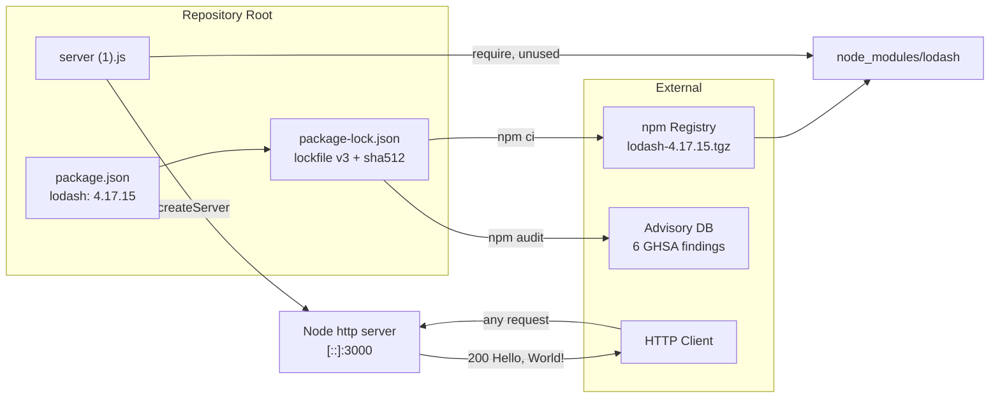

#### 1.2.2.3 Core Technical Approach

- **Runtime:** Node.js in CommonJS module style (`require`), using only the built-in `http` module. There is no framework and no build or transpile step. The manifest declares no `engines` field. The fixture was verified on Node.js v22.23.3 with npm 11.18.0.
- **Package management:** npm with lockfile format v3. That format is backwards compatible only to npm v7, so older npm clients cannot consume the lockfile as-is.
- **Server design:** a single anonymous arrow-function handler that ignores `req` and ends every response straight away. The server keeps no state and does no routing, middleware, error handling or graceful shutdown.
- **Vulnerability embedding:** the dependency is pinned exactly and imported at module load. The vulnerable package is therefore present both in the manifest (static analysis) and in the running process (runtime reachability), yet no code path calls it.

### 1.2.3 Success Criteria

The repository defines no formal objectives, KPIs, tests or CI gates. The criteria below come from the fixture's own observable behavior and its evident role as a CVE test case. Each was checked in an isolated copy of the repository.

#### 1.2.3.1 Measurable Objectives

| Objective | Measurement | Observed Result |
|---|---|---|
| Deterministic install | `npm ci` package count | `added 1 package` |
| Vulnerability detectable by SCA | `npm audit` against the locked tree | 1 vulnerable package (`lodash`), 6 advisories, high aggregate severity |
| Service operational | HTTP request to port 3000 | `200` status, 14-byte body |
| Remediation resolves all findings | `npm audit` after pinning `lodash` to `4.18.1` | `found 0 vulnerabilities` |
| Remediation preserves behavior | HTTP request after the upgrade | `200` status, 14-byte body (unchanged) |

#### 1.2.3.2 Critical Success Factors

- **Integrity of the vulnerable state.** The `lodash` 4.17.15 pin in `package.json` and `package-lock.json` must stay in place until someone deliberately runs remediation. Changing either file changes what the fixture tests.
- **Manifest–lockfile consistency.** The root record in `package-lock.json`, `packages[""]`, must continue to mirror `package.json` (name, version, dependency), or `npm ci` will fail.
- **Semver-minor remediation path.** Clearing every current advisory requires `lodash` 4.18.1, the current upstream release and the latest non-vulnerable version. Version 4.17.21 still falls within the ranges of GHSA-r5fr-rjxr-66jc, GHSA-f23m-r3pf-42rh and GHSA-xxjr-mmjv-4gpg. Because of the exact pin, remediation has to edit the declared version itself; range resolution alone cannot pick up the fix.
- **Behavioral invariance.** The fixed HTTP response is the oracle that shows a remediation did not break the application.

#### 1.2.3.3 Key Performance Indicators

| KPI | Baseline (as committed) | Target after Remediation |
|---|---|---|
| Vulnerable packages reported by `npm audit` | 1 | 0 |
| Advisories reported against `lodash` | 6 (3 high, 3 moderate) | 0 |
| Highest CVSS score among findings | 8.1 (GHSA-r5fr-rjxr-66jc) | None |
| HTTP response on port 3000 | `200`, `Hello, World!\n` | Identical |

## 1.3 Scope

### 1.3.1 In-Scope

#### 1.3.1.1 Core Features and Functionalities

**Must-have capabilities**

| Capability | Implementation | Source |
|---|---|---|
| Vulnerable dependency declaration | `"lodash": "4.17.15"` (exact pin) | `package.json` L4–L6 |
| Locked, verifiable dependency resolution | Resolved tarball URL + `sha512` integrity + MIT license | `package-lock.json` L14–L19 |
| Runtime load of the dependency | `const _ = require('lodash');` | `server (1).js` L1 |
| Fixed-response HTTP endpoint | `res.end('Hello, World!\n')` for all requests | `server (1).js` L3–L4 |
| Listening on TCP 3000 with a startup log | `.listen(3000, () => console.log(...))` | `server (1).js` L5 |

**Primary user workflows**

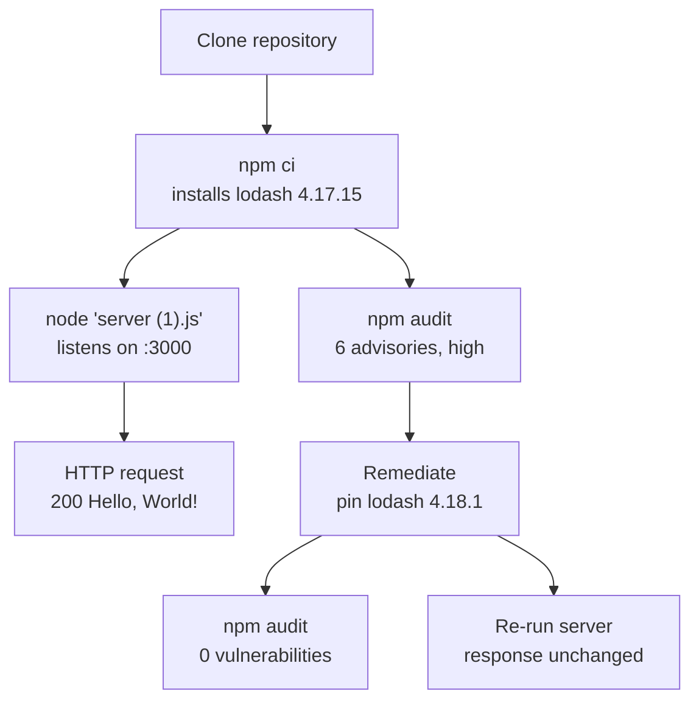

1. **Detection:** install from the lockfile, then run a dependency audit or SCA scan that reports the `lodash` advisories.
2. **Execution:** start the server with `node "server (1).js"` and send any HTTP request to port 3000.
3. **Remediation and validation:** update the `lodash` version in `package.json` and `package-lock.json`, re-audit, and confirm the HTTP response is unchanged.

**Essential integrations**

- The npm public registry, for fetching the `lodash` tarball (`package-lock.json` L16).
- The npm advisory data behind `npm audit`, for vulnerability findings.

**Key technical requirements**

| Requirement | Basis |
|---|---|
| A Node.js runtime with CommonJS `require` and arrow-function support | `server (1).js` syntax; no `engines` field is declared |
| npm v7 or later | `lockfileVersion: 3` (`package-lock.json` L4) |
| Network access to `registry.npmjs.org` at install time | `resolved` URL in `package-lock.json` L16 |
| TCP port 3000 free on the host | Hard-coded in `server (1).js` L5 |
| Shell quoting of the entry filename | Space and parentheses in `server (1).js` |

#### 1.3.1.2 Implementation Boundaries

| Boundary | Definition |
|---|---|
| System boundary | One Node.js process with one HTTP listener on port 3000, bound to all interfaces (`[::]`). The only external dependency is the npm registry at install time. |
| User groups covered | Security-tooling operators, remediation agents and QA engineers who validate dependency scanning (inferred; see 1.1.3). There are no end users. |
| Geographic / market coverage | Not applicable. The fixture has no localization, regional configuration or market-specific logic. |
| Data domains included | Only dependency metadata (package name, version, resolved URL, integrity hash, license) and one static response string. The fixture accepts, stores and transmits no business, personal or configuration data. |

### 1.3.2 Out-of-Scope

#### 1.3.2.1 Excluded Features and Capabilities

The source files do not implement any of the following:

- Request routing, method handling, or reading paths, query strings, headers or bodies. The `req` argument is ignored.
- Response content negotiation, including a `Content-Type` header.
- Authentication, authorization, TLS/HTTPS, CORS or rate limiting.
- Persistence of any kind: databases, files or caches.
- Configuration through environment variables or files. Port 3000 is hard-coded, and no host is specified.
- Error handling, structured logging, health checks, metrics, and graceful shutdown or signal handling.
- Any use of the `lodash` API. The imported `_` binding is never referenced.
- npm `scripts` (`start`, `test`, `lint`), a `main` entry, `engines` and `license` fields, and `devDependencies`.
- Automated tests, CI pipelines, container images and infrastructure-as-code.
- Project documentation. The one-line `README.md` was deleted in commit `44b04ea`.

#### 1.3.2.2 Future Phase Considerations

The repository contains no roadmap, TODO/FIXME markers, issues or changelog, so no future phases are defined. The only transition the fixture's design implies is the remediation step: replacing `lodash` 4.17.15 with a non-vulnerable release. Currently that release is 4.18.1, and lodash's support policy covers only the latest patch release of a line. Doing this ends the fixture's role as a vulnerable test case. It should therefore be done in a downstream copy or branch, or treated as the expected output of the workflow under test.

#### 1.3.2.3 Integration Points Not Covered

- Private or mirrored npm registries. The lockfile pins the public `registry.npmjs.org` URL.
- Alternative package managers (Yarn, pnpm). They have no lockfiles here.
- Upstream services, APIs, databases, message queues, identity providers and observability backends.
- Reverse proxies, load balancers and service meshes. No deployment topology is defined.

#### 1.3.2.4 Unsupported Use Cases

| Use Case | Reason Unsupported |
|---|---|
| Production or internet-facing deployment | Ships a dependency with 6 known advisories. Binds to all interfaces despite logging `127.0.0.1`. Has no security controls. |
| Use as an application template | No routing, configuration, error handling, tests or build tooling |
| Demonstrating exploitation of the `lodash` CVEs | No code path calls `lodash` functions such as `_.template`, `_.unset`, `_.omit` or `_.zipObjectDeep`, so no advisory is reachable through the HTTP interface |
| Running on npm older than v7 | Lockfile v3 is not backwards compatible below npm v7 |
| Running alongside another service on port 3000 | The port is hard-coded, with no override |

## 1.4 References

**Repository files and folders**

- `package.json`: package identity `cve-test-fixture@1.0.0`, the exact `lodash` `4.17.15` pin, and the absence of `main`, `scripts`, `engines`, `license` and `devDependencies`
- `package-lock.json`: lockfile v3 (`requires: true`), the root record mirroring the manifest, and `node_modules/lodash` locked to version 4.17.15, its resolved registry tarball URL, `sha512` integrity hash and MIT license, with no transitive dependencies
- `server (1).js`: CommonJS entry point; unused `lodash` import (L1); fixed `Hello, World!\n` handler (L3–L4); `listen(3000)` with no host argument and a `127.0.0.1` log message (L5)
- `` (repository root): a flat structure of three files with no subfolders, no `.blitzyignore`, and no tests, CI or documentation
- Git history (`b306e60`, `ddd2024`, `44b04ea`): authorship (`lakshya-blitzy`), the web-upload origin of the files, and the deleted one-line `README.md` (`# Repo_withMinorCVE_02`)

**Runtime verification (isolated copies of the repository)**

- `npm ci`: installs exactly one package
- `node "server (1).js"` plus an HTTP request: `200 OK`, 14-byte body, default Node headers, no `Content-Type`, listener on `[::]:3000`
- `npm audit`: six `lodash` advisories (GHSA-35jh-r3h4-6jhm, GHSA-p6mc-m468-83gw, GHSA-29mw-wpgm-hmr9, GHSA-r5fr-rjxr-66jc, GHSA-f23m-r3pf-42rh, GHSA-xxjr-mmjv-4gpg) with CVSS scores and affected ranges; fix path is `lodash@4.18.1`
- `lodash@4.18.1` upgrade: `found 0 vulnerabilities`, with server behavior unchanged

**Web sources**

- [web] Snyk Vulnerability Database, `https://security.snyk.io/package/npm/lodash`: latest version and latest non-vulnerable version are both 4.18.1
- [web] EOL Risk, `https://eolrisk.com/lodash/`: 4.18.1 released April 2026 as the current version; 4.17.23 fixed CVE-2025-13465; the lodash policy supports only the latest patch release
- [web] lodash Changelog, `https://github.com/lodash/lodash/wiki/Changelog`: the 4.18.x fixes for GHSA-f23m-r3pf-42rh and GHSA-r5fr-rjxr-66jc (CVE-2026-4800)
- [web] TuxCare, `https://tuxcare.com/blog/lodash-vulnerability-pinned-version/`: 4.17.21 still falls within the post-2025 advisory ranges, and upgrading to 4.18.1 closes them

# 2. Product Requirements

## 2.1 Feature Catalog

The repository's three root files (`package.json`, `package-lock.json`, `server (1).js`) break down into five discrete features. Priority reflects each feature's weight in the fixture's role as a CVE test case (see 1.1.2 Core Problem Being Solved):

- **Critical**: the feature defines the vulnerable state under test.
- **High**: the feature makes the fixture runnable or supplies the behavioral oracle used to validate remediation (see 1.2.3.2 Critical Success Factors).

Every feature has status **Completed**, meaning it is implemented as committed at HEAD `44b04ea`. The repository contains no roadmap, issues, or TODO/FIXME markers, so no feature is Proposed, Approved, or In Development (see 1.3.2.2 Future Phase Considerations).

### 2.1.1 Feature Summary

| ID | Feature Name | Category | Priority / Status |
|---|---|---|---|
| F-001 | Vulnerable Dependency Declaration | Dependency Management | Critical / Completed |
| F-002 | Locked Dependency Resolution and Reproducible Install | Dependency Management | Critical / Completed |
| F-003 | Runtime Dependency Loading | Runtime Module Loading | High / Completed |
| F-004 | HTTP Server Bootstrap and Startup Signal | Runtime Service | High / Completed |
| F-005 | Fixed-Response HTTP Handler | HTTP Interface | High / Completed |

| ID | Implementing File | Lines | Related Specification |
|---|---|---|---|
| F-001 | `package.json` | L2–L6 | 1.1.2, 1.3.1.1 |
| F-002 | `package-lock.json` | L1–L21 | 1.1.4, 1.2.2.2 |
| F-003 | `server (1).js` | L1 | 1.2.2.3, 1.3.2.4 |
| F-004 | `server (1).js` | L3, L5 | 1.2.1.2, 1.3.1.2 |
| F-005 | `server (1).js` | L3–L4 | 1.2.2.1, 1.2.3.2 |

### 2.1.2 F-001: Vulnerable Dependency Declaration

**Feature Metadata**

| Attribute | Value |
|---|---|
| Unique ID | F-001 |
| Feature Name | Vulnerable Dependency Declaration |
| Feature Category | Dependency Management (security test condition) |
| Priority Level | Critical |
| Status | Completed |

**Description**

- **Overview:** `package.json` declares the package identity `cve-test-fixture@1.0.0` (L2–L3) and one runtime dependency, `"lodash": "4.17.15"` (L4–L6). The version is an exact pin with no semver range operator. The manifest declares no other fields: there is no `main`, `scripts`, `engines`, `license`, or `devDependencies`.
- **Business Value:** This declaration is the fixture's test condition. `lodash` 4.17.15 falls inside the affected ranges of six published advisories: `npm audit` reports 3 high and 3 moderate, with a highest CVSS score of 8.1. That gives dependency scanners a known-answer target.
- **User Benefits:** Scanner operators and QA engineers get exactly one vulnerable package to assert against. Remediation agents get a single, well-defined edit target.
- **Technical Context:** Because the pin is exact, npm cannot resolve a patched release on its own, and `npm audit fix` cannot upgrade the package without `--force`. npm reports the available fix as `lodash@4.18.1` with `isSemVerMajor: false`, and warns that the fix lies outside the stated dependency range.

**Dependencies**

| Dependency Type | Detail |
|---|---|
| Prerequisite Features | None; this is the root feature |
| System Dependencies | npm CLI, to interpret the manifest |
| External Dependencies | `lodash` 4.17.15 on the npm public registry; npm advisory data for detection |
| Integration Requirements | Must stay consistent with the F-002 root record `packages[""]` in `package-lock.json` (L7–L13) |

### 2.1.3 F-002: Locked Dependency Resolution and Reproducible Install

**Feature Metadata**

| Attribute | Value |
|---|---|
| Unique ID | F-002 |
| Feature Name | Locked Dependency Resolution and Reproducible Install |
| Feature Category | Dependency Management (supply-chain determinism) |
| Priority Level | Critical |
| Status | Completed |

**Description**

- **Overview:** `package-lock.json` is an npm lockfile, version 3 (`lockfileVersion: 3`, `requires: true`; L4–L5). Its root record, `packages[""]`, mirrors the manifest (L7–L13). Its only other record, `node_modules/lodash` (L14–L19), locks version `4.17.15`, the resolved tarball `https://registry.npmjs.org/lodash/-/lodash-4.17.15.tgz`, a `sha512` integrity hash, and the license `MIT`. The lockfile has no transitive entries.
- **Business Value:** The lockfile makes the vulnerable state reproducible across machines and over time. Lockfile-reading scanners see the same dependency tree that the runtime loads.
- **User Benefits:** `npm ci` rebuilds an identical tree (observed: `added 1 package`), and the integrity hash rejects tampered tarballs.
- **Technical Context:** Lockfile v3 requires npm v7 or later. `npm ci` refuses to install when the manifest and lockfile disagree. Changing only `package.json` to `4.18.1` produced `Invalid: lock file's lodash@4.17.15 does not satisfy lodash@4.18.1` and exit code 1.

**Dependencies**

| Dependency Type | Detail |
|---|---|
| Prerequisite Features | F-001 (the manifest the lockfile mirrors) |
| System Dependencies | npm v7 or later (lockfile v3) |
| External Dependencies | Public registry tarball at `registry.npmjs.org` |
| Integration Requirements | Consumed by `npm ci` and `npm audit`; produces the `node_modules/lodash` tree that F-003 loads |

### 2.1.4 F-003: Runtime Dependency Loading

**Feature Metadata**

| Attribute | Value |
|---|---|
| Unique ID | F-003 |
| Feature Name | Runtime Dependency Loading |
| Feature Category | Runtime Module Loading |
| Priority Level | High |
| Status | Completed |

**Description**

- **Overview:** `const _ = require('lodash');` (`server (1).js` L1) loads `lodash` when the module loads, before the server is created. The `_` binding is never referenced again.
- **Business Value:** The vulnerable package is present in the running process as well as in the declared and locked tree. No code path calls its API (see 1.2.2.3 Core Technical Approach).
- **User Benefits:** Remediation cannot break application logic, because no `lodash` function is invoked. Any version that resolves and loads satisfies the script.
- **Technical Context:** The script uses CommonJS resolution from `node_modules`. If `lodash` is not installed, startup fails with `Error: Cannot find module 'lodash'` (`MODULE_NOT_FOUND`) and exit code 1, before any listener is created.

**Dependencies**

| Dependency Type | Detail |
|---|---|
| Prerequisite Features | F-002 (installed `node_modules/lodash`) |
| System Dependencies | A Node.js runtime with CommonJS `require` |
| External Dependencies | The `lodash` package |
| Integration Requirements | Must complete, at L1, before F-004 runs in the same script |

### 2.1.5 F-004: HTTP Server Bootstrap and Startup Signal

**Feature Metadata**

| Attribute | Value |
|---|---|
| Unique ID | F-004 |
| Feature Name | HTTP Server Bootstrap and Startup Signal |
| Feature Category | Runtime Service |
| Priority Level | High |
| Status | Completed |

**Description**

- **Overview:** `require('http').createServer(handler).listen(3000, callback)` (`server (1).js` L3, L5) creates one server with Node's built-in `http` module and listens on the hard-coded TCP port 3000. The call passes no host argument, so Node binds the unspecified address: `[::]:3000`, which covers all interfaces. The listen callback writes `Server running at http://127.0.0.1:3000/` to stdout.
- **Business Value:** The fixture runs as a service, so a remediation can be validated by executing it, not only by static inspection.
- **User Benefits:** Starting takes one command, `node "server (1).js"`. The port is fixed, and a readiness line appears on stdout for test harnesses to match.
- **Technical Context:** The log text names the loopback address, but the listener accepts connections on every interface; a non-loopback IPv4 address was verified to return `200`. There is no `start` script: `npm start` fails with `Missing script: "start"`. The filename contains a space and parentheses, so it must be quoted. If the port is taken, an unhandled `EADDRINUSE` error ends the process with exit code 1.

**Dependencies**

| Dependency Type | Detail |
|---|---|
| Prerequisite Features | F-003 (the script must execute past L1) |
| System Dependencies | Node.js runtime; built-in `http` module; TCP port 3000 free on the host |
| External Dependencies | None |
| Integration Requirements | Registers the F-005 handler; emits the startup line to stdout |

### 2.1.6 F-005: Fixed-Response HTTP Handler

**Feature Metadata**

| Attribute | Value |
|---|---|
| Unique ID | F-005 |
| Feature Name | Fixed-Response HTTP Handler |
| Feature Category | HTTP Interface |
| Priority Level | High |
| Status | Completed |

**Description**

- **Overview:** The anonymous arrow function `(req, res) => { res.end('Hello, World!\n'); }` (`server (1).js` L3–L4) ignores `req` and ends every response with the 14-byte body `Hello, World!\n` and the implicit status `200`.
- **Business Value:** The handler is the fixture's behavioral oracle (see 1.2.3.2): a constant output that is easy to compare and shows whether a dependency change broke the application.
- **User Benefits:** Every HTTP method and path yields the same result, so validation needs one request and one byte comparison.
- **Technical Context:** Responses carry only Node's default headers: `Date`, `Connection: keep-alive`, `Keep-Alive: timeout=5`, and `Content-Length: 14`. No `Content-Type` is set. A `HEAD` request returns `200` with headers and no body. The handler keeps no state and does no routing or body parsing.

**Dependencies**

| Dependency Type | Detail |
|---|---|
| Prerequisite Features | F-004 (the server that invokes the handler) |
| System Dependencies | Node.js built-in `http` module |
| External Dependencies | Any HTTP client that can reach TCP port 3000 |
| Integration Requirements | None with `lodash`; the handler never references `_` |

## 2.2 Functional Requirements

The requirements below describe the fixture as built, not a planned design. Each acceptance criterion was checked in an isolated copy of the repository with Node.js v22.23.3 and npm 11.18.0. These versions come from the environment; the repository declares none.

| Scale | Meaning in this Section |
|---|---|
| Must-Have | Removing or changing it alters what the fixture tests or breaks its use as a test case |
| Should-Have | Supports isolation, determinism, or diagnosability of the test case |
| Could-Have | Incidental as-built behavior, recorded so tests can assert it |
| Complexity (High/Medium/Low) | Effort to implement or verify; the codebase is 13 non-empty lines, so most items are Low |

### 2.2.1 F-001 Requirements: Vulnerable Dependency Declaration

**Requirement Details**

| Requirement ID | Description | Acceptance Criteria | Priority / Complexity |
|---|---|---|---|
| F-001-RQ-001 | Declare the package identity | `package.json` has `name` = `cve-test-fixture` and `version` = `1.0.0` (L2–L3). The same values appear in `package-lock.json` L2–L3 and L8–L9. | Must-Have / Low |
| F-001-RQ-002 | Declare exactly one runtime dependency, pinned exactly | `dependencies` contains only `lodash`, with the value `4.17.15` and no range syntax (`^`, `~`, `>`, `x`) (L4–L6) | Must-Have / Low |
| F-001-RQ-003 | The declared version is detectable as vulnerable | After `npm ci`, `npm audit --json` reports `high: 1` and `total: 1`, `lodash` range `<=4.17.23`, and the six advisories listed in 1.1.2 | Must-Have / Low |
| F-001-RQ-004 | No other dependency groups | `devDependencies`, `peerDependencies`, and `optionalDependencies` are all absent | Should-Have / Low |
| F-001-RQ-005 | The pin resists automatic range-based fixes | `npm audit` reports the fix `lodash@4.18.1` with `isSemVerMajor: false`, and applying it requires an explicit version edit or `npm audit fix --force` | Should-Have / Medium |

**Technical Specifications**

| Specification | Detail |
|---|---|
| Input Parameters | `package.json` (JSON, 104 bytes): `name`, `version`, `dependencies.lodash` |
| Output / Response | A dependency specification consumed by npm; advisory findings emitted by `npm audit` |
| Performance Criteria | None defined; this is a static declaration |
| Data Requirements | A valid JSON document; the version string must be an exact semver value |

**Validation Rules**

| Rule Type | Rule |
|---|---|
| Business Rules | The pin must stay `4.17.15` until remediation is deliberately performed; changing it changes what the fixture tests (1.2.3.2) |
| Data Validation | The manifest must parse as JSON and match the lockfile root record (see F-002-RQ-002) |
| Security Requirements | The dependency is intentionally vulnerable. The fixture must not be deployed to production (1.3.2.4). |
| Compliance Requirements | The fixture declares no `license` of its own. The `lodash` license is MIT, as recorded in `package-lock.json` L18. |

### 2.2.2 F-002 Requirements: Locked Dependency Resolution and Reproducible Install

**Requirement Details**

| Requirement ID | Description | Acceptance Criteria | Priority / Complexity |
|---|---|---|---|
| F-002-RQ-001 | Use lockfile format v3 | L4 `lockfileVersion: 3` and L5 `requires: true`; the file is readable by npm v7 or later | Must-Have / Low |
| F-002-RQ-002 | The root record mirrors the manifest | `packages[""]` (L7–L13) equals `package.json` in name, version, and dependencies, and `npm ci` succeeds. If `package.json` alone is changed, `npm ci` exits 1 with an "are in sync" error. | Must-Have / Low |
| F-002-RQ-003 | Lock `lodash` to one specific artifact | `node_modules/lodash` (L14–L19) records `version` 4.17.15, the `resolved` registry URL, a `sha512` `integrity` hash, and `license` MIT | Must-Have / Low |
| F-002-RQ-004 | Deterministic single-package install | `npm ci` prints `added 1 package`, and `require('lodash').VERSION` returns `4.17.15` | Must-Have / Low |
| F-002-RQ-005 | No transitive dependencies | `packages` contains only the `""` and `node_modules/lodash` keys | Should-Have / Low |

**Technical Specifications**

| Specification | Detail |
|---|---|
| Input Parameters | `package-lock.json` (537 bytes) and `package.json`; access to `https://registry.npmjs.org/lodash/-/lodash-4.17.15.tgz` or to the local npm cache |
| Output / Response | A `node_modules/lodash` tree containing `lodash` 4.17.15; `npm ci` exits 0 |
| Performance Criteria | None defined. `npm ci` was observed to finish in 259 ms for one package; this figure depends on the environment and is not a target. |
| Data Requirements | Per-package `version`, `resolved`, `integrity`, and `license` fields |

**Validation Rules**

| Rule Type | Rule |
|---|---|
| Business Rules | Remediation must update the manifest and the lockfile together (workflow step 3 in 1.3.1.1) |
| Data Validation | npm checks the downloaded tarball against the `sha512` integrity value; `npm ci` enforces manifest–lockfile agreement |
| Security Requirements | The integrity hash detects tampered artifacts. The `resolved` URL uses HTTPS to the public registry. |
| Compliance Requirements | The dependency license (MIT) is recorded; the repository defines no other compliance obligations |

### 2.2.3 F-003 Requirements: Runtime Dependency Loading

**Requirement Details**

| Requirement ID | Description | Acceptance Criteria | Priority / Complexity |
|---|---|---|---|
| F-003-RQ-001 | Load `lodash` at startup through CommonJS | `server (1).js` L1 `require('lodash')` runs before L3, and the loaded version equals the locked version (4.17.15) | Must-Have / Low |
| F-003-RQ-002 | Invoke no `lodash` API | `_` is referenced only in its declaration on L1, and HTTP output does not depend on the installed `lodash` version | Must-Have / Low |
| F-003-RQ-003 | Fail fast when the dependency is missing | Without `node_modules`, `node "server (1).js"` exits 1 with `Cannot find module 'lodash'` (`MODULE_NOT_FOUND`) and opens no listener | Should-Have / Low |

**Technical Specifications**

| Specification | Detail |
|---|---|
| Input Parameters | `node_modules/lodash`, found through Node's module resolution |
| Output / Response | An in-memory `_` binding, which is unused |
| Performance Criteria | A one-time module-load cost at startup; no criteria defined |
| Data Requirements | None |

**Validation Rules**

| Rule Type | Rule |
|---|---|
| Business Rules | The import must stay, so that the vulnerable package is loaded in-process (1.2.2.3) |
| Data Validation | Not applicable; no data is processed |
| Security Requirements | No code path reaches the vulnerable functions named by the advisories, such as `_.template`, `_.unset`, `_.omit`, or `_.zipObjectDeep` (1.3.2.4) |
| Compliance Requirements | None identified |

### 2.2.4 F-004 Requirements: HTTP Server Bootstrap and Startup Signal

**Requirement Details**

| Requirement ID | Description | Acceptance Criteria | Priority / Complexity |
|---|---|---|---|
| F-004-RQ-001 | Create an HTTP server with the built-in `http` module | L3 calls `require('http').createServer(...)`; no third-party framework is involved | Must-Have / Low |
| F-004-RQ-002 | Listen on TCP port 3000 | After start, port 3000 accepts connections; the listener is observed at `[::]:3000` | Must-Have / Low |
| F-004-RQ-003 | Emit a startup signal | Once listening, stdout contains exactly `Server running at http://127.0.0.1:3000/` | Must-Have / Low |
| F-004-RQ-004 | Start with a single command | `node "server (1).js"`, with the filename quoted, starts the server. `npm start` exits 1 with `Missing script: "start"`. | Must-Have / Low |
| F-004-RQ-005 | Accept connections on every interface (as-built) | A request to a non-loopback host address returns `200`. This is recorded as a limitation in 1.2.1.2. | Could-Have / Low |
| F-004-RQ-006 | Terminate on a port conflict | A second instance exits 1 with `listen EADDRINUSE: address already in use :::3000` | Could-Have / Low |

**Technical Specifications**

| Specification | Detail |
|---|---|
| Input Parameters | None. There are no CLI arguments, environment variables, or configuration files; port 3000 is hard-coded at L5. |
| Output / Response | A listening socket on `[::]:3000` and the startup line on stdout. On failure, a stack trace on stderr and exit code 1. |
| Performance Criteria | Node's defaults apply unchanged: `requestTimeout` 300000 ms, `headersTimeout` 60000 ms, `keepAliveTimeout` 5000 ms. The repository sets none of them. |
| Data Requirements | None |

**Validation Rules**

| Rule Type | Rule |
|---|---|
| Business Rules | The port (3000) and the startup line are fixed values that validation scripts can rely on |
| Data Validation | Not applicable; the bootstrap accepts no input |
| Security Requirements | No TLS and no authentication. The server binds all interfaces even though the log says loopback, so run it only in isolated environments (1.3.2.4). |
| Compliance Requirements | None identified |

### 2.2.5 F-005 Requirements: Fixed-Response HTTP Handler

**Requirement Details**

| Requirement ID | Description | Acceptance Criteria | Priority / Complexity |
|---|---|---|---|
| F-005-RQ-001 | Return a fixed body for every request | `GET`, `POST`, `PUT`, `DELETE`, `PATCH`, and `OPTIONS` to any path and query, with or without a body, return `200` and the bytes `Hello, World!\n` (14 bytes) | Must-Have / Low |
| F-005-RQ-002 | Emit Node's default headers only | The headers are `Date`, `Connection: keep-alive`, `Keep-Alive: timeout=5`, and `Content-Length: 14`; `Content-Type` is absent | Should-Have / Low |
| F-005-RQ-003 | Handle `HEAD` | `HEAD /` returns `200` with headers and no body | Could-Have / Low |
| F-005-RQ-004 | Stateless, input-independent handling | `req` is never read, and repeated requests return identical responses | Must-Have / Low |
| F-005-RQ-005 | Behavior is unchanged by remediation | After `lodash` is upgraded to `4.18.1` in both the manifest and the lockfile, `npm audit` reports `found 0 vulnerabilities` and the response is still `200` with the same 14-byte body | Must-Have / Low |

**Technical Specifications**

| Specification | Detail |
|---|---|
| Input Parameters | Any HTTP/1.1 request; its method, path, query, headers, and body are all ignored |
| Output / Response | `HTTP/1.1 200 OK` with the body `Hello, World!\n` |
| Performance Criteria | No SLA is defined. A single loopback request was observed to complete in 0.19 ms (curl `time_total`); this is not a target. |
| Data Requirements | One static string constant; nothing is persisted |

**Validation Rules**

| Rule Type | Rule |
|---|---|
| Business Rules | The response must stay byte-identical across remediation, because it is the behavioral oracle (1.2.3.2) |
| Data Validation | None beyond Node's built-in HTTP parser; the application does not inspect the request |
| Security Requirements | No authentication, authorization, TLS, CORS, or rate limiting (1.3.2.1). Node's parser defaults are the only safeguards. |
| Compliance Requirements | No personal or business data is accepted or transmitted (1.3.1.2) |

## 2.3 Feature Relationships

Every relationship below comes from file content or observed runtime behavior. The features form one linear chain: the manifest drives the lockfile, the lockfile yields the installed tree, the installed tree must load before the server starts, and the server invokes the handler. The one notable non-relationship is between the handler (F-005) and `lodash` (F-003): the handler never calls `lodash`.

### 2.3.1 Feature Dependency Map

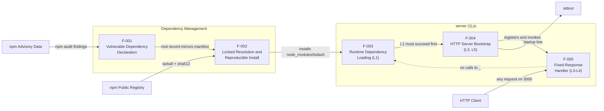

| Feature | Depends On | Nature of Dependency | Effect if the Dependency Fails |
|---|---|---|---|
| F-002 | F-001 | `packages[""]` must mirror `package.json` | `npm ci` exits 1 with a manifest–lockfile sync error |
| F-003 | F-002 | `node_modules/lodash` must exist | `MODULE_NOT_FOUND`, exit 1 |
| F-004 | F-003 | Runs after L1 in the same script | No listener is created |
| F-005 | F-004 | The server invokes the handler | Clients get connection refused |
| F-005 | None on F-003 | `_` is never referenced | No functional effect; remediation cannot change output |

### 2.3.2 Process Flows

The flowchart below traces the runtime path through F-003, F-004 and F-005, including the two failure exits observed during verification. For the end-to-end detect, execute and remediate workflow, see the "Primary user workflows" flowchart in 1.3.1.1. For the component view, see the diagram in 1.2.2.2.

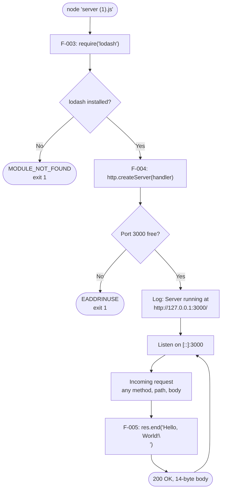

### 2.3.3 Integration Points

| Integration Point | Features | Direction / Protocol | Evidence |
|---|---|---|---|
| npm public registry | F-002 | Inbound HTTPS download at install time | `package-lock.json` L16 (`resolved`) |
| npm advisory data (via `npm audit`) | F-001, F-002 | Read at audit time against the locked tree | `npm audit` output: 6 advisories |
| HTTP clients | F-004, F-005 | Inbound HTTP/1.1 over TCP 3000, all interfaces | `server (1).js` L3–L5; listener on `[::]:3000` |
| Process stdout / stderr | F-003, F-004 | Outbound: startup line (stdout); unhandled error traces (stderr) | `server (1).js` L5; observed `MODULE_NOT_FOUND` and `EADDRINUSE` traces |

### 2.3.4 Shared Components and Common Services

**Shared components**

| Component | Shared By | Role | Location |
|---|---|---|---|
| `server (1).js` | F-003, F-004, F-005 | Single entry script, executed top to bottom | Repository root |
| `lodash` version string `4.17.15` | F-001, F-002 | Defines the vulnerable state; all three occurrences must change together | `package.json` L5; `package-lock.json` L11, L15 |
| Package identity `cve-test-fixture@1.0.0` | F-001, F-002 | Links the manifest to the lockfile root record | `package.json` L2–L3; `package-lock.json` L2–L3, L8–L9 |
| Node built-in `http` module | F-004, F-005 | Server creation, request parsing, default headers | `server (1).js` L3 |

**Common services**

| Service | Used By | Operations |
|---|---|---|
| npm CLI | F-001, F-002 | `npm ci` (install), `npm audit` (detection), `npm install <pkg>@<ver> --save-exact` (remediation) |
| Node.js runtime | F-003, F-004, F-005 | CommonJS loader, `http` server, event loop |

The repository has no shared application libraries, middleware, utility modules, or configuration services.

## 2.4 Implementation Considerations

The considerations below follow from the committed files and from verified runtime behavior. The fixture is a test asset. Its constraints are therefore stated relative to that role, not to production operation, which 1.3.2.4 rules out.

### 2.4.1 F-001: Vulnerable Dependency Declaration

| Aspect | Consideration | Evidence |
|---|---|---|
| Technical Constraints | The exact pin prevents range resolution from picking up fixes. npm is the only supported package manager: there are no Yarn or pnpm lockfiles and no `engines` field. | `package.json` L5; root listing |
| Performance | Not applicable; this is a static declaration | `package.json` |
| Scalability | One dependency keeps the finding unambiguous. Adding packages would add findings unrelated to the test case. | `package-lock.json` has only `node_modules/lodash` |
| Security Implications | The version is intentionally vulnerable (3 high and 3 moderate advisories; maximum CVSS 8.1). The set of advisories grows over time: three of the six have ranges that extend to `4.17.22` or `4.17.23`. | `npm audit --json`; 1.1.2 |
| Maintenance | Expected audit results drift as advisories are published. Harnesses should assert specific advisory IDs, or treat severity as time-dependent. The repository name ("MinorCVE") already disagrees with the current `high` rating (1.1.2). | `npm audit`; repository name |

### 2.4.2 F-002: Locked Dependency Resolution and Reproducible Install

| Aspect | Consideration | Evidence |
|---|---|---|
| Technical Constraints | Requires npm v7 or later (lockfile v3). The `resolved` URL fixes the public registry; private mirrors are not covered (1.3.2.3). | `package-lock.json` L4, L16 |
| Performance | Installing means fetching or reading from cache one tarball; duration depends on network and cache | `npm ci`: `added 1 package` |
| Scalability | Not applicable; the tree is one package | `package-lock.json` L6–L20 |
| Security Implications | The `sha512` integrity value and the HTTPS URL protect artifact authenticity. No `.npmrc` or registry configuration exists. | `package-lock.json` L16–L17; root listing |
| Maintenance | Any manifest edit requires regenerating the lockfile (for example, `npm install lodash@<ver> --save-exact`), otherwise `npm ci` fails with a sync error | Desync test: exit 1 |

### 2.4.3 F-003: Runtime Dependency Loading

| Aspect | Consideration | Evidence |
|---|---|---|
| Technical Constraints | CommonJS only. `node_modules/lodash` must be resolvable from the script's location. | `server (1).js` L1 |
| Performance | A one-time load cost at startup, with no per-request cost | `server (1).js` L1 is outside the handler |
| Scalability | Not applicable | — |
| Security Implications | The vulnerable code is in memory but no code path reaches it. Any future call, such as `_.template` or `_.unset` on untrusted input, would make a currently unreachable finding reachable. | `_` referenced only on L1 |
| Maintenance | A linter would flag `_` as unused, though none is configured. Removing the import would change the fixture's runtime-presence property (1.2.2.3). | `package.json` has no `scripts` or `devDependencies` |

### 2.4.4 F-004: HTTP Server Bootstrap and Startup Signal

| Aspect | Consideration | Evidence |
|---|---|---|
| Technical Constraints | Port 3000 is hard-coded, with no environment or CLI override. The filename must be quoted. There is no `main` field or `start` script. | `server (1).js` L5; `npm start` fails |
| Performance | One process and one event loop, with Node's default timeouts (`headersTimeout` 60000 ms, `requestTimeout` 300000 ms, `keepAliveTimeout` 5000 ms) and no clustering | `server (1).js` L3–L5; runtime check |
| Scalability | Only one instance can run per host, because a second instance fails with `EADDRINUSE`. No load-balancing or deployment topology is defined (1.3.2.3). | Port-conflict test |
| Security Implications | The server binds all interfaces while the log names `127.0.0.1`, which could mislead operators about exposure. There is no TLS. Isolate the fixture at the network or container level. | `/proc/net/tcp6` `[::]:3000`; non-loopback request returned `200` |
| Maintenance | There are no error handlers, signal handlers, or graceful shutdown: termination drops the listener immediately. The only operational signal is the startup line. | `server (1).js`; after `kill`, curl got connection refused |

### 2.4.5 F-005: Fixed-Response HTTP Handler

| Aspect | Consideration | Evidence |
|---|---|---|
| Technical Constraints | No `Content-Type` header is sent, so clients fall back to their own defaults for interpreting the body | Response header capture |
| Performance | Each request does constant work: no I/O, computation, or allocation beyond the response. Observed at 0.19 ms on loopback. | `server (1).js` L4; curl `time_total` |
| Scalability | The handler is stateless and places no shared-state constraints. The limit on capacity is F-004's single fixed-port process. | `server (1).js` L3–L4 |
| Security Implications | Application code processes no input, so it offers no injection surface. The remaining exposure is Node's HTTP parser and the listener scope. There is no rate limiting. | `req` ignored; 1.3.2.1 |
| Maintenance | The response string is the behavioral oracle. Changing it invalidates the "Identical" KPI target in 1.2.3.3 and any harness expectations. | `server (1).js` L4 |

## 2.5 Traceability Matrix

The repository has no tests or CI (1.3.2.1). Every requirement is therefore traced to its source lines and to a manual verification method that a harness can automate.

### 2.5.1 Requirements Traceability Matrix

| Requirement ID | Source Location | Verification Method | Related Specification |
|---|---|---|---|
| F-001-RQ-001 | `package.json` L2–L3; `package-lock.json` L2–L3, L8–L9 | Inspect the JSON fields | 1.1.1 |
| F-001-RQ-002 | `package.json` L4–L6 | Inspect the JSON; check for no range operator | 1.3.1.1 |
| F-001-RQ-003 | `package.json` L5; `package-lock.json` L15 | `npm ci`, then `npm audit --json` | 1.1.2, 1.2.3.1 |
| F-001-RQ-004 | `package.json` L1–L7 | Inspect the JSON keys | 1.3.2.1 |
| F-001-RQ-005 | `package.json` L5 | Read `fixAvailable` in `npm audit --json` | 1.2.1.2, 1.2.3.2 |
| F-002-RQ-001 | `package-lock.json` L4–L5 | Inspect the JSON fields | 1.2.2.3 |
| F-002-RQ-002 | `package-lock.json` L7–L13 | `npm ci` succeeds; desync test fails | 1.2.3.2 |
| F-002-RQ-003 | `package-lock.json` L14–L19 | Inspect the JSON; `npm ci` integrity check | 1.3.1.1 |
| F-002-RQ-004 | `package-lock.json` L14–L19 | `npm ci` output; `require('lodash').VERSION` | 1.2.3.1 |
| F-002-RQ-005 | `package-lock.json` L6–L20 | Inspect the `packages` keys | 1.1.4 |
| F-003-RQ-001 | `server (1).js` L1 | Start the server; print the loaded version | 1.2.2.3 |
| F-003-RQ-002 | `server (1).js` L1–L5 | Check for references to `_`; compare responses across versions | 1.3.2.4 |
| F-003-RQ-003 | `server (1).js` L1 | Run without `node_modules` | 1.3.1.1 |
| F-004-RQ-001 | `server (1).js` L3 | Code inspection | 1.2.2.2 |
| F-004-RQ-002 | `server (1).js` L5 | Connect to port 3000; inspect listening sockets | 1.3.1.2 |
| F-004-RQ-003 | `server (1).js` L5 | Capture stdout | 1.2.2.1 |
| F-004-RQ-004 | `server (1).js` (filename); `package.json` | Run `node "server (1).js"` and `npm start` | 1.2.1.2 |
| F-004-RQ-005 | `server (1).js` L5 | Send a request to a non-loopback address | 1.2.1.2, 1.3.2.4 |
| F-004-RQ-006 | `server (1).js` L5 | Start a second instance | 1.3.2.4 |
| F-005-RQ-001 | `server (1).js` L3–L4 | Send each method to any path; compare the body bytes | 1.2.2.1 |
| F-005-RQ-002 | `server (1).js` L4 | Capture the response headers | 1.2.2.1 |
| F-005-RQ-003 | `server (1).js` L4 | Send a `HEAD` request | 1.2.2.1 |
| F-005-RQ-004 | `server (1).js` L3–L4 | Send repeated requests; confirm `req` is unused | 1.3.2.1 |
| F-005-RQ-005 | `server (1).js` L1, L4; `package.json` L5 | Upgrade to `4.18.1` in a copy, then re-audit and re-request | 1.2.3.1, 1.2.3.3 |

### 2.5.2 Assumptions and Constraints

**Assumptions**

| ID | Assumption | Basis | Impact if Invalid |
|---|---|---|---|
| A-01 | The fixture exists to test SCA and remediation | Package name `cve-test-fixture`; repository name; exact vulnerable pin | Priorities in 2.1 would need re-ranking |
| A-02 | Node.js v22.23.3 and npm 11.18.0 represent the target runtime | Verification environment only; no `engines` field is declared | Default headers or timeouts may differ on other versions |
| A-03 | The advisory data is current as of 2026-09-25 | `npm audit` run date | The expected findings in F-001-RQ-003 will change |
| A-04 | The timing figures are illustrative only | Single-host loopback measurements | None; they are not requirements |
| A-05 | The user groups are inferred, not declared | 1.1.3 | Acceptance criteria might omit consumer-specific checks |

**Constraints**

| ID | Constraint | Source |
|---|---|---|
| C-01 | TCP port 3000 is hard-coded, and no host argument is given | `server (1).js` L5 |
| C-02 | npm v7 or later is required | `package-lock.json` L4 |
| C-03 | Network or cache access to `registry.npmjs.org` is needed at install time | `package-lock.json` L16 |
| C-04 | The entry filename must be shell-quoted | `server (1).js` |
| C-05 | There is no automated test harness; verification is manual or supplied externally | Root listing |
| C-06 | The dependency version is an exact pin, so remediation requires an explicit edit | `package.json` L5 |

**Correction to 2.2:** The complexity note in 2.2 gives the codebase size as 13 non-empty lines, which is wrong. The correct figures are 4 non-empty lines of executable code in `server (1).js` and 32 non-empty lines across all three files (7 + 21 + 4). The complexity ratings in 2.2 are unaffected.

### 2.5.3 Requirement Version Control

The repository has no requirement versioning of its own. These requirements are baselined against the following snapshot:

| Baseline Attribute | Value |
|---|---|
| Source revision | Commit `44b04ea` (HEAD, "Delete README.md"), 2026-09-25 |
| Package version | `cve-test-fixture` `1.0.0` |
| Advisory snapshot | `npm audit`, 2026-09-25: 1 package, 6 advisories, high aggregate severity |
| Re-baseline triggers | Any edit to the three root files; newly published `lodash` advisories; remediation |

The table below shows what happens to each requirement's expected values when `lodash` is remediated to `4.18.1`:

| Requirement ID | Expected Value Before | Expected Value After | Change Type |
|---|---|---|---|
| F-001-RQ-002 | `4.17.15` | `4.18.1` | Value update |
| F-001-RQ-003 | 6 advisories, high | `found 0 vulnerabilities` | Inverted; the fixture stops being a vulnerable case |
| F-001-RQ-005 | Fix available: `4.18.1` | No fix needed | Retired |
| F-002-RQ-003 / F-002-RQ-004 | 4.17.15 URL, hash, and version | 4.18.1 URL, hash, and version | Value update |
| F-003-RQ-001 | Loads 4.17.15 | Loads 4.18.1 | Value update |
| F-004-RQ-001 to RQ-006; F-005-RQ-001 to RQ-004 | As specified | Unchanged | Invariant |
| F-005-RQ-005 | Invariance check | Passes (verified) | Validation gate |

## 2.6 References

**Repository files and folders**

- `package.json` - Package identity `cve-test-fixture@1.0.0` (L2–L3) and the exact `lodash` `4.17.15` pin (L4–L6); no `main`, `scripts`, `engines`, `license`, or other dependency groups (F-001, F-004-RQ-004)
- `package-lock.json` - Lockfile v3 with `requires: true` (L4–L5), the root record mirroring the manifest (L7–L13), and `node_modules/lodash` with its version, resolved URL, `sha512` integrity, and MIT license (L14–L19); no transitive entries (F-002)
- `server (1).js` - Unused `lodash` import (L1); `http.createServer` with a fixed `Hello, World!\n` handler (L3–L4); `listen(3000)` with no host and a `127.0.0.1` startup log (L5) (F-003, F-004, F-005)
- `` (repository root) - A flat layout of three files with no subfolders, no `.blitzyignore`, and no tests, CI, linter, `.npmrc`, or alternative lockfiles
- Git history (`b306e60`, `ddd2024`, `44b04ea`) - The source revision used as the requirements baseline (2.5.3)

**Runtime verification (isolated copies; repository left unmodified)**

- `npm ci` - `added 1 package`; loaded `lodash` version `4.17.15` (F-002-RQ-004, F-003-RQ-001)
- HTTP requests with `GET`, `POST`, `PUT`, `DELETE`, `PATCH`, `OPTIONS`, and `HEAD` - `200` responses, a 14-byte body, Node's default headers, and no `Content-Type` (F-005)
- Listener inspection and a non-loopback request - Binding on `[::]:3000` across all interfaces (F-004-RQ-002, F-004-RQ-005)
- Second instance, missing `node_modules`, and `npm start` - `EADDRINUSE`, `MODULE_NOT_FOUND`, and `Missing script: "start"`, each exiting with code 1 (F-004-RQ-004, F-004-RQ-006, F-003-RQ-003)
- `npm audit --json` - 1 high-severity package, 6 advisories, and the fix `lodash@4.18.1` with `isSemVerMajor: false` (F-001-RQ-003, F-001-RQ-005)
- Manifest-only edit followed by `npm ci` - A sync error with exit code 1 (F-002-RQ-002)
- Node `http` server defaults - `requestTimeout` 300000 ms, `headersTimeout` 60000 ms, `keepAliveTimeout` 5000 ms (F-004 performance criteria)

**Related Technical Specification sections**

- 1.1 Executive Summary - The fixture's purpose, the advisory table (1.1.2), stakeholders (1.1.3), and value proposition (1.1.4)
- 1.2 System Overview - Limitations (1.2.1.2), the component diagram (1.2.2.2), the technical approach (1.2.2.3), and success criteria and KPIs (1.2.3)
- 1.3 Scope - In-scope capabilities and the primary workflow flowchart (1.3.1.1), boundaries (1.3.1.2), exclusions (1.3.2.1), and unsupported use cases (1.3.2.4)
- 1.4 References - Evidence and web sources behind the advisory and remediation facts reused here

# 3. Technology Stack

## 3.1 Programming Languages

The whole stack is JavaScript running on Node.js, plus the two JSON documents npm consumes. The repository root contains only `package.json`, `package-lock.json` and `server (1).js`. It has no subfolders and no other source, configuration or build files, so the inventory below is complete.

### 3.1.1 Language Inventory by Component

| Component | Language / Format | Language Level | Evidence |
|---|---|---|---|
| HTTP server (`server (1).js`) | JavaScript, CommonJS module system | ES2015 syntax: `const` and arrow functions. There is no `"type"` field, so Node.js treats `.js` as CommonJS. | `server (1).js` L1–L5; `package.json` |
| Package manifest | JSON (npm `package.json` schema) | Uses only the `name`, `version` and `dependencies` fields | `package.json` L1–L7 |
| Dependency lockfile | JSON (npm lockfile format) | `lockfileVersion: 3`, `requires: true` | `package-lock.json` L4–L5 |

The executable code is four non-empty lines in one file. The repository has no TypeScript, no type declarations, no transpiled or minified output and no shell or build scripts.

### 3.1.2 Selection Rationale

The repository does not document why it chose this language. The rationale below is inferred from the fixture's role as a dependency-vulnerability test case (1.2.1.1) and from its core technical approach (1.2.2.3).

| Choice | Justification |
|---|---|
| JavaScript on Node.js | The fixture targets the npm ecosystem. The vulnerable package (`lodash`) and the detector (`npm audit` and npm-aware SCA tools) both belong to it. |
| CommonJS `require` | The synchronous `require('lodash')` at module load (L1) puts the vulnerable package inside the running process. This is the fixture's runtime-presence property (1.2.2.3). |
| Plain ES2015 without a build step | The committed source is exactly what runs. No generated artifact can hide or duplicate the dependency, and nothing needs compiling before a scan or run. |

### 3.1.3 Constraints and Dependencies

- **Undeclared language level.** `package.json` has no `engines` field and the repository has no `.nvmrc`. The only syntactic requirement is an ES2015-capable runtime. The code was verified on Node.js v22.23.3 (V8 12.4.254.21-node.57).
- **CommonJS lock-in.** Adding `"type": "module"` would break both `require` calls (L1 and L3). Moving to ES modules means rewriting the imports.
- **Entry filename.** `server (1).js` contains a space and parentheses. Every invocation must be quoted (`node "server (1).js"`), because no `main` field or `start` script hides the name.
- **No static analysis.** No linter, formatter or type checker is configured, so nothing reports the unused `_` binding on L1 (2.4.3).

### 3.1.4 Alignment with the Default Technology Stack

The fixture uses none of the default stack's languages: Python for the backend, TypeScript for web and mobile, Swift, Kotlin or Objective-C. The existing architecture (1.2.2.3) fixes the language as JavaScript on Node.js, and the success criteria (1.2.3) depend on npm-specific detection and remediation. Switching languages would move the fixture to a different package ecosystem and invalidate what it tests.

## 3.2 Frameworks & Libraries

The system uses no application framework. It runs on the Node.js platform with the built-in `http` module and loads one third-party library, `lodash`, which it never calls.

### 3.2.1 Runtime Platform

| Component | Version | Role | Evidence |
|---|---|---|---|
| Node.js | Not declared by the repository. Verified on v22.23.3 (LTS codename "Jod"). | Provides the CommonJS loader, the `http` module and the event loop | `package.json` (no `engines`); runtime check |
| V8 JavaScript engine | 12.4.254.21-node.57 (bundled with the verified Node.js) | Executes the ES2015 source | `process.versions.v8` |

### 3.2.2 Core Framework

**None.** `server (1).js` L3 calls `require('http').createServer(...)` directly. The repository has no Express, Fastify or Koa, and no middleware, router, template engine or request parser.

This follows from the requirements. F-005 (Fixed-Response HTTP Handler) ignores `req` and returns one constant body, so routing and middleware have nothing to do. A framework would also add transitive packages to `package-lock.json`, and each of those could produce SCA findings unrelated to the test case. That would break the single-finding design described in 2.4.1.

### 3.2.3 Supporting Libraries and Built-in Modules

| Library / Module | Version | Usage in Code | Evidence |
|---|---|---|---|
| `http` (Node.js core) | Ships with the runtime | `createServer` with an anonymous arrow handler; `.listen(3000, callback)` with no host argument, so the server binds all interfaces | `server (1).js` L3, L5 |
| `console` (Node.js global) | Ships with the runtime | Prints `Server running at http://127.0.0.1:3000/` once the listener is bound | `server (1).js` L5 |
| `lodash` (third-party) | 4.17.15, pinned exactly | Imported as `_`. The binding is never referenced, so the library is loaded but unused. | `server (1).js` L1; `package.json` L5 |

`lodash` is a general-purpose utility library, and in this system it has no functional role. It is there as the vulnerable dependency under test (1.2.2.2). Its import sits outside the request handler, so loading it is a one-time startup cost with no per-request overhead (2.4.3).

### 3.2.4 Compatibility Requirements

| Requirement | Detail | Basis |
|---|---|---|
| Node.js release line | The code uses no version-specific APIs, so any currently supported line should run it: 22.x (Maintenance LTS, end of life 2027-04-30), 24.x "Krypton" (Active LTS, end of life 2028-04-30) or 26.x (Current, scheduled for LTS on 2026-10-28). Only 22.23.3 was actually exercised. | `server (1).js` syntax; Node.js release schedule |
| Runtime support level | Node.js advises running only Active LTS or Maintenance LTS lines in production. The verified 22.x line now receives only critical and security fixes. | Node.js releases page |
| `lodash` ↔ Node.js | Neither `lodash` 4.17.15 nor 4.18.1 declares an `engines` constraint or any dependencies, so the library imposes no runtime floor | `node_modules/lodash/package.json`; registry metadata |
| Module format | CommonJS only. Both `require` calls fail under ES-module semantics. | `server (1).js` L1, L3 |

### 3.2.5 Runtime Composition

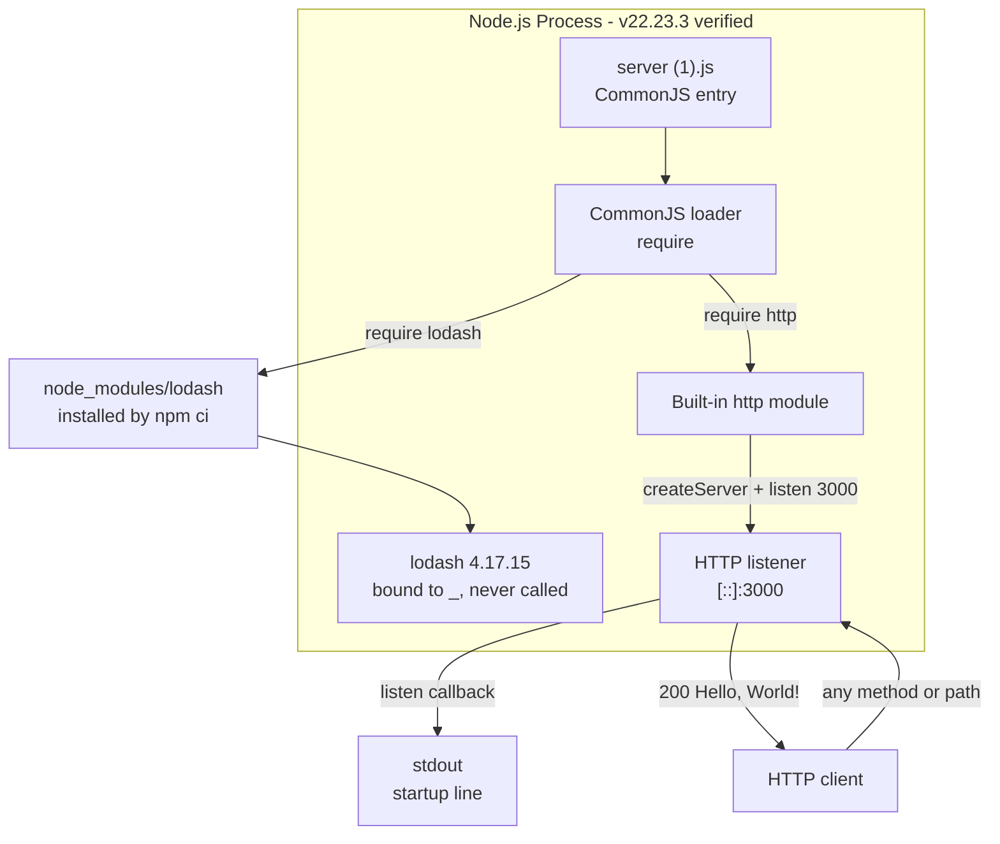

**Integration requirements between components:**

- `node_modules/lodash` must exist before startup. Without it, L1 throws `Cannot find module 'lodash'` (`MODULE_NOT_FOUND`) and the process exits with code 1. As a result, `npm ci` (3.6.2) is a hard prerequisite for running the server.
- The built-in `http` module has no install-time dependency. Its behavior, including the default timeouts and headers documented in 2.4.4, comes from the Node.js version that runs it.

## 3.3 Open Source Dependencies

The dependency graph has one package. Its security posture is the reason the fixture exists.

### 3.3.1 Dependency Inventory

| Package | Declared (`package.json`) | Locked (`package-lock.json`) | License |
|---|---|---|---|
| `lodash` | `"4.17.15"`, an exact pin with no range operator (L5) | Version 4.17.15, resolved tarball URL and `sha512` integrity (L14–L19) | MIT (L18) |

| Metric | Value | Evidence |
|---|---|---|
| Direct runtime dependencies | 1 | `package.json` L4–L6 |
| Transitive dependencies | 0: `lodash` declares no dependencies | `package-lock.json` has only `node_modules/lodash` |
| `devDependencies` / `optionalDependencies` / `peerDependencies` | None | `package.json` |
| Installed footprint | 4.9 MB (`node_modules/lodash`) | Post-`npm ci` measurement |
| Upstream publish date of 4.17.15 | 2019-07-19 | npm registry metadata |

### 3.3.2 Registry, Package Manager and Integrity

| Aspect | Detail | Security Implication |
|---|---|---|
| Registry | The public npm registry. The lockfile pins `https://registry.npmjs.org/lodash/-/lodash-4.17.15.tgz` (L16). The repository has no `.npmrc`, so the client's default registry applies. | Transport is HTTPS. Private mirrors are out of scope (1.3.2.3). |
| Integrity | `sha512-8xOcRHvC…NbA1A==` (L17), checked by npm on every install | A tampered or substituted tarball fails installation |
| Install scripts | The lockfile entry has no `hasInstallScript` flag | No third-party lifecycle code runs during `npm ci` |
| Package manager | npm only, lockfile format v3, which requires npm v7 or later. The repository has no Yarn or pnpm lockfile. | Using another client would re-resolve dependencies and bypass the committed integrity record |
| Version pinning | Exact pin in both files | Installs are fully reproducible, but `npm audit fix` cannot upgrade without `--force` (1.2.1.2) |

### 3.3.3 Known Vulnerabilities in the Locked Version

`npm audit` reports one vulnerable package, `lodash` (affected range `<=4.17.23`, aggregate severity **high**), with six advisories. It exits with code 1.

| Advisory (GHSA / CVE) | Weakness | Severity (CVSS) | Affected Range → Fixed In |
|---|---|---|---|
| GHSA-35jh-r3h4-6jhm / CVE-2021-23337 | Command injection (`_.template`) | High (7.2) | `<4.17.21` → 4.17.21 |
| GHSA-p6mc-m468-83gw / CVE-2020-8203 | Prototype pollution (`_.zipObjectDeep`) | High (7.4) | `>=3.7.0 <4.17.19` → 4.17.19 |
| GHSA-29mw-wpgm-hmr9 / CVE-2020-28500 | Regular-expression denial of service | Moderate (5.3) | `>=4.0.0 <4.17.21` → 4.17.21 |
| GHSA-r5fr-rjxr-66jc / CVE-2026-4800 | Code injection via `_.template` imports key names | High (8.1) | `>=4.0.0 <=4.17.23` → 4.18.0 |
| GHSA-f23m-r3pf-42rh / CVE-2026-2950 | Prototype pollution via array-path bypass in `_.unset` / `_.omit` | Moderate (6.5) | `<=4.17.23` → 4.18.0 |
| GHSA-xxjr-mmjv-4gpg / CVE-2025-13465 | Prototype pollution in `_.unset` / `_.omit` | Moderate (6.5) | `>=4.0.0 <=4.17.22` → 4.17.23 |

**Reachability.** No code path calls `lodash`, because `_` is referenced only on L1. None of the advisories can therefore be exploited through the HTTP interface (1.3.2.4). Scanners still detect the package in two places: in the manifest and lockfile, which static SCA reads, and in process memory, which runtime SCA inspects.

**Drift.** Three of the six advisories were published against ranges that extend to 4.17.22 or 4.17.23. Expected audit results therefore change over time as new advisories appear (2.4.1).

### 3.3.4 Version Currency and Upgrade Path

| Aspect | Value |
|---|---|
| Locked version | 4.17.15 (2019-07-19) |
| Latest upstream release | 4.18.1, the `latest` dist-tag, published 2026-04-01 |
| Latest non-vulnerable release | 4.18.1. Version 4.17.21 remains affected by three advisories. |
| `npm audit` fix recommendation | `lodash@4.18.1`, `isSemVerMajor: false` |
| Upgrade command that works with the exact pin | `npm install lodash@4.18.1 --save-exact`, which rewrites both `package.json` and `package-lock.json` |
| Compatibility of 4.18.1 | Same major version, no `engines` field, no dependencies. After the upgrade, `npm audit` reports `found 0 vulnerabilities` and the HTTP response is unchanged. |

Running this upgrade ends the fixture's role as a vulnerable test case. It belongs in a downstream copy or branch, or as the expected output of the remediation workflow under test (1.3.2.2).

## 3.4 Third-Party Services

At runtime the system makes no outbound calls. The only external service it relies on is the public npm registry, and only during installation and auditing.

### 3.4.1 External APIs and Integrations

| Service | When Used | Purpose | Evidence |
|---|---|---|---|
| npm public registry (`registry.npmjs.org`) | Install time (`npm ci`) | Serves `lodash-4.17.15.tgz` | `package-lock.json` L16 |
| npm registry advisory data | Audit time (`npm audit`) | Supplies the six GHSA findings for the locked tree | `npm audit` output (3.3.3) |

No runtime API integration exists. `server (1).js` makes no outbound HTTP requests, DNS lookups beyond binding, or socket connections. It only accepts inbound connections on port 3000.

### 3.4.2 Authentication Services

None. The HTTP listener has no authentication, authorization or TLS (1.3.2.1). Installation needs no registry credentials, because `lodash` is a public package and no `.npmrc` token exists. The default stack's Auth0 is not used.

### 3.4.3 Monitoring and Observability

None. The only operational signal is the startup line written to stdout by `console.log` (`server (1).js` L5). The system has no metrics, health endpoints, structured logging, tracing or error reporting (1.3.2.1).

### 3.4.4 Cloud Services

None. The repository has no cloud SDKs, provider configuration or infrastructure-as-code, and it defines no deployment target (1.3.2.3). The default stack's AWS is not used.

## 3.5 Databases & Storage

The system has no database, cache or storage service. The request handler is stateless and writes nothing. The default stack's MongoDB is not used.

### 3.5.1 Databases and Data Persistence

| Concern | Status | Evidence |
|---|---|---|
| Primary / secondary database | None. The repository has no database drivers, connection strings or schemas. | `package.json` declares only `lodash` |
| Application persistence | None. The handler ignores `req` and returns a constant string. The process reads and writes no files at runtime. | `server (1).js` L3–L4 |
| Application caching | None. The handler keeps no in-memory state between requests. | `server (1).js` L3–L4 |

### 3.5.2 On-Disk Artifacts

The only data on disk is the repository content itself and the dependency tree that tooling generates.

| Artifact | Origin | Lifecycle |
|---|---|---|
| `package.json`, `package-lock.json`, `server (1).js` | Committed to Git (commit `ddd2024`) | Static. They define the fixture's vulnerable state (1.2.3.2). |
| `node_modules/lodash/` (4.9 MB) | Generated by `npm ci` from the lockfile | Recreated on every clean install. It is not committed. No `.gitignore` exists either, so Git reports it as untracked. |
| npm client cache (`~/.npm/_cacache`) | npm tooling, outside the repository | Tarballs are reused across installs and verified against the lockfile `sha512` |

The missing `.gitignore` is a maintenance risk. A careless `git add .` could commit `node_modules/`, which would duplicate the vulnerable package in version control.

## 3.6 Development & Deployment

The system has no build system, containerization, CI/CD or infrastructure-as-code. Its development and deployment toolchain is the Node.js runtime and the npm client, and the repository declares neither.

### 3.6.1 Development Tools

| Tool | Version | Declared in Repository? | Purpose |
|---|---|---|---|
| Node.js | v22.23.3 verified; any ES2015-capable supported line | No (no `engines`, no `.nvmrc`) | Runs `server (1).js` |
| npm | 11.18.0 verified; v7 or later required | No | `npm ci` install, `npm audit` scan, remediation via `npm install --save-exact` |
| Git | Repository VCS: 3 commits, HEAD `44b04ea` | — | Version control. The content arrived in a single web upload (`ddd2024`). |

The repository has no linter, formatter, test framework, type checker, editor configuration or pre-commit hooks. Its `package.json` has no `scripts` and no `devDependencies`.

### 3.6.2 Build System

There is no build step. JavaScript executes as committed, and "building" amounts to installing dependencies from the lockfile.

| Command | Result | Notes |
|---|---|---|
| `npm ci` | `added 1 package` (`lodash` 4.17.15) | Installs exactly what the lockfile records. It fails with a sync error if `package.json` and `package-lock.json` disagree. |
| `npm audit` | Exit code 1, 1 high-severity package, 6 advisories | A non-zero exit is the fixture's intended state (3.3.3) |
| `node "server (1).js"` | Listens on `[::]:3000` and logs the startup line | The filename must be quoted |
| `npm start` | Fails: `Missing script: "start"` | No npm scripts are defined |

### 3.6.3 Containerization

None. The repository has no `Dockerfile`, Compose file or image definition, and the default stack's Docker is not adopted. The server binds all interfaces while logging `127.0.0.1`, so 2.4.4 recommends running it in an isolated network or container. Any image built for it would need three things:

- A Node.js base image paired with npm v7 or later.
- `npm ci` run before start.
- Port 3000 published only on an isolated network.

### 3.6.4 CI/CD

None. The repository has no `.github/workflows` directory or any other pipeline definition, and the default stack's GitHub Actions is not adopted. A pipeline that exercises the fixture would have to meet the constraints below:

| Requirement | Reason |
|---|---|
| Install with `npm ci`, not `npm install` | Preserves the locked 4.17.15 tree and its integrity check |
| Use npm v7 or later | Lockfile format v3 (`package-lock.json` L4) |
| Treat `npm audit` exit code 1 as expected before remediation | The advisories are the fixture's purpose |
| Assert advisory IDs, not a fixed count or severity | Findings drift as advisories are published (3.3.3) |
| Verify the HTTP response is unchanged after remediation | The `200` status with `Hello, World!\n` body is the behavioral oracle (1.2.3.3) |

### 3.6.5 Infrastructure and Deployment

The repository has no Terraform or other infrastructure-as-code, no deployment target and no environment configuration. Port 3000 is hard-coded and the server reads no environment variables. Production or internet-facing deployment is explicitly unsupported (1.3.2.4).

### 3.6.6 Toolchain Flow

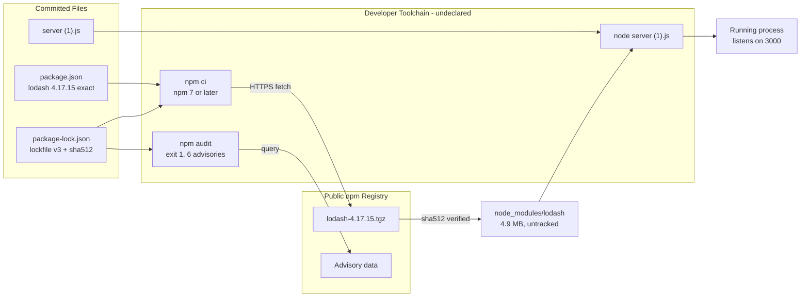

## 3.7 References

**Repository files and folders**

- `` (repository root) - Flat layout containing only the three files below. It has no subfolders and no Dockerfile, CI, IaC, `.npmrc`, `.nvmrc` or `.gitignore`.
- `package.json` - Package identity `cve-test-fixture@1.0.0` and the exact `lodash` `4.17.15` pin (L5). Absent fields: `type` (so CommonJS applies), `engines`, `scripts`, `main`, `devDependencies`.
- `package-lock.json` - Lockfile v3 with `requires: true` (L4–L5). The `lodash` 4.17.15 record (L14–L19) holds the resolved registry URL, `sha512` integrity and MIT license. It has no transitive dependencies and no install-script flag.
- `server (1).js` - CommonJS/ES2015 source. Imports `lodash` without using it (L1), uses the built-in `http` server (L3–L4) and listens on port 3000 with a stdout startup log (L5).

**Runtime and tooling observations (isolated copy; repository unmodified)**

- Node.js v22.23.3 (LTS "Jod"), V8 12.4.254.21-node.57 and npm 11.18.0 in the verification environment.
- `npm ci` result, installed `lodash` metadata (no `engines`, no dependencies, 4.9 MB), `npm audit` JSON output (six advisories, exit code 1, fix `4.18.1`), and `npm view lodash` (latest `4.18.1`, published 2026-04-01; 4.17.15 published 2019-07-19).

**Cross-referenced specification sections**

- 1.2 System Overview - Limitations (1.2.1.2), integrations (1.2.1.3), components (1.2.2.2), core technical approach (1.2.2.3), success criteria (1.2.3).
- 1.3 Scope - Key technical requirements (1.3.1.1), boundaries (1.3.1.2), exclusions (1.3.2.1), future phase (1.3.2.2), uncovered integrations (1.3.2.3), unsupported use cases (1.3.2.4).
- 2.4 Implementation Considerations - Per-feature constraints and security implications for F-001 to F-005 (2.4.1–2.4.5).

**Web sources**

- [web] https://github.com/nodejs/release - Release lines and dates: 24.x "Krypton" Active LTS with end of life 2028-04-30; 26.x Current, scheduled for LTS on 2026-10-28, end of life 2029-04-30.
- [web] https://nodejs.org/en/about/previous-releases - Production should use only Active LTS or Maintenance LTS lines; an annual release cadence begins with Node.js 27.
- [web] https://hidekazu-konishi.com/entry/nodejs_release_and_eol_timeline.html - As of 2026-07, supported lines were 22.x (Maintenance LTS), 24.x (Active LTS) and 26.x (Current); 20.x and earlier are end of life.
- [web] https://security.snyk.io/package/npm/lodash - 4.18.1 is the latest non-vulnerable `lodash` version.
- [web] https://github.com/lodash/lodash/wiki/Changelog - The 4.17.23 and 4.18.0 fixes for the `_.unset`/`_.omit` and `_.template` advisories.
- [web] https://tuxcare.com/blog/lodash-vulnerability-pinned-version/ - Maps GHSA-f23m-r3pf-42rh to CVE-2026-2950.
- [web] https://eolrisk.com/lodash/ - `lodash` 4.18.1 released April 2026 as the current release.

# 4. Process Flowchart

## 4.1 System Workflows

The fixture has no business domain: no users, accounts, orders or transactions. Its workflows are the operations its consumers run against it (install, detect, execute, remediate) and the lifecycle of its single Node.js process. The six workflows below cover all behavior in the three root files: `package.json`, `package-lock.json` and `server (1).js`. They expand the "Primary user workflows" in 1.3.1.1 and the runtime flow in 2.3.2. Every exit code, message and timing below was observed on Node.js v22.23.3 and npm 11.18.0, in copies of the repository at HEAD `44b04ea`. The repository itself declares neither version.

| ID | Workflow | Trigger / Actor | Features | Terminal Outcome (success) |
|---|---|---|---|---|
| WF-01 | Dependency Installation | `npm ci` run by an operator or CI | F-001, F-002 | `added 1 package` (`lodash` 4.17.15), exit 0 |
| WF-02 | Vulnerability Detection | `npm audit` or an SCA scanner | F-001, F-002 | exit 1: 1 high-severity package, 6 advisories |
| WF-03 | Remediation and Validation | Remediation agent or engineer | F-001, F-002, F-005 | `found 0 vulnerabilities`; HTTP response unchanged |
| WF-04 | Server Startup | `node "server (1).js"` | F-003, F-004 | Listener on `[::]:3000`; startup line on stdout |
| WF-05 | Request Handling | Any HTTP client | F-004, F-005 | `200 OK` with the 14-byte body `Hello, World!\n` |
| WF-06 | Shutdown | SIGINT or SIGTERM | F-004 | Process exits 130 or 143; port released |

### 4.1.1 Core Business Processes

#### 4.1.1.1 High-Level System Workflow

The diagram shows the end-to-end detect, execute and remediate cycle. Each swim lane is one system boundary. The npm CLI and Node.js lanes are undeclared toolchain (3.6.1); only the three committed files belong to the repository.

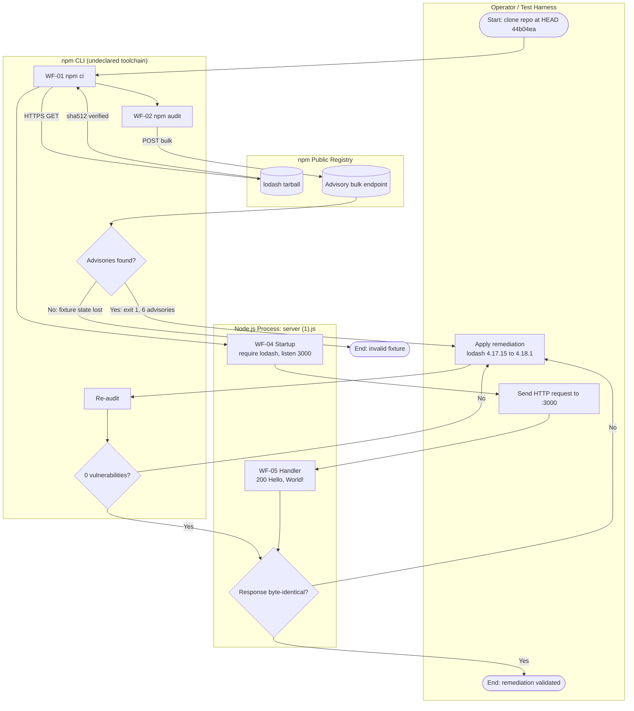

The "No" branch of *Advisories found?* is a real outcome, not a formality: an offline audit reports zero findings (4.3.2.3). A fixture whose audit comes back clean has lost its purpose as a test case (1.2.3.2).

#### 4.1.1.2 End-to-End User Journeys

The actors are the inferred user groups from 1.3.1.2. None of them interacts with application logic; every touchpoint is a shell command, a file, a console stream, or the fixed HTTP response.

| Journey | Actor | Workflow Sequence | Touchpoints | Success Signal |
|---|---|---|---|---|
| J-1 Scanner validation | Security-tooling operator | WF-01 → WF-02 | Shell; `npm audit` report; lockfile | The six advisory IDs listed in 1.1.2 are reported |
| J-2 Remediation | Remediation agent / engineer | WF-02 → WF-03 → WF-02 → WF-04 → WF-05 → WF-06 | Edits to `package.json` and `package-lock.json`; audit report; HTTP response | Audit exits 0; response is still `200` and byte-identical (F-005-RQ-005) |
| J-3 Behavioral smoke check | QA engineer / harness | WF-01 → WF-04 → WF-05 → WF-06 | stdout line `Server running at http://127.0.0.1:3000/`; HTTP response; exit code | Startup line appears; `200` with 14-byte body |

User touchpoints by channel:

- **Input:** shell commands (`npm ci`, `npm audit`, `node "server (1).js"`, signals), manifest and lockfile edits, and HTTP requests to TCP 3000.
- **Output:** the stdout startup line (`server (1).js` L5); stderr stack traces on crash; npm `error` lines plus a debug log under `<npm cache>/_logs/`; the audit report; HTTP responses; and process exit codes.

#### 4.1.1.3 System Interactions

| Interaction | From → To | Mechanism | Evidence |
|---|---|---|---|
| Manifest / lockfile consistency check | npm CLI → both files | `packages[""]` compared with `package.json` | `package.json` L2–L6; `package-lock.json` L7–L13 |
| Artifact fetch | npm CLI → `registry.npmjs.org` | HTTPS GET of the `resolved` URL | `package-lock.json` L16 |
| Artifact verification | npm CLI → npm cache / `node_modules` | `sha512` comparison | `package-lock.json` L17 |
| Advisory lookup | npm CLI → registry advisory API | HTTPS POST `/-/npm/v1/security/advisories/bulk` | npm debug log |
| Module load | Node loader → `node_modules/lodash` | CommonJS `require` | `server (1).js` L1 |
| Socket bind | Node `http` → OS | `listen(3000)` with no host → `[::]:3000` | `server (1).js` L5 |
| Request dispatch | OS → Node parser → handler | `request` event | `server (1).js` L3–L4 |
| Startup signal | Process → stdout | `console.log` in the `listening` callback | `server (1).js` L5 |

#### 4.1.1.4 Decision Points

`server (1).js` contains no conditional statement. All of the decisions below are made by npm, by the Node.js runtime, or by the operator.

| ID | Decision | Decided By | Outcomes |
|---|---|---|---|
| D-01 | Does `package.json` match `packages[""]`? | npm ci | Continue / exit 1 "are in sync" |
| D-02 | Is the tarball cached under its `sha512`? | npm ci | Use the cache (works offline) / fetch from the registry |
| D-03 | Did the fetch succeed? Are attempts left? | npm ci | Extract / retry (at most 3 attempts) / exit 1 `ECONNREFUSED` |
| D-04 | Does the tarball match `sha512` at L17? | npm ci | Install / exit 1 `EINTEGRITY` |
| D-05 | Is the audit online? | npm audit | Query advisories / report `found 0 vulnerabilities` (false negative) |
| D-06 | Is the highest severity at or above `--audit-level`? | npm audit | exit 1 (default: any severity) / exit 0 (e.g. `critical`) |
| D-07 | Which remediation method? | Operator | Exact `4.18.1` / caret `^4.18.1` / no change |
| D-08 | Does `lodash` resolve? | Node loader, L1 | Continue / `MODULE_NOT_FOUND`, exit 1 |
| D-09 | Is port 3000 free? | Node `http`, L5 | Listen / `EADDRINUSE`, exit 1 |
| D-10 | Is the request valid, with headers ≤ 16384 bytes? | Node HTTP parser | Invoke the handler / `400` or `431`, then close |
| D-11 | Is this an HTTP/1.1 keep-alive connection? | Node `http` | Idle up to 5000 ms / close after the response |

#### 4.1.1.5 Error Handling Paths

Every error path ends in one of two ways. Either the process terminates with a non-zero exit code, or the Node HTTP parser returns a `4xx` to the client and the server keeps running. The application defines no handler of its own on any path. Recovery procedures are in 4.3.2.

| Error Path | Workflow | Entry Condition | Terminal State |
|---|---|---|---|
| Manifest / lockfile desync | WF-01 | D-01 = No | exit 1; `node_modules` untouched |
| Registry unreachable | WF-01 | D-03 attempts exhausted | exit 1 after about 70 s; no tree |
| Integrity mismatch | WF-01 | D-04 = No | exit 1; partial 6-file `node_modules/lodash` |
| Advisory endpoint unreachable | WF-02 | D-05 online, request fails | exit 1 "audit endpoint returned an error" |
| Dependency missing | WF-04 | D-08 = No | exit 1; no listener |
| Port conflict | WF-04 | D-09 = No | exit 1; `listen EADDRINUSE: address already in use :::3000` |
| Invalid request | WF-05 | D-10 = No | `400` / `431` with `Connection: close`; server continues; nothing logged |
| Missing npm script | WF-04 | `npm start` | exit 1 `Missing script: "start"` |

### 4.1.2 Integration Workflows

#### 4.1.2.1 Data Flow Between Systems

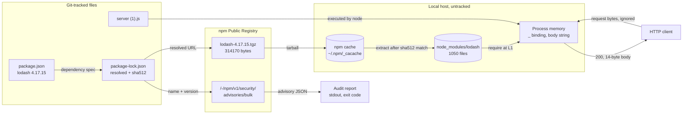

| Data Item | Source → Destination | Format | Notes |
|---|---|---|---|
| Dependency spec `lodash@4.17.15` | `package.json` L5 → npm | JSON | Exact pin; no range operator |
| Locked artifact record | `package-lock.json` L14–L19 → npm | JSON, lockfile v3 | `version`, `resolved`, `integrity`, `license` |
| Tarball | Registry → npm cache → `node_modules` | gzip tar, 314170 bytes | Verified against `sha512` before use |
| Advisory query and result | npm → registry → npm | JSON over HTTPS | Built from the lockfile; `node_modules` is not required |
| HTTP request | Client → Node parser | HTTP/1.x bytes | Parsed by Node, then ignored by the handler (`req` is unused) |
| HTTP response | Handler → client | `Hello, World!\n` | Constant string (L4); no `Content-Type` |

#### 4.1.2.2 API Interactions

The fixture calls no APIs itself. All outbound traffic comes from the npm CLI; the only inbound interface is the HTTP listener.

| Direction | Endpoint | Method | Caller / Purpose |
|---|---|---|---|
| Outbound | `https://registry.npmjs.org/lodash/-/lodash-4.17.15.tgz` | GET | `npm ci`, on a cache miss; artifact download |
| Outbound | `https://registry.npmjs.org/-/npm/v1/security/advisories/bulk` | POST | `npm audit`, plus the install-time audit inside `npm ci` |
| Outbound | `https://registry.npmjs.org/npm` | GET | npm CLI update check (toolchain behavior, not the fixture's) |
| Inbound | `http://<any-interface>:3000/<any-path>` | Any | Fixed-response handler, `server (1).js` L3–L4 |

**WF-01 install integration sequence:**

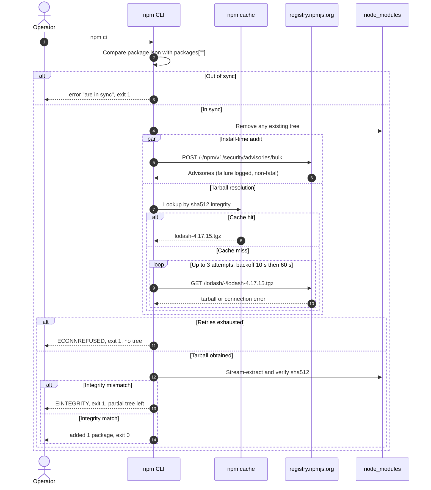

**WF-02 audit integration sequence:**

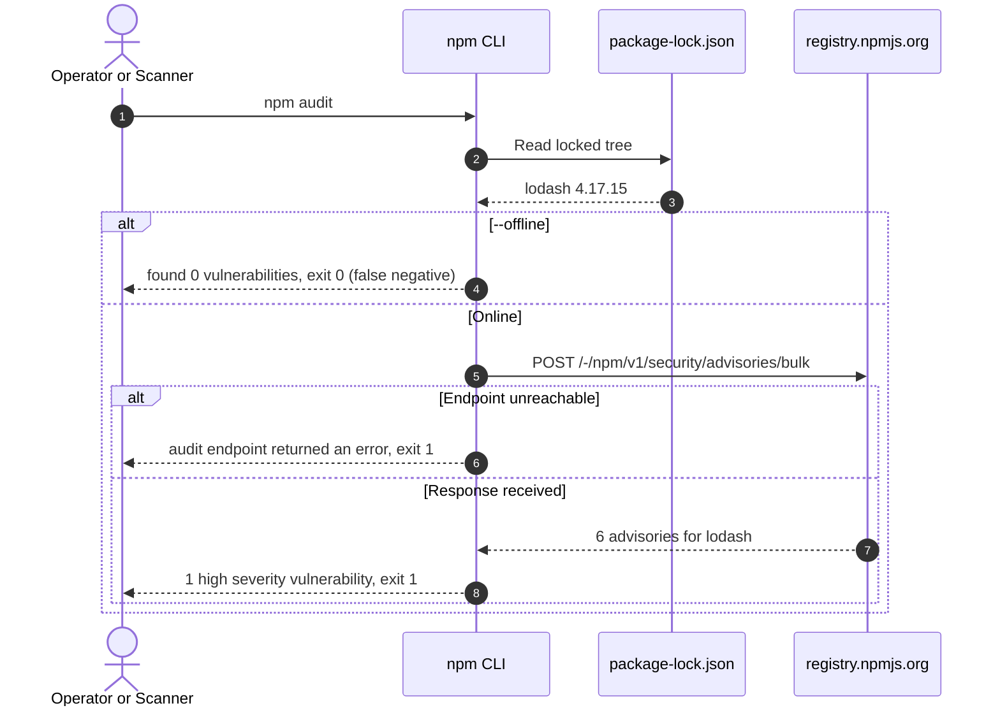

**WF-05 HTTP integration sequence:**

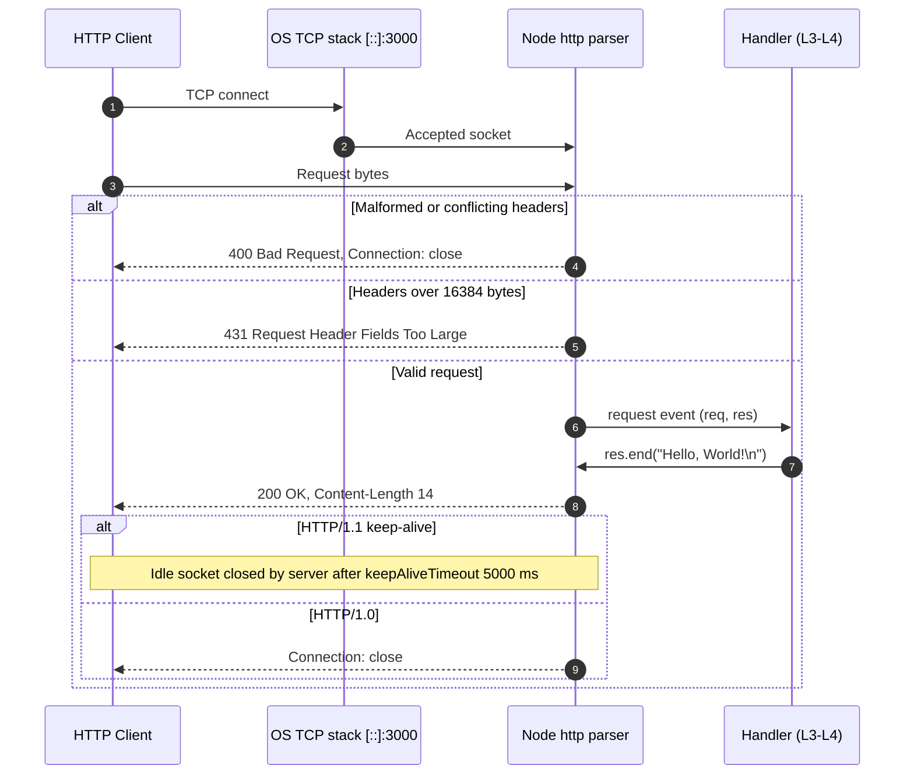

#### 4.1.2.3 Event Processing Flows

There are no message queues, pub/sub topics, webhooks or scheduled events. Events exist only inside the Node.js event loop, and the repository registers handlers for two of them.

| Event | Emitter | Handler in Repository | Resulting Behavior |
|---|---|---|---|
| `listening` | `http.Server` | L5 arrow callback | Writes `Server running at http://127.0.0.1:3000/` to stdout |
| `request` | `http.Server` | L3 arrow function | `res.end('Hello, World!\n')` → `200` |
| `clientError` | `http.Server` | None (Node default) | `400` or `431` with `Connection: close`; socket destroyed; nothing logged |
| `error` (bind failure) | `http.Server` | None | Uncaught exception; stack trace on stderr; exit 1 |
| Keep-alive timeout | Node internals | None (default 5000 ms) | Idle socket closed; observed about 6.0 s after the response |
| `SIGINT` / `SIGTERM` | OS | None | Default termination; exit 130 / 143; open sockets dropped |

The single-threaded event loop dispatches requests one at a time. Two HTTP/1.1 requests pipelined on one socket each received `200`. 500 requests from 10 and from 50 concurrent client workers all received the identical `200` response.

#### 4.1.2.4 Batch Processing Sequences

The repository defines no batch jobs, cron entries, schedulers or pipeline files (3.6.4). The only fixed-order, multi-step sequence is the validation run implied by the CI constraints in 3.6.4. A harness has to run its steps in this order:

1. `npm ci` → expect exit 0 and `added 1 package`.
2. `npm audit` (online) → expect exit 1 and the six advisory IDs. Assert IDs, not counts (3.3.3).
3. `node "server (1).js"` in the background → wait for the stdout startup line (35–41 ms observed).
4. Probe any path on `:3000` → expect `200` and the 14 bytes `Hello, World!\n`.
5. Stop the server with SIGTERM → expect exit 143.
6. Remediate with `npm install lodash@4.18.1 --save-exact` → both files are rewritten and `node_modules` is updated.
7. `npm audit` → expect exit 0 and `found 0 vulnerabilities`.
8. Repeat steps 3–5 → expect a byte-identical response.

## 4.2 Flowchart Requirements

Each workflow in 4.1 has a detailed flowchart below. All of them use the same conventions:

| Element | Notation |
|---|---|
| Start / end points | Stadium nodes `([ ... ])`; error terminals name the exit code or HTTP status |
| Process steps | Rectangles; source line numbers where the step is repository code |
| Decisions | Diamonds, matching the decision IDs D-01 to D-11 in 4.1.1.4 |
| System boundaries / swim lanes | `subgraph` blocks per actor or system: Operator, npm CLI, Registry, Node.js, OS, Client |
| User touchpoints | Nodes in the Operator, Scanner, Agent or Client lanes |
| Timing | Edge or node labels carrying observed durations or Node / npm default timeouts |

### 4.2.1 Detailed Process Flows

#### 4.2.1.1 WF-01 Dependency Installation (F-001, F-002)

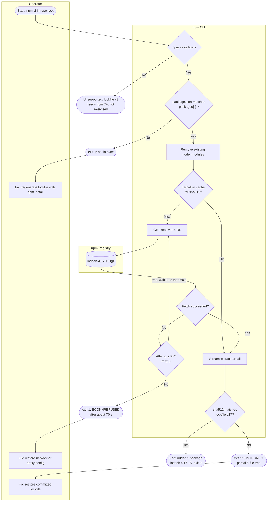

| Step | Behavior | Evidence |
|---|---|---|
| Precondition | Lockfile v3 requires npm v7 or later. This branch was not exercised; see 1.3.2.4. | `package-lock.json` L4 |
| D-01 sync check | Editing only `package.json` to `4.18.1` fails with "`npm ci` can only install packages when your package.json and package-lock.json ... are in sync" and exit 1 | F-002-RQ-002 |
| D-02 cache | With a warm cache and the registry unreachable, the install still succeeds: `added 1 package in 298ms` | npm cache under `~/.npm/_cacache` |
| D-03 retry | With a cold cache and the registry unreachable: attempts 1–3 fail with `ECONNREFUSED`, and the run exits 1 after 70 s | npm defaults `fetch-retries=2`, `fetch-retry-mintimeout=10000`, `fetch-retry-maxtimeout=60000` |
| D-04 integrity | A tampered L17 hash produces `EINTEGRITY ... wanted sha512-9xOc... but got sha512-8xOc... (314170 bytes)` | `package-lock.json` L17 |
| Success | `added 1 package` in 0.44 s (warm); `require('lodash').VERSION` = `4.17.15` | F-002-RQ-004 |

#### 4.2.1.2 WF-02 Vulnerability Detection (F-001, F-002)

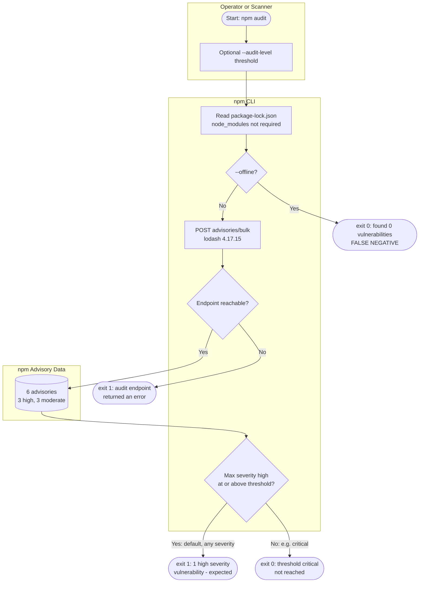

- With only the lockfile present (no `node_modules`), the audit still reports `1 high severity vulnerability` with exit 1. Detection therefore does not depend on WF-01.
- An exit code of 1 has two meanings: findings, or an endpoint error. A harness must read the output to tell them apart.
- Both `npm ci --offline` and `npm audit --offline` print `found 0 vulnerabilities` and exit 0. Treat any offline result as invalid.
- `--audit-level=critical` exits 0, because the highest severity present is `high`. Harnesses must not raise the threshold above `high`.

#### 4.2.1.3 WF-03 Remediation and Validation (F-001, F-002, F-005)

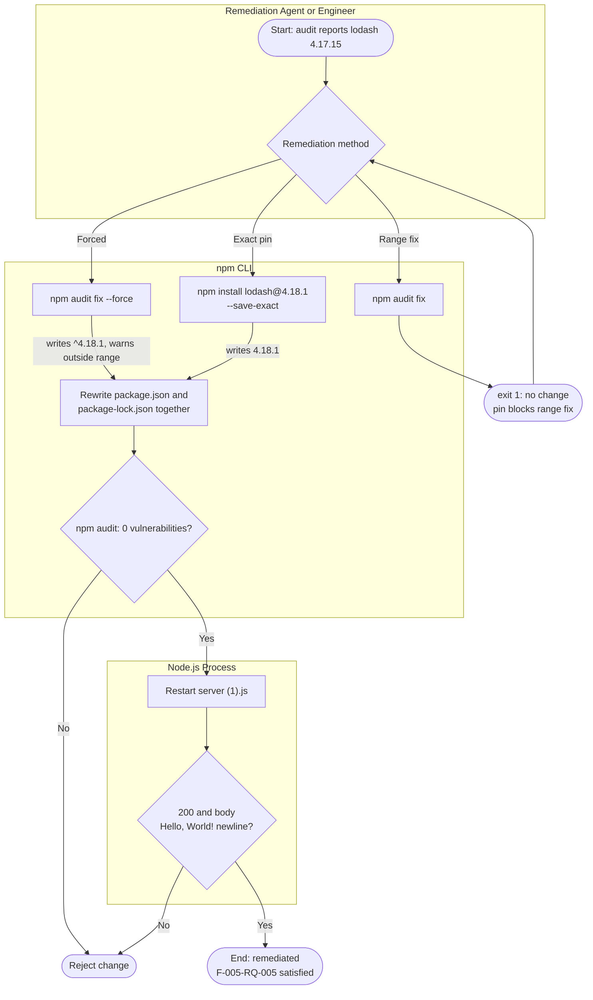

| Method (D-07) | Resulting `package.json` | Lockfile | Outcome |
|---|---|---|---|
| `npm audit fix` | Unchanged, `"4.17.15"` | Unchanged | exit 1; the fix lies outside the exact pin |
| `npm audit fix --force` | `"^4.18.1"` (caret range) | `4.18.1` | Warns "Recommended protections disabled" and "outside your stated dependency range"; `found 0 vulnerabilities` in 483 ms |
| `npm install lodash@4.18.1 --save-exact` | `"4.18.1"` (exact) | `4.18.1`, `lodash-4.18.1.tgz`, `sha512-dMIn...` | `found 0 vulnerabilities` in 357 ms; keeps the exact-pin convention |

Both successful methods left the server response at `200` with `Content-Length: 14` and the body `Hello, World!\n`. That is expected, because `_` is never referenced (F-003-RQ-002).

#### 4.2.1.4 WF-04 Server Startup (F-003, F-004)

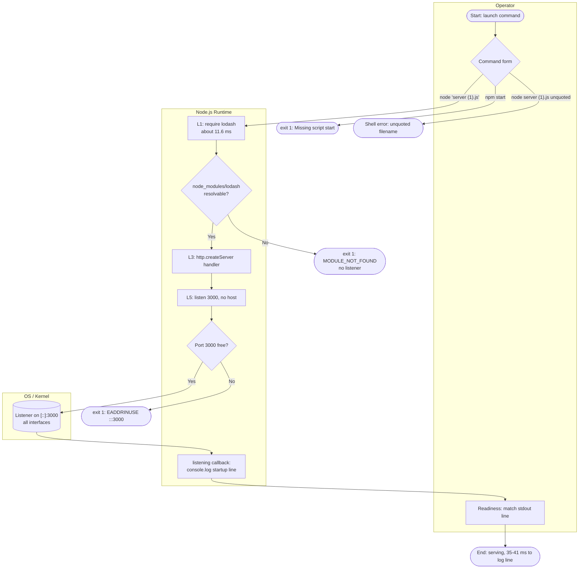

- Unquoted, bash rejects the filename: `syntax error near unexpected token '('`, exit 2. Quoting it, or escaping it as `server\ \(1\).js`, works.
- A partial tree left behind by `EINTEGRITY` (4.2.1.1) contains no `package.json` or `lodash.js`, so it also takes the `MODULE_NOT_FOUND` path.
- The startup line says `127.0.0.1`, but the socket is `[::]:3000`. A readiness check can match the line; it cannot rely on the address in it (1.2.1.2).

#### 4.2.1.5 WF-05 Request Handling (F-004, F-005)

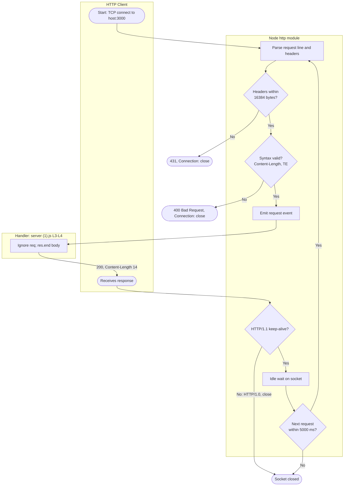

| Request Variant | Observed Response |
|---|---|
| Any method (`GET`, `POST`, `PUT`, `DELETE`, `PATCH`, `OPTIONS`), any path or query, with or without a body | `200`, `Content-Length: 14`, `Hello, World!\n` |
| `HEAD /` | `200` with headers and no body |
| HTTP/1.0 | `200`, `Connection: close`, no `Content-Length`, same body; the socket is then closed |
| Request line `GARBAGE`; `Content-Length: abc`; `Content-Length` together with `Transfer-Encoding` | `400 Bad Request`, `Connection: close`; the handler is not invoked |
| A 20000-byte header | `431 Request Header Fields Too Large`, `Connection: close` |
| Two pipelined requests on one socket | Two `200` responses |

#### 4.2.1.6 WF-06 Shutdown (F-004)

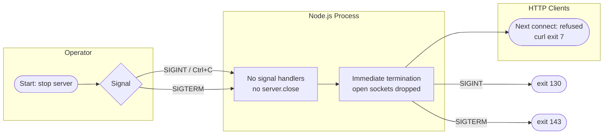

The process has no drain phase, so in-flight responses are cut off rather than finished. Harnesses should stop the server only after the probe response has been received.

### 4.2.2 Timing and SLA Considerations

No SLA, SLO or timeout is defined anywhere in the repository. The figures below are either Node.js / npm defaults that apply because nothing overrides them, or single-environment observations. None of them is a target.

| Stage | Value | Source | Constraint for Harnesses |
|---|---|---|---|
| `npm ci` (warm cache) | 0.44 s; 298–392 ms in other runs | Observed | None |
| `npm ci`, registry unreachable | Exit after 70 s (3 attempts) | npm defaults: retries 2, backoff 10 s → 60 s cap | Step timeouts must be above 70 s, or set `--fetch-retries=0` to fail fast |
| npm per-request fetch timeout | 300000 ms | npm default `fetch-timeout` | Upper bound for a stalled download |
| `npm audit` | 0.37 s | Observed | Requires network access |
| Remediation install | 357 ms (`--save-exact`); 483 ms (`--force`) | Observed | None |
| Process start to startup line | 35–41 ms (5 runs) | Observed; `require('lodash')` about 11.6 ms | Poll stdout rather than sleeping a fixed time |
| Single loopback request | About 0.19 ms | Observed (2.2.5) | None |
| Keep-alive idle close | 5000 ms configured; about 6.0 s observed | Node default `keepAliveTimeout` | Clients must tolerate server-side closes |
| Header receive limit | 60000 ms | Node default `headersTimeout` (connections checked every 30000 ms) | Relevant to slow clients only |
| Full request limit | 300000 ms | Node default `requestTimeout` | Same |
| Socket inactivity timeout | 0 (disabled) | Node default `server.timeout` | Idle HTTP/1.1 sockets rely on keep-alive only |

### 4.2.3 Validation Rules

#### 4.2.3.1 Business Rules at Each Step

| Workflow Step | Business Rule | Requirement Reference |
|---|---|---|
| WF-01 install | Install with `npm ci`, never `npm install`, so the locked 4.17.15 tree is preserved | 3.6.4; F-002-RQ-004 |
| WF-02 detect | `npm audit` exit 1 is the expected pre-remediation state; the audit must run online | F-001-RQ-003; 3.6.4 |
| WF-02 detect | Assert advisory IDs, not a count or severity, because findings drift as advisories are published | 3.3.3 |
| WF-03 remediate | Change `package.json` L5 and `package-lock.json` L11, L15–L17 together | 2.3.4; F-002-RQ-002 |
| WF-03 remediate | Remediate only in a downstream copy or branch; the committed fixture must stay vulnerable | 1.3.2.2 |
| WF-03 validate | The response must stay byte-identical: `200`, `Hello, World!\n` | F-005-RQ-005; 1.2.3.2 |
| WF-04 startup | The `require('lodash')` import at L1 must stay, so the package is loaded in-process | F-003-RQ-001 |

#### 4.2.3.2 Data Validation Requirements

| Checkpoint | Validation Performed | Performed By |
|---|---|---|
| Manifest / lockfile agreement | `packages[""]` must equal `package.json` | npm ci (D-01) |
| Artifact integrity | The tarball `sha512` must equal `package-lock.json` L17 | npm ci (D-04) |
| Module resolution | `node_modules/lodash` must contain a resolvable entry point | Node loader (D-08) |
| HTTP syntax | Valid request line; well-formed `Content-Length`; no `Content-Length`/`Transfer-Encoding` conflict | Node HTTP parser (D-10) |
| HTTP header size | Headers must total at most 16384 bytes (`http.maxHeaderSize`) | Node HTTP parser (D-10) |
| Application input | None: the handler never reads `req` | Not applicable |

#### 4.2.3.3 Authorization Checkpoints

There are none. The flows contain no authentication, authorization, TLS, CORS or rate-limiting step (1.3.2.1). Any client that can reach TCP 3000 on any interface gets `200`. The only access boundary is network isolation, which the operator provides (1.3.2.4; 3.6.3).

#### 4.2.3.4 Regulatory Compliance Checks

There are none. The fixture accepts, stores and transmits no personal or business data (1.3.1.2). The only compliance-related datum in any flow is the dependency license, `MIT`, recorded at `package-lock.json` L18 and preserved through remediation. The fixture declares no license of its own (F-001 validation rules, 2.2.1).

## 4.3 Technical Implementation

### 4.3.1 State Management

The application holds no business state. `server (1).js` keeps two values in memory for the life of the process: the unused `_` binding and the constant response string. The state that matters lives in three places: the dependency state of the files on disk, the lifecycle of the process, and the lifecycle of each HTTP connection. The diagrams below model each one.

#### 4.3.1.1 State Transitions

**Fixture dependency state** (WF-01, WF-02, WF-03):

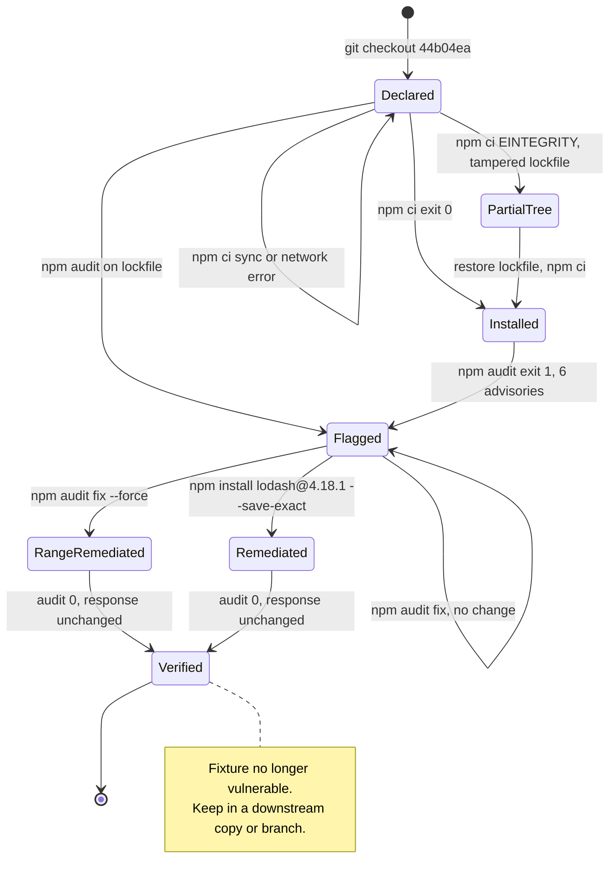

| State | Defining Condition | Evidence |
|---|---|---|
| Declared | The committed files pin `lodash` 4.17.15; there is no `node_modules` | `package.json` L5; `package-lock.json` L15 |
| Installed | `node_modules/lodash` holds 1050 files; `VERSION` = `4.17.15` | Output of `npm ci` |
| PartialTree | 6 files remain after `EINTEGRITY`; there is no `package.json`; `require` fails | Tampered-hash run |
| Flagged | `npm audit` exits 1 with 6 advisories (3 high, 3 moderate) | F-001-RQ-003 |
| Remediated / RangeRemediated | `lodash` 4.18.1, pinned exactly or as `^4.18.1` | WF-03 method table, 4.2.1.3 |
| Verified | Audit exits 0 and the HTTP response is byte-identical | F-005-RQ-005 |

**Process lifecycle** (WF-04, WF-05, WF-06):

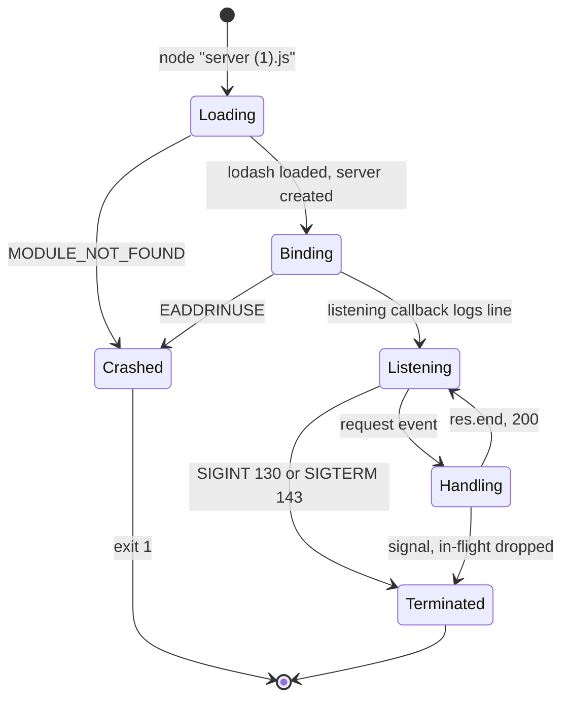

**HTTP connection lifecycle** (WF-05):

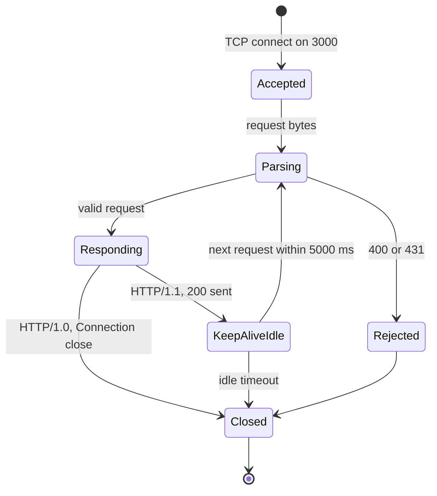

A request carries no state into the next one. The handler reads nothing from `req` and writes nothing outside `res` (F-005-RQ-004).

#### 4.3.1.2 Data Persistence Points

| Store | Location | Written By / When | Lifetime |
|---|---|---|---|
| Dependency declaration | `package.json` | Author; `npm install --save-exact` during WF-03 | Git-tracked (HEAD `44b04ea`) |
| Dependency lock | `package-lock.json` | Author; any npm install that modifies the tree | Git-tracked |
| Installed tree | `node_modules/lodash` (4.9 MB, 1050 files) | `npm ci` in WF-01 | Local; not committed. With no `.gitignore`, it shows as untracked. |
| npm content cache | `~/.npm/_cacache`, outside the repository | npm on each fetch | Persists across runs; makes offline installs possible |
| npm debug logs | `<npm cache>/_logs/*-debug-0.log` | npm, on any error | Persists; diagnostic only |
| Process memory | Node heap | `server (1).js` L1, L3–L4 | Lost on exit |
| Console streams | stdout / stderr | Startup line; crash traces | Not persisted unless the harness redirects them |

The system has no database, no file writes at runtime, no sessions and no cookies (1.3.2.1).

#### 4.3.1.3 Caching Requirements

| Cache | Behavior | Requirement |
|---|---|---|
| HTTP response caching | None. Responses carry only `Date`, `Connection`, `Keep-Alive` and `Content-Length`; there is no `Cache-Control` or `ETag` | None. Every request is served fresh from a constant. |
| Node module cache | `lodash` is loaded once per process at L1 and stays cached | Restart the process after remediation, or it keeps the old module in memory |
| npm content-addressable cache | Keyed by `sha512`. On a hit, D-02 skips the registry. Content is re-verified against L17 before extraction. | Optional. Pre-warm it with one online `npm ci` for offline installs. It cannot make `npm audit` work offline (4.3.2.3). |

#### 4.3.1.4 Transaction Boundaries

- **Repository state:** a Git commit is the only atomic unit. The vulnerable fixture is defined by commit `44b04ea`.
- **Install (`npm ci`):** not atomic. npm deletes any existing `node_modules` first, then extracts the tarball as a stream. An `EINTEGRITY` failure leaves a partial 6-file tree, with no rollback. Repair is a successful re-run: after the lockfile was restored, `npm ci` rebuilt all 1050 files.
- **Remediation:** `npm install lodash@4.18.1 --save-exact` rewrites the manifest and the lockfile in a single command. A hand edit to one file breaks the pair, and the next `npm ci` rejects it (D-01).
- **HTTP request:** each request/response pair is self-contained and finishes with one `res.end` call (L4). No transaction spans two requests.

### 4.3.2 Error Handling

The repository has no `try`/`catch`, no `error` or `clientError` listeners, no signal handlers and no `process.on('uncaughtException')`. All error handling on these paths comes from npm and Node.js defaults. The consolidated flowchart:

```mermaid
flowchart TD
    DET(["Failure observed:<br/>non-zero exit or HTTP error"])
    STG{"Stage?"}
    subgraph EInstall["Install errors - npm ci"]
        I1{"Error code?"}
        I2["Sync error: regenerate lockfile<br/>with npm install, commit both files"]
        I3["ECONNREFUSED after 3 attempts:<br/>fix network, or use warm cache"]
        I4["EINTEGRITY: restore committed<br/>lockfile, re-run npm ci"]
    end
    subgraph EAudit["Audit errors - npm audit"]
        A1{"Result?"}
        A2["Endpoint error: restore registry<br/>access, re-run online"]
        A3["0 found while offline:<br/>discard result, re-run online"]
    end
    subgraph EStart["Startup errors - node"]
        S1{"stderr message?"}
        S2["MODULE_NOT_FOUND: run npm ci"]
        S3["EADDRINUSE: stop the process<br/>holding port 3000"]
        S4["Missing script: run node directly<br/>with quoted filename"]
    end
    subgraph ERun["Runtime errors - HTTP"]
        R1{"Client sees?"}
        R2["400 or 431: fix client request;<br/>server keeps running"]
        R3["Connection refused: process<br/>stopped; restart it"]
    end
    RETRY(["Retry the failed step"])
    DET --> STG
    STG -->|install| I1
    I1 -->|not in sync| I2
    I1 -->|ECONNREFUSED| I3
    I1 -->|EINTEGRITY| I4
    STG -->|audit| A1
    A1 -->|endpoint error| A2
    A1 -->|offline zero| A3
    STG -->|startup| S1
    S1 -->|Cannot find module| S2
    S1 -->|address in use| S3
    S1 -->|npm start| S4
    STG -->|runtime| R1
    R1 -->|4xx, no server log| R2
    R1 -->|ECONNREFUSED| R3
    I2 --> RETRY
    I3 --> RETRY
    I4 --> RETRY
    A2 --> RETRY
    A3 --> RETRY
    S2 --> RETRY
    S3 --> RETRY
    S4 --> RETRY
    R2 --> RETRY
    R3 --> RETRY
```

#### 4.3.2.1 Retry Mechanisms

| Layer | Retry Behavior | Values |
|---|---|---|
| Application (`server (1).js`) | None | Not applicable |
| npm registry fetch | Automatic retry with exponential backoff on connection errors | `fetch-retries=2` (3 attempts); `fetch-retry-mintimeout=10000`; `fetch-retry-maxtimeout=60000`; exit observed after 70 s |
| npm per-request timeout | Aborts a stalled fetch | `fetch-timeout=300000` ms |
| Install-time audit inside `npm ci` | No retry that affects the outcome; a failure is logged at verbose level and the install still exits 0 | Observed with the registry unreachable and a warm cache |
| Process supervision | None: no npm scripts, container or process manager restarts a crashed server | Not applicable |
| HTTP clients | Up to the client. A server close after 5000 ms idle requires the client to reconnect. | Node `keepAliveTimeout` |

These npm values are CLI defaults; the repository has no `.npmrc` to change them. Integrity failures (`EINTEGRITY`) and sync failures are not retried.

#### 4.3.2.2 Fallback Processes

| Failure | Fallback | Result |
|---|---|---|
| Registry unreachable during `npm ci` | npm content cache (D-02) | Install succeeds offline if the tarball was cached before. Otherwise there is no fallback: the lockfile pins the public `registry.npmjs.org` URL, and no mirror is configured (1.3.2.3). |
| Invalid HTTP request | Node default `clientError` handling | `400` / `431`, and the socket closes; the server keeps serving other clients |
| Missing dependency, port conflict | None | The process exits 1. There is no alternate port, no configurable host, and no handling for a missing module. |
| Advisory endpoint unreachable | None | Detection cannot finish. An offline audit is **not** a valid fallback (4.3.2.3). |

#### 4.3.2.3 Error Notification Flows

The system has no alerting, monitoring or structured logging (1.3.2.1). Errors reach operators only through the channels below.

| Error | Channel | Observed Message | Exit / Status |
|---|---|---|---|
| Manifest / lockfile desync | npm stderr + debug log | "`npm ci` can only install packages when your package.json and package-lock.json ... are in sync"; "Invalid: lock file's lodash@4.17.15 does not satisfy lodash@4.18.1" | 1 |
| Registry unreachable | npm stderr + debug log | `npm error code ECONNREFUSED`; the log shows "attempt 1/2/3 failed" | 1 |
| Integrity mismatch | npm stderr + debug log | `npm error code EINTEGRITY` ... "integrity checksum failed when using sha512" | 1 |
| Advisory endpoint error | npm stderr | "audit endpoint returned an error" | 1 |
| Findings present | npm audit stdout | "1 high severity vulnerability ... npm audit fix --force" | 1 |
| Missing module | Node stderr stack trace | `Error: Cannot find module 'lodash'`, `MODULE_NOT_FOUND` | 1 |
| Port conflict | Node stderr stack trace | `Error: listen EADDRINUSE: address already in use :::3000` | 1 |
| Missing script | npm stderr | `Missing script: "start"` | 1 |
| Invalid request | HTTP status to the client only | `400 Bad Request` / `431 Request Header Fields Too Large` | Process continues |
| Termination | Exit status only | No message | 130 (SIGINT) / 143 (SIGTERM) |

**Silent or misleading outcomes** that harnesses must guard against:

- `npm audit --offline`, and the audit step of `npm ci --offline`, report `found 0 vulnerabilities` with exit 0. For this fixture, that is a false negative.
- `npm audit` returns exit 1 both for findings and for endpoint failures. Tell them apart by the output text, or with `--json`.
- Rejected HTTP requests (`400`/`431`) produce no server-side output, so the server log cannot show them.
- The startup line states `127.0.0.1`, while the actual bind is `[::]:3000` on all interfaces.

#### 4.3.2.4 Recovery Procedures

| Error | Recovery Steps | Verification |
|---|---|---|
| Desync (D-01) | Run `npm install lodash@<version> --save-exact` so both files are regenerated together, or revert both to the committed `44b04ea` state | `npm ci` exits 0 |
| `ECONNREFUSED` (D-03) | Restore registry or proxy access, then re-run `npm ci`. Offline hosts can pre-warm the npm cache while online. | `added 1 package` |
| `EINTEGRITY` (D-04) | Restore `package-lock.json` from Git, then re-run `npm ci`. It deletes the partial tree first. | 1050 files; `VERSION` = `4.17.15` |
| Audit endpoint error / offline zero | Restore network access, then re-run `npm audit` without `--offline` | Six advisory IDs reported |
| `MODULE_NOT_FOUND` (D-08) | Run `npm ci` | Startup line appears |
| `EADDRINUSE` (D-09) | Stop the process holding TCP 3000. The port is hard-coded, so there is no override. | Startup line appears |
| `Missing script: "start"` | Run `node "server (1).js"` directly | Startup line appears |
| `400` / `431` | Correct the client request: valid syntax, headers ≤ 16384 bytes. No server action is needed. | `200` response |
| Process terminated or crashed | Restart it manually; nothing restarts it automatically | Probe returns `200` |

## 4.4 Diagram Catalog and Requirement Traceability

### 4.4.1 Required Diagram Coverage

| Required Diagram Type | Diagrams in this Section | Related Diagrams Elsewhere |
|---|---|---|
| High-level system workflow | 4.1.1.1 High-Level System Workflow; 4.1.2.1 Data Flow | 1.3.1.1 Primary user workflows; 1.2.2.2 component view; 3.6.6 Toolchain Flow |
| Detailed process flow per core feature | 4.2.1.1–4.2.1.6 (WF-01 to WF-06) | 2.3.2 runtime process flow |
| Error handling flowcharts | 4.3.2 consolidated error flowchart; error terminals in every flow in 4.2.1 | 2.3.2 (two failure exits) |
| Integration sequence diagrams | 4.1.2.2: WF-01 install, WF-02 audit, WF-05 HTTP | 2.3.1 Feature Dependency Map |
| State transition diagrams | 4.3.1.1: fixture dependency state, process lifecycle, HTTP connection lifecycle | None |

### 4.4.2 Workflow-to-Requirement Traceability

| Workflow | Decision Points | Requirements Exercised | Diagrams |
|---|---|---|---|
| WF-01 Dependency Installation | D-01 to D-04 | F-001-RQ-001, F-001-RQ-002, F-002-RQ-001 to F-002-RQ-005 | 4.1.2.2 (install sequence), 4.2.1.1, fixture state (4.3.1.1) |
| WF-02 Vulnerability Detection | D-05, D-06 | F-001-RQ-003, F-001-RQ-005 | 4.1.2.2 (audit sequence), 4.2.1.2 |
| WF-03 Remediation and Validation | D-07, plus D-01 on the next install | F-001-RQ-005, F-002-RQ-002, F-003-RQ-002, F-005-RQ-005 | 4.2.1.3, fixture state (4.3.1.1) |
| WF-04 Server Startup | D-08, D-09 | F-003-RQ-001, F-003-RQ-003, F-004-RQ-001 to F-004-RQ-006 | 4.2.1.4, process lifecycle (4.3.1.1) |
| WF-05 Request Handling | D-10, D-11 | F-005-RQ-001 to F-005-RQ-004 | 4.1.2.2 (HTTP sequence), 4.2.1.5, connection lifecycle (4.3.1.1) |
| WF-06 Shutdown | Signal type | No requirement defined; graceful shutdown is out of scope (1.3.2.1) | 4.2.1.6, process lifecycle (4.3.1.1) |

### 4.4.3 Source-Line Traceability

Every process step that runs repository code maps to one of five lines. Everything else in this section happens in the npm CLI or the Node.js runtime.

| Source Location | Process Step | Workflows |
|---|---|---|
| `package.json` L5 | Exact pin `"lodash": "4.17.15"`; input to D-01 and the audit query | WF-01, WF-02, WF-03 |
| `package-lock.json` L7–L13 | Root record compared at D-01 | WF-01, WF-03 |
| `package-lock.json` L15–L17 | Locked version, fetch URL, and `sha512` checked at D-04 | WF-01, WF-02, WF-03 |
| `server (1).js` L1 | `require('lodash')`; D-08 | WF-04 |
| `server (1).js` L3–L4 | Handler registration and `res.end('Hello, World!\n')` | WF-04, WF-05 |
| `server (1).js` L5 | `listen(3000)` (D-09) and the startup log line | WF-04 |

## 4.5 References

**Repository files and folders**

- `` (repository root) - Flat structure with three files and no subfolders, CI, scripts, `.npmrc`, `.gitignore` or `.blitzyignore`; HEAD `44b04ea`. It sets the system boundary for every workflow.
- `package.json` - The exact pin `"lodash": "4.17.15"` (L5) and the package identity (L2–L3). It is the input to D-01, the audit query, and the WF-03 remediation target. It has no `scripts`, so `npm start` fails.
- `package-lock.json` - Lockfile v3 (L4–L5), root record (L7–L13), and `node_modules/lodash` record (L14–L19): version L15, `resolved` URL L16, `sha512` integrity L17, MIT license L18. It supplies the inputs to D-01 and D-04, the fetch URL, and the audit data.
- `server (1).js` - `require('lodash')` (L1, D-08), `http.createServer` with the fixed-response handler (L3–L4, WF-05), and `listen(3000)` with the startup log callback (L5, D-09). It has no error, signal or `clientError` handlers.

**Cross-referenced Technical Specification sections**

- 1.2.1.2, 1.2.3.2 - Known limitations (all-interfaces bind) and the behavioral-oracle success factor.
- 1.3.1.1, 1.3.1.2, 1.3.2.1–1.3.2.4 - Primary user workflows, implementation boundaries, excluded capabilities, and unsupported use cases.
- 2.1, 2.2 - Feature IDs F-001 to F-005 and requirement IDs F-00X-RQ-00Y, traced in 4.4.2.
- 2.3.1–2.3.4 - Feature dependency map, runtime process flow, integration points, and shared components.
- 3.3.3, 3.6.1–3.6.6 - Advisory drift guidance, the undeclared toolchain, the CI constraints behind 4.1.2.4, and the toolchain flow.

**Runtime observations** (isolated copies of the repository; Node.js v22.23.3, npm 11.18.0, provided by the environment rather than declared by the repository)

- npm CLI defaults - `fetch-retries=2`, `fetch-retry-mintimeout=10000`, `fetch-retry-maxtimeout=60000`, `fetch-timeout=300000`, registry `https://registry.npmjs.org/`.
- npm debug logs - Retry attempts 1–3 against `lodash-4.17.15.tgz`; the advisory endpoint `/-/npm/v1/security/advisories/bulk`; the update-check request to `/npm`.
- Node.js `http` defaults - `maxHeaderSize` 16384, `headersTimeout` 60000, `requestTimeout` 300000, `keepAliveTimeout` 5000, `timeout` 0, `connectionsCheckingInterval` 30000.

No web sources were used for this section.

# 5. System Architecture

## 5.1 High-Level Architecture

The system is a CVE test fixture made of three committed files: `package.json`, `package-lock.json` and `server (1).js`. Together they hold 32 non-empty lines, 4 of them executable. This section describes the architecture those files produce once npm installs them and Node.js runs them. The repository contains no design documents; its `README.md` was deleted in commit `44b04ea`. Where this section states a rationale, the rationale is inferred from the package name (`cve-test-fixture`), the repository name (`Repo_withMinorCVE_02`) and the shape of the code.

### 5.1.1 System Overview

#### 5.1.1.1 Architecture Style and Rationale

The architecture is a **single-process, single-file, framework-free Node.js script** on top of a **declarative npm dependency layer**. It works on two planes that meet at exactly one point, the CommonJS resolution of `lodash` at `server (1).js` L1:

- **Supply-chain plane** (install and audit time). `package.json` declares the dependency and `package-lock.json` locks it. The npm CLI turns that lock into an installed `node_modules/lodash` tree and an advisory report.
- **Runtime plane** (process lifetime). One Node.js process runs one event-driven HTTP/1.1 server. Its single stateless callback returns a constant response.

The inferred rationale for this style follows from the fixture's purpose:

| Design Choice | Inferred Rationale | Evidence |
|---|---|---|
| One direct dependency, zero transitive packages | An SCA scan produces exactly one unambiguous finding (`lodash`) | `package-lock.json` L6–L20 contains only `node_modules/lodash` |
| Exact version pin plus a committed lockfile | Every checkout reproduces the same vulnerable tree | `package.json` L5; `package-lock.json` L15–L17 |
| `lodash` loaded at startup but never called | The vulnerable package is present both statically and in memory, yet unreachable. Tools can then tell *present* apart from *reachable*. | `server (1).js` L1; `_` is not referenced anywhere else |
| Constant response with no input processing | The fixed output is an oracle for proving that a remediation left behavior unchanged | `server (1).js` L4; 1.2.3.2 |

#### 5.1.1.2 Key Architectural Principles and Patterns

| Principle / Pattern | How It Is Realized | Evidence |
|---|---|---|
| Deterministic, reproducible dependencies | Exact pin, lockfile v3, a `sha512` integrity string, and installation with `npm ci` | `package.json` L5; `package-lock.json` L4, L17 |
| Minimalism | Only the built-in `http` module; no framework, build step, configuration or environment variables | `server (1).js` L3 |
| Event-driven, non-blocking I/O (Node.js event loop) | An anonymous request callback plus a `listen` callback; no threads and no clustering | `server (1).js` L3, L5 |
| Stateless request handling | The handler reads nothing from `req` and writes only to `res` | `server (1).js` L3–L4 |
| Fail-fast through platform defaults | No `try`/`catch`, `error` listeners or signal handlers, so any bootstrap error ends the process with exit 1 | `server (1).js`; 4.3.2 |
| Behavioral invariance under remediation | Upgrading `lodash` must leave the byte-level response unchanged | F-005-RQ-005; 1.2.3.3 |

#### 5.1.1.3 System Boundaries and Major Interfaces

The system boundary encloses the three committed files, the derived `node_modules/lodash` tree and the running process. Everything else is external: the npm registry, the advisory service, HTTP clients and the operator or harness.

| Interface | Direction | Protocol / Format | Defined At |
|---|---|---|---|
| Dependency declaration | Read by npm and SCA tools | npm manifest JSON | `package.json` L1–L7 |
| Dependency lock | Read and written by npm | npm lockfile v3 JSON | `package-lock.json` L1–L21 |
| Artifact download | Outbound from npm | HTTPS `GET` of a `.tgz` tarball | `package-lock.json` L16 |
| Advisory query | Outbound from npm | HTTPS `POST` with a JSON bulk payload | `npm audit` runtime behavior |
| HTTP service | Inbound | HTTP/1.1 (and 1.0) over TCP 3000 on all interfaces (`[::]`) | `server (1).js` L3–L5 |
| Operational output | Outbound to the operator | stdout startup line, stderr stack traces, POSIX exit codes | `server (1).js` L5; 4.3.2.3 |
| Process control | Inbound from the operator | Shell launch; `SIGINT` (exit 130) and `SIGTERM` (exit 143) | WF-04, WF-06 |

```mermaid
flowchart TB
    subgraph PlaneSC["Supply-Chain Plane - install and audit time"]
        MAN["package.json<br/>lodash 4.17.15 exact"]
        LCK["package-lock.json<br/>v3, resolved URL, sha512"]
        NPM["npm CLI 7+<br/>ci, audit, install"]
        NMD[("node_modules/lodash<br/>4.17.15, untracked")]
    end
    subgraph PlaneRT["Runtime Plane - one Node.js process"]
        L1["L1 require lodash<br/>binding _ unused"]
        HS["L3 http.createServer<br/>Node built-in http"]
        HND["L3-L4 handler<br/>res.end constant"]
        LSN["L5 listen 3000<br/>no host argument"]
    end
    subgraph ExtSys["External Systems"]
        REG["registry.npmjs.org<br/>tarball"]
        ADV["npm advisory endpoint<br/>bulk POST"]
        CLI["HTTP clients<br/>any interface"]
        OPS["Operator or harness<br/>stdout, stderr, exit codes"]
    end
    MAN -->|mirrored by packages root| LCK
    LCK --> NPM
    NPM -->|HTTPS GET| REG
    NPM -->|HTTPS POST JSON| ADV
    NPM -->|sha512 verified extract| NMD
    NMD -->|CommonJS resolve| L1
    L1 --> HS --> HND
    HS --> LSN
    CLI -->|HTTP/1.1 TCP 3000| LSN
    LSN -->|startup line| OPS
    NPM -->|report and exit code| OPS
```

### 5.1.2 Core Components Table

The system has seven components, C1 to C7. The Node.js runtime is the platform beneath C5 to C7, verified on v22.23.3 and not declared by the repository (3.6.1). The five required attributes are split across two tables so that neither exceeds four columns.

**Responsibilities, dependencies and integration points**

| Component Name | Primary Responsibility | Key Dependencies | Integration Points |
|---|---|---|---|
| **C1 Manifest** (`package.json`) | Declares the package identity `cve-test-fixture@1.0.0` and the exact pin `lodash: "4.17.15"` (L5) | None | Read by C3 (`ci`, `audit`, `install`); mirrored by C2 `packages[""]` (L7–L13); read by external SCA tools |
| **C2 Lockfile** (`package-lock.json`) | Locks the resolved URL (L16), `sha512` integrity (L17) and MIT license (L18) of the only dependency | C1, which it must mirror | C3 sync check, integrity verification and audit payload |
| **C3 npm CLI** (undeclared; verified 11.18.0; v7+ required) | Install (`npm ci`), detection (`npm audit`) and remediation (`npm install --save-exact`) | C1, C2, npm registry, advisory endpoint, npm content cache | HTTPS to `registry.npmjs.org`; writes C4; reports to the operator via stdout, stderr and exit codes |
| **C4 Vulnerable Library** (`node_modules/lodash` 4.17.15) | The package under test; it has no functional role | Created by C3 from the registry tarball | CommonJS resolution from C5 L1 |
| **C5 Entry Script** (`server (1).js`) | Top-to-bottom bootstrap: load `lodash` (L1), create the server (L3), listen and log (L5) | Node.js runtime, C4, Node `http` | Launched as `node "server (1).js"`; writes the startup line to stdout |
| **C6 HTTP Server** (Node built-in `http`) | Accepts TCP connections on `[::]:3000`, parses HTTP, adds default headers and manages keep-alive | Node.js runtime, OS TCP stack | Inbound clients; invokes C7; rejects invalid requests with `400` / `431` |
| **C7 Request Handler** (anonymous arrow function, L3–L4) | Ends every response with `Hello, World!\n` | The `req` / `res` objects supplied by C6 | Writes only to `res`; never references `_` (C4) |

**Critical considerations**

| Component Name | Critical Considerations | Cross-Reference |
|---|---|---|
| C1 Manifest | The exact pin blocks `npm audit fix`. The version string has to change together with C2 L11 and L15. | 1.2.1.2; 2.4.1 |
| C2 Lockfile | `npm ci` exits 1 if C2 is out of sync with C1. Format v3 requires npm v7 or later. The URL hard-codes the public registry. | 2.4.2; 4.3.2.4 |
| C3 npm CLI | Its version is declared nowhere (no `engines`, no `.npmrc`). An offline audit returns a false negative, and exit code 1 means either "findings" or "endpoint error". | 3.6.1; 4.3.2.3 |
| C4 Vulnerable Library | Carries 6 advisories, with a maximum CVSS of 8.1. It is loaded once into the module cache, so a running process keeps 4.17.15 in memory until it restarts, even after on-disk remediation. | 3.3; 4.3.1.3; 5.2.7 |
| C5 Entry Script | The filename must be quoted. There is no `start` script or `main` field, and port 3000 is hard-coded. The log line names `127.0.0.1`, but the server binds all interfaces. | 1.2.1.2; 2.4.4 |
| C6 HTTP Server | Only Node defaults apply (`headersTimeout` 60000 ms, `requestTimeout` 300000 ms, `keepAliveTimeout` 5000 ms, `maxHeaderSize` 16384). There is no TLS, and only one instance can run per host (`EADDRINUSE`). | 4.2.2; 2.4.4 |
| C7 Request Handler | Sets no `Content-Type` and ignores `req` entirely. Its output is the behavioral oracle. | 2.4.5; 1.2.3.3 |

### 5.1.3 Data Flow Description

#### 5.1.3.1 Primary Data Flows

**Flow A: declaration to installed tree (`npm ci`, WF-01).** C3 reads C1 and C2 and checks that C2's root record `packages[""]` matches C1 (transformation point **T1**). A mismatch aborts the install with exit 1. C3 then removes any existing `node_modules` and looks up the tarball in its content-addressable cache, keyed by the L17 `sha512`. On a cache miss it issues an HTTPS `GET` to the L16 URL. The 314170-byte tarball is stream-extracted into `node_modules/lodash` (1050 files, 4.9 MB) while its digest is checked against L17 (**T2**). The result is a derived file tree that Git does not track.

**Flow B: lockfile to advisory report (`npm audit`, WF-02).** C3 reads C2 alone; `node_modules` is not required. It reduces the locked tree to a bulk payload of package names and versions (**T3**) and sends it with `POST` to `https://registry.npmjs.org/-/npm/v1/security/advisories/bulk`. It then condenses the returned advisory records into one entry per package (**T4**): `lodash`, range `<=4.17.23`, severity high, fix `4.18.1`. The report goes to stdout as text, or as JSON with `--json`, and the command exits 1.

**Flow C: module load (WF-04).** The Node.js CommonJS loader resolves `lodash` from the script's directory to `node_modules/lodash`. It evaluates the module once and caches its exports. The binding `_` lives as long as the process but is never read, so no data flows from C4 to any later step.

**Flow D: request and response (WF-05).** A client's bytes arrive over TCP at C6. The HTTP parser validates the request syntax and the 16384-byte header limit, then turns the bytes into the `req` and `res` objects (**T5**). C7 ignores `req` and calls `res.end` with a 14-byte constant. Node's serializer (**T6**) adds the status line `200 OK` and the headers `Date`, `Connection: keep-alive`, `Keep-Alive: timeout=5` and `Content-Length: 14`. An HTTP/1.0 request gets `Connection: close` and no `Content-Length`; a `HEAD` request gets headers only. Request data never reaches application code and nothing is persisted.

**Flow E: operational signals.** The `listen` callback writes one startup line to stdout. Uncaught errors write stack traces to stderr and set exit code 1. npm writes debug logs under `<npm cache>/_logs/` whenever it fails.

#### 5.1.3.2 Integration Patterns and Protocols

| Flow | Pattern | Protocol / Format | Transformation Points |
|---|---|---|---|
| A: install | Pull on cache miss; request/response with retry and backoff | HTTPS `GET`; gzip tarball; SRI `sha512` string | T1 sync check; T2 digest check and extraction |
| B: audit | Synchronous bulk query | HTTPS `POST`; JSON | T3 lockfile to payload; T4 advisories to report |
| C: module load | Synchronous in-process call | CommonJS `require` | None (exports are cached, not used) |
| D: request | Synchronous request/response over persistent connections | HTTP/1.1 and 1.0 over TCP 3000 | T5 parse; T6 serialize with default headers |
| E: signals | Fire-and-forget | stdio text; POSIX exit codes | None |

#### 5.1.3.3 Key Data Stores and Caches

| Store / Cache | Kind | Contents | Lifetime |
|---|---|---|---|
| `package.json`, `package-lock.json` | Git-tracked JSON | The declarative dependency state | Versioned (HEAD `44b04ea`) |
| `node_modules/lodash` | Derived local file tree | `lodash` 4.17.15 sources | Until the next `npm ci`; untracked |
| npm content cache (`~/.npm/_cacache`) | Content-addressable cache keyed by `sha512` | Tarballs and metadata | Persists across runs, outside the repository |
| Node module cache | In-memory, per process | `lodash` exports | Process lifetime |
| Process heap | In-memory | The `_` binding and the constant response string | Process lifetime |

The system has no database, application cache, sessions or HTTP caching headers (`Cache-Control`, `ETag`). Persistence and caching are covered in detail in 4.3.1.2 and 4.3.1.3.

### 5.1.4 External Integration Points

**Integration characteristics**

| System Name | Integration Type | Data Exchange Pattern | Protocol / Format |
|---|---|---|---|
| npm public registry (`registry.npmjs.org`) | Artifact source at install time, called by C3 | Pull on cache miss; up to 3 attempts | HTTPS `GET`; `.tgz` verified with `sha512` (`package-lock.json` L16–L17) |
| npm advisory endpoint (`/-/npm/v1/security/advisories/bulk`) | Vulnerability data at audit time, called by C3 | One synchronous bulk query per `npm audit` run; also a non-fatal step of `npm ci` | HTTPS `POST`; JSON request and response |
| HTTP clients | Inbound consumers of C6 at runtime | Synchronous request/response; keep-alive and pipelining | HTTP/1.1 and 1.0 over TCP 3000 on all interfaces; 14-byte body without `Content-Type` |
| Operator / test harness | Process control and observation | Launch, signal, read output and exit codes | Shell command; stdio text; exit statuses 0, 1, 130, 143 |
| SCA scanners / remediation agents (implied) | Static analysis of C1 and C2 | Read the files from a checkout | npm manifest and lockfile v3 JSON |

The last row is an assumption based on the package and repository names. The repository contains no scanner configuration.

**Service levels and failure behavior**

| System Name | SLA Requirements | Behavior Under Failure |
|---|---|---|
| npm public registry | None defined. npm defaults apply: `fetch-timeout` 300000 ms, `fetch-retries` 2, backoff from 10 s up to a 60 s cap. | Cold cache: exit 1 with `ECONNREFUSED` after about 70 s. Warm cache: the install succeeds offline. |
| npm advisory endpoint | None defined. It must be reachable, because detection has no offline fallback. | `audit endpoint returned an error`, exit 1. `--offline` reports 0 vulnerabilities, a false negative. |
| HTTP clients | None defined. Node defaults apply: `headersTimeout` 60000 ms, `requestTimeout` 300000 ms, `keepAliveTimeout` 5000 ms. | Malformed requests get `400` / `431`. When the process is stopped, connections are refused. |
| Operator / test harness | None defined. The startup line was observed 35–41 ms after launch. | A crash exits 1 with a stderr trace; nothing restarts the process. |
| SCA scanners | None defined. Findings drift as new advisories are published, so assertions should name advisory IDs. | Not applicable |

## 5.2 Component Details

Each component defined in 5.1.2 is described below under five aspects: purpose, technologies, interfaces, persistence and scaling. C1 and C2 are covered together because every change to one requires a matching change to the other (2.3.4).

### 5.2.1 C1 Manifest and C2 Lockfile: Dependency Declaration Layer

| Aspect | Specification | Evidence |
|---|---|---|
| Purpose and responsibilities | Define and freeze the vulnerable dependency state. These two files are the source of truth for install, audit and SCA scanning. | `package.json` L1–L7; `package-lock.json` L1–L21 |
| Technologies | npm manifest with only `name`, `version` and `dependencies`. There is no `type`, so CommonJS is the default, and there are no `scripts`, `main`, `engines` or `license` fields. The lockfile uses format v3 (`lockfileVersion: 3`, `requires: true`), which has no legacy top-level `dependencies` block, plus an SRI `sha512` integrity string. | `package.json` L2–L6; `package-lock.json` L4–L5, L17 |
| Key interfaces | The root record `packages[""]` (L7–L13) must mirror C1. The record `packages["node_modules/lodash"]` (L14–L19) supplies `version`, `resolved`, `integrity` and `license` to C3. | `package-lock.json` L7–L19 |
| Data persistence | Both files are tracked in Git; they were added in `ddd2024` and are unchanged at HEAD `44b04ea`. They should be modified only through `npm install <pkg>@<ver> --save-exact`, which rewrites both files together. | Git history; 4.3.1.4 |
| Scaling considerations | A single entry keeps the finding unambiguous, and every added package would add unrelated findings. Lockfile v3 limits consumers to npm v7 or later. | 2.4.1; 2.4.2 |

### 5.2.2 C3 npm CLI: Install, Audit and Remediation Toolchain

| Aspect | Specification | Evidence |
|---|---|---|
| Purpose and responsibilities | The only toolchain. It turns C1 and C2 into C4, queries advisory data, and applies remediation. | 3.6.1; 3.6.2 |
| Technologies | npm 11.18.0, verified with Node.js v22.23.3; any version from v7 up is required. The repository has no `.npmrc`, so CLI defaults apply: registry `https://registry.npmjs.org/`, `fetch-retries=2`, `fetch-retry-mintimeout=10000`, `fetch-retry-maxtimeout=60000`, `fetch-timeout=300000`. | Runtime check; 4.3.2.1 |
| Data persistence | Writes `node_modules/lodash`; writes C1 and C2 during remediation; stores tarballs in `~/.npm/_cacache`; writes debug logs to `<cache>/_logs/*-debug-0.log` on failure. | 4.3.1.2 |
| Scaling considerations | An install means one tarball: 0.44 s with a warm cache. Parallel harness runs on one host share the content cache. With a cold cache and no network, a run blocks for about 70 s before it fails. | 4.2.2 |

**Key interfaces (commands):**

| Command | Reads | Writes | Result on the Committed Fixture |
|---|---|---|---|
| `npm ci` | C1, C2, cache or registry | `node_modules/lodash` | `added 1 package`, exit 0 |
| `npm audit` (optionally `--json`, `--audit-level`) | C2 only | stdout | `1 high severity vulnerability`, exit 1 |
| `npm audit fix` | C1, C2 | Nothing | Exit 1; the exact pin blocks the fix |
| `npm install lodash@4.18.1 --save-exact` | Registry | C1, C2, C4 | `found 0 vulnerabilities`; the exact pin is kept |
| `npm audit fix --force` | Registry | C1 (`^4.18.1`), C2, C4 | `found 0 vulnerabilities`; the exact pin becomes a caret range |

### 5.2.3 C4 Vulnerable Library: `lodash` 4.17.15

| Aspect | Specification | Evidence |
|---|---|---|
| Purpose and responsibilities | The subject of the test case. It has no functional role in the application. | `server (1).js` L1; F-003-RQ-002 |
| Technologies | `lodash` 4.17.15, published 2019-07-19. MIT license, no dependencies, no `engines` field, entry point `lodash.js`. Installed, it is 1050 files and 4.9 MB. | `package-lock.json` L15–L18; npm registry metadata |
| Key interfaces | The CommonJS exports object bound to `_`, with `_.VERSION` = `4.17.15`. The application invokes no function on it. | `server (1).js` L1 |
| Known advisories | Six advisories: GHSA-35jh-r3h4-6jhm, GHSA-p6mc-m468-83gw, GHSA-29mw-wpgm-hmr9, GHSA-r5fr-rjxr-66jc, GHSA-f23m-r3pf-42rh, GHSA-xxjr-mmjv-4gpg. Three are high and three moderate, with a maximum CVSS of 8.1. The combined vulnerable range is `<=4.17.23`, and the fix is `4.18.1`. | `npm audit --json`; 3.3 |
| Data persistence | None. The tree is derived and rebuilt by every `npm ci`. | 4.3.1.2 |
| Scaling considerations | Loaded once at startup in about 11.6 ms, with no cost per request. Once loaded it stays in the module cache; see 5.2.7.2. | 4.2.2 |

### 5.2.4 C5 Entry Script: `server (1).js` Bootstrap

| Aspect | Specification | Evidence |
|---|---|---|
| Purpose and responsibilities | Assembles the runtime in three statements, executed top to bottom: load C4 (L1), build C6 with C7 (L3), then bind and signal readiness (L5). It has no exports. | `server (1).js` L1–L5 |
| Technologies | JavaScript using ES2015 `const` and arrow functions, and the CommonJS `require` from Node.js core. There is no transpiler, bundler or linter. | 3.1; 3.6.2 |
| Key interfaces | Launched as `node "server (1).js"`; the filename must be quoted. It takes no CLI arguments and reads no environment variables. Its output is the stdout line `Server running at http://127.0.0.1:3000/`. | `server (1).js` L5; 4.2.1.4 |
| Data persistence | None | — |
| Scaling considerations | Port 3000 is hard-coded, so each host or network namespace can run only one instance; a second one fails with `EADDRINUSE`. The script uses no `cluster` or worker threads. Horizontal scaling would require separate hosts or containers, and the repository defines neither (3.6.3). | F-004-RQ-006; 2.4.4 |

### 5.2.5 C6 HTTP Server: Node.js Built-in `http`

| Aspect | Specification | Evidence |
|---|---|---|
| Purpose and responsibilities | Owns all network I/O: accepts connections, parses and validates HTTP, emits `request` events, serializes responses with default headers, and manages keep-alive. | `server (1).js` L3, L5 |
| Technologies | The Node.js core `http` module and its built-in parser, running on the single-threaded event loop. | 3.2 |
| Key interfaces | Listens on `[::]:3000`, the unspecified address on a dual-stack socket, so it is reachable over IPv4 and IPv6 on every interface. It sends the `request` event to C7 and rejects invalid input on its own with `400` or `431` plus `Connection: close`. | `/proc/net/tcp6` listener `[::]:0BB8`; 4.2.1.5 |
| Effective configuration | All values are Node defaults; the repository overrides none: `headersTimeout` 60000 ms, `requestTimeout` 300000 ms, `keepAliveTimeout` 5000 ms, `maxHeaderSize` 16384 bytes, `maxRequestsPerSocket` 0 (unlimited), `server.timeout` 0 (disabled). | Runtime check on Node v22.23.3 |
| Data persistence | None | — |
| Scaling considerations | One event loop serves every connection. 500 requests at concurrency 10 and at concurrency 50 all returned `200` in 0.12–0.33 s of wall time, a single-environment observation rather than a target. There is no rate limiting, connection cap or TLS termination. | 4.2.2; 2.4.4 |

### 5.2.6 C7 Request Handler

| Aspect | Specification | Evidence |
|---|---|---|
| Purpose and responsibilities | Produces the constant response that serves as the fixture's behavioral oracle | `server (1).js` L3–L4 |
| Technologies | An anonymous arrow function, `(req, res) => { res.end('Hello, World!\n'); }` | `server (1).js` L3–L4 |
| Key interfaces | Input: `req`, which it never reads. Output: a single `res.end` call. The status stays at the default `200` and no headers are set, so there is no `Content-Type`. The body is 14 bytes. | F-005-RQ-004 |
| Data persistence | None; the handler is stateless across requests | 4.3.1.1 |
| Scaling considerations | Constant work per request, with no I/O and no shared state, measured at about 0.19 ms on loopback. The handler is never the bottleneck; capacity is bounded by C5 and C6. | 2.4.5 |

### 5.2.7 Component Interactions and State Transitions

#### 5.2.7.1 Component Interaction Diagram

The numbered edges fall into four groups: install (1–5), audit (6), startup (7–9) and request handling (10–13). The dotted edge marks the deliberate non-interaction between C7 and C4.

```mermaid
flowchart LR
    OPR(["Operator / Harness"])
    subgraph CDecl["Declaration Layer - Git-tracked"]
        C1["C1 Manifest<br/>package.json"]
        C2["C2 Lockfile<br/>package-lock.json"]
    end
    subgraph CTool["Toolchain Layer - undeclared"]
        C3["C3 npm CLI"]
        NCACHE[("npm cache<br/>~/.npm/_cacache")]
    end
    subgraph CDep["Dependency Layer - untracked"]
        C4["C4 lodash 4.17.15<br/>node_modules/lodash"]
    end
    subgraph CRun["Application Layer - server (1).js"]
        C5["C5 Entry Script<br/>bootstrap L1, L3, L5"]
        C6["C6 HTTP Server<br/>Node http, [::]:3000"]
        C7["C7 Request Handler<br/>L3-L4"]
    end
    EXTREG["npm Registry and<br/>Advisory Endpoint"]
    HCL["HTTP Client"]
    OPR -->|"1 npm ci"| C3
    C3 -->|"2 read and compare"| C1
    C3 -->|"2 read and compare"| C2
    C3 -->|"3 cache lookup by sha512"| NCACHE
    C3 -->|"4 fetch on miss"| EXTREG
    C3 -->|"5 extract"| C4
    OPR -->|"6 npm audit"| C3
    OPR -->|"7 node server (1).js"| C5
    C5 -->|"8 require"| C4
    C5 -->|"9 createServer, listen"| C6
    HCL -->|"10 request"| C6
    C6 -->|"11 request event"| C7
    C7 -->|"12 res.end"| C6
    C6 -->|"13 200, 14 bytes"| HCL
    C7 -.->|"never calls _"| C4
```

#### 5.2.7.2 State Transition Diagram: Coupling of Disk State and Process State

Section 4.3.1.1 models the dependency state, the process lifecycle and the connection lifecycle separately. The diagram below shows how the two planes interact. The running process loads `lodash` once, at L1. An upgrade made on disk while the process runs is therefore invisible to that process. This was verified: after a process had loaded 4.17.15, `npm install lodash@4.18.1 --save-exact` left `node_modules` at 4.18.1, while `require('lodash').VERSION` in the same process still returned `4.17.15`.

```mermaid
stateDiagram-v2
    [*] --> VulnStopped: checkout 44b04ea, npm ci
    VulnStopped --> VulnRunning: node "server (1).js"
    VulnRunning --> VulnStopped: SIGINT or SIGTERM
    VulnStopped --> FixedStopped: npm install lodash@4.18.1 --save-exact
    VulnRunning --> StaleRunning: remediate on disk while running
    StaleRunning --> FixedStopped: stop process
    FixedStopped --> FixedRunning: restart process
    FixedRunning --> FixedStopped: SIGINT or SIGTERM
    FixedRunning --> [*]: audit 0 and response identical
    note right of StaleRunning
        Disk holds 4.18.1 but the
        require cache still serves
        4.17.15 until restart
    end note
```

| State | Files on Disk | Code in Process Memory | `npm audit` Result |
|---|---|---|---|
| VulnStopped | 4.17.15 | None | Exit 1, 6 advisories |
| VulnRunning | 4.17.15 | 4.17.15 | Exit 1 |
| StaleRunning | 4.18.1 | 4.17.15 | Exit 0, which is misleading for runtime scanners |
| FixedStopped | 4.18.1 | None | Exit 0 |
| FixedRunning | 4.18.1 | 4.18.1 | Exit 0; response unchanged (F-005-RQ-005) |

### 5.2.8 Sequence Diagrams for Key Flows

The protocol-level sequences for install, audit and HTTP exchange are in 4.1.2. The two sequences below span components end to end.

#### 5.2.8.1 Startup to First Response

```mermaid
sequenceDiagram
    autonumber
    actor OP as Operator
    participant ND as Node.js Runtime
    participant FS as node_modules/lodash
    participant HT as http module
    participant OS as OS TCP Stack
    actor CL as HTTP Client
    OP->>ND: node "server (1).js"
    ND->>FS: L1 require lodash
    alt module missing
        FS-->>ND: MODULE_NOT_FOUND
        ND-->>OP: stderr trace, exit 1
    else module present
        FS-->>ND: exports cached as _
        ND->>HT: L3 createServer with handler
        ND->>HT: L5 listen 3000
        HT->>OS: bind unspecified address
        alt port in use
            OS-->>ND: EADDRINUSE
            ND-->>OP: stderr trace, exit 1
        else port free
            OS-->>HT: listener on [::]:3000
            HT-->>OP: stdout Server running at http://127.0.0.1:3000/
            CL->>OS: TCP connect, HTTP/1.1 request
            OS->>HT: bytes
            HT->>HT: parse, emit request event
            HT->>ND: invoke handler req, res
            ND->>HT: res.end Hello, World!
            HT-->>CL: 200 OK, Content-Length 14, keep-alive 5 s
        end
    end
```

#### 5.2.8.2 Detect, Remediate and Verify

The sequence below runs in a downstream copy or branch. The committed fixture itself must stay vulnerable (1.3.2.2).

```mermaid
sequenceDiagram
    autonumber
    actor AG as Remediation Agent
    participant NPM as npm CLI
    participant REPO as Manifest and Lockfile
    participant ADV as Advisory Endpoint
    participant REG as npm Registry
    participant SRV as server (1).js process
    AG->>NPM: npm audit
    NPM->>REPO: read lockfile tree
    NPM->>ADV: POST lodash 4.17.15
    ADV-->>NPM: 6 advisories
    NPM-->>AG: 1 high severity vulnerability, exit 1
    AG->>NPM: npm install lodash@4.18.1 --save-exact
    NPM->>REG: GET lodash-4.18.1.tgz
    REG-->>NPM: tarball
    NPM->>REPO: rewrite L5 and lock entries together
    NPM-->>AG: found 0 vulnerabilities
    AG->>SRV: restart process
    SRV-->>AG: startup line
    AG->>SRV: HTTP probe
    SRV-->>AG: 200, Hello, World! 14 bytes
    Note over AG,SRV: Identical response confirms F-005-RQ-005
```

## 5.3 Technical Decisions

The repository records no decisions: it has no ADR files, README or commit messages beyond "Add files via upload". Every decision below is reconstructed from what the committed files do. Each rationale is inferred from the fixture's purpose, and each tradeoff was verified against runtime behavior.

### 5.3.1 Architecture Style Decisions and Tradeoffs

| Decision Area | Observed Choice | Rationale | Tradeoff |
|---|---|---|---|
| Application structure | One file with three statements, no modules and no exports (`server (1).js` L1–L5) | The smallest runtime that can load a dependency and prove it is alive | No separation of concerns. The filename is a browser upload artifact and must be quoted. |
| Web layer | Node's built-in `http`; no framework such as Express | A framework would add transitive packages and therefore unrelated SCA findings | No routing, middleware, content negotiation or error handling |
| Module system | CommonJS. `package.json` has no `type` field, so `require` is the default. | A synchronous `require` at L1 loads `lodash` into memory before the server starts, deterministically | Does not exercise ES-module resolution paths |
| Process model | A single process on a single event loop, with no `cluster` and no worker threads | Adequate for a probe-driven fixture | One instance per host; uses one CPU core |
| Build and tooling | No build, transpile, lint or test step | The code runs exactly as committed, so what the scanner reads is what executes | Nothing automated catches regressions (3.6.4) |
| Configuration | Hard-coded constants: port 3000, the response body, and no host argument | Deterministic behavior on every host | No override: a port conflict cannot be resolved without editing code, and the bind scope is implicit (all interfaces) |

### 5.3.2 Communication Pattern Choices

| Link | Pattern | Justification | Implication |
|---|---|---|---|
| HTTP client ↔ C6 | Synchronous request/response over HTTP/1.1 in plaintext, with Node's default keep-alive (5000 ms) | Any HTTP tool can probe it, for example `curl` | No TLS. Reachable on every interface; idle sockets are closed after about 5 s. |
| C5 → C4 | Synchronous in-process call (`require`) | Places the vulnerable code in the process address space | The module is cached for the process lifetime, so remediation takes effect only after a restart (5.2.7.2) |
| C3 ↔ npm registry | HTTPS pull with retry and exponential backoff (npm defaults) | The lockfile fixes the source URL and the digest | Depends on public-registry availability unless the cache is warm |
| C3 ↔ advisory endpoint | HTTPS `POST` bulk query | npm's built-in audit service, with no extra tooling | Online only; offline mode gives a false negative |
| Process → operator | stdout line, stderr traces, exit codes | No logging library is needed, so no extra dependency | Output is unstructured and has no levels or correlation |

The system uses no message queue, event bus, RPC, WebSocket or streaming protocol.

### 5.3.3 Data Storage Solution Rationale

| Data | Storage Choice | Rationale | Alternative Not Adopted |
|---|---|---|---|
| Dependency state | JSON files tracked in Git (C1, C2) | Versioned and diffable, and these files are the actual input that SCA scanners consume | — |
| Installed dependency | Local `node_modules`, derived and untracked | Can be rebuilt byte for byte from C2 by `npm ci` | Vendoring into Git. There is also no `.gitignore`, so the tree appears as untracked and could be committed by accident. |
| Artifact cache | npm content-addressable cache under `~/.npm/_cacache` | Integrity-keyed reuse and offline installs | Private mirror or registry (1.3.2.3) |
| Application data | None | The fixture holds no business data | Any database; the default stack's MongoDB is not adopted (3.5) |

### 5.3.4 Caching Strategy Justification

| Cache | Decision | Justification | Consequence |
|---|---|---|---|
| HTTP response cache | None: no `Cache-Control`, `ETag` or `Last-Modified` | The body is constant, and each probe should reach the live process | Every request exercises C6 and C7 |
| Application-level cache | None | Nothing is computed or fetched per request | — |
| Node module cache | Implicit platform behavior | `lodash` is evaluated once at L1 | A running process keeps whatever version it loaded; restart it after remediation |
| npm content cache | Implicit npm default | Speeds up installs and allows installs without network access | Cannot make `npm audit` work offline (4.3.1.3) |

### 5.3.5 Security Mechanism Selection

| Concern | Mechanism Present | Rationale or Gap | Reference |
|---|---|---|---|
| Artifact authenticity | The `sha512` SRI string in C2 is verified by `npm ci`; a mismatch fails with `EINTEGRITY` | Guards against tampered tarballs | `package-lock.json` L17; D-04 |
| Transport to the registry | HTTPS `resolved` URL | Confidentiality and integrity in transit | `package-lock.json` L16 |
| Dependency surface | One package and zero transitive dependencies. The lockfile carries no `hasInstallScript`, so no install-time lifecycle scripts run. | A minimal supply-chain attack surface | `package-lock.json` L14–L19 |
| Version drift versus patching | Exact pin | Deliberately reproducible, which also blocks automatic security fixes | ADR-001 |
| Vulnerable-code reachability | `_` is never invoked | The advisories are present but unreachable. Any future call on untrusted input, such as `_.template` or `_.unset`, would make them reachable. | 2.4.3 |
| Request parsing | Node parser defaults: `400` for malformed syntax and for `Content-Length` with `Transfer-Encoding` conflicts; `431` above 16384 header bytes | The platform supplies protection against request smuggling and oversized headers | 4.2.3.2 |
| Network exposure | None in code: no TLS, authentication, CORS or rate limiting; binds `[::]:3000` | Isolation is delegated to the operator's network or container boundary | 2.4.4; 4.2.3.3 |

### 5.3.6 Decision Tree: Change Governance

The fixture is valuable only while its invariants hold. The tree below classifies any proposed change against the ADRs in 5.3.7.

```mermaid
flowchart TD
    START(["Proposed change to the fixture"])
    Q1{"Target is the committed<br/>fixture at 44b04ea?"}
    Q2{"Changes the lodash version in<br/>package.json L5 or the lockfile?"}
    Q3{"Removes or stops loading<br/>require lodash at L1?"}
    Q4{"Changes the response<br/>string at L4?"}
    Q5{"Adds a runtime<br/>dependency?"}
    Q6{"Edits manifest without<br/>regenerating lockfile?"}
    DS(["Allowed only in a downstream<br/>copy or branch - WF-03"])
    RJ1(["Reject: breaks the vulnerable<br/>state - ADR-001"])
    RJ2(["Reject: loses runtime<br/>presence - ADR-003"])
    RJ3(["Reject: breaks the<br/>behavioral oracle - ADR-007"])
    RJ4(["Reject: adds unrelated<br/>findings - ADR-001"])
    RJ5(["Reject: npm ci sync<br/>failure - ADR-002"])
    OK(["Accept: e.g. README, start script,<br/>signal or error handlers"])
    START --> Q1
    Q1 -->|No, remediation copy| DS
    Q1 -->|Yes| Q2
    Q2 -->|Yes| RJ1
    Q2 -->|No| Q3
    Q3 -->|Yes| RJ2
    Q3 -->|No| Q4
    Q4 -->|Yes| RJ3
    Q4 -->|No| Q5
    Q5 -->|Yes| RJ4
    Q5 -->|No| Q6
    Q6 -->|Yes| RJ5
    Q6 -->|No| OK
```

Changes that pass every check, such as adding a README, a `start` script or signal handlers, leave the dependency state, the runtime presence and the response all intact.

### 5.3.7 Architecture Decision Records

ADR-001 to ADR-007 are **Accepted (implicit)**: they describe the state committed at `44b04ea`. ADR-008 is **Proposed**: it is the remediation decision, which applies only to downstream copies.

| ADR | Decision | Context and Rationale | Consequences |
|---|---|---|---|
| ADR-001 | Pin `lodash` exactly to `4.17.15` as the only dependency | The fixture needs one known-vulnerable package with an unambiguous finding (`package.json` L5) | `npm audit` exits 1 with 6 advisories. `npm audit fix` cannot upgrade. Findings drift as new advisories are published (3.3.3). |
| ADR-002 | Commit a v3 lockfile with the `resolved` URL and `sha512` integrity | Every checkout must reproduce the same tree (`package-lock.json` L4, L16–L17) | Requires npm v7 or later. Install is tied to the public registry. Editing the manifest alone breaks `npm ci` (D-01). |
| ADR-003 | Import `lodash` at startup and never call it | Presence at runtime without reachability (`server (1).js` L1) | The vulnerable code sits in memory, and removing L1 would change what the fixture tests (F-003-RQ-001) |
| ADR-004 | Use the built-in `http` module in a single CommonJS file, with no framework and no build step | Avoid dependencies that would produce unrelated findings (`server (1).js` L3) | No routing or middleware; the code runs exactly as committed |
| ADR-005 | Hard-code port 3000 and pass no host argument | Simplicity (`server (1).js` L5) | Binds all interfaces while the log names `127.0.0.1`. One instance per host (`EADDRINUSE`). No configuration override. |
| ADR-006 | Delegate all error handling to Node.js and npm defaults | Minimal code | Fail-fast exit 1 on bootstrap errors; `400`/`431` handled by the platform; no graceful shutdown (5.4.3) |
| ADR-007 | Return a constant `200` with the body `Hello, World!\n` for every request | A deterministic oracle for behavioral equivalence (`server (1).js` L4) | The response must stay byte-identical across remediation (F-005-RQ-005). There is no `Content-Type`. |
| ADR-008 | Remediate with `npm install lodash@4.18.1 --save-exact` (Proposed) | 4.18.1 is the latest release and clears all six advisories; 4.17.21 still falls within three of the ranges (1.2.3.2) | Keeps the exact-pin convention and rewrites C1 and C2 together. Needs a process restart (5.2.7.2). `--force` would write `^4.18.1` instead. |

**ADR relationship map:**

```mermaid
flowchart LR
    subgraph AdrSC["Supply-Chain Decisions"]
        A1["ADR-001<br/>Exact pin lodash 4.17.15"]
        A2["ADR-002<br/>Commit lockfile v3<br/>with sha512"]
        A8["ADR-008<br/>Remediate by exact-pin<br/>reinstall to 4.18.1"]
    end
    subgraph AdrRT["Runtime Decisions"]
        A3["ADR-003<br/>Import lodash, never call it"]
        A4["ADR-004<br/>Built-in http, no framework,<br/>single CommonJS file"]
        A5["ADR-005<br/>Hard-coded port 3000,<br/>no host argument"]
        A6["ADR-006<br/>Delegate errors to<br/>platform defaults"]
        A7["ADR-007<br/>Constant response<br/>as behavioral oracle"]
    end
    A1 -->|requires reproducible tree| A2
    A1 -->|blocks npm audit fix| A8
    A2 -->|both files rewritten together| A8
    A3 -->|keeps code unreachable| A7
    A4 -->|enables| A7
    A7 -->|verifies| A8
    A4 -->|no middleware for| A6
    A5 -->|EADDRINUSE handled by| A6
```

## 5.4 Cross-Cutting Concerns

The repository implements no cross-cutting infrastructure: there is no logging library, no metrics, no auth middleware, no error handlers and no supervisor. Each concern below is handled either by the platform defaults (Node.js, npm) or by the operator's harness. The tables state which one, and where the gap is.

### 5.4.1 Monitoring and Observability Approach

The system has no metrics endpoint, health route, APM agent or telemetry exporter. Observability rests on five externally visible signals:

| Signal | Source | What It Indicates | Limitation |
|---|---|---|---|
| Startup line `Server running at http://127.0.0.1:3000/` | C5, `listen` callback (L5) | The listener is bound; readiness | The printed address is wrong: the actual bind is `[::]:3000` on all interfaces |
| HTTP probe returning `200` with the 14-byte body | C6 and C7, on any method or path | Liveness, plus the behavioral oracle | There is no dedicated health endpoint; any path returns the same response |
| Process exit status | Node.js runtime | `1` = bootstrap crash; `130` / `143` = `SIGINT` / `SIGTERM` | Nothing restarts the process or reports the exit |
| `npm audit` exit code and `--json` report | C3 | Vulnerability state: 6 advisory IDs, `high` aggregate severity | Exit `1` means either findings or an endpoint error |
| npm debug log `<cache>/_logs/*-debug-0.log` | C3 | Root cause of install or audit failures | Local to the host; written only on failure |

A harness monitors the fixture in four steps:

1. Wait for the startup line on stdout, rather than sleeping a fixed time (35–41 ms observed).
2. Probe any path and compare the status and body byte for byte.
3. Record exit codes.
4. Parse `npm audit --json` for advisory IDs.

### 5.4.2 Logging and Tracing Strategy

| Log Source | Content | Format | Destination and Retention |
|---|---|---|---|
| Application (C5) | One startup line; no request logs; no logs for rejected (`400`/`431`) requests | Plain text via `console.log` | stdout; kept only if the harness redirects it |
| Node.js runtime | Stack traces for uncaught errors (`MODULE_NOT_FOUND`, `EADDRINUSE`) | Plain-text stack trace | stderr; same retention |
| npm CLI (C3) | Progress, audit report, error codes (`ECONNREFUSED`, `EINTEGRITY`, sync errors) | Text; JSON with `--json` | stdout and stderr, plus the persistent debug log in the npm cache |

The system has no tracing: no request IDs, correlation headers, spans, log levels or structured log schema. Because C7 reads nothing from `req`, application code has no request context to log.

### 5.4.3 Error Handling Patterns

The pattern is **layer-local handling with fail-fast propagation**. Each error is handled, or left unhandled, by the layer that raises it. The application adds nothing: `server (1).js` contains no `try`/`catch`, `error` or `clientError` listeners, `uncaughtException` hook or signal handlers.

| Error Class | Raised By | Handling Pattern | Outcome |
|---|---|---|---|
| Manifest / lockfile out of sync (D-01) | npm | Validate, then abort | Exit 1, no install |
| Registry unreachable (D-03) | npm | Retry: 3 attempts with 10 s → 60 s backoff, then abort | Exit 1 after about 70 s; with a warm cache, the install succeeds instead |
| Integrity mismatch (D-04) | npm | Abort with no retry and no rollback | Exit 1; leaves a partial 6-file tree |
| Advisory endpoint failure | npm | Abort | Exit 1; the text distinguishes it from findings |
| Missing `lodash` (D-08) | Node loader, at L1 | Uncaught exception | Exit 1 before any listener exists |
| Port in use (D-09) | `http` server `error` event, at L5 | Unhandled `error` event, thrown | Exit 1 |
| Malformed request or oversized headers (D-10) | Node `http` parser | Default `clientError` reply, then socket close | `400` / `431`; C7 is not invoked; the process keeps serving |
| Termination signal | OS | Default signal disposition | Exit 130 / 143; in-flight responses are dropped |
| Handler failure | — | Not applicable: C7 only ends the response with a constant string | — |

**Error handling flow (propagation by layer):**

```mermaid
flowchart TD
    subgraph LSupply["Supply-Chain Plane - npm CLI"]
        N1["Sync check fails - D-01"]
        N2["Fetch fails after<br/>3 attempts - D-03"]
        N3["sha512 mismatch - D-04"]
        N4["Advisory endpoint<br/>unreachable"]
        N5["Advisories found"]
    end
    subgraph LBoot["Bootstrap - server (1).js"]
        B1["L1 require lodash throws<br/>MODULE_NOT_FOUND"]
        B2["L5 listen emits error<br/>EADDRINUSE"]
    end
    subgraph LReq["Request Path - Node http"]
        H1["Malformed request or<br/>headers over 16384 bytes"]
        H2["Valid request"]
    end
    UNC["No try/catch, no error listener,<br/>no uncaughtException hook"]
    CE["Node default clientError<br/>handler, handler not invoked"]
    OUT1(["npm stderr + debug log<br/>exit 1"])
    OUT2(["stdout report<br/>exit 1 - expected state"])
    OUT3(["stderr stack trace<br/>exit 1, no listener"])
    OUT4(["400 or 431 to client<br/>Connection close, no log"])
    OUT5(["200 OK, 14-byte body"])
    N1 --> OUT1
    N2 --> OUT1
    N3 --> OUT1
    N4 --> OUT1
    N5 --> OUT2
    B1 --> UNC
    B2 --> UNC
    UNC --> OUT3
    H1 --> CE --> OUT4
    H2 --> OUT5
```

The recovery steps for each outcome are in the consolidated flowchart and tables of 4.3.2 (4.3.2.1 to 4.3.2.4).

### 5.4.4 Authentication and Authorization Framework

There is none. The only identity check anywhere in the system applies to artifacts, not to users.

| Control | Status | Evidence |
|---|---|---|
| Client authentication | None; every request receives `200` | `server (1).js` L3–L4 |
| Authorization / access control | None; there are no routes, roles or policies | `server (1).js` |
| Transport security | No TLS; plaintext HTTP on `[::]:3000` | `server (1).js` L5; listener check |
| CORS, CSRF, rate limiting | None | 4.2.3.3 |
| Registry authentication | None. The public registry is used anonymously; there is no `.npmrc` and no token. | Root listing; `package-lock.json` L16 |
| Artifact authentication | The `sha512` integrity string is verified on every `npm ci` | `package-lock.json` L17 |

The only access boundary is network isolation provided by the operator, such as an isolated network or a container with port 3000 unpublished or bound locally (2.4.4; 3.6.3). The fixture must not be deployed where untrusted networks can reach it (1.3.2.4).

### 5.4.5 Performance Requirements and SLAs

The repository defines no SLA, SLO or performance target. The table below lists effective limits (Node or npm defaults that nothing overrides) and single-environment observations on Node.js v22.23.3 and npm 11.18.0. None of these values is a commitment.

| Metric | Value | Nature | Source |
|---|---|---|---|
| Install (`npm ci`, warm cache) | 0.44 s; 298–392 ms in other runs | Observed | 4.2.2 |
| Install failure with the registry unreachable | Exit after about 70 s | npm defaults (retries, backoff) | 4.2.1.1 |
| Audit (`npm audit`) | 0.37 s | Observed; requires network | 4.2.2 |
| Process start to startup line | 35–41 ms, of which `require('lodash')` takes about 11.6 ms | Observed | 4.2.1.4 |
| Single request latency (loopback) | About 0.19 ms | Observed | 2.4.5 |
| Burst of 500 requests (concurrency 10 and 50) | All `200`; 0.12–0.33 s wall time | Observed; client-side variance | 5.2.5 |
| Header / request / keep-alive limits | 60000 / 300000 / 5000 ms | Node defaults | 5.2.5 |
| Maximum header size | 16384 bytes | Node default | 4.2.3.2 |

Scalability implications:

- **Vertical:** one event loop on one core; the per-request work is constant, so throughput is bounded by Node's HTTP stack, not by application code.
- **Horizontal:** the handler is stateless, so instances need no coordination. The hard-coded port still limits each host or network namespace to one instance, and no load balancer, container or orchestration definition exists.
- **Supply chain:** install time grows with network latency to one tarball. Pre-warming the npm cache takes the registry off the critical path for installs, but not for audits.

### 5.4.6 Disaster Recovery Procedures

All authoritative state is the three committed files at `44b04ea`. Every other artifact is derived and can be rebuilt: the installed tree, the npm cache and the process. The repository defines no RPO or RTO. In effect the RPO is the last pushed commit, and recovery takes one clone plus `npm ci` plus a process start.

| Scenario | Recovery Procedure | Verification |
|---|---|---|
| Host or working copy lost | Clone the repository at `44b04ea`, run `npm ci`, then `node "server (1).js"` | `added 1 package`; startup line; probe returns `200` |
| `node_modules` corrupted or partial (after `EINTEGRITY`) | Re-run `npm ci`, which deletes the tree before extracting | 1050 files; `require('lodash').VERSION` = `4.17.15` |
| Fixture files modified by accident | Restore both `package.json` and `package-lock.json` from Git, then run `npm ci` | `npm audit` exits 1 with the six advisory IDs |
| Registry outage | Use a pre-warmed npm cache; no mirror is configured, so a cold cache has no fallback | `npm ci` exits 0 |
| Advisory service outage | Postpone detection; treat any offline result as invalid | Online `npm audit` reports the six IDs |
| Process crash or termination | Restart manually, since there is no supervisor or auto-restart | Startup line; probe returns `200` |
| Remediation applied to the fixture by mistake | Revert both files to `44b04ea` and run `npm ci`. Restart any running process: in-memory state follows what is on disk only after a restart (5.2.7.2). | Audit shows 6 advisories again |

The lockfile names a single public tarball URL. Apart from a pre-warmed npm cache, the system keeps no local copy of `lodash` 4.17.15, so the fixture's reproducibility depends on the registry continuing to serve that version.

## 5.5 References

### 5.5.1 Repository Files and Folders

- `` (repository root) - Flat layout: three committed files and no subfolders, `.blitzyignore`, README, CI, container or IaC definitions. HEAD `44b04ea`; the content was added in `ddd2024`.
- `package.json` - Package identity `cve-test-fixture@1.0.0` (L2–L3) and the exact pin `lodash: "4.17.15"` (L5). No `type`, `scripts`, `main`, `engines` or `license` fields (C1; ADR-001).
- `package-lock.json` - Lockfile v3 with `requires: true` (L4–L5); the root record mirroring the manifest (L7–L13); the `lodash` entry with version (L15), `resolved` HTTPS URL (L16), `sha512` integrity (L17) and MIT license (L18); no transitive packages (C2; ADR-002).
- `server (1).js` - `require('lodash')` bound to an unused `_` (L1); `http.createServer` with an anonymous handler (L3); the constant `res.end('Hello, World!\n')` (L4); `listen(3000)` with no host and the startup log line (L5) (C5–C7; ADR-003 to ADR-007).

### 5.5.2 Runtime Verification (isolated copies; repository left unmodified)

- `npm ci` / `require('lodash').VERSION` - One package installed; version 4.17.15.
- `node "server (1).js"` with an HTTP probe - `200 OK`; headers `Date`, `Connection: keep-alive`, `Keep-Alive: timeout=5`, `Content-Length: 14`; no `Content-Type`; listener on `[::]:3000`; `SIGTERM` exit 143.
- Node `http` defaults on v22.23.3 - `requestTimeout` 300000, `headersTimeout` 60000, `keepAliveTimeout` 5000, `maxHeaderSize` 16384, `maxRequestsPerSocket` 0.
- `npm audit --json` - One high-severity package; range `<=4.17.23`; six advisory IDs with CVSS scores 7.2, 7.4, 5.3, 8.1, 6.5 and 6.5; fix `4.18.1` (not semver-major); exit 1.
- `npm view lodash version` - `4.18.1` is the latest release.
- Module-cache test - After an on-disk upgrade to 4.18.1, a running process still reports `4.17.15` (5.2.7.2).

### 5.5.3 Cross-Referenced Technical Specification Sections

- 1.2 System Overview - Limitations (1.2.1.2), integrations (1.2.1.3), component view (1.2.2.2), technical approach (1.2.2.3), success criteria and KPIs (1.2.3).
- 1.3 Scope - Out-of-scope items and unsupported use cases (1.3.2.1 to 1.3.2.4).
- 2.3 Feature Relationships - Feature dependency map, runtime flow, integration points, shared components.
- 2.4 Implementation Considerations - Per-feature constraints and security implications (2.4.1 to 2.4.5).
- 2.2 Functional Requirements - Requirement IDs F-003-RQ-001, F-003-RQ-002, F-004-RQ-006, F-005-RQ-004, F-005-RQ-005.
- 3.1, 3.2, 3.3, 3.5, 3.6 Technology Stack - Language and runtime, advisory drift (3.3.3), storage, toolchain, containerization and CI constraints.
- 4.1 System Workflows - Decision IDs D-01 to D-11 and the protocol-level sequence diagrams (4.1.2).
- 4.2 Flowchart Requirements - WF-01 to WF-06 flows, timing table (4.2.2), validation rules (4.2.3).
- 4.3 Technical Implementation - State diagrams (4.3.1.1), persistence (4.3.1.2), caching (4.3.1.3), transactions (4.3.1.4), error handling and recovery (4.3.2).

# 6. SYSTEM COMPONENTS DESIGN

## 6.1 Core Services Architecture

### 6.1.1 Applicability Determination

**Core Services Architecture is not applicable for this system.**

The repository at HEAD `44b04ea` has three files: `package.json`, `package-lock.json` and `server (1).js`. Together they produce one deployable unit: a single Node.js process running a single-file HTTP server. Its only request handler returns a constant response (`server (1).js` L3–L5). There is no second service, no call from one service to another, no deployment descriptor, and nothing that provides replication, discovery or failover. Section 5.1.1.1 classifies the architecture as a *single-process, single-file, framework-free Node.js script* on a declarative npm dependency layer. The package name `cve-test-fixture` shows what the system is for: it presents `lodash` 4.17.15 to software-composition-analysis tooling. It does not serve a distributed workload, and production or internet-facing deployment is explicitly unsupported (1.3.2.4).

#### 6.1.1.1 Evidence Against a Service Architecture

| Service-Architecture Prerequisite | Observed in Repository | Evidence |
|---|---|---|
| Multiple independently deployable services | Absent. There is one entry script and one process, which spawns no child processes. | Root listing (3 files, no folders); `server (1).js` L1–L5; runtime check shows 0 child processes |
| Inter-service clients (HTTP, gRPC, message queues) | Absent. At runtime the process holds only its listening socket and opens no outbound connections. | `server (1).js` contains no `fetch`, `http.get`, `net` or queue client; runtime check shows 1 socket descriptor, the listener |
| Service registry or discovery configuration | Absent. The port is the literal `3000`, and no environment variable is read. | `server (1).js` L5; launching with `PORT=4000` still binds 3000 |
| Deployment or orchestration descriptors | Absent. There is no `Dockerfile`, Compose file, Kubernetes manifest, Procfile or IaC. | Root listing; 3.6.3; 3.6.5 |
| In-process scale-out (`cluster`, `worker_threads`, `child_process`) | Absent | `server (1).js` L1–L5 |
| Scaling, resilience or runtime configuration | Absent. There are no `scripts`, `engines` or configuration files. | `package.json` L1–L7 |

#### 6.1.1.2 Architectural Reasons

1. **One deployable unit.** C4 to C7 in the component model (5.1.2) all run inside one process. No other component has a network boundary that a service architecture could govern.
2. **No runtime dependencies on other services.** Network peers exist only at install and audit time: the npm public registry and the advisory endpoint. They are used by the npm CLI (C3), a developer tool, and not by the running system (5.1.4).
3. **Stateless, constant behavior.** The handler reads nothing from `req` and stores nothing (`server (1).js` L3–L4). There is no data to partition, replicate or keep consistent across instances.
4. **Fixture purpose.** The design goal is a reproducible, statically detectable vulnerable dependency (5.1.1.1). Operational scale and availability are not goals.

#### 6.1.1.3 Conditions That Would Change This Determination

This determination applies to commit `44b04ea`. It should be revisited if the repository gains any of the following:

- A second deployable component.
- An outbound client to another service.
- A deployment or orchestration descriptor.
- Externalized network configuration such as a port or host setting.

#### 6.1.1.4 Scope of the Remaining Sub-Sections

For each concern in the section template, sub-sections 6.1.2 to 6.1.4 record the system's as-built status and the evidence for it, so reviewers can confirm each absence rather than infer it. Every diagram shows the system as built, not a target design.

| Sub-Section | Template Area | Diagram |
|---|---|---|
| 6.1.2 | Service Components | Figure 6.1-1: As-built service interaction |
| 6.1.3 | Scalability Design | Figure 6.1-2: As-built scalability constraints |
| 6.1.4 | Resilience Patterns | Figure 6.1-3: As-built fault handling |

### 6.1.2 Service Components Assessment

The system has one runtime component boundary, the Node.js process. None of the service-component patterns in the template is implemented. The only retry and fallback behavior anywhere belongs to the npm CLI at install time, and it comes from npm's built-in defaults. The repository has no `.npmrc` to override them.

#### 6.1.2.1 Service Component Concerns

| Concern | Status | As-Built Behavior | Evidence |
|---|---|---|---|
| Service boundaries and responsibilities | One boundary | A single process contains C4 (`lodash`, loaded but never called), C5 (the entry script), C6 (the HTTP server) and C7 (the handler). C3 (the npm CLI) and the registry run only at install and audit time, outside the runtime. | 5.1.1.3; 5.1.2 |
| Inter-service communication | Not applicable | The only traffic is inbound HTTP/1.1 (and 1.0) from clients on TCP 3000. The handler makes no outbound calls. | `server (1).js` L3–L4; runtime socket check |
| Service discovery | Not applicable | Clients must know the host and port 3000 in advance. The startup line prints `127.0.0.1`, but the server actually binds all interfaces (`[::]`). | `server (1).js` L5; 5.4.1 |
| Load balancing | Not implemented | No load balancer, reverse proxy or `cluster` primary exists. A single listener accepts every connection, and keep-alive follows the Node default (`keepAliveTimeout` 5000 ms). | 5.4.5; 5.2.5 |
| Circuit breaker | Not applicable | There are no downstream dependencies to guard. | `server (1).js` L3–L4 |
| Retry and fallback (runtime) | Absent | There are no `try`/`catch` blocks, error listeners or retry loops. A failure ends the process (6.1.4). | 5.4.3 |
| Retry and fallback (install time, npm CLI) | npm defaults | A tarball fetch gets 3 attempts (`fetch-retries` 2), with backoff from 10 s up to a 60 s cap. A warm content cache keyed by `sha512` lets `npm ci` succeed with the registry unreachable. `npm audit` has no fallback: `--offline` reports 0 vulnerabilities, a false negative. | 4.3.2.1; 4.3.2.2; 5.1.4 |

#### 6.1.2.2 Service Interaction Diagram

**Figure 6.1-1: As-built service interaction.** Solid arrows are interactions that occur; numbered labels give the order of a request. Dashed arrows are calls the code could make but never does.

```mermaid
flowchart LR
    subgraph ClientSide["Inbound Consumers"]
        CLI["HTTP clients<br/>any interface"]
    end
    subgraph HostNS["Single Host / Network Namespace"]
        subgraph NodeProc["One Node.js Process - node server (1).js"]
            LSN["C6 HTTP server<br/>listens on [::]:3000"]
            HND["C7 request handler<br/>constant 14-byte body"]
            LOD["C4 lodash 4.17.15<br/>loaded at L1, never called"]
        end
    end
    subgraph NoPeers["Downstream Services"]
        NONE["None defined<br/>no outbound sockets,<br/>no service clients"]
    end
    subgraph ToolTime["Install and Audit Time - not a runtime service"]
        NPM["C3 npm CLI"]
        REG["registry.npmjs.org<br/>tarball + advisories"]
    end
    CLI -->|"1. HTTP/1.1 over TCP 3000"| LSN
    LSN -->|"2. req, res"| HND
    HND -->|"3. 200 OK, Hello, World!"| CLI
    HND -.->|"no call"| LOD
    HND -.->|"no call"| NONE
    NPM -->|"HTTPS GET / POST"| REG
    NPM -->|"writes node_modules"| LOD
```

#### 6.1.2.3 Interface Summary

| Interface | Direction | Protocol | Governed By |
|---|---|---|---|
| Client requests | Inbound | HTTP/1.1 and 1.0, TCP 3000, plaintext | Node `http` defaults (5.2.5) |
| Service-to-service calls | — | None | — |
| Registry fetch and advisory query | Outbound, npm CLI only | HTTPS `GET` / `POST` | npm defaults (5.1.4) |
| Operator control | Inbound | Shell launch, POSIX signals | Default signal disposition (5.4.3) |

See 5.1.3 for the full data flows (A to E) and 5.2.8 for the startup and remediation sequences.

### 6.1.3 Scalability Assessment

The repository defines no scaling approach, triggers, resource limits or capacity targets. Scalability is therefore fixed by two facts in `server (1).js`. First, the handler is stateless and does constant work. Second, port 3000 is hard-coded and no configuration is read (L5).

#### 6.1.3.1 Scalability Concerns

| Concern | Status | As-Built Behavior | Evidence |
|---|---|---|---|
| Horizontal scaling | Not supported as committed | A second instance on the same host exits 1 with `listen EADDRINUSE: address already in use :::3000`, even when `PORT=4000` is set. Because the handler is stateless, copies on separate hosts or network namespaces would need no coordination, but nothing in the repository creates them. | `server (1).js` L5; runtime check; 5.4.5 |
| Vertical scaling | Limited to one core | JavaScript runs on one event-loop thread, and nothing uses `cluster` or `worker_threads`. The process had 7 OS threads, all runtime helpers. The test host had 44 CPUs, and extra cores do not add request capacity. | `server (1).js` L1–L5; runtime check |
| Auto-scaling triggers and rules | None | There is no metrics endpoint, orchestrator or scaling policy. The only signals are the startup line, HTTP probes and exit codes (5.4.1). | Root listing; 5.4.1 |
| Resource allocation | Platform defaults, no limits | There are no container limits, Node flags (no `scripts`) or heap settings. Observed RSS was about 50 MiB idle and about 63 MiB after 8,000 requests. | `package.json` L1–L7; runtime check |
| Performance optimization | None at application level | The response is constant, with no compression or caching headers. Connection reuse comes from Node's keep-alive default (5000 ms). `lodash` loads at startup (about 11.6 ms) but never runs on the request path. | `server (1).js` L1, L4; 4.2.2; 5.1.3.1 |
| Capacity planning guidelines | None defined | The repository has no load profile, SLA or target. The figures in 6.1.3.2 describe one environment only. | 5.4.5 |

#### 6.1.3.2 Observed Capacity Baseline

These measurements come from a single environment: Node.js v22.23.3 on loopback in the test sandbox. They describe how the fixture behaves and are not commitments.

| Measurement | Observed Value | Conditions |
|---|---|---|
| Sustained throughput | About 11,063 requests/s; 8,000 of 8,000 responses correct | 8 client threads, 1,000 keep-alive `GET`s each, 0.72 s wall time |
| Burst handling | All 500 requests returned `200` in 0.12–0.33 s | Concurrency 10 and 50 (5.4.5) |
| Single-request latency | About 0.19 ms | One loopback request (5.4.5) |
| Startup to readiness | 35–41 ms | Process launch to the startup line (4.2.2) |
| Memory footprint | About 50 MiB idle; about 63 MiB peak | RSS before and after the 8,000-request run |

Every request does the same work regardless of input, because the handler ignores `req`. Capacity is therefore bounded by Node's HTTP stack on one core, not by application logic. **The unit of capacity is one process per host or network namespace.**

#### 6.1.3.3 Scalability Architecture Diagram

**Figure 6.1-2: As-built scalability constraints.** Dashed elements do not exist in the repository.

```mermaid
flowchart TB
    subgraph NotDefined["Scaling Infrastructure - absent from repository"]
        LB["Load balancer<br/>not defined"]
        ASG["Auto-scaler / orchestrator<br/>not defined"]
    end
    subgraph HostA["One Host or Network Namespace - 44 CPUs in test sandbox"]
        subgraph Inst1["Instance 1"]
            EL["Single JavaScript event loop<br/>uses one core"]
            MEM["RSS about 50 MiB idle,<br/>about 63 MiB after 8000 requests"]
        end
        INST2["Instance 2 launch<br/>same host"]
        ENV["PORT=4000 set"]
        ERR(["listen EADDRINUSE :::3000<br/>exit 1"])
    end
    SEP["Replication unit available:<br/>one instance per host or namespace,<br/>operator-provided"]
    LB -.->|"would distribute"| EL
    ASG -.->|"would add"| SEP
    INST2 -->|"hard-coded port 3000"| ERR
    ENV -->|"ignored, no env read"| ERR
    SEP -.->|"stateless handler,<br/>no coordination needed"| EL
```

Isolating the fixture in its own network namespace or container is recommended in 2.4.4 and 3.6.3, and it is also the only way to run more than one copy on a host. The repository provides no such definition.

### 6.1.4 Resilience Assessment

The runtime has no resilience mechanisms. `server (1).js` contains no `try`/`catch`, no `error` or `clientError` listeners, no `uncaughtException` hook and no signal handlers. The repository also has no supervisor, standby or health-check configuration. The system is resilient only in that it is cheap to rebuild: all of its authoritative state is three Git-tracked files.

#### 6.1.4.1 Resilience Concerns

| Concern | Status | As-Built Behavior | Evidence |
|---|---|---|---|
| Fault tolerance | Platform defaults only | Node's parser answers malformed requests or headers over 16384 bytes with `400`/`431` and keeps serving. A bootstrap fault (`MODULE_NOT_FOUND`, `EADDRINUSE`) exits 1 before any listener exists. | 5.4.3; 4.3.2 |
| Disaster recovery procedures | Rebuild from Git | Recovery is: clone at `44b04ea`, run `npm ci`, then `node "server (1).js"`. No RPO or RTO is defined; in effect the RPO is the last pushed commit. | 5.4.6 |
| Data redundancy | No runtime data; source kept in Git | Nothing is persisted at runtime. The source is replicated to the GitHub remote `origin` (`lakshya-blitzy/Repo_withMinorCVE_02`, branches `main` and `2509_01`). The `lodash` tarball has a single URL, and the only other copy is a local npm cache. | `package-lock.json` L16; `git remote -v`; 5.1.3.3 |
| Failover configurations | None | There is one instance with no standby, supervisor or restart policy. After `SIGTERM`, clients get connection refused (curl exit 7) and nothing restarts the process. | Runtime check; 5.4.1 |
| Service degradation policies | None; all-or-nothing | The handler has no optional dependencies to shed. The unused `lodash` import is still a hard startup dependency: without it the process exits 1 at L1. `npm audit` has no degraded mode; offline results are false negatives. | `server (1).js` L1; 4.3.2.2 |
| Health checking | No dedicated endpoint | Any method on any path returns the 14-byte `200` response, so it doubles as a liveness probe. The startup line signals readiness. | 5.4.1 |
| Change application | Restart required | The module cache keeps `lodash` 4.17.15 in memory after an on-disk upgrade until the process restarts. | 5.2.7.2 |

#### 6.1.4.2 Resilience Pattern Diagram

**Figure 6.1-3: As-built fault handling.** The runtime plane has no recovery path of its own. The only automated retry and fallback in the system run in the supply-chain plane, provided by npm defaults.

```mermaid
flowchart TD
    subgraph RtFail["Runtime Plane - server (1).js on Node defaults"]
        F1["Bootstrap error<br/>MODULE_NOT_FOUND or EADDRINUSE"]
        F2["SIGINT or SIGTERM"]
        F3["Malformed request or<br/>headers over 16384 bytes"]
        E1(["Exit 1, stderr stack trace"])
        E2(["Exit 130 or 143,<br/>in-flight responses dropped"])
        E3(["400 or 431 to that client,<br/>process keeps serving"])
        DOWN["Service unavailable:<br/>clients get connection refused"]
        MAN(["Manual restart by operator<br/>no supervisor, no failover"])
    end
    subgraph TlFail["Supply-Chain Plane - npm CLI defaults"]
        C1["npm ci needs lodash tarball"]
        C2{"sha512 hit in<br/>local npm cache?"}
        C3["HTTPS GET to registry"]
        C4{"Attempt<br/>succeeded?"}
        C6{"3 attempts<br/>used?"}
        C5["Backoff 10 s, then 60 s cap"]
        OK(["Extract and verify sha512<br/>install succeeds"])
        FX(["Exit 1 after about 70 s"])
    end
    F1 -->|"no try/catch, no error listener"| E1
    F2 -->|"no signal handler"| E2
    F3 -->|"Node default clientError"| E3
    E1 --> DOWN
    E2 --> DOWN
    DOWN --> MAN
    C1 --> C2
    C2 -->|"yes - cache fallback"| OK
    C2 -->|"no"| C3
    C3 --> C4
    C4 -->|"yes"| OK
    C4 -->|"no"| C6
    C6 -->|"no"| C5
    C5 --> C3
    C6 -->|"yes"| FX
```

#### 6.1.4.3 Failure Detection and Recovery Summary

| Failure | Detection Signal | Recovery Action |
|---|---|---|
| Process crash or termination | Exit status 1, 130 or 143; probe refused | Restart manually after fixing the cause (e.g., free port 3000, run `npm ci`) |
| Registry unreachable during install | `ECONNREFUSED`, exit 1 after about 70 s | Retry when the registry is back, or install from a pre-warmed npm cache |
| Corrupt or partial `node_modules` (`EINTEGRITY`) | npm exit 1; `require('lodash')` fails | Restore the correct lockfile and re-run `npm ci`, which replaces the tree |
| Host or working copy lost | — | Clone from `origin`, run `npm ci`, start the process |

Step-by-step procedures are in 4.3.2.4 and 5.4.6.

### 6.1.5 References

**Repository files and folders**

- `server (1).js` - The single entry point, running as one process: L1 loads `lodash` into the unused `_`; L3–L4 create the Node `http` server with a constant-response handler; L5 listens on the hard-coded port 3000 and logs `127.0.0.1`. It contains no `cluster`, `worker_threads`, `child_process` or outbound client, and no retry, error-listener, signal-handler or environment-variable code.
- `package.json` - The manifest (L1–L7): `cve-test-fixture@1.0.0` with exactly one dependency, `lodash` `4.17.15` (L5). It declares no `scripts`, `engines` or runtime configuration.
- `package-lock.json` - Lockfile v3 (L1–L21). The single public tarball URL (L16) and the `sha512` integrity string (L17) are the basis for the install-time retry and cache-fallback behavior and for the data-redundancy assessment.
- `` (repository root) - Three files and no subfolders. There are no deployment, orchestration, container, IaC or `.npmrc` files.
- Git metadata - HEAD `44b04ea`; remote `origin` on GitHub (`lakshya-blitzy/Repo_withMinorCVE_02`), branches `main` and `2509_01`. This is the basis for source redundancy and disaster recovery.

**Runtime observations (Node.js v22.23.3, npm 11.18.0, test sandbox)**

- One process with 0 child processes, 7 OS threads and one socket descriptor (the listener on `[::]:3000`).
- A second instance, and a launch with `PORT=4000`, both exit 1 with `EADDRINUSE :::3000`.
- 8,000 keep-alive requests over 8 client threads: all correct, 0.72 s wall time, about 11,063 requests/s. RSS rose from about 50 MiB to about 63 MiB. The host had 44 CPUs.
- After `SIGTERM` nothing restarts the process, and a probe fails with curl exit 7.

**Cross-referenced Technical Specification sections**

- 1.3.2.4 - Production and internet-facing deployment are unsupported.
- 2.4.4 - Recommendation to isolate the fixture on an isolated network or in a container.
- 3.6.3, 3.6.5 - No containerization, IaC or deployment target.
- 4.2.2 - Timing baselines: startup 35–41 ms, `require('lodash')` about 11.6 ms.
- 4.3.2, 4.3.2.1–4.3.2.4 - Error handling: retry, fallback, notification and recovery procedures.
- 5.1.1.1, 5.1.1.3 - Architecture style (single-process, two planes) and system interfaces.
- 5.1.2 - Component model C1 to C7.
- 5.1.3 - Data flows A to E; 5.1.3.3 covers data stores and caches.
- 5.1.4 - External integration points, npm retry and backoff defaults, and failure behavior.
- 5.2.5 - Node `http` server defaults and burst behavior.
- 5.2.7.2 - Restart required after remediation (module cache).
- 5.2.8 - Startup and remediation sequences.
- 5.4.1, 5.4.3, 5.4.5, 5.4.6 - Monitoring signals, error-handling patterns, performance and scalability implications, disaster recovery procedures.

## 6.2 Database Design

### 6.2.1 Applicability Determination

**Database Design is not applicable to this system.** The repository at commit `44b04ea` holds three files: `package.json`, `package-lock.json` and `server (1).js`. None of them defines, connects to, or writes to a database or any other persistent application store. The system is a vulnerable-dependency test fixture. It exists to present a pinned `lodash` 4.17.15 (ADR-001, 5.3.7) behind a constant-response HTTP server. Business data is outside its scope (1.3.2.1), and the default stack's MongoDB was not adopted (3.5, 5.3.3).

#### 6.2.1.1 Evidence

| Criterion | Finding | Evidence |
|---|---|---|
| Database engine or service | None. There is no compose file, container definition or IaC that provisions one. | Root listing: the three files plus `.git`, no folders |
| Driver, ORM or query builder | None. The lockfile's `packages` map has exactly two keys, `""` and `node_modules/lodash`, and `lodash` is a utility library. | `package-lock.json` L6–L19; `package.json` L4–L6 |
| Schema, migration or seed files | None. There are no `.sql` files and no `models/` or `migrations/` folders. | Root listing; file and folder index searches returned nothing |
| Connection configuration | None. There are no connection strings, no `.env` and no `process.env` reads. | `server (1).js` L1–L5 |
| Runtime data writes | None. The handler never reads `req` and ends every response with a constant (F-005-RQ-004). | `server (1).js` L3–L4 |
| Runtime I/O footprint | After 50 `POST` requests with form bodies, no file in the working copy or home directory was created or modified. The process held one socket, the `[::]:3000` listener, and made no outbound connections. | Runtime check on Node.js v22.23.3 |
| In-memory application state | Two values last for the life of the process: the unused `_` binding and the response string. Nothing accumulates per request. | `server (1).js` L1, L4; 4.3.1 |

#### 6.2.1.2 How the Remaining Sub-sections Are Scoped

The system still persists some data, but only as files that tooling consumes. None of it is application data. The sub-sections below therefore:

- document those file-based records, with their keys and constraints, as the nearest equivalent of a schema (6.2.2);
- mark each required database-design area as **Not applicable**, with its reason and nearest equivalent, so that every area is shown to have been checked (6.2.3);
- show where data moves and where copies of it exist, which stands in for data-flow and replication architecture (6.2.4);
- record the constraints that any future persistence would have to respect (6.2.5).

These findings apply to commit `44b04ea`, verified on Node.js v22.23.3 with npm 11.18.0.

### 6.2.2 Persistent Data Artifact Model

The only data that outlives the process is file-based, and tooling reads it: Git, npm and the Node.js module loader. 3.5.2 and 4.3.1.2 list these artifacts and their lifecycles. This sub-section models their record structures and the keys and constraints that tie them together.

#### 6.2.2.1 Record Relationship Diagram

**Figure 6.2-1: File-based record model (not a database schema)**

```mermaid
erDiagram
    GIT_COMMIT ||--|{ TRACKED_FILE : "contains"
    TRACKED_FILE ||--o| MANIFEST : "package.json"
    TRACKED_FILE ||--o| LOCKFILE : "package-lock.json"
    MANIFEST ||--|| LOCKFILE : "must stay in sync D-01"
    LOCKFILE ||--|{ LOCK_PACKAGE : "packages map"
    LOCK_PACKAGE ||--o| INSTALLED_PACKAGE : "npm ci materializes"
    LOCK_PACKAGE ||--o| CACHE_CONTENT : "integrity addresses"
    CACHE_INDEX_ENTRY }o--|| CACHE_CONTENT : "integrity references"
    GIT_COMMIT {
        string sha PK "44b04ea"
        string message "Delete README.md"
    }
    TRACKED_FILE {
        string path PK "3 files"
    }
    MANIFEST {
        string name "cve-test-fixture"
        string version "1.0.0"
        map dependencies "lodash 4.17.15"
    }
    LOCKFILE {
        int lockfileVersion "3"
        bool requires "true"
        map packages "2 records"
    }
    LOCK_PACKAGE {
        string path_key PK "empty or node_modules/lodash"
        string version "4.17.15"
        string resolved "HTTPS tarball URL"
        string integrity UK "sha512 SRI"
        string license "MIT"
    }
    INSTALLED_PACKAGE {
        string dir PK "node_modules/lodash"
        int file_count "1049"
    }
    CACHE_CONTENT {
        string sha512_hex_path PK "content-v2/sha512/f3/13/..."
        int size_bytes "314170"
    }
    CACHE_INDEX_ENTRY {
        string bucket PK "sha256 of key"
        string key "request-cache URL"
        string integrity FK "sha512 SRI"
        int time "epoch ms"
        int size "314170"
    }
```

#### 6.2.2.2 Record Structures

| Record | Location and Owner | Fields | Evidence |
|---|---|---|---|
| Manifest | `package.json`; author, tracked in Git | `name`, `version`, `dependencies` holding `lodash: "4.17.15"`. There are no other fields: no `type`, `scripts`, `engines` or `devDependencies`. | `package.json` L1–L7 |
| Lockfile header | `package-lock.json`; npm, tracked in Git | `name`, `version`, `lockfileVersion: 3`, `requires: true`, `packages` | `package-lock.json` L1–L6 |
| Lock package records | `packages` map inside the lockfile | Key `""` is the root record: name, version and dependencies. Key `node_modules/lodash` holds `version`, `resolved`, `integrity` and `license`. | `package-lock.json` L7–L19 |
| Installed package | `node_modules/lodash` plus the hidden lockfile `node_modules/.package-lock.json`; npm, untracked | 1049 package files (4.9 MB). The hidden lockfile repeats the `lodash` record and omits the `""` root record. | Tree after `npm ci` |
| Cache content | `~/.npm/_cacache/content-v2/sha512/…`; npm, outside the repository | The raw tarball, 314170 bytes, stored at the hex form of the `sha512` digest | Hash of the stored file matches `package-lock.json` L17 |
| Cache index entry | `~/.npm/_cacache/index-v5/<bucket>`; npm, outside the repository | One line per entry: a SHA-1 checksum, a tab, then JSON with `key`, `integrity`, `time`, `size` and `metadata` (`time`, `url`, `reqHeaders`, `resHeaders`, `options`) | Bucket and checksum recomputed and matched |
| Commit | `.git` object store; Git | The commit SHA addresses the whole tracked tree. HEAD, `origin/main` and `origin/2509_01` all resolve to `44b04ea`. | Git history and branch refs |

#### 6.2.2.3 Keys, Indexes and Constraints

None of these files has a database index. The keys and constraints below are enforced by file formats and tooling, not by a database engine.

| Key or Constraint | Kind | Enforced By | Outcome When Violated |
|---|---|---|---|
| `packages` map keys `""` and `node_modules/lodash` | Primary key: a unique install path within the lockfile | JSON object-key semantics; npm | Not applicable; npm writes one record per path |
| Manifest and lockfile agreement on `lodash` | Referential constraint between two files (D-01) | `npm ci` validation | Exit 1 with the "in sync" error; nothing is installed (4.3.2.3) |
| Exact pin `"4.17.15"` | Domain constraint: a single allowed version | npm resolver | `npm audit fix` cannot upgrade it; `--force` warns that the new version is outside the stated range (ADR-001) |
| `integrity` `sha512-8xOc…` | Uniqueness plus check constraint: a content digest | `npm ci` and the npm cache | `EINTEGRITY`, exit 1, and a partial tree left behind (D-04, 4.3.1.4) |
| `resolved` URL on `https://registry.npmjs.org` | Source constraint: a single origin | npm fetcher | No mirror fallback when the cache is cold (4.3.2.2) |
| `lockfileVersion: 3` | Format-version constraint | npm v7 and later | Unsupported toolchain (1.3.2.4) |
| Cache content path from the digest (`f3/13/9c44…`) | Hash index keyed by `integrity` | npm cache | A corrupt entry is caught by digest re-verification before extraction (4.3.1.3) |
| Cache index bucket = SHA-256 of `make-fetch-happen:request-cache:<url>` | Hash index keyed by request URL, with a SHA-1 checksum on each line | npm cache | A line whose checksum fails is not used |
| Commit SHA `44b04ea` | Content address of the repository state | Git | Any change to a tracked file produces a new SHA |

The cache and Git structures belong to npm and Git, not to the repository. They are listed because they are the only indexed data in the workflow.

### 6.2.3 Required Area Assessment

Each area this section is required to cover is assessed below. **N/A** means the repository has no database mechanism for that area. Where a non-database equivalent exists in the file-based artifacts (6.2.2), it is named.

#### 6.2.3.1 Schema Design

| Area | Status | Reason | Nearest Equivalent |
|---|---|---|---|
| Entity relationships | N/A | There are no tables, collections or documents | The file-record relationships in Figure 6.2-1 |
| Data models and structures | N/A | The application defines no types, classes or records (`server (1).js` L1–L5) | The JSON record structures in 6.2.2.2 |
| Indexing strategy | N/A | No database indexes exist | Hash-keyed indexes in the npm cache and Git content addresses (6.2.2.3); npm and Git own them |
| Partitioning approach | N/A | No dataset exists to partition. The lockfile is 537 bytes and holds one package record. | None |
| Replication configuration | N/A | There is no primary, replica or sync protocol | Pull-only copies (6.2.4.2) |
| Backup architecture | N/A | No backup job, snapshot or dump exists | The Git remote is the only off-host copy of authoritative state. Everything else is rebuilt from it (5.4.6). |

#### 6.2.3.2 Data Management

| Area | Status | Reason | Nearest Equivalent |
|---|---|---|---|
| Migration procedures | N/A | There is no schema and no migration tool | Remediation (ADR-008) is the only structural data change: `npm install lodash@4.18.1 --save-exact` rewrites the manifest and the lockfile together in one command (4.3.1.4) |
| Versioning strategy | N/A | No schema version exists | Three layers carry versions: Git commits (3 commits, HEAD `44b04ea`); the package `version` field, fixed at `1.0.0`; and the lockfile format, `lockfileVersion: 3` |
| Archival policies | N/A | No data is produced that could be archived | Git history keeps deleted content: `README.md` was added in `b306e60` and deleted in `44b04ea` |
| Storage and retrieval | N/A at runtime | The process reads nothing from disk after L1 loads `lodash`, and writes nothing | npm reads both JSON files, then fetches and extracts the tarball. `require` loads the module once (Figure 6.2-2). |
| Caching policies | N/A for application data | Responses carry no `Cache-Control` or `ETag`; the handler caches nothing | The npm content cache is keyed by `sha512`; the registry served the tarball with `cache-control: public, immutable, max-age=31557600`. The Node module cache lasts for the process lifetime (4.3.1.3, 5.3.4). |

#### 6.2.3.3 Compliance Considerations

| Area | Status | Reason | Nearest Equivalent |
|---|---|---|---|
| Data retention rules | N/A | No request data is collected. `req` is never read, and no request is logged. | Retention of stdout (one startup line) and stderr is up to the harness (5.4.2) |
| Backup and fault tolerance | N/A | No stateful store can fail | Recovery is a clone plus `npm ci`. The effective RPO is the last pushed commit, and no RTO is defined (5.4.6). |
| Privacy controls | N/A | No personal data is processed or stored. There are no cookies, sessions or user records. | None needed. Request bodies, such as form data containing a name or secret, are never read and never reach disk. |
| Audit mechanisms | N/A | There are no audit tables or data-access logs | Git history is the change audit for authoritative state. `npm audit` audits vulnerabilities, not data access. npm debug logs record install and audit failures (5.4.1). |
| Access controls | N/A | There are no database users, roles or grants | Filesystem permissions on the checkout: tracked files are mode `644`. The registry is used anonymously, and HTTP has no authentication (5.4.4). |

#### 6.2.3.4 Performance Optimization

| Area | Status | Reason | Nearest Equivalent |
|---|---|---|---|
| Query optimization patterns | N/A | No queries are issued | None |
| Caching strategy | N/A for application data | Per-request work is a constant write | A warm npm cache takes the registry off the install path (D-02) |
| Connection pooling | N/A | There are no database connections | HTTP keep-alive between clients and the server is the only connection reuse (Node default 5000 ms) |
| Read/write splitting | N/A | There is no data store to split | None |
| Batch processing approach | N/A | There are no jobs, queues or bulk loads | `npm audit` sends one bulk `POST` to `/-/npm/v1/security/advisories/bulk` that covers every lockfile package (4.1.2) |

### 6.2.4 Data Flow and Copy Topology

These two diagrams stand in for the required data-flow and replication-architecture diagrams. The first shows where data is stored and where it is not. The second shows every copy of the persisted artifacts and how each copy is kept current.

#### 6.2.4.1 Data Flow Across the Persistence Boundary

**Figure 6.2-2: Data flow. The runtime plane stores nothing; the supply-chain plane persists files.**

```mermaid
flowchart LR
    subgraph RtPlane["Runtime Plane - server (1).js"]
        CL(["HTTP client"])
        LS["C6 listener [::]:3000"]
        HD["C7 handler L3-L4<br/>req never read"]
        CB["Constant body<br/>Hello, World!"]
        HEAP[("Process heap<br/>lodash module + constant<br/>lost on exit")]
        NODB["No database, no file write,<br/>no session, no cache"]
    end
    subgraph ToolPlane["Supply-Chain Plane - npm CLI"]
        WC[("Working copy<br/>package.json + package-lock.json")]
        NPM["npm ci"]
        CQ{"Cache hit by<br/>sha512 L17?"}
        CC[("npm cache<br/>~/.npm/_cacache")]
        REG(["registry.npmjs.org<br/>tarball L16"])
        VER{"sha512 matches?"}
        NM[("node_modules/lodash<br/>1049 files")]
        ERR(["EINTEGRITY exit 1"])
    end
    WC --> NPM --> CQ
    CQ -->|hit| CC
    CQ -->|miss| REG
    REG -->|tarball 314170 bytes| CC
    CC --> VER
    VER -->|yes| NM
    VER -->|no| ERR
    NM -->|require at L1| HEAP
    CL -->|request| LS --> HD --> CB
    CB -->|200, 14 bytes| CL
    HD -.->|nothing stored| NODB
```

The only data write in the entire workflow happens in the supply-chain plane, when npm fills its cache and extracts `node_modules`. The one link between the planes is the `require` at L1, which reads from disk once at startup. From then on, requests flow through memory only and leave no trace.

#### 6.2.4.2 Copy Topology (Replication Equivalent)

**Figure 6.2-3: Copies of persisted artifacts. All copies are pull-only; there is no database replication.**

```mermaid
flowchart TB
    subgraph SrcAuth["Authoritative Sources"]
        GH[("GitHub origin<br/>main and 2509_01 at 44b04ea")]
        RG[("npm public registry<br/>lodash-4.17.15.tgz")]
    end
    subgraph HostCopy["Per-Host Copies - pull only"]
        CLN[("Git clone<br/>3 tracked files")]
        NC[("npm cache<br/>content-addressed")]
    end
    subgraph WcCopy["Per-Working-Copy Derived State"]
        NMD[("node_modules/lodash")]
    end
    subgraph ProcCopy["Per-Process State"]
        MC[("Node module cache<br/>in heap")]
    end
    NOTE["No database replication:<br/>no primary, replica, write-back<br/>or synchronization protocol"]
    GH -->|git clone or fetch| CLN
    RG -->|HTTPS GET on cache miss| NC
    CLN -->|lockfile drives npm ci| NMD
    NC -->|verified extract| NMD
    NMD -->|require once at startup| MC
    MC -.-> NOTE
```

| Copy | Source | Update Mechanism | Consistency Behavior |
|---|---|---|---|
| Git clone | GitHub `origin`. The `main` and `2509_01` branches both point to `44b04ea`. | Manual `git clone` or `git fetch` | Pull-only. Local edits never propagate unless pushed. |
| npm cache | Registry tarball at `package-lock.json` L16 | Fetched on a cache miss, then reused | Immutable. Content is addressed by `sha512` and re-verified before every extraction. |
| `node_modules/lodash` | Lockfile plus the npm cache | `npm ci` deletes the tree, then extracts | Rebuilt on every install. It is not atomic: an `EINTEGRITY` failure leaves a partial tree (4.3.1.4). |
| Node module cache | `node_modules/lodash` | One `require` at L1 | Stale until the process restarts. It keeps 4.17.15 in memory even after the disk is remediated (5.2.7.2). |

Copies flow in one direction only, from the authoritative sources down to the process. No copy writes back upstream, and none is synchronized with another at runtime.

### 6.2.5 Constraints on Introducing Persistence

The repository does not plan a database. Adding one to the committed fixture would conflict with its recorded invariants. The change-governance tree in 5.3.6 and the ADRs in 5.3.7 produce these constraints:

| Change | Governing Rule | Outcome for the Committed Fixture | Where It Would Be Allowed |
|---|---|---|---|
| Add a database driver or ORM, such as a MongoDB, PostgreSQL or Redis client | ADR-001: `lodash` is the only dependency. A new runtime dependency adds unrelated SCA findings. | Rejected (5.3.6, "adds a runtime dependency") | A downstream copy or branch only |
| Persist request data or change the response based on stored state | ADR-007: a constant `200` with a 14-byte body serves as the behavioral oracle (F-005-RQ-005) | Rejected. It would break the byte-identical response check. | Nowhere in the fixture |
| Add a connection string or environment-based configuration | ADR-005: configuration is hard-coded, and `process.env` is never read | Would change the startup contract. No such mechanism exists today. | A downstream copy only |
| Commit `node_modules` as a local artifact store | 5.3.3: the installed tree is derived and untracked | Would duplicate the vulnerable package in Git. The missing `.gitignore` makes this easy to do by accident (3.5.2). | Not recommended anywhere |

A downstream derivative that does add persistence would have to supply its own schema, migrations, backups and access controls. Nothing in this repository provides a starting point for any of them.

### 6.2.6 References

**Repository files and folders**

- `` (repository root) - Contains only three tracked files plus `.git`. No schema, migration, model, ORM, compose, `.env` or cache-configuration files; no subfolders.
- `server (1).js` - L1 loads `lodash` into the unused `_`. L3–L4: the handler ignores `req` and returns a constant. L5 binds port 3000. No storage, database, environment or session APIs appear anywhere in the file.
- `package.json` - L1–L7: the manifest record (`name`, `version`, `dependencies`), with `lodash` pinned exactly to `4.17.15` (L5) and no database driver.
- `package-lock.json` - L4 `lockfileVersion: 3`; L5 `requires: true`; L6–L19 the `packages` map with the keys `""` and `node_modules/lodash`; L16 `resolved` HTTPS URL; L17 `sha512` integrity, which serves as the content key; L18 license.

**Git and runtime observations (not repository files)**

- Git history and refs - Three commits (`b306e60`, `ddd2024`, `44b04ea`). `README.md` was added and later deleted. HEAD, `origin/main` and `origin/2509_01` all resolve to `44b04ea`.
- Runtime check - After 50 `POST` requests, no files were created or modified. The only socket was the `[::]:3000` listener, and there were no outbound connections.
- Tree after `npm ci` - `node_modules/lodash` with 1049 files and 4.9 MB, plus the hidden lockfile `node_modules/.package-lock.json`.
- npm cache structure (outside the repository) - `content-v2/sha512` paths derived from the L17 digest (314170 bytes). `index-v5` buckets are keyed by the SHA-256 of the request key, and each line carries a SHA-1 checksum. The registry's `cache-control` metadata reads `public, immutable, max-age=31557600`.

**Technical Specification cross-references**

- 1.3.2.1 and 1.3.2.4 - Persistence is excluded from scope; unsupported toolchains.
- 3.5 Databases & Storage - No database or cache; on-disk artifacts; the missing `.gitignore`.
- 4.1.2 Integration Workflows - The bulk advisory query issued by `npm audit`.
- 4.3.1 State Management - Persistence points, caching and transaction boundaries, including the non-atomic `npm ci`.
- 4.3.2 Error Handling - Sync, integrity and fallback behavior (D-01, D-02, D-04).
- 5.2.7.2 - Module-cache staleness until the process restarts.
- 5.3 Technical Decisions - Data storage rationale (5.3.3), caching (5.3.4), security (5.3.5), the change-governance tree (5.3.6), and ADR-001, ADR-005, ADR-007 and ADR-008 (5.3.7).
- 5.4 Cross-Cutting Concerns - Logging (5.4.2), authentication and authorization (5.4.4), disaster recovery (5.4.6).
- 6.1 Core Services Architecture - A single process with no distributed services.

## 6.3 Integration Architecture

### 6.3.1 Applicability Determination

**Integration Architecture is not applicable for this system** in the sense this section template assumes. The running system integrates with no external system or service. At HEAD `44b04ea` the repository holds three files: `package.json`, `package-lock.json` and `server (1).js`. The only executable code is a four-line CommonJS script. It loads `lodash` without using it (L1) and starts a Node.js built-in `http` server (L3) whose single handler ends every response with a constant (L4) on port 3000 (L5). The script contains no outbound client, no API contract, no authentication, no message broker client and no gateway configuration. The system is a vulnerable-dependency test fixture (`cve-test-fixture`, 5.1.1.1), and production or internet-facing deployment is unsupported (1.3.2.4).

Two kinds of interaction still cross the system boundary, and the rest of this section documents them so that every external dependency is recorded:

- **One inbound interface.** A catch-all HTTP/1.x listener with no API semantics (6.3.2).
- **Supply-chain integrations run by the toolchain, not by the system's code.** The npm CLI calls the public npm registry and its advisory endpoint, and Git talks to the GitHub remote (6.3.4). The fixture needs these at install and audit time, but never at runtime.

#### 6.3.1.1 Evidence

| Integration Prerequisite | Observed in Repository | Evidence |
|---|---|---|
| Outbound API or service clients | None. `server (1).js` has no `fetch`, `http.get`, `https`, `net`, `dns` or SDK usage. While the server ran, including after 8,000 requests, the process held one socket: the `[::]:3000` listener. | `server (1).js` L1–L5; runtime socket check |
| Defined API contract (routes, schemas, status codes) | None. The handler never reads `req`, and every method and path gets the same `200` and 14-byte body. | `server (1).js` L3–L4 |
| Authentication or authorization code | None. A request to `/admin` carrying `Authorization: Bearer invalid` returned `200 OK`. | `server (1).js` L3–L4; runtime probe |
| Message broker, queue or stream client | None. The lockfile's `packages` map contains only `""` and `node_modules/lodash`. | `package-lock.json` L6–L19 |
| API gateway, reverse proxy or ingress configuration | None. There are no folders and no proxy, container or IaC files. | Root listing (3 files) |
| API specification or documentation | None. No OpenAPI or Swagger file exists, and `README.md` was deleted in `44b04ea`. | Root listing; Git history |
| Integration configuration (endpoints, credentials, `.npmrc`, `.env`) | None. `process.env` is never read. npm and Git run on built-in defaults. | `server (1).js` L5; root listing |

#### 6.3.1.2 Reasons

1. **No runtime peers.** Components C4 to C7 (5.1.2) run inside one process that initiates no network connections (6.1.1.2).
2. **No contract to integrate against.** The response is a fixed oracle (ADR-007, F-005-RQ-005). Nothing in the request can change it, so there is no request schema, error model or version to agree on.
3. **Purpose-driven minimalism.** Adding any integration library would add unrelated SCA findings next to the single `lodash` finding, which conflicts with ADR-001 (5.3.7).
4. **Supply-chain calls belong to the toolchain.** The registry and advisory calls are made by the npm CLI (C3), which the repository does not even declare (3.6.1). The committed files only supply their inputs: the `resolved` URL (L16) and the `sha512` integrity (L17).

#### 6.3.1.3 Integration Surfaces That Exist

| Surface | Initiated By | Direction and Protocol | Detailed In |
|---|---|---|---|
| Catch-all HTTP listener | HTTP clients | Inbound; plaintext HTTP/1.1 and 1.0 on TCP 3000, all interfaces | 6.3.2 |
| Tarball download | npm CLI (`npm ci`) | Outbound HTTPS `GET` | 6.3.4.5 |
| Bulk advisory query | npm CLI (`npm audit`, and inside `npm ci`) | Outbound HTTPS `POST`, gzip-compressed JSON | 6.3.4.5 |
| Package metadata (packument) lookup | npm CLI, to calculate the audit fix | Outbound HTTPS `GET` | 6.3.4.5 |
| CLI update check | npm CLI (`update-notifier`) | Outbound HTTPS `GET` | 6.3.4.5 |
| Source retrieval | Git client | HTTPS to the GitHub remote `origin` | 6.3.4.1 |
| Static file consumption | SCA scanners (implied) | Read the manifest and lockfile from a checkout | 5.1.4 |
| Process control and output | Operator or harness | Shell launch, signals, stdio, exit codes | 6.3.3.4 |

#### 6.3.1.4 Scope of the Remaining Sub-Sections and Change Conditions

As in 6.1 and 6.2, each concern in the template is recorded with its as-built status and evidence, so that reviewers can confirm each absence rather than infer it. Every diagram shows the system as built.

| Sub-Section | Template Area | Diagrams |
|---|---|---|
| 6.3.2 | API Design | Figure 6.3-1: API architecture; Figure 6.3-2: inbound request sequence |
| 6.3.3 | Message Processing | Figure 6.3-3: event and message flow |
| 6.3.4 | External Systems | Figure 6.3-4: integration flow; Figures 6.3-5 and 6.3-6: service-contract sequences |
| 6.3.5 | Integration requirements and constraints | — |

This determination applies to commit `44b04ea`. It should be revisited if the repository gains any of the following:

- an outbound HTTP, SDK or broker client;
- request routing, or any request-dependent response;
- authentication middleware;
- an `.npmrc` or other registry or proxy configuration;
- a deployment descriptor that puts a gateway or proxy in front of port 3000.

### 6.3.2 API Design

The system exposes one API: a catch-all HTTP endpoint made from the Node.js built-in `http` module (ADR-004) and an anonymous handler (`server (1).js` L3–L4). Every valid request maps to the same operation, which returns a constant response. Everything else in API behavior (parsing, rejecting malformed input, default headers, keep-alive, timeouts) comes from Node.js v22 defaults, because the script sets no server options (ADR-006).

#### 6.3.2.1 Endpoint Specification

| Attribute | Specification | Evidence |
|---|---|---|
| Base address | `http://<any-host-interface>:3000`. The listener binds `[::]:3000`, so it accepts IPv4 and IPv6 on every interface, although the log line says `127.0.0.1`. | `server (1).js` L5; `/proc/net/tcp6` listener; a non-loopback IPv4 probe returned `200` |
| Paths and query strings | Any. `/`, `/v1/users`, `/v2/users`, `/admin` and `/api/v1/items?i=N` all behave the same. | Runtime probes |
| Methods | Any. `GET`, `POST`, `PUT`, `DELETE`, `PATCH` and `OPTIONS` return the full response; `HEAD` returns headers only. | Runtime probes (2.2, 4.2.1) |
| Request headers and body | Ignored. There is no size limit: a 10 MB body, a 10 MB chunked body and `Expect: 100-continue` all got `200`. | `server (1).js` L3–L4; runtime probes |
| Success response | `200 OK`; body `Hello, World!\n` (14 bytes); headers `Date`, `Connection: keep-alive`, `Keep-Alive: timeout=5`, `Content-Length: 14` | `server (1).js` L4; runtime probe |
| Media type | None. No `Content-Type` is sent, and `Accept: application/json` changes nothing. | Runtime probe |

**Response matrix.** Every outcome other than a normal `200` is produced by the platform, not by application code:

| Request Condition | Client Receives | Produced By |
|---|---|---|
| Valid HTTP/1.1 request | `200`, 14-byte body, connection kept alive (idle socket closed after about 5 s) | Handler L4; Node `keepAliveTimeout` 5000 ms |
| Valid HTTP/1.0 request | `200`, body with `Connection: close` and no `Content-Length` | Node serializer |
| `HEAD` request | `200` headers, no body | Node serializer |
| Malformed request line, invalid `Content-Length`, or conflicting `Content-Length` and `Transfer-Encoding` | `400 Bad Request`, `Connection: close` | Node `clientError` default |
| Header block over 16384 bytes | `431 Request Header Fields Too Large`, `Connection: close` | Node `maxHeaderSize` default |
| HTTP/2 prior-knowledge preface (`PRI * HTTP/2.0`) | `HTTP/1.1 400 Bad Request` | Node HTTP/1 parser |
| TLS `ClientHello` on port 3000 | Handshake fails (`WRONG_VERSION_NUMBER` at the client) | No TLS listener exists |
| `Upgrade: websocket` or `h2c` | `HTTP/1.1 200`; no protocol switch | No `upgrade` listener exists |
| Process not running | Connection refused (curl exit 7) | Operating system |

#### 6.3.2.2 Protocol Specifications

| Protocol Layer | Supported | As-Built Behavior | Evidence |
|---|---|---|---|
| Transport | TCP only | Port 3000 is hard-coded and no host is given (ADR-005). Setting `PORT` has no effect. | `server (1).js` L5; 6.1.3.1 |
| Transport security | No | Plaintext only. `https://` requests fail (curl exit 35). | Runtime probe; 1.3.2.1 |
| HTTP/1.1 | Yes | Keep-alive and pipelining work: two pipelined requests got two `200`s, and 16 keep-alive connections served 8,000 requests. | 4.1.2.3; burst test |
| HTTP/1.0 | Yes | The response closes the connection | 4.2.1 |
| HTTP/2, h2c, WebSocket | No | Rejected with `400`, or answered as a plain HTTP/1.1 request | Runtime probes |
| Content negotiation, compression, CORS | No | `Accept`, `Accept-Encoding` and `Origin` are ignored. There is no `Content-Type`, `Content-Encoding` or `Access-Control-*` header, including on `OPTIONS` preflight. | Runtime probes |
| HTTP caching | No | No `Cache-Control`, `ETag` or `Last-Modified` header | 5.1.3.3 |
| Timeouts and limits | Node defaults | `headersTimeout` 60000 ms; `requestTimeout` 300000 ms; `keepAliveTimeout` 5000 ms; `maxHeaderSize` 16384 bytes; `maxRequestsPerSocket` 0, meaning unlimited | 4.2.2; 5.2.5 |

#### 6.3.2.3 Authentication and Authorization Framework

| Concern | Status | As-Built Behavior | Evidence |
|---|---|---|---|
| Inbound authentication | None | No credentials are checked. `Authorization: Bearer invalid` gets `200`. | `server (1).js` L3–L4; runtime probe |
| Inbound authorization | None | No resource, role or scope exists, and `/admin` is served like `/` | Runtime probe; 5.4.4 |
| Sessions and cookies | None | No `Set-Cookie` header; no session state | Response headers; 6.2.3.3 |
| Credential storage | None | No `.env` or `.npmrc` exists, and no secret is read | Root listing; `server (1).js` L5 |
| Outbound registry authentication | Anonymous | npm sends `npm-auth-type: web` (its configured login flow) but no `Authorization` header. `lodash` is a public package (3.4.2). | Captured request headers (6.3.4.5) |
| Default-stack identity provider | Not used | Auth0 is not adopted (3.4.2) | `package.json` L4–L6 |

Access control is left entirely to the network. Because the listener binds all interfaces, 2.4.4 and 3.6.3 recommend running the fixture on an isolated network or in a container.

#### 6.3.2.4 Rate Limiting, Versioning and Documentation Standards

| Concern | Status | As-Built Behavior | Evidence |
|---|---|---|---|
| Rate limiting and throttling | None | 8,000 `GET`s over 16 keep-alive connections, each carrying `X-Forwarded-For: 203.0.113.7`, all got `200` with the exact body in 0.74 s. No `429` or `Retry-After` was ever returned. | Burst test |
| Quotas and payload limits | None at the application level | Only Node's header limit applies (16384 bytes, `431`). Bodies are unbounded because they are never read. | 6.3.2.1 |
| API versioning | None | No version in the path, header or media type: `/v1/…` and `/v2/…` are identical. Package version `1.0.0` is never exposed. | Runtime probes; `package.json` L3 |
| Compatibility policy | Implicit and strict | The byte-identical response is a fixed contract that remediation must preserve (F-005-RQ-005, ADR-007). In effect, the API may never change. | 1.2.3.3; 5.3.7 |
| API documentation | None | No OpenAPI, Swagger or API reference exists. `/openapi.json`, `/swagger` and `/docs` return the constant body. The only description of the interface is this specification. | Root listing; runtime probes |
| Health and metrics endpoints | None dedicated | Any path works as a liveness probe. `/health` and `/metrics` return the constant body. | Runtime probes; 5.4.1 |

#### 6.3.2.5 API Architecture Diagram

**Figure 6.3-1: As-built inbound API stack.** Solid elements exist at runtime. The dashed chain lists the API layers the template expects, none of which is defined in the repository.

```mermaid
flowchart TB
    CL(["HTTP client<br/>any method, path, headers, body"])
    subgraph Absent["API Layers Not Defined in Repository"]
        direction LR
        TLS["TLS termination<br/>https:// fails, curl exit 35"]
        GW["API gateway or reverse proxy"]
        AUTHN["Authentication<br/>Authorization header ignored"]
        AUTHZ["Authorization / RBAC"]
        RL["Rate limiter<br/>8000-request burst all 200"]
        RT["Router and version prefix<br/>/v1 and /v2 identical"]
        DOC["OpenAPI or docs endpoint<br/>/openapi.json returns constant"]
    end
    subgraph Built["As-Built Inbound Stack - one Node.js process"]
        SOCK["TCP listener [::]:3000<br/>server (1).js L5"]
        PARSE{"Node http parser<br/>HTTP/1.0 or 1.1 valid?"}
        HND["Handler L3-L4<br/>req never read"]
        SER["Node serializer<br/>Date, Connection, Keep-Alive,<br/>Content-Length 14"]
        REJ(["400 or 431<br/>Connection: close"])
    end
    RESP(["200 OK<br/>Hello, World!"])
    CL -->|"plaintext TCP"| SOCK
    SOCK --> PARSE
    PARSE -->|"no"| REJ
    PARSE -->|"yes, request event"| HND
    HND -->|"res.end constant"| SER
    SER --> RESP
    CL -.->|"would pass through"| TLS
    TLS -.-> GW -.-> AUTHN -.-> AUTHZ -.-> RL -.-> RT -.-> DOC
```

#### 6.3.2.6 Inbound Request Sequence

**Figure 6.3-2: Key inbound flows as observed.** The diagram covers a credentialed, versioned request, a sustained burst, and three kinds of protocol negotiation. 4.1.2.2 (WF-05) shows the `400` and `431` rejection branches and keep-alive closure, which are not repeated here.

```mermaid
sequenceDiagram
    autonumber
    participant C as HTTP Client
    participant P as Node http parser [::]:3000
    participant H as Handler L3-L4
    Note over C,H: No TLS, gateway, auth, rate limit or router on the path
    C->>P: GET /v2/admin, Authorization Bearer invalid, Origin header
    P->>H: request event (req, res)
    Note right of H: req.method, req.url and req.headers never read
    H->>P: res.end("Hello, World!\n")
    P-->>C: 200 OK, Content-Length 14, no Content-Type, no CORS headers
    loop 8000 requests on 16 keep-alive connections
        C->>P: GET /api/v1/items?i=N
        P->>H: request event
        H->>P: res.end constant
        P-->>C: 200 OK, same 14 bytes
    end
    alt HTTP/2 prior-knowledge preface
        C->>P: PRI * HTTP/2.0
        P-->>C: HTTP/1.1 400 Bad Request, connection closed
    else TLS ClientHello to port 3000
        C->>P: Binary handshake bytes
        P-->>C: Non-TLS bytes, handshake fails with wrong version number
    else WebSocket or h2c Upgrade header
        C->>P: GET / with Upgrade header
        P->>H: request event, no upgrade listener
        P-->>C: HTTP/1.1 200 OK, no protocol switch
    end
```

### 6.3.3 Message Processing

The system has no messaging infrastructure. No broker, queue, topic, stream processor, webhook or scheduler is defined, and none is reachable from the code. "Messages" exist only as in-memory callbacks that the Node.js event loop dispatches inside the single process. The repository registers exactly two of them: the `request` handler (`server (1).js` L3) and the `listening` callback (L5). 4.1.2.3 lists each event and its resulting behavior. This sub-section describes the processing model and the error strategy around them.

#### 6.3.3.1 Message Processing Concerns

| Concern | Status | As-Built Behavior | Evidence |
|---|---|---|---|
| Event processing patterns | In-process observer only | `http.Server` is an `EventEmitter`. The script subscribes to `request` through the `createServer` argument and to `listening` through the `listen` callback. There is no custom emitter, `process.on` hook or `clientError`/`error` listener. | `server (1).js` L3, L5; 4.1.2.3 |
| Message queue architecture | None | No AMQP, Kafka, SQS, Redis or pub/sub client is present. The lockfile holds one utility package. | `package-lock.json` L14–L19 |
| Stream processing design | None | The handler never consumes the `req` stream and sends the response in one `res.end` call. There is no `pipe` or transform logic. 10 MB bodies, fixed-length or chunked, get `200` without the application touching them. | `server (1).js` L4; runtime probes |
| Batch processing flows | None in the repository | No jobs, cron entries or pipeline files exist (3.6.4). The nearest equivalents are outside the code: `npm audit` sends all locked packages in one bulk `POST` (6.3.4.5), and a validation harness runs a fixed eight-step sequence (4.1.2.4). | Root listing; 6.2.3.4 |
| Asynchronous outbound messaging | None | The handler publishes nothing and calls no one | `server (1).js` L3–L4 |

#### 6.3.3.2 Delivery Semantics

These properties describe how the event loop behaves when no messaging layer exists. They set expectations for anyone who treats HTTP requests as messages.

| Property | As-Built Value | Basis |
|---|---|---|
| Delivery guarantee | At most once, in memory. A request that is in flight when the process stops is lost. | No persistence (6.2.1); `SIGTERM` exits 143 without draining (6.1.4) |
| Ordering | Per connection. Pipelined HTTP/1.1 requests are answered in order. There is no ordering across connections. | 4.1.2.3; Node `http` semantics |
| Concurrency | One JavaScript thread, so callbacks run one at a time | 6.1.3.1 |
| Backpressure and flow control | TCP and Node socket buffering only. The application sets no queue depth or admission limit. | 6.3.2.4 burst test |
| Retry, dead-letter queue and replay | None at runtime. Clients must retry on their own. | `server (1).js` L1–L5 |
| Idempotency | Every request is idempotent in effect: no state changes and the response is constant | `server (1).js` L4; F-005-RQ-004 |

#### 6.3.3.3 Message Flow Diagram

**Figure 6.3-3: Event and message flow inside the single process.** Solid paths are the only dispatch that happens. The dashed edge marks the messaging layer that does not exist.

```mermaid
flowchart TB
    subgraph Sources["Event Sources"]
        OSK(["OS socket readiness<br/>accept, read, close"])
        OSS(["OS signals<br/>SIGINT, SIGTERM"])
        TMR(["Node timers<br/>keepAliveTimeout 5000 ms"])
    end
    subgraph Loop["Single Node.js Event Loop - libuv, one JS thread"]
        Q["Pending callback queue<br/>in memory, FIFO per phase"]
        subgraph Emitter["http.Server EventEmitter"]
            EVL["listening"]
            EVR["request"]
            EVC["clientError"]
            EVE["error"]
        end
    end
    subgraph Handlers["Handlers"]
        H1["L5 callback<br/>console.log startup line"]
        H2["L3-L4 handler<br/>res.end constant"]
        H3["Node default<br/>400 or 431, destroy socket"]
        H4["No listener<br/>uncaught, exit 1"]
        H5["Default disposition<br/>exit 130 or 143"]
        H6["Node default<br/>close idle socket"]
    end
    BRK["Message broker, queue, topic,<br/>stream or scheduler: none"]
    OSK --> Q
    TMR --> Q
    Q --> EVL
    Q --> EVR
    Q --> EVC
    Q --> EVE
    EVL --> H1
    EVR --> H2
    EVC --> H3
    EVE --> H4
    OSS -->|"no process.on handler"| H5
    TMR --> H6
    H2 -.->|"never publishes"| BRK
```

#### 6.3.3.4 Error Handling Strategy

The strategy is to **delegate every error to platform or toolchain defaults** (ADR-006). The application catches nothing. Runtime errors either make Node answer the client with a `4xx` or end the process. Integration errors in the supply-chain plane are handled by npm's built-in retry and cache behavior.

| Error Class | Detected By | Handling | Outcome |
|---|---|---|---|
| Malformed or oversized request | Node HTTP parser (`clientError`) | Node default | `400` / `431` with `Connection: close`; nothing is logged; the server keeps serving |
| Bind failure (`EADDRINUSE`) or missing `lodash` (`MODULE_NOT_FOUND`) | Node runtime at L5 or L1 | No listener and no `try`/`catch` | Stack trace on stderr, exit 1, no listener |
| `SIGINT` / `SIGTERM` | Operating system | Default signal disposition | Exit 130 / 143; in-flight responses dropped |
| Tarball fetch failure (network error or `5xx`) | npm fetcher | Up to 3 attempts, backoff from 10 s to a 60 s cap; warm-cache fallback | Exit 1 when attempts run out (about 70 s, `ECONNREFUSED`; immediately with `E503` when retries are 0); no `node_modules` |
| Integrity mismatch | npm, against L17 | None; fatal | `EINTEGRITY`, exit 1, partial tree left |
| Advisory endpoint failure | npm audit | None; fatal for `npm audit`, non-fatal inside `npm ci` | `audit endpoint returned an error`, exit 1 |
| Offline audit | npm audit `--offline` | No remote query is made | Reports `found 0 vulnerabilities`: a false negative |

The same exit code 1 means different things: findings, an endpoint error and an install failure all produce it. Integrations must therefore parse output or JSON (`npm audit --json`) rather than rely on the exit status alone (4.3.2.3). Recovery procedures are in 4.3.2.4 and 6.1.4.3.

### 6.3.4 External Systems

All external systems are reached through the toolchain (npm CLI and Git) at install, audit or checkout time. The running process calls none of them (6.3.1.1). The repository holds no configuration for any of these integrations, so every behavior below is an npm 11.18.0 or Git default, observed in a sandbox copy with Node.js v22.23.3. 5.1.4 gives service levels and failure behavior. This sub-section adds the dependency inventory, the patterns in use and the wire-level contracts.

#### 6.3.4.1 External Dependency Inventory

| External Dependency | Type | Used When and By | Criticality and Evidence |
|---|---|---|---|
| npm public registry: tarball endpoint (`registry.npmjs.org`) | Artifact repository | `npm ci`, on a content-cache miss | Required for a cold install. The URL is at `package-lock.json` L16. |
| npm registry: bulk advisory endpoint (`/-/npm/v1/security/advisories/bulk`) | Vulnerability-data API | `npm audit`, and the audit step inside `npm ci` | Required for detection, with no offline fallback (4.1.1.4 D-05) |
| npm registry: packument (`GET /lodash`) | Package-metadata API | Audit fix calculation (`fixAvailable` 4.18.1) | Supporting. It was served from cache or revalidated on warm runs. |
| npm registry: CLI update check (`GET /npm`) | Toolchain housekeeping | Seen on fresh-cache runs; npm `update-notifier` is `true` | Not needed by the fixture. A `503` did not stop `ci` or `audit`. |
| GitHub Advisory Database | Upstream advisory source (indirect) | Every advisory's `url` field points to `github.com/advisories/GHSA-…` | Informational; it is never called directly |
| GitHub remote `origin` (`github.com/lakshya-blitzy/Repo_withMinorCVE_02`) | Source-control host | `git clone` or `git fetch`; branches `main` and `2509_01` at `44b04ea` | The only off-host copy of authoritative state (6.1.4.1) |
| `lodash` 4.17.15 (MIT, published 2019-07-19) | Third-party library | Loaded at L1, never called | Hard startup dependency with 6 advisories, maximum CVSS 8.1 (3.3) |
| Node.js runtime (undeclared; verified v22.23.3) | Platform | Runs `server (1).js`; supplies `http` | Required. No `engines` field exists (3.6.1). |
| npm CLI (undeclared; v7 or later required by lockfile v3; verified 11.18.0) | Toolchain | Install, audit, remediation | Required for every supply-chain flow (5.1.2 C3) |

The system uses no cloud service, identity provider, monitoring service or third-party SDK (3.4).

#### 6.3.4.2 Third-Party Integration Patterns

| Pattern | Applied To | Mechanism | Evidence |
|---|---|---|---|
| Immutable, pinned artifact retrieval | Tarball | A fixed `resolved` URL plus an SRI `sha512` digest. The registry marks the tarball `cache-control: public, immutable, max-age=31557600`. | `package-lock.json` L16–L17; npm cache metadata (6.2.2.2) |
| Content-addressed cache-aside | Tarball | The cache is checked by digest before any network call, so a warm cache installs with the registry down | 4.1.1.4 D-02; 6.2.4.2 |
| Registry host substitution | Tarball | With `replace-registry-host` at its default `npmjs`, the L16 host is rewritten to the configured registry. Pointing npm at a local registry produced `GET /lodash/-/lodash-4.17.15.tgz` on that host. | npm config; captured request |
| Synchronous bulk query | Advisories | One `POST` covers every locked package, with a gzip-compressed JSON body | Captured request (6.3.4.5) |
| Conditional revalidation | Packument | Warm runs log `cache hit` or `cache revalidated` instead of a full fetch | `npm ci --loglevel=http` output |
| Retry with exponential backoff | Tarball | npm defaults: `fetch-retries` 2, `fetch-retry-mintimeout` 10000 ms, `fetch-retry-maxtimeout` 60000 ms, `fetch-timeout` 300000 ms | 5.1.4; 4.3.2.1 |
| Anonymous public access | All registry calls | No `Authorization` header and no token configuration | Captured requests; root listing (no `.npmrc`) |

No webhook, callback, polling or push pattern is used anywhere.

#### 6.3.4.3 Legacy System Interfaces

None. The repository has no SOAP, XML-RPC, FTP, file-drop, mainframe or database-link interface. There are two legacy elements, neither of them an interface to a legacy system:

- the deliberately outdated `lodash` 4.17.15, the object under test;
- HTTP/1.0 compatibility, which Node's parser provides by default (6.3.2.2).

#### 6.3.4.4 API Gateway Configuration

No gateway, reverse proxy, ingress controller or load balancer is defined (6.1.3.3). Clients connect straight to the Node listener on `[::]:3000`, so none of the usual gateway functions is present: TLS termination, routing, authentication, rate limiting, request logging and CORS. The startup line `Server running at http://127.0.0.1:3000/` understates the exposure, because the socket accepts connections on every interface.

A gateway would have to come from the operator, outside the repository, forwarding to port 3000. It would not change the fixture's behavior: the handler ignores all headers, including the `X-Forwarded-For` sent during the burst test. It also must not alter the response bytes, because the byte-identical response is the fixture's check (ADR-007).

#### 6.3.4.5 External Service Contracts

These requests were captured by pointing npm at a local capture registry with `--registry`, and the response schema comes from a live call to `registry.npmjs.org`.

**Contract summary**

| Contract | Request | Success Response | Failure Behavior |
|---|---|---|---|
| EC-1 Tarball download | `GET {registry}/lodash/-/lodash-4.17.15.tgz` | `200`; gzip tar, 314170 bytes; its digest must equal L17 | `E503` or `ECONNREFUSED` once retries run out, then exit 1 with no tree. A digest mismatch gives `EINTEGRITY`, exit 1. |
| EC-2 Bulk advisory query | `POST {registry}/-/npm/v1/security/advisories/bulk`; body `{"lodash":["4.17.15"]}` (name mapped to an array of versions), gzip | `200`; JSON object mapping each package name to an array of advisory objects (6 for `lodash`) | `audit endpoint returned an error`, exit 1 (fatal for `npm audit`, non-fatal inside `npm ci`) |
| EC-3 Packument lookup | `GET {registry}/lodash` | `200`; package metadata including the version list and `latest` (4.18.1) | Not separately exercised; served from cache on warm runs |
| EC-4 CLI update check | `GET {registry}/npm` | `200`; npm package metadata | Non-fatal: a `503` did not interrupt `ci` or `audit` |
| EC-5 Source retrieval | Git over HTTPS to `origin` | Refs `main` and `2509_01` at `44b04ea` | Standard Git errors (not exercised) |

**Request envelope sent by npm 11.18.0 (EC-1 to EC-4)**

| Header | Observed Value | Sent On |
|---|---|---|
| `user-agent` | `npm/11.18.0 node/v22.23.3 linux x64 workspaces/false` | All requests |
| `npm-command` | `ci` or `audit`, depending on the invoking command | All requests |
| `npm-auth-type` | `web` | All requests |
| `Accept-Encoding` | `gzip,deflate` | All requests |
| `accept` | `application/vnd.npm.install-v1+json; q=1.0, application/json; q=0.8, */*` | Packument requests (observed on `GET /npm`) |
| `content-type` / `content-encoding` | `application/json` / `gzip` | EC-2 only |
| `Authorization` | Absent | None |

**EC-2 response schema.** Each advisory object has exactly seven fields:

| Field | Type | Example from the `lodash` Response | Meaning |
|---|---|---|---|
| `id` | Integer | `1106913` | npm advisory identifier |
| `url` | String | `https://github.com/advisories/GHSA-35jh-r3h4-6jhm` | Upstream GitHub advisory |
| `title` | String | Command injection, prototype pollution, ReDoS or code injection titles | Human-readable summary |
| `severity` | String | `high`, `moderate` | Severity bucket used for `--audit-level` |
| `vulnerable_versions` | Semver range | `<4.17.21` | Affected range, compared against the locked version |
| `cvss` | Object | `score` 7.2 | CVSS data |
| `cwe` | Array | CWE identifiers | Weakness classification |

**Advisories returned for `lodash` 4.17.15** (the live response on the documentation date; the set grows as advisories are published, 3.3.3):

| npm ID | GHSA Advisory | Severity / CVSS | Vulnerable Range |
|---|---|---|---|
| 1106913 | GHSA-35jh-r3h4-6jhm | high / 7.2 | `<4.17.21` |
| 1106920 | GHSA-p6mc-m468-83gw | high / 7.4 | `>=3.7.0 <4.17.19` |
| 1108258 | GHSA-29mw-wpgm-hmr9 | moderate / 5.3 | `>=4.0.0 <4.17.21` |
| 1115806 | GHSA-r5fr-rjxr-66jc | high / 8.1 | `>=4.0.0 <=4.17.23` |
| 1115810 | GHSA-f23m-r3pf-42rh | moderate / 6.5 | `<=4.17.23` |
| 1120370 | GHSA-xxjr-mmjv-4gpg | moderate / 6.5 | `>=4.0.0 <=4.17.22` |

npm merges these into a single report entry: `lodash`, range `<=4.17.23`, severity high, fix `4.18.1` (5.1.3.1, transformation T4).

#### 6.3.4.6 Integration Flow Diagram

**Figure 6.3-4: End-to-end integration flow.** Every external call starts in the toolchain. The runtime process only accepts inbound connections.

```mermaid
flowchart LR
    subgraph Actors["Operators and Consumers"]
        OP(["Operator, CI harness<br/>or remediation agent"])
        HC(["HTTP clients"])
        SCA(["SCA scanners<br/>read files only"])
    end
    subgraph RepoSys["System Boundary - commit 44b04ea"]
        MAN["package.json L5<br/>lodash 4.17.15"]
        LCK["package-lock.json<br/>L16 resolved, L17 sha512"]
        SRV["server (1).js<br/>listener [::]:3000"]
    end
    subgraph Tooling["Toolchain - undeclared"]
        GIT["git client"]
        NPM["npm CLI 11.18.0<br/>anonymous, npm-auth-type web"]
    end
    subgraph External["External Systems"]
        GH[("GitHub origin<br/>lakshya-blitzy/Repo_withMinorCVE_02")]
        TGZ[("registry.npmjs.org<br/>GET /lodash/-/lodash-4.17.15.tgz")]
        PKM[("registry.npmjs.org<br/>GET /lodash packument")]
        BULK[("registry.npmjs.org<br/>POST /-/npm/v1/security/advisories/bulk")]
        UPD[("registry.npmjs.org<br/>GET /npm update check")]
        GHSA[("GitHub Advisory Database<br/>referenced by advisory url")]
    end
    NONE["Runtime outbound calls:<br/>none"]
    OP -->|"clone, fetch"| GIT
    GIT -->|"HTTPS"| GH
    GIT -->|"checkout 3 tracked files"| MAN & LCK & SRV
    OP -->|"npm ci, npm audit"| NPM
    MAN --> NPM
    LCK --> NPM
    NPM -->|"cache miss"| TGZ
    NPM -->|"gzip JSON payload"| BULK
    NPM -->|"fix calculation"| PKM
    NPM -->|"update-notifier"| UPD
    BULK -.->|"url field points to"| GHSA
    SCA -->|"static read"| LCK
    HC -->|"HTTP/1.1 TCP 3000"| SRV
    SRV -.->|"no client code"| NONE
```

#### 6.3.4.7 Service-Contract Sequences

The two sequences below show the EC-2 and EC-1 contracts at the level of requests and headers. The retry loop, integrity branches and offline false negative are drawn in full in 4.1.2.2 (WF-01, WF-02) and are shortened here.

**Figure 6.3-5: Advisory query contract (EC-2, with EC-3).**

```mermaid
sequenceDiagram
    autonumber
    actor Op as Operator or CI
    participant CLI as npm CLI 11.18.0
    participant Lock as package-lock.json
    participant Reg as registry.npmjs.org
    Op->>CLI: npm audit
    CLI->>Lock: Read packages map
    Lock-->>CLI: node_modules/lodash 4.17.15
    CLI->>CLI: Build payload {"lodash":["4.17.15"]}, gzip
    CLI->>Reg: POST /-/npm/v1/security/advisories/bulk
    Note over CLI,Reg: content-type application/json, content-encoding gzip, npm-command audit, npm-auth-type web, no Authorization
    alt Endpoint returns error or is unreachable
        Reg-->>CLI: 503 or connection error
        CLI-->>Op: audit endpoint returned an error, exit 1
    else 200 OK
        Reg-->>CLI: {"lodash":[6 advisory objects]}
        CLI->>Reg: GET /lodash packument (cache hit or revalidate)
        Reg-->>CLI: Version list, latest 4.18.1
        CLI->>CLI: Merge ranges, compute fixAvailable 4.18.1
        CLI-->>Op: 1 high severity vulnerability, exit 1
    end
```

**Figure 6.3-6: Tarball download contract (EC-1).**

```mermaid
sequenceDiagram
    autonumber
    actor Op as Operator or CI
    participant CLI as npm CLI 11.18.0
    participant Cache as npm cache _cacache
    participant Reg as Configured registry
    Op->>CLI: npm ci
    CLI->>CLI: Read resolved URL at lockfile L16
    CLI->>CLI: replace-registry-host npmjs rewrites host to configured registry
    CLI->>Cache: Lookup by sha512 at lockfile L17
    alt Cache hit
        Cache-->>CLI: Tarball bytes
    else Cache miss
        CLI->>Reg: GET /lodash/-/lodash-4.17.15.tgz
        Note over CLI,Reg: Accept */*, Accept-Encoding gzip deflate, npm-command ci, no Authorization
        alt 200 OK
            Reg-->>CLI: 314170-byte tarball
            CLI->>Cache: Store content-addressed
        else 503 or network failure after retries
            Reg-->>CLI: E503 or ECONNREFUSED
            CLI-->>Op: npm error, exit 1, no node_modules
        end
    end
    CLI->>CLI: Verify sha512, extract node_modules/lodash
    CLI-->>Op: added 1 package, audit summary, exit 0
```

No service-level agreement is defined for any of these contracts. The timeouts and retries that apply are npm defaults (5.1.4).

### 6.3.5 Integration Requirements and Constraints

The fixture defines no integration configuration, so every environment that consumes it (a CI pipeline, an SCA harness or a remediation agent) has to meet the requirements below. Each one follows from observed behavior. The change constraints come from the ADRs in 5.3.7.

#### 6.3.5.1 Consumer Integration Requirements

| Requirement | Reason | Evidence |
|---|---|---|
| Allow outbound HTTPS to `registry.npmjs.org` for every audit and for any cold-cache install | EC-1 needs the registry when the cache is cold. EC-2 has no offline mode, and `--offline` reports 0 vulnerabilities, a false negative. | 6.3.4.5; 4.1.1.4 D-05 |
| Assert on advisory IDs, not counts or exit codes | The EC-2 response grows as new advisories appear, and exit 1 covers findings, endpoint errors and install failures alike | 6.3.4.5; 6.3.3.4; 3.3.3 |
| Use `npm ci` with the committed lockfile | The integrity check against L17 and the sync check against the manifest protect the artifact contract (EC-1) | `package-lock.json` L7–L17; 4.1.1.4 D-01, D-04 |
| A mirror or private registry must serve byte-identical tarballs | Host substitution sends EC-1 to the configured registry, but the L17 digest still has to match or npm fails with `EINTEGRITY`. Private registries are otherwise out of scope (1.3.2.3). | 6.3.4.2 |
| Optionally disable the npm update check (`update-notifier=false`) | EC-4 is toolchain traffic the fixture does not need | 6.3.4.1 |
| Isolate the listener's network and keep port 3000 free | The listener binds all interfaces with no authentication, and a second instance fails with `EADDRINUSE` | 6.3.2.3; 6.1.3.1; 2.4.4 |
| Restart the process after remediation before probing | The module cache keeps `lodash` 4.17.15 in memory after an on-disk upgrade | 5.2.7.2 |
| Launch with the quoted filename `node "server (1).js"` | There is no `start` script or `main` field, and the filename contains a space and parentheses | `package.json` L1–L7; 3.6.2 |

#### 6.3.5.2 Constraints on Adding Integrations

| Proposed Change | Governing Rule | Effect on the Committed Fixture |
|---|---|---|
| Add authentication, rate limiting, routing or versioning to the handler | ADR-007 and F-005-RQ-005: the response is a constant, byte-identical check | Rejected. Responses would start to depend on the request, and the remediation check would break. |
| Add an HTTP client, SDK or message-broker dependency | ADR-001: `lodash` is the only dependency | Rejected. It would add unrelated SCA findings and transitive packages. |
| Read endpoints, port or credentials from the environment | ADR-005: configuration is hard-coded | Would change the startup contract. No such mechanism exists today. |
| Put a TLS proxy or API gateway in front of port 3000 | Outside the repository (6.3.4.4) | Allowed at deployment time, as long as the response bytes stay the same |

A derivative that needs real integrations would have to add its own API contract, security controls and messaging layer. The repository offers no starting point for any of them.

### 6.3.6 References

**Repository files and folders**

- `` (repository root) - Three tracked files plus `.git`, with no subfolders. There are no API specifications, gateway or proxy configuration, `.npmrc`, `.env`, container or IaC files, and `README.md` was deleted in `44b04ea`.
- `server (1).js` - The only integration surface in code. L1 loads `lodash` into the unused `_`. L3 creates the built-in `http` server with an anonymous `request` handler. L4 `res.end('Hello, World!\n')` is the constant response contract. L5 `listen(3000, …)` binds `[::]:3000` with no host and logs `127.0.0.1`. The file has no outbound client, authentication, routing, versioning, rate limiting, broker, stream, error-listener, signal-handler or `process.env` code.
- `package.json` - L1–L7: `cve-test-fixture@1.0.0` with its only dependency, `lodash` `4.17.15` (L5). It declares no HTTP-client, SDK or broker dependency, and no `scripts`, `engines` or `main`.
- `package-lock.json` - L4 `lockfileVersion: 3` (npm v7 or later); L6–L19 the `packages` map, with only `""` and `node_modules/lodash`; L16 the `resolved` tarball URL on `registry.npmjs.org` (EC-1); L17 the `sha512` integrity that the downloaded artifact must match; L18 MIT license.

**Runtime and toolchain observations (Node.js v22.23.3, npm 11.18.0, sandbox copy; repository unmodified)**

- Inbound probes - Every path tried (`/v1`, `/v2`, `/admin`, `/openapi.json`, `/swagger`, `/docs`, `/health`, `/metrics`) returned `200` with 14 bytes. A request with `Authorization: Bearer invalid` got `200`. `OPTIONS` preflight returned no CORS headers, and no response had a `Content-Type`. 10 MB bodies, fixed-length and chunked, and `Expect: 100-continue` all got `200`. The HTTP/2 preface got `400`, a TLS handshake failed with `WRONG_VERSION_NUMBER`, and an `Upgrade` request got `200` with no protocol switch.
- Burst test - 8,000 `GET`s over 16 keep-alive connections, sent with `X-Forwarded-For`, all returned the exact `200` in 0.74 s. Afterwards the process held a single socket, the listener, and had no outbound connections.
- `npm ci` / `npm audit` with `--loglevel=http` - Requests observed: `GET /lodash/-/lodash-4.17.15.tgz`, `POST /-/npm/v1/security/advisories/bulk`, `GET /lodash` (packument) and `GET /npm` (update check). Warm runs logged cache hits and revalidation.
- Capture registry (`--registry` pointed at a local server) - Showed the request headers (`user-agent`, `npm-command`, `npm-auth-type: web`, `Accept-Encoding`, the packument `accept` header) and the absence of any `Authorization` header. The EC-2 body was gzip JSON `{"lodash":["4.17.15"]}`. The tarball path was rewritten to the configured host. A `503` gave `E503` exit 1 for `npm ci` and `audit endpoint returned an error` exit 1 for `npm audit`.
- Live EC-2 response from `registry.npmjs.org` - A map from package name to advisory objects with the fields `id`, `url`, `title`, `severity`, `vulnerable_versions`, `cvss` and `cwe`. It returned six `lodash` advisories: npm IDs 1106913, 1106920, 1108258, 1115806, 1115810 and 1120370.
- npm configuration defaults - `registry` `https://registry.npmjs.org/`, `replace-registry-host` `npmjs`, `update-notifier` `true`; fetch retry and timeout defaults as listed in 5.1.4.
- Git metadata - HEAD `44b04ea`; remote `origin` at `github.com/lakshya-blitzy/Repo_withMinorCVE_02`, with branches `main` and `2509_01`.

**Technical Specification cross-references**

- 1.2.3.3, 1.3.2.1, 1.3.2.3, 1.3.2.4 - Behavioral-invariance criteria; exclusion of authentication and TLS; integrations not covered (private registries, proxies); unsupported production use.
- 2.2 (F-005-RQ-004, F-005-RQ-005), 2.3.3, 2.4.4 - Handler requirements, integration points, and the isolation recommendation.
- 3.3, 3.3.3, 3.4, 3.6.1, 3.6.2, 3.6.3, 3.6.4 - Advisory inventory and drift, third-party services, undeclared toolchain, command usage, containerization and CI requirements.
- 4.1.1.4 (D-01, D-02, D-04, D-05), 4.1.2.2, 4.1.2.3, 4.1.2.4, 4.2.2, 4.3.2 - Decision points, API interactions and WF-01/WF-02/WF-05 sequences, event table, harness batch sequence, timing baselines, error handling.
- 5.1.1.1, 5.1.2, 5.1.3, 5.1.4, 5.2.5, 5.2.7.2, 5.3.7, 5.4.1, 5.4.4 - Architecture style, components C1 to C7, data flows and transformation T4, external integration SLAs and failure behavior, Node `http` defaults, module-cache restart, ADR-001/004/005/006/007, monitoring, and authentication and authorization.
- 6.1.1.2, 6.1.3, 6.1.4 - Single-process determination, scalability constraints, resilience and recovery.
- 6.2.1, 6.2.2.2, 6.2.3.4, 6.2.4.2 - No persistence, npm cache metadata, the bulk query as the batch equivalent, and the copy topology.

## 6.4 Security Architecture

### 6.4.1 Applicability Determination

**Detailed Security Architecture is not applicable for this system.** The repository at commit `44b04ea` holds three files: `package.json`, `package-lock.json` and `server (1).js`. Together they form `cve-test-fixture` v1.0.0, a test fixture that deliberately ships a known-vulnerable dependency. At runtime the fixture has no users, credentials, sessions, protected resources, stored data or secrets. The runtime therefore has nothing that an authentication framework, authorization system or data-protection scheme could protect.

The fixture's security relevance is its **software supply chain**. It pins `lodash` 4.17.15, which carries six published advisories, and it relies on npm's integrity and transport controls to reproduce that state exactly. The sub-sections below assess each required area against the as-built code, document the standard practices that do apply, and define the operator-side controls the fixture depends on.

#### 6.4.1.1 Evidence Supporting the Determination

| Area | Finding | Evidence |
|---|---|---|
| Identity and credentials | No user model, credential store, login route or authentication library; the only dependency is `lodash` | `server (1).js` L1–L5; `package.json` L4–L6 |
| Security configuration | No `.npmrc`, `.env`, TLS certificate, key file, `SECURITY.md` or policy file; Git tracks exactly three files | Root folder listing; Git index |
| Protected resources | One anonymous handler returns the same response for every method, path and caller | `server (1).js` L3–L4 |
| Data handled | The handler never reads `req`, and nothing is persisted (6.2) | `server (1).js` L4 |
| Security-relevant code | A keyword scan for auth, session, cookie, token, crypto, TLS, header, CORS, role, permission, secret and env constructs matches only the `console.log` call at L5 | `server (1).js` |
| Known vulnerabilities | `lodash` 4.17.15: one vulnerable package with six advisories (three high, three moderate) and maximum CVSS 8.1; `npm audit` exits 1 | `package.json` L5; `package-lock.json` L14–L19 |

#### 6.4.1.2 Standard Security Practices Followed Instead

| Practice | Mechanism | Evidence | Owner |
|---|---|---|---|
| Locked, reproducible dependency tree | Exact version pin plus a v3 lockfile; `npm ci` refuses to install when the manifest and lockfile disagree | `package.json` L5; `package-lock.json` L4, L14–L19 | Repository |
| Artifact integrity verification | The `sha512` SRI digest is checked on every install; a mismatch aborts with `EINTEGRITY` | `package-lock.json` L17 | Repository and npm |
| Registry signature verification | `npm audit signatures` reports "1 package has a verified registry signature" for 4.17.15 and for 4.18.1 | Operator command | Operator |
| Encrypted transport to the registry | HTTPS `resolved` URL; npm `strict-ssl=true`; TLS 1.2 minimum and 1.3 maximum (Node.js v22.23.3, OpenSSL 3.5.8) | `package-lock.json` L16; npm config | Repository and platform |
| Minimal attack surface | One package, zero transitive dependencies, no install-time lifecycle scripts (`lodash` declares only a `test` script), no web framework | `package-lock.json` L14–L19; ADR-004 (5.3.7) | Repository |
| Software composition analysis | `npm audit` against the public advisory endpoint; the exit code serves as a gate | `package.json` L5 | Operator |
| Request-parsing protections | Node.js parser defaults reject malformed requests (`400`) and headers over 16384 bytes (`431`) | 4.2.3.2; 5.3.5 | Platform |
| No committed secrets | The public registry is used anonymously; no tokens or keys appear in tracked files or in history | Git history (README.md held only a title) | Repository |
| Network isolation | The listener must not be reachable from untrusted networks | 1.3.2.4; 2.4.4; 5.4.4 | Operator |

#### 6.4.1.3 Conditions That Would Make a Detailed Security Architecture Applicable

Each change below would create an asset or trust relationship and require the design named beside it:

| Change | New Exposure | Required Design |
|---|---|---|
| A handler that reads request data or calls `_` | The six `lodash` advisories become reachable (2.4.3) | Input validation, dependency remediation (ADR-008), 6.4.3 enforcement points |
| Users, roles or protected routes | Identity and privilege | 6.4.2 and 6.4.3 in full |
| Stored or logged request data | Confidentiality of stored data | 6.4.4 encryption, masking and retention |
| Deployment beyond an isolated network | Plaintext traffic to an unauthenticated listener on all interfaces | TLS termination, access control, rate limiting (6.4.5) |
| Private registry or tokens in `.npmrc` | Credential management | 6.4.4.3 key management |

### 6.4.2 Authentication Framework

The system has no authentication framework for principals. Its only authentication checks apply to **artifacts**: npm verifies the identity and integrity of the `lodash` tarball. 5.4.4 summarizes this at the architecture level. This sub-section assesses each required concern and specifies the artifact checks in detail.

#### 6.4.2.1 Assessment of Required Authentication Areas

| Concern | Status | As-Built Behavior | Evidence |
|---|---|---|---|
| Identity management | Not implemented | The code has no concept of a user, principal or client identity, and the handler cannot tell callers apart | `server (1).js` L3–L4 |
| Multi-factor authentication | Not applicable | There is no first factor, so there is nothing to strengthen | `server (1).js` |
| Session management | Not implemented | No `Set-Cookie` is issued. A forged `Cookie: session=forged` is ignored and gets `200`. HTTP keep-alive (5000 ms, a Node default) is connection reuse, not a security session. | Runtime probe; 5.3.2 |
| Token handling | Not implemented | Tokens are never issued, validated or stored. `Authorization: Bearer invalid` and Basic `admin:wrong` both get `200` with the 14-byte body. | Runtime probe |
| Password policies | Not applicable | No password field, hash function or credential store exists | `server (1).js`; `package.json` L4–L6 |
| Server identity (TLS) | Not implemented | No certificate and no TLS listener; an `https://` request to port 3000 fails the handshake (curl exit 35) | `server (1).js` L5 |
| Registry client authentication | Anonymous | No `.npmrc` and no token; registry requests carry no `Authorization` header (6.3) | Root listing; 6.3 |
| Artifact authentication | Implemented by npm | `sha512` digest check on install; registry signature check on demand | `package-lock.json` L17 |

#### 6.4.2.2 Artifact Authentication Controls

These checks run in the supply-chain plane, before the process starts. None of them runs when the server loads its dependency.

| Check | When It Runs | Failure Behavior | Evidence |
|---|---|---|---|
| Registry TLS server identity | Every HTTPS request by npm (tarball, advisory bulk query, packument) | The connection is refused. `strict-ssl=true`, with no custom `cafile`, so the default trust store applies. | `package-lock.json` L16; npm config |
| Tarball content integrity | Download and cache reads during `npm ci` | `EINTEGRITY`, exit 1, no retry; a partial 6-file tree remains until the next `npm ci` (4.3.1.4) | `package-lock.json` L17 |
| Registry signature | Only when an operator runs `npm audit signatures` | A non-zero exit on an invalid signature. Observed: "1 package has a verified registry signature", exit 0. | Operator command |
| Manifest and lockfile agreement | `npm ci` | Exit 1, "can only install packages when your package.json and package-lock.json ... are in sync" (D-01) | `package.json` L5; `package-lock.json` L11, L15 |
| Load-time integrity | Never | A file edited under `node_modules/lodash` after install is loaded as-is. In testing, `require('lodash').VERSION` returned the tampered value and `npm ls` still exited 0. | `server (1).js` L1 |

The last row sets the trust model: **the installed tree is trusted only as far as the last `npm ci`**. Re-running `npm ci` deletes and re-verifies the tree, which is also the recovery procedure (5.4.6).

#### 6.4.2.3 Authentication Flow

Figure 6.4-1 traces both planes. In the runtime plane, credentials are carried but never evaluated. In the supply-chain plane, an anonymous client authenticates the artifact instead of itself.

```mermaid
sequenceDiagram
    autonumber
    actor CL as HTTP Client (any network)
    participant PS as Node http parser (C6)
    participant HD as Request handler (C7)
    participant NPM as npm CLI (C3)
    participant REG as registry.npmjs.org
    Note over CL,HD: Runtime plane - no identity provider, no credential store
    CL->>PS: GET /admin with Authorization Bearer and Cookie
    PS->>PS: Syntax and 16384-byte header limit check only
    PS->>HD: request event (credentials ignored)
    HD-->>CL: 200 OK, 14-byte body, no Set-Cookie
    CL->>PS: TLS ClientHello on port 3000
    PS-->>CL: Plaintext listener, handshake fails
    Note over NPM,REG: Supply-chain plane - artifact authentication, anonymous user
    NPM->>REG: HTTPS GET tarball (TLS 1.2 to 1.3, strict-ssl true, no Authorization header)
    REG-->>NPM: lodash-4.17.15.tgz
    NPM->>NPM: Compare sha512 with package-lock.json L17
    alt Digest matches
        NPM->>NPM: Extract to node_modules
    else Digest differs
        NPM-->>NPM: EINTEGRITY, exit 1
    end
    NPM->>REG: npm audit signatures (operator-invoked)
    REG-->>NPM: Registry signing keys
    NPM->>NPM: 1 package has a verified registry signature
```

*Figure 6.4-1: Authentication flow as built — credentials ignored at runtime, artifacts authenticated at install time.*

### 6.4.3 Authorization System

The application makes no authorization decisions. Every request that passes Node's HTTP parser reaches the same handler (`server (1).js` L3–L4), which returns `200 OK` and the body `Hello, World!\n` whatever the method, path, headers or caller. Enforcement that does exist sits in the platform, in the npm toolchain and with the operator.

#### 6.4.3.1 Assessment of Required Authorization Areas

| Concern | Status | As-Built Behavior | Evidence |
|---|---|---|---|
| Role-based access control | Not implemented | The code defines no roles and assigns none. `/admin/delete?id=1` returns the same response as `/`. | `server (1).js` L3–L4; runtime probe |
| Permission management | Not implemented | No permission model, ACL, policy file or configuration source; environment variables are never read | Root listing; `server (1).js` |
| Resource authorization | Not applicable | The only resource is a constant string. GET, POST, PUT, DELETE, PATCH and OPTIONS all get `200`, and no ownership check exists. | `server (1).js` L4 |
| Policy enforcement points (application) | None | No middleware, route guard or request filter | `server (1).js` |
| Audit logging | Not implemented for access | Only the startup line is written (6.4.3.3) | `server (1).js` L5 |
| Process privilege | Not declared | The repository defines no runtime user. Port 3000 is unprivileged, so the server needs no elevated rights, and running it as a non-root user is an operator choice. | `server (1).js` L5 |

#### 6.4.3.2 Enforcement Points Outside the Application

| Enforcement Point | Policy Enforced | Decision Outcome | Evidence |
|---|---|---|---|
| EP-1: Node.js HTTP parser (platform) | Well-formed HTTP/1.1; header block of at most 16384 bytes; no `Content-Length` and `Transfer-Encoding` conflict | `400` or `431` with `Connection: close`; the handler is not invoked | 4.2.3.2; 5.3.5 |
| EP-2: Operator network boundary | Only trusted clients can reach `[::]:3000` | Not implemented in the repository, but required (1.3.2.4) | 5.4.4; 6.4.5 |
| EP-3: `npm ci` sync and integrity checks | Only the locked, digest-matching artifact is installed | Exit 1 on sync failure (D-01) or `EINTEGRITY` (D-04) | `package-lock.json` L15–L17 |
| EP-4: `npm audit` severity gate (operator or CI) | Block when findings reach a threshold | With `--audit-level` set to `low`, `moderate` or `high`: exit 1. With `critical`: exit 0, because the highest severity is `high`. The repository sets no level (`audit-level=null`), so by default any finding exits 1. | npm config; audit run |
| EP-5: Change governance | Fixture invariants: vulnerable pin, runtime import, constant oracle | Accept or reject per the decision tree in 5.3.6 | ADR-001, ADR-003, ADR-007 |

Operators should use the default gate, or `--audit-level=moderate` or stricter. A `critical` threshold passes this fixture even though it carries three high-severity advisories.

#### 6.4.3.3 Audit Logging

| Event | Recorded | Where | Evidence |
|---|---|---|---|
| Server start | Yes, one line | stdout: `Server running at http://127.0.0.1:3000/`. The address is inaccurate: the bind is `[::]:3000`. | `server (1).js` L5 |
| Individual requests (access log) | No | — | 20 probe requests left stdout at one line |
| Rejected requests (`400`/`431`) | No | — | 5.4.2 |
| Authentication or authorization decisions | Not applicable | None are made | 6.4.2.1 |
| Process termination | Exit status only (`130`/`143` on signal, `1` on crash) | Operator harness | 5.4.1 |
| Dependency install and audit results | npm stdout and stderr; debug log on failure | `<cache>/_logs/*-debug-0.log` | 5.4.2 |
| Changes to dependency state | Yes | Git history: three commits, each with author and timestamp | Git log at `44b04ea` |

Git history is the only durable, attributable audit trail. Runtime logs have no timestamps, levels, request identifiers or tamper evidence, and they are retained only if the operator redirects stdout.

#### 6.4.3.4 Authorization Flow

```mermaid
flowchart TD
    subgraph RtPath["Runtime Request Path - server (1).js"]
        R1(["Inbound request on [::]:3000"])
        R2{"Parser accepts<br/>syntax and headers?"}
        R3(["400 or 431, Connection close<br/>handler not invoked"])
        R4["Handler L3-L4 invoked"]
        R5["No route, role, permission<br/>or ownership check"]
        R6(["200 OK for every method,<br/>path and principal"])
    end
    subgraph AbsentCtl["Policy Enforcement Points Not Implemented"]
        X1["Authentication middleware"]
        X2["RBAC or ACL decision"]
        X3["Resource ownership check"]
        X4["Audit log write"]
    end
    subgraph ScGate["Supply-Chain Policy Gate - operator-owned"]
        G1(["Candidate lockfile"])
        G2["npm audit --audit-level=LEVEL"]
        G3{"Findings at or above<br/>LEVEL?"}
        G4(["Exit 1: block"])
        G5(["Exit 0: allow"])
    end
    R1 --> R2
    R2 -->|No| R3
    R2 -->|Yes| R4
    R4 --> R5
    R5 --> R6
    X1 -.->|absent| R4
    X2 -.->|absent| R5
    X3 -.->|absent| R5
    X4 -.->|absent| R6
    G1 --> G2
    G2 --> G3
    G3 -->|"Yes: low, moderate, high today"| G4
    G3 -->|"No: critical today"| G5
```

*Figure 6.4-2: Authorization flow — the only runtime decision is the parser's (EP-1). The supply-chain gate (EP-4) is the only policy decision about security posture.*

### 6.4.4 Data Protection

The fixture processes no confidential data. The handler never reads the request, nothing is persisted (6.2), and every artifact is public open-source material. Data protection therefore reduces to two things: the integrity of the dependency supply chain, and the confidentiality of npm's outbound traffic.

#### 6.4.4.1 Data Classification

| Data Item | Classification | Handling | Evidence |
|---|---|---|---|
| Response body `Hello, World!\n` (14 bytes) | Public, constant | Sent in plaintext to any caller | `server (1).js` L4 |
| Inbound request data (headers, query, body) | Untrusted, not processed | Never read, stored or logged; a 10 MB body is discarded unread | `server (1).js` L3–L4; 6.3 |
| `package.json`, `package-lock.json` | Public | Tracked in Git | Root listing |
| `node_modules/lodash`, npm cache | Public third-party code (MIT) | Local disk, derived and untracked | `package-lock.json` L18; 6.2 |
| Advisory query payload `{"lodash":["4.17.15"]}` | Public, but it discloses the dependency inventory to the registry | gzip-compressed JSON over HTTPS | 6.3 |
| npm debug logs | Internal operational data | npm cache `_logs` directory, written on failure | 5.4.2 |
| Personal data, credentials, secrets | None present | — | Keyword scan; Git history |

#### 6.4.4.2 Encryption Standards

| Scope | Standard | Status | Evidence |
|---|---|---|---|
| Inbound HTTP on port 3000 | None: plaintext HTTP/1.1; no TLS and no HTTP/2 | Not implemented | `server (1).js` L3, L5; 6.3 |
| npm to registry and advisory endpoint | TLS, minimum 1.2 and maximum 1.3 (Node.js v22.23.3 with OpenSSL 3.5.8 defaults); certificate validation enforced by `strict-ssl=true` | Platform default, unmodified | `package-lock.json` L16; npm config |
| Data at rest | None; no confidential data is stored | Not applicable | 6.2 |
| Artifact integrity | SHA-512 Subresource Integrity digest in the lockfile; the npm cache is content-addressed by the same digest | Implemented by npm | `package-lock.json` L17; 6.2.2 |

#### 6.4.4.3 Key Management

The repository creates, stores and rotates no keys, certificates or secrets.

| Key Material | Owner | Handling | Evidence |
|---|---|---|---|
| TLS trust anchors for registry connections | Node.js platform | Default trust store; no custom `cafile` | npm config |
| Registry signing keys | npm registry | Fetched by `npm audit signatures`; not stored in the repository | Operator command |
| Registry authentication tokens | Not used | No `.npmrc`; access is anonymous | Root listing |
| Git remote credentials | Operator environment | Outside the tracked files; not documented here | Git index (3 files) |

The repository has no `.gitignore` (3.5.2), so `git add .` would stage any file placed in the working copy. If a private registry is introduced (1.3.2.3), supply its token from a user-level configuration or the environment, never from a project-level `.npmrc` in this directory.

#### 6.4.4.4 Data Masking Rules

No masking rules are defined, and none are needed as built. The only application log line contains no request data, and npm output carries no credentials because none are configured. If request logging is ever added, the `Authorization` and `Cookie` headers and request bodies must be excluded or masked, since callers can send them even though the server ignores them (6.4.2.1).

#### 6.4.4.5 Secure Communication

| Channel | Protocol | Protection | Gap |
|---|---|---|---|
| HTTP client to server | HTTP/1.1 plaintext on `[::]:3000`, all interfaces | Parser limits only (EP-1) | No confidentiality or integrity; reachable on every interface although the log names `127.0.0.1` |
| npm to registry (tarball, packument) | HTTPS | TLS plus the `sha512` digest | A single public source; no mirror |
| npm to advisory bulk endpoint | HTTPS `POST`, gzip-compressed JSON | TLS | Online only; `--offline` returns a false "found 0 vulnerabilities" (4.1.2) |
| npm update check (`GET /npm`) | HTTPS | TLS | `update-notifier=true` adds a network call the fixture does not need |
| Git to origin (GitHub) | HTTPS | TLS | Depends on operator credentials |

The server sends only `Date`, `Connection`, `Keep-Alive` and `Content-Length` headers. It sends no `Content-Type`, `Strict-Transport-Security`, `Content-Security-Policy`, `X-Content-Type-Options` or `X-Frame-Options`. Because the body is a constant plain-text string, the practical impact is low. These headers are still required before any browser-facing use.

#### 6.4.4.6 Compliance Controls

| Control Area | Requirement | Status | Evidence |
|---|---|---|---|
| License compliance | Third-party licenses are identified | `lodash` is MIT. The fixture's own manifest declares no `license` field. | `package-lock.json` L18; `package.json` L1–L7 |
| Data-protection regulation (GDPR, HIPAA, PCI DSS) | Applies only when personal, health or payment data is processed | Not triggered; no such data is handled | 6.4.4.1 |
| Vulnerability management | Known vulnerabilities are identified and tracked | Six advisories are known and intentionally left unremediated in the fixture; the remediation path is ADR-008 | `package.json` L5; 5.3.7 |
| Supported components | Dependencies and runtime receive security fixes | `lodash` supports only its latest release (4.18.1). The observed Node.js 22 line is in Maintenance LTS until 2027-04-30 (3.1). | Registry query; 3.1 |
| Secret hygiene | No credentials in source control | Satisfied: 3 tracked files; history holds only a README title | Git history |
| Security frameworks (SOC 2, ISO 27001) | Organizational controls | None defined in the repository | Root listing |

### 6.4.5 Security Zones and Trust Boundaries

The code defines no zones. Its call to `listen(3000)` passes no host argument, so the process accepts connections on every interface (`[::]:3000`, IPv4 and IPv6). The zones below are therefore the **required deployment model**: the fixture is safe only when the operator supplies Zone 1 (1.3.2.4; 2.4.4; 3.6.3).

#### 6.4.5.1 Zone Definitions

| Zone | Contents | Trust Level | Control Owner |
|---|---|---|---|
| Zone 0: Untrusted network | Any client that can route to the host | Untrusted | None |
| Zone 1: Operator isolation boundary | The host, container or network namespace running the fixture | Trusted, and must exclude Zone 0 | Operator |
| Zone 1a: Node.js process | Listener, HTTP parser, constant handler, and `lodash` 4.17.15 in memory (never called) | Trusted code with known-vulnerable content | Repository |
| Zone 1b: Local filesystem | Manifest, lockfile, `node_modules`, npm cache | Trusted after `npm ci` verification | Operator and npm |
| Zone 2: External tool-time services | `registry.npmjs.org` (tarball, packument, advisory bulk endpoint) and the Git origin on GitHub | Authenticated by TLS; artifacts verified by digest | Third parties |

#### 6.4.5.2 Security Zone Diagram

```mermaid
flowchart LR
    subgraph Z0["Zone 0 - Untrusted Network"]
        U1["Any HTTP client<br/>on any reachable interface"]
    end
    subgraph Z1["Zone 1 - Operator Isolation Boundary (host, container or netns)"]
        subgraph Z1a["Zone 1a - Node.js Process"]
            P1["Listener [::]:3000<br/>plaintext HTTP/1.1"]
            P2["http parser defaults<br/>400 / 431"]
            P3["Constant-response handler"]
            P4["lodash 4.17.15 in memory<br/>6 advisories, never called"]
        end
        subgraph Z1b["Zone 1b - Local Filesystem"]
            F1["package.json L5<br/>package-lock.json L16-L17"]
            F2["node_modules/lodash<br/>no load-time integrity check"]
            F3["npm cache ~/.npm/_cacache<br/>content-addressed by sha512"]
        end
        T1["npm CLI and Git"]
    end
    subgraph Z2["Zone 2 - External Tool-Time Services"]
        E1["registry.npmjs.org<br/>tarball, packument"]
        E2["Advisory bulk endpoint<br/>GitHub Advisory data"]
        E3["Git origin on GitHub"]
    end
    U1 -->|"TB-1: no TLS, no authn, no rate limit"| P1
    P1 --> P2
    P2 --> P3
    F2 -->|"TB-3: require at L1"| P4
    F1 --> T1
    T1 -->|"TB-2: HTTPS, strict-ssl, anonymous"| E1
    T1 -->|"TB-2: HTTPS POST lockfile versions"| E2
    T1 -->|"clone and push"| E3
    E1 -->|"sha512 verified"| F3
    F3 --> F2
```

*Figure 6.4-3: Security zones and trust boundaries. In the repository as committed, the arrow from Zone 0 is open. Only the operator's boundary closes it.*

#### 6.4.5.3 Trust Boundary Controls

| Boundary | Crossing | Controls Present | Gaps |
|---|---|---|---|
| TB-1: Zone 0 to Zone 1a | Inbound HTTP to port 3000 | Node parser limits (EP-1) only | No TLS, authentication, rate limiting or access log; binds all interfaces. Close it with a loopback-only bind, an unpublished container port or a firewall. |
| TB-2: Zone 1 to Zone 2 | npm and Git outbound HTTPS | TLS 1.2–1.3 with certificate validation; `sha512` digest; on-demand registry signature check | Anonymous, single public source; the advisory query discloses the dependency inventory |
| TB-3: Zone 1b to Zone 1a | `require('lodash')` at L1 loads code from disk | Verification happens only at `npm ci` time | No load-time integrity check; edits made after install are loaded as-is (6.4.2.2) |

### 6.4.6 Security Control Matrix and Compliance Requirements

The tables below consolidate every security control relevant to the fixture, the vulnerabilities it intentionally carries, and the requirements that keep it safe and valid. The repository has no CI (3.6.4), so it enforces none of these requirements automatically. Enforcement rests with npm's built-in checks and with the operator's harness.

#### 6.4.6.1 Security Control Matrix

Status values: **Implemented** (in the committed files), **Platform** (a Node.js or npm default that nothing overrides), **Operator** (required, but outside the repository), **Absent**.

| Domain | Control | Status | Evidence |
|---|---|---|---|
| Authentication | User identity, sessions, tokens, passwords, MFA | Absent | 6.4.2.1 |
| Authentication | Server identity (TLS certificate) | Absent | `server (1).js` L5 |
| Authentication | Artifact integrity (`sha512` SRI) | Implemented | `package-lock.json` L17 |
| Authentication | Registry TLS certificate validation (`strict-ssl=true`) | Platform | npm config |
| Authentication | Registry signature verification (`npm audit signatures`) | Operator | 6.4.2.2 |
| Authorization | RBAC, permissions, resource ownership | Absent | 6.4.3.1 |
| Authorization | Request syntax and header-size limits (EP-1) | Platform | 4.2.3.2 |
| Authorization | Network access restriction (EP-2) | Operator | 6.4.5 |
| Authorization | Severity gate on `npm audit` (EP-4) | Operator | 6.4.3.2 |
| Audit | Access and decision logging | Absent | 6.4.3.3 |
| Audit | Change history of dependency state | Implemented (Git) | Git log |
| Data protection | Encryption in transit, inbound | Absent | 6.4.4.2 |
| Data protection | Encryption in transit, npm outbound (TLS 1.2–1.3) | Platform | `package-lock.json` L16 |
| Data protection | Encryption at rest, masking | Not applicable (no sensitive data) | 6.4.4.1 |
| Supply chain | Exact pin with lockfile agreement (`npm ci` sync check) | Implemented | `package.json` L5; `package-lock.json` L11 |
| Supply chain | Zero transitive dependencies, no install scripts | Implemented | `package-lock.json` L14–L19 |
| Supply chain | Load-time integrity of `node_modules` | Absent | 6.4.2.2 |
| Supply chain | Vulnerability remediation | Absent by design (ADR-001); Proposed for copies (ADR-008) | 5.3.7 |
| Exposure | Vulnerable code unreachable (`_` never invoked) | Implemented | `server (1).js` L1, L4 |
| Exposure | Response security headers | Absent | 6.4.4.5 |
| Exposure | Rate limiting, CORS, CSRF | Absent | 5.4.4 |

#### 6.4.6.2 Known Vulnerability Register

Each advisory below is present in memory, because `require` at L1 loads `lodash`, but none is reachable: no code path calls `_`. The vectors are the advisory publishers' CVSS 3.1 ratings, not reachability-adjusted scores.

| Advisory and Weakness | CVSS 3.1 | Affected Range | First Fixed |
|---|---|---|---|
| GHSA-35jh-r3h4-6jhm (CVE-2021-23337): Command injection; CWE-77, CWE-94 | 7.2 High, `AV:N/AC:L/PR:H/UI:N/S:U/C:H/I:H/A:H` | `<4.17.21` | 4.17.21 |
| GHSA-p6mc-m468-83gw (CVE-2020-8203): Prototype pollution; CWE-770, CWE-1321 | 7.4 High, `AV:N/AC:H/PR:N/UI:N/S:U/C:N/I:H/A:H` | `>=3.7.0 <4.17.19` | 4.17.19 |
| GHSA-29mw-wpgm-hmr9 (CVE-2020-28500): ReDoS; CWE-400, CWE-1333 | 5.3 Moderate, `AV:N/AC:L/PR:N/UI:N/S:U/C:N/I:N/A:L` | `>=4.0.0 <4.17.21` | 4.17.21 |
| GHSA-xxjr-mmjv-4gpg (CVE-2025-13465): Prototype pollution in `_.unset`/`_.omit`; CWE-1321 | 6.5 Moderate, `AV:N/AC:L/PR:N/UI:N/S:U/C:N/I:L/A:L` | `>=4.0.0 <=4.17.22` | 4.17.23 |
| GHSA-r5fr-rjxr-66jc (CVE-2026-4800): Code injection via `_.template` `imports` key names; CWE-94 | 8.1 High, `AV:N/AC:H/PR:N/UI:N/S:U/C:H/I:H/A:H` | `>=4.0.0 <=4.17.23` | 4.18.0 |
| GHSA-f23m-r3pf-42rh (CVE-2026-2950): Prototype pollution via array-path bypass in `_.unset`/`_.omit`; CWE-1321 | 6.5 Moderate, `AV:N/AC:L/PR:N/UI:N/S:U/C:N/I:L/A:L` | `<=4.17.23` | 4.18.0 |

Upgrading to 4.17.21 or 4.17.23 still leaves advisories open. Only 4.18.x clears all six, and the verified target is 4.18.1: after `npm install lodash@4.18.1 --save-exact`, `npm audit` reports "found 0 vulnerabilities" and the registry signature still verifies.

#### 6.4.6.3 Compliance Requirements

| ID | Requirement | Verification | Source |
|---|---|---|---|
| SEC-CR-01 | The fixture keeps its vulnerable state: `lodash` is exactly 4.17.15 in both the manifest and the lockfile | Online `npm audit --json` exits 1 and lists the six IDs in 6.4.6.2 | ADR-001; F-001-RQ-003 |
| SEC-CR-02 | Installs use `npm ci` and must pass the sync and `sha512` checks | Exit 0 with "added 1 package"; any `EINTEGRITY` or sync error blocks use | ADR-002; F-002-RQ-002; F-002-RQ-004 |
| SEC-CR-03 | Vulnerable code stays unreachable: `_` is never referenced and the handler never reads the request | The source contains no `_.` reference; the handler body is L4 only | ADR-003; F-003-RQ-002 |
| SEC-CR-04 | The listener is never reachable from Zone 0 | A probe from outside the operator boundary fails to connect | 1.3.2.4; 6.4.5 |
| SEC-CR-05 | Vulnerability results are valid only from an online audit | Reject any `--offline` "found 0 vulnerabilities" result | 4.1.2; 5.4.6 |
| SEC-CR-06 | Any CI gate uses the default level or `--audit-level=moderate` or stricter | `--audit-level=high` exits 1 on the fixture; `critical` wrongly exits 0 | EP-4 (6.4.3.2) |
| SEC-CR-07 | Remediated copies pin `lodash` to exactly 4.18.1 in both files and restart the process | `npm audit` exits 0; response still `200` with the 14-byte body | ADR-008; F-005-RQ-005; 5.2.7.2 |
| SEC-CR-08 | No credentials in source control; any registry token stays outside the repository | Git index and history review | 6.4.4.3 |
| SEC-CR-09 | Run on a supported Node.js line with npm 7 or later | `node -v` and `npm -v`; lockfile v3 requires npm 7 or later | 3.1; ADR-002 |

#### 6.4.6.4 Operator Hardening Controls

These controls work on the fixture as committed, need no code change, and preserve SEC-CR-01 to SEC-CR-03.

| Control | How to Apply | Effect | Verification |
|---|---|---|---|
| Network isolation | Run in an isolated network or a container with port 3000 unpublished | Closes TB-1 | Required by 1.3.2.4; the code provides no bind restriction |
| Script-free install | `npm ci --ignore-scripts` | Blocks lifecycle scripts from any future dependency | Verified: "added 1 package"; `VERSION` is 4.17.15 |
| Signature check | `npm audit signatures` after `npm ci` | Confirms that the registry signed the installed package | Verified: exit 0, one verified signature |
| Fresh install before start | Run `npm ci` before every `node "server (1).js"` | Removes any edits made after install (closes the TB-3 gap) | Verified: a tampered tree is restored to 4.17.15 |
| Online audit gate | `npm audit` with the default or a moderate threshold | Detects vulnerability drift and the expected findings | Verified: exit 1 on `high` and lower thresholds |
| Restart after remediation | Stop and start the process after changing the installed version | The Node module cache holds the old version until restart | Verified in 5.2.7.2 |

### 6.4.7 References

**Repository files and folders**

- `` (repository root) - Contains only `package.json`, `package-lock.json` and `server (1).js`; no folders and no security configuration (`.npmrc`, `.env`, `.gitignore`, `SECURITY.md`, certificates or policy files are absent).
- `server (1).js` - L1 `require('lodash')` loads the vulnerable package, which is never invoked. L3–L4: an anonymous handler returns a constant `200` response with no authentication, authorization, request reading or security headers. L5: `listen(3000)` with no host argument (binds all interfaces), no TLS, and a `console.log` startup line that is the only application log.
- `package.json` - L5: the exact pin `"lodash": "4.17.15"`, the source of the six advisories. No `license` field and no other dependencies.
- `package-lock.json` - L4 lockfile v3; L11/L15 pinned version; L14–L19 the single package, with no transitive dependencies and no `hasInstallScript`; L16 HTTPS `resolved` URL; L17 `sha512` integrity digest; L18 MIT license.

**Technical Specification cross-references**

- 1.3.2.4 Unsupported Use Cases - Production or untrusted-network deployment is unsupported.
- 2.4.3 / 2.4.4 - Reachability of vulnerable code; isolation recommendation.
- 3.1 Programming Languages - Node.js 22 support lifecycle.
- 3.5.2 - The missing `.gitignore` risk.
- 3.6.3 / 3.6.4 - No containerization; no CI.
- 4.1.2 / 4.2.3.2 / 4.3.1.4 - Offline audit false negative; parser limits; partial tree after `EINTEGRITY`.
- 5.2.7.2 - A process restart is required after remediation.
- 5.3.5 / 5.3.6 / 5.3.7 - Security mechanism selection; change-governance tree; ADR-001 to ADR-008.
- 5.4.1 / 5.4.2 / 5.4.4 / 5.4.6 - Observability signals; logging; authentication and authorization summary; disaster recovery.
- 6.2 Database Design - No persistence.
- 6.3 Integration Architecture - Anonymous registry request contract; advisory bulk payload; inbound protocol probe results.

**External sources**

- [web] npm registry (`npm view lodash version`, `npm audit`, `npm audit signatures`, run against https://registry.npmjs.org/) - Latest `lodash` is 4.18.1. Six advisories with CWE IDs, CVSS 3.1 vectors and affected ranges. Verified registry signatures for 4.17.15 and 4.18.1. 4.18.1 audits with zero vulnerabilities.
- [web] https://security.snyk.io/package/npm/lodash - 4.18.1 is the latest non-vulnerable version.
- [web] https://github.com/lodash/lodash/wiki/Changelog - 4.17.23 fixed GHSA-xxjr-mmjv-4gpg; 4.18.0 fixed GHSA-r5fr-rjxr-66jc and GHSA-f23m-r3pf-42rh.
- [web] https://tuxcare.com/blog/lodash-vulnerability-pinned-version/ - GHSA-f23m-r3pf-42rh maps to CVE-2026-2950; GHSA-r5fr-rjxr-66jc maps to CVE-2026-4800.
- [web] https://eolrisk.com/lodash/ - 4.18.1 release date (April 2026); lodash supports only its latest release.

## 6.5 Monitoring and Observability

### 6.5.1 Applicability Determination

**Detailed Monitoring Architecture is not applicable for this system.**

At HEAD `44b04ea` the repository holds three files: `package.json`, `package-lock.json` and `server (1).js`. The only construct in them that concerns monitoring is the `console.log` startup line at `server (1).js` L5. There is no metrics instrumentation, logging framework, tracing, dedicated health route, alert rule or dashboard, and no deployment target that could host collectors. The system is a single-process CVE test fixture (`cve-test-fixture`). Its purpose is to present `lodash` 4.17.15 to software-composition-analysis tooling, and production or internet-facing deployment is explicitly unsupported (1.3.2.4). Monitoring therefore comes down to basic health checks on the process plus a check of the fixture's vulnerability state, both run by the operator's harness.

#### 6.5.1.1 Evidence Against a Monitoring Architecture

| Monitoring Prerequisite | Observed in Repository | Evidence |
|---|---|---|
| Metrics instrumentation or exporter (Prometheus client, StatsD, OpenTelemetry, APM agent) | Absent. The only dependency is `lodash`. A request to `/metrics` returns the same 14-byte `200` body as every other path. | `package.json` L4–L6; `package-lock.json` L6–L20; runtime probe |
| Logging framework or log configuration | Absent. There is one `console.log` call and no logger, log level or format. | `server (1).js` L5 |
| Tracing or request correlation | Absent. The handler never reads `req`, so it has no request context to propagate. | `server (1).js` L3–L4 |
| Dedicated health or readiness endpoint | Absent. `/health`, `/healthz`, `/ready`, `/status` and `/debug/vars` all return `200` with `Hello, World!\n`. | `server (1).js` L3–L4; runtime probe |
| Process hooks (`process.on` for signals, `uncaughtException`, `error` or `clientError` listeners) | Absent | `server (1).js` L1–L5; 5.4.3 |
| Alert rules, notification channels, on-call configuration | Absent | Root listing (3 files, no folders) |
| Dashboard definitions | Absent | Root listing |
| Platform able to host probes or collectors (container, orchestrator, CI pipeline, process manager) | Absent. There is no `Dockerfile`, Compose file, CI workflow, `Procfile` or process-manager configuration. | Root listing; 3.6.3–3.6.5 |

#### 6.5.1.2 Reasons

1. **Binary health state.** The system is one process with no downstream dependencies, and it returns a constant response (`server (1).js` L3–L4). It is either up and returning the oracle response, or it is down. There are no internal stages to measure and no calls to correlate.
2. **The key outcome is not runtime telemetry.** The fixture's main observable result is the supply-chain state that `npm audit` reports: 1 vulnerable package, 6 advisories and a highest CVSS score of 8.1 (1.2.3.3). That state comes from the lockfile, not from the running process.
3. **No hosting environment.** No deployment target, container or pipeline exists to run collectors, exporters or alerting (3.6.5; 6.1.1.1).
4. **Short-lived runs.** The lifecycle is install, audit, launch, probe, stop (4.1). There is no long-running uptime to trend and no user traffic to analyse.

#### 6.5.1.3 Basic Monitoring Practices Followed Instead

The repository automates none of these practices. They are the operator harness's responsibilities, built on the signals listed in 5.4.1.

| ID | Practice | Method | Pass Condition |
|---|---|---|---|
| BMP-01 | Readiness gating | Launch `node "server (1).js"` with stdout redirected and wait for `Server running at http://127.0.0.1:3000/`, not a fixed sleep. The line prints `127.0.0.1`, but the server binds all interfaces (`[::]:3000`). | The line appears. Observed: 35–41 ms (4.2.2); 54 ms to the first successful probe with 10 ms polling. |
| BMP-02 | Liveness and oracle probe | HTTP `GET` to any path on a fresh connection, comparing status and body byte for byte | `200`, `Content-Length: 14`, body `Hello, World!\n` |
| BMP-03 | Exit-status capture | Record the wait status of the Node.js process | No exit during the run. `1` means a bootstrap crash; `130` / `143` mean `SIGINT` / `SIGTERM`. |
| BMP-04 | Stream capture | Redirect stdout and stderr to per-run files | stdout has exactly one line; stderr is 0 bytes while the process serves |
| BMP-05 | Vulnerability-state check | Run `npm audit --json` online and parse `metadata.vulnerabilities` and `vulnerabilities.lodash.via`. Do not rely on the exit code alone: exit `1` means either findings or an endpoint error. | Vulnerable state: `total` 1, 6 advisories, highest CVSS 8.1. Remediated state: `total` 0. |
| BMP-06 | On-demand diagnostics | Node.js features that need no code change: `NODE_DEBUG=http` writes a per-connection trace to stderr; launching with `--report-on-signal --report-directory=<existing dir>` and then sending `SIGUSR2` writes a JSON diagnostic report | Use only in isolated runs. Node warns that `NODE_DEBUG=http` "can expose sensitive data", and the report includes `environmentVariables`. |

#### 6.5.1.4 Conditions That Would Change This Determination

This determination applies to commit `44b04ea`. Revisit it if any of the following happens:

- The fixture is deployed as a long-running or shared service. This conflicts with 1.3.2.4.
- The handler gains request-dependent logic, routes or downstream calls, which would give it internal states worth measuring.
- A container, orchestrator, CI or process-manager definition is added that could host probes, collectors or restart policies.
- A logging or metrics dependency is added. This would also change the dependency set the fixture presents to SCA tools, which alters what the fixture tests (1.2.3.2).

#### 6.5.1.5 Scope of the Remaining Sub-Sections

Sub-sections 6.5.2 to 6.5.4 give the as-built status of each area in the section template, plus the minimal harness-side artifacts (metrics, thresholds, service levels, runbooks) needed to apply the basic practices above. Every threshold is a harness proposal derived from single-environment baselines (Node.js v22.23.3, npm 11.18.0, loopback) with explicit headroom. None is a repository commitment.

| Sub-Section | Template Area | Artifacts |
|---|---|---|
| 6.5.2 | Monitoring Infrastructure | Metrics definitions M-01 to M-17; log event coverage; Figure 6.5-1 (monitoring architecture); Figure 6.5-2 (dashboard layout) |
| 6.5.3 | Observability Patterns | Health-check contract; performance, business and capacity baselines; service-level requirements SLO-01 to SLO-06 |
| 6.5.4 | Incident Response | Severity model; alert threshold matrices AL-01 to AL-12; Figure 6.5-3 (alert flow); runbooks RB-01 to RB-09; post-incident and improvement tracking |

### 6.5.2 Monitoring Infrastructure

The repository provides no monitoring infrastructure. Every metric, log file and alert described here is collected or produced by the operator's harness, from outside the process, using signals the runtime and npm already emit. The application emits no telemetry of its own.

#### 6.5.2.1 Infrastructure Concerns

| Concern | Status | As-Built Behavior | Evidence |
|---|---|---|---|
| Metrics collection | Not implemented | The code has no counters, gauges, histograms or `/metrics` route. Metrics exist only when the harness samples them externally (6.5.2.2). | `package.json` L4–L6; `server (1).js` L3–L4 |
| Log aggregation | Not implemented | There are three local streams: application stdout, Node.js stderr, and npm output plus its debug log. Nothing ships, rotates or retains them unless the harness redirects them to files. The per-run directory is the only aggregation unit. | `server (1).js` L5; 5.4.2 |
| Distributed tracing | Not applicable | There is one process with no outbound calls, and the handler ignores `req`. No trace or correlation header is read or emitted. | `server (1).js` L3–L4; 6.3 |
| Alert management | Not implemented | There are no alert rules, notification channels or pager. The only machine-readable failure signals are exit codes and `npm audit --json`. The harness evaluates thresholds (6.5.4.2). | Root listing |
| Dashboard design | Not implemented | There are no dashboard definitions. A single-run status view (Figure 6.5-2) covers every available signal. | Root listing |

#### 6.5.2.2 Metrics Definitions

**Runtime metrics.** The harness samples these from outside the Node.js process.

| Metric | Definition and Unit | Collection Method | Source Signal |
|---|---|---|---|
| M-01 Process up | `1` while the PID exists, `0` after exit | PID liveness check | OS process table |
| M-02 Exit status | Integer wait status of the process | Wait on the child process | Node.js default dispositions (5.4.3) |
| M-03 Launch-to-ready | Milliseconds from spawn to the startup line on stdout | Timestamp of the stdout line | `server (1).js` L5 |
| M-04 Probe success | `1` if the status is `200` and the body equals `Hello, World!\n` (14 bytes); otherwise `0` | HTTP `GET` on a fresh connection, byte comparison | `server (1).js` L4 |
| M-05 Probe latency | Milliseconds per probe; p50, p95 and p99 over a window | Client-side timer | Node `http` stack |
| M-06 Throughput | Requests per second, measured only during load runs | Client-side count divided by wall time | Node `http` stack |
| M-07 Resident memory | `VmRSS` in MiB | `/proc/<pid>/status` | OS |
| M-08 Threads | `Threads` count | `/proc/<pid>/status` | OS (event loop plus libuv/V8 helpers) |
| M-09 Open descriptors | Entry count | `/proc/<pid>/fd` | OS |
| M-10 Listeners on port 3000 | Rows with local port `0BB8` and state `0A` (LISTEN) | `/proc/net/tcp6` | `server (1).js` L5 |
| M-11 stderr volume | Bytes in the captured stderr file | File size | Node.js runtime |

**Supply-chain metrics.** These come from npm and Node.js CLI invocations against the working copy.

| Metric | Definition and Unit | Collection Method | Source Signal |
|---|---|---|---|
| M-12 Vulnerable packages | `metadata.vulnerabilities.total` | `npm audit --json` | `package-lock.json` L14–L19 plus the advisory service |
| M-13 Advisories by severity | Count of `vulnerabilities.lodash.via` entries, grouped by `severity` | Parse the audit JSON | Advisory service |
| M-14 Highest CVSS | Maximum `via[].cvss.score` | Parse the audit JSON | Advisory service |
| M-15 Installed version and fix | `require('lodash').VERSION`; `vulnerabilities.lodash.fixAvailable` | `node -e`; parse the audit JSON | `node_modules/lodash`; registry |
| M-16 Install result | `npm ci` exit code, npm error code and duration | Command wrapper | npm CLI |
| M-17 Audit result | `npm audit` exit code, duration and validity (run online; JSON with `auditReportVersion` 2 parsed) | Command wrapper | npm CLI |

#### 6.5.2.3 Log Event Coverage

The table shows what each lifecycle event writes, which determines what the harness can see.

| Event | Output Written | Stream | Monitoring Consequence |
|---|---|---|---|
| Successful startup | `Server running at http://127.0.0.1:3000/` | stdout | Readiness signal (M-03). The printed address differs from the actual bind, `[::]:3000`. |
| Request served, any method or path | Nothing | — | There is no access log. Request volume and latency are measurable only from the client side (M-05, M-06). |
| Malformed request (`400`) or headers over 16384 bytes (`431`) | Nothing | — | Rejections are invisible on the server side. The process keeps serving. |
| Port 3000 already bound | `Unhandled 'error' event` followed by `Error: listen EADDRINUSE: address already in use :::3000` and a stack trace | stderr | Exit `1`; stdout stays empty |
| `lodash` not installed | `Error: Cannot find module 'lodash'`, `code: 'MODULE_NOT_FOUND'` | stderr | Exit `1` before any listener exists |
| `SIGINT` / `SIGTERM` | Nothing | — | Visible only as exit status `130` / `143` (M-02) |
| `npm ci` success | `added 1 package …`, plus the audit hint `Run npm audit for details.` | stdout | Input to M-16 |
| npm install or audit failure | npm error lines (for example `EINTEGRITY`, `E503`, `ECONNREFUSED`, the lockfile sync error, `audit endpoint returned an error`) | stderr, plus the debug log under the npm cache `_logs/` directory | Root cause for AL-08 and AL-09 |

**Aggregation practice.** For each run, keep one directory holding the captured stdout, the captured stderr, the process exit status, the `npm ci` output, the raw `npm audit --json` document and the path of any npm debug log. The repository defines no retention, so keep this directory with the test-run results. No log shipping or rotation is needed: in 17,000+ requests the application wrote one stdout line and no stderr bytes.

#### 6.5.2.4 Monitoring Architecture

**Figure 6.5-1: Monitoring architecture.** The signal sources on the left exist today. The harness in the middle is operator-provided and lies outside the repository. Dashed links point to capabilities that do not exist.

```mermaid
flowchart LR
    subgraph SrcRuntime["Runtime Signal Sources - node server (1).js"]
        S1["stdout<br/>one startup line, L5"]
        S2["stderr<br/>stack trace on bootstrap crash only"]
        S3["TCP [::]:3000<br/>any path: 200, 14-byte body"]
        S4["Exit status<br/>1, 130, 143"]
        S5["/proc/PID status and fd<br/>RSS, threads, descriptors"]
    end
    subgraph SrcSupply["Supply-Chain Signal Sources - npm CLI"]
        S6["npm audit --json<br/>metadata.vulnerabilities"]
        S7["npm ci / npm audit<br/>exit code and error code"]
        S8["npm debug log<br/>cache _logs, on failure"]
    end
    subgraph Harness["Operator Harness - outside the repository"]
        H1["Stream capture<br/>stdout and stderr to files"]
        H2["HTTP prober<br/>status + byte-exact body + latency"]
        H3["Exit recorder"]
        H4["Resource sampler"]
        H5["Audit parser<br/>IDs, severities, CVSS, fix version"]
        EV{"Threshold evaluation<br/>AL-01 to AL-12"}
        RPT(["Run report and alerts<br/>to fixture operator"])
    end
    subgraph Absent["Not Implemented - no code or configuration"]
        X1["Metrics endpoint or exporter"]
        X2["Tracing and correlation IDs"]
        X3["Log shipper or aggregator"]
        X4["Alert manager or pager"]
        X5["Dashboard definitions"]
    end
    S1 --> H1
    S2 --> H1
    S3 --> H2
    S4 --> H3
    S5 --> H4
    S6 --> H5
    S7 --> H5
    S8 -.->|"manual inspection"| H1
    H1 --> EV
    H2 --> EV
    H3 --> EV
    H4 --> EV
    H5 --> EV
    EV --> RPT
    S3 -.->|"no /metrics route"| X1
```

Signal paths:

- **Runtime plane (S1–S5).** Collection is fully passive. The prober (H2) is the only component that touches the process, and it sends the same kind of request as any client. Because the handler ignores `req`, a probe cannot change or observe any internal state.
- **Supply-chain plane (S6–S8).** Collection needs network access to the registry's advisory endpoint. An offline audit reports `found 0 vulnerabilities`, a false negative (4.3.2.2), so the audit parser (H5) has to reject offline results rather than record them.

#### 6.5.2.5 Dashboard Design

The fixture needs no persistent dashboard. A per-run status view that renders the harness report is enough. Figure 6.5-2 gives its layout, and the table after it defines each panel.

**Figure 6.5-2: Dashboard layout (harness run view).**

```mermaid
flowchart TB
    subgraph Row1["Row 1 - Runtime Availability"]
        P1["Process State<br/>M-01 up, M-02 last exit code"]
        P2["Readiness<br/>M-03 launch-to-ready ms"]
        P3["Liveness and Oracle<br/>M-04 last probe result"]
    end
    subgraph Row2["Row 2 - Performance and Capacity"]
        P4["Probe Latency<br/>M-05 p50, p95, p99"]
        P5["Throughput<br/>M-06 requests per second, load runs only"]
        P6["Resources<br/>M-07 RSS, M-08 threads, M-09 fds, M-10 listeners"]
    end
    subgraph Row3["Row 3 - Supply-Chain State"]
        P7["Vulnerable Packages<br/>M-12 total, expected 1 or 0"]
        P8["Advisories<br/>M-13 by severity, M-14 max CVSS"]
        P9["Installed Version<br/>M-15 lodash VERSION, fixAvailable"]
    end
    subgraph Row4["Row 4 - Events and Alerts"]
        P10["Active Alerts<br/>AL-01 to AL-12 with severity"]
        P11["Error Stream<br/>M-11 stderr tail, npm debug log path"]
        P12["Run Timeline<br/>M-16 install, M-17 audit, launch, probe, stop"]
    end
    P1 ~~~ P4
    P4 ~~~ P7
    P7 ~~~ P10
```

| Panel | Update Trigger | Healthy Display | Alerting Link |
|---|---|---|---|
| P1 Process State | Process start and exit | Up; no exit code recorded | AL-02 |
| P2 Readiness | Once per launch | Startup line seen; launch-to-ready in tens of milliseconds | AL-01 |
| P3 Liveness and Oracle | Every probe | `200`, 14 bytes, body matches | AL-03, AL-04 |
| P4 Probe Latency | End of each probe window | p99 below 1 ms on loopback | AL-05 |
| P5 Throughput | Load runs only | Informational; no target is defined | — |
| P6 Resources | Each sampling interval | RSS about 50–63 MiB; 7 threads; 1 listener | AL-06 |
| P7 Vulnerable Packages | Each audit | `1` in the vulnerable state; `0` after remediation | AL-10, AL-11 |
| P8 Advisories | Each audit | 6 advisories (3 high, 3 moderate), highest CVSS 8.1, in the vulnerable state | AL-10 |
| P9 Installed Version | After install and after audit | `4.17.15` in the vulnerable state; `4.18.1` after remediation | AL-10, AL-12 |
| P10 Active Alerts | Each evaluation | None active | All |
| P11 Error Stream | stderr change; npm failure | Empty | AL-07, AL-08, AL-09 |
| P12 Run Timeline | Each stage | All stages completed in order | AL-08, AL-09 |

### 6.5.3 Observability Patterns

None of these patterns is built into the code. Each one is applied from outside, using the metrics defined in 6.5.2.2. All baselines are single-environment observations: Node.js v22.23.3 and npm 11.18.0 on loopback in the test sandbox.

#### 6.5.3.1 Health Checks

The server exposes no health route. Every method and path returns the same response (`server (1).js` L3–L4), so every request doubles as a health check.

| Check | Mechanism | Pass Criteria | Limitation |
|---|---|---|---|
| Readiness | Wait for the startup line on stdout. As a fallback, poll the port until the first successful probe. | Line present within 5 s of launch (AL-01) | The line is printed by the `listen` callback, so it proves the listener is bound. Its address text (`127.0.0.1`) is not the bind address (`[::]`). |
| Liveness | HTTP `GET` on any path over a fresh connection, with a 1 s timeout | `200`, `Content-Length: 14`, body `Hello, World!\n` | `/health` and `/metrics` behave exactly like `/`. A probe cannot tell a health check from ordinary traffic. |
| Port-level check | TCP connect to port 3000 | Connection accepted | Weaker than the HTTP probe, because it does not verify the oracle |
| Dependency (deep) health | Not applicable | — | There are no runtime dependencies. `lodash` is loaded but never called, and a missing `lodash` already fails at startup with exit `1`. |
| Supply-chain health | Online `npm audit --json` | Matches the expected fixture state (6.5.3.3) | The exit code alone is ambiguous: `1` means findings or an endpoint error |

Probe design rules:

- **Use `GET`, not `HEAD`.** A `HEAD` request returns `200` without a body or `Content-Length`, so it cannot verify the 14-byte oracle.
- **Open a fresh connection per probe.** The server closes idle keep-alive sockets after about 5 s (Node default `keepAliveTimeout` 5000 ms, 5.4.5). A prober that reuses a connection after a longer interval will see spurious connection errors.
- **Interval and cost.** Probes are cheap (p99 0.307 ms), so an interval of 5 s during a run adds no measurable load. A single failure is enough to alert: 1,000 of 1,000 probes passed, and no source of flapping was observed on loopback.

#### 6.5.3.2 Performance Metrics

| Metric | Observed Baseline | Conditions | Source |
|---|---|---|---|
| M-03 Launch-to-ready | 35–41 ms to the startup line; 54 ms to the first successful probe | 5 launches (4.2.2); probe polled every 10 ms | Runtime measurement |
| M-05 Probe latency | p50 0.124 ms, p95 0.186 ms, p99 0.307 ms, max 0.708 ms | 1,000 `GET /health` requests, one fresh connection each, all passing the oracle | Runtime measurement |
| M-06 Throughput | About 11,063 and about 11,819 requests/s | 8 client threads with keep-alive: 8,000 requests in 0.72 s (6.1.3.2) and 16,000 requests in 1.35 s | Runtime measurement |
| Startup cost of the unused import | About 11.6 ms for `require('lodash')` | Part of M-03 | 4.2.2 |
| M-16 Install duration | 0.44 s with a warm cache (298–392 ms in other runs); exit `1` after about 70 s when the registry is unreachable | `npm ci` | 4.2.2; 5.4.3 |
| M-17 Audit duration | 0.37–0.40 s | Online `npm audit` | 4.2.2; runtime measurement |

Request latency depends only on Node's HTTP stack, because the handler does constant work and reads nothing from the request. The Node timeouts that bound slow clients (`headersTimeout` 60000 ms, `requestTimeout` 300000 ms) are defaults that the repository does not override (5.4.5).

#### 6.5.3.3 Business Metrics

The fixture has one "business" outcome: it must be a detectable CVE test case that can also be remediated. Its KPIs (1.2.3.3) map directly onto metrics.

| KPI | Expected in Vulnerable State (as committed) | Expected in Remediated State | Metric |
|---|---|---|---|
| Vulnerable packages | 1 (`lodash`, aggregate severity high, range `<=4.17.23`) | 0 | M-12 |
| Advisories | 6: GHSA-35jh-r3h4-6jhm, GHSA-p6mc-m468-83gw, GHSA-29mw-wpgm-hmr9, GHSA-r5fr-rjxr-66jc, GHSA-f23m-r3pf-42rh, GHSA-xxjr-mmjv-4gpg (3 high, 3 moderate) | 0 | M-13 |
| Highest CVSS | 8.1 (GHSA-r5fr-rjxr-66jc) | None | M-14 |
| Installed `lodash` | `4.17.15`; `fixAvailable` = `4.18.1` with `isSemVerMajor` false | `4.18.1` | M-15 |
| Audit gate outcome | `--audit-level` low, moderate or high: exit `1`; critical: exit `0` | Exit `0` at every level | M-17 |
| Behavioral oracle | `200` with the 14-byte body | Identical | M-04 |

The advisory set is external data. If M-13 changes while `package.json` and `package-lock.json` are unchanged, the advisory database has changed (advisory drift, 3.3.3). The fixture itself has not.

#### 6.5.3.4 SLA Monitoring and Service-Level Requirements

The repository defines no SLA, SLO, availability percentage or RTO (5.4.5; 5.4.6). The requirements below are the minimum service levels a harness should enforce so that each run's results can be trusted. Each threshold is a proposal derived from the baselines in 6.5.3.2 and 6.5.3.3, with the headroom stated in the Basis column.

| ID | Requirement | Measurement | Basis |
|---|---|---|---|
| SLO-01 Readiness | Startup line within 5 s of every launch | M-03 | Observed at most 54 ms, about 90× headroom |
| SLO-02 Correctness | 100 % of probes during a run pass the oracle | M-04 | 1,000 of 1,000 probes and 16,000 of 16,000 load requests passed; the response is constant by design (ADR-007) |
| SLO-03 Responsiveness | Probe p99 at most 10 ms, and no probe over 1 s, on loopback | M-05 | Observed p99 0.307 ms and max 0.708 ms, about 30× headroom on p99 |
| SLO-04 Detection fidelity | In the vulnerable state, every online audit reports M-12 = 1, the six advisory IDs and M-14 = 8.1 | M-12 to M-14, M-17 | KPI baseline in 1.2.3.3 |
| SLO-05 Remediation effectiveness | After pinning `4.18.1` and restarting the process, M-12 = 0 and SLO-02 still holds | M-12, M-15, M-04 | 1.2.3.1. A restart is required because the module cache keeps 4.17.15 in memory (5.2.7.2). |
| SLO-06 Install reproducibility | `npm ci` exits `0` with `added 1 package`, and `VERSION` is `4.17.15` | M-16, M-15 | 1.2.3.1 |

**Compliance evaluation.** The harness evaluates every requirement once per run. A run is compliant when all six hold and no Critical or High alert fired (6.5.4.2). Availability is defined only within a run, as the pass ratio of SLO-02. Outside a run there is no uptime target, because the fixture has no supervisor and recovery is a manual restart (6.1.4).

#### 6.5.3.5 Capacity Tracking

| Resource | Observed | Constraint | Tracking Guidance |
|---|---|---|---|
| CPU / event loop | One JavaScript thread. The test host had 44 CPUs, and extra cores add no request capacity. | No `cluster` or `worker_threads` (`server (1).js` L1–L5) | Measure M-06 only during deliberate load runs. There is no production load to trend. |
| Memory | RSS about 50–53 MiB idle and about 63 MiB (`VmHWM` 64,540 kB) after 16,000 requests | No heap flags, `scripts` or container limits (`package.json` L1–L7) | Sample M-07 each interval and warn above 128 MiB, about 2× the observed peak (AL-06) |
| Threads | 7, unchanged under load | Set by the runtime | A change in M-08 indicates a runtime or flag change |
| File descriptors | 22 before and after load | No `ulimit` set by the repository | Sample M-09. Growth under steady probing would indicate leaked connections. |
| Instances and listeners | 1 per host or network namespace. A second instance exits `1` with `EADDRINUSE`. | Hard-coded port 3000 (`server (1).js` L5) | M-10 must equal 1 |
| Disk | `node_modules/lodash` about 4.9 MB (about 1,050 files). The npm cache lies outside the repository. | Only derived artifacts; nothing is written at runtime | Check after each `npm ci`. It does not change while the process serves (6.2). |

The unit of capacity is one process per host or network namespace (6.1.3.2). Capacity planning beyond confirming these values stay stable is not required for a fixture that runs only inside a harness.

### 6.5.4 Alerting and Incident Response

The repository has no alert rules, notification channels, on-call rotation, runbooks or incident records. Its Git history is three commits by a single contributor. The model below is the minimum needed to act on the basic practices in 6.5.1.3: alerts are evaluated by the harness and routed to one operator role. Thresholds refer to the requirements in 6.5.3.4.

#### 6.5.4.1 Severity Model

| Severity | Meaning | Effect on the Run | Response Expectation |
|---|---|---|---|
| Critical | The fixture is not serving: not started, exited, or unreachable | The run stops, and its results are void | The operator applies the runbook before any further test uses the fixture |
| High | The fixture serves, but results cannot be trusted: wrong dependency state, invalid audit, failed install or oracle mismatch | The run stops, and its results are void | The operator acts before any result from the run is published |
| Warning | Degradation or anomaly that does not invalidate results | The run continues, and the report is annotated | Reviewed after the run |

#### 6.5.4.2 Alert Threshold Matrices

**Runtime alerts** (signals S1–S5 in Figure 6.5-1):

| Alert | Trigger Condition | Severity | Runbook |
|---|---|---|---|
| AL-01 Readiness timeout | No startup line within 5 s of launch (SLO-01; observed at most 54 ms) | Critical | RB-01, RB-02 |
| AL-02 Unexpected exit | M-02 recorded while the run expects the process to be up: `1` is a bootstrap crash; `130` / `143` is a signal | Critical | RB-01, RB-02, RB-03 |
| AL-03 Liveness failure | Probe connection refused (curl exit `7`), connection reset, or no response within 1 s | Critical | RB-03 |
| AL-04 Oracle mismatch | Status is not `200`, `Content-Length` is not `14`, or the body is not `Hello, World!\n` (SLO-02) | High | RB-04 |
| AL-05 Latency degradation | Probe-window p99 over 10 ms (SLO-03; observed 0.307 ms) | Warning | RB-09 |
| AL-06 Memory growth | M-07 over 128 MiB (observed peak about 63 MiB) | Warning | RB-09 |
| AL-07 Unexpected stderr | M-11 over 0 bytes while the process is running, except in runs launched deliberately with `NODE_DEBUG` | Warning | RB-09 |

**Supply-chain alerts** (signals S6–S8):

| Alert | Trigger Condition | Severity | Runbook |
|---|---|---|---|
| AL-08 Install failure | `npm ci` exits non-zero: `EINTEGRITY`, `E503`, `ECONNREFUSED` after about 70 s of retries, or the lockfile sync error (SLO-06) | High | RB-05 |
| AL-09 Audit result invalid | The audit ran with `--offline`, the output contains `audit endpoint returned an error`, or the JSON does not parse as `auditReportVersion` 2 | High | RB-06 |
| AL-10 Vulnerable-state drift | In the vulnerable state: M-12 is not 1, the advisory ID set differs from the six expected, M-14 is not 8.1, or M-15 is not `4.17.15` (SLO-04) | High | RB-07 |
| AL-11 Remediation not effective | In the remediated state: M-12 over 0, or M-04 = 0 after the restart (SLO-05) | High | RB-08 |
| AL-12 Restart pending | The process started before the last change to `package-lock.json`, so the `lodash` loaded in memory differs from the one on disk (5.2.7.2) | Warning | RB-08 |

An `npm audit` exit code of `1` is expected in the vulnerable state and does not trigger an alert by itself. AL-09 and AL-10 are evaluated from the parsed JSON, never from the exit code. AL-12 can be detected by comparing the process start time (`ps -o lstart= -p <pid>`) with the lockfile's modification time.

#### 6.5.4.3 Alert Flow

**Figure 6.5-3: Alert flow.** The harness evaluates each stage of a run in order. Critical and High alerts stop the run and preserve the evidence bundle; Warnings annotate the report.

```mermaid
flowchart TD
    START(["Harness run: npm ci, npm audit, launch, probe"])
    I1{"npm ci exit 0?"}
    A1{"Online audit JSON<br/>parsed without error?"}
    A2{"Findings match expected<br/>fixture state?"}
    R1{"Startup line within 5 s?"}
    R2{"Process still running?"}
    R3{"Probe 200 with exact<br/>14-byte body within 1 s?"}
    R4{"p99 at most 10 ms, RSS at most 128 MiB,<br/>stderr empty, no restart pending?"}
    HIGH1["High: AL-08 install failure"]
    HIGH2["High: AL-09 audit result invalid"]
    HIGH3["High: AL-10 or AL-11 state drift"]
    CRIT1["Critical: AL-01 readiness timeout"]
    CRIT2["Critical: AL-02 unexpected exit"]
    CRIT3["Critical: AL-03 liveness or<br/>High: AL-04 oracle mismatch"]
    WARN1["Warning: AL-05, AL-06,<br/>AL-07, AL-12"]
    HEALTHY(["Healthy: record metrics in run report"])
    STOP["Stop run, preserve evidence:<br/>stdout, stderr, exit code,<br/>audit JSON, npm debug log"]
    NOTE["Annotate run report,<br/>results remain usable"]
    OP["Fixture operator<br/>single role, no pager"]
    RB["Apply runbook RB-01 to RB-09"]
    VER{"Re-audit and re-probe pass?"}
    ESC["Escalate to repository maintainer:<br/>re-baseline or fix fixture"]
    CLOSE(["Close with post-incident record"])
    START --> I1
    I1 -->|"no"| HIGH1
    I1 -->|"yes"| A1
    A1 -->|"no"| HIGH2
    A1 -->|"yes"| A2
    A2 -->|"no"| HIGH3
    A2 -->|"yes"| R1
    R1 -->|"no"| CRIT1
    R1 -->|"yes"| R2
    R2 -->|"no"| CRIT2
    R2 -->|"yes"| R3
    R3 -->|"no"| CRIT3
    R3 -->|"yes"| R4
    R4 -->|"no"| WARN1
    R4 -->|"yes"| HEALTHY
    HIGH1 --> STOP
    HIGH2 --> STOP
    HIGH3 --> STOP
    CRIT1 --> STOP
    CRIT2 --> STOP
    CRIT3 --> STOP
    WARN1 --> NOTE
    STOP --> OP
    NOTE --> OP
    OP --> RB
    RB --> VER
    VER -->|"yes"| CLOSE
    VER -->|"no"| ESC
    ESC --> CLOSE
```

#### 6.5.4.4 Alert Routing and Escalation

The repository configures no routing, so every alert goes to one role: the operator who runs the harness. Escalation beyond that role follows the fixture's ownership. No response-time targets are defined.

| Level | Responsible | Entry Condition | Action |
|---|---|---|---|
| L0 Harness (automated) | Harness logic | Any alert | Critical or High: stop the run and capture the evidence bundle (6.5.2.3). Warning: annotate the report. |
| L1 Fixture operator | Person running the harness | Any Critical or High alert; Warnings at post-run review | Apply the mapped runbook (6.5.4.5), then re-verify with a fresh audit and probe |
| L2 Repository maintainer | Owner of the three fixture files | The runbook does not resolve the alert; AL-10 with the fixture files unchanged (advisory drift); or a fixture change is required | Decide whether to re-baseline the expected advisory set (6.5.3.3) or correct the fixture, then commit the change |
| L3 Upstream provider | npm public registry and advisory service | `E503` / `ECONNREFUSED` persists, or advisory data appears wrong | Wait for the upstream to recover, or install from a pre-warmed cache. No SLA exists with the registry (5.1.4). |

#### 6.5.4.5 Runbooks

| Runbook | Trigger | Diagnosis | Recovery and Verification |
|---|---|---|---|
| RB-01 Port conflict | AL-01 or AL-02 with stderr `listen EADDRINUSE: address already in use :::3000` | Confirm a listener on local port `0BB8` in `/proc/net/tcp6` (or use `ss -ltnp` where available) and identify its process, for example a leftover fixture run | Stop the process holding the port, then relaunch `node "server (1).js"`. Setting `PORT` has no effect (6.1.3.1). Verify the startup line, M-10 = 1 and a passing probe. |
| RB-02 Dependency missing | AL-01 or AL-02 with `Cannot find module 'lodash'` (`MODULE_NOT_FOUND`) | Check that `node_modules/lodash` exists | Run `npm ci`, verify `added 1 package` and `VERSION` `4.17.15`, then relaunch |
| RB-03 Termination or refusal | AL-02 with `130` / `143`, or AL-03 | Check the exit status. The process logs nothing on shutdown, so find the sender of the signal in harness or OS records. | Relaunch; there is no runtime state to recover (6.2). Verify SLO-01 and SLO-02. |
| RB-04 Oracle mismatch | AL-04 | Run `git status` and `git diff` on `server (1).js`, and confirm the probe reached the fixture on port 3000 and not another service | Restore `server (1).js` from Git at `44b04ea`, restart, and verify the 14-byte body |
| RB-05 Install failure | AL-08 | Read the npm error code and the debug log. `EINTEGRITY` means the lockfile or cache was altered; `E503` / `ECONNREFUSED` means the registry; the sync error means `package.json` was edited without the lockfile. | For `EINTEGRITY` or the sync error: restore both files from Git and re-run `npm ci`, which replaces the partial tree. For registry errors: retry later or use a pre-warmed cache. Verify SLO-06. |
| RB-06 Invalid audit | AL-09 | Confirm network access to the registry and that `--offline` was not set | Discard the invalid result and re-run `npm audit --json` online. Verify that the JSON parses. |
| RB-07 State drift | AL-10 | Run `git diff -- package.json package-lock.json` and check `VERSION` | If the files changed: restore them from Git and run `npm ci`. If they are unchanged but the advisory set changed: this is advisory drift, so escalate to L2 to re-baseline 6.5.3.3. |
| RB-08 Remediation verification | AL-11, AL-12 | Confirm `4.18.1` in `package.json` L5 and in the lockfile, and compare the process start time with the lockfile's modification time | Apply the pin with `npm install lodash@4.18.1 --save-exact` (ADR-008). `npm audit fix --force` writes the caret range `^4.18.1` instead. Restart the process, then verify `found 0 vulnerabilities` and a passing probe. |
| RB-09 Degradation diagnostics | AL-05, AL-06, AL-07 | Repeat the probe window to rule out client-side variance. For deeper analysis, relaunch in an isolated run with `NODE_DEBUG=http` or with `--report-on-signal`, then send `SIGUSR2`. | A restart clears in-process state. Treat the debug output and report files as sensitive (they can contain headers and environment variables), and attach them to the post-incident record. |

#### 6.5.4.6 Post-Incident (Post-Mortem) Process

The repository keeps no incident records, issue templates or changelog. Git history (`b306e60`, `ddd2024`, `44b04ea`) is its only change record. Write a post-incident record for every Critical or High alert and for every run that breached a requirement in 6.5.3.4.

| Record Element | Content | Source |
|---|---|---|
| Identification | Alert IDs, severity, fixture commit, Node.js and npm versions | Harness report; `git rev-parse HEAD`; `node -v`; `npm -v` |
| Timeline | Timestamps for install, audit, launch, detection, runbook start and verification | Run timeline (panel P12) |
| Evidence | Captured stdout and stderr, exit status, `npm ci` output, raw audit JSON, npm debug log, any diagnostic report | Per-run directory (6.5.2.3) |
| Root cause class | One of the error classes in 5.4.3, or advisory drift | 5.4.3; 3.3.3 |
| Resolution | Runbook applied and the verification result | 6.5.4.5 |
| Follow-up | New or updated improvement item (6.5.4.7), or a re-baseline decision | L2 maintainer |

Store records with the test-run results, outside the three fixture files. Editing `package.json`, `package-lock.json` or `server (1).js` changes what the fixture tests (1.2.3.2).

#### 6.5.4.7 Improvement Tracking

These gaps come from the as-built code and affect monitoring. Any change has to preserve the fixture's vulnerable pin, the `lodash` import at L1 and the constant response, or the fixture stops testing what it is meant to test.

| ID | Observed Gap | Monitoring Impact | Constraint on Change |
|---|---|---|---|
| IMP-01 | The startup line prints `127.0.0.1`, but the server binds `[::]` (`server (1).js` L5) | The readiness message misstates the reachable address | Keep a startup line: harnesses wait on it (BMP-01) |
| IMP-02 | No access or rejection logging (L3–L4; `400` / `431` are silent) | No server-side evidence of requests | The 14-byte response must stay constant (ADR-007) |
| IMP-03 | No distinct health route | Health checks cannot be told apart from traffic | A new route changes the oracle for that path, so SLO-02 would need re-baselining |
| IMP-04 | No signal or error handlers and no shutdown log | Terminations show only as exit codes; in-flight responses are dropped | Keep fail-fast bootstrap errors, because AL-01 and AL-02 depend on them |
| IMP-05 | No `start` script or `engines` field (`package.json` L1–L7) | Harnesses must hard-code `node "server (1).js"` and the runtime version | Manifest edits must keep the lockfile root record in sync (1.2.3.2) |
| IMP-06 | No CI pipeline | The requirements in 6.5.3.4 are checked only when someone runs the harness | A CI audit gate must expect exit `1` in the vulnerable state (6.5.3.3) |

Track each item in the team's issue tracker, linked to the alert IDs and post-incident records that raised it. Close an item only after a harness run shows the affected requirements (SLO-01 to SLO-06) still hold.

### 6.5.5 References

**Repository files and folders**

- `server (1).js` - The only source of runtime signals. L1 loads `lodash` into the unused `_`, a hard startup dependency that produces `MODULE_NOT_FOUND` when missing. L3–L4 define the constant-response handler that serves as the liveness oracle for every path. L5 listens on the hard-coded port 3000 and holds the single `console.log` startup line used as the readiness signal. The file has no metrics, logger, tracing, health route, error listeners or signal handlers.
- `package.json` - The manifest (L1–L7). Its only dependency is `lodash` `4.17.15` (L5). It declares no `scripts`, `engines` or monitoring and logging dependencies, which is the basis for the determination and for IMP-05.
- `package-lock.json` - Lockfile v3 (L1–L21). The `node_modules/lodash` record (L14–L19), with its resolved URL (L16) and `sha512` integrity (L17), is the input to the supply-chain metrics M-12 to M-16 and to alerts AL-08 and AL-10.
- `` (repository root) - Three files and no folders. There are no CI, container, process-manager, alerting or dashboard definitions. Git history has three commits (`b306e60`, `ddd2024`, `44b04ea`).

**Runtime observations (Node.js v22.23.3, npm 11.18.0, loopback, test sandbox)**

- Readiness in 54 ms to the first successful probe. `/`, `/health`, `/healthz`, `/ready`, `/metrics`, `/status` and `/debug/vars` all return `200` with 14 bytes.
- Probe latency over 1,000 fresh connections: p50 0.124 ms, p95 0.186 ms, p99 0.307 ms, max 0.708 ms. A load run of 16,000 keep-alive requests passed in 1.35 s (about 11,819 requests/s).
- RSS about 52.6 MiB after startup and about 63 MiB after the load run; 7 threads; 22 descriptors; one listener at `[::]:3000`.
- stdout held one line and stderr zero bytes across all requests, including `400` and `431` rejections.
- Exit codes: `1` for `EADDRINUSE` and `MODULE_NOT_FOUND`, with stderr stack traces; `130` for `SIGINT` and `143` for `SIGTERM`, with no output.
- `npm audit --json` returned `auditReportVersion` 2, `metadata.vulnerabilities.total` 1 (high), 6 advisories, highest CVSS 8.1 and `fixAvailable` 4.18.1. With `--audit-level`, low, moderate and high exit `1`; critical exits `0`.
- The Node.js diagnostics `NODE_DEBUG=http` and `--report-on-signal` (with `SIGUSR2`) both work without code changes. Both can expose sensitive data.

**Cross-referenced Technical Specification sections**

- 1.2.3.1, 1.2.3.2, 1.2.3.3 - Measurable objectives, critical success factors and KPI baselines behind the business metrics and SLO-04 to SLO-06.
- 1.3.2.4 - Production and internet-facing deployment are unsupported.
- 3.3.3 - Advisory drift, relevant to AL-10 and RB-07.
- 3.6.3, 3.6.5 - No containerization, IaC or deployment target to host monitoring.
- 4.1, 4.2.2 - Run lifecycle and timing baselines (startup 35–41 ms, install 0.44 s, audit 0.37 s, `require('lodash')` about 11.6 ms).
- 4.3.2.2 - Offline audit false negative, the basis for AL-09.
- 5.1.4 - External integration points; no SLA with the registry.
- 5.2.7.2 - Restart required after remediation (module cache), the basis for AL-12.
- 5.4.1, 5.4.2, 5.4.3, 5.4.5, 5.4.6 - Monitoring signals, log sources, error classes, performance limits and disaster recovery.
- 5.3.7 - ADR-007 (constant response oracle) and ADR-008 (remediate by exact-pin reinstall of 4.18.1).
- 6.1.3.1, 6.1.3.2, 6.1.4 - Scalability constraints, capacity baseline and resilience assessment.
- 6.2 - No runtime persistence.
- 6.3 - No outbound integrations to trace.

## 6.6 Testing Strategy

### 6.6.1 Applicability Determination

**Detailed Testing Strategy is not applicable for this system.** At commit `44b04ea` the repository holds three files: `package.json`, `package-lock.json` and `server (1).js`. Together they form `cve-test-fixture` v1.0.0, which is itself a test asset: a deliberately vulnerable dependency declaration plus a five-line HTTP server that returns a constant response. The system has no services, database, user interface, external runtime calls or configurable behavior (6.1, 6.2, 6.3). A multi-tier strategy covering service integration, database integration, UI automation, cross-browser runs and load testing would have nothing to exercise.

What does need verifying is small and exact. The locked vulnerable state must stay intact, the vulnerable code must stay unreachable, and the constant response must stay byte-identical before and after remediation (1.2.3.2). The rest of this section defines a **basic testing approach** built on Node.js's built-in test runner. It has three layers: offline unit tests, a thin serial black-box layer, and online security checks.

> **Status:** The repository contains no tests. Every test file, path and command below is a proposal. Each one was prototyped against an isolated copy of the repository on Node.js v22.23.3 with npm 11.18.0, the repository itself was left unmodified, and all 31 prototype tests passed.

#### 6.6.1.1 Evidence Supporting the Determination

| Area | Finding | Evidence |
|---|---|---|
| Test code | None. Git tracks exactly three files, and there is no `test/`, `tests/`, `__tests__/` or `spec/` folder. | Root folder listing; Git index |
| Test tooling | No `scripts` (so no `test` script) and no `devDependencies`. No Jest, Mocha, nyc, c8 or Vitest configuration exists. | `package.json` L1–L7; 3.6.1 |
| CI/CD | No `.github/workflows`, `.gitlab-ci.yml`, `.circleci`, `Jenkinsfile`, `.travis.yml` or `Makefile` | Root folder listing; 3.6.4 |
| Testable surface | Four executable lines: one `require`, one anonymous handler, one `listen` call. Nothing is exported. | `server (1).js` L1–L5 |
| Integration targets | No database, message broker, downstream service or runtime outbound call | 6.1.1, 6.2.1, 6.3.1 |
| User interface | None. The response is 14 bytes of plain text with no `Content-Type`. | `server (1).js` L4 |
| Existing verification | Manual only. The success criteria in 1.2.3 were checked by hand in isolated copies. | 1.2.1.2 ("No test, CI, lint or engine constraints") |

#### 6.6.1.2 Reasons a Detailed Strategy Does Not Apply

- **The system is the test subject.** SCA and remediation tooling uses the fixture as its input. Its correctness criteria are its vulnerable state and its constant oracle, not business functionality.
- **There is no logic to decompose.** The handler has no branches, reads no input and calls nothing (F-005-RQ-004). Unit, integration and system behavior all collapse to "every request gets `200` and `Hello, World!\n`".
- **There are no integration boundaries at run time.** The only external system, the npm registry, is used by tools at install and audit time, never by the running process (6.3.4).
- **Adding a test framework would change the fixture.** Jest, Mocha or any other runner installed as a `devDependency` would add entries to `package-lock.json` and packages to the scope of `npm audit`. That conflicts with F-001-RQ-004 (no other dependency groups) and F-002-RQ-005 (no transitive dependencies), and it would change the SCA findings the fixture exists to produce. The built-in `node:test` runner avoids this.

#### 6.6.1.3 Scope of the Basic Testing Approach

| Test Layer | Status | Scope | Network |
|---|---|---|---|
| Unit: static artifacts and mocked module | Required | Manifest, lockfile and source invariants; the entry module loaded with `http` mocked (6.6.2) | None |
| Black-box process (integration) | Required, serial | A spawned server on port 3000: response oracle, headers, parser rejection, start-up failure modes (6.6.3.1) | Loopback only |
| Security | Required, online | Online `npm audit`, gate thresholds, registry signatures, offline negative control (6.6.6.1) | `registry.npmjs.org` |
| End-to-end remediation | Required for remediated copies | Upgrade a temporary copy to `lodash` 4.18.1 and confirm the response is unchanged (6.6.3.2) | `registry.npmjs.org` |
| Service, database, UI, cross-browser, load | Not applicable | No such components exist | — |

#### 6.6.1.4 Conditions That Would Make a Detailed Strategy Applicable

| Change | Testing It Would Require |
|---|---|
| The handler reads request data or calls `_` | Input-validation and fuzz tests; reachability tests for the advisory functions (`_.template`, `_.unset`, `_.omit`; 2.4.3) |
| Routes, authentication or roles are added | API contract tests per route; authentication and authorization tests (6.4.2, 6.4.3) |
| Persistence is introduced | Database integration tests with seeded fixtures and teardown (6.2.5) |
| A browser-facing UI is added | UI automation, cross-browser runs, security-header checks (6.4.4.5) |
| The port becomes configurable (for example via an environment variable) | Parallel-safe tests on ephemeral ports, replacing the serial constraint in 6.6.4.2 |
| Deployment beyond an isolated network, or a defined SLA | Load and latency tests against contractual thresholds, replacing the informational baselines in 6.6.3.3 |

### 6.6.2 Basic Unit Testing Approach

Unit tests are the core layer. They run offline, they are safe to run in parallel, and on their own they give full coverage of `server (1).js`. They check two things: the committed artifacts as data (manifest, lockfile, source text), and the entry module loaded in-process with Node's `http` module mocked, so that no socket is opened.

#### 6.6.2.1 Testing Frameworks and Tools

Every tool below either ships with Node.js or is already required to install the fixture. None adds a package to `package.json` or `package-lock.json`.

| Tool | Version Verified | Role | Why It Was Chosen |
|---|---|---|---|
| `node:test` (built-in runner) | Node.js v22.23.3 | `describe`/`it`, `before`/`after` hooks, `mock`, reporters, sharding, name filters, concurrency control | Needs no new dependency, so it preserves F-001-RQ-004 and F-002-RQ-005 (6.6.1.2) |
| `node:assert/strict` | Node.js v22.23.3 | `equal`, `deepEqual`, `match`, `ok` | Built in; strict mode uses `Object.is` equality |
| V8 coverage via `--experimental-test-coverage` | Node.js v22.23.3 (the flag is experimental in this line) | Line, branch and function coverage with `--test-coverage-lines`, `--test-coverage-branches` and `--test-coverage-functions` thresholds | Built in; a missed threshold exits 1 |
| `node:child_process`, `node:http`, `node:net` | Node.js v22.23.3 | Spawn the server, issue HTTP requests, send raw malformed bytes | Built in; used by the black-box and security layers |
| npm CLI | 11.18.0 (npm 7 or later required by lockfile v3) | `npm ci` before tests; `npm audit` and `npm audit signatures` in security tests | Already required to install the fixture (3.6.1) |

The runner is invoked directly, so `package.json` stays byte-identical. Two invocation rules were confirmed on Node.js v22.23.3:

- **Pass a quoted glob, not a directory.** `node --test test/unit/` fails with `Cannot find module '/…/test/unit'`. `node --test "test/unit/**/*.test.js"` works.
- **Quote the entry filename wherever it appears,** for example `--test-coverage-include="server (1).js"`. It contains a space and parentheses (1.2.1.2).

#### 6.6.2.2 Test Organization Structure

Proposed layout. Folder names encode the execution constraint of each layer.

| Path | Contents | Constraint |
|---|---|---|
| `test/unit/manifest.test.js` | Manifest, lockfile and source-text invariants (F-001, F-002, F-003-RQ-002) | Offline, parallel-safe |
| `test/unit/handler.test.js` | Entry module loaded with `http.createServer` and `console.log` mocked (F-004, F-005) | Offline, parallel-safe, opens no socket |
| `test/integration/http.test.js` | Spawned server on port 3000; spawned failure probes (6.6.3.1) | Serial; needs port 3000 free |
| `test/security/audit.test.js` | Online audit, gate levels, signatures, offline negative control (6.6.6.1) | Online, serial |
| `test/e2e/remediation.test.js` | Remediation of a temporary copy, with the server restarted on port 3000 (6.6.3.2) | Online, serial |
| `test/helpers/server.js` | `startServer`, `stopServer`, `runToExit` and `request` helpers | Not a test file |

Always select files with the explicit glob `"test/**/*.test.js"`. When `node --test` runs with no arguments, its default discovery also executes `test/helpers/server.js` as a test file: it reported 32 tests instead of 31.

#### 6.6.2.3 Mocking Strategy

`server (1).js` exports nothing and starts listening as soon as it is loaded. The unit strategy therefore intercepts the two platform calls the module makes, then loads the module fresh.

| Dependency | Technique | Rationale |
|---|---|---|
| `http.createServer` | `mock.method(http, 'createServer', …)` returns a stub whose `listen` records its arguments and calls the callback | Captures the anonymous handler without opening a socket; asserts port `3000` and that no host argument is passed |
| `console.log` | `mock.method(console, 'log', …)` collects the output lines | Asserts the exact startup line (F-004-RQ-003) |
| `req` | A `Proxy` whose `get` trap throws on any property access | Proves the handler never reads the request (F-005-RQ-004) |
| `res` | An object whose `end`, `setHeader` and `writeHead` are each `mock.fn()` | Asserts one `end('Hello, World!\n')` call and zero header calls |
| Module cache | `delete require.cache[entry]` before `require(entry)` | Forces the module to evaluate again under the mocks |
| `lodash` | **Not mocked.** The real 4.17.15 is loaded. | Loading the vulnerable package is itself under test (F-003-RQ-001); mocking it would hide the import |
| npm registry | **Not mocked** in security tests | An offline or stubbed audit returns a false "found 0 vulnerabilities" (SEC-CR-05) |
| Restoration | `mock.restoreAll()` in `after()` | Leaves no mocks behind for later suites in the same file |

#### 6.6.2.4 Code Coverage Requirements

| Metric | Target | Observed (prototype) | Enforcement |
|---|---|---|---|
| Line coverage of `server (1).js` | 100% | 100.00% | `--test-coverage-lines=100` |
| Branch coverage of `server (1).js` | 100% | 100.00% | `--test-coverage-branches=100` |
| Function coverage of `server (1).js` (2 inline callbacks) | 100% | 100.00% | `--test-coverage-functions=100` |
| Coverage scope | `server (1).js` only | — | `--test-coverage-include="server (1).js"` |

Three coverage behaviors shape how this gate must be run:

1. **Coverage must come from unit tests.** A black-box run on its own reported 80.00% lines and 0.00% functions, with line 4 uncovered, and exited 1 (`80.00% line coverage does not meet threshold of 100%`). The server child is stopped with `SIGTERM`, so its V8 coverage is never flushed.
2. **The gate can pass vacuously.** If no test loads the entry file, the report prints `all files | 100.00` with no row for `server (1).js`, and the run exits 0. The gate must therefore include `test/unit/handler.test.js` and check that a `server (1).js` row is present (QG-04, 6.6.6.3).
3. **Coverage does not prove the invariants.** A mutant that routes the body through `_.toString` still returns identical bytes and keeps full coverage. Only the static invariant test F-003-RQ-002 catches it (6.6.6.2).

#### 6.6.2.5 Test Naming Conventions

| Element | Convention | Example |
|---|---|---|
| File | `<subject>.test.js` in the folder for its layer | `test/unit/manifest.test.js` |
| Suite (`describe`) | Feature ID, then subject | `F-002 lockfile` |
| Test (`it`) | Requirement ID, then the expected behavior in the present tense | `F-002-RQ-005 has no transitive dependencies` |
| Non-feature IDs | `SEC-CR-0n` (6.4.6.3), `EP-n` (6.4.3.2), `E2E-0n` (6.6.3.2) | `SEC-CR-05 offline audit is a false negative and must be rejected` |
| Parametrized cases | A loop that builds one `it` per value, with the value in the name | `F-005-RQ-001 PATCH /any/path?q=1 returns 200 and the 14-byte oracle` |

Because every name begins with a requirement ID, the IDs work as selectors (`--test-name-pattern="F-002"` ran only the matching tests) and appear verbatim in the JUnit output used for traceability (6.6.3.4).

#### 6.6.2.6 Test Data Management

| Data | Source | Handling Rule |
|---|---|---|
| `package.json`, `package-lock.json`, `server (1).js` | Committed files, read at test time | Read-only. Tests never write to the working copy. |
| Response oracle `Hello, World!\n` (14 bytes) and the startup line | Constants in the test code | Change them only together with a deliberate, recorded behavior change (ADR-007) |
| Expected advisories: six GHSA IDs and fix version `4.18.1` | Constants in the security tests | Assert that each expected ID is present, not a total count, because advisories drift (3.3.3; 3.6.4) |
| Hostile inputs: a `{"__proto__":{"x":1}}` body and a `GARBAGE` request line | Generated inline | They exercise parser and prototype-pollution paths without fixture files |
| Temporary copies | `fs.mkdtempSync(os.tmpdir() + 'fixture-e2e-' or 'fixture-nomod-')` | Removed with `fs.rmSync` in `after` or `finally`; no directories were left after the prototype runs |
| `node_modules/lodash` | `npm ci` before the run (4.9 MB, untracked) | The E2E test installs into its own copy, so the working copy stays at 4.17.15 |

#### 6.6.2.7 Example Test Patterns

Static invariant, which catches reachability regressions that the HTTP response cannot show:

```javascript
assert.equal((src.match(/\b_\./g) || []).length, 0);   // F-003-RQ-002: no lodash call
assert.deepEqual(Object.keys(lock.packages).sort(), ['', 'node_modules/lodash']); // F-002-RQ-005
```

Handler capture with platform mocks, which opens no socket:

```javascript
mock.method(http, 'createServer', (h) => { handler = h; return { listen: (...a) => { listenArgs = a; a[1](); } }; });
delete require.cache[entry]; require(entry);
handler(new Proxy({}, { get: () => { throw new Error('req was read'); } }), res);
```

Oracle assertion on the captured response object:

```javascript
assert.deepEqual(res.end.mock.calls[0].arguments, ['Hello, World!\n']);
assert.equal(res.setHeader.mock.callCount() + res.writeHead.mock.callCount(), 0);
```

The unit layer ran 12 tests in 4 suites in 0.103 s of wall-clock time and passed them all.

### 6.6.3 Integration and End-to-End Test Scope

Above the unit layer, testing is limited to a real process on port 3000 and the npm toolchain. Each required integration and E2E topic is assessed below: implemented where the fixture has a real surface, and marked not applicable, with the reason, where it does not.

#### 6.6.3.1 Integration Testing Assessment

| Concern | Status | Approach | Evidence |
|---|---|---|---|
| Service integration | Not applicable | There are no services to integrate. The process makes no outbound calls. | 6.1.1; 6.3.1 |
| API testing | Implemented as a black-box oracle | Spawn the real server and assert status, body and headers across methods, paths and hostile bodies. The contract is a constant response (6.3.2). | `server (1).js` L3–L5 |
| Database integration | Not applicable | There is no persistence layer | 6.2.1 |
| External service mocking | Deliberately not used | Nothing external is called at run time. The registry stays real for security tests (6.6.2.3). A local capture registry passed through `--registry` is an option only for request-contract checks; 6.3.4 documents its `503` failure behavior. | 6.3.4.5 |
| Test environment management | Required | Isolated host, `npm ci` before the run, exclusive use of port 3000, readiness gated on the startup line, `SIGTERM` teardown (6.6.5.1) | 6.4.5; 6.6.5 |

The black-box helper starts the server with the current Node binary and treats the startup line as its readiness signal:

```javascript
const child = spawn(process.execPath, ['server (1).js'], { cwd, stdio: ['ignore', 'pipe', 'pipe'] });
child.stdout.on('data', (d) => { out += d; if (out.includes(READY)) resolve({ child }); }); // 5000 ms timeout
```

| Black-Box Test | Assertion | Observed |
|---|---|---|
| F-004-RQ-003 startup signal | stdout is exactly `Server running at http://127.0.0.1:3000/` plus a newline; stderr is empty | Pass |
| F-005-RQ-001 × 6 methods | `GET`, `POST`, `PUT`, `DELETE`, `PATCH` and `OPTIONS` to `/any/path?q=1`, the non-`GET` requests carrying a `__proto__` JSON body, all return `200` and `Hello, World!\n` | Pass |
| F-005-RQ-002 headers | With a non-pooled client (`agent: false`, which sends `Connection: close`), the header keys are exactly `connection`, `content-length` and `date`, and there is no `content-type`. Keep-alive clients also receive `Keep-Alive: timeout=5`. | Pass |
| F-005-RQ-003 `HEAD` | `200` with an empty body | Pass |
| EP-1 parser rejection | The raw bytes `GARBAGE\r\n\r\n` produce `HTTP/1.1 400 Bad Request` | Pass |
| F-004-RQ-006 port conflict | A second instance exits 1 with `EADDRINUSE: address already in use :::3000` | Pass |
| F-003-RQ-003 missing dependency | A copy of the entry script with no `node_modules` exits 1 with `Cannot find module 'lodash'` and writes nothing to stdout | Pass |
| F-002-RQ-004 / F-003-RQ-001 loaded version | `require('lodash').VERSION` equals the version in `package-lock.json` (4.17.15) | Pass |

The 13 integration tests passed in 0.251 s of wall-clock time. After teardown, port 3000 had only `TIME_WAIT` sockets and no listener.

#### 6.6.3.2 End-to-End Test Scenarios

| Scenario | Steps | Expected Result | Status |
|---|---|---|---|
| E2E-01 Install and serve | `npm ci`, start the server, probe it, stop it with `SIGTERM` | `added 1 package`; `200` with the oracle; the process exits on the signal | Verified (precondition plus 6.6.3.1) |
| E2E-02 Vulnerability detection | Online `npm audit --json` against the locked tree | Exit 1; `lodash` lists all six expected GHSA IDs; `fixAvailable.version` is `4.18.1` | Verified (6.6.6.1) |
| E2E-03 Remediation preserves behavior | In a temporary copy: `npm ci --no-audit`, baseline audit and probe, `npm install lodash@4.18.1 --save-exact`, audit again, restart, probe | Baseline audit exits 1. Afterwards `package.json` pins `4.18.1`, audit exits 0, and the restarted server returns `200`, the oracle and `Content-Length: 14`. | Verified: 2 tests |
| E2E-04 Recovery from a tampered install | Edit `node_modules/lodash` after install, run `npm ci`, then check `VERSION` | `npm ci` restores 4.17.15. Without it, the tampered file is loaded as-is. | Proposed; behavior verified in 6.4.2.2 |

E2E-03 starts a **new** process after the upgrade. A running process keeps the old `lodash` in its module cache until it restarts (5.2.7.2), so probing the old process would test nothing.

| Required Topic | Status | Reason or Approach |
|---|---|---|
| UI automation | Not applicable | There is no UI; the body is plain text with no `Content-Type` |
| Cross-browser testing | Not applicable | There is no HTML, script or browser-specific behavior |
| Test data setup and teardown | Implemented | `fs.mkdtempSync` copies of the three committed files; `fs.rmSync` in `after` or `finally`; `SIGTERM` for every spawned server (6.6.2.6) |

#### 6.6.3.3 Performance Testing Requirements

No SLA or performance requirement is defined (2.2; 5.4.5), so performance tests are **not** a release gate. The baselines below come from earlier sections' measurements on the verification host. They depend on the client and the host and are informational only.

| Measure | Observed Baseline | Optional Smoke Threshold | Source |
|---|---|---|---|
| Launch to first successful probe | 54 ms | ≤ 5 s (readiness timeout; AL-01) | 6.5.3 |
| Probe latency on a fresh connection (n = 1000) | p50 0.124 ms, p95 0.186 ms, p99 0.307 ms | p99 ≤ 10 ms (AL-05) | 6.5.3.2 |
| Keep-alive throughput (8 threads × 2000 requests) | 16,000 of 16,000 correct, about 11,819 requests/s | Every response equals the oracle | 6.5.3.2 |
| Resident memory | About 52.6 MiB idle; about 63 MiB peak after load | ≤ 128 MiB (AL-06) | 6.5.3.5 |
| stderr output during load | 0 bytes | Empty (AL-07) | 6.5.2 |

If a smoke threshold is breached, treat it as a warning to investigate (runbook RB-09, 6.5.4.5), not as a test failure.

#### 6.6.3.4 Test Strategy Matrix and Requirement Traceability

| Requirement IDs | Layer | Prototype Test | Status |
|---|---|---|---|
| F-001-RQ-001, F-001-RQ-002, F-001-RQ-004 | Unit | `test/unit/manifest.test.js` | Verified |
| F-001-RQ-003 | Security | `test/security/audit.test.js` | Verified |
| F-001-RQ-005 | Security | `test/security/audit.test.js` (asserts `fixAvailable.version` is `4.18.1`) | Partial: `isSemVerMajor: false` is not yet asserted |
| F-002-RQ-001, F-002-RQ-003, F-002-RQ-005 | Unit | `test/unit/manifest.test.js` | Verified |
| F-002-RQ-002 | Unit | `test/unit/manifest.test.js` (root record mirrors the manifest) | Partial: the negative case, where `npm ci` exits 1 after a manifest-only edit, is proposed |
| F-002-RQ-004, F-003-RQ-001, F-003-RQ-003 | Integration | `test/integration/http.test.js` | Verified |
| F-003-RQ-002 | Unit | `test/unit/manifest.test.js` | Verified |
| F-004-RQ-001, F-004-RQ-002 | Unit | `test/unit/handler.test.js` | Verified |
| F-004-RQ-003 | Unit and integration | `handler.test.js`; `http.test.js` | Verified |
| F-004-RQ-004 | Integration | — | Proposed: assert that `npm start` exits 1 with `Missing script: "start"` |
| F-004-RQ-005 | Integration | — | Proposed. It needs a non-loopback host address, so it depends on the environment. |
| F-004-RQ-006, EP-1 | Integration | `test/integration/http.test.js` | Verified |
| F-005-RQ-001, F-005-RQ-004 | Unit and integration | `handler.test.js`; `http.test.js` | Verified |
| F-005-RQ-002, F-005-RQ-003 | Integration | `test/integration/http.test.js` | Verified |
| F-005-RQ-005, SEC-CR-07 | E2E | `test/e2e/remediation.test.js` | Verified |
| SEC-CR-01, SEC-CR-05, SEC-CR-06 | Security | `test/security/audit.test.js` | Verified |
| SEC-CR-02 | Precondition | `npm ci` stage (6.6.4.5) | Verified at every run |
| SEC-CR-03 | Unit | `manifest.test.js` (no `_.`); `handler.test.js` (`req` never read) | Verified |
| SEC-CR-04 | Operator probe | A connection attempt from outside the isolation boundary | Proposed; depends on the environment |
| SEC-CR-08 | Static review | Git index and history scan | Proposed |
| SEC-CR-09 | Precondition | `node -v` and `npm -v` check | Proposed |

The prototype suite has 31 tests: 12 unit, 13 integration, 4 security and 2 E2E. They cover every Must-Have requirement in 2.2 except F-004-RQ-004, which is listed above as proposed.

### 6.6.4 Test Automation

The repository has no pipeline (3.6.4), and neither GitHub Actions nor any other CI platform is adopted. The stages below are plain shell commands that any CI runner or local harness can execute. They satisfy the pipeline constraints already listed in 3.6.4: install with `npm ci`, use npm 7 or later, expect `npm audit` to exit 1 before remediation, assert advisory IDs rather than counts, and verify that the response is unchanged after remediation.

#### 6.6.4.1 CI/CD Integration and Automated Triggers

| Stage | Command | Pass Condition | Network |
|---|---|---|---|
| S0 Toolchain | `node -v`; `npm -v` | A supported Node.js line; npm 7 or later (SEC-CR-09) | None |
| S1 Install | `npm ci --no-fund` | Exit 0 with `added 1 package` (SEC-CR-02) | Registry, or a warm cache |
| S2 Unit and coverage | `node --test --experimental-test-coverage --test-coverage-include="server (1).js" --test-coverage-lines=100 --test-coverage-branches=100 --test-coverage-functions=100 "test/unit/**/*.test.js"` | Exit 0, and the report contains a `server (1).js` row (QG-04) | None |
| S3 Integration | `node --test --test-concurrency=1 "test/integration/**/*.test.js"` | Exit 0; no listener left on port 3000 | Loopback only |
| S4 Security and E2E | `node --test --test-concurrency=1 "test/security/**/*.test.js" "test/e2e/**/*.test.js"` | Exit 0; the online audit was reachable | `registry.npmjs.org` |

| Trigger | Stages | Reason |
|---|---|---|
| Any change to `package.json`, `package-lock.json`, `server (1).js` or `test/**` | S0–S4 | Any of these files can change the fixture state or the oracle (1.2.3.2) |
| Schedule, for example daily | S1 and S4 | Advisory data changes without any commit (3.3.3). A new advisory still passes the inclusion assertions; a withdrawn one fails and needs review. |
| Change of Node.js or npm version on the runner | S0–S4 | The toolchain is undeclared (no `engines`, no `.nvmrc`), so a runner upgrade is an untested change |
| A remediated copy or branch (`lodash` 4.18.1) | S0–S3, then S4 with the audit expectation inverted | SEC-CR-07: audit must exit 0 and the response must be identical |

#### 6.6.4.2 Parallel Test Execution

The runner executes test files in parallel by default, one subprocess per file; the verification host reported `availableParallelism` = 8. Because `listen(3000)` is hard-coded (`server (1).js` L5), only the unit layer is safe to parallelize.

| Execution Mode | Observed Result | Rule |
|---|---|---|
| Unit files at default concurrency | 12 of 12 pass | Allowed |
| Full suite at default concurrency | 3 of 3 runs passed, but only because timing kept the port users from overlapping | Not allowed: a latent race |
| Two port-3000 files forced to overlap at default concurrency | 3 of 3 runs exited 1; 15 passed and 11 were `cancelledByParent` out of 26, after `EADDRINUSE` in a `before` hook | Proves the race |
| The same two files with `--test-concurrency=1` | 3 of 3 runs passed, 26 of 26 | Required for S3 and S4 |
| `--test-shard=1/2` and `--test-shard=2/2` on the unit layer | 4 and 8 tests respectively | Sharding is allowed only for S2. Shards of S3 or S4 need separate hosts or network namespaces. |

Two pipelines must never run S3 or S4 on the same host or in the same network namespace at the same time.

#### 6.6.4.3 Test Reporting Requirements

| Report | How It Is Produced | Consumer |
|---|---|---|
| Human-readable run log | `--test-reporter=spec` to stdout | Developers; CI console |
| Machine-readable results | `--test-reporter=junit --test-reporter-destination=<file>`. The unit run produced a `<testsuites>` root with 12 `<testcase>` elements and `failures="0"`. | CI test-result ingestion; traceability (6.6.3.4) |
| TAP stream | `--test-reporter=tap` (`TAP version 13`) | TAP-compatible tools |
| Coverage table | The `--experimental-test-coverage` summary, with line, branch and function percentages and uncovered lines per file | The QG-04 check |
| npm failure diagnostics | npm debug log `<cache>/_logs/*-debug-0.log` (5.4.2) | Triage of S1 or S4 failures |

Several reporters can run at once. For example, `--test-reporter=spec --test-reporter-destination=stdout --test-reporter=junit --test-reporter-destination=<file>` was verified. Every report must keep the full test name, because the requirement ID at its start is the traceability key (6.6.2.5).

#### 6.6.4.4 Failed Test Handling and Flaky Test Management

A failing `before` hook cancels every test in its suite, and those tests are reported as `cancelled` rather than `fail`. Gates must treat a non-zero cancelled count as a failure. The runner's exit code (1) already reflects this.

| Failure Signal | Probable Cause | Action |
|---|---|---|
| `EADDRINUSE` or readiness timeout in a `before` hook | Port 3000 is occupied by a stray server or a parallel run | Free the port and rerun serially (runbook RB-01, 6.5.4.5) |
| `Cannot find module 'lodash'` in live tests | S1 did not run or failed | Rerun S1 (RB-02) |
| `EINTEGRITY` or an "in sync" error at S1 | Tampered lockfile, or a manifest-only edit | Restore the committed files; block (RB-05) |
| Audit exits 0 on the unremediated fixture | The pin drifted from 4.17.15 | Block; the fixture no longer tests anything (RB-07) |
| An expected GHSA ID is missing | An advisory was withdrawn or renamed upstream | Review, then update the constants as a deliberate change (6.6.6.4) |
| `audit endpoint returned an error`, or the registry is unreachable | Network or registry outage | Mark the run **inconclusive**, not passed, and never substitute `--offline` (SEC-CR-05; RB-06) |
| Oracle mismatch (status, body or headers) | Behavior regression | Block (RB-04) |

**Flaky test management.** Node.js v22.23.3 has no built-in retry or rerun-failed option; its help output lists only the `--watch` family. Retry is therefore a pipeline policy:

- **S0–S3: no automatic retries.** These stages are deterministic once the host is isolated and port 3000 is exclusive, so any failure is real.
- **S4: at most one manual rerun,** and only when the failure is a network error. npm itself already retries fetches: 3 attempts, failing after about 70 s (4.3.2.1).
- **No quarantine.** Each test implements a numbered requirement, so disabling one removes a requirement from verification.
- **Known flake sources:** port collisions (removed by the serial rule and host isolation), registry availability (handled as inconclusive), and advisory drift (handled by inclusion assertions).

#### 6.6.4.5 Test Execution Flow

Figure 6.6-1 shows the stage order, the preconditions and the outcome of each gate. The stages fail fast. Stage 3 is online-only, and an unreachable registry yields an inconclusive result rather than a pass.

```mermaid
flowchart TD
    S0([Test run requested]) --> S1{Node.js 22+ and npm 7+ present?}
    S1 -->|No| X1([Abort: SEC-CR-09 not met])
    S1 -->|Yes| S2[npm ci from committed lockfile]
    S2 --> S3{Exit 0 and added 1 package?}
    S3 -->|No| X2([Abort: EINTEGRITY or sync error])
    S3 -->|Yes| S4{Port 3000 free?}
    S4 -->|No| X3([Abort: pre-existing listener])
    S4 -->|Yes| U1
    subgraph ST1["Stage 1 - Unit, offline, parallel-safe"]
        U1[unit glob: manifest and handler tests]
        U2[Coverage gate: 100 percent lines, branches, functions]
    end
    U1 --> U2
    U2 -->|Fail| F1([Block: regression or vacuous coverage])
    U2 -->|Pass| I1
    subgraph ST2["Stage 2 - Integration, serial, port 3000"]
        I1[Spawn server, await startup line within 5 s]
        I2[HTTP oracle, headers, HEAD, parser 400]
        I3[EADDRINUSE and MODULE_NOT_FOUND probes]
        I4[SIGTERM teardown, confirm no listener]
    end
    I1 --> I2 --> I3 --> I4
    I4 -->|Fail| F2([Block: behavior changed])
    I4 -->|Pass| N1
    subgraph ST3["Stage 3 - Security and E2E, online"]
        N1{Registry reachable?}
        N2[Online audit: exit 1, six GHSA IDs]
        N3[Gate levels and signature check]
        N4[E2E remediation in temp copy]
    end
    N1 -->|No| F3([Inconclusive: never accept offline result])
    N1 -->|Yes| N2 --> N3 --> N4
    N4 -->|Fail| F4([Block: fixture state or remediation invalid])
    N4 -->|Pass| R1([Publish spec and JUnit reports])
```

*Figure 6.6-1: Test execution flow. The diagram's Stages 1–3 correspond to pipeline stages S2–S4 in 6.6.4.1; S0 and S1 are the preconditions at the top.*

### 6.6.5 Test Environment and Test Data Flow

A test run needs one isolated host: a machine, container or network namespace that holds the toolchain, the working copy, the system under test and the runner. Network access to the public npm registry is needed only for installation from a cold cache and for the security and E2E stage.

#### 6.6.5.1 Test Environment Requirements

| Requirement | Specification | Reason |
|---|---|---|
| Isolation | A dedicated host, container or network namespace whose port 3000 is not reachable from untrusted networks | The server binds `[::]:3000` on every interface, with no TLS and no authentication (SEC-CR-04; Zone 1 in 6.4.5) |
| Node.js | A supported release line; verified on v22.23.3, which includes `node:test` and V8 coverage | The repository declares no `engines` field (3.1; SEC-CR-09) |
| npm | Version 7 or later; verified on 11.18.0 | Required by lockfile v3 (`package-lock.json` L4) |
| TCP port 3000 | Free, and used by one test stage at a time | Hard-coded at `server (1).js` L5 (6.6.4.2) |
| Outbound HTTPS | `registry.npmjs.org` for S1 with a cold cache, and for S4 | Tarball, advisory bulk endpoint, packument and signing keys (6.3.4) |
| Filesystem | Writable working copy for `node_modules`, a writable `os.tmpdir()` and the npm cache (`~/.npm/_cacache`) | Installs, E2E copies and missing-dependency copies |
| Privileges | None elevated | Port 3000 is unprivileged (6.4.3.1) |
| Environment variables | None required | The server reads no environment (3.6.5) |

#### 6.6.5.2 Resource Requirements

All figures were measured on the verification host with a warm npm cache.

| Resource | Observed | Guidance |
|---|---|---|
| Wall-clock time per stage | S1 `npm ci` 0.425 s; S2 unit 0.103 s; S3 integration 0.251 s; S4 security and E2E 3.62 s | Full serial suite with coverage: 5.13 s. Allow for registry latency in S1 and S4. |
| Command timeouts | Readiness 5,000 ms; npm calls 120,000 ms in security tests and 180,000 ms in E2E | npm alone can take about 70 s to fail when the registry is unreachable (4.3.2.1) |
| CPU | Child processes used 4.01 s user and 0.73 s system time over the 5.13 s full run | Serial stages are light; the parallel unit stage uses one subprocess per file |
| Memory | Largest single child process peaked at 111.5 MiB RSS; the server itself uses about 50–63 MiB (6.1.3.2) | Budget at least the sum of the runner, one server and one npm process |
| Disk | `node_modules/lodash` is 4.9 MB per install. E2E adds a second install; the npm cache holds both tarballs. | Temporary copies are removed after each run (none remained) |
| Network ports | TCP 3000 only | One port-3000 user per host or namespace at a time |

#### 6.6.5.3 Test Environment Architecture

```mermaid
flowchart LR
    subgraph HOST["Isolated Test Host - Zone 1, port 3000 not published"]
        subgraph TOOLS["Toolchain"]
            NODE["Node.js 22.x<br/>node:test, node:assert"]
            NPMC["npm 11.x<br/>npm 7+ required"]
        end
        subgraph RUNNER["node --test runner"]
            TR["Runner process<br/>concurrency 1 for port users"]
            TF["One subprocess per test file"]
        end
        subgraph SUTG["System Under Test"]
            SUT["node server (1).js<br/>listens on [::]:3000"]
            SUT2["Second instance probe<br/>expects EADDRINUSE"]
        end
        subgraph FS["Filesystem"]
            WC["Working copy<br/>manifest, lockfile, entry script"]
            NM["node_modules/lodash 4.17.15<br/>4.9 MB"]
            TMP["os.tmpdir copies<br/>fixture-e2e-*, fixture-nomod-*"]
            CACHE["npm cache<br/>~/.npm/_cacache"]
            REP["Reports<br/>spec on stdout, JUnit XML file"]
        end
    end
    subgraph EXT["External - online stages only"]
        REG["registry.npmjs.org<br/>tarball, packument"]
        ADV["Advisory bulk endpoint"]
        SIG["Registry signing keys"]
    end
    TR --> TF
    TF -->|spawn and SIGTERM| SUT
    TF -->|spawn| SUT2
    TF -->|HTTP to 127.0.0.1:3000| SUT
    TF -->|read| WC
    TF -->|create and remove| TMP
    TR --> REP
    NODE --> TR
    NPMC --> NM
    NPMC --> CACHE
    NPMC -->|HTTPS| REG
    NPMC -->|HTTPS POST| ADV
    NPMC -->|HTTPS| SIG
    NM --> SUT
```

*Figure 6.6-2: Test environment architecture. Everything except the External group sits inside the operator's isolation boundary, and the External group is contacted only by npm.*

#### 6.6.5.4 Test Data Flow

Test inputs come from three sources: the committed files, constant oracles in the test code, and artifacts generated during the run. Each assertion joins one generated artifact with one or more fixed inputs.

```mermaid
flowchart LR
    subgraph SRC["Committed Test Inputs"]
        D1["package.json<br/>lodash 4.17.15"]
        D2["package-lock.json<br/>v3, sha512"]
        D3["server (1).js source text"]
    end
    subgraph ORC["Constant Oracles in Test Code"]
        O1["Body Hello, World! plus newline<br/>14 bytes"]
        O2["Startup line"]
        O3["Six expected GHSA IDs<br/>fix version 4.18.1"]
    end
    subgraph GEN["Generated at Run Time"]
        G1["Captured handler and mock calls"]
        G2["HTTP status, headers, body"]
        G3["npm audit JSON report"]
        G4["Temp copy with lodash 4.18.1"]
    end
    subgraph ASSERT["Assertions"]
        A1["Unit: structure and invariants"]
        A2["Integration: response oracle"]
        A3["Security: advisory IDs and gates"]
        A4["E2E: audit 0 and identical response"]
    end
    OUT["Reporters: spec, TAP, JUnit"]
    CLEAN["Teardown: SIGTERM server, rmSync temp dirs"]
    D1 --> A1
    D2 --> A1
    D3 -->|regex scan| A1
    D3 -->|require with mocked http| G1
    G1 --> A1
    O1 --> A2
    O2 --> A2
    G2 --> A2
    D2 -->|npm audit| G3
    G3 -->|via url to IDs| A3
    O3 --> A3
    D1 -->|copy| G4
    D2 -->|copy| G4
    D3 -->|copy| G4
    G4 --> A4
    O1 --> A4
    A1 --> OUT
    A2 --> OUT
    A3 --> OUT
    A4 --> OUT
    A2 --> CLEAN
    A4 --> CLEAN
```

*Figure 6.6-3: Test data flow. Committed files are only ever read. All mutation, including the 4.18.1 upgrade, happens in temporary copies that teardown removes.*

The advisory IDs are taken from the last path segment of each `via[].url` entry in the `npm audit --json` report, for example `…/advisories/GHSA-r5fr-rjxr-66jc`. The `npm audit` bulk response carries npm's numeric advisory IDs, and its `url` field is what links each one to its GHSA identifier (6.3.4.5).

### 6.6.6 Security Testing and Quality Metrics

Security testing for this fixture runs **inverted**. On the committed branch, a passing security test means the known vulnerabilities are still detected. An audit that comes back clean on the unremediated fixture is a failure, because the fixture has drifted. Only a remediated copy is expected to audit clean (SEC-CR-07).

#### 6.6.6.1 Security Testing Requirements

| ID | Test | Expected Result on the Fixture | Status |
|---|---|---|---|
| SEC-CR-01 | `npm audit --json` online | Exit 1; `vulnerabilities.lodash.via` includes all six IDs (GHSA-35jh-r3h4-6jhm, GHSA-p6mc-m468-83gw, GHSA-29mw-wpgm-hmr9, GHSA-xxjr-mmjv-4gpg, GHSA-r5fr-rjxr-66jc, GHSA-f23m-r3pf-42rh); `fixAvailable.version` is `4.18.1` | Verified |
| SEC-CR-06 | Gate thresholds | `--audit-level=high` exits 1. `--audit-level=critical` exits 0; the test asserts this known gap so that no pipeline adopts the `critical` level. | Verified |
| SEC-CR-05 | Offline negative control | `npm audit --offline` exits 0 with `found 0 vulnerabilities`. The test pins the false negative so the harness rejects offline results. | Verified |
| Signatures | `npm audit signatures` | Exit 0; `1 package has a verified registry signature` | Verified |
| SEC-CR-03 | Reachability invariant | The source contains no `_.` and exactly one `_` token; the handler never reads `req` (unit tests and the mutation check in 6.6.6.2) | Verified |
| EP-1 | Parser rejection | `GARBAGE` request line returns `400 Bad Request` | Verified. The case of a header block over 16 KB returning `431` is proposed; the behavior itself was verified in 4.2.3.2. |
| Hostile input | `{"__proto__":{"x":1}}` body on every write method | `200` with the oracle; the body is never parsed | Verified |
| SEC-CR-02 | Integrity negative test | A lockfile with an altered `integrity` value makes `npm ci` exit 1 with `EINTEGRITY` | Proposed; the behavior was verified in 4.3.1.4 |
| SEC-CR-04 | Exposure probe | A connection attempt from outside the isolation boundary fails | Proposed; depends on the environment |
| SEC-CR-08 | Secret hygiene | The Git index and history contain no credentials or tokens | Proposed as a static check |
| SEC-CR-07 | Remediated-copy audit | In the E2E copy after upgrading to 4.18.1, audit exits 0 and the response is unchanged | Verified (E2E-03) |

Security tests must run **after** a fresh `npm ci`. Integrity is verified only at install time: a file edited under `node_modules` afterwards is loaded without any check (6.4.2.2).

#### 6.6.6.2 Quality Metrics and Targets

| Metric | Target | Observed (prototype) | Measured By |
|---|---|---|---|
| Line, branch and function coverage of `server (1).js` | 100% each | 100.00% each | S2 coverage thresholds |
| Test success rate | 100% pass; 0 failed; 0 cancelled | 31 of 31 passed in the full serial run | Runner summary; JUnit `failures` |
| Mutation kill rate on the reference mutants | 4 of 4 | 4 of 4 | Unit suite against mutated copies |
| Must-Have requirements with an automated test | 100% | All except F-004-RQ-004 (untested) and F-002-RQ-002 (positive case only) | 6.6.3.4 |
| Flaky reruns in S0–S3 | 0 | 0 across the repeated serial runs | Pipeline history |
| Performance | None required | Informational baselines only | 6.6.3.3 |

The reference mutants measure whether the suite actually detects regressions. Each mutant was killed by exactly one unit test, and every run exited 1 with 11 passing and 1 failing:

| Mutant | Change Applied to a Copy | Killed By |
|---|---|---|
| Body | `res.end('Hello, World!')`, dropping the newline | F-005-RQ-001/004 (handler oracle) |
| Port | `listen(3001, …)` | F-004-RQ-002 |
| Reachability | `res.end(_.toString('Hello, World!\n'))`: the HTTP output is identical, but `lodash` is now called | F-003-RQ-002 (static invariant) |
| Header | `res.setHeader('Content-Type', 'text/plain')` before `end` | F-005-RQ-001/004 (no header calls) |

The reachability mutant is the reason the static invariants must stay. It passes every black-box test and keeps full coverage, yet it makes the vulnerable library reachable.

#### 6.6.6.3 Quality Gates

| Gate | Condition | Stage | On Failure |
|---|---|---|---|
| QG-01 Toolchain | Supported Node.js line; npm 7 or later | S0 | Abort |
| QG-02 Install | `npm ci` exits 0 with `added 1 package` | S1 | Abort; restore the committed files |
| QG-03 Unit | All unit tests pass | S2 | Block |
| QG-04 Coverage | 100% lines, branches and functions, and a `server (1).js` row is present in the report | S2 | Block. A missing row counts as a vacuous pass and fails the gate. |
| QG-05 Integration | All black-box tests pass; no listener remains on port 3000 | S3 | Block |
| QG-06 Fixture state | Online audit exits 1 and all six expected IDs are present | S4 | Block on drift; inconclusive if the registry is unreachable |
| QG-07 Gate level | No pipeline uses `--audit-level=critical` | Review | Reject the pipeline change |
| QG-08 Remediation | E2E-03 passes: audit 0 and an identical response after restart | S4 | Block remediation changes |
| QG-09 Hygiene | No leftover `fixture-e2e-*` or `fixture-nomod-*` directories and no stray server processes | After S4 | Clean up; investigate teardown |

#### 6.6.6.4 Documentation Requirements

- **Traceability in names.** Every test name begins with the requirement ID it verifies (6.6.2.5). When a requirement is added to 2.2 or 6.4.6.3, the test that verifies it is added in the same change.
- **Oracle changes are decisions.** Changing the body, the startup line, the port or the expected GHSA set requires a recorded decision (ADR-007, ADR-008 in 5.3.7). Test constants never change silently.
- **Advisory updates are reviewed.** When a scheduled S4 run fails because an expected ID is missing, the update to the expected set is committed with a link to the upstream advisory change.
- **Retained artifacts.** Keep the JUnit report and coverage summary for every run, and the npm debug log for every S1 or S4 failure.
- **Inconclusive runs are recorded as such.** A run with the registry unreachable is never reported as passed.

### 6.6.7 References

**Repository files and folders**

- `` (repository root) - Holds only `package.json`, `package-lock.json` and `server (1).js`. There is no test folder, test configuration, CI definition, `Makefile` or linter configuration.
- `package.json` - L1–L7: no `scripts` (so no `test` script) and no `devDependencies`. L5 is the exact `lodash` pin `4.17.15`, which the unit tests assert. Invoking the runner directly leaves this file unchanged.
- `package-lock.json` - L4 lockfile v3, which requires npm 7 or later; L7–L13 is the root record, which unit tests compare with the manifest; L14–L19 is the single `lodash` artifact, with the HTTPS `resolved` URL at L16 and the `sha512` integrity at L17, both asserted by unit tests. It has no transitive dependencies.
- `server (1).js` - L1 `require('lodash')`, which is loaded and never called (the static invariant); L3 `require('http').createServer`, which the unit layer mocks; L4 the constant body `Hello, World!\n` (the oracle); L5 `listen(3000)` with no host argument, which forces port-3000 tests to run serially. It exports nothing, so its handler has to be captured through the mock.

**Technical Specification cross-references**

- 1.2.1.2 / 1.2.3 - The documented lack of tests and CI; success criteria and KPIs, with the response as the behavioral oracle.
- 2.2 Functional Requirements - Requirement IDs F-001-RQ-001 to F-005-RQ-005, used in test names and in the strategy matrix.
- 2.4.3 - Reachability of the advisory functions.
- 3.1 / 3.3.3 / 3.6.1 / 3.6.4 / 3.6.5 - Supported Node.js lines; advisory drift; no test framework; CI constraints; no environment configuration.
- 4.2.3.2 / 4.3.1.4 / 4.3.2.1 - Parser limits (`400`/`431`); `EINTEGRITY` behavior; npm retry timing.
- 5.2.7.2 / 5.3.7 / 5.4.2 / 5.4.5 - The restart required after remediation; ADR-007 and ADR-008; the npm debug log; no SLA.
- 6.1.1 / 6.1.3.2 / 6.2.1 / 6.3 - No services, capacity baseline, no database, and the registry request and response contracts.
- 6.4.2.2 / 6.4.3 / 6.4.5 / 6.4.6.3 - No load-time integrity check; EP-1 and EP-4; isolation zones; SEC-CR-01 to SEC-CR-09.
- 6.5.3 / 6.5.4 - Performance baselines, alert thresholds AL-01 and AL-05 to AL-07, and runbooks RB-01 to RB-09.

**Verification environment (not part of the repository)**

- Prototype suite in an isolated copy (31 tests under `test/unit`, `test/integration`, `test/security` and `test/e2e`, with helpers in `test/helpers/server.js`) - All 31 passed on Node.js v22.23.3 with npm 11.18.0. The run also established: 100% coverage from the unit tests alone; the vacuous-coverage and black-box coverage behaviors; the port-3000 race at default concurrency; the JUnit, TAP and spec reporters, sharding and name filtering; the absence of a built-in retry option; resource use; and a 4-of-4 mutation kill rate.
- Mermaid sources for Figures 6.6-1 to 6.6-3, each rendered with `mmdc` without errors.

No web sources were used for this section.

# 7. User Interface Design

## 7.1 User Interface Applicability

**No user interface required**

The repository defines no user interface: no graphical, web or interactive command-line UI. It is a dependency-scanning test fixture. Its users are security-tooling operators, remediation agents and QA engineers, who work with it through shell commands (1.3.1.2, 3.6.2). It has no end users.

| UI Indicator | Finding | Evidence |
|---|---|---|
| Screens, templates, stylesheets, static assets | None. The repository holds three files and no folders, and no UI file has ever been committed. | Root folder `""`; git history |
| Frontend frameworks or UI libraries | None. The only dependency is `lodash` 4.17.15, and the server never uses it. | `package.json` L4–L6; `package-lock.json` L14–L19 |
| Rendered output | Every path returns HTTP 200 with the same 14-byte plain-text body: no HTML, no `Content-Type`, no routing. This includes `/`, `/index.html`, `/favicon.ico`, `/static/app.css` and `/login`. | `server (1).js` L3–L4 |
| Command-line interaction | No argument parsing, prompts or stdin reads. The server prints one fixed startup line. | `server (1).js` L5 |

The program's entire human-visible output is these two constant strings:

```text
Server running at http://127.0.0.1:3000/   # stdout, once at startup (server (1).js L5)
Hello, World!                              # HTTP body for every request (server (1).js L4)
```

The HTTP endpoint is a machine-facing test oracle, not a presentation layer. Section 6.3.2 specifies its contract.

## 7.2 References

- `""` (repository root) – holds only `package.json`, `server (1).js` and `package-lock.json`, with no frontend, template, view, public or static-asset folders
- `server (1).js` – L3–L4: the request handler returns the constant plain-text body `Hello, World!\n` for every request, with no HTML, routing or `Content-Type`. L5: the fixed startup log line, with no CLI arguments or prompts.
- `package.json` – L4–L6: `lodash` 4.17.15 is the only dependency; there are no UI frameworks, `scripts` or `bin` entries
- `package-lock.json` – L6–L20: the only locked packages are the root project and `lodash`, so there are no transitive UI libraries
- Technical Specification 1.3 Scope – 1.3.1.2 lists the user groups and states there are no end users; 1.3.2.1 excludes routing and response content negotiation
- Technical Specification 3.6 Development & Deployment – 3.6.2 lists the shell commands operators use to interact with the fixture
- Technical Specification 6.3 Integration Architecture – 6.3.2 specifies the machine-facing HTTP endpoint contract

# 8. Infrastructure

## 8.1 Infrastructure Applicability

**Detailed Infrastructure Architecture is not applicable for this system.** At commit `44b04ea` the repository holds three files totalling 826 bytes: `package.json`, `package-lock.json` and `server (1).js`. Together they form `cve-test-fixture` v1.0.0, a software-composition-analysis (SCA) test fixture. It pairs a deliberately vulnerable dependency pin (`lodash` 4.17.15) with a five-line HTTP server that returns a constant response. The repository defines no deployment target, environment, cloud account, container image, orchestration manifest, pipeline or infrastructure-as-code. Deploying it to production or on the internet is explicitly unsupported (1.3.2.4). The whole system runs as one local Node.js process on a host the operator provides and isolates.

This section therefore covers the minimal build requirements (8.2), the distribution requirements (8.3), and the execution environment, sizing, cost, maintenance and recovery guidance that follow from them (8.4). Section 8.5 goes through each infrastructure area the template requires and states whether, and why, it applies.

### 8.1.1 Evidence Supporting the Determination

| Area | Finding | Evidence |
|---|---|---|
| Deployment target | None. No hosting manifest (`Procfile`, `app.yaml`, `fly.toml`, `vercel.json`, `netlify.toml`, `serverless.yml`) and no deployment script. | Root folder listing; Git index (3 files) |
| Infrastructure as Code | None. No Terraform, CloudFormation, Pulumi, Helm or Kubernetes files. | Root folder listing; 3.6.5 |
| Containers | None. No `Dockerfile`, `.dockerignore` or Compose file. | Root folder listing; 3.6.3 |
| CI/CD | None. No `.github/workflows`, `.gitlab-ci.yml`, `.circleci`, `Jenkinsfile`, `.travis.yml`, `azure-pipelines.yml` or `Makefile`. | Root folder listing; 3.6.4 |
| Runtime configuration | Port `3000` is hard-coded, and no host argument is passed. The server reads no environment variables and has no `.env`, `.npmrc` or config file. | `server (1).js` L5 |
| Toolchain declaration | No `engines`, `packageManager`, `.nvmrc` or `.node-version` | `package.json` L1–L7 |
| Packaging metadata | No `private`, `main`, `files`, `bin` or `scripts` fields | `package.json` L1–L7 |
| Release markers | No Git tags, changelog or release assets. The branches `main` and `2509_01` both point at `44b04ea`. | Git refs |
| Runtime footprint | One process, 7 OS threads, about 50.5 MiB RSS when idle, and one listener on `[::]:3000` | Runtime check on Node.js v22.23.3 |

### 8.1.2 Reasons Detailed Infrastructure Does Not Apply

- **The system is a test input, not a service.** SCA scanners and remediation tools consume it on an operator host (1.3.1.2). It has no end users, traffic targets or availability commitments (5.4.5).
- **It must not be exposed.** The server binds every interface with no TLS or authentication, and the process loads a library with six published advisories. The only infrastructure control the system needs is network isolation (SEC-CR-04, 6.4.5). Cloud networking, load balancers and public ingress would work against that control.
- **It has no state to host.** All authoritative state is the three committed files. The installed tree, the npm cache and the process can all be rebuilt in under a second from a warm cache (5.4.6). There is no database or volume to provision (6.2.1).
- **It cannot scale out on one host.** The hard-coded port allows one instance per host or network namespace (5.4.5; 6.1.3). A load balancer or autoscaler would have nothing to distribute across.

### 8.1.3 Scope of This Section

| Topic | Treatment | Location |
|---|---|---|
| Build requirements: toolchain, procedure, dependencies, artifacts, gates | Documented as the minimal requirement | 8.2 |
| Distribution: channels, package contents, versioning, integrity | Documented as the minimal requirement | 8.3 |
| Target environment, resource sizing, network, cost, maintenance, DR | Documented at single-host scope | 8.4 |
| Deployment environment management, cloud, containers, orchestration, CI/CD, infrastructure monitoring | Each assessed: status, reason and minimum constraint | 8.5 |

### 8.1.4 Conditions That Would Make Detailed Infrastructure Applicable

| Change | Infrastructure It Would Require |
|---|---|
| The fixture is served to remote SCA tools across a network | A private network segment or VPN, TLS termination and access control in front of port 3000 (6.4.5) |
| Many fixture instances are needed at once | Per-instance network namespaces or containers, since the port is fixed (`server (1).js` L5), or a code change that reads the port from configuration |
| An automated verification pipeline is adopted | A runner definition for stages S0–S4 and quality gates QG-01 to QG-09 (6.6.4, 6.6.6.3) |
| Offline or air-gapped use | A local registry mirror or a pre-seeded npm cache holding `lodash-4.17.15.tgz`. No mirror is configured today (5.4.6). |
| Distribution through a package registry | A publishing policy, and a `"private": true` guard in the meantime (8.3.2) |

### 8.1.5 As-Built Infrastructure Footprint

Figure 8-1 shows everything the system touches. All of it sits on a single operator host, apart from the two public services used by the toolchain. The dashed group lists infrastructure that the repository does not define.

```mermaid
flowchart TB
    subgraph EXTZ["External Services - Zone 2"]
        GH["Git origin on GitHub<br/>branches main, 2509_01"]
        REG["registry.npmjs.org<br/>lodash-4.17.15.tgz, packument"]
        ADV["Advisory bulk endpoint<br/>/-/npm/v1/security/advisories/bulk"]
    end
    subgraph HOSTZ["Operator Host - Zone 1, isolation provided by operator"]
        subgraph TOOLZ["Toolchain - not declared by repository"]
            GIT["git client"]
            NODE["Node.js supported line<br/>verified v22.23.3, about 119 MiB binary"]
            NPM["npm 7 or later<br/>verified 11.18.0"]
        end
        subgraph FSZ["Filesystem"]
            WC["Working copy at 44b04ea<br/>3 files, 826 bytes"]
            NM["node_modules/lodash 4.17.15<br/>4.9 MB, 1050 files"]
            CACHE["npm cache ~/.npm/_cacache"]
        end
        PROC["node server (1).js<br/>one process, about 50-63 MiB RSS"]
        LSN["TCP listener [::]:3000<br/>plain HTTP/1.1, all interfaces"]
    end
    subgraph ABSZ["Not Defined by the Repository"]
        X1["Cloud account or region"]
        X2["Container image or registry"]
        X3["Orchestrator, load balancer, autoscaler"]
        X4["IaC, CI pipeline, deployment target"]
    end
    GH -->|git clone over HTTPS| GIT
    GIT --> WC
    WC --> NPM
    NPM -->|HTTPS GET, sha512 verified| REG
    NPM -->|HTTPS POST gzip JSON| ADV
    NPM --> CACHE
    NPM --> NM
    NODE --> PROC
    WC --> PROC
    NM --> PROC
    PROC --> LSN
    X1 -.- X2 -.- X3 -.- X4
```

*Figure 8-1: Infrastructure architecture. Zones follow 6.4.5. The running process makes no outbound connections; only npm and git reach Zone 2.*

## 8.2 Minimal Build Requirements

Nothing is compiled, transpiled or bundled. `server (1).js` runs as committed, so a "build" means reproducing the locked dependency tree and confirming that the fixture is still in its intended vulnerable state. The command reference is in 3.6.2. This section sets the requirements a build environment must meet.

### 8.2.1 Build Toolchain

| Tool | Minimum Requirement | Verified Version | Declared in Repository? |
|---|---|---|---|
| Node.js | A supported release line. The code uses only ES2015 syntax (`const`, arrow functions) and CommonJS `require` (3.1). | v22.23.3 | No: no `engines`, `.nvmrc` or `.node-version` |
| npm | v7 or later, because the lockfile is format v3 (`package-lock.json` L4) | 11.18.0 | No: no `packageManager` field |
| Git | Any client that can clone the origin over HTTPS | — | — |
| Shell | Must quote the entry filename, which contains a space and parentheses. In bash, `node server (1).js` without quotes fails with a syntax error (exit 2). | bash | — |
| Network | Outbound HTTPS to `registry.npmjs.org`, needed for installs from a cold cache and for every audit | Default registry | No `.npmrc`; npm defaults apply |

Because the toolchain is undeclared, a change of Node.js or npm version on the build host is an untested change. It must trigger the full verification run (6.6.4.1).

### 8.2.2 Build Procedure

```bash
npm ci --no-fund       # install lodash 4.17.15 exactly as locked, sha512-verified
npm audit --json       # online; exit 1 with six advisories is the expected state
node "server (1).js"   # smoke start; the filename must be quoted
```

| Step | Command | Success Criterion | On Failure |
|---|---|---|---|
| B1 Toolchain | `node -v`; `npm -v` | A supported Node.js line; npm 7 or later | Stop (QG-01, SEC-CR-09) |
| B2 Install | `npm ci` | Exit 0 with `added 1 package`; about 0.43 s with a warm cache | A sync error or `EINTEGRITY` means the committed files must be restored (RB-05). If the registry is unreachable, npm exits after about 70 s; retry later or use a warm cache. |
| B3 Tree check | `node -p "require('lodash').VERSION"` | `4.17.15` | Re-run `npm ci`, which replaces a partial tree |
| B4 Fixture state | `npm audit --json`, online | Exit 1; `lodash` lists the six expected GHSA IDs; `fixAvailable.version` is `4.18.1` | Exit 0 means drift (RB-07). An endpoint error or an offline run is inconclusive (RB-06). |
| B5 Smoke | Start, then probe any path | Startup line within 5 s; `200` with the 14-byte body | `EADDRINUSE` (RB-01), `MODULE_NOT_FOUND` (RB-02), oracle mismatch (RB-04) |

Commands a build must **not** use:

- `npm install` instead of `npm ci`. It may re-resolve and rewrite the lockfile.
- `npm audit fix --force`. It upgrades to `lodash` 4.18.1 but writes the caret range `^4.18.1`, which breaks the exact-pin convention (ADR-001; 4.2.1.3).
- `npm start`. No scripts are defined, so it exits 1 with `Missing script: "start"`.
- `npm audit --offline`. It reports `found 0 vulnerabilities`, a false negative (SEC-CR-05).

`npm ci --ignore-scripts` is a safe hardening option. `lodash` declares no install lifecycle scripts, and the install succeeds with the flag (6.4.6.4).

### 8.2.3 Dependency Management

| Control | Mechanism | Evidence | Build Effect |
|---|---|---|---|
| Exact version pin | `"lodash": "4.17.15"`, with no range operator | `package.json` L5 | Resolution cannot drift, and `npm audit fix` without `--force` changes nothing |
| Locked install | Lockfile v3 with `requires: true`; the root record mirrors the manifest | `package-lock.json` L4–L13 | `npm ci` installs exactly one package. Editing only the manifest makes `npm ci` exit 1 with an "in sync" error. |
| Artifact integrity | `sha512` integrity string | `package-lock.json` L17 | A tampered or corrupted tarball fails with `EINTEGRITY` |
| Artifact source | HTTPS `resolved` URL on the public registry | `package-lock.json` L16 | npm replaces the host with the configured registry (`replace-registry-host=npmjs`, 6.3.4) |
| Transitive closure | None; `lodash` has no dependencies | `package-lock.json` L14–L19 | The whole tree is one package: 4.9 MB, 1050 files |
| Dependency groups | Only `dependencies`; no dev, optional or peer groups | `package.json` L4–L6 | The audit scope is exactly one package (F-001-RQ-004) |
| Remediation path | `npm install lodash@4.18.1 --save-exact`, in a copy or a separate branch | ADR-008 (5.3.7) | Audit exits 0 and the response is unchanged. A running process must be restarted (5.2.7.2). |

### 8.2.4 Build Artifacts and Storage

| Artifact | Produced By | Size or Location | Version-Controlled? |
|---|---|---|---|
| `node_modules/lodash/` | `npm ci` | 4.9 MB, 1050 files | No. There is also no `.gitignore`, so `git add .` would stage it (3.5.2). |
| `node_modules/.package-lock.json` | `npm ci` | Hidden lockfile containing only the `lodash` record | No |
| npm cache entry | `npm ci` on a cache miss | 314,170-byte tarball in `~/.npm/_cacache`, addressed by the lockfile's `sha512` | No; outside the repository |
| npm debug log | npm, on failure | `<cache>/_logs/*-debug-0.log` | No |
| Compiled output, bundle, binary or image | — | None is produced | — |

No artifact repository is defined, and none is needed: every artifact above can be rebuilt from the lockfile. The only durable, versioned artifact is the Git commit (8.3).

### 8.2.5 Build Quality Gates

The full gate set is QG-01 to QG-09 (6.6.6.3). A build that only provisions a fixture instance must pass at least the following:

| Gate | Condition | Blocks |
|---|---|---|
| QG-01 Toolchain | A supported Node.js line and npm 7 or later | Builds on an unsupported toolchain |
| QG-02 Install | `npm ci` exits 0 with `added 1 package` | Tampered, desynchronized or partial installs |
| QG-06 Fixture state | Online audit exits 1 and lists all six expected IDs | A drifted fixture. The result is inconclusive, not passed, if the registry is unreachable. |
| QG-07 Gate level | No pipeline uses `--audit-level=critical`, which exits 0 because the highest severity is `high` | Pipeline changes that would hide the findings |
| Smoke oracle (the start-up part of QG-05) | Startup line within 5 s, then `200` with `Hello, World!\n` | Behavior regressions |

## 8.3 Distribution Requirements

The fixture is distributed as source, through Git. Nothing is published to a package registry, container registry or release page. To use it, a consumer checks out a named commit and runs the build procedure in 8.2.2 on their own isolated host.

### 8.3.1 Distribution Channels

| Channel | Status | What a Consumer Receives | Evidence |
|---|---|---|---|
| Git repository (origin on GitHub) | In use; the only channel | The three tracked files at `44b04ea`. A gzip `git archive` of `HEAD` is 700 bytes; the pack holds 10 objects in 4.50 KiB. | Git index and refs |
| npm registry | Not used. The name `cve-test-fixture` is unclaimed on the public registry (`npm view` returns 404). | Nothing | `npm view cve-test-fixture` |
| Container registry | Not used | — | No `Dockerfile` (8.1.1) |
| Release assets or tags | Not used | — | `git tag` lists nothing |

### 8.3.2 Package Publication Constraints

The repository has no `private` field. The table below shows what would happen if someone packed or published it anyway. All checks ran on isolated copies; nothing was published.

| Property | Observed | Consequence |
|---|---|---|
| Tarball contents | `npm pack` produced `cve-test-fixture-1.0.0.tgz`, 336 B packed and 289 B unpacked, holding only `package.json` (104 B) and `server (1).js` (185 B) | npm left out `package-lock.json`, so the `sha512` pin does not travel with the package. The exact version in the manifest still resolves 4.17.15. |
| Publish guard | `npm publish --dry-run` exits 0 with `+ cve-test-fixture@1.0.0`. A real publish attempt with a dummy token against an unreachable local registry got as far as the network (`ECONNREFUSED`). | Any authenticated operator could publish a known-vulnerable package publicly under an unclaimed name |
| Consumer install | Installing the tarball into an empty project pulls in `lodash` 4.17.15, and that project's `npm audit` reports the `lodash` advisories | The vulnerability would spread to every downstream consumer |
| Library usability | In the consumer project, `require('cve-test-fixture')` fails with `MODULE_NOT_FOUND`: there is no `main` field and no `index.js` | The package does nothing as a dependency |

**Recommended guard.** Adding `"private": true` to `package.json` was tested on a copy:

- A real publish then fails with `EPRIVATE` ("This package has been marked as private") before any network call.
- `npm ci` still reports `added 1 package`, and the lockfile needs no change.
- `npm audit` still reports `1 high severity vulnerability`.

`npm publish --dry-run` still exits 0 with the guard in place, so a dry run cannot confirm the guard works. The change alters the committed manifest, so it needs a recorded decision and a review of the manifest unit tests (6.6.2; 6.6.6.4).

### 8.3.3 Distribution Requirements

| ID | Requirement | Reason |
|---|---|---|
| DIST-01 | Distribute only by Git clone or checkout of a named commit | Only the commit carries the lockfile, the source and the exact pin together |
| DIST-02 | Never publish to any npm registry | See 8.3.2: publishing spreads the vulnerability, and the package cannot be used as a library |
| DIST-03 | Consumers build with `npm ci` from the committed lockfile, never from a packed tarball or with `npm install` | Keeps the `sha512` integrity check and the single-package tree (8.2.3) |
| DIST-04 | Refer to a fixture release by its commit SHA, `44b04ea` for the current state | There are no tags or version bumps; `1.0.0` has never changed (8.3.4) |
| DIST-05 | Keep remediated variants (`lodash` 4.18.1) on separate branches or copies, never on the branch that holds the vulnerable fixture | The fixture's purpose depends on the vulnerable pin staying put (QG-06; ADR-008) |
| DIST-06 | Never commit or ship `node_modules` | The tree is derived, and without a `.gitignore` it is easy to stage by accident (8.2.4) |
| DIST-07 | Run consumer instances only inside an isolated network boundary | The server binds all interfaces with no TLS or authentication (SEC-CR-04) |

### 8.3.4 Versioning and Release Management

| Element | Current State | Requirement |
|---|---|---|
| Package version | `1.0.0` in `package.json` L3 and in `package-lock.json` L3 and L9 | Keep the three values identical, and change them only in a recorded fixture change |
| Release identifier | No tags. There are three commits, and HEAD is `44b04ea`. | Consumers pin to the commit SHA. An annotated tag is optional and does not replace the SHA. |
| Branches | `main` and `2509_01` both at `44b04ea`, locally and on the origin | Treat the vulnerable fixture's branch as protected; do remediation elsewhere (DIST-05) |
| Change history | No changelog. The commits are "Initial commit", "Add files via upload" and "Delete README.md". | Record any change to the pin, oracle or port as a decision (ADR-007, ADR-008; 6.6.6.4) |

### 8.3.5 Distribution Integrity

| Layer | Mechanism | How to Verify |
|---|---|---|
| Source | Git content addressing for the three files and commit `44b04ea` | `git rev-parse HEAD` returns `44b04ea…`, and `git status` is clean |
| Dependency artifact | `sha512` integrity in `package-lock.json` L17, over HTTPS (L16) | `npm ci` exits 0; a mismatch fails with `EINTEGRITY` |
| Registry provenance | npm registry signature on `lodash` 4.17.15 | `npm audit signatures` exits 0 with `1 package has a verified registry signature` (6.4.6.4) |
| Installed tree at load time | None. An edited file under `node_modules` is loaded without any check (6.4.2.2). | Run a fresh `npm ci` immediately before every start |

## 8.4 Execution Environment, Sizing and Cost

A fixture instance needs one isolated host: a workstation, VM, container or CI runner that the operator provides. This section sets the requirements for that host and gives sizing, network, cost, maintenance and recovery guidance at single-host scope. Unless stated otherwise, the figures come from a Node.js v22.23.3 and npm 11.18.0 environment on Linux x64. They are observations, not commitments (5.4.5).

### 8.4.1 Target Environment Assessment

| Aspect | Assessment | Evidence |
|---|---|---|
| Environment type | On-premises or local only: an operator-controlled host, VM, container or CI runner. No cloud, hybrid or multi-cloud environment is defined. | 8.1.1 |
| Geographic distribution | None. There is one instance on one host, with no region, replication or latency requirement. The only remote dependencies are the public npm registry and the Git origin, both used by tools. | 6.3.4 |
| Operating system | The code is platform-neutral: it uses only the built-in `http` module and no native add-ons. Verified on Linux x64. | `server (1).js` L3; npm user-agent `linux x64` |
| Privileges | No elevated privileges and no environment variables are needed. Port 3000 is unprivileged. | 6.6.5.1 |
| Data and compliance | The handler reads no request data and nothing is persisted, so no personal or regulated data is processed (6.2.1; 6.4.4.1). `lodash` is MIT-licensed (`package-lock.json` L18). The fixture itself declares no `license` field, so its redistribution terms are unspecified. | `package.json` L1–L7 |
| Governing constraint | Security policy, not regulation. Known-vulnerable software must stay inside an isolation boundary (SEC-CR-04) and must not be published (DIST-02). | 6.4.6.3; 8.3.3 |

### 8.4.2 Resource Sizing Guidelines

| Resource | Observed | Sizing Guideline | Basis |
|---|---|---|---|
| CPU | One JavaScript event loop and 7 OS threads. About 11,063–11,819 requests/s under keep-alive load on the verification host. | 1 vCPU per instance | The handler does constant work; throughput is bounded by Node's HTTP stack (6.1.3.2; 6.5.3.2) |
| Memory | 50.5 MiB RSS idle; about 63 MiB peak after load; 111.5 MiB for the largest child process during the test suite | 128 MiB per server instance (the AL-06 threshold); 512 MiB free on a host that also runs npm and the full test suite | 6.5.3.5; 6.6.5.2 |
| Disk | Node.js binary about 119 MiB; npm 19 MB; `node_modules` 4.9 MB; working copy 826 B; 592 KB for a cold npm cache after one install | 200 MB for the toolchain plus one install, and about 5 MB for each extra copy (for example a remediation copy) | Measured footprints |
| Inbound network | TCP 3000 on every interface (`[::]:3000`) | Loopback or an isolated segment only; one port per instance per host or network namespace | `server (1).js` L5 |
| Outbound network | HTTPS 443 to `registry.npmjs.org` (a 314,170-byte tarball per cold install, plus small audit requests) and to the Git origin (a 4.50 KiB pack) | Allow-list only these two destinations | 6.3.4 |
| Time | `npm ci` in 0.43 s with a warm cache and 0.50 s with a cold one; startup in 35–54 ms; full verification suite in 5.13 s | 5 s readiness timeout; 120 s timeout for npm commands | 4.2.2; 6.6.5.2 |

### 8.4.3 Network Architecture

```mermaid
flowchart LR
    subgraph Z0["Zone 0 - Untrusted Networks"]
        UC["Remote clients"]
    end
    subgraph Z1["Zone 1 - Operator Host or Network Namespace"]
        FW["Operator isolation<br/>firewall, private network,<br/>or unpublished container port"]
        LO["Loopback, for example 127.0.0.1"]
        NIC["Host interfaces<br/>any IPv4 and IPv6 address"]
        LSN["Node listener [::]:3000<br/>TCP, HTTP/1.1, no TLS"]
        HC["Local clients and probes<br/>curl, SCA harness"]
        NPMC["npm CLI"]
        GITC["git client"]
    end
    subgraph Z2["Zone 2 - Public Internet Services"]
        REG["registry.npmjs.org:443"]
        GHO["GitHub origin:443"]
    end
    UC -.->|must be blocked, SEC-CR-04| FW
    FW -.-> NIC
    HC --> LO --> LSN
    NIC --> LSN
    NPMC -->|HTTPS outbound: tarball GET,<br/>advisory bulk POST, packument GET| REG
    GITC -->|HTTPS outbound: clone, fetch| GHO
```

*Figure 8-4: Network architecture. The listener accepts connections on every interface, so the operator's isolation layer is the only barrier between Zone 0 and the fixture. The running process opens no outbound connections.*

| Flow | Direction and Port | Protocol | Required When |
|---|---|---|---|
| Fixture HTTP | Inbound TCP 3000 on all interfaces | HTTP/1.1, plaintext; no HTTP/2, TLS or WebSocket (6.3.2.2) | While an instance runs. Restrict it to loopback or an isolated segment. |
| Dependency fetch | Outbound TCP 443 to `registry.npmjs.org` | HTTPS `GET` for the tarball and the packument | `npm ci` with a cold cache; fix calculation during audits |
| Advisory query | Outbound TCP 443 to `/-/npm/v1/security/advisories/bulk` | HTTPS `POST` with a gzip JSON body | Every `npm audit`, and the audit that `npm ci` runs after installing unless `--no-audit` is passed |
| Update check | Outbound TCP 443, `GET /npm` | HTTPS | Optional npm update notifier; `--no-update-notifier` turns it off |
| Source | Outbound TCP 443 to the Git origin | Git over HTTPS | Clone and fetch |
| Runtime outbound | None | — | Never |

### 8.4.4 Scalability Requirements

No scalability requirement is defined. The constraints the as-built system imposes are:

- **Vertical:** one event loop on one core. Extra cores do not raise the throughput of a single instance.
- **Horizontal:** the handler is stateless, but `listen(3000)` is hard-coded, so each host or network namespace can run one instance. More instances need separate namespaces or containers, each with its own port 3000. A second instance on the same host exits 1 with `EADDRINUSE` (6.1.3).
- **Supply chain:** installs depend on network latency to a single tarball URL. A pre-warmed npm cache takes the registry off the critical path for installs, but not for audits (5.4.5).

### 8.4.5 Infrastructure Cost Estimates

| Cost Item | Estimate | Basis |
|---|---|---|
| Software licensing | $0 | Node.js, npm and `lodash` (MIT) are open source; no commercial service is used |
| Registry and advisory data | $0 | Anonymous use of the public npm registry; no token or paid plan (5.4.4) |
| Compute for a fixture instance | $0 extra on an existing workstation or runner | Under 1 vCPU and 128 MiB (8.4.2) |
| Hosted CI run (if one is adopted), GitHub-hosted Linux 2-core runner | $0 for public repositories. For private repositories, about $0.006 per job beyond the plan's included minutes. | Jobs are billed in whole minutes, rounded up. A 5–10 s S0–S4 run bills one minute. |
| Scheduled drift check (daily S1 + S4, 6.6.4.1) | At most about $0.18 per month (30 jobs × $0.006). $0 within the Free plan's 2,000 included Linux minutes per month. | GitHub list prices as of 2026 |
| Self-hosted runner | $0 in platform fees; the host's own cost only | No per-minute fee for self-hosted runners is in effect |
| Storage and egress | Negligible | 4.50 KiB Git pack; 4.9 MB per install, not retained; about 0.3 MB downloaded per cold install |

Since the repository adopts no CI platform (3.6.4), the CI rows are estimates for a pipeline an operator might choose to add, not current costs. Cost optimization comes down to three things: warm npm caches, running S3 and S4 serially on one small runner instead of parallel hosts (6.6.4.2), and triggering runs only on changes to the three files, on a schedule, or on a toolchain change (6.6.4.1).

### 8.4.6 Maintenance Procedures

| Task | Frequency | Procedure | Reference |
|---|---|---|---|
| Advisory drift check | Daily or on a schedule | `npm ci`, then an online `npm audit --json`, asserting that the six expected IDs are present | QG-06; 6.6.4.1 |
| Toolchain currency | For each new Node.js or npm version | Run S0–S4 on the new version before adopting it. The verified line, Node.js 22, is in Maintenance LTS until 2027-04-30. | 3.1; SEC-CR-09 |
| Fresh install before starting | Every start | Run `npm ci`, then start, to close the gap left by the missing load-time integrity check | 6.4.2.2 |
| Restart after remediation | After any change to `lodash` on disk | Stop and start the process; a running process keeps the old module in its cache | 5.2.7.2 |
| Port and process hygiene | After each run | Confirm there is no listener on port 3000 and no stray `node` process | QG-09 |
| npm cache upkeep | As needed | `npm cache verify` checks content integrity and garbage-collects. On a cold cache it verified 8 entries (396,489 bytes) in 0.026 s. | — |
| Working-copy hygiene | Before every commit | `git status` must list only intended files; never stage `node_modules` | DIST-06 |

### 8.4.7 Backup and Disaster Recovery

The scenario-by-scenario recovery table is in 5.4.6. At infrastructure scope:

| Concern | Current State | Requirement |
|---|---|---|
| Authoritative state | Three files at `44b04ea`. The branches `main` and `2509_01` both point at it, but both live on the same Git host. | Keep an independent copy, such as a second remote or a `git bundle`. `git bundle create <file> --all` produced a 3,635-byte bundle with 6 refs; `git bundle verify` exited 0, and a clone from it restored `44b04ea` with all three files. |
| Dependency artifact | The public registry and any local npm cache are the only copies of `lodash-4.17.15.tgz` | Keep the 314,170-byte tarball, or a pre-seeded cache, for offline recovery. `npm ci` checks it against the `sha512` in L17. |
| RPO | The last pushed commit | No change: the system produces no runtime data |
| RTO | Not defined. After a clone, recovery took 0.43–0.50 s for `npm ci` plus 35–54 ms to start. | Registry availability, not local work, dominates recovery time; a cold cache with the registry unreachable does not recover (about 70 s to failure) |
| Recovery validation | — | Startup line; probe returns `200` with the 14-byte body; online audit lists the six IDs |

## 8.5 Infrastructure Area Assessment

This section goes through each infrastructure area the template requires. For each concern it records what the repository provides as built and the minimum constraint an operator must respect. An area that does not apply is marked as such, with the reason.

### 8.5.1 Deployment Environment Management

| Concern | Status | As-Built Behavior and Minimum Constraint |
|---|---|---|
| Infrastructure as Code | Not used | No IaC files exist (8.1.1). A single isolated host needs none. If many isolated instances were ever needed, the namespace or container definitions would be the first IaC required (8.1.4). |
| Configuration management | Not applicable | There is no runtime configuration. The port is fixed at `server (1).js` L5; there are no environment variables and no config files. The only configuration is the manifest and lockfile pair, versioned in Git. npm settings come from host defaults (registry `https://registry.npmjs.org/`, `strict-ssl=true`, `fetch-retries=2`), since the repository has no `.npmrc`. |
| Environment promotion (dev, staging, production) | Not defined | There is one class of environment, the isolated operator host, used in two roles: verification and usage (Figure 8-3). Staging and production are unsupported (1.3.2.4). |
| Backup and disaster recovery | Git plus rebuild | See 8.4.7 and 5.4.6 |

```mermaid
flowchart LR
    subgraph SRCZ["Source Control"]
        C1["Commit on a branch<br/>main or 2509_01"]
    end
    subgraph VERZ["Verification Environment - isolated host or runner"]
        V1["Stages S0 to S4<br/>6.6.4.1"]
        V2{"Quality gates<br/>QG-01 to QG-09 pass?"}
    end
    subgraph USEZ["Usage Environment - isolated operator host"]
        U1["Vulnerable fixture instance<br/>lodash 4.17.15, audit exit 1"]
        U2["Remediated copy<br/>lodash 4.18.1 exact, audit exit 0"]
    end
    subgraph NOTZ["Not Supported"]
        P1["Staging or production<br/>internet-facing, 1.3.2.4"]
    end
    C1 --> V1 --> V2
    V2 -->|No| R1["Reject change<br/>revert to last good commit"]
    V2 -->|Yes| U1
    U1 -->|npm install lodash@4.18.1 --save-exact<br/>in a copy, then restart| U2
    U2 -->|rollback: restore both files, npm ci, restart| U1
    U1 -.->|blocked| P1
    U2 -.->|blocked| P1
```

*Figure 8-3: Environment promotion flow. A commit moves forward only by passing the verification gates. The remediated state lives in a separate copy or branch (DIST-05), and nothing is promoted beyond an isolated host.*

### 8.5.2 Cloud Services

**The system does not use cloud services.** It contains no cloud SDK, provider configuration or account reference. The running process makes no outbound calls, and internet-facing deployment is unsupported. The default stack's AWS is not adopted (3.4.4).

| Concern | Status | Minimum Constraint |
|---|---|---|
| Provider selection | None | — |
| Core services and versions | None | — |
| High availability | Not required | There is no availability target. Recovery is a manual restart (5.4.6). |
| Cost optimization | Not applicable | $0 cloud spend (8.4.5) |
| Security and compliance | Not applicable as built | If an operator runs the fixture on a cloud VM anyway, it must sit in a private network with no inbound rule for port 3000 from untrusted sources (SEC-CR-04) |

### 8.5.3 Containerization

**The system does not use containers.** There is no `Dockerfile` or image definition, and the default stack's Docker is not adopted. The process has no system-level dependencies beyond Node.js, so a container is one possible isolation mechanism, not a requirement (3.6.3).

| Concern | Status | Minimum Constraint if an Operator Containerizes It |
|---|---|---|
| Container platform | None | Any OCI-compatible runtime |
| Base image | None | A supported Node.js line with npm 7 or later (8.2.1). The Node.js runtime (binary about 119 MiB) dominates image size; the application layer is 826 B plus a 4.9 MB `node_modules`. |
| Image versioning | None | Tag each image with the source commit SHA (DIST-04) |
| Build optimization | None | Copy the manifest and lockfile first and run `npm ci` in its own layer so it is cached. Use `--ignore-scripts` (8.2.2). Quote the entry filename in the start command. |
| Security scanning | None | A scan of the image is expected to report the `lodash` advisories; those are the fixture's intended findings, not a build failure (QG-06). Port 3000 must stay unpublished, or be published only on a loopback or internal address (SEC-CR-04). Stopping the container sends `SIGTERM`, which ends the process at once (exit 143) without draining connections (5.4.3). |

### 8.5.4 Orchestration

**The system does not require orchestration.** It runs as a single instance with no replicas, dependencies or service discovery (6.1.1). The fixed port allows one instance per network namespace, and there is no load or availability target that scheduling or autoscaling could serve.

| Concern | Status | Minimum Constraint if Scheduled Anyway |
|---|---|---|
| Orchestration platform and cluster | None | — |
| Service deployment strategy | Not applicable | One instance per pod or namespace |
| Auto-scaling | Not applicable | No scaling signal exists (8.4.4) |
| Resource allocation | Not defined | 1 vCPU and 128 MiB per instance (8.4.2) |
| Health probes | No dedicated endpoint | Any path returns `200` with the oracle (6.5.3.1). Readiness can also be taken from the startup line. |

### 8.5.5 CI/CD Pipeline

The repository has no pipeline (3.6.4). The stages, triggers, gates and failure handling that any pipeline must follow are defined in 6.6.4 and 6.6.6.3. The tables below map the template's build and deployment topics onto those definitions.

#### 8.5.5.1 Build Pipeline

| Topic | As Built | Minimum Requirement |
|---|---|---|
| Source control triggers | None | Run on any change to the three committed files or to `test/**`, on a daily schedule, on a toolchain change, and on a remediated branch with the audit expectation inverted (6.6.4.1) |
| Build environment | None | An isolated host or runner meeting 8.2.1 and 8.4.2, with exclusive use of port 3000 while S3 and S4 run (6.6.4.2) |
| Dependency management | Lockfile only | `npm ci` only; never `npm install` or `npm audit fix --force` (8.2.2) |
| Artifact generation and storage | None | No deployable artifact is produced. Keep the JUnit report, the coverage summary, the audit JSON and, on failure, the npm debug log for each run (6.6.6.4). |
| Quality gates | None | QG-01 to QG-09 (6.6.6.3); the minimum build subset is in 8.2.5 |

#### 8.5.5.2 Deployment Pipeline

| Topic | As Built | Minimum Requirement |
|---|---|---|
| Deployment strategy | None | Stop and replace in place on one host. Blue-green and canary releases cannot run on a single host, because both versions would need port 3000; they would need separate namespaces. |
| Environment promotion | None | Verification environment, then usage environment (Figure 8-3) |
| Rollback | None | Restore both `package.json` and `package-lock.json` to the last good commit, run `npm ci`, then restart the process (5.4.6) |
| Post-deployment validation | None | Startup line within 5 s; `200` with the 14-byte body; an online audit listing the six IDs, or audit exit 0 for a remediated copy (SEC-CR-07) |
| Release management | None | The commit SHA is the release identifier (8.3.4). Oracle and pin changes need recorded decisions. |

#### 8.5.5.3 Deployment Workflow

Figure 8-2 shows how a single fixture instance is provisioned: the build procedure from 8.2.2 followed by the post-deployment checks, with each failure exit mapped to its runbook (6.5.4.5).

```mermaid
flowchart TD
    A([Operator requests a fixture instance]) --> B[Clone or checkout commit 44b04ea]
    B --> C{node -v supported line<br/>and npm -v 7 or later?}
    C -->|No| XA([Stop: SEC-CR-09 not met])
    C -->|Yes| D{Port 3000 free and host<br/>isolated from Zone 0?}
    D -->|No| XB([Stop: RB-01 or SEC-CR-04])
    D -->|Yes| E[npm ci]
    E --> F{Exit 0 and added 1 package?}
    F -->|No, sync error or EINTEGRITY| XC([Stop: restore committed files, RB-05])
    F -->|No, registry unreachable after about 70 s| XD([Retry later or use warm cache])
    F -->|Yes| G[npm audit --json online]
    G --> H{Exit 1 and six expected GHSA IDs?}
    H -->|Endpoint error or offline| XE([Inconclusive: RB-06])
    H -->|Exit 0| XF([Stop: fixture drift, RB-07])
    H -->|Yes| I["Start: node #quot;server (1).js#quot;"]
    I --> J{Startup line within 5 s?}
    J -->|No, exit 1| XG([MODULE_NOT_FOUND or EADDRINUSE: RB-02, RB-01])
    J -->|Yes| K[Probe any path on 127.0.0.1:3000]
    K --> L{200 with 14-byte body<br/>Hello, World! plus newline?}
    L -->|No| XH([Stop instance: RB-04])
    L -->|Yes| M([Instance ready for SCA or remediation tooling])
```

*Figure 8-2: Deployment workflow. For a remediated copy the audit decision is inverted: it must exit 0.*

### 8.5.6 Infrastructure Monitoring

The system has no monitoring infrastructure, and a detailed monitoring architecture does not apply (6.5.1). Host-level signals and scheduled checks cover each template topic:

| Topic | As Built | Minimum Requirement |
|---|---|---|
| Resource monitoring | None | Read the process's RSS, thread count, file descriptors and listeners from `/proc` (M-07 to M-10). Warn above 128 MiB RSS (AL-06). |
| Performance metrics | None | Probe latency and throughput (M-05, M-06). Warn when p99 exceeds 10 ms (AL-05). These figures are informational only (6.6.3.3). |
| Cost monitoring | Not applicable | Only if hosted CI is adopted: track billed minutes against the plan's included minutes each month (8.4.5) |
| Security monitoring | None | A scheduled online audit (M-12 to M-15; AL-10 for drift, AL-11 for remediation that did not take effect), registry signature checks, and an exposure probe from outside the boundary (SEC-CR-04) |
| Compliance auditing | None | Keep each run's reports (8.5.5.1). Review pipeline changes against QG-07. Periodically confirm that `npm view cve-test-fixture` still returns 404, meaning the package has not been published (DIST-02). |

The full signal inventory, alert thresholds, dashboard layout and runbooks are in 6.5.2 to 6.5.4.

## 8.6 Container Termination Constraint

**Correction to 8.5.3.** 8.5.3 says that stopping a container sends `SIGTERM` and ends the process at once with exit 143. That is true only when `node` is **not** process ID 1. In the usual container layout, where the entry command runs `node` directly as PID 1, the behavior is different.

`server (1).js` installs no signal handlers (5.4.3), and the kernel does not apply default signal actions to a PID namespace's init process. This was verified by running the server as PID 1 in its own PID namespace:

| Signal Sent to `node` as PID 1 | Observed Result |
|---|---|
| `SIGTERM` | Ignored. The process kept running, and a probe still returned `200`. |
| `SIGINT` | Ignored. The process kept running. |
| `SIGKILL` | The process exited, and the next probe was refused. |

As a result, a container stop waits out the runtime's stop timeout and then kills the process (exit 137). Rollbacks and stop-and-replace deployments (8.5.5.2) are delayed by that timeout, and orchestrated termination (8.5.4) behaves the same way.

| ID | Requirement |
|---|---|
| INF-CT-01 | When containerized, run the server under an init process that forwards signals, for example the container runtime's `--init` option, so that `SIGTERM` ends it with exit 143 |
| INF-CT-02 | Otherwise, accept stop-timeout-then-`SIGKILL` as the termination path, and budget the timeout into rollback and replacement times |
| INF-CT-03 | In post-stop validation, confirm that port 3000 has no listener before starting a replacement instance (QG-09) |

When `node` runs as an ordinary child process, as it does on a host shell or under the test harness in 6.6, `SIGTERM` still ends it immediately with exit 143 (4.2.1.6; 6.5.4.5).

## 8.7 References

**Repository files and folders**

- `` (repository root) - Holds only `package.json`, `package-lock.json` and `server (1).js`, 826 bytes in total. It has no subfolders and no `Dockerfile`, Compose file, CI definition, IaC, hosting manifest, `.npmrc`, `.nvmrc`, `.gitignore`, `.npmignore` or `Makefile`. There are no Git tags, and the branches `main` and `2509_01` both point at `44b04ea`.
- `package.json` - L1–L7. L2 is the name `cve-test-fixture`; L3 is version `1.0.0`; L5 is the exact `lodash` pin `4.17.15`. The file has no `private`, `main`, `files`, `bin`, `scripts`, `engines`, `packageManager` or `license` fields. That establishes the undeclared toolchain, the missing publish guard and the fact that the package cannot be used as a library.
- `package-lock.json` - L3 and L9 repeat version `1.0.0`. L4 is lockfile v3, which requires npm 7 or later. L7–L13 is the root record. L14–L19 is the single `lodash` artifact: L16 the HTTPS `resolved` URL, L17 the `sha512` integrity, L18 the MIT license. It has no transitive dependencies, and `npm pack` leaves it out.
- `server (1).js` - L3 uses the built-in `http` module only. L5 is `listen(3000)` with no host argument, which binds `[::]:3000` on all interfaces. The file reads no environment and installs no signal handlers, which is why it ignores `SIGTERM` and `SIGINT` when running as PID 1.

**Technical Specification cross-references**

- 1.3.1.2 / 1.3.2.4 - Operator user groups; production and internet-facing deployment unsupported.
- 3.1 / 3.4.4 / 3.5.2 / 3.6 - Supported Node.js lines and the Node.js 22 end of support; no cloud services; the missing `.gitignore`; the toolchain and command tables, the containerization and CI constraints, no IaC.
- 4.2.1.3 / 4.2.1.6 / 4.2.2 - The remediation workflow and `^4.18.1` from `audit fix --force`; shutdown signals; timing.
- 5.2.7.2 / 5.3.7 / 5.4.3 / 5.4.4 / 5.4.5 / 5.4.6 - Restart after remediation; ADR-001, ADR-007 and ADR-008; error handling; anonymous registry use; scalability; the disaster-recovery table.
- 6.1.1 / 6.1.3 / 6.2.1 / 6.3.2.2 / 6.3.4 - No services or scaling surface; no database; protocol support; registry endpoints and host rewrite.
- 6.4.2.2 / 6.4.4.1 / 6.4.5 / 6.4.6.3 / 6.4.6.4 - The load-time integrity gap; data classification; zones 0 to 2; SEC-CR-04, SEC-CR-05, SEC-CR-07 and SEC-CR-09; `--ignore-scripts` and signature checks.
- 6.5.1 / 6.5.2 to 6.5.4 - Monitoring applicability; M-05 to M-15, AL-05, AL-06, AL-10 and AL-11, runbooks RB-01 to RB-09.
- 6.6.4 / 6.6.5 / 6.6.6 - Stages S0–S4 and their triggers; the serial port rule; environment and resource requirements; quality gates QG-01 to QG-09; report retention.

**Verification environment (not part of the repository)**

- Isolated copies of the three files on Node.js v22.23.3 and npm 11.18.0, Linux x64, with the repository left unmodified. These runs established:
  - `npm ci` times (0.43 s warm, 0.50 s cold) and the 4.9 MB, 1050-file tree.
  - The `npm pack` contents (336 B, 2 files, lockfile excluded) and `npm publish --dry-run` exiting 0.
  - The `EPRIVATE` result with `"private": true`, and `ECONNREFUSED` without it, both against an unreachable local registry.
  - The consumer-install result: `lodash` 4.17.15 installed and `MODULE_NOT_FOUND` on require.
  - `npm view` returning 404 for the package name.
  - The `git archive` size (700 B), pack size (4.50 KiB) and `git bundle` recovery (3,635 B, verify exit 0).
  - `npm cache verify` output, a 50.5 MiB idle RSS and 7 threads.
  - Node.js binary size (about 119 MiB) and npm size (19 MB).
  - `node` as PID 1 in a PID namespace ignoring `SIGTERM` and `SIGINT`.
- Mermaid sources for Figures 8-1 to 8-4, each rendered with `mmdc` without syntax errors.

**Web sources**

- [web] GitHub Docs, Actions runner pricing (docs.github.com/en/billing/reference/actions-runner-pricing) - Job minutes are rounded up to the nearest whole minute.
- [web] CICDCalculator, GitHub Actions Pricing 2026 (cicdcalculator.com/github-actions) - Linux 2-core rate of $0.006 per minute since 1 January 2026; free and unlimited for public repositories; 2,000 included Linux minutes per month on the Free plan for private repositories.
- [web] CICDCost, GitHub Actions Pricing 2026 (cicdcost.com/github-actions-pricing) - The same rates were rechecked in September 2026; there is no per-minute fee for self-hosted runners; the planned self-hosted platform charge never took effect.

# 9. Appendices

## 9.1 Additional Technical Information

This appendix gathers reference material that the earlier sections use but never set out in one place: a line-by-line map of the three committed files, the repository's provenance, the verification environment, the platform defaults the fixture silently relies on, the `lodash` release timeline, a catalog of exit codes and diagnostics, a registry of every identifier scheme in the specification, and a list of known errata. Unless noted, every value was re-checked against the repository at HEAD `44b04ea` on Node.js v22.23.3 with npm 11.18.0, in throwaway copies. The repository itself was not modified.

### 9.1.1 Source Line Reference Map

The specification cites source locations as `L<n>`. The repository has 33 lines (32 non-empty) in 826 bytes. The table below resolves every line.

| File | Lines | Content | Role and Principal References |
|---|---|---|---|
| `package.json` | L1, L7 | `{`, `}` | Object delimiters |
| `package.json` | L2 | `"name": "cve-test-fixture"` | Package identity (F-001-RQ-001) |
| `package.json` | L3 | `"version": "1.0.0"` | Package version; mirrored in `package-lock.json` L3 and L9 (8.3.4) |
| `package.json` | L4, L6 | `"dependencies": {`, `}` | The only dependency group (F-001-RQ-004) |
| `package.json` | L5 | `"lodash": "4.17.15"` | Exact pin, the fixture's test condition (F-001-RQ-002; ADR-001; SEC-CR-01) |
| `package-lock.json` | L1, L21 | `{`, `}` | Object delimiters |
| `package-lock.json` | L2–L3 | `name`, `version` | Lockfile header; mirrors the manifest identity |
| `package-lock.json` | L4 | `"lockfileVersion": 3` | Requires npm 7 or later (C-02; SEC-CR-09) |
| `package-lock.json` | L5 | `"requires": true` | Lockfile format flag |
| `package-lock.json` | L6, L20 | `"packages": {`, `}` | Package map with exactly two keys (F-002-RQ-005) |
| `package-lock.json` | L7–L13 | Root record `""`: name, version, `dependencies` with `lodash` `4.17.15` at L11 | Compared with the manifest at D-01 (F-002-RQ-002) |
| `package-lock.json` | L14, L19 | `"node_modules/lodash": {`, `}` | The only installed-package record |
| `package-lock.json` | L15 | `"version": "4.17.15"` | Locked version |
| `package-lock.json` | L16 | `"resolved": "https://registry.npmjs.org/lodash/-/lodash-4.17.15.tgz"` | HTTPS tarball source (TB-2) |
| `package-lock.json` | L17 | `"integrity": "sha512-8xOc…NbA1A=="` | SRI digest checked at D-04; also the npm cache key (6.2.2) |
| `package-lock.json` | L18 | `"license": "MIT"` | Third-party license (6.4.4.6) |
| `server (1).js` | L1 | `const _ = require('lodash');` | Loads the vulnerable package; `_` is never referenced again (F-003; SEC-CR-03; TB-3) |
| `server (1).js` | L2 | *(blank)* | — |
| `server (1).js` | L3 | `require('http').createServer((req, res) => {` | Built-in HTTP server and anonymous handler (F-004-RQ-001; C6, C7) |
| `server (1).js` | L4 | `res.end('Hello, World!\n');` | The constant 14-byte oracle (F-005; ADR-007) |
| `server (1).js` | L5 | `}).listen(3000, () => console.log('Server running at http://127.0.0.1:3000/'));` | Port 3000 with no host, so it binds `[::]:3000`; startup line (F-004-RQ-002/003/005/006; D-09; ADR-005) |

`server (1).js` holds four executable lines and exactly two functions, both inline arrow callbacks. It declares no exports, classes or named functions.

### 9.1.2 Repository Provenance

| Commit | Author Timestamp | Message | Effect |
|---|---|---|---|
| `b306e60` (`b306e604a373…`) | 2026-09-25 13:42:26 +05:30 | Initial commit | Adds `README.md`, whose only content is `# Repo_withMinorCVE_02` |
| `ddd2024` (`ddd20242ce7f…`) | 2026-09-25 13:43:43 +05:30 | Add files via upload | Adds the three fixture files (33 inserted lines) |
| `44b04ea` (`44b04ea9ccf9…`) | 2026-09-25 13:43:58 +05:30 | Delete README.md | Removes the README; current HEAD |

- **Author:** all three commits are by `lakshya-blitzy`. The whole history spans 92 seconds.
- **Refs:** the local branches `main` and `2509_01`, and `origin/main`, `origin/2509_01` and `origin/HEAD`, all resolve to `44b04ea`. There are no tags.
- **Remote:** the origin is hosted on GitHub. Its URL is left out of this specification on purpose, because remote credentials belong to the operator's environment (6.4.4.3; SEC-CR-08).

### 9.1.3 Verification Environment Baseline

The repository declares no runtime or toolchain versions. Every behavioral statement in this specification was observed on the stack below. Components marked "new" are not recorded elsewhere.

| Component | Version | Relevance to the Fixture |
|---|---|---|
| Node.js | v22.23.3, LTS codename "Jod" (Maintenance LTS until 2027-04-30) | Runs `server (1).js`; source of every default in 9.1.4 (3.1) |
| V8 | 12.4.254.21-node.57 | JavaScript engine; source of the built-in test coverage (6.6.2.1) |
| libuv (new) | 1.51.0 | Event loop, sockets and signal delivery behind WF-04 to WF-06 |
| llhttp (new) | 9.4.3 | The HTTP/1.x parser that returns `400`/`431` (EP-1; D-10) |
| OpenSSL | 3.5.8 | TLS 1.2 to 1.3 for npm's outbound HTTPS; the server itself has no TLS (6.4.4.2) |
| npm | 11.18.0 | `npm ci`, `npm audit`, remediation; v7 or later is the declared minimum by implication of lockfile v3 |
| Platform | Linux x64 | Reported in the npm user-agent (6.3.4) |
| Advisory snapshot | 2026-09-25 | Date of the six-advisory baseline (A-03, 2.5.2) |

### 9.1.4 Platform and Toolchain Defaults Relied Upon

The fixture configures nothing. The values below are therefore unmodified platform defaults, and a different Node.js or npm version may change them (A-02).

**Node.js `http.Server` defaults (v22.23.3)**

| Setting | Default | Observable Effect on the Fixture | Reference |
|---|---|---|---|
| `keepAliveTimeout` | 5000 ms | `Keep-Alive: timeout=5` header; idle sockets closed about 6.0 s after the last response | D-11; 4.1.2.3 |
| `headersTimeout` / `requestTimeout` | 60000 ms / 300000 ms | Upper bounds on slow clients; the handler never waits on the request | 4.2.2 |
| `timeout` | 0 | No socket inactivity timeout | 5.4.5 |
| `http.maxHeaderSize` | 16384 bytes | Larger header blocks get `431` | EP-1; D-10 |
| `maxRequestsPerSocket` | 0 | Unlimited requests per keep-alive connection | 6.3.2 |
| `connectionsCheckingInterval` | 30000 ms | Interval at which the header and request timeouts are enforced | 4.2.2 |

**npm configuration defaults (11.18.0; the repository has no `.npmrc`)**

| Setting | Default | Observable Effect on the Fixture | Reference |
|---|---|---|---|
| `registry`, `replace-registry-host` | `https://registry.npmjs.org/`, `npmjs` | The lockfile's `resolved` host is rewritten to whichever registry is configured | 6.3.4 |
| `fetch-retries`, `fetch-retry-mintimeout`, `fetch-retry-maxtimeout` | 2, 10000 ms, 60000 ms | Three fetch attempts; an unreachable registry fails after about 70 s | D-03; 4.3.2.1 |
| `fetch-timeout` | 300000 ms | Per-request ceiling for registry calls | 4.3.2.1 |
| `strict-ssl` | `true` | Registry certificates are validated | 6.4.2.2 |
| `audit`, `audit-level` | `true`, `null` | `npm ci` runs an install-time audit; any finding makes `npm audit` exit 1 | EP-4; SEC-CR-06 |
| `ignore-scripts` | `false` | Lifecycle scripts would run; `lodash` has none (6.4.6.4) | 3.3.2 |
| `save-exact`, `save-prefix` | `false`, `^` | `npm install lodash@4.18.1` without `--save-exact` writes `"^4.18.1"` (verified), which breaks the exact-pin convention; `--save-exact` is mandatory for ADR-008 | ADR-001; ADR-008 |
| `update-notifier` | `true` | An extra `GET /npm` request on each run | 6.4.4.5 |

### 9.1.5 lodash Release Timeline

Publication times come from the registry's `time` metadata. They explain why the fixture's findings have grown since it was designed (3.3.3).

| Version | Published (UTC) | Significance for the Fixture |
|---|---|---|
| 4.17.15 | 2019-07-19 | The locked version |
| 4.17.19 | 2020-07-08 | First fix for GHSA-p6mc-m468-83gw |
| 4.17.20 | 2020-08-13 | No listed advisory is first fixed here |
| 4.17.21 | 2021-02-20 | First fix for GHSA-35jh-r3h4-6jhm and GHSA-29mw-wpgm-hmr9 |
| 4.17.22 | Never published | Upper bound of GHSA-xxjr-mmjv-4gpg's range `<=4.17.22`, which in practice covers everything up to 4.17.21 |
| 4.17.23 | 2026-01-21 | First fix for GHSA-xxjr-mmjv-4gpg, released almost five years after 4.17.21 |
| 4.18.0 | 2026-03-31 | First fix for GHSA-r5fr-rjxr-66jc and GHSA-f23m-r3pf-42rh |
| 4.18.1 | 2026-04-01 | The `latest` dist-tag and the verified remediation target (ADR-008) |

Every 4.17.x release, 4.17.23 included, leaves at least two advisories open. The upgrade that clears them all is a semver-minor step to 4.18.x (6.4.6.2).

### 9.1.6 Exit Code and Diagnostic Message Catalog

Exit codes are the fixture's main machine-readable signal (5.4.1). Signal exits follow the `128 + signal number` convention.

**Toolchain (npm) outcomes**

| Command | Exit | Condition or Message | Reference |
|---|---|---|---|
| `npm ci` | 0 | `added 1 package` | WF-01; QG-02 |
| `npm ci` | 1 | "can only install packages when your package.json and package-lock.json … are in sync" | D-01; RB-05 |
| `npm ci` | 1 | `EINTEGRITY`; a partial 6-file `node_modules/lodash` is left behind | D-04; 4.3.1.4 |
| `npm ci` | 1 | `ECONNREFUSED` after three attempts (about 70 s), or `E503` when the registry answers `503` | D-03; 6.3.4 |
| `npm audit` | 1 | `1 high severity vulnerability` (the fixture's expected state) | WF-02; SEC-CR-01 |
| `npm audit` | 1 | `audit endpoint returned an error` (inconclusive) | RB-06 |
| `npm audit --offline` | 0 | `found 0 vulnerabilities`, a false negative | D-05; SEC-CR-05 |
| `npm audit --audit-level=critical` | 0 | Highest severity is only `high` | D-06; SEC-CR-06 |
| `npm audit fix` (no `--force`) | 1 | No file is changed; the exact pin blocks the fix | D-07; WF-03 |
| `npm audit signatures` | 0 | `1 package has a verified registry signature` | 6.4.2.2 |
| `npm start` | 1 | `Missing script: "start"` | F-004-RQ-004 |
| `npm publish` (no token) | 1 | `ENEEDAUTH`; the authentication check runs before the `private` check | 8.3.2 |
| `npm publish` with `"private": true` | 1 | `EPRIVATE`; `--dry-run` still exits 0 | 8.3.2 |

**Runtime, shell and client outcomes**

| Command or Event | Exit or Status | Condition or Message | Reference |
|---|---|---|---|
| `node "server (1).js"` | Keeps running | Prints `Server running at http://127.0.0.1:3000/` | WF-04 |
| `node "server (1).js"` | 1 | `Error: Cannot find module 'lodash'` (`MODULE_NOT_FOUND`) | D-08; RB-02 |
| `node "server (1).js"` | 1 | `listen EADDRINUSE: address already in use :::3000` | D-09; RB-01 |
| `SIGINT` / `SIGTERM` | 130 / 143 | Immediate termination; no drain and no log line | WF-06 |
| `SIGINT` / `SIGTERM` when `node` is PID 1 | Ignored | Process keeps serving; only `SIGKILL` stops it (exit 137 after a container stop timeout) | 8.6; INF-CT-01 |
| Unquoted `node server (1).js` in bash | 2 | `syntax error near unexpected token '('` | 8.2.1 |
| Malformed request, or header block over 16384 bytes | HTTP `400` / `431` | `Connection: close`; the handler is not invoked; nothing is logged | EP-1; D-10 |
| `curl` to a stopped server | 7 | Connection refused | RB-03 |
| `curl https://…:3000` / `curl --http2-prior-knowledge` | 35 / 56 | No TLS listener / HTTP/2 preface rejected with `400` | 6.3.2.2 |

### 9.1.7 Specification Identifier Registry

The specification defines 31 identifier series. Each ID is defined once, in the section below, and cited everywhere else.

| Series | Expansion | Defined In | What It Identifies |
|---|---|---|---|
| F-001 to F-005 | Feature | 2.1 | The five fixture features |
| F-00n-RQ-00n | Feature requirement | 2.2 (traced in 2.5.1) | 24 functional requirements: 5, 5, 3, 6 and 5 per feature |
| A-01 to A-05 | Assumption | 2.5.2 | Baseline assumptions (purpose, runtime, advisory date, timings, user groups) |
| C-01 to C-06 | Constraint | 2.5.2 | Hard constraints (port, npm version, registry access, quoting, no harness, exact pin) |
| WF-01 to WF-06 | Workflow | 4.1 | Install, detection, remediation, startup, request handling, shutdown |
| J-1 to J-3 | User journey | 4.1.1.2 | Scanner validation, remediation, smoke check |
| D-01 to D-11 | Decision point | 4.1.1.4 | npm, Node.js and operator decisions (the source has no conditionals) |
| C1 to C7 | Component | 5.1.2 | Manifest, lockfile, npm CLI, `lodash` tree, entry script, HTTP server, handler |
| Flows A to E; T1 to T6 | Data flow; transformation point | 5.1.3.1 | Data movements and the points where data changes form |
| ADR-001 to ADR-008 | Architecture Decision Record | 5.3.7 | Pin, lockfile, unused import, built-in `http`, fixed port, platform errors, oracle, remediation |
| EC-1 to EC-5 | External contract | 6.3.4.5 | Registry and advisory request and response contracts |
| EP-1 to EP-5 | Enforcement point | 6.4.3.2 | Parser, network boundary, `npm ci` checks, audit gate, change governance |
| Zone 0, 1 (1a, 1b), 2 | Security zone | 6.4.5.1 | Untrusted network, operator boundary (process, filesystem), external services |
| TB-1 to TB-3 | Trust boundary | 6.4.5.3 | Inbound HTTP, outbound HTTPS, disk-to-process load |
| SEC-CR-01 to SEC-CR-09 | Security compliance requirement | 6.4.6.3 | Requirements that keep the fixture valid and contained |
| BMP-01 to BMP-06 | Basic monitoring practice | 6.5.1.3 | Minimum operational checks |
| M-01 to M-17 | Metric | 6.5.2.2 | Runtime, install and audit measurements |
| P1 to P12 | Dashboard panel | 6.5.2.5 | Panels in the dashboard layout |
| SLO-01 to SLO-06 | Service level objective | 6.5.3.4 | Informational objectives; no SLA exists |
| AL-01 to AL-12 | Alert | 6.5.4.2 | Alert conditions and thresholds |
| L0 to L3 | Escalation level | 6.5.4.4 | Alert routing tiers |
| RB-01 to RB-09 | Runbook | 6.5.4.5 | Recovery procedures |
| IMP-01 to IMP-06 | Improvement item | 6.5.4.7 | Tracked improvements |
| E2E-01 to E2E-04 | End-to-end scenario | 6.6.3.2 | Install and serve, detection, remediation, tamper recovery |
| S0 to S4 | Pipeline stage | 6.6.4.1 | Toolchain, install, unit, integration, security and E2E |
| QG-01 to QG-09 | Quality gate | 6.6.6.3 | Toolchain, install, unit, coverage, integration, fixture state, gate level, remediation, hygiene |
| B1 to B5 | Build step | 8.2.2 | Toolchain, install, tree check, fixture state, smoke |
| DIST-01 to DIST-07 | Distribution requirement | 8.3.3 | How the fixture may be shared |
| INF-CT-01 to INF-CT-03 | Infrastructure container-termination requirement | 8.6 | Signal handling when containerized |

Four naming hazards are easy to trip over:

- **C-01 to C-06 versus C1 to C7.** Constraints (2.5.2) carry a hyphen and two digits; components (5.1.2) carry neither.
- **T1 to T6 versus TB-1 to TB-3.** Transformation points (5.1.3.1) are not trust boundaries (6.4.5.3).
- **Stage numbers in Figure 6.6-1.** The figure's Stages 1 to 3 are pipeline stages S2 to S4.
- **Mermaid node IDs.** Diagram sources reuse short IDs locally, such as `S0` to `S4` in Figure 6.6-1, `P1` to `P4` and `T1` in Figure 6.4-3, and `A1` to `A4` in Figure 6.6-3. These are drawing handles, not registry IDs, and they do not appear in rendered diagrams.

Figure 9-1 shows how the principal series trace to one another.

```mermaid
flowchart LR
    subgraph Req["Requirements - Sections 2 and 6.4"]
        F["F-001 to F-005<br/>features, 2.1"]
        RQ["F-00n-RQ-00n<br/>requirements, 2.2"]
        SEC["SEC-CR-01 to 09<br/>compliance, 6.4.6.3"]
    end
    subgraph Beh["Behavior - Sections 4 and 5"]
        WF["WF-01 to WF-06<br/>workflows, 4.1"]
        D["D-01 to D-11<br/>decision points, 4.1.1.4"]
        C["C1 to C7<br/>components, 5.1.2"]
        ADR["ADR-001 to 008<br/>decisions, 5.3.7"]
    end
    subgraph Ctl["Controls - Sections 6.4 and 8"]
        EP["EP-1 to EP-5<br/>enforcement points"]
        TB["Zones 0 to 2, TB-1 to TB-3<br/>trust boundaries"]
        DIST["DIST-01 to 07, INF-CT-01 to 03<br/>distribution, termination"]
    end
    subgraph Ver["Verification and Operations - Sections 6.5, 6.6, 8.2"]
        QG["QG-01 to QG-09<br/>quality gates, S0 to S4"]
        AL["M-01 to M-17, AL-01 to AL-12<br/>metrics and alerts"]
        RB["RB-01 to RB-09<br/>runbooks"]
    end
    F -->|decomposed into| RQ
    RQ -->|exercised by| WF
    WF -->|branches at| D
    C -->|participate in| WF
    ADR -->|cited as source of| SEC
    RQ -->|cited as source of| SEC
    SEC -->|enforced at| EP
    EP -->|guards| TB
    SEC -->|constrains| DIST
    RQ -->|named in tests behind| QG
    SEC -->|checked by| QG
    QG -->|failures handled by| RB
    AL -->|routed to| RB
```

*Figure 9-1: Identifier traceability. Requirements flow into workflows and controls, and are verified by quality gates. Gate failures and alerts both end in runbooks.*

### 9.1.8 Specification Errata and Cross-Section Discrepancies

The items below are statements in earlier sections that are wrong, imprecise, or that disagree with another section. Where two sections disagree, both readings are given.

| Location | Statement | Correct Reading | Status |
|---|---|---|---|
| 2.2, complexity note | The codebase is "13 non-empty lines" | 4 executable non-empty lines in `server (1).js`; 32 non-empty lines across the three files | Corrected in 2.5.2 |
| 3.4.1 | No "DNS lookups beyond binding" | `listen(3000)` with no host does no DNS lookup at all. The intended meaning is that the running process opens no outbound connection of any kind (6.1.1; 6.3.1). | Wording only |
| 4.4.3, introduction | Every repository step "maps to one of five lines" | The table lists six source locations. Two are JSON data, not code, and `server (1).js` has four executable lines (9.1.1). | Wording only |
| 6.6.3.4 vs 6.6.6.2 | 6.6.3.4: every Must-Have requirement is covered except F-004-RQ-004. 6.6.6.2: F-002-RQ-002 is also covered only for its positive case. | Read 6.6.6.2 as authoritative. The matrix in 6.6.3.4 also lists F-001-RQ-005 as partial and F-004-RQ-005 as proposed. | Discrepancy |
| 8.5.3 | Stopping a container sends `SIGTERM`, which ends the process with exit 143 | True only when `node` is not PID 1. As PID 1, `SIGTERM` and `SIGINT` are ignored. | Corrected in 8.6 |
| Section 8 figures | Figures appear in the order 8-1, 8-4, 8-3, 8-2 | The numbering does not follow reading order. Content is unaffected. | Cosmetic |
| 1.1.2 vs 3.3.3 and 6.4.6.2 | 1.1.2 gives GHSA-f23m-r3pf-42rh no CVE; the later sections map it to CVE-2026-2950 | The mapping comes from a secondary source (6.4.7). The GHSA ID, which `npm audit` reports, is the authoritative key for tests (6.6.5.4). | Discrepancy |
| 4.1.2.4 vs 8.4.2 | Startup takes 35–41 ms, or 35–54 ms | Different measures: 35–41 ms is launch to startup line; 54 ms is launch to first successful probe (6.5). Neither is an SLA. | Consistent once scoped |
| 6.1.3.2 vs 6.5.3.2 | Throughput is about 11,063 or about 11,819 requests/s | Two separate keep-alive load runs on the same host. Both are informational baselines. | Consistent once scoped |
| Figure 6.6-1 vs 6.6.4.1 | The figure checks for "Node.js 22+"; S0 requires "a supported Node.js line" | These match today, since 22, 24 and 26 are the supported lines. They diverge after Node.js 22 reaches end of life on 2027-04-30; follow the text (SEC-CR-09). | Latent discrepancy |

## 9.2 Glossary

Definitions are given in the sense this specification uses them. Identifier series (F-, WF-, SEC-CR-, QG- and so on) are defined in 9.1.7. Abbreviations are expanded in 9.3.

### 9.2.1 Fixture and Verification Concepts

| Term | Definition | Where Used |
|---|---|---|
| Test fixture | A fixed, deliberately built input for testing other tools. Here that input is `cve-test-fixture`, which SCA and remediation tooling consume. | 1.1.1 |
| Fixture state (vulnerable state) | The committed condition: `lodash` is exactly 4.17.15 in both the manifest and the lockfile, and an online audit reports the six expected advisories | 1.2.3.2; QG-06; SEC-CR-01 |
| Behavioral oracle (response oracle) | The constant expected output, HTTP `200` with the 14-byte body `Hello, World!\n`, used to prove that a change did not alter behavior | 1.2.3.2; ADR-007 |
| Startup line | The single stdout line `Server running at http://127.0.0.1:3000/`, used as the readiness signal. Its address is inaccurate, because the server binds `[::]:3000`. | F-004-RQ-003; 6.4.3.3 |
| Known-answer test | A test whose expected result is fixed in advance. Here the answer is the six GHSA IDs. | 1.1.3; 6.6.2.6 |
| Remediation | Replacing `lodash` 4.17.15 with a non-vulnerable release. The verified target is an exact pin on 4.18.1, applied with `npm install lodash@4.18.1 --save-exact`. | WF-03; ADR-008 |
| Remediated copy | A throwaway copy or separate branch where remediation is applied, so that the committed fixture stays vulnerable | DIST-05; E2E-03 |
| Advisory drift | A change in audit results with no commit, caused by advisories being published or withdrawn upstream | 3.3.3; AL-10 |
| Reachability | Whether any code path can invoke a vulnerable function. `lodash` is loaded but unreachable, because `_` is never referenced. | 2.4.3; SEC-CR-03 |
| Runtime presence | The vulnerable package being loaded into process memory at L1, where runtime SCA can see it even though it is never called | 1.2.2.3 |
| Runtime plane / supply-chain plane | The two halves of the architecture: the running process that serves HTTP, and the tool-time path (npm, registry, files) that produces the installed tree | 5.1.1; 6.4.2.3 |
| Stale runtime | A process still running the old `lodash` from its module cache after the files on disk were remediated. Only a restart fixes it. | 5.2.7.2; AL-12 |
| Operator | The person or harness that installs, runs, gates and cleans up the fixture, and that owns its isolation | 6.4.5.1; 6.5.4.4 |
| Isolation boundary | The operator-supplied host, container or network namespace (Zone 1) that keeps port 3000 unreachable from untrusted networks | SEC-CR-04; DIST-07 |

### 9.2.2 npm and Supply-Chain Terms

| Term | Definition | Where Used |
|---|---|---|
| Manifest | `package.json`: the package identity and the declared dependency | 2.1.2; C1 |
| Lockfile (lockfile v3) | `package-lock.json` in format version 3: exact resolved artifacts with URL, integrity and license. It requires npm 7 or later. | 2.1.3; C2 |
| Root record | The `packages[""]` entry in the lockfile. It must mirror the manifest, or `npm ci` refuses to install. | D-01; F-002-RQ-002 |
| Hidden lockfile | `node_modules/.package-lock.json`, npm's record of the installed tree. It is untracked. | 6.2.2; 8.2.4 |
| Exact pin | A version given with no range operator (`4.17.15`), so resolution cannot drift | ADR-001 |
| Caret range | A range such as `^4.18.1` that accepts later compatible versions. `npm audit fix --force`, and `npm install` without `--save-exact`, write one. | 8.2.2; 9.1.4 |
| `npm ci` | A clean install strictly from the lockfile. It deletes any existing tree and fails when the manifest and lockfile disagree. | WF-01; B2 |
| `npm audit` | Sends the locked versions to the registry's advisory endpoint and reports findings. It exits 1 when a finding meets the audit level. | WF-02; EP-4 |
| Advisory bulk endpoint | `POST /-/npm/v1/security/advisories/bulk` on the registry, sent a gzip-compressed JSON body such as `{"lodash":["4.17.15"]}` | 4.1.2.2; 6.3.4.5 |
| Packument | The registry's metadata document for a package (for example `GET /lodash`), used to work out fix versions | 6.3.4 |
| dist-tag | A named pointer to a published version. `latest` points to `lodash` 4.18.1. | 3.3.4 |
| `fixAvailable` / `isSemVerMajor` | `npm audit --json` fields naming the fix version (`4.18.1`) and whether it crosses a major version (`false`) | F-001-RQ-005 |
| Integrity string (SRI digest) | The `sha512-…` base64 digest at lockfile L17. npm checks it against every tarball it installs. | D-04; EP-3 |
| Content-addressed cache | The npm cache (`~/.npm/_cacache`), which stores tarballs under their integrity digest. It lets installs succeed with the registry unreachable. | D-02; 6.2.2 |
| Tarball | The `.tgz` package archive; `lodash-4.17.15.tgz` is 314,170 bytes | 4.1.2.1 |
| Lifecycle scripts | Package scripts such as `preinstall` and `postinstall` that npm runs during installation. `lodash` has none, and its lockfile entry has no `hasInstallScript` flag. | 3.3.2; 6.4.6.4 |
| Registry signature | The npm registry's signature over a published package, checked on demand with `npm audit signatures` | 6.4.2.2 |
| `private` flag | A `package.json` field that makes `npm publish` fail with `EPRIVATE`. The fixture does not have it. | 8.3.2 |
| Semver-minor upgrade | A change to the middle version number (4.17 to 4.18), which semantic versioning treats as backward compatible | 1.1.2; 3.3.4 |
| Static / runtime SCA | Static SCA reads the manifest and lockfile. Runtime SCA inspects the modules a process has loaded. The fixture is visible to both. | 3.3.3 |

### 9.2.3 Node.js Runtime and HTTP Terms

| Term | Definition | Where Used |
|---|---|---|
| CommonJS | Node.js's `require`-based module system, the default for `.js` files when `package.json` has no `"type": "module"` | 3.1.1 |
| Module cache | The per-process cache of loaded modules (`require.cache`). It is why a running process keeps the old `lodash` after remediation. | 5.2.7.2; 6.6.2.3 |
| Event loop | Node.js's single-threaded dispatcher, provided by libuv. It handles one callback at a time. | 4.1.2.3; 6.1.3 |
| Unspecified address (`[::]`) | The address bound when `listen` gets no host. It accepts connections on every IPv6 interface and, on a dual-stack host, every IPv4 interface. | F-004-RQ-005 |
| Keep-alive | HTTP/1.1 reuse of one connection for several requests. Node.js closes an idle connection after `keepAliveTimeout` (5000 ms). | D-11 |
| Pipelining | Sending several HTTP/1.1 requests on one socket without waiting for each response. Each pipelined request got `200`. | 4.1.2.3 |
| `clientError` | The `http.Server` event raised for a malformed request. Node's default handling replies `400` or `431` and closes the socket. | 4.1.2.3; EP-1 |
| PID 1 (init process) | The first process in a PID namespace. The kernel applies no default signal actions to it, so a `node` PID 1 without handlers ignores `SIGTERM` and `SIGINT`. | 8.6 |
| Network namespace | A Linux isolation of the network stack. Each namespace can host one instance on port 3000. | 6.1.3; 8.4.4 |
| Active LTS / Maintenance LTS / Current | Node.js release phases: full long-term support, security-only support, and the newest non-LTS line | 3.1; SEC-CR-09 |
| `TIME_WAIT` | The TCP state a closed connection holds for a short period; the only state left on port 3000 after test teardown | 6.6.3.1 |

### 9.2.4 Vulnerability and Security Terms

| Term | Definition | Where Used |
|---|---|---|
| Advisory | A published vulnerability record with an affected version range, a severity and a fix version | 3.3.3 |
| GHSA identifier | A GitHub Security Advisory ID (`GHSA-xxxx-xxxx-xxxx`). `npm audit` links each finding to one, which makes it the authoritative key for tests. | 6.6.5.4 |
| CVE identifier | A Common Vulnerabilities and Exposures ID. Some fixture advisories are mapped to CVEs only by secondary sources (9.1.8). | 1.1.2; 3.3.3 |
| CVSS base score and vector | A 0–10 severity score and the metric string behind it (for example `AV:N/AC:H/PR:N/UI:N/S:U/C:H/I:H/A:H`, 8.1) | 6.4.6.2 |
| CWE | A Common Weakness Enumeration category, such as CWE-1321 for prototype pollution | 6.4.6.2 |
| Aggregate severity | The per-package severity `npm audit` reports: the highest severity among that package's advisories (`high` for `lodash`) | 1.1.2 |
| Prototype pollution | Changing `Object.prototype` through crafted keys such as `__proto__`, which then affects every object. It is behind three fixture advisories (`_.zipObjectDeep`, `_.unset`, `_.omit`). | 3.3.3 |
| ReDoS | Denial of service through regular expressions whose matching time explodes on crafted input | GHSA-29mw-wpgm-hmr9 |
| Template injection | Code or command injection through `_.template` options or `imports` key names | GHSA-35jh-r3h4-6jhm; GHSA-r5fr-rjxr-66jc |
| Audit gate | A pipeline rule that fails on `npm audit` findings at or above `--audit-level`. The `critical` level passes this fixture. | EP-4; SEC-CR-06 |
| False negative (offline audit) | `npm audit --offline` reporting `found 0 vulnerabilities` because no advisory data was fetched | D-05; SEC-CR-05 |
| Load-time integrity | Checking installed files at `require` time. Node.js does not do this, so edits made after `npm ci` are loaded unchecked. | 6.4.2.2; TB-3 |
| Security zone / trust boundary | A region with uniform trust (Zones 0–2), and a crossing between regions where controls apply (TB-1 to TB-3) | 6.4.5 |
| Enforcement point | A place where a policy decision is made. All five are outside the application code. | 6.4.3.2 |

### 9.2.5 Testing and Operations Terms

| Term | Definition | Where Used |
|---|---|---|
| `node:test` | Node.js's built-in test runner. The proposed tests use it so that no `devDependency` changes the audit scope. | 6.6.2.1 |
| V8 coverage | Line, branch and function coverage collected by the JavaScript engine through `--experimental-test-coverage` | 6.6.2.4 |
| Vacuous pass | A coverage gate that passes because the entry file was never loaded and so has no row in the report | QG-04 |
| Mutant / mutation kill rate | A deliberately altered copy of the source, and the share of such copies the tests detect (4 of 4) | 6.6.6.2 |
| Inverted security testing | Security tests that pass while the known vulnerabilities are still detected. A clean audit on the fixture is a failure. | 6.6.6 |
| Inconclusive run | A run in which the registry was unreachable. It is neither passed nor failed, and it is never replaced by an offline result. | 6.6.4.4; RB-06 |
| Serial rule | Tests that use port 3000 run with `--test-concurrency=1`, and never two at a time on one host or namespace | 6.6.4.2 |
| `cancelledByParent` | The runner's status for tests cancelled because a `before` hook failed. Gates must count these as failures. | 6.6.4.4 |
| Probe | An HTTP request to port 3000 used as a readiness or liveness check and compared with the oracle | 6.5.3.1; B5 |
| Readiness timeout | The 5-second limit for the startup line to appear after launch | AL-01; 8.2.2 |
| JUnit XML / TAP / spec reporters | The machine-readable, stream and human-readable output formats of the test runner | 6.6.4.3 |
| Sharding | Splitting a test run across workers with `--test-shard`. It is allowed only for the offline unit stage. | 6.6.4.2 |
| Runbook | A step-by-step recovery procedure tied to a failure signal | 6.5.4.5 |

## 9.3 Acronyms

Acronyms and abbreviations are listed alphabetically, with the context in which this specification uses them. Identifier prefixes (ADR, AL, QG, SEC-CR and others) are expanded in the registry in 9.1.7.

### 9.3.1 General and Technical Acronyms

| Acronym | Expanded Form | Context in This Specification |
|---|---|---|
| ACL | Access Control List | Absent; assessed in 6.4.3.1 |
| ADR | Architecture Decision Record | ADR-001 to ADR-008 (5.3.7) |
| API | Application Programming Interface | Registry endpoints (4.1.2.2); the unused `lodash` API |
| AWS | Amazon Web Services | Default-stack cloud provider, not adopted (3.4.4) |
| CI/CD | Continuous Integration / Continuous Delivery | None in the repository; requirements in 3.6.4 and 6.6.4 |
| CLI | Command-Line Interface | The npm CLI, component C3 |
| CORS | Cross-Origin Resource Sharing | No CORS headers are sent (6.3.2; 6.4.6.1) |
| CPU / vCPU | Central Processing Unit / virtual CPU | Sizing: 1 vCPU per instance (8.4.2) |
| CSP | Content Security Policy | `Content-Security-Policy` header, not sent (6.4.4.5) |
| CSRF | Cross-Site Request Forgery | No protection; nothing to protect (6.4.6.1) |
| CVE | Common Vulnerabilities and Exposures | Identifiers mapped to the six GHSA advisories (3.3.3) |
| CVSS | Common Vulnerability Scoring System | Version 3.1 scores and vectors (6.4.6.2) |
| CWE | Common Weakness Enumeration | Weakness classes of the advisories (6.4.6.2) |
| DB | Database | None exists (6.2) |
| DNS | Domain Name System | No runtime lookups (3.4.1) |
| DR | Disaster Recovery | 5.4.6; 8.4.7 |
| E2E | End-to-End | E2E-01 to E2E-04 (6.6.3.2) |
| ERD | Entity-Relationship Diagram | File-based record model (6.2.2) |
| ES2015 | ECMAScript 2015 | The language level of `server (1).js` (3.1) |
| fd | File descriptor | Open-descriptor metric (6.5.2.2) |
| GDPR | General Data Protection Regulation | Not triggered (6.4.4.6) |
| GHSA | GitHub Security Advisory | Advisory identifiers reported by `npm audit` (1.1.2) |
| HIPAA | Health Insurance Portability and Accountability Act | Not triggered (6.4.4.6) |
| HSTS | HTTP Strict Transport Security | `Strict-Transport-Security` header, not sent (6.4.4.5) |
| HTTP / HTTPS | Hypertext Transfer Protocol / HTTP over TLS | Plaintext HTTP/1.1 inbound; HTTPS for npm and Git outbound (8.4.3) |
| IaC | Infrastructure as Code | None in the repository (3.6.5) |
| ID | Identifier | All identifier series (9.1.7) |
| IPv4 / IPv6 | Internet Protocol version 4 / version 6 | The `[::]` listener accepts both (F-004-RQ-005) |
| ISO | International Organization for Standardization | ISO 27001, not defined (6.4.4.6) |
| JSON | JavaScript Object Notation | Manifest, lockfile, audit payloads and reports |
| KiB / MiB / MB | Kibibyte (1,024 B) / Mebibyte (1,048,576 B) / Megabyte | Memory and disk figures (8.4.2) |
| KPI | Key Performance Indicator | 1.2.3.3 |
| LTS | Long-Term Support | Node.js release phases (3.1) |
| MFA | Multi-Factor Authentication | Not applicable (6.4.2.1) |
| MIT | Massachusetts Institute of Technology (the MIT License) | License of `lodash` (`package-lock.json` L18) |
| npm | Not officially an acronym; commonly read as "Node Package Manager" | Package manager and registry |
| OS | Operating System | TCP stack, signals (4.1.2.2) |
| p50 / p95 / p99 | 50th / 95th / 99th percentile | Probe latency (6.5.3.2) |
| PCI DSS | Payment Card Industry Data Security Standard | Not triggered (6.4.4.6) |
| PID | Process Identifier | PID 1 signal behavior (8.6) |
| QA | Quality Assurance | Inferred user group (1.1.3) |
| RBAC | Role-Based Access Control | Absent (6.4.3.1) |
| ReDoS | Regular Expression Denial of Service | GHSA-29mw-wpgm-hmr9 |
| RPO / RTO | Recovery Point Objective / Recovery Time Objective | RPO is the last pushed commit; no RTO is defined (8.4.7) |
| RSS | Resident Set Size | Memory metric: about 50.5 MiB idle (8.4.2) |
| SCA | Software Composition Analysis | The tooling the fixture exists to test (1.1.2) |
| SHA-512 | Secure Hash Algorithm, 512-bit digest | Lockfile integrity (L17) |
| SLA / SLO | Service Level Agreement / Service Level Objective | No SLA; informational SLO-01 to SLO-06 (6.5.3.4) |
| SOC 2 | System and Organization Controls 2 | Not defined (6.4.4.6) |
| SRI | Subresource Integrity | The `sha512-…` digest format (6.4.4.2) |
| TAP | Test Anything Protocol | Test reporter (6.6.4.3) |
| TCP | Transmission Control Protocol | Port 3000 listener; port 443 outbound |
| TLS | Transport Layer Security | Absent inbound; 1.2 to 1.3 for npm outbound (6.4.4.2) |
| UI | User Interface | None (7.1) |
| URL | Uniform Resource Locator | Lockfile `resolved` field (L16) |
| UTC | Coordinated Universal Time | Release dates (9.1.5) |
| V8 | Not an acronym; Google's JavaScript engine | Node.js engine and coverage source (9.1.3) |
| VCS | Version Control System | Git (3.6.1) |
| VM | Virtual Machine | Possible host type (8.4.1) |
| XML | Extensible Markup Language | JUnit report format (6.6.4.3) |

### 9.3.2 CVSS 3.1 Vector Abbreviations

These abbreviations make up the vector strings in 6.4.6.2.

| Abbreviation | Metric | Values Appearing in the Fixture's Advisories |
|---|---|---|
| AV | Attack Vector | `N` (Network) for all six |
| AC | Attack Complexity | `L` (Low) for four; `H` (High) for GHSA-p6mc-m468-83gw and GHSA-r5fr-rjxr-66jc |
| PR | Privileges Required | `H` (High) for GHSA-35jh-r3h4-6jhm; `N` (None) for the other five |
| UI | User Interaction | `N` (None) for all six |
| S | Scope | `U` (Unchanged) for all six |
| C / I / A | Confidentiality / Integrity / Availability impact | `H` (High), `L` (Low) or `N` (None), per advisory |

### 9.3.3 Error Codes and Signals

| Code or Signal | Meaning | Source and Exit Behavior |
|---|---|---|
| `EADDRINUSE` | Address already in use | Node.js bind failure on port 3000; exit 1 (D-09) |
| `ECONNREFUSED` | Connection refused | npm fetch failure after retries; exit 1 (D-03) |
| `EINTEGRITY` | Integrity checksum mismatch | npm tarball verification; exit 1 (D-04) |
| `ENEEDAUTH` | Authentication needed | `npm publish` without a token; exit 1 (9.1.6) |
| `EPRIVATE` | Package marked private | `npm publish` with `"private": true`; exit 1 (8.3.2) |
| `E503` | HTTP 503 Service Unavailable | Registry error response to npm; exit 1 (6.3.4) |
| `MODULE_NOT_FOUND` | A module could not be resolved | `require('lodash')` without `node_modules`; exit 1 (D-08) |
| `SIGINT` | Interrupt signal (2) | Exit 130; ignored when `node` is PID 1 |
| `SIGTERM` | Termination signal (15) | Exit 143; ignored when `node` is PID 1 (8.6) |
| `SIGKILL` | Kill signal (9); cannot be caught or ignored | Exit 137; the container runtime's fallback after its stop timeout |

**Correction to 9.1.7.** The registry introduction says the specification defines 31 identifier series. The table actually lists 30 series in 29 rows, because Flows A to E and T1 to T6 share one row.

## 9.4 References

**Repository files and folders**

- `` (repository root) - The only folder. It holds `package.json`, `package-lock.json` and `server (1).js` (826 bytes, 33 lines, 32 non-empty) plus `.git`. There are no subfolders and no `.blitzyignore`.
- `package.json` - L1–L7, mapped line by line in 9.1.1. L5 is the exact pin `"lodash": "4.17.15"`. It has no `private`, `engines`, `scripts` or `license` field.
- `package-lock.json` - L1–L21, mapped line by line in 9.1.1: L4 lockfile v3, L7–L13 root record, L14–L19 the single `lodash` record with L16 `resolved` URL, L17 `sha512` integrity and L18 MIT license.
- `server (1).js` - L1–L5, mapped line by line in 9.1.1: L1 unused `require('lodash')`, L3 built-in `http` server, L4 constant oracle, L5 `listen(3000)` with no host and the startup line.
- Git metadata (`.git`, not a tracked file) - Three commits (`b306e60`, `ddd2024`, `44b04ea`) with author timestamps spanning 92 seconds on 2026-09-25; `main`, `2509_01` and their origin counterparts all at `44b04ea`; no tags (9.1.2). The remote URL is deliberately not reproduced.

**Technical Specification sections consulted**

- 1.1 / 1.2 / 1.3 - Fixture purpose, advisory table, limitations, success criteria and unsupported uses; the source of 1.1.2's CVE mapping discrepancy (9.1.8).
- 2.1 / 2.2 / 2.5 - Feature and requirement IDs, assumptions A-01 to A-05, constraints C-01 to C-06, and the line-count correction to 2.2.
- 3.1 / 3.3 / 3.4 / 3.6 - Language level and V8 version, dependency and advisory data, the 3.4.1 wording erratum, and build commands.
- 4.1 / 4.4 - Workflows WF-01 to WF-06, journeys J-1 to J-3, decision points D-01 to D-11, the event table, and the 4.4.3 wording erratum.
- 5.1 / 5.2 / 5.3 / 5.4 - Components C1 to C7, flows and transformation points, ADR-001 to ADR-008, the module-cache restart requirement, and DR figures (through the recorded evidence for those sections).
- 6.1 / 6.2 / 6.3 / 6.5 - Throughput baselines, cache structure, registry contracts EC-1 to EC-5, and monitoring IDs BMP, M, P, SLO, AL, L, RB and IMP (through the recorded evidence for those sections).
- 6.4 - Enforcement points EP-1 to EP-5, zones and trust boundaries, SEC-CR-01 to SEC-CR-09, the vulnerability register with CVSS vectors, and the compliance frameworks named in 9.3.
- 6.6 - Pipeline stages S0 to S4, quality gates QG-01 to QG-09, E2E-01 to E2E-04, and the coverage discrepancy between 6.6.3.4 and 6.6.6.2.
- 8.2 / 8.3 / 8.4 / 8.6 - Build steps B1 to B5, DIST-01 to DIST-07, sizing, network and cost figures, INF-CT-01 to INF-CT-03, and the PID 1 correction to 8.5.3.

**Verification environment (not part of the repository)**

- Throwaway copies of the three files on Node.js v22.23.3 (V8 12.4.254.21-node.57, libuv 1.51.0, llhttp 9.4.3, OpenSSL 3.5.8, Linux x64) and npm 11.18.0. They established the `http.Server` and npm configuration defaults in 9.1.4, and showed that `npm install lodash@4.18.1` without `--save-exact` writes `"^4.18.1"`. The repository stayed unmodified (`git status` clean).
- The mermaid source for Figure 9-1, which rendered with `mmdc` without errors.

**External sources**

- [web] npm public registry (`npm view lodash time` and `npm view lodash dist-tags`, against https://registry.npmjs.org/) - Publication dates for `lodash` 4.17.15, 4.17.19, 4.17.20, 4.17.21, 4.17.23, 4.18.0 and 4.18.1; 4.17.22 was never published; `latest` is 4.18.1.
- [web] Secondary advisory sources cited in 3.3 and 6.4.7 (Snyk, the lodash changelog, TuxCare, eolrisk) - The basis for the fixed-in versions and the CVE mappings repeated in 9.1.5 and 9.1.8. They were not queried again for this section.

